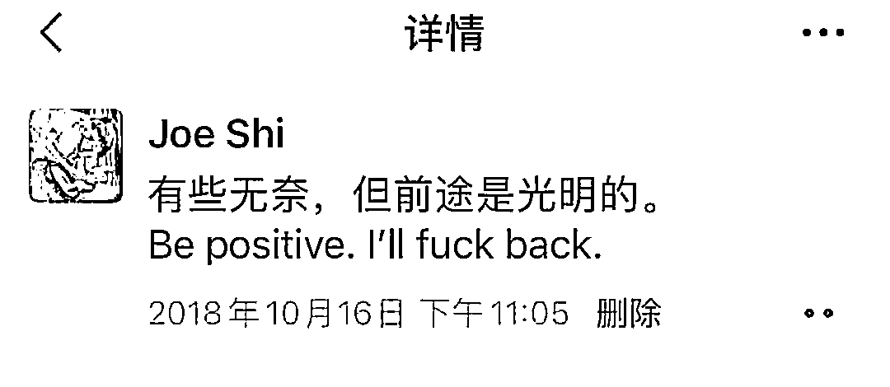
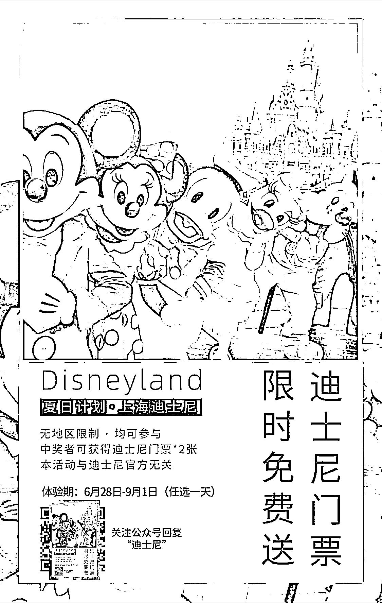

# 十天涨粉十万：零投放裂变拆解

龙哥盟有个固定栏目，每周一请一位圈友来拆自己的赚钱路子。这期嘉宾是 Joe Shi，主营业务是大学生海外游学，线上靠订阅号，线下靠校园团队。他做过一次很猛的社群拉新：没投广告，账号先多了六万多关注；也正因为冲得太快，被封停了。后来他把目标客户的消费心理摸透，用十天时间精准拉来十万关注，之后总盘累计到五十万。今天他聊两块内容：一是怎样把获客成本压到极低，二是旅游行业里还有哪些可做的切口。

## 回国之前：先折腾，再找方向

2017 年 7 月，我结束学业回国。读书时课上有一句话让我印象很深：Why join the navy, if you can be a pirate——大意是，有当海盗的胆量，就别急着去正规军排队。那之后我拉着朋友试过不少项目，学校教授也主动找我参与留学生相关的事情。那阵子没赚到什么钱，但折腾本身很快乐。

墨尔本适合居住，却不适合我当时的创业设想。澳洲总人口两千多万，体量约等于一个上海；软硬件又多跟着美国走，本地创新氛围有限。反观国内，双创火热，身边朋友拿到融资的消息不断，我没怎么犹豫就回来了。

## 抓娃娃机：账算完，念头也放下了

刚回来时我并不知道做什么。有段时间盯上了抓娃娃设备——商场、影院、游乐场里那种机器。它说白了是概率生意，商家能把中奖率调成三十次一抓或一百次一抓，玩家却容易觉得是自己技术好。

我去人民广场蹲过一小时。周末下午两点到三点，单台设备流水约两百元；按每天有效运营十小时、一排六台、工作日打三折估算，这个六台点位一个月流水可到十七万往上。再扣人工六千二、玩偶每个五元、设备每台三千按两年折旧，场地六十一平半但租金未知，粗算月净利接近十万。

数据一出来我就行动了。回国才两周，公司还没注册，我先印名片去谈 KTV 和影院，甚至找到银乐迪杭州总部的一位副总。现在回看，当时确实敢冲。后来我意识到，点位才是核心资产，而且很难复制，于是收手，只当一段有意思的经历。

## 月薪四千五入行，为后面创业铺路

那时我看了《合伙中国人》，节目里一位旅游创业者干了三年，营收做到两千多万，还拿到徐小平、姚劲波的投资。这个数字让我很受触动。我自己也爱旅行，去过三十多个国家，写过专栏，对旅游赛道本来就有期待。

我打开招聘软件，在 BOSS 直聘上找到这家公司，刚好也在上海，就很诚恳地去争取面试。和创始人的谈话细节我记不清了，只记得他问期望薪资，我说没要求；他提议四千五，我答应了。就这样，一个硕士毕业生以每月四千五的工资进了旅游行业。

入职后，我从销售对接客户做起，又去产品端对接供应商，还主动关心新媒体同事的工作，帮着出主意。我很清楚自己不是来混资历的，而是来为日后单干打底，所以尽量往核心岗位靠。完整经历一轮淡季、旺季、再淡季之后，获客、供应链、行业里常见的坑，我基本都摸了一遍。觉得火候到了，我便离开。

## 县级本地号：只合作了两周

2018 年 4 月出来后，我花了几个月找新方向。6 月，我在知乎上因为社工话题认识了一位技术人。他也在上海，当晚我们就约了饭。聊天时他说，自己前东家当年用任务宝工具做裂变，一晚上能涨一万粉，很赚钱。我此前靠内容做了半年，才攒下几千关注，听到这个数字觉得不可思议。

我们一度很投缘，计划做县级城市的本地号，批量复制到一千个县，做成百万级矩阵，再靠广告变现。结果合作两周左右，他因为本职工作退出，事情黄了，关注只停在二十个，哈哈。

## 十万块启动旅游创业，第一次爆量就被封

7 月世界杯期间，我常和朋友看球喝酒。一次局上，新认识的朋友说自己在做大学生国际游学。起初我没太当回事，旅游不是暴利行业，赚辛苦钱的人很多。但几杯下肚，他提到刚提了辆 A6。他才 24 岁，这让我立刻警觉，便用话术套出几个关键信息：大学期间开始创业，三年营收一百八十万，毛利四成，而且是一个人干。

当晚虽然喝了不少，我还是打开电脑研究，结论是：这事我也能做。他主做欧美，我决定避开正面竞争，切东南亚和澳洲。8 月注册公司，9 月正式开干。启动资金十万元，真是一块钱掰成一百块花；办公室那张六人桌，是我在淘宝花七百元买回来，自己搭了一下午。正式员工请不起，就带了四个实习生。

真正开始后，事情反而单纯：把想清楚的事一项项落地，再按反馈调整。6 月攒下的裂变经验，加上第一份工作积累的供应商资源，成了第一次创业的底子。

10 月，我做出一次成功活动。有人可能还记得 2018 年 10 月那波锦鲤推文，当天不花投放费，精准新增六万多关注，我兴奋得睡不着。第二天，🛰️分时段把我六个账号逐一封停清粉，我直接怀疑人生，还发了条朋友圈吐槽。

但营销这件事，只要抓住目标人群的心理，就还有下一次。后来我累计做到五十多万精准关注，其中十多万被平台清掉。说白了，我是把知识付费那套高利润行业的打法，搬到了旅游行业。十万元启动金，实际花到五万时现金流就转正，第五个月回本并盈利；一年多时间里，靠卖旅行产品和广告，赚到人生第一个一百万。直到 2020 年 1 月疫情来袭，境外游业务直接归零。

## 压箱底方法：社群裂变怎么跑

先聊点干货。2019 年底之前，订阅号对普通人来说是很友好的创业平台：只要有人关注，内容总有人看，也总有人愿意付费。早期靠好文章吸粉，后来营销号开始用活动猛拉新。2014、2015 年流行礼品裂变，做法是后台回复关键词，再引导把链接发到朋友圈；2017 年任务宝送书火过一阵，转发宣传图、扫码关注，再邀请三十位好友就能包邮领书。那时泛粉一天涨十万、一个月上百万的传闻都有，🛰️生态被搅乱后自然遭到重锤。2018 年起，社群裂变成了主流，同时还有分销裂变、小程序裂变。

我重点讲社群裂变。我自己设计过一张活动图，十天拉来十万左右一二线城市女性关注；当时这类账号转手能卖十五到二十万，用旅行产品变现则更高。所以这套“财富密码”我没在其他地方拆过，龙哥盟是第一次讲。内容偏干，对🛰️营销没兴趣的朋友可以跳过；文末也会提一些现在还能复用的运营技巧。

做订阅号裂变，目的只有一个：把关注量做起来，让人留在账号里，未来才有可能买产品。所以核心思路始终是：用更低的成本换更多的关注。

完整路径不算短：先在朋友圈看到别人转发的活动图和文案，感兴趣后扫码关注；关注后按自动回复提示回复关键词，弹出群二维码；进群后，机器人每分钟提醒一次，要求先转发活动图才有抽奖资格；转发完，在群里等开奖。

流程之所以绕，是为了避开平台对诱导分享的打击。账号后台自动回复里，“转发”“分享”“朋友圈”都容易被判敏感，所以把强制动作放进🛰️群，与订阅号隔开，降低风险。

环节一多，每一步都会漏人。我把它拆成三块：活动图吸引力、入群路径、转发氛围。

先说活动图。奖品力度上，我测过很多礼品，最有效的是大众认可、价值直观的东西，比如迪士尼门票。它不一定是刚需，但要有面子，让人愿意转；让人转发去领洗衣液，动力很弱，但冰岛极光旅行就很有吸引力。信息量上，要回答参与者心里的疑问：活动是真的吗、之前有人中过吗、现在第几期、中奖后什么时候能去、能领几张。图上的文案，很多是从客服对话里提炼的。比如总有人问不在上海能不能参加，我们后来就加上“不限地区”。美观度上，别硬做原创，创客贴、图怪兽有大量模板。曾有同事花一整天自己画图，效果惨不忍睹。我们也试过反差色：朋友圈是白底，就把图做成黑色；但文字和按钮也是黑色，大家对黑色反而不敏感。真正抓眼的是正红和亮色。

再说入群。原则是别让参与者动脑。路径已经够长，任何细节都可能让人分心。有些账号做活动时太贪，一口气推八个活动，用户手一滑点进新链接，三秒后就忘了原本要干什么，参与热情大打折扣。也别让人等，要高频给关键词提示，比如“点此直接参与”“就差最后一步”“进群即可参与”。分享一组实测：加上“进群即可参与”后，入群率从 25% 提到 50%，相当于翻倍。还有一次做旅行体验官活动，输入法默认打出“体验馆”，我就把后台关键词设成“体验官”“体验馆”“体验关”以及繁体写法等多个版本，无论回哪个词都能触发。几个月后我突然想到，把“体验官”简化成“体验”也不影响目的；改完后入群率从 50% 升到 75%，一个字带来五成提升。文案转化率确实可怕。这里推荐陈勇老师的《超级转化率》。

最后说转发氛围。稀缺性上，用“仅限五个名额”“越早转发中奖率越高”“只剩最后两个名额”这类话，让人产生紧迫感。趋同性上，规则写成“转发后截图发回群内才算有效”；群里如果没有普通参与者晒截图，一个托就能带动三到五个真人跟转。权威性上，写“本次活动由某平台举办，是第八期迪士尼赠票粉丝福利”，平台背书通常比个人送票更可信。这里推荐《影响力》。

## 冷启动：种子用户从哪里来

裂变效率优化到头后，最初的种子用户怎么找？我最早去知乎、贴吧、豆瓣发帖，零散加了约两千人到🛰️个人号。这两千人主要用来测试不同版本的活动图；转发率达到预期后，我再向外买量。

我们做大学生人群，最直接的是校园号投放和线下传单、张贴物。校园号投放大约一元一个阅读，但转化成我们账号关注，单个成本超过三元，太贵，做不了。后来找学生兼职去大学城发传单，设计和流程都很初级，现在看问题不少；花了一千元，最终只增加六十个关注，那个阳光很好的下午，我的笑容直接僵住。

再后来，我通过鉴锋团队认识了@文林，接触到新买量方式：赞助大学生社团的“朋友圈转发”。和社团负责人谈好，让成员统一转发指定内容，就能覆盖整个校园。活动火爆时，甚至有老师联系我们，要求确保安全。之后我不断优化流程，手里积累了两百多个高校社团负责人联系方式，同时细化转发规则、提高负责人积极性，获客成本明显下降。我们还发展出线下校园团队，用梯度返佣激励他们推广产品。

2019 年，广点通转订阅号关注大约六元一个；我们靠活动导流，精准粉最低做到六分钱一个。

到 2020 年，订阅号已不是主流新增渠道，抖音在抢时间，平台规则也更严。但机会仍在。给个思路：球鞋抽奖。关注几个球鞋类账号就能发现，这事还很疯；把活动图换成球鞋奖品，照样能跑。

## 旅游行业里看到的两个百万机会

订阅号说到底是获客入口。再说旅游行业。这个行业很传统，除了携程、飞猪把预订线上化，几乎看不到多少创新。也正因如此，懂互联网的人进来，会有明显的降维优势；但入口缺乏创新，也很难长出新的巨富，一年赚几十万到上百万，过得滋润，这种机会是存在的。

我看到两个方向：一是借 OTA，也就是携程、飞猪、马蜂窝这些平台的低价流量，做亲子、蜜月定制；二是自建阵地，比如网站、订阅号、🧣，做小众高利润产品，如滑雪、军事、野外等。

先补点行业常识。旅游范围很广，酒店、用车、旅游用品店都算，这里主要说旅行社业务，因为它最轻，主要投入人力，适合普通人。

盈利方式：整合或采购酒店、用车、导游、门票等资源，打包卖给消费者，赚差价。获客要么在 OTA 接单，相当于在淘宝开店；要么自建渠道，做订阅号、网站、🧣、抖音等。资质方面，境内旅行社保证金二十万，出境社一百四十万；出境社要求境内社满三年后才能申请，也可以通过挂靠解决，出境社挂靠年费一到三万。供应链可以自己组合特色线路，比如加特色餐或小众景点，也可以直接采购地接社现成线路；参加行业展会，或找当地旅游局推荐地接社，通常就能对接。

在 OTA 里搜西藏，旅行团同质化严重，只能拼价格，很难做出溢价。但有个低价流量入口被忽略了：定制旅行。它的本质是让旅行规划师做一条专属路线，体验更深、更友好。客群主要是带父母出游、亲子游、蜜月游。以携程定制系统为例，用户发布“欧洲十日游”需求后，两天内会有三到五位规划师联系，沟通方案后导入🛰️转化。定制客群收入高，商务舱、包车比例不低，毛利可做到四成以上。我认识一个同行，话术很强，招十个人做短期培训，专在携程、马蜂窝接东南亚亲子团和蜜月定制，月净利二十万以上。

去年我姨妈来家里玩，聊起她从巴厘岛回来，在途牛选了定制游，对那位规划师赞不绝口，说安排周到，下次还找他。我出于职业习惯问了行程和价格：七天四星酒店含早不含餐、经济舱，一人一万二，共十二人。我算了算成本，大约七千到八千一人，只好用僵硬的笑容说：“玩得开心就好，旅游最重要的就是开心，钱不钱的不重要。”

自建平台的关键是产品差异化，最好在 OTA 上找不到同类。比如面向年轻人的跟团游、军事野外生存、海钓、滑雪，甚至猎艳团。最终成交大多在🛰️端，因为个人号朋友圈更容易建立信任，订阅号专业内容做辅助，官网则作为搜索流量的背书。

分享一个我工作时操盘过的东南亚豪华别墅预订项目。背景是亲子游通常五到十二人，度假别墅有私人泳池和客厅，正好补上酒店客房分散、没有公共空间的短板，对高预算客户很有吸引力。普吉岛三卧别墅旺季能到五千到一万一晚，所以最低客单也在两万以上；含机票平均客单十万到十五万，我经手的最高一单超过一百万。获客上，早期吃订阅号红利，用优质旅行内容触达精准人群；后来增长乏力，转去📕，借女性对网红打卡的兴趣继续做内容获客，同时在携程定制入口导流到🛰️，再慢慢培养转化。供应链靠实地考察和业内交流，还有些更直接的方式，略敏感，可以私聊。利润方面，毛利百分之十五到二十；因为客单价高，十万的单子毛利也有一万五起，机票毛利低一些。衍生业务包括高端酒店预订，比如马尔代夫一晚两万的索尼娃贾妮，以及商务机预订；曾接过一家六口国庆假期预算一百万的单。

今年疫情让境外游直接归零。需求还在，只等疫苗普及和行业恢复。今年我也在测试新项目：学习、测试、反馈、优化、拿结果、赚钱，这个过程最让我享受。感谢龙哥盟的朋友们一起分享，一起共勉。

