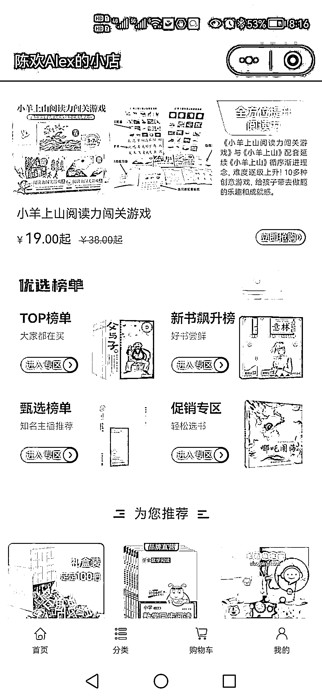
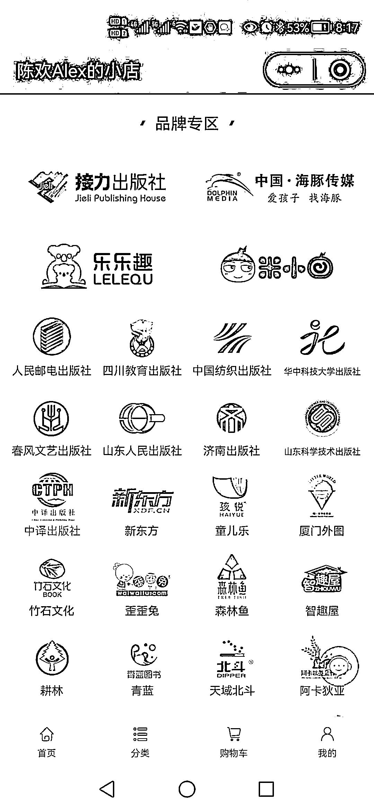
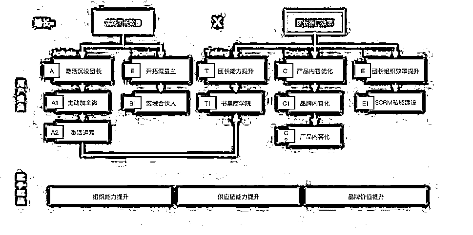
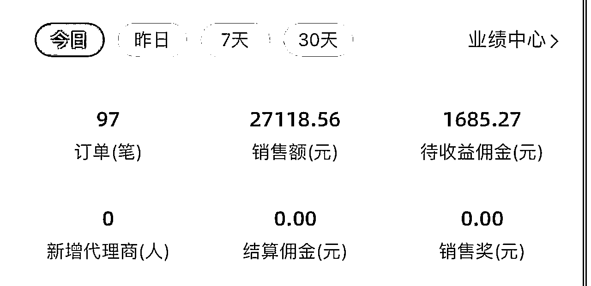
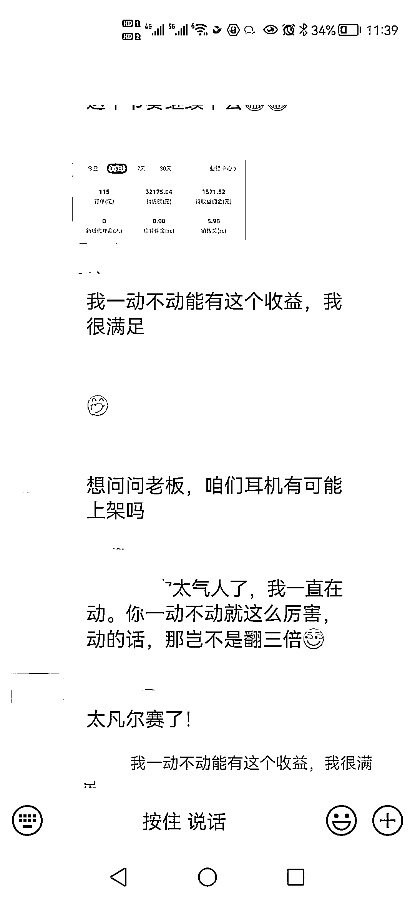
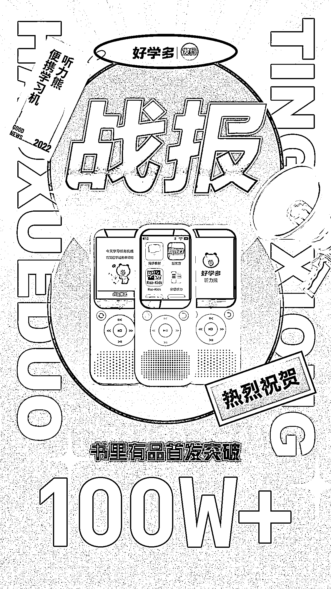
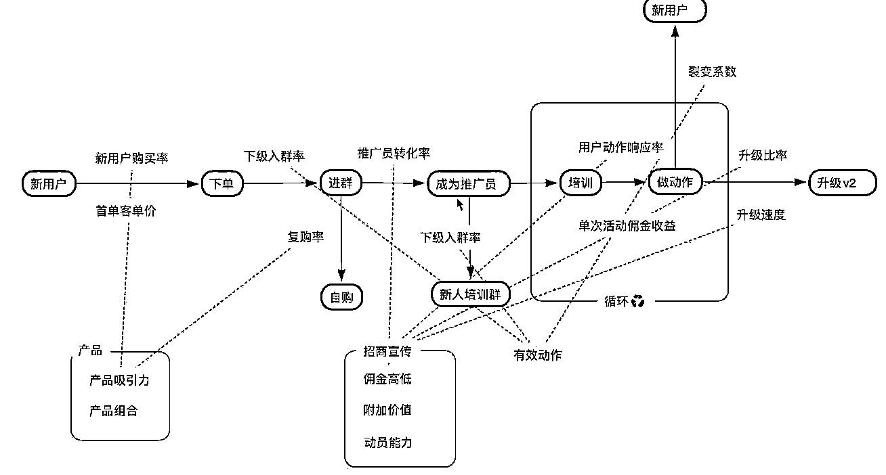

# 撬动80万宝妈卖童书：2年做到行业头部的社群分销复盘

宝妈向的生意，一直是很多商家眼里绕不开的肥肉。社群分销看起来增长很快，但真做起来又重又复杂。圈子里很少人愿意公开聊这套玩法：跑得快的顶级玩家都在闷声赚钱，像蜂享家那样百亿GMV的体量，压根没有分享的动力；小团队呢，很多模式不够规范，也不敢出来讲。所以我自己当初研究的时候，能从外面找到的实操内容少得可怜。加上眼下大家的目光都盯着短视频和直播，社群分销节奏平稳，关注度自然不高。

龙哥盟的朋友们好，我是陈欢，书里有品联合创始人，做商业顾问14年，写过《新零售进化论》。

书里有品是童书社群分销平台，2020年4月上线，首月没花一分钱投放，就涌进来10万宝妈和老师做分销员。目前我们已经是行业头部，积累了80多万阅读推广人，200多家出版社入驻直发，销售额做到了1.5亿，还拿了4轮融资，背后有掌阅集团这些图书产业链上下游的股东。今年开始，我们也在向蜂享家、万物心选、云货优选、喜马拉雅供货。

接下来我会把整套方法摊开来讲：从零预算单月拉来10万分销员，到30人团队带着80多万宝妈卖书，再到两年冲到行业头部，每一步踩过的坑和验证过的打法都分享出来，希望对你有所启发。

这篇内容可能对三类人有点用处，你可以对照看看：

第一类，做女性或宝妈生意的人。这类生意基本离不开社群，那宝妈业务具体怎么设计和组织？

第二类，手里有私域流量的人。怎么给现有生意接上社群分销这个杠杆，从自己卖变成大家一起卖，快速放大？

第三类，有优质货源的人。以什么样的姿势进入社群分销生态，才能比同行飞得更快？

说句实话，社群分销这条路上我们也踩过大坑，交了几百上千万的学费，最凶险的时候差点全军覆没。以前看过一些分享，嘴上说得天花乱坠，逻辑也很顺，真去执行才发现完全无效，甚至埋着雷。所以我的观点和主流说法可能不太一样，你自己批判着看。这些只是个人经验，不接受理论上的抬杠。另外，今天这些成绩主要靠合伙人靠谱、团队给力，我只是作为代表发言。

为了方便阅读，先放个目录：

**1**、冷启动怎么做：零预算，一个月进来**10**万分销员

**2**、社群分销的核心设计：增长公式

**3**、分销员和团长去哪儿找？

**4**、团长的积极性怎么调动？

**5**、快速增长期要抓住什么？

**6**、你的业务怎么嫁接社群分销？

*名词解释

分销员：把分销当副业来做的用户；

团长：组织分销活动的团队负责人，分销员做到一定业绩后可以升级为团长。

**一、冷启动怎么做：零预算，一个月进来10万分销员**

书里有品是2020年4月上线的，恰好赶上疫情。当时公司只有4个全职员工、两位合伙人，一个在图书行业摸爬滚打多年，手里有供应链资源，另一个来自阿里，做过多年电商运营。

起步阶段，我们找到了一些性价比很突出的图书货源，靠着有赞平台自带的分销体系，4个人先发朋友圈，很快就有几个专做图书的群主跟着发。不到一个月，10万分销员就进来了，那时候真是人人都是分销员。

这就是社群分销的特点：只要打通一两个关键节点，很容易产生指数级裂变。

疫情期间，大量线下绘本馆没生意，老板正发愁怎么养员工，突然发现可以在线上卖书，毫不犹豫就加入了，这也成了我们的第一批优质用户。

后来复盘发现，这10万人里大多数没做过其他分销副业，属于儿童教育圈里的意见领袖。比如南京有一位很有名的作文老师，他发了一条朋友圈，后面就带来了上万个用户。

回头看，社群分销冷启动有几条关键经验：

**1.1 社群分销最核心的不是运营，而是产品，是供应链的强度和差异化**

冷启动阶段一定要挑标品。大家冲着性价比进来，优惠明明白白摆在那儿，不需要多解释。如果你选的是要花力气教育客户的高客单价产品，分销这把火很难烧起来。我们选了儿童图书这个赛道，有一定差异化，也没有巨头压着。

试想一下，如果卖的是百货、水果这类东西，市面上已经有大量平台，用户来了也只管买，根本不愿意加入做推广。

**1.2 做社交形象加分的产品，让推广员发朋友圈、私聊都没有心理负担**

发圈动力约等于佣金除以社交压力。社群分销主要靠推广员发朋友圈、发群、私聊，所以一定要挖掘产品的社交货币价值。发朋友圈推荐好书，立起来的是爱阅读、爱学习、爱教育的好妈妈人设，价值观正向，大家当然愿意刷屏。如果你的产品是服装、美妆、食品这些品类，也可以试着从健康生活方式的角度去挖，别硬邦邦地只发产品。

**1.3 初始流量不需要多大，关键是找到核心人群的传播节点**

很多人都以为社群分销得先有大量私域流量。其实最重要的，是找到几个意见领袖当传播节点。我们试过把同一套模式复制给其他有私域流量的社群，效果差别很大。有的社群人数很多，但全是普通消费者，只有购买行为，没有裂变；有的社群虽然不大，但能筛出意见领袖，裂变效果反而很好。

**二、社群分销怎么设计：一条核心增长公式**

**2.1 收入增长=供应链强度×顶层设计×动员能力**

供应链强度，就是产品有没有优势。标准品看价格是不是更低，非标准品看发圈转化率，也就是同样发一条朋友圈，有多少人看完愿意下单。顶层设计，包括关系怎么绑定、商品销售流程怎么走、佣金怎么分、分销员怎么升级。动员能力，就是你对分销员团队的影响力，比如在群里发一条消息，有多少人真的会行动。

下面我用书里有品的案例具体拆开讲。

**2.2 供应链强度**

供应链强度没什么好说的，就是个先有鸡还是先有蛋的问题。销售能力不够强，供应商就不愿意给低价；拿不到低价，又吸引不了分销员。

那怎么办呢？我们的做法是集中所有力量打爆品，拿成绩向供应链证明实力。比如前期假设一个月能卖100万，如果摊到100个单品上，一个品只能卖1万，供应商根本不在乎。但如果你把其中80万的销量集中到8个产品上，一个品就能卖10万，总销售额没变，供应商却马上愿意给更好的价格政策。所以，所有人都需要做爆品。

怎么找出爆品？这需要你对行业和用户有深度洞察。如果是复杂品，就要会讲故事，比如课程、保健品、名气不大的美妆个护。这个故事通常不需要分销平台来讲，但你要能判断消费者买不买账。比如冬奥会之前，我们卖过一套冬奥主题收藏邮票，故事特别应景，销量不错，算是押中了爆品。

如果是简单品，就是消费者一眼能看懂的超高性价比产品，比如15元的积木对标市面上49元的同类产品，心理价差越大越容易爆。我们还会给大团长提供低价买样、免费送样的机会，先看看反馈。更省事的方法，是把市面上已经爆过一次的产品，第一时间谈回来做，效果非常好，但这要靠平台销量和实力才能拿到好价格。

**2.3 顶层设计**

**1**）关系确认机制

关系是分销的地基。一般都会设计成：一旦绑定就永久绑定，而且不能解绑，这样分销员才有动力去拓展客户。绑定有两种形式：一种点击绑定，另一种购买绑定。我们更推荐购买绑定，更公平。技术上已经可以做到：用户最后一次点击谁的链接下单，就绑定谁，以后不管隔多久、在哪儿下单，都算这个人的。为了防止有人滥用绑定机制，我们平台最便宜的产品也在9块9以上，避免推广员用超低价产品批量去绑客户。

**2**）商品销售机制

一件代发，卖一件就结一件佣金，所有售后问题平台统一解决。

**3**）佣金分配机制

想走分销模式，产品利润至少要25%以上。国内法律不允许超过三级分销，所以只有一级佣金和二级佣金。一级佣金是推广员直接销售的佣金，二级佣金是运营管理团队的佣金。一般一级要比二级高，另外还要留一部分营销费用。我们自己用的比例大概是一级佣金：二级佣金：营销费用=5:3:2。对比市面上其他社群分销平台，佣金比例也都差不多，说明这个结构相对平衡、比较健康。

底层的设计逻辑是这样的：一级佣金高，普通分销员卖货意愿很强，但很难吸引大团长；二级佣金高，团长特别愿意招商、扩团队，但普通分销员带货的劲头会弱。也有一些平台故意把一级佣金压低，逼着分销员升级团长，具体看平台处在什么阶段。通常来说，调高二级佣金，招商裂变跑得快；调高一级佣金，平台发展走得稳。

除了给一级、二级佣金和平台自身留下利润，还要单独划出一块营销费用，用来推爆品、做额外激励。这些激励最好是一次性的，不跟关系绑定，可以用奖品、积分这些形式。

**4**）升级机制

普通消费者在什么条件下能升级成分销员？我们设计的机制是：自购满99元才能升级，而且不能自动升，必须主动申请开通。背后的考虑有两点：一是满99元能拉高新用户的ARPU值；二是主动申请这一步抬高了推广员身份的门槛，得到的身份更不容易，大家会更珍惜。

**5**）提现完税

佣金按月提现，平台要负责完税。这里有个小细节：不要从分销员到手的佣金里扣税，一定要先扣税，再结算佣金。分销员特别反感到手钱还要被打折，哪怕只少1%，也会很不爽。所以我们在算佣金的时候，就已经把税务成本提前预留出来了。

**6**）开店礼包

平台为了方便推广员招商，会把一系列产品打包成开店礼包，买了之后可以直接升级为推广员。开店礼包要特别谨慎。有些平台为了提高利润率和招商动力，把礼包价格定得虚高，结果业务空心化，所有人都在卖开店礼包，等于卖空气币，平台很快就会崩掉。

**7**）其他很重要的机制

1. 复杂的佣金机制尽量别碰，容易踩线，别人也听不懂。如果激励不够，统统用营销活动去补。

2. 顶层设计一定要想清楚，定了以后中途千万别改，一旦改动，推广员的信心就动摇了。

**2.4 动员能力**

可以看下面这张图，具体内容后面展开。

（模式参考图，实际操作需定制）

**三、分销员和团长去哪儿找？**

**3.1 总体思路**

流量池本身是一个个私域小水洼，分销要做的就是把水洼连起来，百川汇海。不要妄想从零开始培养团长，我们试过，效率实在太低。我们尝试过各种培训方式，最后发现，没有社群分销经验的普通推广员，成长为优质团长的比例非常低。大部分优秀团长都有两年以上的社群运营和分销经验。

要做好团长画像。比如我们书里有品的团长画像，基本就是读书教育类的群主、教培机构的老师、做过其他消费品社群团购或社区分销业务的团长。大团长们通常活跃在各个学习类社群里，让合伙人亲自下场找人、多做分享，很容易碰到。

团长都在一个社交圈子里，彼此渗透，一起物色好项目。只要产品有优势、顶层设计合理，几个团长就能撑起整条业务线。去年我们有一条产品线，前期只私聊了4个团长，一个月就裂变了几千人，卖出大几百万。

**3.2 怎么吸引优质团长？**

**1**）躺赚机制

鼓励普通分销员去帮平台找大团长。团长完成指定的销售业绩后，给一次性奖励。分销员只需要拉个群、做个联络，平台会派专人负责讲解和转化。

**2**）平移机制

手里有资源的团队长，只要满足一定条件，可以直接提交团队信息，平台在后台配置好，整个团队直接平移过来。

**3.3 怎么说服团长加入？**

要抓住团长最关心的几个问题：

①产品是否正规，比如我们的书是不是正版；

②产品有没有优势，比如书的价格有没有竞争力；

③到底挣不挣钱，最好直接告诉她，和她类似规模的团长现在月收入多少；

④麻不麻烦，所有团长都想要躺赚，要告诉她：素材有人准备，新人有人培训，售后客服不用管；

⑤会不会跟自己的主业冲突。我们鼓励团长把图书当成引流品、增值业务。如果你的产品能成为所有其他平台团长的辅助产品线，推广效率会非常高。

**四、团长积极性怎么调动？**

这一点上我们走了不少弯路。

我们一开始以为：第一，要给团长大力赋能，降低他们运营社群的难度；第二，要靠培训提升团队凝聚力，用丰富的活动提供附加价值。因为书的佣金相比其他赛道不算高，就想用额外价值把人留住。

所以2020到2021年，我们一边扩充社群运营团队，一边做了大量阅读专业类的培训。结果呢？增长反而放缓，数据开始下滑。

后来认真做了一次复盘：

**1.** 不要“赋能”太过。团长运营只需要抓好头部就够了。

团长的心态其实很矛盾：一方面保护自己的资源，不希望平台企业🛰️去加人；另一方面又确实忙不过来，希望平台能进社群帮着运营。后来我们拉了各种大小的团长群、团队群，配了很多社群运营岗，运营压力很大，但收效甚微。

**2.** 团长的注意力是有限的，所有消耗团长注意力的活动都不要组织。

很多活动的初衷是提供附加价值、提升认同感，最后却是大家注意力被分散，搞不好把带货组织变成了学习组织。我们做过读书会，反馈很好，但太占精力。后来吸取教训，改成每周五组织直播连线作者，既能推广新书，又能帮推广员发展新用户，还省时间。

**3.** 顶住团长的压力，不要盲目增加SKU。

团长经常抱怨产品不够丰富，其实真正的原因是产品不够挣钱。我们听到最多的抱怨就是“有些书没有，所以招不来客户”，于是平台就上架更多书，结果书越多，销售越差。平台主要靠爆品盈利，严格服从二八定律，20%的产品贡献80%的利润。产品一多，优势就不明显，大家各自为政，形不成声浪，转化自然差。因为赚不到钱，又错误归因成书不够多。

后来我们调整成“爆品+长尾”模式，从每天推四五个品，改成一个爆品连续推几天，转化率大幅提升，一个品就能带来过百万销售额。团长一天躺赚一千多，动力满满，自然愿意跟着平台干。

**五、快速增长期要抓住什么？**

如果供应链给力、顶层设计也合理，分销业务就会进入快速增长期。这种时候要重点关注几件事：

**1.** 动力是没法靠培训提升的。

打鸡血长期看没有效果。真正有效的是扶持致富典型，让一部分团长先富起来。基础的新人培训肯定要有，比如做知识库、定期开培训课。但再往上走，培训的作用就不大了，经常沟通反而更重要。在沟通中去介绍先进典型、分享打法，提升每个团队的战斗力。

对团长来说，最大的激励永远是爆品带来的佣金反馈。

**2.** 只抓大团长。

把核心大团长拉进一个群，老板亲自带着推爆品、晒收入，效果最好。

为什么不花精力管理普通分销员呢？很多人都会疑惑：平台不是应该多花时间推动分销员成长成团长吗？是的，我们一开始也这么想。但经过一两年的试错之后发现，平台花大量精力去管理运营普通分销员、期待他们变成团长，效果很不理想，原因有三：

1）团长最清楚自己团队里谁有潜力。团长自己有动力，自然会带核心骨干成长。

2）平台如果亲自下场做分销员成长活动，大团长反而会躺平，适得其反。

3）投产比不高。平台把精力放在中台和激励机制上，多和大团长互动，反而四两拨千斤。

**3.** 机构也要做分销，机构流量是一片隐藏的蓝海。

有一次偶然的机会，一个拥有千万级用户体量的大👸号找过来，希望用图书引流，然后把👸号用户加到企业🛰️，最终销售他们自己的课程。我们双方一起设计引流方案，跑通运营SOP，后来这个👸号每个月能走一百多万的货。

如果你的产品也能通过分销起到引流作用，👸号会是很好的流量池。

再后来，我们的思路就更打开了：直接把供应链提供给其他分销平台，赚供应链服务的钱。当分销帮你把市场打开之后，供应链才是真正的核心竞争力。目前我们已经在和蜂享家、万物心选、云货优选这些百亿体量的社交电商平台合作，供应链收入快赶上甚至超过分销业务了。

**六、你的业务怎么嫁接社群分销？**

如果你的客户是宝妈，也想采用分销模式，一定要把分销设计成一种副业身份，而不是一个简单的行为。要有一个完整的概念，比如我们说的是“开一个线上书店”，而不是“卖某本书能挣多少钱”。只有变成副业身份，才能规模化招商；偶尔为之的行为，形成不了自组织。

尽量把产品设计成百搭副业，让那些正在做其他副业的团长，顺手把你的产品加进来当成补充产品线。比如很多主做课程、美妆个护分销的团长，就喜欢拿我们的图书做补充线，既能引流，又能活跃社群。

如果你本身有很好的私域流量基础，先做好产品规划和顶层设计，然后通过推文或者直播发布团长招募信息，把有分销经验的团长筛出来。接着发动团长对外招商，介绍别的团长、拓展团队，自然流量进来的小团长就交给有经验的大团长去带，算是额外福利。这样你不用投入太多人力物力，就能把原来的中心化流量转成网格化流量。

如果你是供应商，手里有优质货源，在理解以上分销知识的基础上，积极去接触大团长，通过他们找到平台，选利润率在25%以上、销量转化没问题的少量爆品合作。最近我们刚把一款学习机在两天内卖了100万。

另外还有一个小诀窍，特别好用。

分销平台的团长大多是女性，品牌方创始人或者老板娘如果亲自下场，自己也成为团长，跟其他团长打成一片、搞好关系，团长甚至会主动要求平台上架你的产品。

不知不觉写了6000字，还有一些细节没法展开，最后补一张用户体验流程图和核心指标。

第一次在赚钱发文，感谢大家的点赞鼓励，希望这篇文章对你有启发。

评论区：

付小鱼：怎么做图书分销？

陈欢：私信我

赚钱纪检委：高质量

争游：悦拜App看看有没有合作机会，加我vx 6242122

陈欢：好的

阿Lin：有收获，谢谢分享

龙哥：感谢分享，已加精华。

欧爸：怎么联系？私聊你也没回