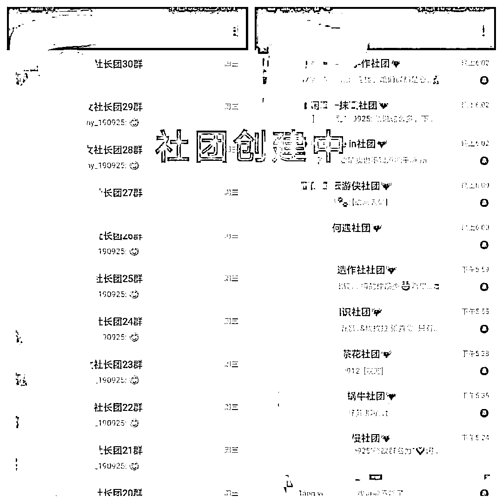
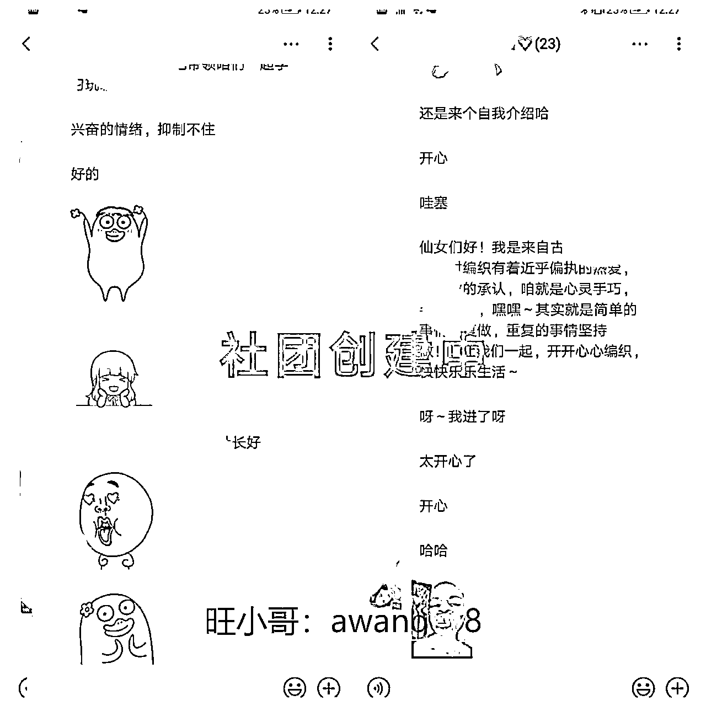
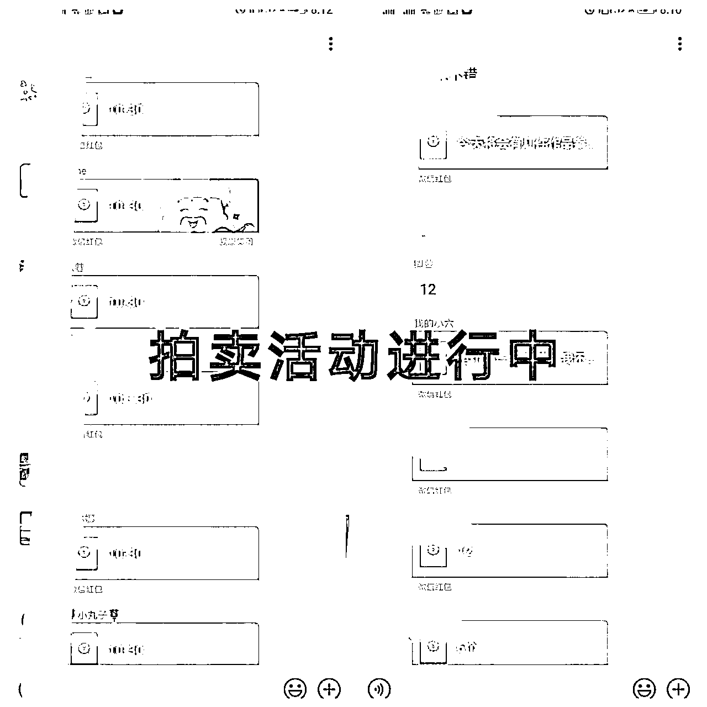
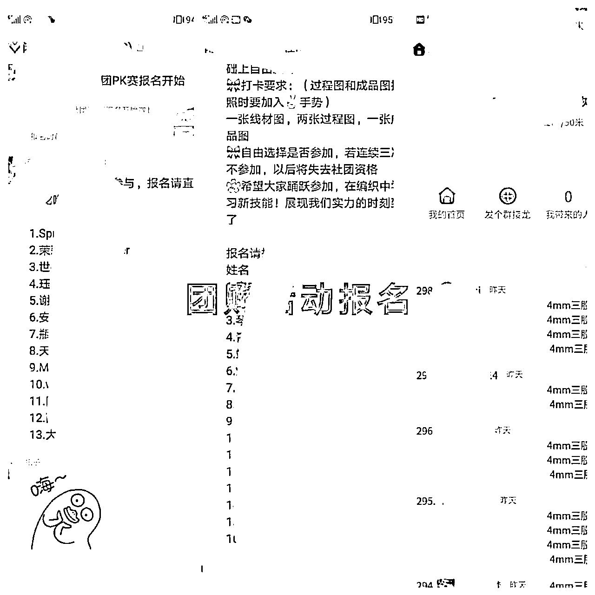
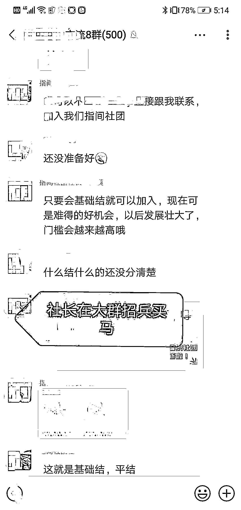
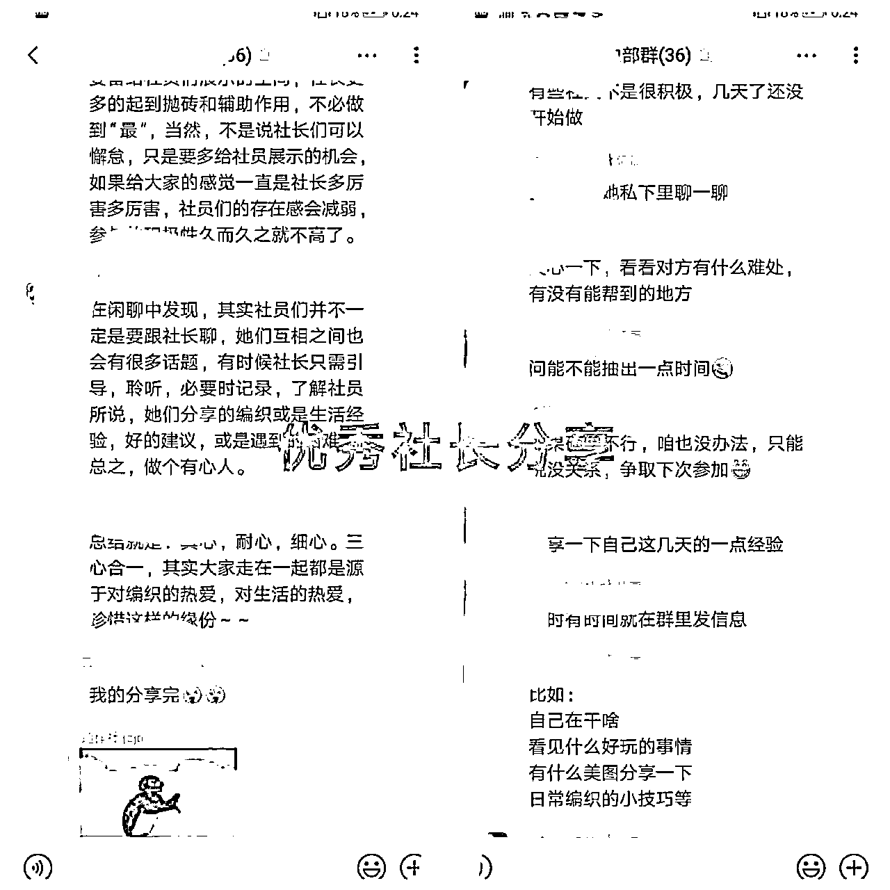

# 少人团队批量开营，转化率破四成的实操拆解

先抛结果：线上操盘手只有两位，三十余个群放在同一节奏里开营，面对上万名粉丝，成交比例能长期守在四成以上。

这不是理论推演，而是我给一家编织线材企业落地过的社群方案。前不久在广州和朋友聊 TikTok，话题拐到社群运营，我讲了点搭建思路，大家怂恿我写成文章；又赶上生财在做训练营，不少圈友把训练营搬进自己的项目，于是有了这篇拆解。

不少公司手上有粉，也试过做社群，最后被累跑了：两三个员工忙不过来，效果却不明显，于是得出“社群没用”的结论，把粉丝晾在一边。我的解法一直没变：不把粉丝只当被服务对象，把管理权分出去，用奖励和晋级机制让粉丝为自己、也为自己的小群出力，总部只带头部骨干。

## 案例底子

这家企业卖编织线材，目标人群是爱手工编织的年轻女性。靠包裹里的卡片，沉淀了几万名同好。一年前他们建过十个满员 500 人的群做日常维护，后来群冷下去，广告也钻了出来。

## 体系怎么搭

**价值观：** 先让同好有目标。我们把“编织不只是消遣，也能做成事业”反复讲。平台不做旁观者，而是她们提升技法、学习管理的必经站。

**团队：** 上万粉丝，能抽出来做社群的只有两位兼职同事，硬带不现实。于是按活跃度与消费额挑出 30 位社长，逐个沟通，让她们定社团名、介绍和口号，官方帮建群。先在大群发通知预热，再让社长用自我介绍和作品展示去激活老群，招 30 名种子成员；随后教她们去抖音、豆瓣等外部平台拉新。用群接龙卡时间，48 小时内完成。之后社长在各自社团迎新，讲理念和活动安排。

**活动：** 分大活动、小活动和福利活动。社员按官方规则在同一时段做作品、打卡；结束算积分，积分前三的社团拿奖励，其余社团得线材折扣。小活动和冲分活动 7 天，大活动 15 到 25 天，中间歇 3 到 7 天，让大家缓口气、互相鼓劲。还会办拍卖，帮社员把作品卖出去，先让一小部分人尝到变现甜头，后面才有人愿意持续跟。

**转化：** 参加活动不收费，但线材必须用官方品牌，打卡时亮出材料，发现不是就请出社团。于是每轮活动前都会出现购线小高峰。活动正式开始前两天做阶梯团购，人数越多单价越低。第一轮团购时社团 732 人，成交 298 人，卖出 1325 卷，转化 40.7%，人均 124.5 元。平时团购备货不够，社团成员可在店铺享 95 折，这个折扣大群没有。原先一周优惠券大约用 20 张；社团启动后，人数约 800 时，一周领 199 份、用 131 张，使用率 65.83%，累计支付 797。小群训练营对成交的拉动很直观。

**进阶：** 社长和社员都得有持续动力。我们做积分：社员若连续三次缺席活动，会被移出；每参加一次按规则得分，个人积分到 29 可申请当社长，另开社团。社长团队积分未满 299 前没有销售分成，相当于考察期；满 299 后拿 10% 的社团销售分成。中间安排冲分活动，官方降低得分难度，时间短但能快速补分，让落后社长也有机会拿到分成。

**日常：** 老群不是弃子。社团启动后，大群反而活了：社长去大群露脸、招人，社员也替社长展示社团；官方早晚发知识点，社团成员会接话。人手还是那两位，没有因为活多而加人。

## 跑起来后的三次修正

**奖励：** 最初从全员里评 16 枚奖章（最佳社长、最佳作品、勤劳付出）加 3 个证书和其他奖励。后来发现有人在小组内很拼，放到大盘里不显眼，几次陪跑会泄气。第二阶段给每位社长一个获奖名额，由她从本组挑一人发“优秀社员章”，积极性被拉回来。

**排名：** 早期公开分数和名次，靠前的开心，中间的暗使劲，靠后的失落，风险不小。后来不公开分数，只公布前三名，其余都叫潜力社团，不披露具体位次，大家都有冲上去的希望。

**分成：** 稳定跑了三个月后遇到转折，我们没敢按原计划猛扩，而是转稳。有社长想单飞，也有社长因收益少而灰心，这类训练营很难完全避免。想单干的，给一次性 75 折批发价，现有社团归她运营，其他资源不得冲突性占用；能力不足而灰心的，可与其他社团合并，分成自行商量，活动仍跟着官方节奏走。

## 十个月后留下的六条经验

- 大群冷了先别散。只要能让小部分人重新动起来，老群有机会被盘活。案例中的群沉寂一年多，靠社长带动又转起来。
- 小群的存在感更强。同一个人在 500 人群里是五百分之一，在 30 人群里是三十分之一，感受完全不同。若项目能设计参与环节，不妨建小群。
- PK 类训练营的奖励要同时照顾团队和个人，比如让群主指定本组获奖者。
- 仪式感要抠细节。启动时群主每句话、每个动作都提前推敲，像新老师进班：自我介绍、带大家认识、发福利、讲规划、提士气。活动中给优秀成员做海报、发大徽章、寄证书，荣誉感和归属感会更强。
- 运营能力不够就多放权。让粉丝参与管理，除了讲梦想，还要给即时反馈。拍卖就是让帮忙的人在没分成前先赚到一笔，开心了才愿意继续。
- 管多个群主时，定期请优秀群主分享心得和技巧，这种分享最接地气，也最能带动人。

这套体系去年 9 月上线，到分享时已跑 10 个月，整体还稳。官方只盯核心社长，社长跟官方做活动、拿团购分成；现在社长们都有分成权限且赚到了钱，也开始照官方教的方法去抖音、豆瓣等平台给自己的社团引流。

作者旺小哥，过去一年帮企业做社群策划与指导。社群搭建、运营上有疑问，欢迎加微信 awangev8，备注“生财有术”，能答尽答。若转载，请提前说一声，感谢。

