# 带娃做团购：40人小群做到120万年流水

口述：泳怡｜2021.6.15

先自报家门，我叫泳怡，94年生，眼下主业是带娃。今天把我的经历摊开讲讲：一个对互联网几乎空白的人，怎样从零搭起一个妈妈好物团购群，一年做出120万流水；还卖出过1台保时捷、2台奔驰，每月收入五位数，并沉淀了几百位深圳本地有房有车、消费力在线的宝妈。起群、破局、瓶颈、客户关系，我都会说。

在旭教练、老K、文林等龙珠前辈打气下，我把这一年梳理成复盘。

目录：

一、从零把群开起来

二、爆品怎么打

三、我的变现方式

四、卡住我的瓶颈

五、差异化的做法

六、加入赚钱后的变化

七、以后想做的事

开场先交代一下我是谁：

2019年末生娃后，我丢了工作节奏，也几乎断了社交，产后抑郁缠了四个多月，整个人被消极情绪裹着。到第五个月，我咬牙想：得做点自己的小事业。

若你想看“素人一个月赚几十万”的爽文，这里没有。认真做满一年，我每月大概1.5万到2万元，约等于经理层工资。可对一位时间被孩子切碎、能力还在长的人来说，能在新行业里做到经济上站住脚，我已觉得不易。

先讲履历。早期我在五八到家深圳分公司做市场经理，干地推：跑小区、看人流、找位置摆摊，第一个星期就成了销冠，日单量五十多。

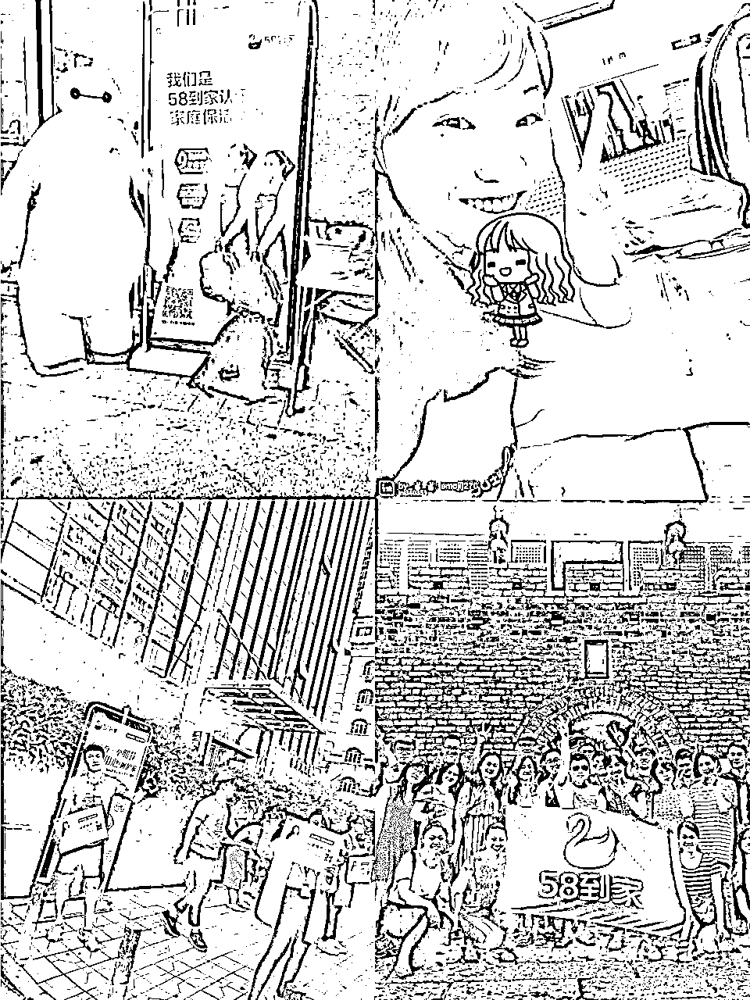

这段经历算是我第一次和互联网行业发生连接。

后来去文化公司做商业活动策划、演出统筹，最大操盘过四万人的商演；写方案、盯现场、讲标、和供应商压价、做导演，还得求公安同志多批些观众。强度大到吓人，但至今仍是我最怀念的岗位。

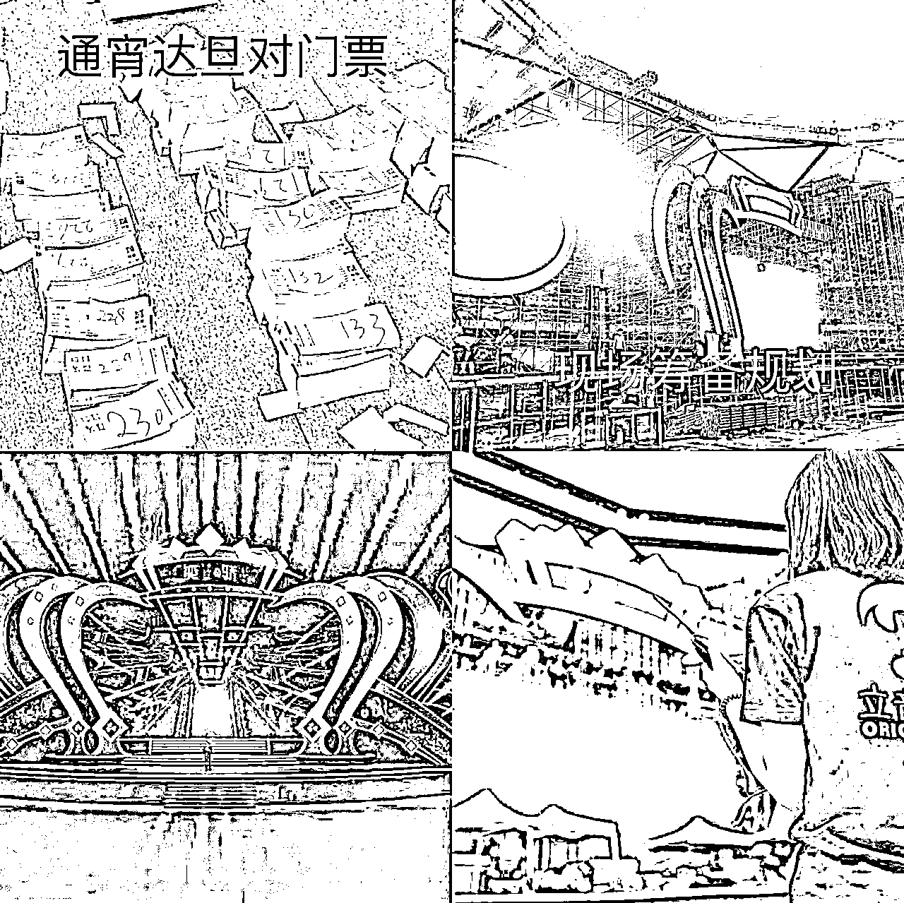

这两段经历，给我如今的小生意铺了底：敢跟陌生人开口、待人亲和、对事情负责，都是那时候练的。可女生绕不开婚育，为了身体，我递了辞呈，身份变成妈妈。

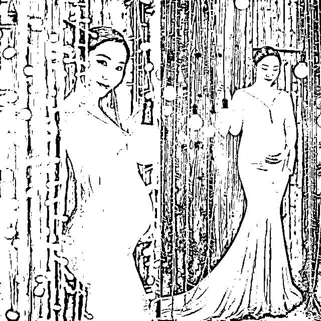

孩子五个月时，我把对微商的成见放下，迈出社群团购第一步。

成绩先摆：一年流水突破120万；群友从40位种子用户长到约800人；规模不算大，复购却很猛，累计下单超过16000次。

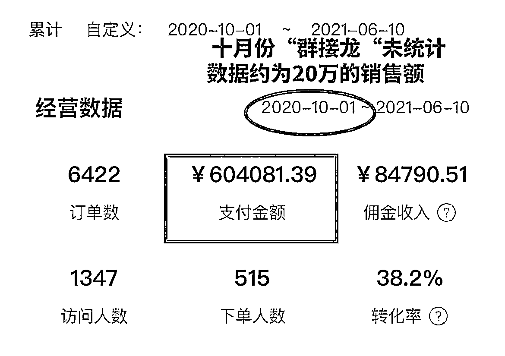

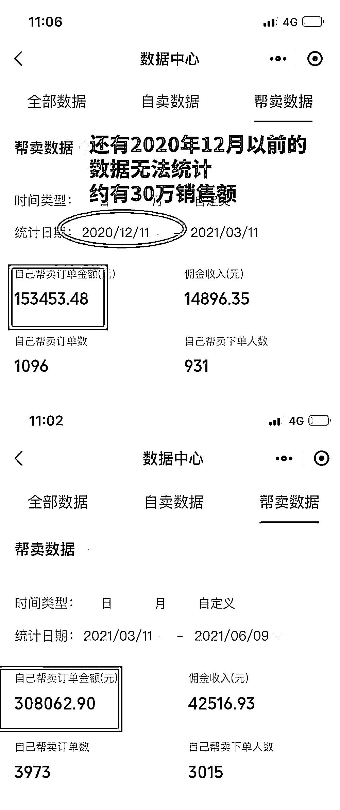

两张截图是不同小程序后台相加，另有早期数据后台抓不到，总计约120万。方法如下，愿能帮到想靠双手挣出经济自主的宝妈。

一、从零把群开起来

第一步不是拉人，而是把🛰️通讯录当矿场：从A翻到Z，按目标客户画像逐个标记潜在买家。能凑出40位以上，这个群就有开的底气。

我那时想做妈妈好物推荐群，自家给宝宝选的又多在中高价品牌，客单不低。于是我仔细挑出近40位初始客户，基本是认知高、舍得花的妈妈。人从哪来？怀孕时报了孕妇学院，练瑜伽，年卡6000到2万元；学院有妈妈会员群，门槛筛出的人自然优质。孕期、产后我常和她们聊天（那会儿还没创业念头），处出一批投缘朋友，后来全成了第一批顾客。一年下来，线上聊到线下，很多人已是好友。

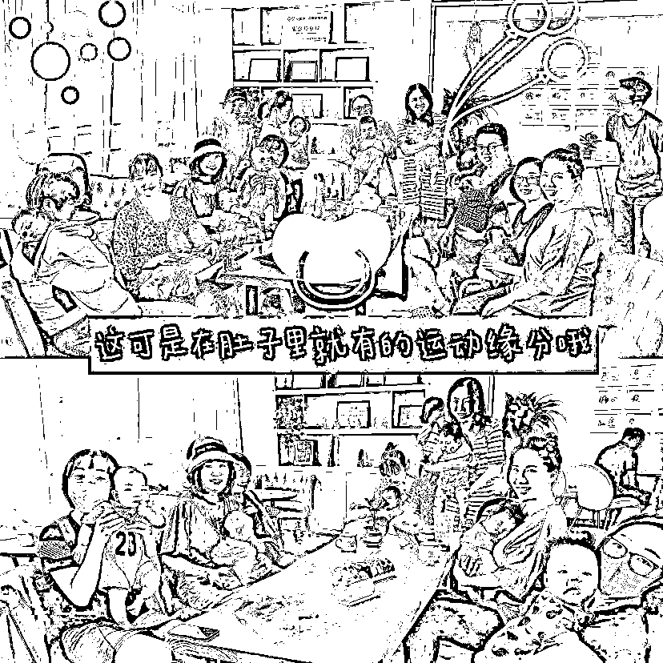

若种子不够，就去借圈子。母婴方向可混产检医院孕妇群、小区宝妈群、闲置群，或客单高的孕产产品用户群。找不到入口，去淘宝搜与你定位相符的产品客户群。比如Nestdesign睡袋均价约300元，在睡袋里算贵：

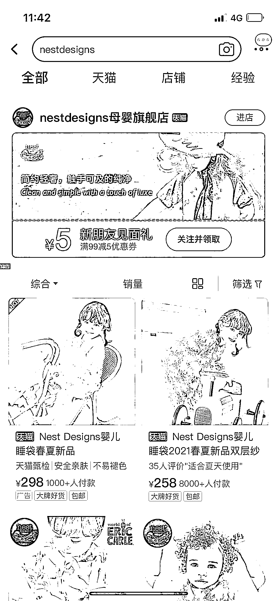

它和我的客户很对味。我买产品后，通过包裹里的引流卡进了品牌用户🛰️群，观察一阵发现大家消费层级接近，画像很准。我在群里适度冒泡、搭话、混脸熟，再找机会加好友，也攒了一波外地客户。闲鱼也能找人，但我没亲自跑通，这里不展开。

再讲个强同行：深圳私立孕产医院美中宜和，生娃收费约8万到10万。那位同行在院里社群里认识不少家境好的妈妈，除母婴外还卖高客单珠宝，转化很好。

我的群开头只有40人，每月却能贡献近2000元利润，互动热到每天消息999+。可见客户准不准是命门。刚起群时我贪人数，盲目拉来一批“僵尸粉”，后来全清掉，白耗不少精力。现在我的判断是：一个对味用户，抵得上二十个泛粉，后续价值无法估量。

二、爆品怎么打

群开起来后，我急着找突破口：怎样把优质妈妈群里的精准用户引过来，还给彼此一个自然加🛰️的理由？

契机是一床很漂亮的婴儿被。有位妈妈晒图，大家都说好看，却嫌贵。我在阿里找到代工厂渠道，买回样品比对，手感和质量很接近，价格能省100多。

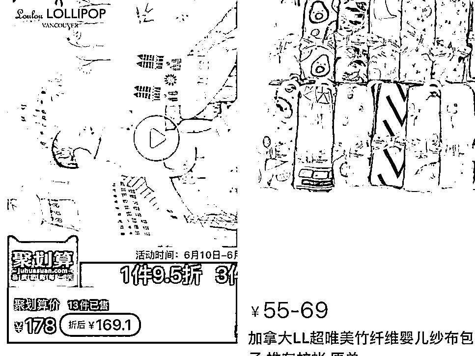

我立刻给宝宝拍照，发到几个关系好的群里，顺手透底：价格只有旗舰店三分之一。询问瞬间爆了。我趁势做团购福利，但必须加我🛰️下单，一晚上新增近60位精准客户。

还有个细节：当时谈的批量价是50元一床，后来厂家愿每床再让2元，我把差价逐一退给已下单客户，并说明团购福利不能多赚大家一分。钱不多，好感却加了分。首批收货后，又带来20多位转介绍精准用户。其中一位妈妈当时是高危孕妇，因卖被子聊出交情，我陪她度过待产、生产、产后，直到宝宝一岁，我们成了闺蜜，事业上也有合作。一床被子，牵出一段缘分。

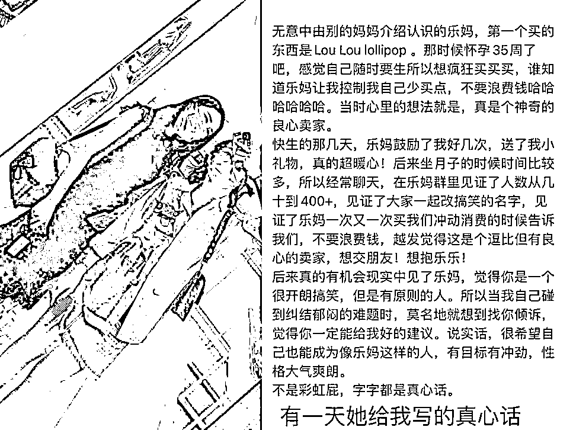

这款被子陪着那批老客户的孩子长大，快一年半了，仍有人持续回购。后来我一次买下许多，送给生二胎的客户当礼物，口碑很稳。

第二款爆品隔了一个月出现。我买了张可折叠便携餐椅，出门方便，吃饭时随手发朋友圈，十几条留言追问品牌和购买渠道。我马上找渠道商拿最低价：淘宝280多元，我们拿货158元。我把淘宝价、同行社群售价摆出来，做了比同行再低5元的福利团，只给我群内客户，并请几位熟妈妈帮忙扩散。一些原本观望、不肯进群的人，听说有群内福利价，也陆续进来了；从其他精准群又引来30多人。身边同行不少，瑜伽学院也有几位妈妈做同类，但我的起量更快，这两款爆品确实把用户底盘垫稳了。

三、我的变现方式

群运作后，抽奖、红包这些常规动作都上，加上群里有一批KOC特别能聊、会热场。这里要划重点：KOC是社群的灵魂人物，每天能抛出有趣话题。刚起步你可以自己顶这个角色，但久了像单口相声；最好去挖能聊的用户，或请亲友帮忙当气氛组。新群一定先把热度托起来，信任才立得住，否则很快沉寂。

有了精准用户和自带笑点的KOC，我的群前期跑得不错，每月靠老客转介绍都能进新人。我一人身兼数职：用群接龙小程序挑团品、写图文链接、在群里讲商品，更多时间陪大家唠家常；同时经营朋友圈，还得照顾宝宝。忙，但能扛。

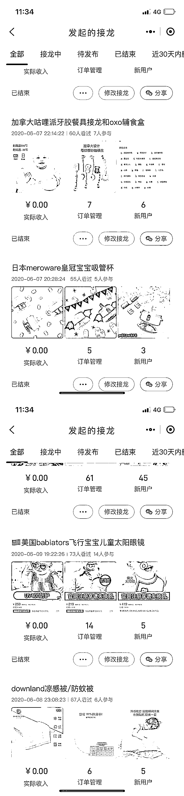

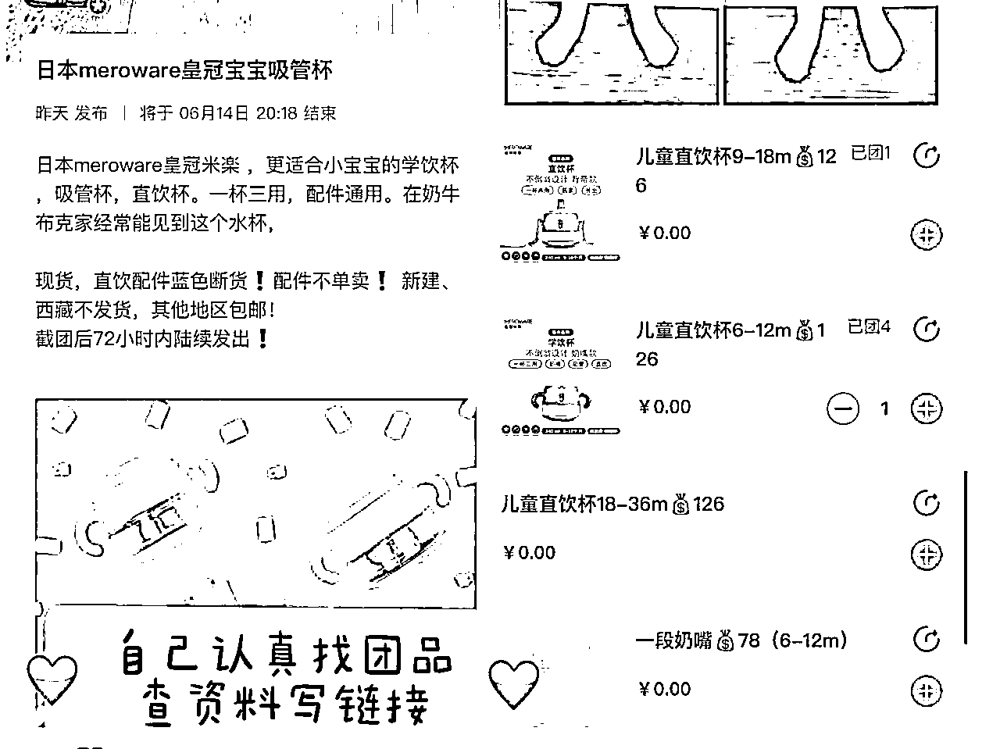 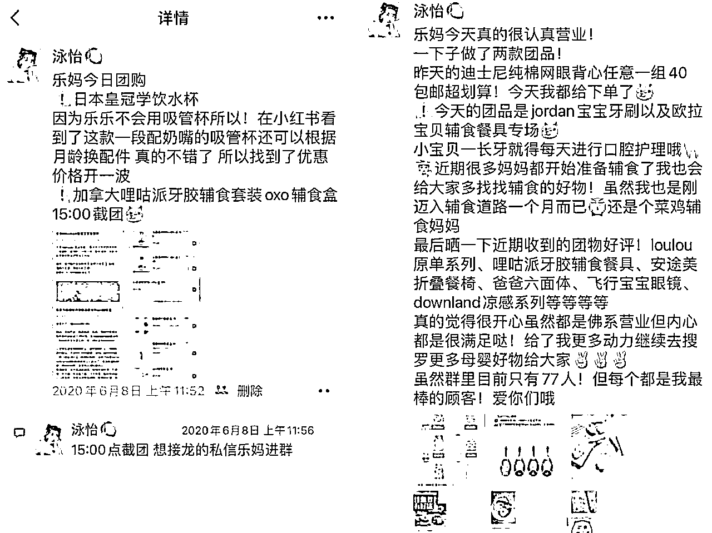

（小程序收入显示0，是平台提现要扣1%手续费；为省成本，我让客户私信下单，也多出互动机会。）

两个月后，群接龙和快团团上线“一键帮卖”：供货商把图文链接做好，我们一键转发成自己的主页；群内有人买，就能拿对方设好的佣金，供货商在后台接单发货，客户收货且无售后，这单即完成。

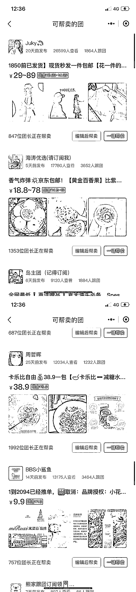

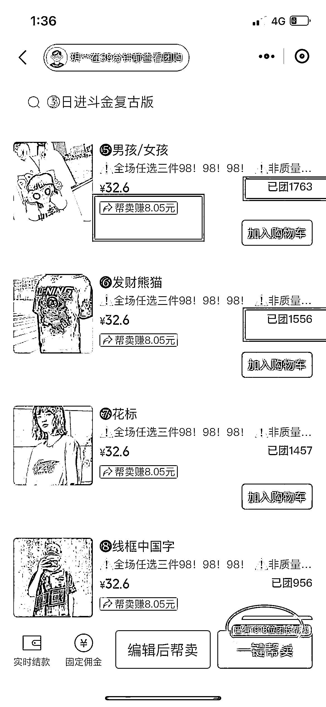

我付出的主要是时间：答售前、跟售后、安抚客户。碰到质量差且供货商不退款，为保信誉，我只能自己贴钱替客户解决。坑不少，但总体好操作。这个模式大幅省时提效：我每天能上约30款团品；当时做的人不多，我吃信息差，加上价格确实实惠，日营业额约3000元，现在稳定5000元以上，遇爆品可破万。团品多为生活用品，客单不高，利润约8%到10%。最初月赚3000多，对刚上手的小白我已满足；何况我是带娃妈妈，用手机就能操作，时间匹配。后期用户增多，月收益也往上走。

再说另一条路：上面我是“帮卖团长”，靠转发赚佣金；去年我也试水“供货商”。数据显示，一个衣服团能有近2000人帮卖，一款T恤卖出1500多件；快团团头部供货团长每月发佣金可超百万。去年8月，我和两位妈妈合伙做供货品牌“卡乐园”，主卖复刻版小众国外童装，供给许多手握母婴群的团长。我们定位垂直，聚焦童装服饰。一年吸引500多位团长，流水近150万，发出佣金超50万。货源来自自联工厂、1688，以及每年跑几个大型母婴展对接品牌资源。若你有靠谱低价供应链（快团团竞争很凶，不少供应链自己下场，价格必须低），或有独家好货、靠谱团队能把选品文案售后做好，可以试这条路，再找官方助推，销量有机会起来。

深耕群接龙、快团团一年，我清楚感到消费习惯在变：越来越多人在团长经营下不再只依赖淘宝京东，而是出于信任，直接在私域下单。

补一句：团品眼花缭乱，我开始筛选，不刷屏；每周固定分析哪类产品好卖、浏览量高，收集客户近期集中需求。夏天防蚊水、防蚊裤走俏，冬天宝宝睡袋、护肤霜需求上来。我盯每笔订单，记客户喜好；客户要的暂时没货就后台登记，到货第一时间私信，成交率不低。一年下来，我有了选品思维，学会站用户角度想什么图文能戳痛点，再升级到用不同维度拆母婴品牌和短期爆品。做团购竟练出品牌思维，算意外收获；这块日后单独写，此处不展开。

四、卡住我的瓶颈

做了一阵，越来越多人涌进团购，毕竟门槛低：开群、发团、点几下，佣金到手。好几个客户来问能否把我的资源分享给她们；可一旦分享，她带来的客户也可能不再属于我。同行变多，客户分散消费；我一人带娃又要处理售后，精力有限，回复慢一点，客户就转去别家，营业额下滑；群消息太吵，一些不熟的客户开始退群……

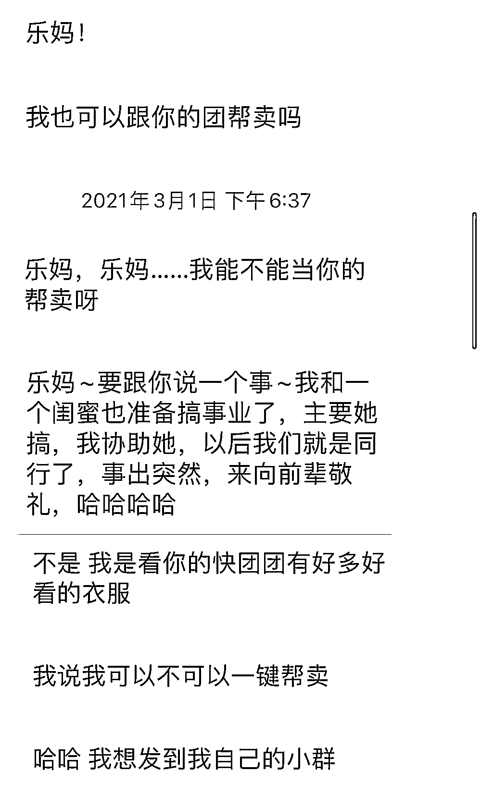

那阵我反复复盘，情绪也低：为什么老客户突然去了隔壁？我该不该变？可经验太少，全靠自己摸，一时无解。我需要一个突破口。正好看到一门社群运营付费课，抱着死马当活马医的心态去听，结果被一句话点醒：

“你得给群友提供真正有用的价值，这才是她们愿意长期留下的原因。”

我一下明白：此前我只做卖货群+聊天群，忽略了自己能提供的价值。起初大家觉得这里能省钱、能遇到聊得来的人；时间一长，同类群泛滥，我的群就没有不可替代性。

恰好在抖音刷到凯格尔五分钟练习视频，很适合产后女性修复。我灵机一动，找打卡小程序，邀群友每天五分钟打卡，坚持30天奖50元现金红包。没想到近30位群友响应——她们本就需要运动，也需要人监督。

我每天定点提醒参与者，借提醒加了不少“在群里但没加🛰️”的客户；提醒完再找话题私聊，问近况，拉近了和陌生客户的距离，收到很多正向反馈。她们说，这个活动让自己直接受益，也觉得我正能量。我因此看到希望。这个看似简单的公益活动，成了社群转折点。

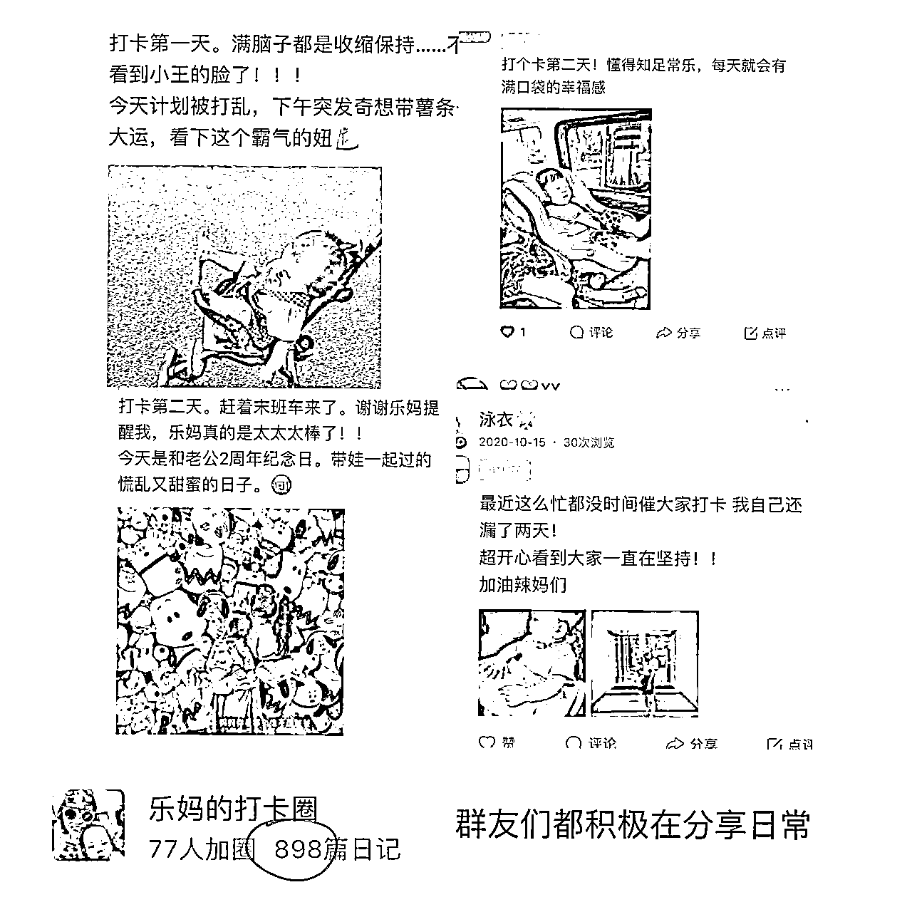

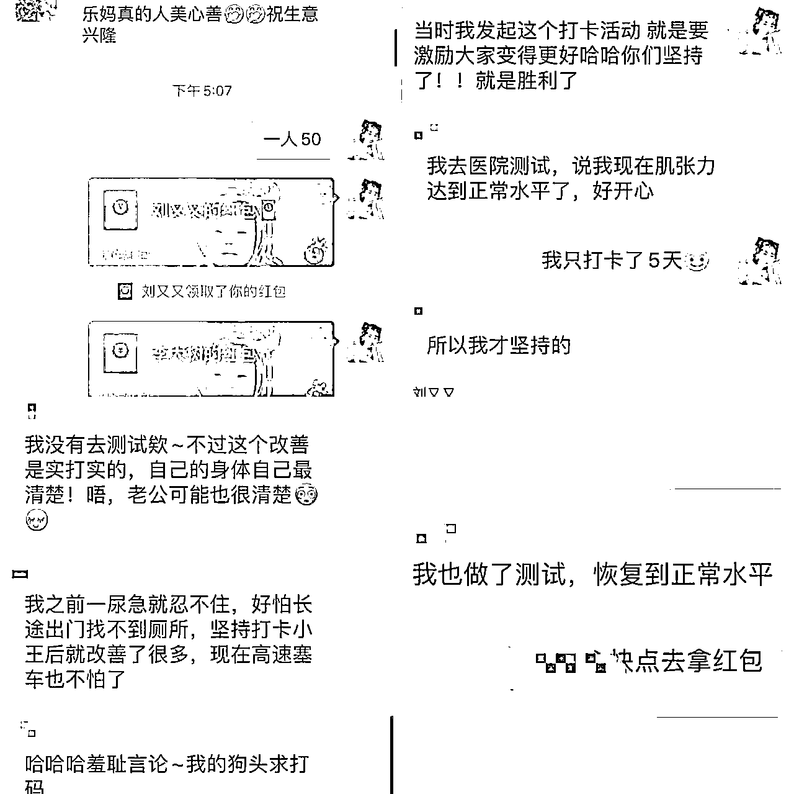 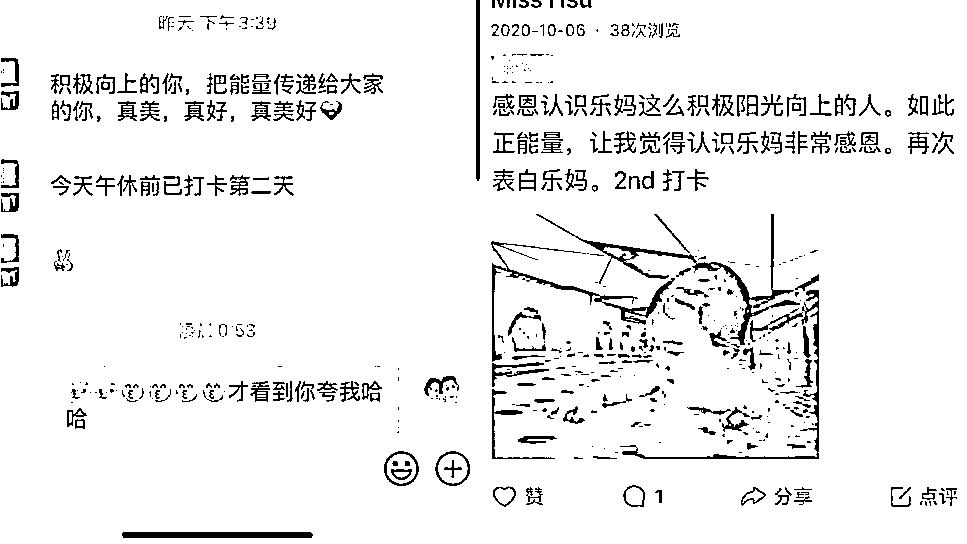

打卡从2020年10月延续至今，仍有妈妈在坚持；不少人身体和心情都好了起来。

我思路打开，开始做各种活动：挑几款慈善品，抢购后把营业额全捐给轻松筹；选一本好书办共读营；请育儿专家进群开讲座；最近还玩相亲角，帮客户的优质弟弟妹妹牵线。同时办线下聚会，把群里活跃的、私下聊得来的客户约出来见面。我话多、亲和力足，每次聚会都热闹；群友经我介绍互相认识，也成了朋友。我越来越信：做一个积极的人，你的光和磁场真能影响别人。

这段时间我发现，社群和个人IP是同步的。如今谁手机里没几十个群？要让用户留下、甚至置顶，除了利益，还得看你的群是否真实可靠、是否有温度、是否互助，以及你本人是否真诚有趣。做IP同理，要在用户心里留下属于你或社群的标签；真诚利他，才留得住人心。

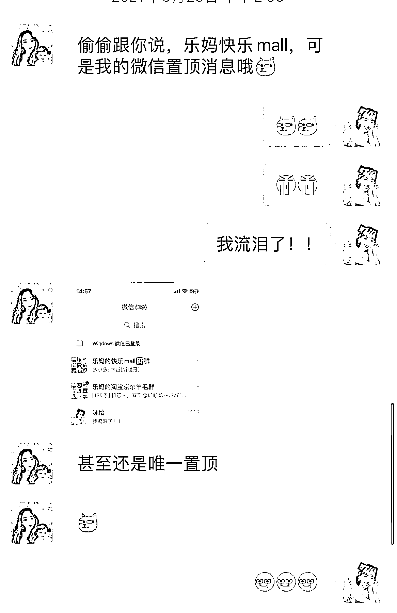

最让我感动的是，这一年除了钱和经验，我还收获一群真心相交的客户：有人开车二十几公里跨深圳来喝下午茶；有人从惠州赶来送工作室开业红包；有人和老公吵架来找我喝酒；有人为聚会特意空出周末；我们还办过27个宝宝的联合生日会。这份情谊，我很珍惜。

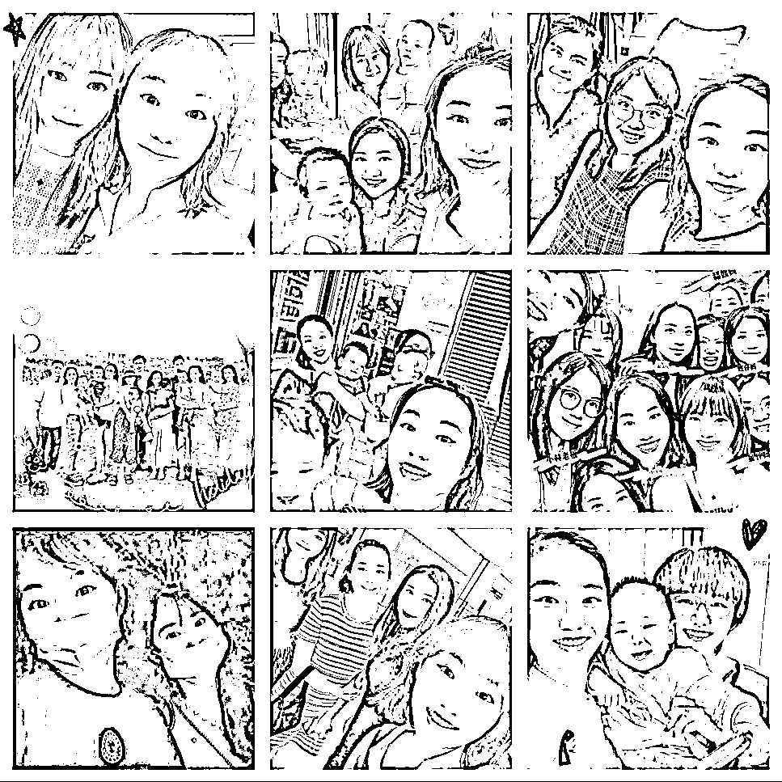

（篇幅有限，只放9张合照；我和客户的好玩故事，以后再写专题。）

群数据也慢慢回升。

五、差异化的做法

我最早想到的差异化就是服务。同行多、资源也不算强，价格战之外只能拼服务。于是我打出“售后无忧”：合理范围内，售后我都替客户解决好；消费多的VIP，哪怕自己亏，也要让她买得舒心。我要做得比淘宝七天无理由更让人放心，让她们一买东西就想到我，慢慢改变消费习惯。

第二点核心是“认真做事，真诚待人”。从建群起，我就把功利心放最后。最初只是想通过社群打开社交窗口，走出产后抑郁；所以群里除了定点卖货，主要分享我和儿子的搞笑日常，以及自己觉得好用的产品。利润上我比较佛系，常在群里喊“哪里便宜去哪买”，淘宝京东618划算就让大家去那买，同行更便宜我也不强留；但在我这成交的，出问题我第一时间处理。供应商不靠谱时，我还会送宝宝小礼物补偿客户。客户从半信半疑到变成粉丝，定点看我的视频号、👸号，朋友圈第一个点赞——这是用心换来的。后来我办“真心话红包”活动，很多客户觉得我真实、不做作，不把钱挂嘴边，不强买强卖，所以愿意一直信我。

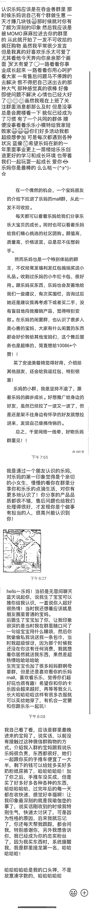

六、加入赚钱后的变化

这部分篇幅有限，这次先不铺开，之后有机会再单独聊。

七、以后想做的事

关于未来，我会另写一篇，先留个念想。

客户维护是我这次复盘里最想摊开细聊的部分。

1 每一次跟客户打交道，不管是售前咨询还是售后跟踪，我都会顺手点开对方的朋友圈，看看她最近分享了什么、喜欢什么、去了哪里，再借机找话题聊。我的共情力比较强，如果她最近状态低落，我也会主动说几句安慰的话。基本上，每个能和客户私下多聊一会儿的机会我都不会放过。

（但这不是硬凑话题，我也没多强的目的性，更多时候是真心觉得当妈的太难了，想用自己身上那点阳光让她们稍微松口气。）

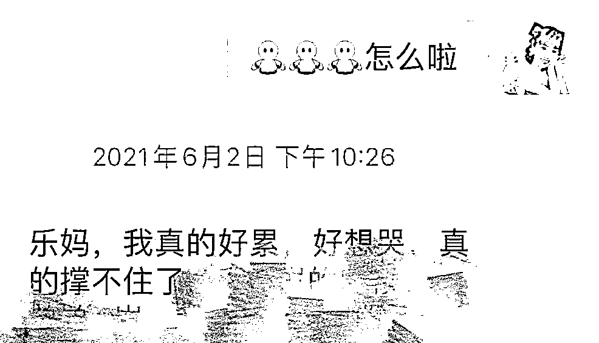 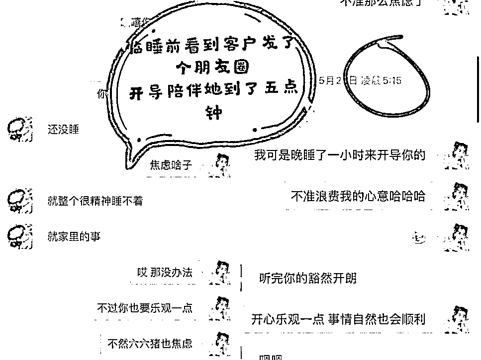

这位客户特地从惠州开车过来，就为了给我送开业红包。真心这东西是会回头的，你给出去了，别人也会捧着真心还给你。

2 我给客户朋友圈点赞留言的频率很高。妈妈们最喜欢晒自己的美图和孩子的日常，我基本都会在底下夸上几句：“宝宝也太萌了吧！”“这颜值哪里像当妈的人！”被夸总是开心的，一来二去大家对我的好感度就上来了。而且我们共同的朋友刷到这些互动，也会顺带记住我这个人。

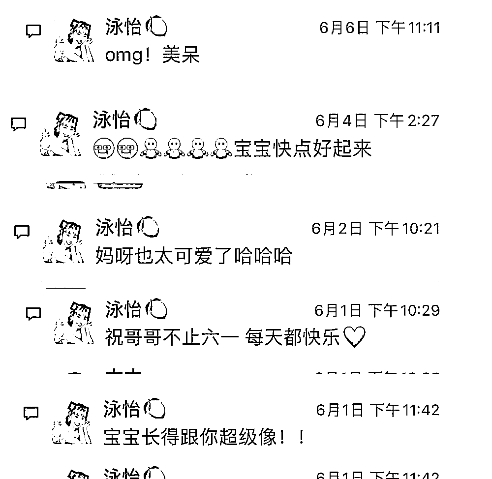

3 客户发的每一条朋友圈我都会认认真真看，不光记长相，还会从穿搭里猜她的性格，娃的名字、性别、长什么样也都默默记着。那些下单大方、消费力强的客户，我会更上心。我自己将心比心过：如果有人能脱口叫出我和孩子的名字，我会觉得被认真对待了，那种体验真的很好。我也很喜欢给客户塞惊喜。印象很深的是，一位VIP发了条动态说想要一个和她女儿一样萌的吸管瓶，我转头就在淘宝上找了款差不多的直接寄到她家。后来她说，她老公看到都酸了。

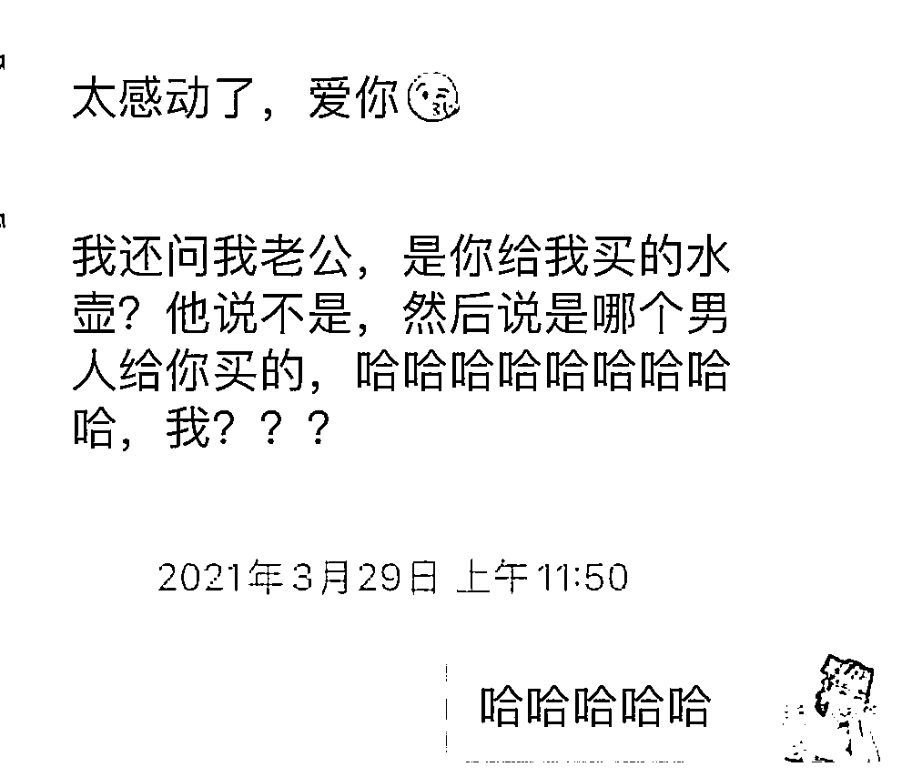

4 各种有仪式感的日子我统统放在心上：春节、母亲节、端午、中秋，尤其是VIP客户的生日和宝宝的生日，私信祝福加红包是标配。宝宝生日我习惯发两个红包：一个88元给孩子，一个52元给妈妈，红包上会写着“妈妈辛苦了”。毕竟这天既是宝宝的出生日，也是妈妈的受难日，可大家往往只顾着给孩子庆生，把妈妈晾在了一边。

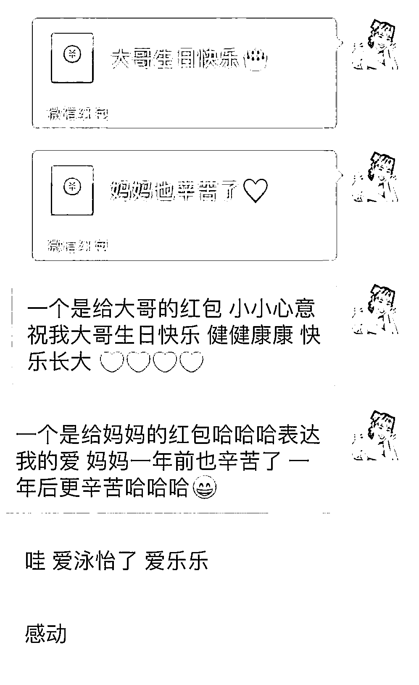

前两天正好有个小例子。一个关系特别好的客户过生日，我刷到朋友圈，当场给她点了一份麦当劳全家桶。她收到就猜到是我送的，还说刚好跟老公正愁没夜宵，这外卖来得太及时了。

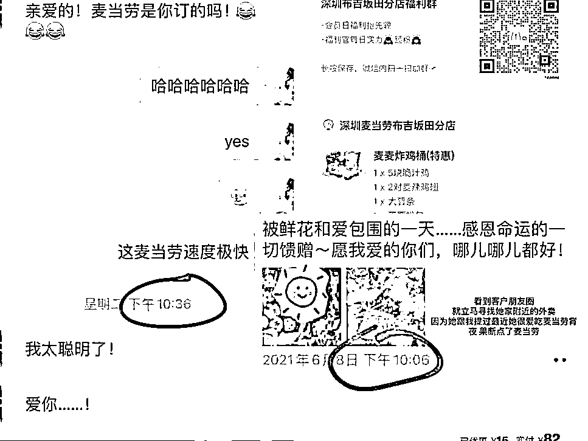

这件事让我下决心把服务流程标准化。我做了表格，把客户和宝宝的资料全部登记好，确保生日礼物能提前或当天送到，让惊喜更到位。我也参考了老纪说的VIP权益，按消费金额把客户划成金卡和银卡，不同等级配不同福利；同时又借鉴了京东PLUS和淘宝88VIP的思路，比如每月免费退货券、专属生日礼物和红包、每月两杯喜茶、影视会员这些，全是实打实能用上的东西。

去年年底，我悄悄给消费前五名的VIP送了五份娇兰镜面新年口红礼盒，单价600元，总额3000元。消费排在六到十名的客户，也都收到了人均150元以上的年货礼包，每份都附上了我手写的感谢信。

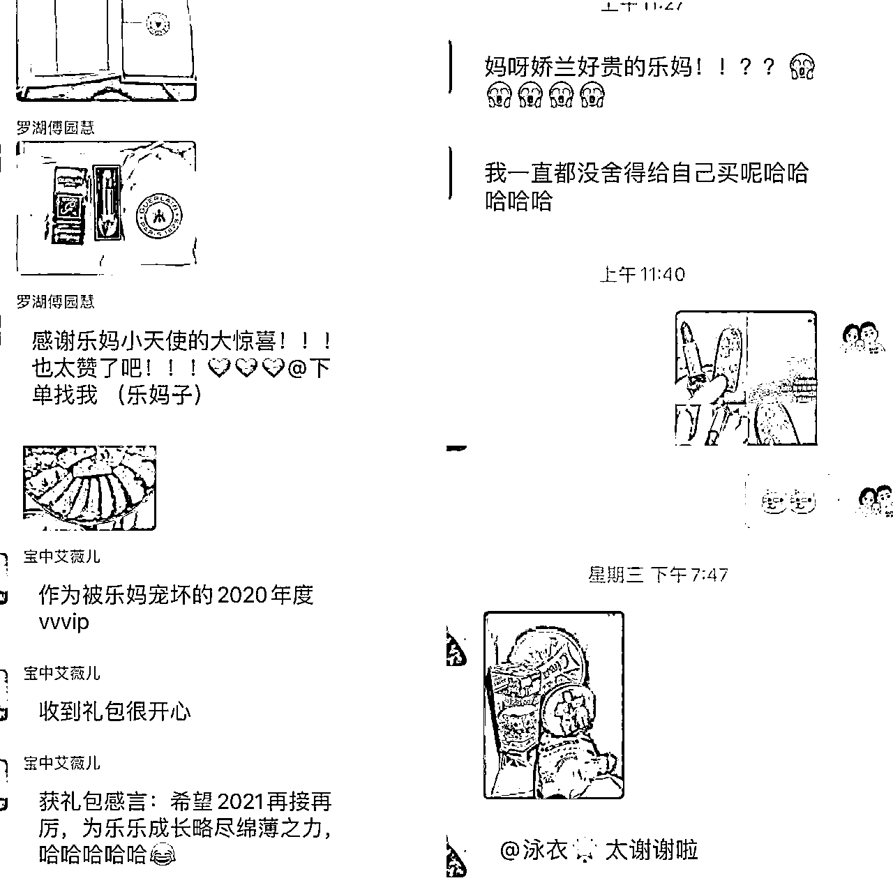

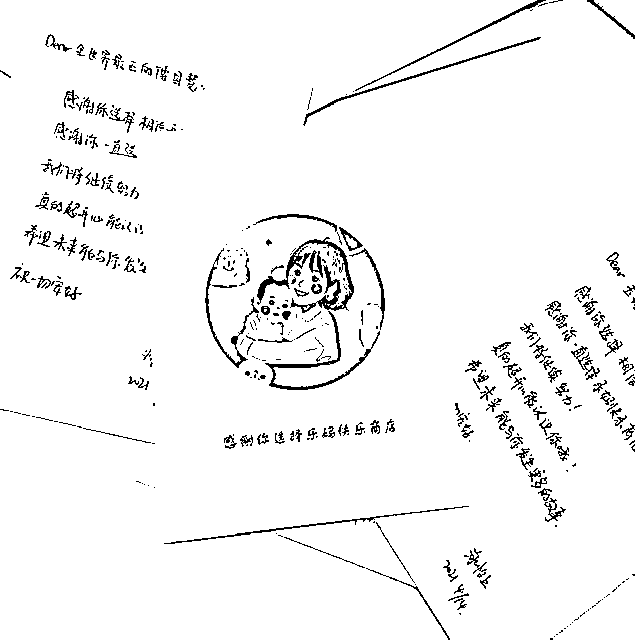

手写信这个习惯我一直留到了现在。今年母亲节，我订了十束花送给VIP，当天早上她们起床就收到了送货上门的鲜花和贺卡，比老公订的还要早。其余客户则按消费排名配了不同的礼物，都是日常贴身的实用款：家居裤、发夹、洗护套装、面膜、睡衣这些居家好物。我让小助理提前挨个联系客户确认收货地址，发货后回传单号，签收了再做回访。整套走下来，客户们的满意度很高。

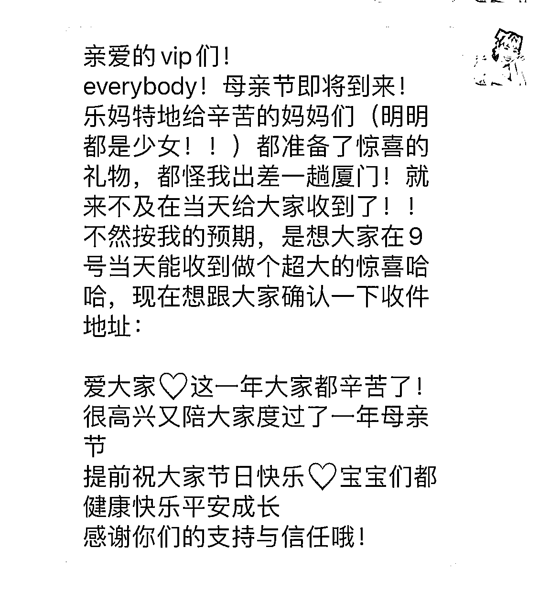

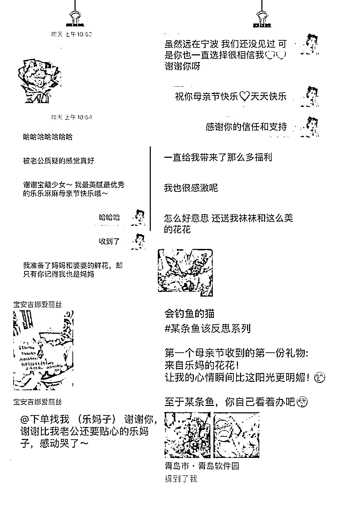

5 还有一个很容易被忽略的点：互惠。你的客户里，肯定也有人做着跟你八竿子打不着的生意，比如卖女装、卖洗护用品、做代购这类。我认识一位做外贸女装的客户，客单价在500左右，我们本来不算熟，但她是我几个好朋友的闺蜜。我的想法很简单：人家在我这里花了这么多钱，我也该去她那消费一笔，将心比心才能长久。于是我买了一条裙子，没想到这一聊，两个人特别投缘，距离一下就拉近了。后来她还在自己的女装群里主动推荐我，给我带了不少精准客户。我也因此意外混进了腾讯妈妈圈，和那几个老朋友的关系也更黏了。

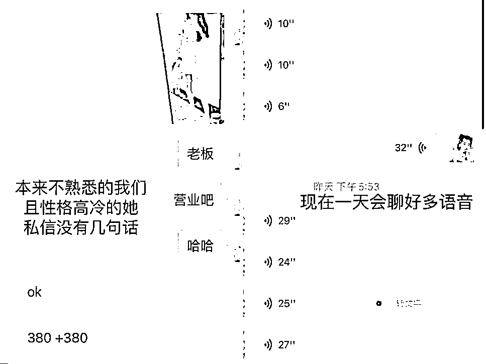

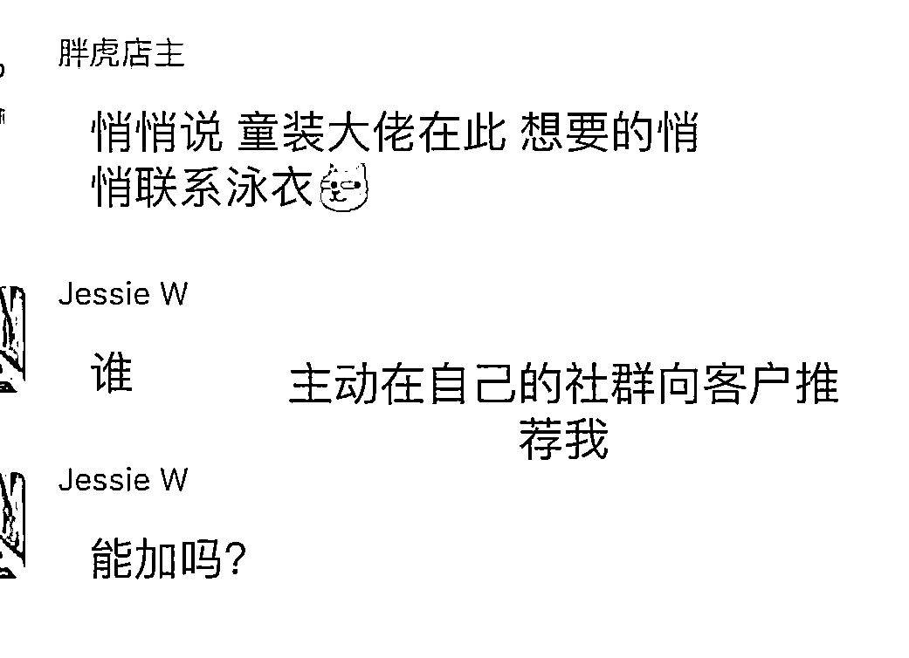

客户要是遇到了业绩压力，或者在群里求助，我一般都会大方帮忙，只要没有利益冲突，也不是什么不正规的高风险事。比如一位客户是4S店店长，月底差一点业绩，我帮着宣传了一下，居然促成了两辆奔驰的订单，后续还通过我的转介绍成交了一台保时捷卡宴。再比如一位做香港保险理财的客户，人非常靠谱，和我们私下关系也好，我把她推荐给了群里不少人，还办过线下的保险科普沙龙，帮她对接了不少业绩和人脉。还有一位藏族客户做滋补品，我确认过渠道正规，每次群里有人问燕窝花胶，我都大大方方地让大家去找她，佣金一分不收。她特别感激，每年都给我寄各种补品礼盒。

但像高价的医美整容、来路不明的微商产品、高风险的投资理财这些，我一律明确拒绝，不能砸自己的口碑。每次推荐前，我都会先做一番调查。我也不是什么忙都帮——那些不精准的、消费力低、一门心思薅羊毛的客户，我直接不理会。换来的回报是，我一旦有需要，很多客户都会毫无保留地把自己的资源和人脉介绍给我。所以别光想着怎么赚客户的钱，偶尔也得光顾一下客户的生意，双向奔赴才能走得久。

6 老话说得好：线上聊一万句，不如线下见一面。我一直很感恩，彼此从没见过面，对方却愿意一直在我这里买单，还不停转介绍朋友，这得是多大的信任。我也一直在跟这些信任我的客户做现实中的链接，请她们吃饭、喝下午茶、带娃聚会，或者就两个人坐下来聊天。每次见面，关系都能明显拉近一层，而且基本第一次碰面就能熟得像多年的老朋友，旁边的爸爸们看了都忍不住问：“你们是不是早就认识啊？”

今年我干脆开了个人工作室，把线下聚会搬到了自己地盘上，定期做亲子和女性成长类的活动，比如婚姻法讲座、心肺急救课、花艺体验、亲子摄影、亲子收纳、女性心理健康分享，还有各种茶话会。我还有一个私心：很多妈妈缺一个倾诉的窗口，我希望她们能在我这里认识一些同频的姐妹，拥有一个可以互相支撑的社交圈，在当妈妈的路上不那么孤独。

哪怕生了孩子，也不要丢掉自我成长。我希望能帮到更多女生。以后我还会做资源整合，用心经营一个本地的妈妈圈子。

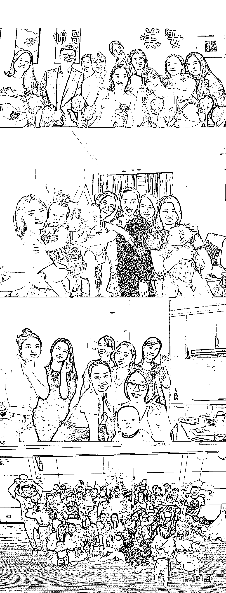

六、遇见赚钱后的蜕变

知道赚钱属于机缘巧合。当时看到2300的票价，我还是有些犹豫，但为了打开自己的认知，还是赶着末班车报了名，顺便参加了深圳见面会。现在回头看，这个决定做得太对了。我不但认识了许多帮了我很多的朋友，整个人的认知和格局也被拉高了一大截。

在赚钱看到“龙珠”的设定，我立刻想到了社群货币。我在自己的群里也开了一套“乐币”玩法（因为我家宝宝叫乐乐），想的都是怎么刺激消费：把购买截图甩到群里得10乐币，晒三张买家秀得30乐币，拉一个好友进群得50乐币。第一个月刚推出，群里直接炸出900多条买家秀，看得我当场懵掉。客户都在说：“乐妈，你简直承包了我们的生活，走到哪儿都有从你这儿买的东西。”第二个月我又加了连续消费打卡送双倍乐币的新规则，玩法一多，大家玩得更上头了。

当时我的心态是：亏了就亏了，成本也没细算，先做了再说，顶多少赚一点。结果没想到效果这么好，连隔壁同行都开始跟着抄作业。可以说，在母婴群主里我算走得比较前的那批了。

最关键的是，我不搞那些虚头巴脑的套路。很多人做积分就是发抵用券，非要客户再来消费个两三次才能抵掉，我觉得挺没劲的。我直接把乐币折成等额人民币，用🛰️转账当场结算。乐币的数量多到统计的小助理直接崩溃，花了好几天才理清——总额2000块，150多个人参与，我光转账就转到手酸，还得附上一段感谢语。

第一个月的乐币冠军一个人就拿走了200多现金。第二个月我把规则改成55上下，总额没变，但更多人分到了甜头。后面我还会继续琢磨更多乐币玩法，让它变得更有分量。

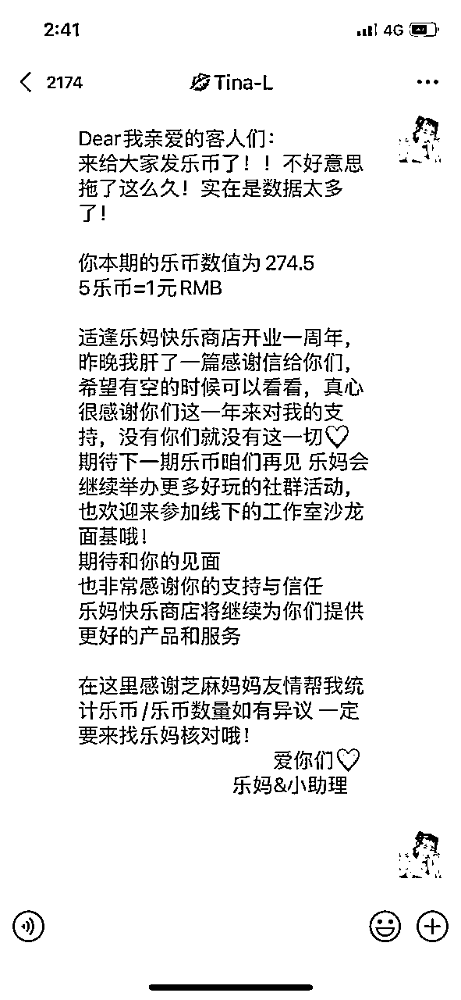

受北野老师的启发，我又搞了一场“荣耀之夜”，专门给积分榜的客户颁奖。提前两天就在社群里预热，做了颁奖海报，活动开始前10分钟红包不停，气氛直接拉满。流程和台词我提前备好了，心里还是有点打鼓，怕冷场。没想到正式开始时，我刚念完祝词，群里的人就齐刷刷刷起烟花和鞭炮，屏幕刷得根本停不下来，进入围观的人也越来越多。最后我花了N个红包才让大家安静下来，乐币冠军终于有机会发表感言。那晚的社群真的又暖又high，我第一次实打实感受到什么叫社群凝聚力——一个小时999+条消息，没有一个人退群。

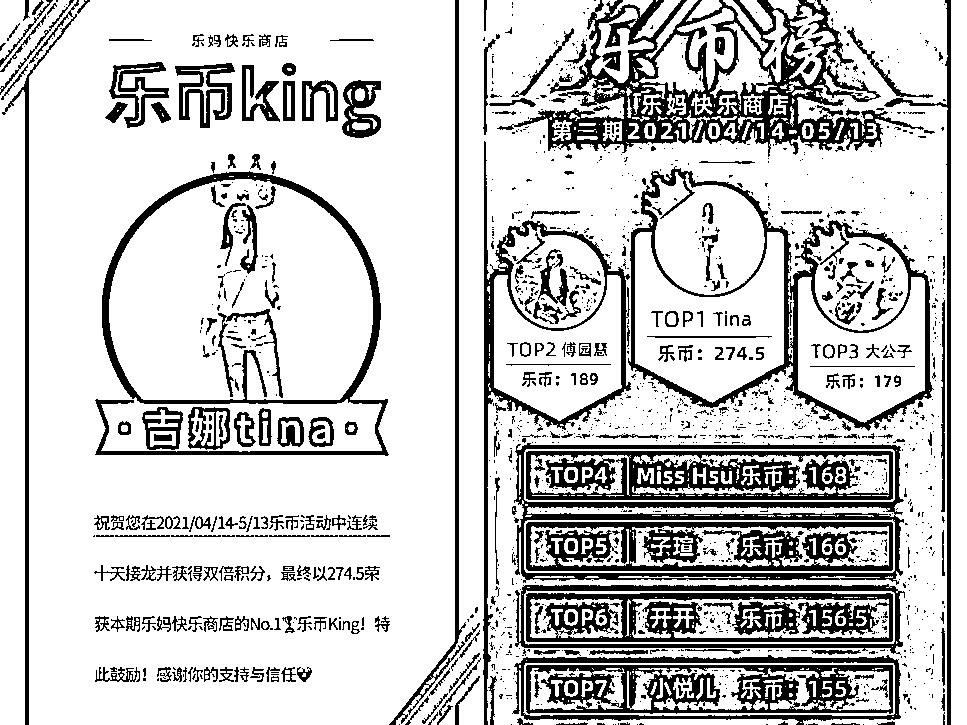

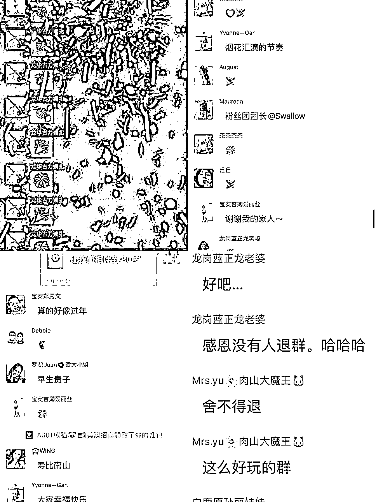

同一时期我还做了会员日抽奖、社群夜话这些活动，反响都很好。进赚钱，确实赚大了。

七、接下来想做什么

目前社群的收益是稳的，但危机感也一直在。我的野心不止于此。自从加入了不少像赚钱这样的优质星球，我的信息源质量明显提升，越来越觉得这个世界变化太快，值得学的东西太多了。尤其是那次“抛家弃子”飞去杭州听老纪分享，对我触动极大。我开始做个人IP，从现成的私域客户入手，运营视频号、写👸号分享经验、试着开直播，继续用我最拿手的服务思维去吸收更多高质量精准用户。同时也在找适合自己的高客单价产品。往后还想做合伙人模式，把在赚钱看到的外卖CPS、闲鱼无货源、淘客这些特别适合全职妈妈的路子研究透，帮更多想经济独立的全职妈妈走出来，走出产后抑郁，重启积极向上的自己。

这篇复盘也许没法像那些月入百万、千万的大佬故事一样看得人热血沸腾，但我更想写给和我一样的全职妈妈、或者想做自由职业的人。如果你的能力和认知暂时撑不起多大的项目——我也幻想过突然爆红月入十几万，但知道自己现在的水平还够不着，我更愿意稳扎稳打——那我的模式就很有参考价值。想做副业，不是只有传统微商囤货压钱当代理一条路。只要肯花时间和心思，认真经营一个自己的社群，找到靠谱的变现逻辑，细心服务好每一个精准客户，就一定能等到属于自己的回报。

一年下来，我每个月的纯利润已经有1.5万，下半年把个人IP跑起来，我相信收益还能再往上走。

最后想聊几句精神层面的东西。这一年，我从产后抑郁慢慢恢复到了以前那个充满能量的自己，身边的人都觉得不可思议，很多客户也一路见证了我的成长。总结下来，有几件事对我格外重要：

1.行动力。想做就马上做，一直观望只会原地踏步。我每次学到新东西、有灵感，就会立刻去执行。比如在赚钱刷到大佬的分享，我会立刻拿来自己的项目里试一遍，所以我的进步一直在持续。

2.努力。天上不会掉馅饼，世上无难事，就怕有心人。做社群绝不是拉个群发红包那么简单。我一天到晚，除了带娃就是盯着手机，脑子里全是社群和客户；写复盘写到凌晨四点也要写完；宝宝睡了才有空干活，那就压缩睡眠，有时候一天只睡三小时；不懂就去学，熬夜看书之外，还能飞去杭州参加赚钱见面会。客户给我最多的评价是：用心又努力。

3.格局。这一年也不是没挨过同行的挤兑和抹黑，但我从来不为哪个客户跑了而生气。眼睛别老盯着那些鸡毛蒜皮，眼光放远一点，留不住的本来就不是你的，是你的怎么都走不了，我不能让那点小利搅乱自己的节奏。今年的目标早就不止社群团购了，我更想把手里攒下的资源和能力盘活，去做更大的商业局。

4.心态要好。写👸号最初只是想记录自己的生活，没想到影响了一批人。她们叫我“鸡血少女”，说每次看完我的文章都像打了鸡血。我一直相信，办法总比困难多。也许是自己当了妈，骨子里那股劲儿更硬了。为了孩子，我想做一个好榜样——哪怕已经是妈妈，也不代表要放弃自我价值。我就是不服输，就是要继续向前冲，也希望带上更多人一起。

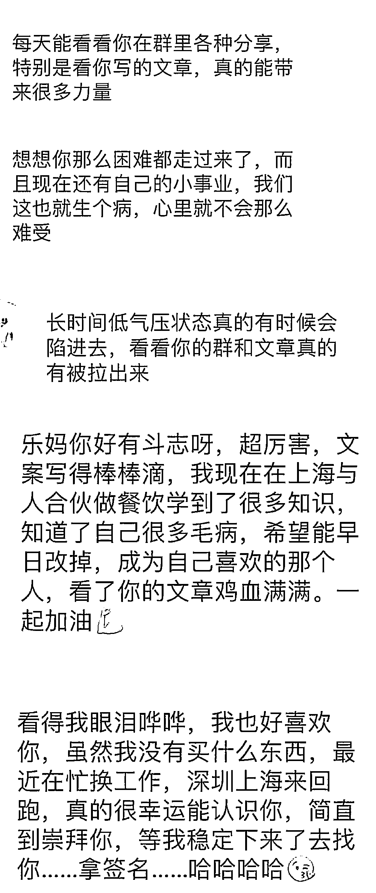

始终记得初心，真诚待人。这一年最大的收获不光是成长，还有这群真心喜欢我的客户朋友。

我是泳怡，一个94年的全职妈妈，外号“鸡血少女”。新的一年，希望破圈成功，链接更多优秀的圈友！

谢谢大家看完这篇文章！

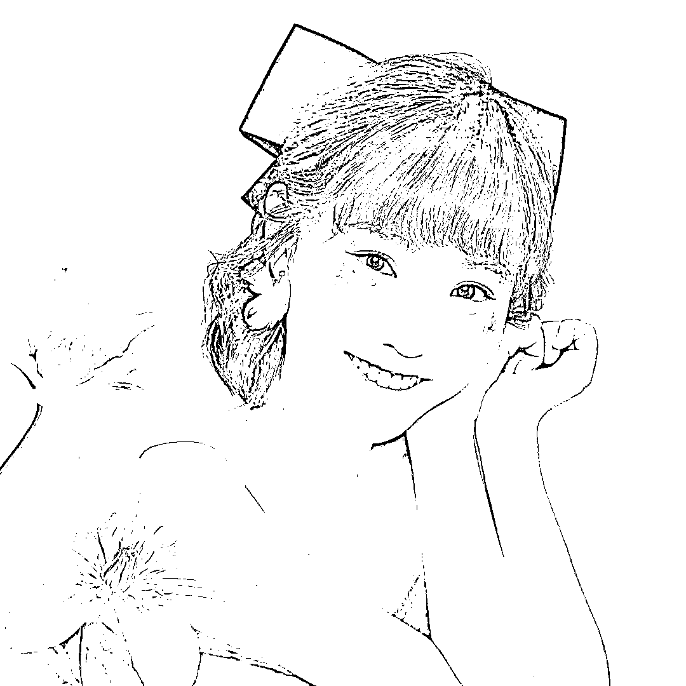

评论区：

商家岛旭教练：泳怡太棒了！见面会才没过多久，又完成了一次蜕变，必须点赞。

文林：见过几次面，非常特别的一位宝妈！泳怡加油！

king老K：听泳怡做了两次线下分享，全是干货。我一直催她把这段经历写出来，分享给更多妈妈圈友。

林童熙🚿：你的经历值得点赞！

商家岛旭教练：👍👍👍

猫头鹰🦉：猜猜我是谁？

马时珍：这位宝妈太厉害了！

俊：分享得非常好。