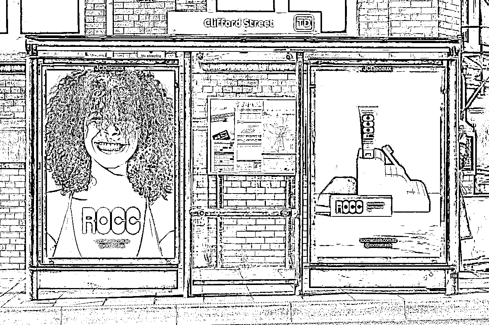
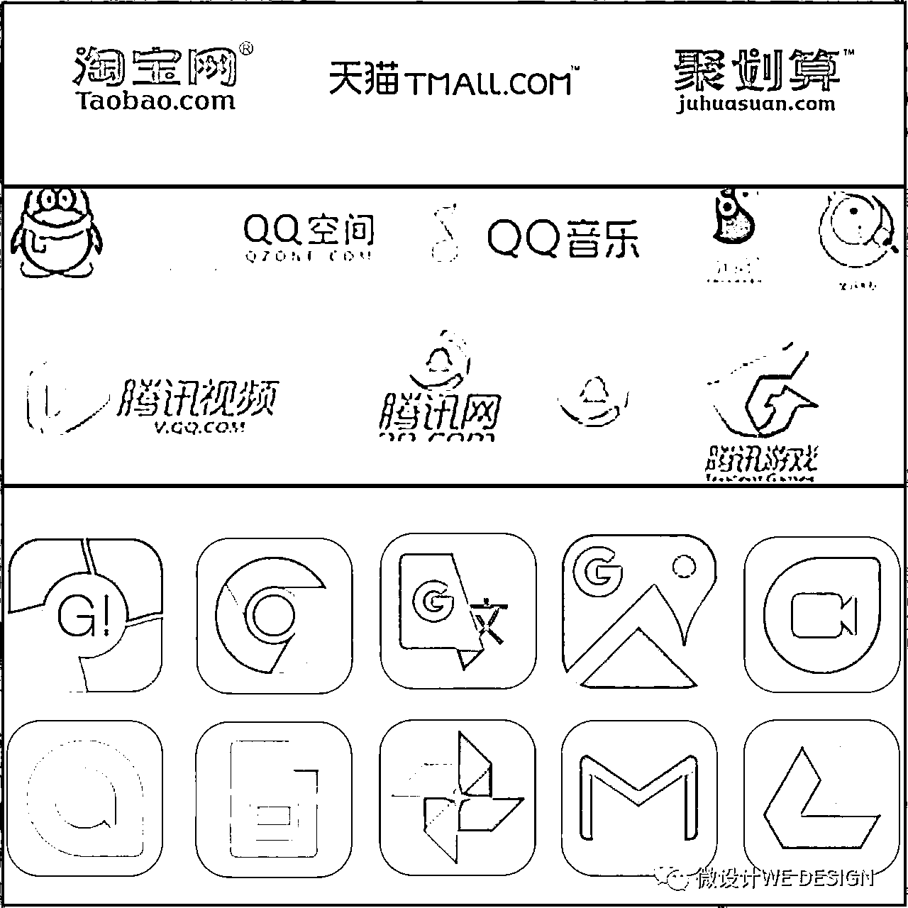
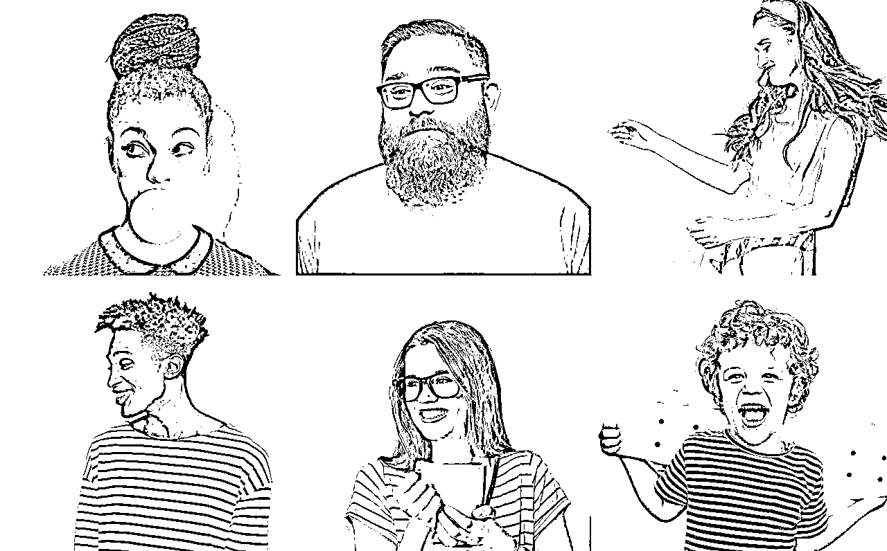
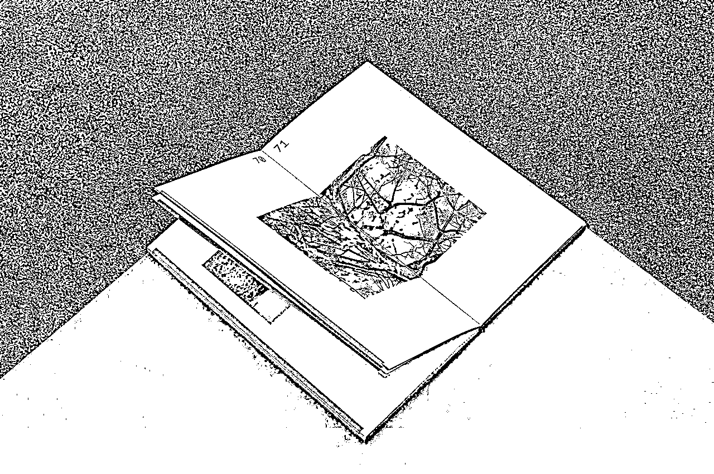
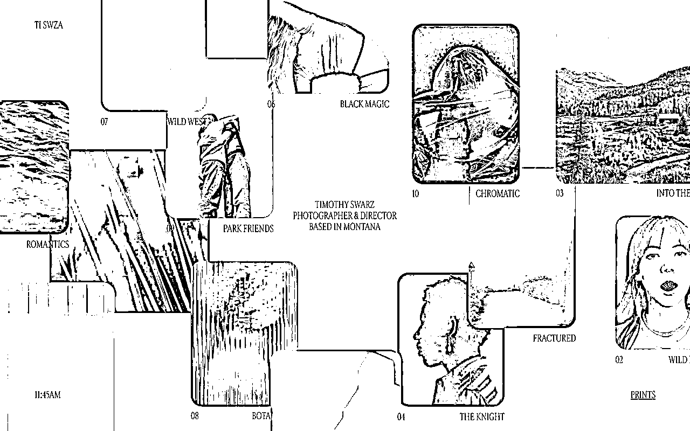
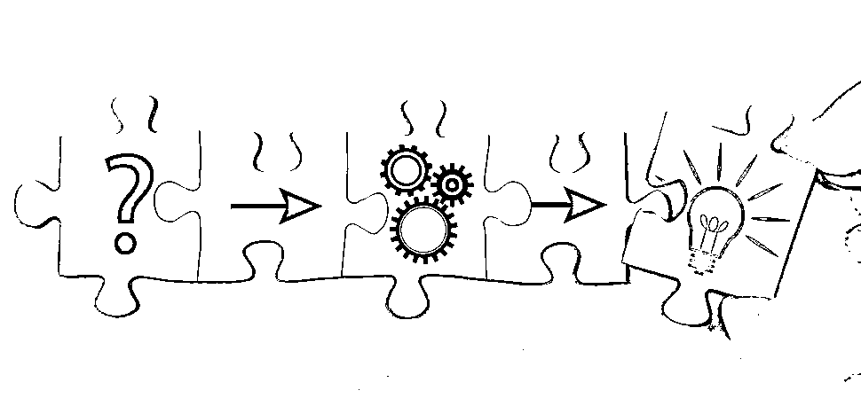

# 设计师创业者的 8 月复盘：100 条思考，条条实在

作者：Sky🏹（表哥）

日期：2021-09-09

赚钱的朋友们，上个月发过一篇设计师创业者的复盘，聊的是设计、生活、品牌、成长、创业这些话题。龙哥建议我养成每月复盘的节奏，所以 8 月版来了。也想提醒各位圈友：再忙，也别停下迭代自己的脚步。觉得对你有用，点个赞，手留余香。

1、关于设计的反思
2、关于品牌的反思
3、关于成长的反思
4、关于生活的反思
5、关于产品的反思
6、关于运营的反思
7、关于创业的反思
8、关于乱七八糟的反思

## 1、关于设计的反思

1、新人设计师普遍还不具备独立原创的能力，眼下最要紧的是拔高审美和眼界。开工之前，先确定一个高质量的参考方向，把优秀作品里的图形、色彩、字体、构图、质感这些要素拆出来吃透。有参照跟没参照，做出来的东西完全是两个水准。

2、自律真的反人性，分享一个 10 分钟的土办法：让你练 1 小时设计，可能直接缴械；但改成只练 10 分钟，心理压力骤减。虽然时间不长，好歹比练两下就放弃强。通常熬过前 10 分钟，会顺势多练 15 或 20 分钟；真要撑不住，歇口气再续 10 分钟也行。我最近写东西就用这套思路。如果还是管不住自己，装个 Forest——本质上就是番茄钟加了游戏化机制，专注时种树，中途退出树就死掉，靠仪式感逼自己坚持。

3、看一位设计师还有没有创作生命，看他有没有好奇心就够了。还愿不愿意每天都接触新事物，还愿不愿意盯着新技术、新趋势去钻研，比如最近大热的 Figma。

4、当年进阿里头一个月，领导丢给我一个变态任务：把全球电商的交互框架和视觉框架全部默写出来，过关了才准做需求。当时一肚子委屈，后来感激得不行。只有把这套底子打牢，你才真正学会站在巨人肩膀上想问题。

5、我一直觉得“设计驱动商业”是行业里最大的伪命题。资源不对等、信息不对称，大多数公司只把设计师当资源方，当作产品的手脚，驱动谈何容易。但设计师又不得不主动去“抢”业务，不然晋升答辩时被问一句“这个项目的成果，哪些是因为你而不同的？”很多人就栽在这里。国内真正够格说设计驱动的公司，印象里也就锤子。

6、找灵感不太刷 Dribbble 和 Behance 了，现在常逛 https://mobbin.design/ ，不光能看到完整截图，喜欢的还能直接下载体验。上面大多是已经上线的落地设计，比概念稿更有参考价值。

7、最近发现一个韩国的宝藏工具，类似“鲁班”那路子，比国内那些“搞定设计”好使多了，关键模板质量高、效果硬核。国内那些花里胡哨的模板，看着真心累。地址：https://www.miricanvas.com/design

8、NFT 说来就来，我坚信这股浪潮会给艺术创作带来深远影响。今天原阿里设计总监善牧跟我说了句话，深以为然：设计创作真正的保护和启发，未来不来自组织，而来自社群。

9、与其跪舔设计大神，不如去深挖是什么成就了他。摸清他成长的主线和拐点，照着路径走一遍，你也能成为高手，而不是永远做粉丝。

10、专业上一定要打磨一块长板，而且这块长板要随时更新。当我们还在争论金属质感和玻璃质感谁更高级时，它们已经是历史名词了。如果身边人聊的趋势和技术你完全接不上话，恭喜你，该警惕了。

11、马云讲课照样被台下老板挑战：“你不在前线，我们在前线。”终身学习重要，但学会怎么学更重要。以伴为师，跟你身边最优秀的设计师学，比看多少网课都强。

12、设计师的学习方法也得迭代。罗胖在得到课里说过：传统案例教学法已经失效，如今要从具体场景出发，围绕用户的问题给方案。时代变得太快，人人都要把视角从后视镜挪到前挡风玻璃。创业同理，时刻假设公司明天就要倒闭，今天干什么？

13、主动让自己变成“U 盘人生”，做“钉耙形人才”——一精多专。多元综合能力怎么培养，值得当成课题来对待。设计师尤其要多接触新东西，技多不压身，学了就有用武之地。

14、都说技多不压身，可真有人囤了几百个免费课程，一个都没打开过，活成了“收藏家”。当下的互联网，知识全部可检索，关键词一输答案就来，真正稀缺的是“怎么学”。那句话没错：当你真正开始动手，就已经赢了 90% 的人。

15、收起玻璃心。做完一个作品，发出去、交上去，收到差评太正常了，别急着上头。把时间花在让自己变厉害这件事上，用行动和结果说话。当然，如果确实是你对，该争的还是要争。

16、设计师的通病是完美主义。可你房子还没盖起来，纠结地砖铺什么花色没什么意义。完成永远好过完美。宫崎骏说得好：遇见的一切都是天意，拥有的都是幸运，不完美又何妨，万物皆有裂痕，那是光照进来的地方。

## 2、关于品牌的反思

17、品牌没有一夜爆红这回事，所有看起来的横空出世，都是长年累月的铺垫，只是刚好等到了风。做个人 IP、做社群也一样，身上的羽毛要爱惜。

18、品牌到底是什么？最近想得比较多。品牌说到底，就是让用户更快找到你、更愿意选你。设计日记这个牌子，用户记住的是什么？颜色和 LOGO 只占极小比重，用户真正留下来的理由，是价值——帮他解决某个特定领域的难题。产品有阶段之分：前期像我们这样拼命刷存在感，目标是攒用户；但品牌到了可口可乐那个段位，追求的不再是曝光，而是社会价值和好感度。劳斯莱斯呢？普通人基本看不到它的广告，因为人家的投放渠道是私人飞机、高端会所，这叫精准。

19、现在一提品牌，大家条件反射想到图形、视觉、色彩，但有两个东西被严重低估：文案和音效。苹果的文案你一读就知道是苹果，味儿太正了；淘宝早期的“亲，你好”，换到支付宝就必须改成“你好”，不同品牌的语气完全不同。音效同理，🐧 的提示音、🧣的下拉声，在地铁里一听就能认出是谁；还有当年的 hello moto、诺基亚开机音。可惜这两样被越来越多的企业忽略掉了。

20、在支付宝时做过一个高端理财项目，目标客户是存款 100 万以上的用户。我们想当然觉得他们吃奢侈风那套，深色、玫瑰金全往上怼。结果被总裁痛批一顿。他讲了个迪拜的故事：蒙着黑纱的姑娘们怎么分辨财富？他碰见一位，黑纱旁垂着一绺飘逸的红线，气质立刻不一样了。他又说，身边财务自由的朋友穿衣服从来不露 LOGO，只讲究剪裁。品牌的表达，未必是大 LOGO、大色块，一个细节就足够了。

21、体验感在线的品牌还是太少。说两个百元档就能拉高生活品质的：Spotify 一直在用，设计、体验、曲库、无损音质都顶，用完之后你会发现以前听歌都是将就。Netflix 也一样，优质电影资源多到看不完，生活质量肉眼可见地提升。

22、每个赛道的品牌，用户能记住的只有前两名：可乐雪碧、优衣库无印良品、家乐福沃尔玛、移动联通。第三名不是不存在，是消费者的大脑懒得记。所以做产品，尤其创业，不是产品线越宽越好，越窄越聚焦，越有机会磨出一把尖刀。

23、子品牌一多，怎么保证母品牌一致性和子品牌个性兼得？可以学腾讯：🐧、🐧 音乐、腾讯视频、腾讯游戏、🛰️、浏览器……统一密码有三个：色彩上蓝绿黄打底；图形上 🐧 浏览器、腾讯地图、全民 K 歌都有 Q 的影子；企鹅元素反复出现。做得最绝的还是 Google，家族感一眼可辨。阿里做得一般，基本靠字体撑场子。

24、快速起一个新品牌的方法论：产品别太差，设计往洋气整，抖音、📕铺一轮达人，能上李佳琦、薇娅、老罗的直播间更好，ROI 跑正之后就全网铺开。

25、苹果生态确实没话说，拿我每天离不开的 AirPods 举例：电脑上放着歌，手机一刷抖音，耳机自动切过来，它会跟着你的苹果设备场景走，非常聪明。但苹果也有拉胯的产品，前几天入了新款 MagSafe 电池组，700 多块，便携是真便携，可它跟手机配对后基本充不满，还是慢充，边充边玩手机电量照掉，妥妥的鸡肋。

26、百度的体验越来越让人头疼。想下载一个苹果字体，前 3 页全是广告位。广告可以理解，毕竟要养技术、要赚钱，但凡事有个度，用户的习惯一旦被别家接走，再想拉回来就难了。

27、竹子前 4 年只长 3 厘米，第 5 年开始每天蹿 30 厘米，6 周就蹿到 15 米。那些被看作一夜爆红的产品，背后全是默默耕耘。以龙哥盟为例，用户爆发发生在第 4 年，前 3 年龙哥都在闷声做内容和口碑。真的没有速成路线，该走的坑一个不会少。产品、品牌同理——市场还没认识你之前，你压根没有品牌，能打的只有服务和内容。

## 3、关于成长的反思

28、每个月初都要立好规划，个人如此，公司也一样。人总觉得自己还年轻、时间还多，减肥、见朋友都可以推到下个月、明年，结果忙忙碌碌一年发现什么都没干成。时间安排错了、优先级排错了，都是隐性损失。

29、今天去朋友公司聊天，有人问我：创业这么苦，离开阿里后悔吗？我一点也不后悔。我不想自己的终点就是我主管那样子——被工作吸干，被资本裹挟，每天战战兢兢，没有生活可言。当然，也有人喜欢这种活法，体面、高薪。公司我改不了，但我可以改自己的选择。试着想想：假如全球所有工作薪水一样，你会选哪份？当你无法选择的时候，就听内心的声音吧。

30、格局怎么提升？猫叔那句话我很赞同：敢花钱，会花钱。现在的大佬都在圈子里，付费就能链接；进了群，大方发几个红包，大家都记住你了。但前提是你要有价值，要拿得出手。很多人说见大佬就怂，田忌赛马嘛，大佬也有短板，拿你的长板去拼。比如我🛰️里躺着很多设计总监，专业上我不如他们，但运营和个人品牌，他们得认我。找适当的契机帮他们解决这类问题，互助共赢。我当年见龙哥也怂，后来他请我当设计顾问，慢慢就熟了。记住，主动利他。

31、抱怨一时爽，一直抱怨火葬场。漫威里那些英雄，哪一个是靠嘴炮解决问题的？都是一步步行动，事态才逐渐扭转。

32、“及时止损”必须写进人生信条。工作不合适就辞，圈子不合就退，感情不对就断，人不对就离，别让沉没成本绑架你。坐错车不可怕，别因为投了币就赖着不下。不为烂事内耗是大智慧。沼泽里待得越久陷得越深，小事上越是纠结输得越多。

33、教育行业这波震荡，字节也跟着裁。哪有什么大厂情怀，资本翻脸比翻书快，没有稀缺能力的人照样出局。真正的护城河，是把某个领域磨到极致，并且在这条线上持续复利。

34、竞争力怎么定义？“人无我有，人有我优，人优我全，人全我不要命。”虽然是句玩笑，但很耐琢磨。人人都该给自己挖护城河，工作如此，生活也是。好在我找到了写作这个着力点，设计师普遍不写、不爱写，我偏在这件事上放大了自己的投入，慢慢它就盖成了我的护城河。

35、职场里搞副业、写东西，一定要低调。除了爸妈，真没几个人希望你过得比他好。我在阿里那会儿写👸号，跟做贼一样，生怕同事发现。企业永远是利益优先，一个只干本职的，一个天天写文章的，你是老板你用谁？所以想搞副业或写作的朋友，记住：屏蔽你那些傻逼同事。

36、跟几个朋友吃饭，聊到“哪些能力重要但大多数人没有”，共识如下：

让人舒服的能力。你跟某人聊得来，什么话题都接得住，以为遇见知己，其实是对方向下兼容，人家情商高。

读懂人的能力。不看他说什么，看他的行为。

坚持的能力。没背景没资源，死磕一件事就能超过 90% 的同龄人。我就是靠写作死磕出来的。

早睡早起的能力。大佬的原话：清晨的白粥比深夜的酒好喝。

执行力的能力。未来知识的获取门槛都差不多，拉开层次的是执行力、商业敏感度和长期主义。

接受平庸的能力。接受改变不了的现实，很多痛苦来自于预期和现实的落差，接受就释然了。企业家、明星，追一辈子无非是钱、房子、想要的生活。大家都不过是只有灵魂的猴子罢了。

37、陆奇在百度时怎么激励大家？做智能驾驶的同学们，选高速路，就得挑一辆跑得快的车；跑在快的赛道，就要选对的交通方式。我们手里的业务，就是一条高速路、一条快赛道。

38、人生大概三阶段：第一段靠聪明；第二段拼关系和赛道，你身边站着谁决定你能走多远；第三段创造价值，年龄不值一提。

39、三十岁的设计师怎么提升竞争力？给自己织一张网。不断破圈，学新东西。别人比技术，你出设计思维；别人比设计思维，你出数据思维；别人比数据思维，你还有商业思维。你脑子里是网，对方手里是线，谁赢？

40、稻盛和夫说过，人是怎么废掉的：假装努力，持续做梦，嘴上巨人，行动矮子；睡前鸡血满满，醒来原样照旧。总以为来日方长，今天推明天，明天推下月。忙得团团转，告诉自己没虚度，却从不思考值不值得，也没有职业规划，80% 的时间用错了地方。戒掉浪费时间的习惯，拿正反馈，整理做事顺序，才可能靠近成功。

41、延迟享乐，我一直在修炼。想成事，先干活后享受，你要有拒绝诱惑的能力，保持自律和专注，直到目标落地。写作期、考试期就要推掉聚会，考完再放纵。凡事看长远，做了别人不愿做的，才拿得到别人拿不到的。

42、活得真实是什么？不怕评价，好的坏的都是你，你比任何人清楚自己的长短板，不必为外界的只言片语否定自己。心里有方向，有光，就坚持走。把时间轴拉长，所有人都不过三万天，在宇宙面前我们就是一粒尘。做好自己。

## 4、关于生活的反思

43、真正挡住我们的，常不是认知，而是心力。认知需要能量托底，身体这组电池不充电，迟早抛锚。左晖的悲剧，表面看是忙、是压力大，根子上是心力被耗干了。所以工作学习再忙，也要把锻炼当成硬指标，给身体续航，很多事不会走到那一步。

44、大环境下，大家都觉得难：打工的嫌不稳定，创业的嫌风向变得快。你随便上街看看，身边谁不难？学习怕吃苦，就要吃生活的苦；创业怕吃苦，就要吃失败的苦。说到底，人生是场修行。建议看看俞敏洪早年的采访，他讲人生大起大落，特别通透。

45、改变自己很难，那就每个月干掉一个坏习惯。比如熬夜、刷短视频、胡吃海塞、身上长肉、周末死宅——死宅等于亲手关上了世界那扇门。改掉一个，就离早睡早起、读书、健康、热爱生活近一步。可惜啊，难度系数不低，具体战况下月复盘见。

46、我们常对朋友客客气气，却对父母、爱人乱发脾气。说白了是潜意识里笃定他们不会离开，这是一种自私。

47、最近几年我喝水总是太少，咖啡喝得凶，身体在抗议。前阵子老罗直播间买了个巨无霸水壶，刻度、水位线清清楚楚，几点喝到哪心里有数，喝水量肉眼可见上来了。人天性懒，所以小罐茶、三顿半、小仙炖这种“替你省事”的产品能成，背后全是对人性的拿捏。

48、爱商，是这一代人最该补的一课。

49、人要学会跟内在的自己对话。最近在复旦上课，老师给了一套《灵魂 11 问》的复盘法，亲测有用。找张纸，认真回答：

过去几天，你身上发生了什么改变？

人生路上，谁一直在给你力量？

在现在的岗位上，你看得见自己的未来吗？

工作生活中，什么事最让你纠结、最耗费能量？

当下工作里，你最大的快乐源泉是什么？

坐上时光机，10 岁和 18 岁的你，会对现在的自己说什么？

继续穿越到生命尽头，那一刻你想给现在的自己什么忠告？

回到当下，未来 3-5 年你的愿景是什么？如果画出来，会有什么元素？越具体越好。

为了抵达愿景，要放下什么、保留什么、立刻开始什么？

谁是帮你把愿景落地的关键人？

未来 3 天，你会马上做什么？

50、哈佛有门幸福课提到：每 7 年，拥有一点高质量的朋友圈，幸福感才会稳定。高质量的朋友圈能抵抗孤独。我身边恰好有几位这样的朋友。必须表白龙哥：以前我朋友圈里全是设计师，是他帮我完成了圈子的升级。

51、日子不是只有忙碌，偶尔也需要一点惊喜。朋友女朋友过生日，要求礼物不能超10元还得有新意。他跑到便利店，买了一盒鲑鱼寿司、一枝葵花、一双竹筷，外加一瓶印着祝福语的饮料。天天低头看屏幕，真的会错过生活里那些细碎的美。

52、🛰️卡到不行，清理聊天记录时才发现，和我聊天最频繁的竟是那个传文件小助手。仔细想想，这功能确实刚需，可为什么没有一个比官方自带更好用的替代品？

53、传统短信还有未来吗？现在睁开眼，推送消息一堆，真正来自人的信息却寥寥无几。读书时每月500条都不够花，如今通讯越来越便利，人跟人反倒有点冷。连对桌的同事，聊工作也都在🛰️里完成。

54、意识到自己快要被淘汰，是从听不懂同事聊的新词开始的。意识到自己开始老去，是从父母不再催着要孩子开始的。

55、读到过一段特别有劲的话：遇到不敢面对的难关，就把自己想象成一位80岁的老人，正为年轻时的逃避和放弃悔恨不已，他真希望能重回青春。然后你睁开眼，发现自己又年轻了一回，还有什么好怕的？

56、年龄越大，越不敢在朋友圈泄气。不是没有情绪，而是怕把坏心情传染给别人；能分享的快乐，也慢慢收进自己熟悉的小圈子。不知道你们有没有同感？

57、中年的两大难题，一是减重，二是熬夜。年轻时吃什么都不容易胖，好像肠胃从不吸收；现在每顿饭都像给身体充值。哪个更难戒？熬夜还能扛，减重是真熬人。蛋白代餐棒啃了一个月，断断续续，越啃越怀疑人生。

**关于产品的反思**

58、Bilibili凭什么比iQiyi更被资本看重？除了占有率，还要看粘性和增速。iQiyi的新增用户已经摸到天花板，十亿网民红利见底，整个行业从增量切换成存量博弈，最后只剩拼价格。所以Bilibili反而更有故事可讲，可惜我没买入。

59、算法越聪明，人反而越像被设定好的程序。但我们的用户运营还停在用CRM挨个私信的阶段，离真正的精细服务还差很远。

60、每个人都是一款需要打磨的产品。你的长板是什么？眼下投入哪些事能让自己的价值持续上涨？我从阿里出来以后，把不少钱花在上课和进修上，说白了就是为自己做增值。

61、一个创业朋友的公司文化里有个词叫‘迭代’，我很喜欢。人同样需要版本更新：给自己画出成长路线，每月完成一个小突破；但学东西一定得学透，最忌讳半吊子，回头重啃更浪费时间。

62、在杭州吃过两家风格极端的馆子。第一家点单前会让你挑个精致小茶杯，杯子小到一口就没了，随后免费给你泡当季新茶，仪式感十足。等你觉得不错想续杯，店员才告诉你茶叶128元一袋；想换白水？山泉水18元一杯。后面的服务不差，但前面这些精心设计过的转化路径，实在让人喜欢不起来。另一家是家牛肉馆，苍蝇馆子，进店直接点单，上菜快、味道硬，没什么多余服务，可你需要时喊一声马上有人应。这就像两种产品思路：一个靠免费噱头引导下单，一个靠真材实料留下回头客。做业务的人不妨问自己：是把心思花在套路转化上，还是先把内容本身做扎实？

63、教培行业这一轮震动，给我最大的启发是：时机比努力更残酷。方向再对，踩错节点也难出头。选对领域、看准窗口，再加上一颗不轻易动摇的心；否则一遇困难，人就开始怀疑自己。

64、总有人问我，怎么才能快速摸清产品和整个线上行业。我的笨办法是：把App Store二十多个分类的头部应用都下载一遍，逐个用，记录三个亮点和三个败笔，再想如果是自己来设计，能不能给出更好的解法。走完这个流程，行业地图基本就长在脑子里了。设计如此，其他领域也一样，拆解力就是学习力。

65、前两天读到曹大的旧文，里面说现在的网上内容，几乎都被改写成了用来检索的条目。过去拼的是博览群书，现在拼的是网感，是搜索能力，是你输入什么词、能不能找到别人找不到的信息。为什么龙哥和涛哥能从一张截图里看到整个项目，而我们不行？差别多半就在检索链路不够深，拿不到一手信息。

66、这几年，连让人惊艳的新产品都很少见了，短命的爆款也不多。是大环境不再鼓励冒险，还是这届产品人心气不足？冬天里，做点利在长远的事当然没错；但创新依然是发展的重要引擎。生态多样，才有更多可能。

67、今天在Mac上打字，刚敲出一个‘花’字，输入法就蹦出个陌生手机号。这台电脑从没存过通讯录，我分不清是它的记忆联想，还是某些厂商已经把手伸进了输入框。大数据面前，个人隐私越来越像一张透明纸。

68、最近在社群里发起了一个小打卡：记录身边做得好的产品细节。好产品不是靠某个大招成的，而是由一个个细节叠出来的。比如去以服务著称的火锅店，等位有人递热毛巾，女生能做美甲、男生能擦皮鞋；吃着吃着，服务员又主动送饮料、续毛巾；生日了，还有人和你一起热闹。正是这些碎片让人觉得体验极好。产品同理——一个商场就算门面全是奢侈品牌，洗手间脏得下不去脚，谁还会觉得它高级？

**关于运营的反思**

69、龙哥前两天在群里提到把训练项目做成游戏，正中我下怀。学习是反人性的，要让人坚持下去，就必须用即时反馈不断喂养成就感。

70、前阵子一口气上了很多新打卡玩法，预想中会爆满，现实却很冷清。我们以为的价值，用户未必买账；一个产品也永远没法讨好所有人。购物和理财都能给你配一套专属推荐，社群能不能也做到按人定制？这个局的解法，我还没找到。

71、人人爱打游戏，图什么？爽感太直接，赢了马上就能收到正反馈。做产品和做学习也一样，也要制造那种‘爽’。学习项目想留住人，尤其需要公开的肯定和表扬。最近我让小班学员去大群里做复盘，他们被围观、被收藏、被夸赞，那种被看见的感觉完全不一样，学下去的劲头一下就来了。

72、运营社群确实磨人，每天有处理不完的琐事。虽然龙哥随时都在，我还是更想自己找答案。现在的习惯是遇到问题先问一句：如果是他，会怎么看待？这个换位动作，能让我快速从情绪里跳出来，回到做事逻辑。

73、写作能力在运营里被低估了。像那些广为流传的广告金句，两三行字就能戳中人的痛处和痒处；好的文案跟好的设计一样，只需要真诚和灵气。最近在翻奥美那本经典文案书，越读越觉得这项能力值得系统训练。

74、用户运营一定要把可能发生的场景提前演一遍。团队把所有意外列出来，再一条条配好应对方案，真到现场才不会手忙脚乱。哪有什么天生的精细化运营，不过是把话术和场景提前磨透了。

75、运营社群最怕自我重复。上个月用户还觉得新鲜的模板，这个月可能就变鸡肋；只能不停上新品去刺激大家的神经。这个月起，我们部门周会固定加了一个环节：每个人分享一个近期看到的优秀营销案例。见得够多，才可能碰撞出新打法。

76、🛰️群最大的痛点不是缺人，而是缺话题。拉几个大咖进来没什么了不起，关键是每天抛出的问题有没有人想接。这一点那个龙珠群做得特别好：新人进来有欢迎仪式，龙哥和秀儿每天推荐讨论题，圈友提出问题马上有回应。还有一点更重要——设置退出机制，别让群被‘潜水党’拖死。

77、IP和助理之间怎么配合？以前我总把SKY塑造得很厉害，结果太高太冷，用户不太敢靠近，所以后来有了叮当猫。但叮当猫不能只负责问候，她要有自己的性格，要能输出观点，要和IP互补。怎样让这个角色真正‘活’起来，成为用户愿意倾诉的对象，是我还在思考的问题。

**关于创业的反思**

78、这个月在复旦听课，老师帮同学拆解企业难题时给了一套七步框架，挺实用：先请当事人完整说清现状；再用开放提问层层逼近本质；接着破除滤镜，找到真正的问题；然后把它定义清楚，列出影响因素，找到最吃劲的那个支点；之后给出具体建议；最后确定下一步行动。值得记下来反复用。

79、判断一家企业值不值得信任，先看创始人的来路和底色。人的经历与执念，最后都会写进公司的路线图里。

80、清洁能源的逻辑越来越清晰：能源需求会持续上升，市场扩容的同时，替代方案也在增多。另一个我看好的方向是生物医药。以前觉得健康安全理所应当，现在才发现它如此珍贵；生物技术的突破，很可能是改变未来的关键变量。

81、有本书叫《终极智慧》，读起来挺开脑洞。机器在不断变聪明，越来越像人；人却很少迭代，越来越像机器。书中推演人和机器的关系有三个阶段：先是机器帮人变得更强；接着是共生，等机器包揽大部分生产后，人可能逐渐变成多余的一群人，工作反而变成最高奖赏；最后，机器的进化速度超过碳基生物，人的存在大概只剩供能，就像那部著名科幻片里的设定。

82、最近的教培变动，让人不得不重新理解趋势。踩中政策方向的企业可以一年十倍二十倍，困在旧逻辑里的可能一天跌去七成。天变了，看清大势、顺应大势，才是做企业的基本功。

83、从创办到上市，企业所用的时间越来越短，PDD只花18个月就做到了。这个行业的剧本每天都在改，没人能预判明天。

84、经营社区必须定期杀掉自己。很多套路和专业知识的保鲜期只有几个月；与其背那些会腐烂的知识，不如去学那些不变的原则，然后以此为底座长出新技能。

85、人要在大周期里做深度布局，把自己的远见和热爱放进去。阿里想活到120岁，听起来夸张，实际是企业家对生命周期的深度思考。海尔有句话我常记：没有夕阳的行业，只有夕阳的企业。

86、以前我认定没工作的人多半在混日子，后来听了不少还在职的朋友的处境，才明白打工到某个阶段才是另一种‘混’——因为没选择，只能做一颗螺丝。真要说有什么建议，就是趁早多赚钱、保持自律，至少焦虑会少一点。创业也不轻松，从拿工资到发工资，心态完全重来。

87、谁都不会活得轻松。年少时的轻松，是父母在背后硬扛；工作时的轻松，是老板在前面挡风。自己当了创业者，才真正明白这句话的分量。

88、创业路上贵人可遇不可求。真正的贵人未必给你塞钱，而是给你机会、给你资源、帮你打开眼界，在你最难的时候拉上一把；他愿意在你身上花时间，帮你避开弯路。如果你身边也有这样的人，一定好好珍惜。这里我要郑重感谢龙哥。

89、创业的终点不该是创业本身，而是更好的生活。别忙碌到忘了抬头看世界。最近我又开始逼自己周末去找一顿好吃的、看一场电影，把脑子从报表里拽出来。换个频道以后，常常会有意外收获。开了一扇事业的窗，别顺手关上生活那扇。

90、人的阈值是需要管理的。以前觉得月入一万就可以休息了，真到了一万，又被生活摩擦得想三万；等到三万里还觉得不够，又开始惦记年薪百万。可你真到了那个位置，发现身边收入几千万的人依然天天在忙。所以真正要修的，不是赚更多的能力，而是对生活预期的阈值。为什么刚毕业月薪六千能开心，现在反而不容易高兴？因为胃口被撑大了。这道题，我得慢慢找回答案。

91、创业以后才懂得，做什么都得拼尽全力，同时要学会消化情绪，好的坏的都不随便往外倒。别人对你的好，不是理所当然；要感恩大环境，也要感恩身边给过你帮助的人。尤其是那些愿意跟你说真话的朋友，最难能可贵。

**杂七杂八的反思**

92、最近补了老电影《进击的巨人》，主角面对人生暗面时的姿态很戳人：不是逃避，而是咬着牙去直面。片末更有意思，曾经像天灾一样的巨人，随着科技发展竟然能被新武器轻易压制。可见每一种能力都有自己的红利窗口。我们虽然不必打巨人，但也活在弱肉强食的现实里；红利消失之前，赶紧更新自己。

93、怎么提高学习能力？我在用几个笨办法：把学到的讲给别人听；等能力涨了再碰新内容；以及每次学完都想一想，这知识能落进什么场景。方法简单，但坚持下来很有效。

94、有个社群里抛出一个很有意思的问题：你有什么化解烦恼的好办法？回答很治愈：有人说写下来，写完就发现自己想多了；有人习惯把自己抽离出来，当旁观者看问题；有人选择马上解决或马上忘记；还有人会先冷静，再慢慢复盘，把情绪和归因分开，花一两天调整回来。更豪爽的一位说是‘骚扰朋友、去运动、读读老庄，再想想以前也趟过很多坎，没什么大不了’。尽人事，听天命。

95、一个北京认识十年的朋友最近找我诉苦。他在大厂当经理，已经快40了，每天如履薄冰，总担心被优化，动了日后做个人IP的念头，问我来不来得及。我说要做就现在做，别等离职。这个圈子的最大特点就是变化快，你相中的方向，可能过一两年就人满为患。我自己要不是当年一边上班一边硬写，也很难有后来的转型机会。所以，事是对的，也要在对的时间做。

96、成年人最该学会的是拒绝。创业后找我的人不少，很多只有点头之交；以前总觉得不见不好，结果一整天全耗在没意义的约见上。后来龙哥教我一笔账：目标是一年赚100万，那么你的时薪就是2000块。见人之前先算，这个人一小时值不值这个价？值就花，不值就拒。听完瞬间清醒。

97、最近看一部剧，被一个情节戳到了：老人儿女都不在身边，骗子每天嘘寒问暖，最后老人心甘情愿买走一大堆保健品和所谓的理疗床。这让我想起妈妈也有过几乎一模一样的经历。我不擅长表达，这些年独自在外，陪她最多的是妹妹，想想很惭愧。天秤座可能就是这副德性：对自己人苛刻，对外人却客气大方。往后要记得多回家看看。给钱不是孝顺，陪伴才是——算一笔账，一年在家10天，父母再活30年，也就300天，不到一年。珍惜眼前人。

98、我喜欢把经典作品反复看，那部大船电影我刷了不下十遍，每次都能发现新细节。歌也是，翻来覆去听老歌，不同年纪听出的味道完全不一样。看剧看书，与其追新，不如啃经典；书也不用读太多，有几本真正读透了，比什么都值。

99、人不能太闲。一闲下来就爱胡思乱想，看什么都不顺眼，还会莫名矫情。忙起来反而人更精神，没空琢磨那点小情绪，许多当时觉得过不去的坎，忙完再看已经平了。

100、最后想用一句很喜欢的话收尾：愿你走遍山河湖海，依然觉得不虚此行。也把这句话送给读到这里的每一位朋友。