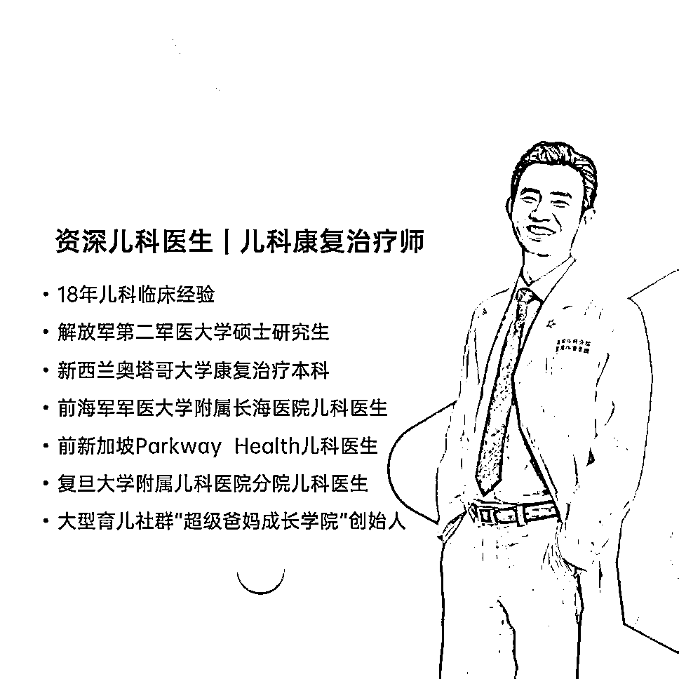
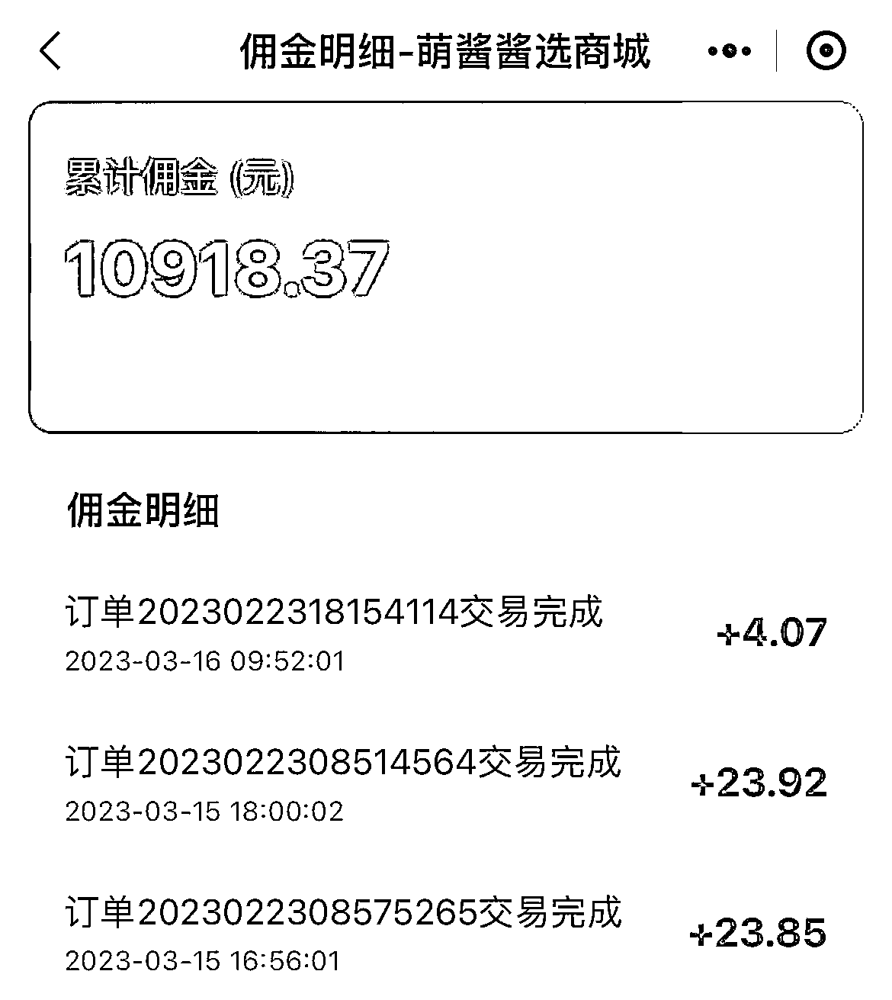
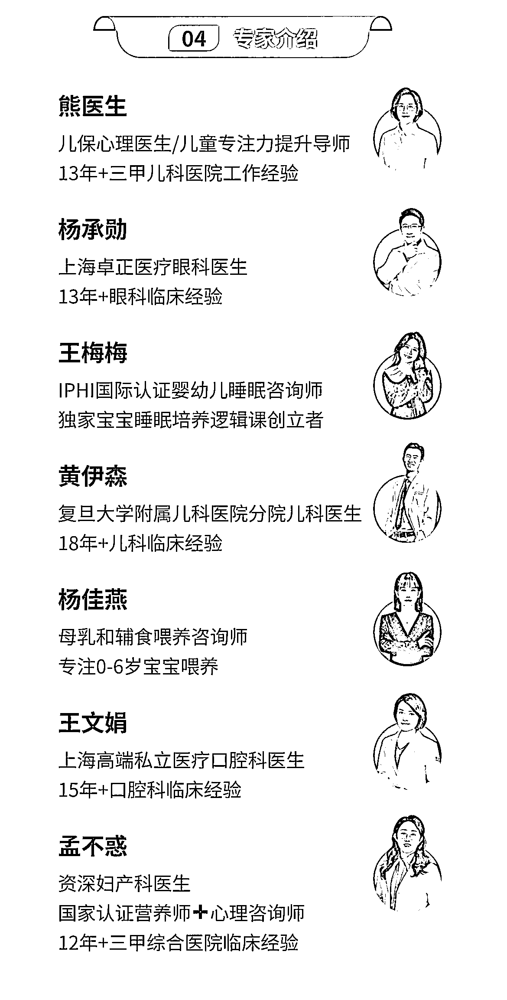
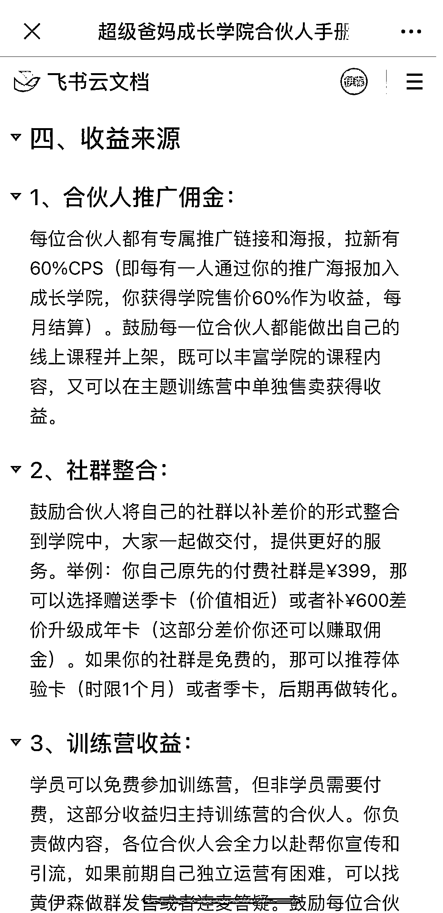
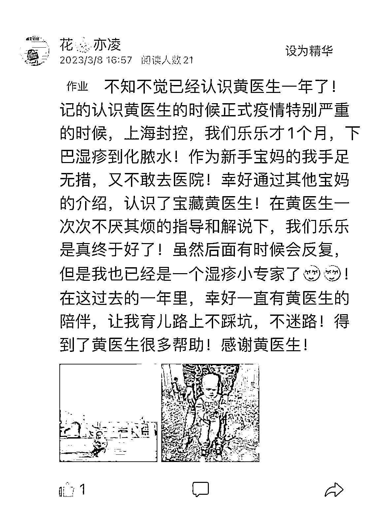
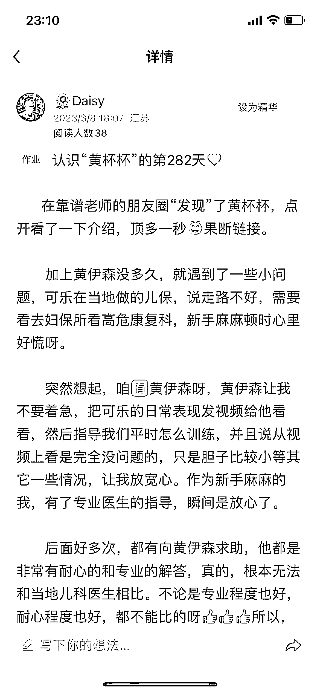

# 零社群经验，我把育儿群带到600人、变现十万+

我是黄伊森，在上海一家三甲儿童专科医院做儿科医生，临床一线待了十八年，接诊过的孩子累计超过十万。我是赚钱第六期的新成员，正职从医，业余折腾医疗自媒体、给健康科技公司当顾问，也做母婴好物电商。我一直想做赚钱的“首席儿科医生”，替球友们的下一代出点力。

今天复盘一件事：一个没有社群履历的人，怎样把人生第一个付费群做到六百多人，维持不错活跃，走通商业闭环，累计营收十万+。

2020年我从新西兰回国后继续从医。此前，自媒体和社群我都没碰过。2021年中期开始拍短视频、发图文；到2022年初，才着手筹备自己的第一个私域群。

职业摆在这，第一个群我选了妈妈育儿群。动手前完全没运营底子，于是先向@北大苏姐取经，听她讲社群踩坑。那堂课我记到现在，也先把她提醒的几个坑分享出来。

有个消费力排序很出名：孩子强于女人，女人强于宠物，宠物强于男人。所以亲子加妈妈群付费力足、变现空间大，也常常是各种群里热度最高的。可运营跟不上，很快会变成闲聊吐槽场。

我理解的好群，不是靠消息刷屏撑活跃，而是成员围绕共同目标行动，愿意留下，每天有获得感、有成长。

在赚钱圈子里，我看到球友卖日历、做共读群，把频率相近的人聚在一起交换见识、共同进步。我因此定了方向：育儿日历共读群。群规我写成“相互借力，先给后取，同频共振，主动结识”。形式类似日历共读，每天抛一个育儿知识点，妈妈们有新内容可学，也能围绕它讨论。

最早一批成员，并非全部付费。我邀请门诊里信任我的家长免费进来，作为初代支持者。她们在群内舆论引导上帮了大忙。我每隔三天左右问一次：内容怎么样、运营哪里要改。因为此前有信任基础，她们说话很直，我听完马上调，分享效率和及时性都上来了。

那时我对线上销售一窍不通，是彻底的门外汉。搭档@梁靠谱医生曾在她自己的日历共读群讲过：普通人想冒头，一要有稳定产出内容的能力，二要有清晰的网络辨识度。

后来视频平台直播火起来，我又看到粥左罗的百日直播，心里冒出一个念头：我也在自己的群里搞一个百日直播。刚定下时真没底，十天也许能扛，二十天、五十天、一百天呢？

为了不让惰性拖垮计划，我用了三招：
第一，在付费群公开承诺：每天开播讲育儿、在线答疑。收了费就得履约，这是内容产品的基本要求。
第二，告诉多位自媒体朋友我要做百日直播，让他们盯着，外部压力拉满。
第三，朋友圈每天打卡倒计时“百日直播第N天”，好友都来监督。退路先堵上，只能硬着头皮走。

百日直播难的不只是天天出现，更是天天有干货。到点开播瞎聊不行，观众得有收获，还得更了解我和产品。所以我列了一张直播主题清单。

育儿话题很多，热度差别大，有的并不适合直播。我翻出十多年门诊经验，围绕常见病、喂养、睡眠、心理、护理等拆出近百个主题，一天讲一个。自己不可能全懂，定题后还查最新指南、问同事，确保内容新鲜、可信、可操作。

我还报了直播训练营，学开播准备、流程设计、表达、互动和成交；封面怎么选、福袋怎么挂、商品链接怎么上、红包怎么发、粉丝问题怎么接，都练了一遍。平时也去高人气直播间旁观拆解。先学后做，心里踏实。

家长的需求不止儿科。视力、牙齿、心理，都有人问。我请口腔科、眼科、儿童心理专家来连麦；也照顾妈妈，请医美和妇产医生聊美容与产后恢复。这样一来，群内容更全更深，嘉宾之间还能互相导流，个人影响力也跟着涨。更关键的是，这些业内关系别家难复制，成了我们的差异点。

妈妈群购买力强，婴儿用品占大头。市面产品眼花缭乱，还有不少智商税。我用儿科医生的视角读配方、看成分，筛出安全、实用、有专业依据的货，帮群友避坑，这本身就很抓人。

直播过程中，多家母婴电商找来合作。我沟通、比较后选了一家靠谱平台，建了“伊森严选母婴好物群”，主推实用、有专业背书的母婴产品。到现在累计销售十万+，个人佣金一万多，还是在上海疫情物流受限时做到的。数字不算大，但百万都从第一块开始；口碑和影响起来后，增长不会只是线性。

群运营一段时间后，必须择机迭代，把低价入口往更高客单推进。我主要做了这些：

群变大，成员诉求也在变。我要敏锐捕捉，甚至提前挖潜，再据此升级产品，客单才有上探空间。

起初，这个群只是低价引流品，和同类群差不多，我一人全包，凭临床底子能解决约九成问题。但群越做越大，我越来越清楚：再全面的儿科医生，也覆盖不了儿童健康全貌。家长现在关注喂养、睡眠、儿保、视力、牙齿；妈妈们还有产后恢复、自我成长、副业等需求，都是增长点。

发现新需求却接不住，怎么办？我不再只靠个人IP，转而找同行做医疗合伙人，组一个小而全的团队。

这行找合伙人不容易：专业要硬，还得有线上表达和商业意识，愿意持续输出、跟得上运营节奏，一起打磨产品。比如遇到眼科、口腔、睡眠、喂养、身高类需求，我就在各群留意合适同行。先邀对方做连麦或图文分享，借机观察专业水平和线上输出能力。

筛到最后，我定下六位合伙人，覆盖儿童心理、喂养、睡眠、口腔、眼睛，以及妈妈产后妇科。社群壁垒更深更宽，专业度也上了一个台阶。

团队定后，我写了合伙人手册：谁在群里输出什么、什么时候做什么，分工清楚；也写明变现渠道。分配上我定“四六分”，六成利润给合伙人，大家才有劲拉新、做服务、持续成长，团队也更有凝聚力。

知识付费圈最怕只拿不给的人。我偏设了体验卡：新用户免费体验28天，期内不限次提问，还能参加实操营；到期可退，若服务不达预期分文不取。

为什么敢？我们做的是长期陪跑式育儿服务。28天对宝宝很短，只是给妈妈一个机会，看看这个专业团队到底怎样。我不怕她薅完体验期就走：体验过专业服务后，大概率会留下，别处很难找到同样配置。对产品，我有底气。

付费也是双向选择。若育儿理念差太远，我会劝退；28天后和平分开。

三月八日正好是社群一周年。我在育儿星球办会员日抽奖：写一段这一年和社群的故事，配一张宝宝照片就能参与。目的有二，一是造共同记忆，二是收集真实好评和宣传素材。效果不错，情感真挚，后续反复用在朋友圈和升级传播里。

以上就是我从零起步，把人生第一个大型育儿付费群带起来的全过程。希望能给你一点启发。有育儿需求，或想做母婴、母婴电商的朋友，欢迎交流，一起龙哥盟。