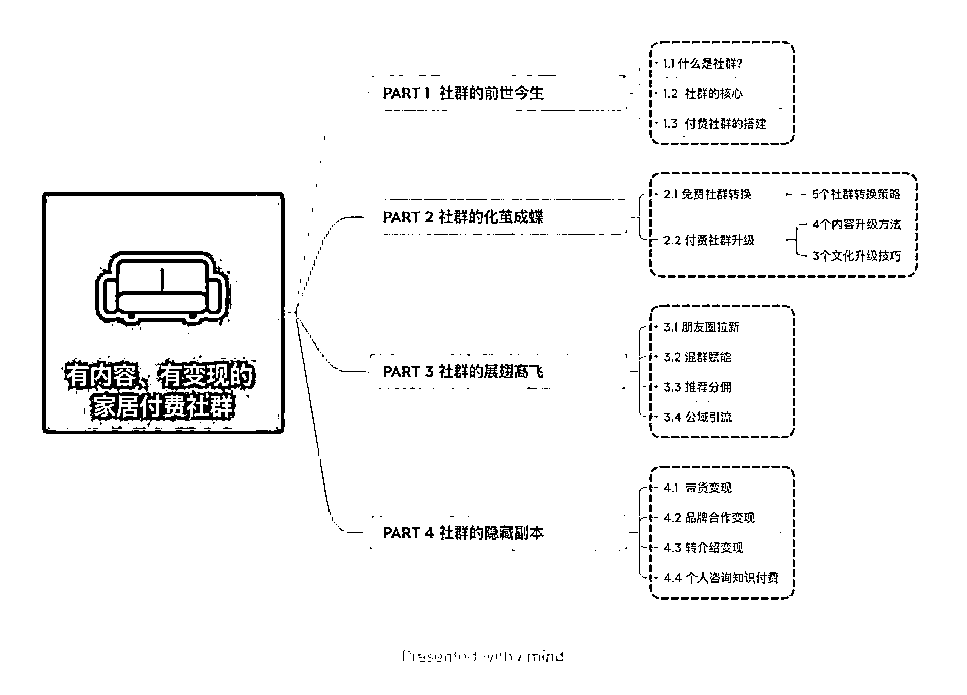

# 零基础运营：我把家居免费群做成付费社群的经验

你见过这样的微信群吗？发个红包过了大半天还剩一堆没人领；群里聊来聊去不是闲扯就是抱怨，翻遍聊天记录也找不出几条干货；群主每天一个人唱独角戏，辛辛苦苦写内容，换来的回应寥寥无几。坦白说，我以前运营免费群时，这些状况全都遇到过。

当时，我还是一名在编幼教老师，业余最喜欢折腾房子，但对社群运营几乎一窍不通。宝妈购物群、装修围观群、副业赚钱分享群……这些群我都建过，可直到参加完三个月的社群运营大航海，我才明白，它们跟真正的“社群”根本不是一回事。

零门槛免费群的坑，远不止这些。新成员一窝蜂涌入，很多是来加好友引流的，老成员的好感度被一点点消耗；购物群逐渐变成广告墙，群里的生意不但没多，反而更差；群主一旦停止输出，整个群就冷了下来，时间长了很难坚持。

所以，我下定决心要改变。花了四个月，原本那个不收费的装修围观群，被我重新打造成了“家居陪伴年度社群”。群友中陆续有14人做过主题分享，大咖讲座一共办了4场，累积下来的精华文字超过4.6万字。最重要的是，好几个变现闭环都跑通了，收入也稳定下来。

这一路靠的不是多高深的运营理论，而是一些实用的小技巧和小话术。正是这些小细节，让我一点一点把“围观群”变成了“付费群”，让它既有活跃度，又有真实价值，还能持续产出收益。

如果你也在经营社群，正为没人说话、没有转化、越来越冷清而头疼，那我这篇复盘应该能给你不少启发。全文共4200字，建议先点赞、收藏，完整图文在飞书这边可以看：https://sebz0gwoxb.feishu.cn/docx/FCekdjKiYoqbe6xUOxVcooOUnCb

