# 线下店破局：把私域做成增长底盘

作者：佳佳  
日期：2022-01-27

我是佳佳，过去在母婴、大健康两个赛道做事，产品培训是我的老本行，也跑过上百间实体店，江浙沪、四川、河南、山东、海南都留下过脚印。上海一家母婴店做周年庆时，我参与协助，单店日均营收冲到三十多万元；合作过的代理商里，也有年销售过亿的。

目录

**1.** 实体店的现实处境  
**2.** 线上：获客入口与私域成交  
**3.** 线下：人、货、场的基本功  
**4.** 额外收入：服务延伸、知识付费与招商加盟  

不少人看空实体零售，连一些店主自己都犯嘀咕。借着鱼丸的约稿，我想把我看到的门店破局方法摊开讲讲。下面会拆多个线下案例，分线上、线下两条线：线上说清怎么从多个平台蓄客、把客户沉淀进自己的私域；线下则从人、货、场三个切口，看那些跑出来的店做对了什么。

**—01—**

实体店的现实处境

**1、实体店眼下过得怎样？**

自从淘宝、拼多多等平台崛起，中小线下店的生意一年比一年难。近两年疫情反复，冲击更明显，不少城市出现关店潮。沃尔玛中国年内关停了31家大型卖场；海底捞也计划收缩约300家店，约占门店总量的两成。

唱空实体零售的声音很多，再叠加商品同质化、拉新成本抬高、营销效果走弱，“内卷”几乎成了商家的共同感受。但换个视角，内卷不等于行业没落，任何行业都在螺旋式演进。线上店能覆盖全国、效率高，可如今线上厮杀更凶，买流量的代价越来越高。反过来，线下店又出现了新机会，前提是经营思路得从老一套切换到创新模式，才能接住新消费人群。需求越来越多元，一些新锐品牌和门店正是借这个窗口跑了出来。

所以今天想聊的是：线下店怎样把线上线下的获客与成交串起来？

**2、开一家实体店，启动资金怎么算？**

入局方式无非直营、加盟、代理三类。选哪条路，都要先盘一盘自己的钱袋子、能力和当地市场，创业有风险，别拍脑袋。

我比较熟母婴店，就拿它做样本，粗算一笔启动账：

**1.** 房租：城市、面积不同，价格差很大。60到100平方米的店，月租常见区间是5000至20000元，按承受力挑。  
**2.** 装修：不必堆豪华，温馨、舒适、有亲子感即可。60到100平方米，硬装软装大约3到5万元；若要放儿童玩具、婴儿洗澡设备，面积最好做到100平方米以上。  
**3.** 品牌加盟：各品牌收费不同，所谓“零加盟”多数只是话术。规范品牌通常在7到15万元。  
**4.** 设备：看店型大小，约1到3万元。  
**5.** 人员工资：按用工人数算，小城市每人每月至少2000到3000元，一二线城市常见4000到6000元。  
**6.** 铺货：母婴店每平方米大致要压1000到1500元货品，80平方米的店，铺货加囤货约5到10万元。  
**7.** 周转金：用于补货和日常开销，建议留3到5万元。  

拿80平方米的自营母婴店举例，不含加盟费，整体预算放在20到30万元比较稳妥。当然，想做多大、在哪个城市，都会改变数字；资金宽裕可以扩大面积，顺带加上游泳馆、游乐场这类能带客的项目。

选址关乎生死，位置差、缺客流、没需求，租金再低也别碰。但如今线上获客通道变多，门店不必死磕“金角银边”，完全可以把省下的租金拿去线上买注意力，后文会细说。

这里有个常被忽略的概念：

人流量 ≠ 客流量！！

人流量，通常指店门口经过的人数，其中混有大量非目标顾客。

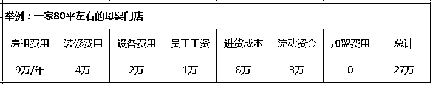

客流，则是有效进店、产生消费的顾客数。

私域，按杭州电子商务研究院的界定，是把公域（internet）、他域（平台、媒体、合作方等）以及私域自身产生的访客，导向官网、客户名单等自有阵地；这些客户数据能反复连接、触达并用于发售等营销活动，和域名、商标、商誉一样，属于企业自有的数字化经营资产。

所以，门口人多不代表生意好，选址要冷静。过去客流主要靠到店，如今想抬营业额，更稳的路子是线上加线下一起获客、一起转化。

**—02—**

线上：获客入口与私域成交

流量是生意的底层燃料。线下店不只是收银场所，更是把顾客引到线上持续服务的入口。特殊时期让更多门店看清了私域的价值。私域到底为何重要？线下店为什么非建不可？

杭州电子商务研究院有过梳理：传统门店靠发传单、店内促销、线上团购来刷存在感、拉客人，这些手段辐射面窄、传播半径小。一旦特殊时期到店人数骤降，资金链很容易吃紧。

因此，线下店把私域做扎实，才谈得上可持续经营。让门店线上化，再用一对一沟通、朋友圈、🛰️群、直播等方式拉近顾客关系，把客户池养好，回报是长期的。

**1、流量从哪里来？**

先说线下流量：门店本身就是流量入口，数字化时代，线下场景里还有大量用户等着被沉淀进私域。

**1）门店自然流量**

不同加盟品牌、不同装修风格、不同点位，自然到店人群并不一样。可以用促销活动做宣发，用行业知识分享做引子，把“加🛰️后能获得更深服务”讲清楚。

**2）种子流量**

种子流量指的是老顾客、回头客。他们对品牌、商品已有基本信任，或者认店长、店员这个人，导入私域相对轻松。运营上，常用朋友圈宣发、一对一私聊关怀去触达、拉群，强化品牌与商品认知，再叠加高附加值服务，促使他们再次到店或带来新客。

**3）转介绍流量**

线下店自带社交关系，老客转介绍的量往往不小。这类人可能有消费需求，但对门店和品牌还不熟，多半是“信朋友，来试试”。一旦沉淀进私域，转成深度用户的概率不低，也会成为下一批种子流量。

**4）活动流量**

门店可以办周末活动、节假日活动、店庆等，节日可借势，也可以自己造由头，天猫双十一就是无中生有的典型。触达方式包括店铺海报、社群邀请，再配裂变玩法放大流量，用充值优惠、抽奖等钩子，把人群导进个微、企微和社群。

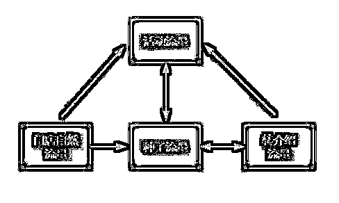

比如做店庆，自然客流、种子客流、转介绍客流都可能汇入活动流量；活动流量经过持续私域运营、建立信任后，又会变成种子流量。种子继续滚动，又裂变出转介绍流量。线下店只有先把用户私域化，后面各种流量才有承接和转化的可能。

再看线上流量，主要有以下几种：

**1）公域流量**

📕、抖音、🧣、🛰️👸号都是当下热门阵地。门店可以拍经营日常、讲行业经验、发专业干货、写推广文章来增加曝光。平台用户基数大，能让门店获得非定向、大范围的传播，曝光上去后，消费者会自然出现。

1. 我们早期重点做📕和🧣，2018年就开始铺内容。📕粉丝3.8万、收藏24.9万，🧣粉丝1.9万，不少客户从这两个平台过来。若你具备内容输出能力，很建议做个人IP：📕、知乎发图文，抖音、快手做短视频，还可以开直播，一边卖货一边获客。母婴店在公域动作不多，我换一家花店来说明，这家店从2018年起持续在公域发图文和短视频。

举例：林子小间

这是摄影师林子和日语专业出身的华先生2018年一起开的小花店，因为店面不大，取名“林子小间”。花艺与摄影结合，能体验花环、相框等手工DIY，也做鲜花、干花装饰，还接花礼定制，常办手作课、户外花艺沙龙和小型婚礼布置。文艺复古的气质，吸引了不少人专程过来。

2. “林子小间”也会在团购平台、点评网站、旅游攻略APP、豆瓣等渠道做引流。

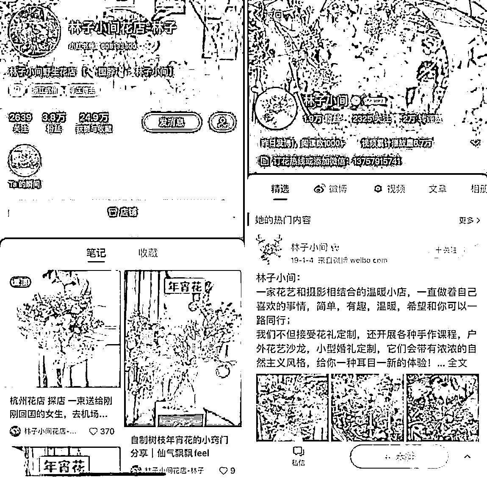

3. 抖音、B站、快手等平台也有“林子小间”的账号，不过短视频表现明显不如图文。店主也在补短视频制作与运营能力，可能还没完全从图文思维切换过来。

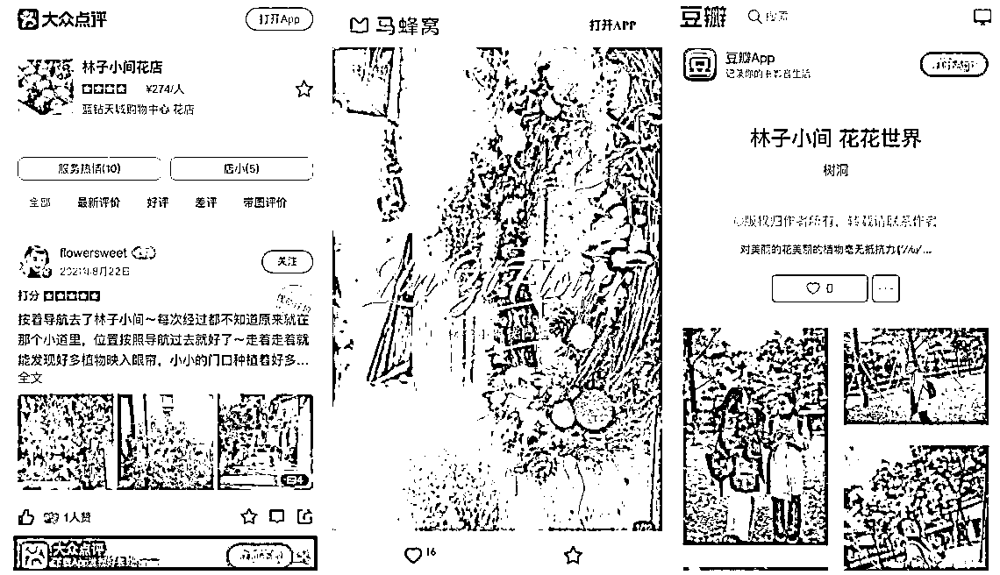 

4. 除了自产内容，林子小间还合作达人探店，以📕为主阵地，再分发到大众点评、抖音等平台。

如果门店没有内容制作能力，达人探店是更省力的办法。不过现在选达人，不只看粉丝量，更看转化率；抖音团购达人的带货分可以拿来参考。

**2）抖音同城号**

线下店很值得做抖音同城号。抖音日活已过8亿，同城还有流量扶持，等于有免费入口，既能宣传，也能把客人引到店或私域成交。

说到抖音，很多人第一反应是粉丝数。其实几十万粉的搞笑号，变现未必强过几千粉的垂直号。同城号也不只餐饮、美业能做，任何线下店都适合。视频不必多精致，拍得普通也没关系，能引流、能成交就有价值。

目前母婴店较少把抖音粉丝往线下引，更多是直播卖货，或做个人IP涨粉接广告。但同城餐饮的团购模式已经跑通：短视频挂POI地址，线上买团购、线下消费，类似大众点评和美团。

举例：红料理串串有瘾

上海连锁品牌“红料理串串有瘾”在11月做了“双红节”：抖音团购1元代金券，11月17日当天身上带两个红色元素，到店用餐每人减117元，上海20家店通用。活动把品牌推到了上海串串好评榜第一。当天客流太猛，部分门店桌号发到700多号，晚上9点多仍有人没叫到号，体验打了折扣。这里也提醒门店：活动别全挤在同一天，接待容量有限。

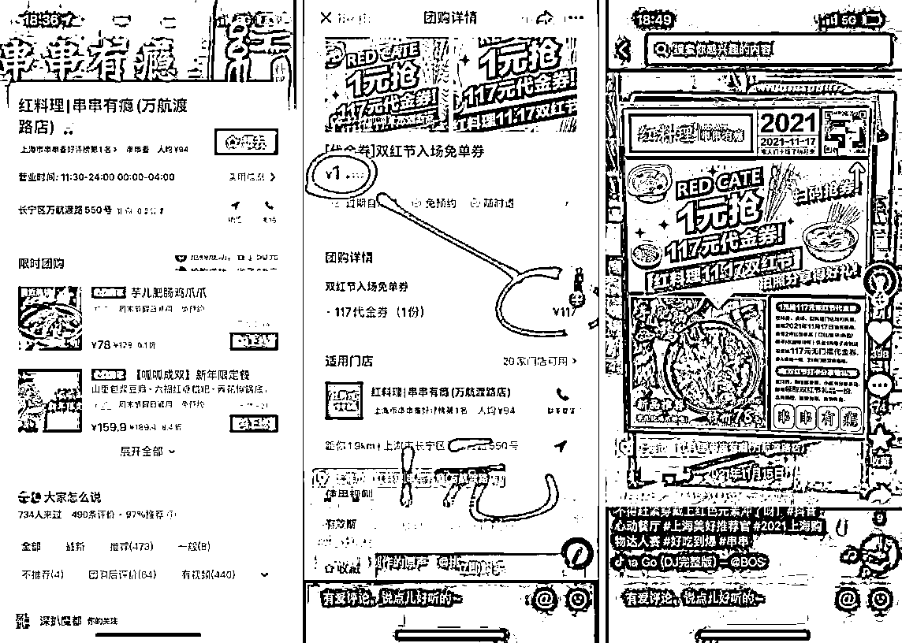

视频示例：https://internal-api-drive-stream.feishu.cn/space/api/box/stream/download/video/boxcnvfz6bt17F3XWugxORd99vV/?quality=720p&data_version=7050330828248727556&mount_point=doc

**3）同城美食号**

这是最成熟、也最热的玩法，流量大；但餐饮赛道竞争最凶，运营能力不突出很难冒头。

**4）同城宠物号**

可覆盖宠物售卖、训练、暂养、寄养等。

**5）同城招聘号**

去同城走访各类用人单位，留下联系方式与工作场景，用求职者视角呈现待遇、环境等信息。

**6）行业技能**

面向同城想学技能的人，展示相关技能内容。

**7）房屋装修**

需求很精准。日常可输出装修公司考察、哪家靠谱、规模如何等干货。

**8）同城旅游**

体验本地景点，替游客排雷避坑。

**2、线上如何变现？**

线上变现主要靠私域运营。店长、店员把到店客或潜在客加到个人🛰️，再做深度服务和多渠道成交。记住：到店顾客尽量加🛰️。前面说的平台流量、🛰️群流量、线下流量，都能在私域里转化。越来越多商家把私域当成精细化运营和降本增效的主阵地，推动新零售转型。

私域的好处是不用付流量费，能按自己的节奏、多次直接触达用户，比如🛰️号、企微个人号、用户群等。新品、折扣、活动信息，随时可以发。

**1）卖门店里的商品**

所有线下店都能线上卖货。母婴店可以卖店内母婴用品，也可以卖与婴幼儿、宝爸宝妈相关的其他商品；餐饮店能卖自制半成品或即食品；宠物店可卖宠物用品等。

**2）卖行业相关商品**

除了自家商品，还能延伸到行业相关的产品与服务。比如母婴店顺带卖女性用品、儿童用品，甚至店员也会卖微商产品。

女性相关：化妆品、减肥产品、保养品……  
宝宝相关：婴幼儿营养品、日用品……

“私域需要时间沉淀，人与人之间的信任不是一步到位。尤其母婴行业，信任要更深，才谈得上成交和转化。”

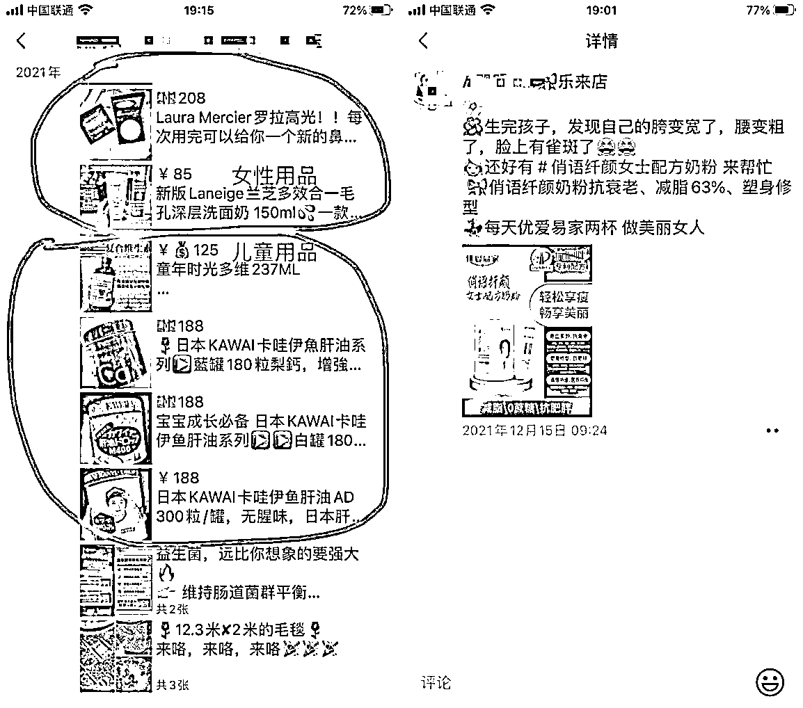

**3）卖货渠道**

把目标客户导进私域后，一对一、朋友圈、社群、直播、微商城都能承接转化。朋友圈可以立IP人设卖货；社群能做快闪群或服务群；视频号短视频和直播也能变现。

举例：婴乐会母婴店

这家店在沙县步行街，名叫“婴乐会”。老板分享过自己的私域体会：

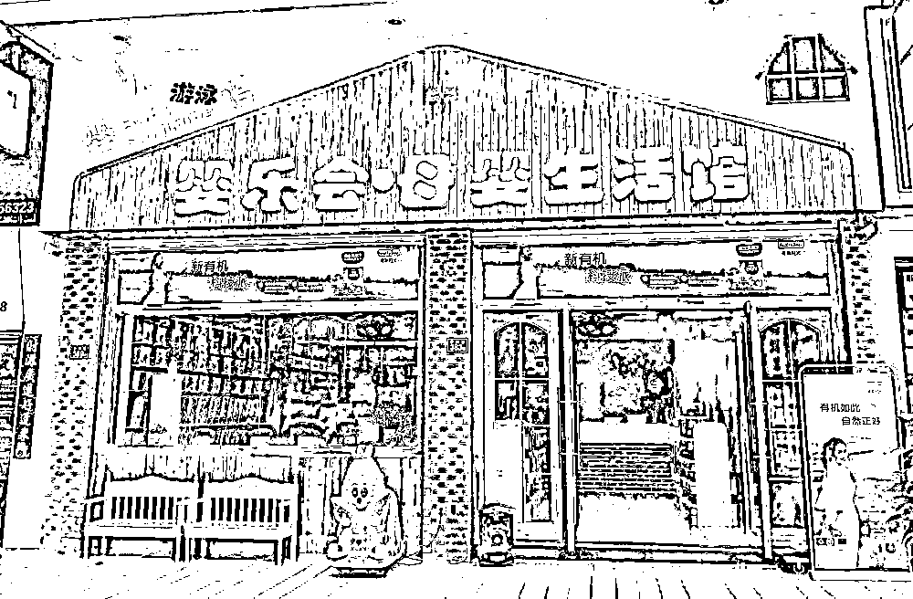

第一年亏30万元，第二年仍亏，第三年转盈，年营业额接近千万元；曾有一场活动，当天单个🛰️收款20万元。

老板说，目前婴乐会线上经营额占七成，线下占三成。线上主要靠🛰️朋友圈和微商城等私域阵地，没有做淘宝等公域。店里有12个🛰️号、几万活跃好友，但老板强调“从来没有主动加过一个客户”，都是被动引流。

“🛰️把我们的销售半径拉大了。实体店开在沙县，只能守一个点；借助🛰️，能做全国生意。我🛰️里有黑龙江、内蒙古、新疆等很远地方的客户，都是客户把我的名片推出去，裂变来的。”

吸粉的常规动作，是把到店消费者加到🛰️；裂变活动也管用，比如零售价6元的纸巾，客户加🛰️转账1元就能拿。因为划算，客户会转告朋友，又带来一批人加🛰️。

🛰️个人号矩阵，把婴乐会的销售覆盖范围撑大了。层层转介绍之后，客户遍布全国。这份成绩，根子还在门店积累的私域和精细化运营。

**—03—**

线下：人、货、场的基本功

为什么线上电商平台纷纷开线下店？因为顾客能看、能摸，信任更容易建立。

线下店做私域引流，其实比纯线上企业简单。线上店让顾客“加群领红包”，对方容易抵触；顾客到店消费时引导进群，送点小礼品或折扣券，比如食品店送小零食、奶茶店免费升大杯、饰品店送八折券，顾客想到下次还可能复购，接受度会高不少，成功率也更高。

线下运营细节很多，下面从人、货、场三个维度拆。

**1、人**

线上买东西更快，但服务核心仍是人。店员靠谱、服务周到、足够专业，能解决顾客问题，就可能成为顾客选店的理由，顾客才愿意来消费。线下店做的是人与人的生意，专业和热情是服务的基本盘。

**1）专业，才能被信赖**

好门店离不开好店员。孩子王的店员不只热情，对产品熟得惊人，妈妈们关心的营养素含量、种类都能说清；疫情后还亲自送货上门。有些孕婴店员不但懂商品优劣，也乐意帮顾客抱宝宝、喂奶粉。

大环境会让一些店员情绪低落，但仍有金牌店长、店员跑在前面。提升自己才是根本：补专业知识、练销售技巧、站在顾客立场推荐商品，持续更新知识储备，把个人和门店的口碑做起来，让顾客愿意口口相传。能打动人心，就不怕客户被抢。

**2）店员的服务状态**

店员得拿出亲和、积极、有精气神的状态，才能感染消费者。设想你走进一家店，导购个个没精打采、垂头丧气，你还会信任它吗？大概率不会。想提业绩，先得把顾客吸引进门。将心比心：作为消费者，什么样的店会让你想进去？进去之后，什么样的服务和陈列会让你愿意掏钱？多站在顾客角度看问题。

**3）送货上门，把服务做成加分项**

无论哪个行业，只要帮顾客解决了实际问题，价值自然就出来了。现在门店之间的比拼越来越激烈，服务成了拉开差距的关键。宝妈带着孩子，想出门常常身不由己，这时候如果店家能主动把货送到家里，优势一下子就能体现出来。所以在我接触的母婴店里，几乎家家都把送货上门当作标配服务。

**2、货：选品决定下限，增值拉高上限**

**1）好产品才是硬道理**

线上能不能出爆款、直播能不能跑通，靠的都是选品眼力和供应链功底；线下实体同样绕不开这个规律。选品就摆在那里，选得好不好，直接反映在生意上。拿餐饮举例，同一条街上，火锅店往往比中餐店火爆，核心原因是这条街的客流就好这一口。母婴店也一样，货品的档次、品类齐全不齐全、品牌有没有号召力、奶粉日期新不新鲜、价格是否实在、有没有促销活动，这些都会成为顾客挑选门店的衡量标准。备货尽量全面，再把陈列、品牌、服务这些细节持续打磨到位。除此之外，店面大小、是否连锁、能不能一站式买齐、陈列是否看着舒服、灯光是否明亮，这些都会影响顾客是否愿意踏进店门。店员热情地让顾客试饮奶粉也很关键，很多人本来没打算买，尝了一口就动心了；就算当下没买，以后要买奶粉时，脑海里也会闪现这家店。

**2）有限空间，挖掘更多价值**

实体店面积摆在那里，怎么在有限的场地里做出更大的生意，不少老板都在动这个脑筋。母婴店会塞进儿童玩具、婴儿泳池；美容院也不只做面部，还延伸到身体护理、身体调养、私密项目；餐厅除了吃饭，还能安排唱歌蹦迪。比如母婴店+儿童游乐区+游泳馆的组合。没走进过母婴店的人，可能会觉得这就是个卖婴儿用品的地方，货架上无非是奶粉、辅食零食、营养品、日用品、妈妈用品、童装童鞋、玩具、推车童床这些。但凡你真正去逛过，就会发现面积大的门店早已不是只卖货了，还会塞进游泳馆、游乐场、儿童电动车这些引流项目，有些游乐设施甚至免费开放。孩子们在店里玩得不想走，大人之间也能闲聊几句，店员正好借机和宝爸宝妈们拉近距离。大人不累，孩子开心，人流量自然就上来了。

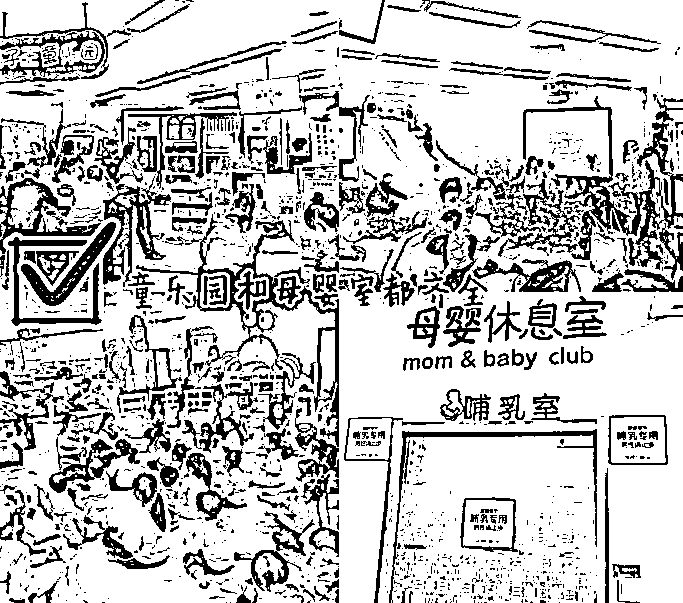

再比如烧烤店+唱歌+蹦迪+单身墙的组合玩法。餐饮圈里有家连锁烧烤叫「M-MIX 电音烤吧」，把吃烧烤这件事做得特别有娱乐感，活动设计也相当有巧思。上海首店开业不到六个月，就冲上抖音上海市音乐餐厅人气榜第1名。它是怎么玩的？晚上八点漫天飘雪、十点变成樱花雨的网红打卡点，一边撸串一边蹦迪，深情演唱穿插劲歌热舞，把潮流科技和浪漫氛围融在一起，成了许多人专程去打卡的地方。

https://internal-api-drive-stream.feishu.cn/space/api/box/stream/download/video/boxcntGABQdcaSZwqYkkER5Ninh/?quality=720p&data_version=7050331658549215236&mount_point=doc

**3、场：视觉、活动、跨界，一个都不能少**

**1）门面就是最好的广告**

之前有位圈友讲过一个真实案例：一家餐饮小店靠视觉改造和好记的店名，在抖音上意外走红，甚至因为太火爆不得不关门调整。这个例子对做实体生意的人特别有参考价值。故事发生在武汉，这家店现在叫「被树挡住的烤肉店」，两年前它的名字还是「三和记炭火烤肉」。店面不大，四五十平方米，摆得下十张桌子，生意一直不错。但今年4月，客流明显下滑。老板观察了一下，发现年轻人越来越爱去网红店打卡。再看看自己这家店，面积小，没设计感，也没钱做推广，更倒霉的是门口还有棵大树挡着，曝光更加吃亏。于是老板决定从改名入手，据说店名和招牌都出自女朋友之手。既然被树挡住，干脆就叫「被树挡住的烤肉店」。靠着本来就不错的烤肉口碑，加上抢眼的绿色门头和朗朗上口的名字，今年9月这家店在抖音和📕上突然就火了。

**2）活动运营，提升到店频次**

前面说到的餐饮店办红料理双红节，还有不少门店搞盲盒活动，这些都是可以参考的玩法。母婴店在基础服务之外，也会跟着季节策划一些应景活动，比如夏天搭建小型水上乐园。这种活动让家长遛娃轻松不少，孩子能玩得久，还能清凉解暑，顺带锻炼宝贝的肺活量，促进血液循环和新陈代谢。还有些门店会和品牌方联手，办插花、手工这类年轻父母喜欢的体验活动，让大家感受到母婴店不只是买奶粉的地方，也能让人放松心情、增进亲子感情。

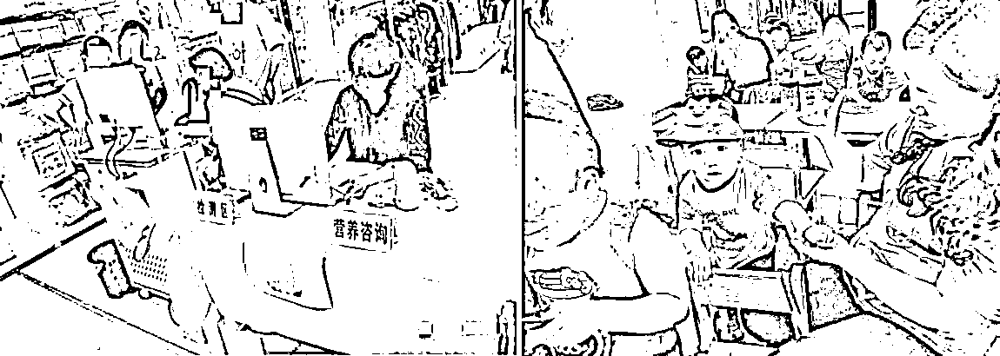

**3）跨界营销，互相借力**

所有实体门店都可以琢磨跨界合作这件事，星巴克、麦当劳那些经典联动案例就很值得研究。下面来看肯德基 KFC 和泡泡玛特、元气森林的跨界合作：

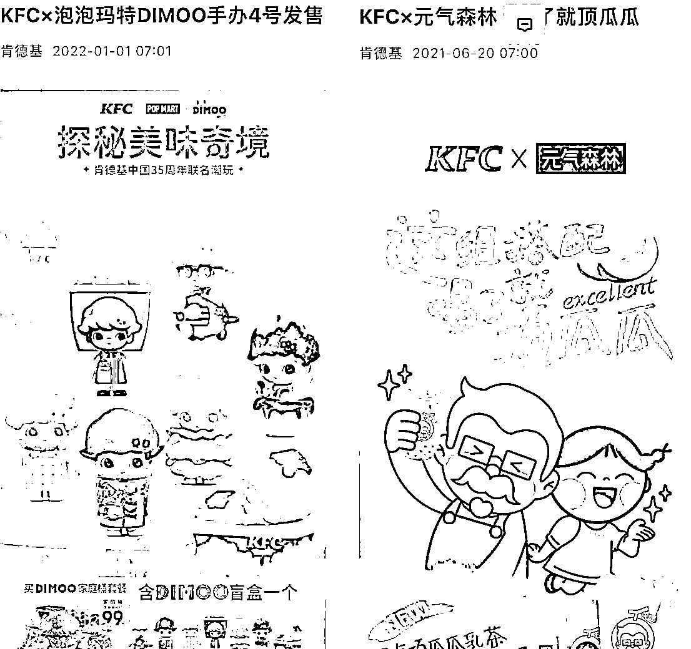

**—04—**

其它收益

**1、行业延伸服务，做不了就转介绍**

实力够的话，行业周边的服务可以自己消化；店小能力有限，那就对接外部资源，把客户转介给靠谱的同行，中间轻松拿一份分润。这种模式在不少行业都跑得通。比如美容院接不了医美、干细胞这类项目，可以把客人引荐给医美医院，光这一块的收入就可能比门店自己的项目还多。操作上通常是用低价项目把客源引进来，再往高价医美项目上做转化。母婴店的产品和周边服务就更丰富了，完全可以和教育、医疗、娱乐、智能硬件等领域做联结。下面以母婴市场为例展开：

母婴市场大致可以分成两大块：母婴产品和母婴服务。

**1）母婴产品**

覆盖孕产妇和各个年龄段婴童在穿衣、饮食、居住、出行、教育、娱乐等方面的需求，主力品类有奶粉、营养辅食、尿裤湿巾、喂养用品、洗护用品、童车童床、安全座椅、玩具书籍、童装童鞋、服饰寝具、智能硬件等。

**2）母婴服务**

涵盖教育、医疗、娱乐等服务型业态，具体产品及商业形态包括：智能硬件类，如温奶器、消毒器、哄娃神器、智能胎教仪、智能体温计等；孕育管理类，如备孕工具、经期管理工具；母婴社区类，如交流群（母婴🛰️群）、照片分享社区（宝宝树、亲宝宝等）；母婴医疗类，如育儿专家、儿科医生平台；母婴电商类，如平台型、垂直型、跨境型电商；母婴内容类，如知识付费、短视频、技能培训等。

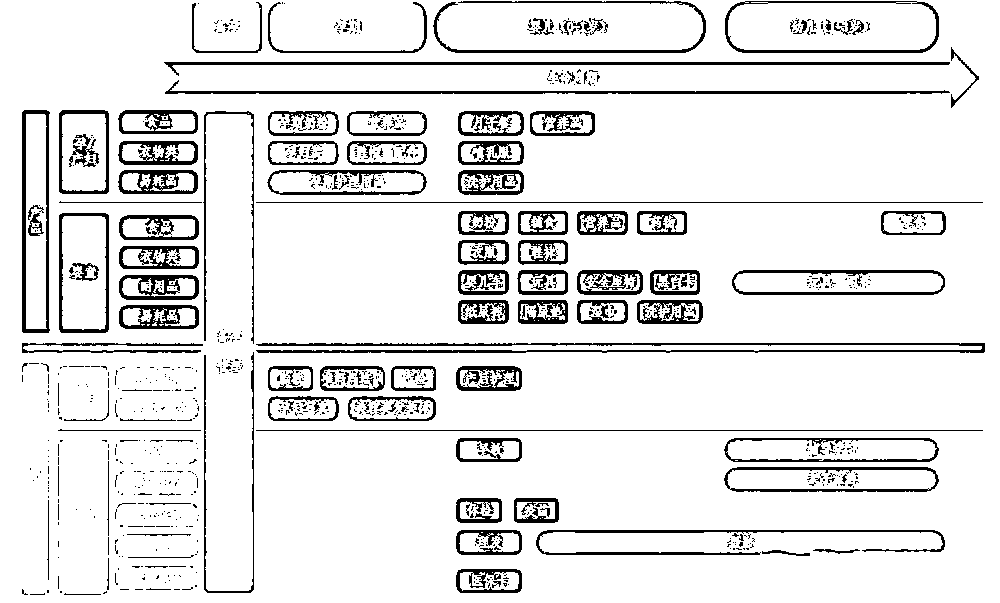

**3）母婴生活护理服务**

婴儿基础护理：喂养、洗澡、换尿布、洗婴儿衣物、拆洗被褥等；婴儿专业护理：抚触、测体温、观察大小便、护理脐带等；产妇基础护理：照顾饮食起居、搭配营养餐、清洗衣物等；产妇专业护理：教母乳喂养方法和婴儿喂养常识、做好产后健康护理与常见病预防、指导产后恢复操等；医疗生活护理：婴儿口腔、皮肤、眼、耳、鼻、脐带的护理，婴儿意外伤害的紧急处理，产妇恶露的观察处理以及哺乳前后的乳房护理等。

**2、知识付费**

**1）付费课程或付费社群**

只要有市场需求，任何行业的知识都能拿来变现，关键看你自己怎么选。擅长什么、对什么感兴趣，就往那个方向定位。可以讲行业干货，讲自己的开店历程和踩过的坑，也可以拉一个社群，让经历相近、背景相似的同路人互相交流切磋。母婴门店做知识付费，可以参考这个案例：

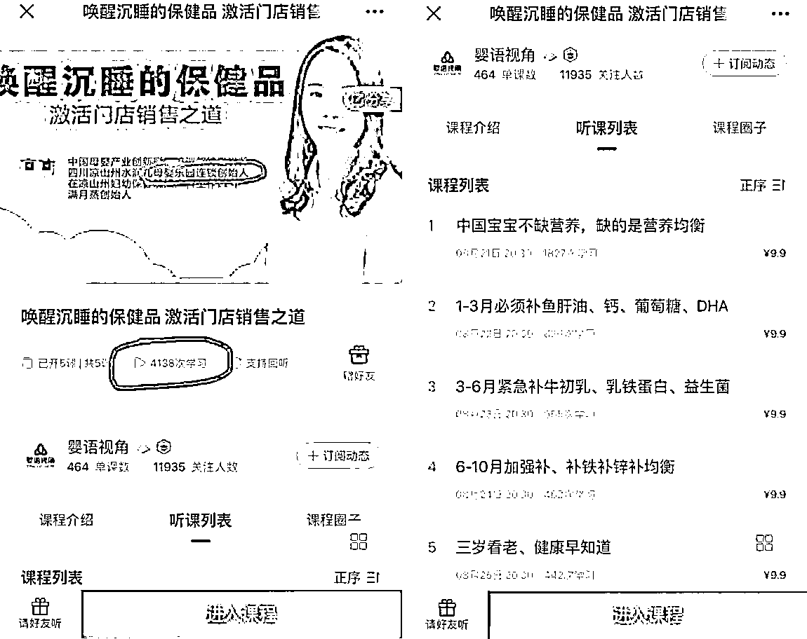

餐饮门店招学徒的模式也很常见：

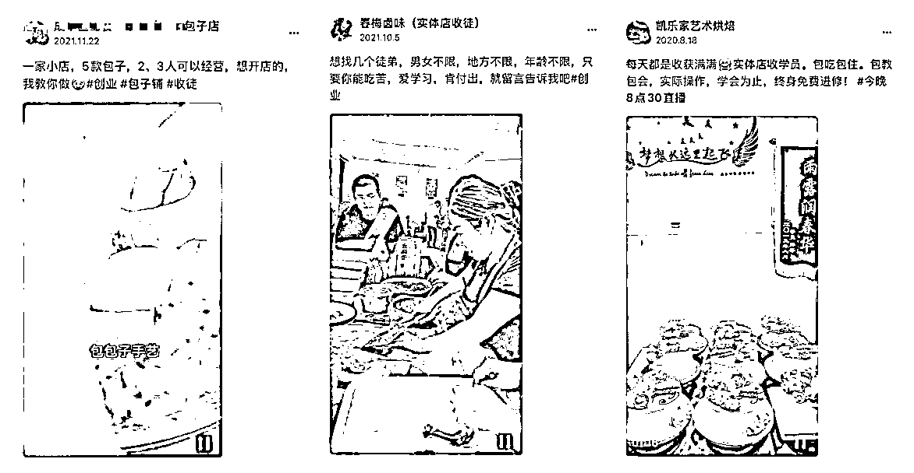

**3、招商加盟**

当你把选址、选品、运营、营销这一整套体系都跑顺了，其实任何实体店都具备了开放加盟的条件。不少实体老板正是在走完0到1的冷启动之后，靠招商加盟实现1到100的快速复制扩张。所以我们看到的连锁品牌，大多是直营和加盟两条腿走路。服装店加盟案例：

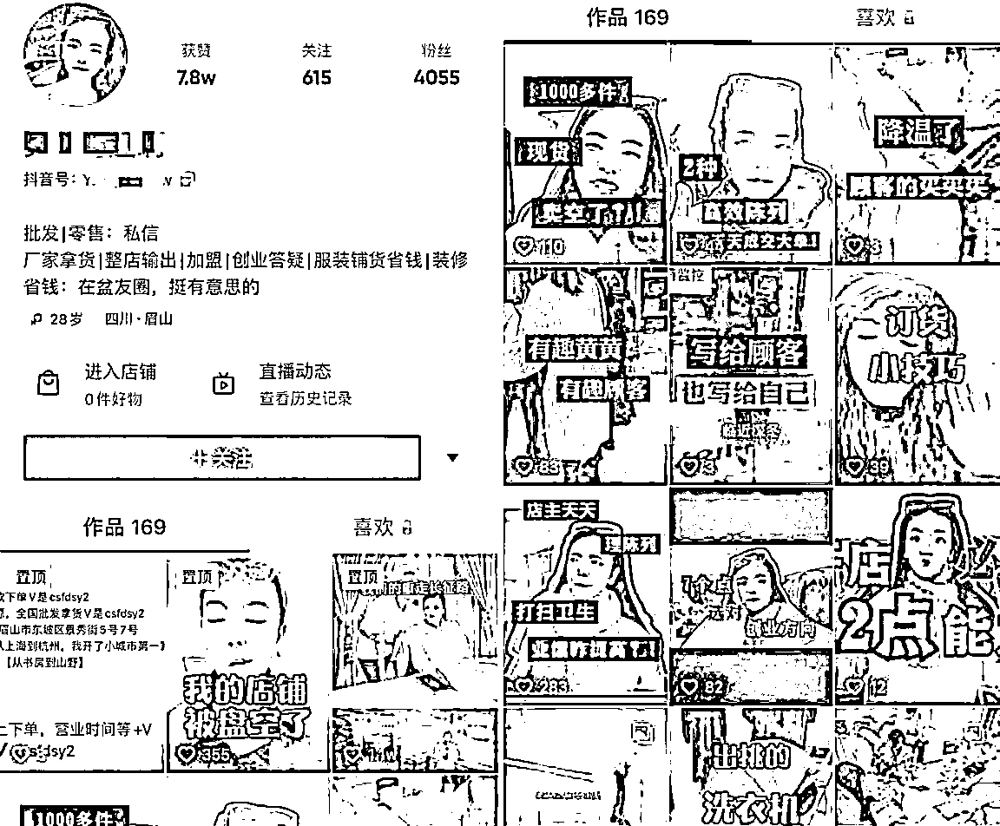

最后想说，不管线上跑得多快、外界怎么唱衰线下，实体门店始终有它不可替代的价值，很多服务终究要在线下完成。真心祝愿每一位实体经营者都能乘风破浪、破圈赚钱。

我是佳佳，一个常年游走在线上业务和线下实体之间的跨界人。做过母婴、大健康、电商，线下也经营者母婴门店和美容养生门店。最近还在短视频和直播领域持续探索。所以当赚钱的数列老师让我写自我介绍时，说实话我纠结了很久，不知道该从哪讲起。好啦，今天就先聊到这儿。

哈哈，特别感谢赚钱小伙伴在背后“挥小鞭子”，逼着我复盘出了这些实体店的玩法和心得。想交流的朋友欢迎私信我，加好友请备注龙哥盟，也欢迎在评论区留言互动。觉得这篇内容对你有启发的话，点个赞支持一下吧，谢谢～

评论区：

Marco : 同为新零售人，方便加 v 交流一下吗

佳佳 : 欢迎欢迎~加 V：jiajia001000

Barbara : 我也想加您，麻烦通过一下，我是 Barbara

佳佳 : 已通过，下午一直忙，刚看到[捂脸]

龙哥 : 感谢分享，已加精华。

佳佳 : 谢谢龙哥大大！

郑小焦 : 谢谢详细分享，打破了我对实体店的老印象，用实体店建立信任基础，再结合线上引流沉淀私域，这个思路真的很棒

佳佳 : 🤝🤝