# 巷子小店靠1.7万粉月入近3万，实体店如何借抖音破局

大家好，我是 silence，在山西运城做猪蹄生意。开店那笔钱，是把车抵押贷出来的；如今这个粉丝只有1.7万的账号，每月能带来接近3万元的利润，算是走出了第一步。今天想聊透一件事：线下门店，怎样借上抖音的力。

**-01-**

## 线下门店做抖音，值不值得投入

我入场的原因很直接：店面租金压得低，位置自然偏，靠路过客人根本撑不住，只能主动找客源。纸传单印过，本地自媒体谈过，美团和饿了么也上过。转了一圈，真正见效的还是抖音。

道理不复杂：所谓流量，本质是消费者愿意把注意力放在你身上。要让运城本地人注意到我的店，成本低、见效快的渠道，基本就是抖音。

和发纸质广告相比，短视频的优势很直观：平台算法会把对吃没兴趣的人挡在外面；动态画面比静态图更能刺激食欲；评论区还能互动，口碑一旦积累起来，熟人之间的扩散很快。小城市尤其如此，街坊之间相互认识，消息传得比大城市还迅速。

再看大盘。2021年初，有接近抖音的人士提到，抖音三个客户端的日活峰值已经非常接近7亿。第七次全国人口普查公报的全国人口为141178万，折算下来，每两个人里至少有一个会打开抖音。还没把老龄化因素算进去——60岁及以上人群有2.64亿，占比18.7%。所以现在做抖音，有点像早些年开淘宝店：过程未必井然有序，但方向大概率没错，坚持做下去，也许就成了别人口中最早尝到红利的那批人。

另外，抖音从美团手里抢市场几乎是必然的，同城团购、心动外卖已经露出苗头。这对线下商家是窗口期：尽早入场积累影响力，把企业号、团购、抖店这些新功能逐个试一遍。等平台格局像美团那样稳定下来，我们也能有立足之地。

**-02-**

## 账号定位怎么做

我起初的想法很朴素：让店铺周边的人刷到我家卤猪蹄、鸡腿，能私信下单最好；哪怕只是混个脸熟，下回路过时好奇进店也行。

后来听林奕老师的《抖音商业IP定位篇》，才意识到自己误打误撞踩对了方向。有效的定位，说到底是两个词：垂直、精准。

检验定位清不清楚，有个很实用的办法：能不能用一句话概括「这个号服务哪类人、给出什么价值、替他们解决什么难题」。能概括出来，说明方向明确；概括不出来，多半还没想透。

以我的号为例：服务店铺附近爱吃卤味的人，提供现卤现卖、热气腾腾的猪蹄，让顾客能联系上下单并吃到，从而带动门店销量。

定位还有一个大前提：你得确认自己愿意长期做下去。起步阶段别把目标定得太高，多数人都是普通创业者，在能力范围内把话说明白、让刷到的人看懂，已经够了，余下的边做边调。千万别拿张同学那种级别要求自己，结果更新两天就停更。

线下门店的定位，拆开就是两件事：把能提供的服务亮出来，赢得用户信任，进而推动成交。

**1. 把服务展示清楚**

也就是结合自身能力，决定呈现方式和内容。建议翻一翻大航海学习手册，用“归纳九宫格”和“发散九宫格”这两个工具，我截了两张图。

大航海学习手册：

https://shengcaiyoushu01.feishu.cn/docs/doccn7JXHWlNv84Sq8hXWEEwBSg#ft7izr

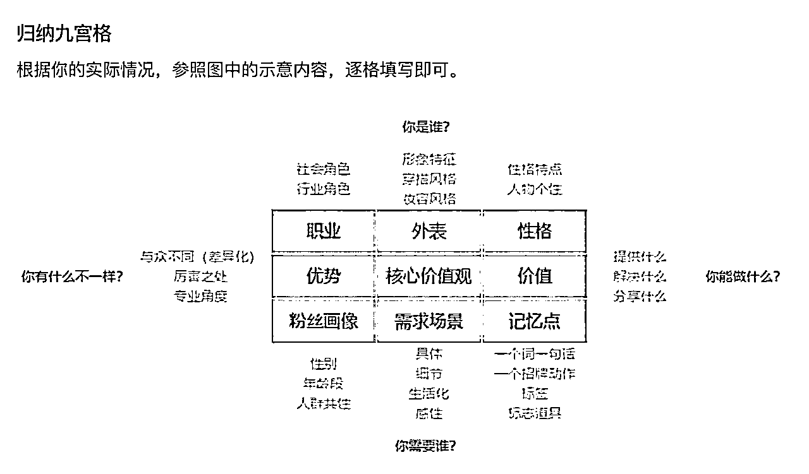

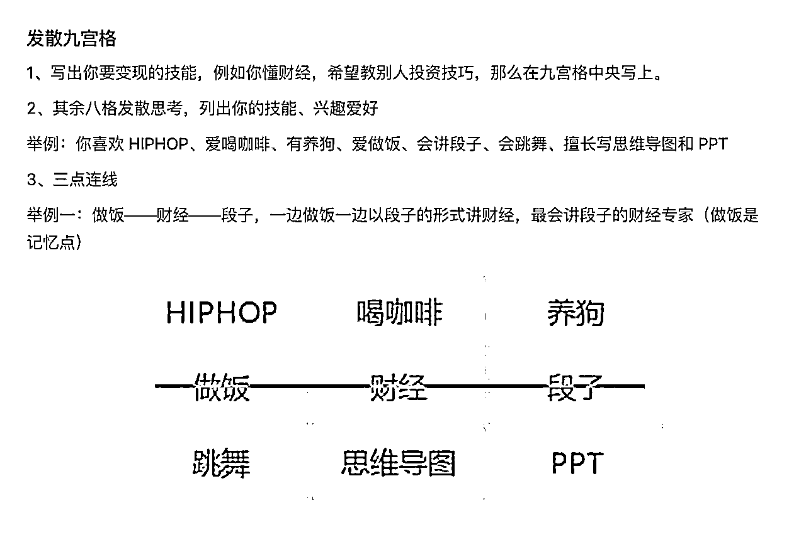

**2. 赢得信任并推动成交**

我实践了四个小办法：

**1）用小号制造问答**

准备几个小号，或者请亲友配合当托，视频发布后立刻在评论区夸赞、提问：看着真香，店在哪里？上次去没买到，营业时间几点到几点？总之，你希望顾客了解的信息，都可以用一问一答的方式露出来。

**2）借助高信誉账号扩散**

必要时可以请本地自媒体做一轮宣传。我当时找了运城本地的“灵通资讯”，也付费合作了几个小网红。

**3）呈现门店忙碌、产品紧俏的场面，适度制造稀缺感**

比如理发店可以写：“记得提前预约，别像这位兄弟大老远跑来却没排上”，哪怕当时店里空着，也可以这样发。

**4）用故事做承接**

拿A账号拍一条有情绪的故事，例如“我的十年”，再通过A账号把流量导向B账号，完成转化。我当时找了本地一个擅长讲故事的账号，做了一期视频。

下面贴两张我的图：

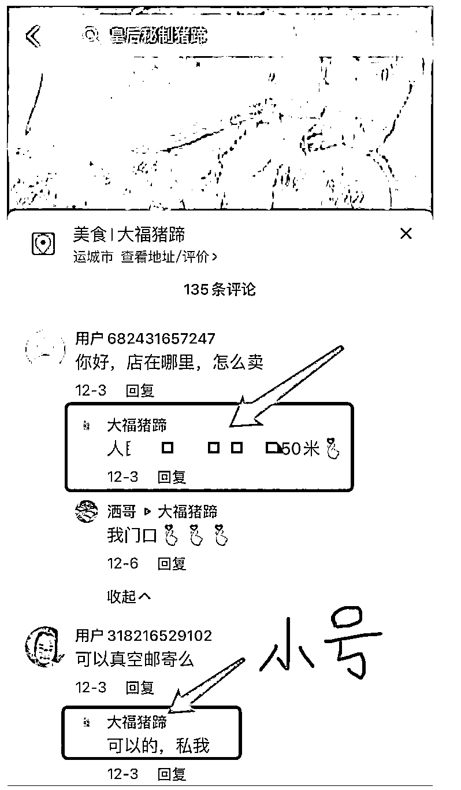

**-03-**

## 变现路径怎么设计

变现对象可以分成两类：一类是普通食客，也就是想吃猪蹄的C端顾客；另一类是想学技术、开加盟店的B端商家。两类人关注点不同，策略也要分开。

C端顾客容易被什么吸引？

卖相好、味道香、价格有优势、环境干净、很多人在买、评价不错。

B端商家更在意什么？

产品有卖相、味道稳定、门店客流大、老板能赚钱、投入不大、操作不复杂、排队现象明显、学员和加盟店开始回本盈利。

落地时走四步：

- 针对不同人群拍内容，投其所好，把播放量做上去。
- 引导观众互动，让他们找到门店、找到下单入口——这一步极其关键，却最常被忽略。
- 完成交易。
- 小闭环跑通后持续优化：产品、短视频、变现逻辑、投放放大。

重点说第二步：顾客从刷到视频到真正付钱，中间那道“连接”必须补上。播放量高，不代表门店客流会涨，更不代表能赚钱；引导没做好，力气容易白费。

以我们号为例：单条视频能跑到5万到10万播放，不算差，但后台记录的日均成交单量只有70上下。还常有顾客进店说“总算找到你家了”。这意味着不少人因为找不到入口而流失。

我的优化办法：

**1）多平台铺信息**

高德、百度、腾讯地图，微信视频号、小程序、公众号，美团、饿了么、大众点评，小黄车、抖音小店、团购小风车，评论区置顶留言，粉丝群，主页地址与联系电话，百度搜索……凡是用户可能搜索的地方，都留下能联系到我们的入口。

**2）用辅助账号主动承接**

看到评论区有购买意向的，就用小号回复或私信，把购买方式告诉对方。

尽量适配不同用户的App习惯，让顾客在自己熟悉的场景里完成连接，最好还能沉淀到私域成交。至于私域之后的二次营销，精华帖里已有不少高手分享，可以搜来细看。

下面贴几张图：

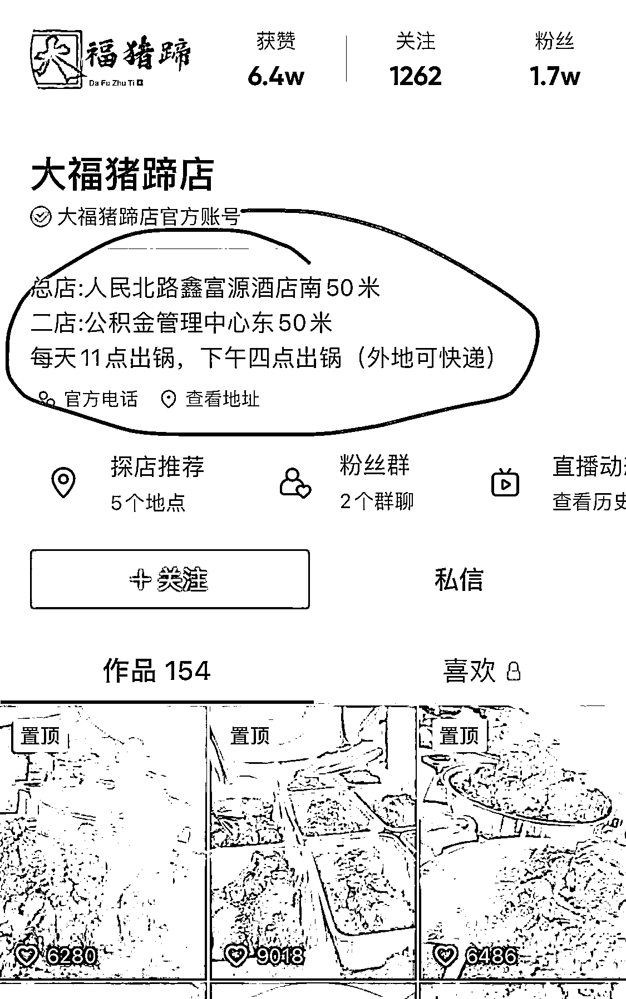 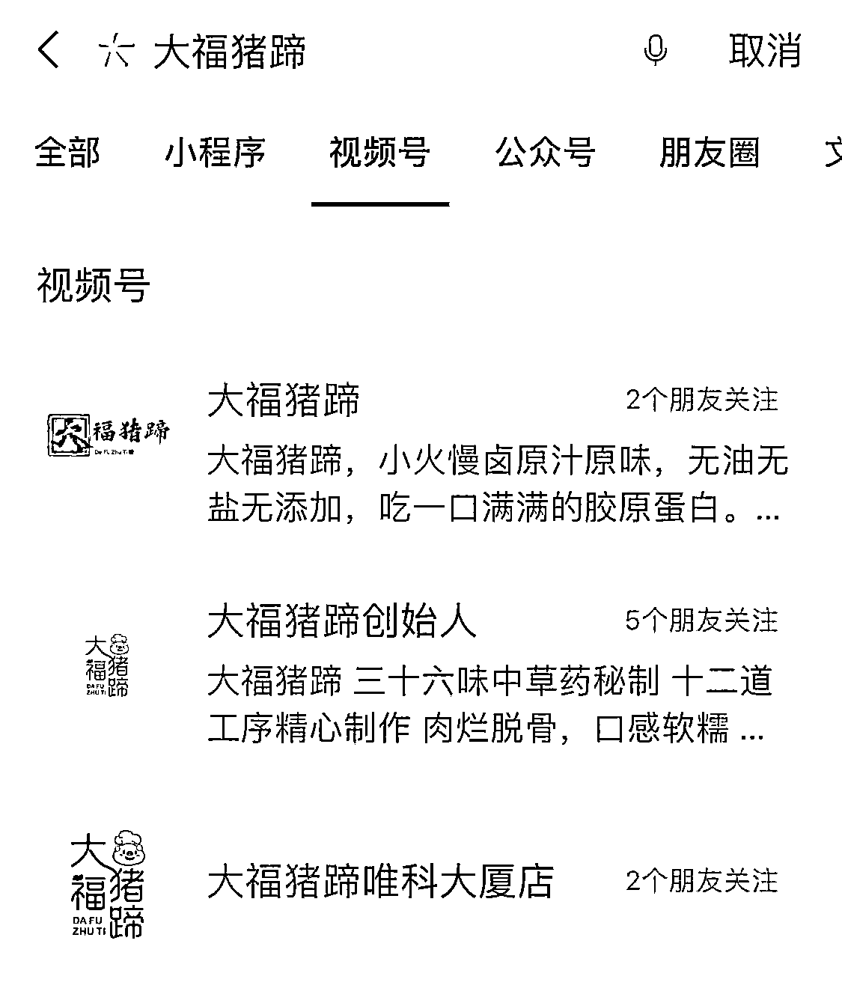

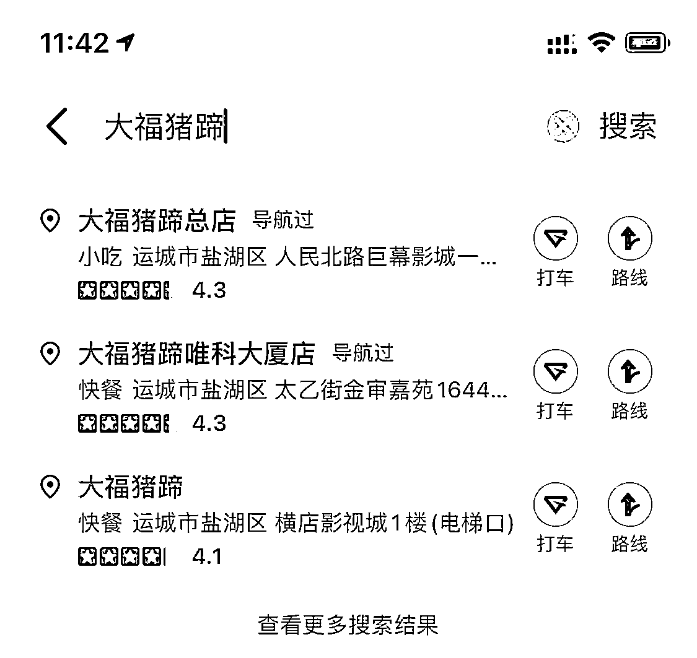

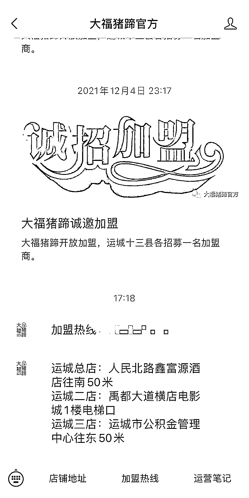

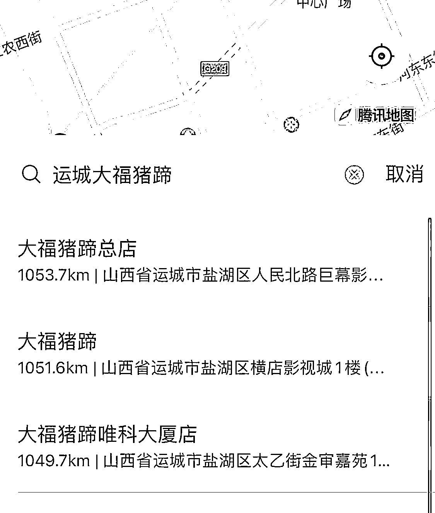

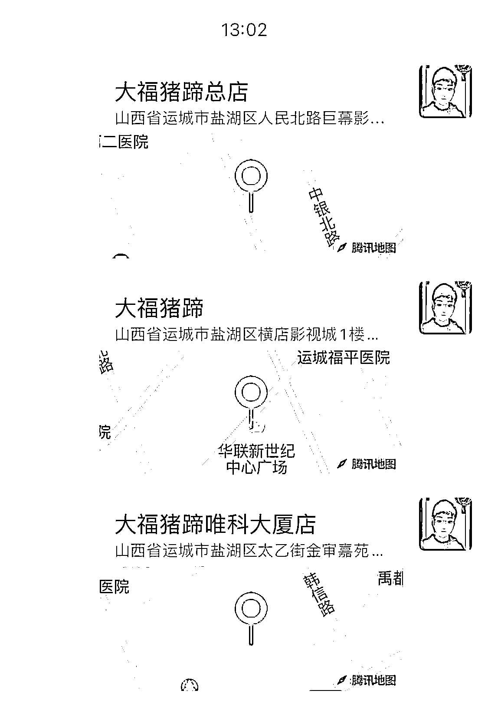

腾讯地图这一项要尽早补上，这样在微信里发定位时才能被搜到。

完整变现链路：产品上架 ——> 分析目标人群 ——> 运营引流 ——> 引导消费成交 ——> 复盘优化

**-04-**

## 实操运营技巧

**1. 先进入互联网平台**

美团、饿了么这类平台，在没有私域、没有知名度的时候，不赚钱也要进，甚至亏一点也值得，因为免费的流量先接住再说。之后再想办法把到店客人转到私域，慢慢养。比如美团抽成通常在20%以上，我的做法是淡季适当提价挂上去维持单量，旺季或店里忙不过来时直接关掉。

**2. 开通抖音团购**

佣金比例给高些，少赚但不亏即可，把利润让给帮我们推广的人。这样会有赚佣金的达人主动上门拍摄。

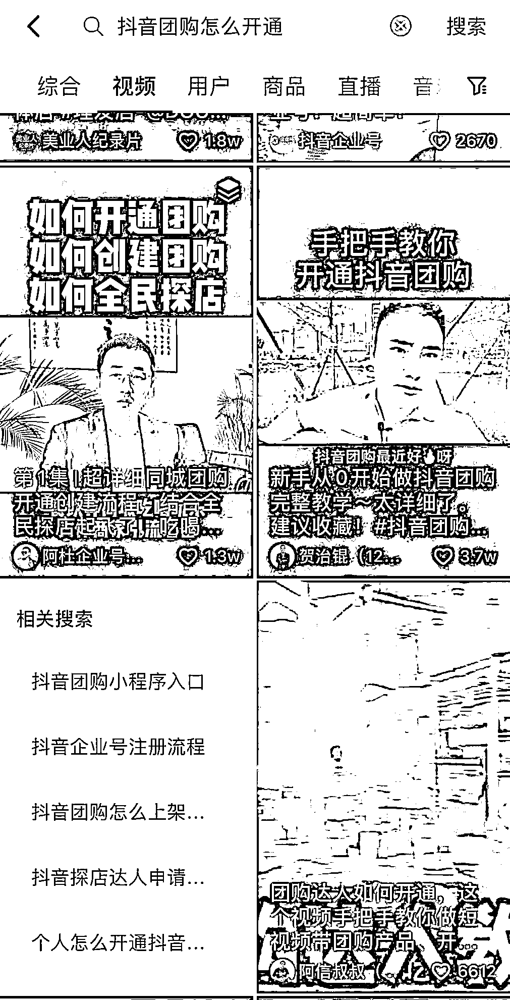

**3. 主动联系达人推广**

每个地方都有大大小小的美食博主、公众号等新媒体团队，想办法建立合作。那些粉丝1万以下、甚至10万以下的地方小博主，其实没那么难接触。联动起来，人数一多，形成的合力不可小看。要营造一种氛围：“这家猪蹄这么多人吃，味道应该不差”。

怎么找靠谱达人（以餐饮为例）：

- 在抖音搜“地点+吃喝玩乐”
- 点头像，点更多，打电话、加微信联系，或关注后私信。优先电话。
- 私信话术：您好，我是XXX地XXX店的XXX，我们店主营XXXXXX，看了您的作品觉得很赞，想了解下合作事宜。（若走私信，补一句：方便的话留个联系方式。）

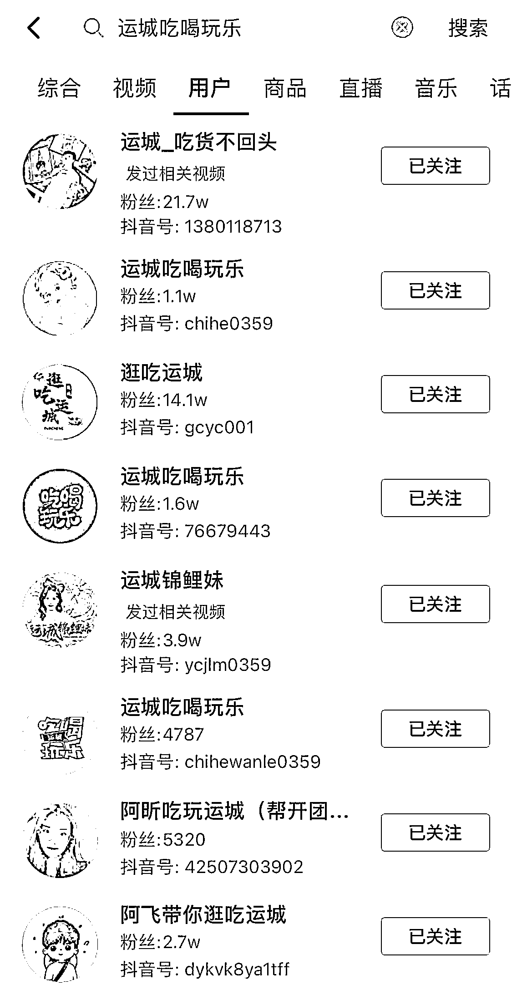

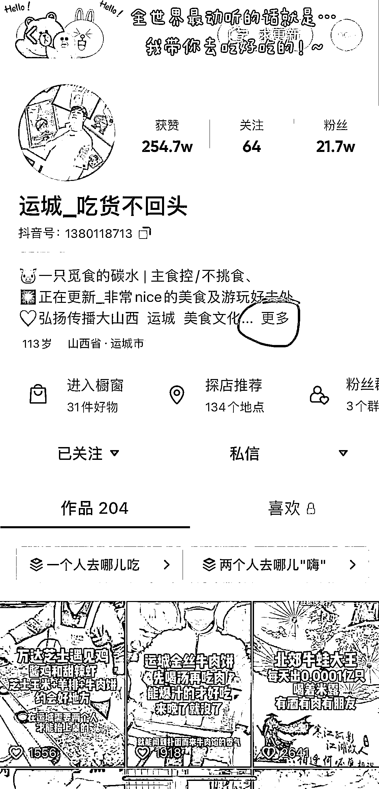

接触达人时要弄清几个关键点：IP定位、粉丝规模、播放表现、收费方式（团购抽佣？坑位费？），再判断账号调性与自家产品是否匹配。后两项直接问达人，结合自身预算决定是否投放：

1）带坑位费或坑位费偏高的一般不合作，粉丝体量大的另说；
2）粉丝多但点赞评论低的不合作；
3）加微信后备注名称+粉丝数+账号特征，数量一多容易混乱；
4）做好跟踪：投放花了多少、播放多少、成交几单、同城浏览多少，算清投产比。产出比高，且门店服务能承接，可以考虑追加；
5）价格上，1万粉以下账号多为团购抽佣合作，不给坑位费，最多提供拍摄餐食，餐食贵也可以不提供。1万到10万粉的账号会适当收费，几百到几千不等。没有严格标准，价格都能谈，多问几家，总能遇到性价比高的。

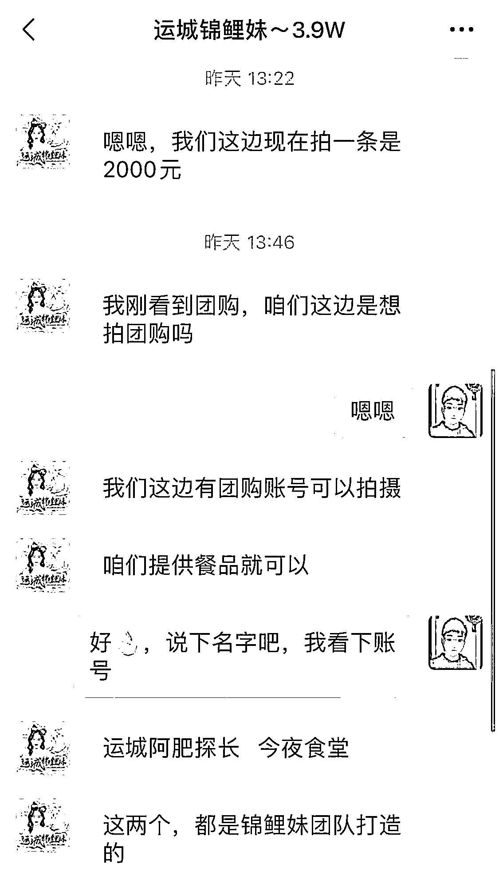

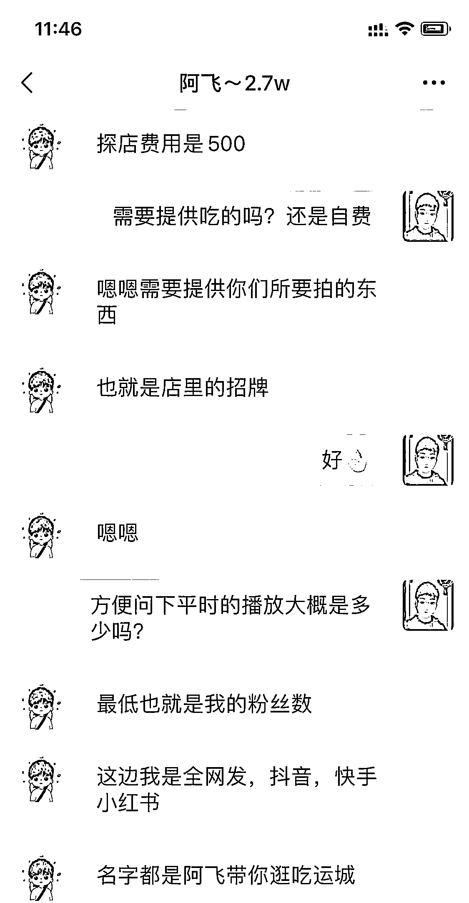

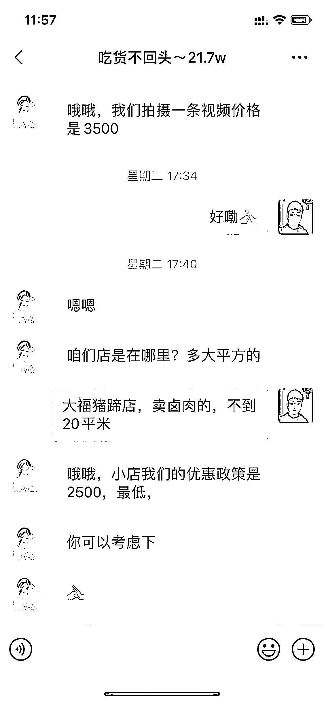

上图这种，要选就果断选2、3。还有个找达人的渠道是抖音搜“团购达人广场”，筛选逻辑同上。

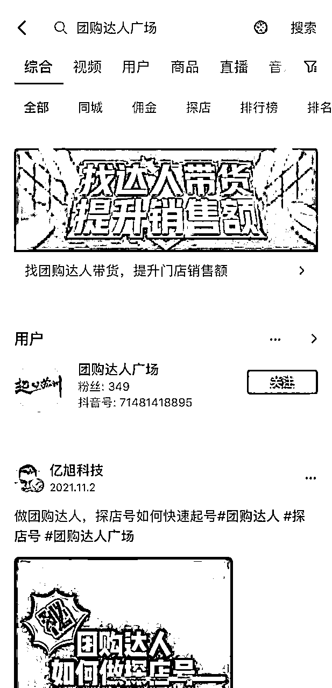

**4. 做抖音矩阵**

据说2021年7月起，抖音开始扶持同城流量，可能是在为未来的心动外卖铺路。算一笔账：一条视频大约500播放，10个号发10条，一天就能有5000左右曝光，这么便宜的流量值得抓。微信也是同样逻辑。

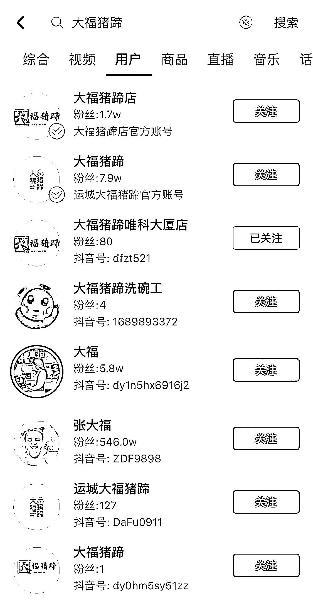

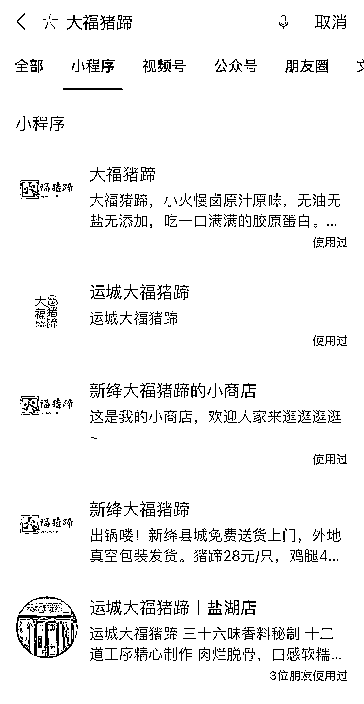

不必把太多精力放在粉丝数上，有播放、能带来到店，初衷就已经实现。

**5. 设计引流活动**

我做过“0.01元抢1只鸡腿”，团购链接上线后，好几个美食博主跟着发视频，两天卖出近600份。鸡腿成本约2元，花2元换一个到店顾客很划算，而且来领鸡腿的人大多顺手买了猪蹄。这里必须限定每人到店只能领1个，否则有人拿10个二维码来核销，活动就变味了。

 

**6. 多平台铺开**

把所有有人的平台尽量铺一遍，然后往一个地方导流。小平台也是肉，每个平台背后都有人在认真运营，挂个招牌、留个钩子，再引到微信完成成交。

**-05-**

## 0.01元一只鸡腿的活动复盘

店里有两类商品：鸡腿和猪蹄。鸡腿专门负责引流，卖10元3个，基本不挣钱，每天控制在一锅33个左右。前段时间上线了“0.01元一只鸡腿”的团购引流活动，这里简要复盘活动前的考虑、活动后的数据和反思。

活动前

目的：

天气转冷，到店人数下滑，希望在可承受范围内激活新老顾客，把进店人数拉起来。

活动形式考虑：

1）不做打折。折扣一旦开头就很难停，既损失利润，等价格恢复后门店还会冷清一阵，顾客心理也容易不平衡。

2）不搞优惠券。原因同上，再加上如今优惠券套路太多，顾客信任感低，不是特别明显的满减很难吸引人，力度太大我们又承受不起。

3）活动要让用户真切感到占了便宜，最好还能分享裂变。

4）不能亏太多。

于是就有了“0.01元一只鸡腿”的团购活动。

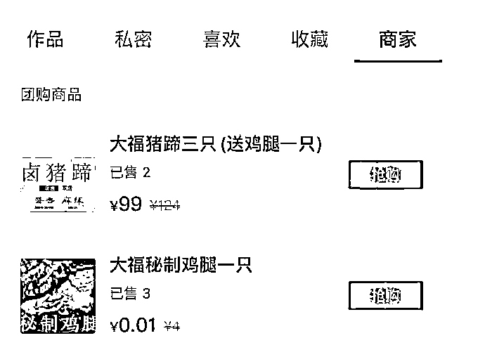

一只鸡腿成本2块，能换一个到店顾客，还能加微信，到店后还可能买猪蹄。这样算下来，活动不仅不亏，还可能小赚。

团购链接上线后，我用小号私信了一些美食探店号。

这种薅羊毛活动，达人能吸粉涨流量，也能帮我们宣传门店，顾客还能薅到羊毛，有点像淘宝客的0元购刷单。很快，一两千粉的小达人开始挂链接发视频，顾客也陆陆续续到店领取。

还有个意外收获：抖音“挖坟”挖出了好几个旧视频，流量开始上涨，小吃快餐的榜单排名也跟着往上走，像被重新激活了一样，店里生意火了好一阵。

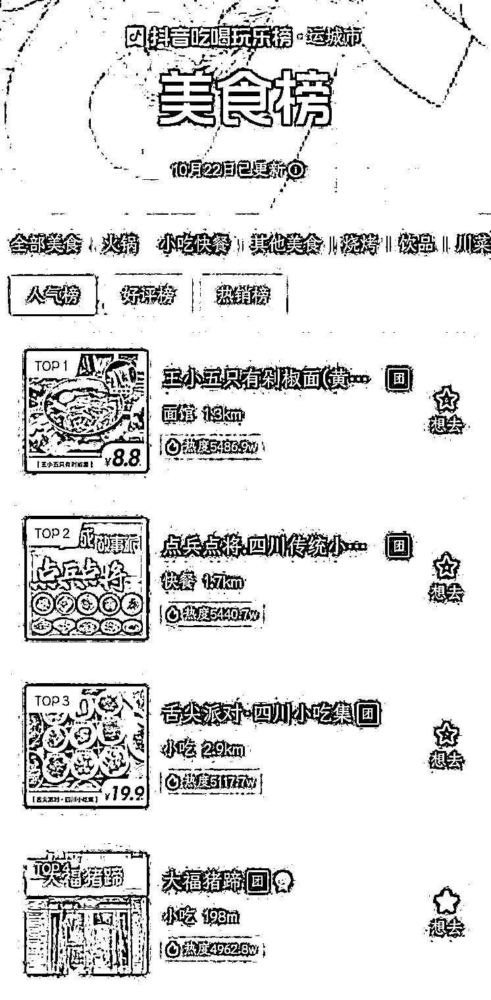

等活动热度退去、我们下架链接时，大概卖了600份，99元的猪蹄卖了五六十个。

600个鸡腿亏损1200块，99元猪蹄按50个算还能赚一些，这还没算到店的其他消费，以及买了但没到店领取的鸡腿。

活动后反思：

1）一开始没限制一人一份，有人领了五六个鸡腿，可能是找家人或异地朋友帮忙，起不到引流到店和拉新的作用；
2）没设计裂变，应该再加一层“转发再送一只鸡腿”，效果会更好。

具体操作流程不复杂，就不写详细步骤了，大家可以在抖音里搜，或者私下交流。

**-06-**

## 最后几条建议

1、启动越早越占便宜。多数创业者并非科班出身，90%的人都靠边做边学。我最初半个多月播放停在500上下，之后一两个月在一两千徘徊，1.5万播放又维持了五个月；坦白讲，粉丝攒到3000，我花了九个月。

2、别用卖惨换同情。把冷清画面配悲伤音乐，指望别人因为可怜你而进店——人性经不起这样测试；我们自己选餐馆时，也不会走进空荡荡的店。其他线下门店同理。

3、把抖音搜索用起来。绝大多数问题，在站内搜一下就能找到答案。

4、餐饮的根本还是味道。菜品要过硬，最好做出自己的特色，服务也要跟上。短视频像扩音器，门店的优点和短板都会被放大：顾客满意，好评会带来倍增；口碑垮掉，生意也会迅速熄火。

5、先模仿再创新。已经火过的内容，翻拍模仿，成功率往往更高。

6、大航海学习手册值得反复翻，里面的干货不少，建议多刷几遍。

评论区：

张静伟@生财有术：优秀，大福猪蹄店，啥时候开到杭州来啊

silence：😄，努力💪努力

北鱼：优秀[强]

平凡：很多实体店可以直接抄作业了[愉快]

silence：[呲牙][呲牙]

顺道：老乡😂

silence：[呲牙][握手]

大嘴师迪：流弊 王老板