# 小团队做汽车用品矩阵短视频，单月变现10W+的实战复盘

大家好，我是米戈，做汽车自媒体也有几年了。抖音破了百万粉，快手也将近百万粉，目前主要靠直播卖汽车用品赚钱。很多人觉得汽车赛道太卷，其实换个切法，机会依然很大。

我一开始也想卖整车，但入局晚、门槛高，跟那些头部达人根本拼不过。后来我转了个方向：不卖车，改卖燃油宝、轮胎这类能解决汽车“疑难杂症”的替换型产品。你想想，车主遇到漏气、掉漆、油耗变高这些问题，质保期内还能去4S店，出了质保呢？多数人只能自己买配件或者养护品换。这类产品利润很可观，复购率也不低，用户需求又非常集中，是个值得深耕的市场。如果你做视频正卡在瓶颈期，或者刚入行不知道挑什么方向，完全可以考虑这种垂直细分的小类目，可能是一条新的赚钱路子。

下面结合我自己的经验，聊聊三五人小团队如何做矩阵短视频、怎么让流量自动来、来了以后怎么快速且持续地变现，以及一些教训。

## 一、流量怎么来：全网铺内容，实现自动供给

先说做什么内容。我的方法很朴素：围绕产品去做。比如你要卖燃油宝，那就盯着燃油宝能解决哪些车主关心的问题——油耗高、抖动、烧机油、尾气超标等，全部整理成话题，再以汽修专家答疑的形式拍视频，常年围绕这些话题产出。刘团长那种实景拍摄清积碳的案例，效果就特别直观。

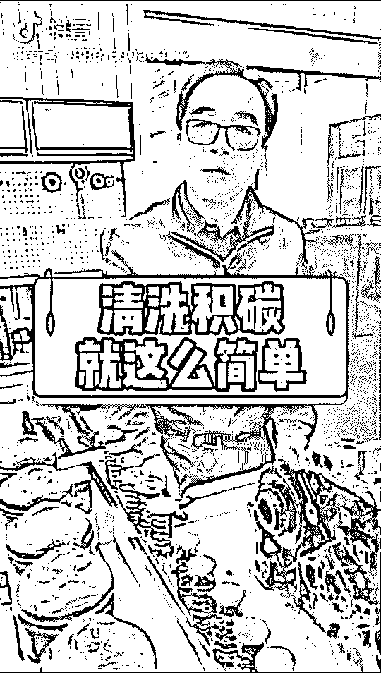

小团队运作，内容上别搞复杂。我们一直坚持一切从简、数量优先，把内容复用做到极致。以混剪为主，实拍为辅，内容不够就拿直播切片来凑。

内容做好了，往哪里发？能发的地方都先去发一轮，哪个渠道引流效果好，就重点经营哪里。懂车帝、汽车之家、易车、爱卡、太平洋、车友头条、汽车头条、今日头条、抖音、火山、快手、秒拍、腾讯、优酷、UC大鱼号、爱奇艺、凤凰网、一点资讯、趣头条、知乎、百度、搜狐、新浪、搜狗、网易、A站、B站、👸号、视频号……全都发一遍，量足够大，奇迹自然就出来。到现在我们累计发了10000多部作品，对比下来，最香的还是抖音和快手。找到适合自己内容的最佳平台，然后持续不断地发布，流量就会一步步实现自动供给。

## 二、怎么变现：知识付费、卖货、其他

流量进来后，怎么把它变成钱？同行就是最好的老师，放心大胆去模仿。

### （1）知识付费

手艺人永远不愁没饭吃。只要你有手艺，培训就可以搞起来。去抖音或快手搜“烧机油”“镗缸”“电喷”“二手车”这些汽车相关关键词，会发现很多账号都在做培训。比如有个电喷账号，常年招生，线下开课，同时卖解码器等维修设备，据说月营业额能做到100W+（这个数字来源于线下设备代理商的推测）。如果重培训做不了，那就做相对轻的付费问答、付费诊断修车，入驻“大家车问”“汽车大师”这类平台，用专业知识和技能为付费用户及时服务。

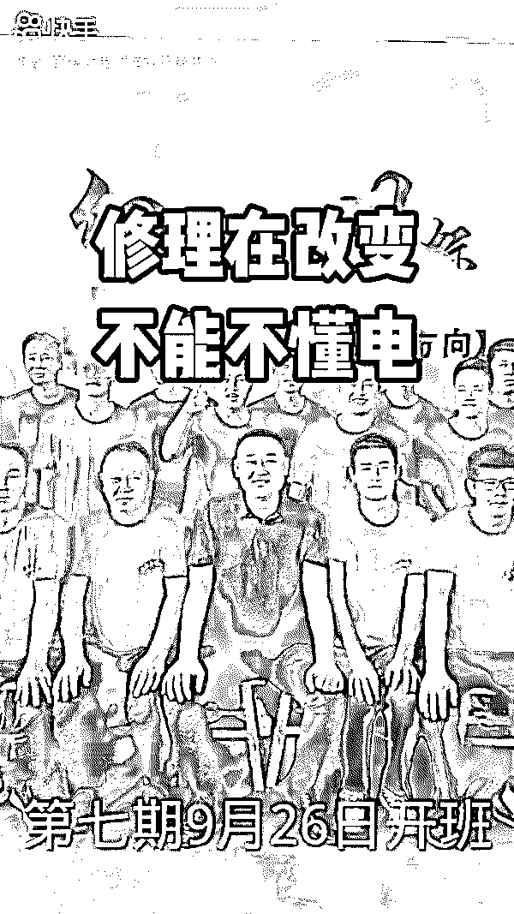

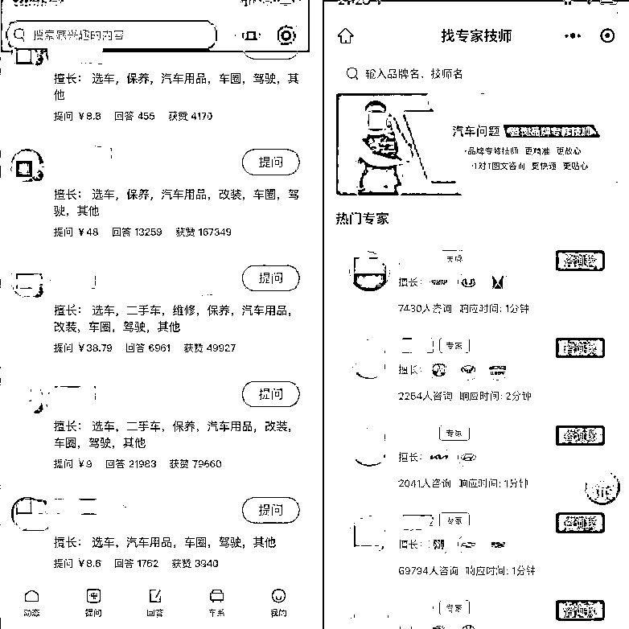

### （2）卖货

IP立起来以后，卖货就可以一直不停。我们目前是在抖音和快手两个平台同步直播。开播会不会没流量？不会。因为前期围绕产品铺了大量内容，车子有问题的车友看到视频会直接进直播间，流量精准度也有保证，剩下的就交给转化。

我们的做法是，直播间一对一连麦，先给来咨询的车友做免费诊断。如果对方提到的正好是油耗高、抖动这类常见症状，那基本就是精准客户，这时候再针对性地推荐小黄车里的自营产品。这是同一天抖音和快手的直播数据，放出来给大家作参考。

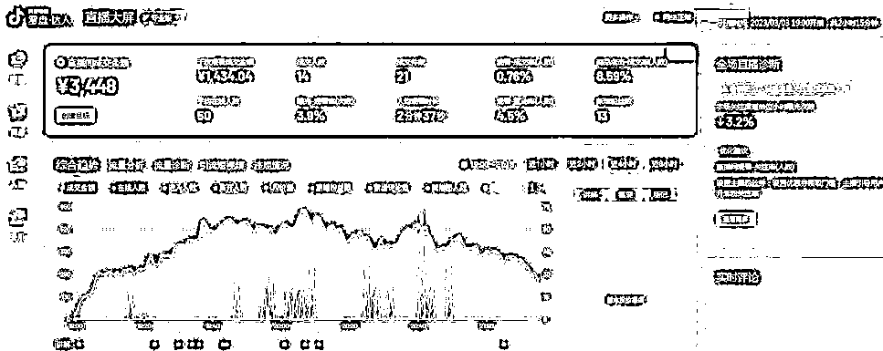

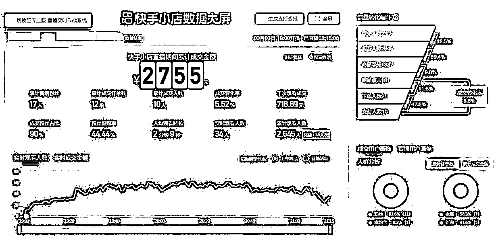

不过，一对一连麦的效率还是低了点。想在现有基础上多赚一些，可以试试无人直播和短视频带货，让赚钱这件事半自动起来。

无人直播：我们每天都有真人直播，素材从来不缺。把直播回放直接拿来当无人直播的视频素材，放两小时左右，效果跟真人直播差不多。真人直播时是连麦模式，开无人直播记得把连麦关掉，观众进来只听就行，照样有人主动下单。目前这么操作还没有收到过违规通知。

短视频带货：如果是自营产品，就把直播回放稍作剪辑，每天发布；如果带的是合作产品，哪个视频跑量好，就照着它1:1拍摄，一次拍摄，反复混剪。抖音精选联盟和快手快分销里的汽车用品，一般佣金都在40%以上。如果没有自营产品，直接找这类合作产品一件代发，自己专心做内容就好。

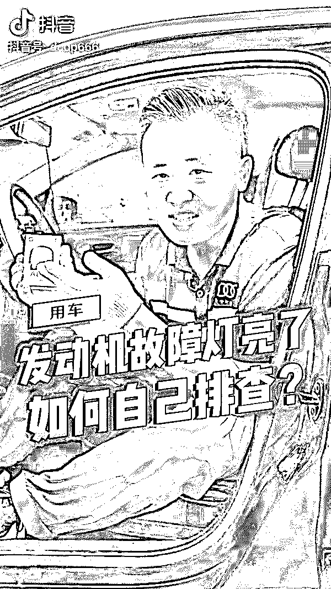

能付费推广的产品就重点推。小店随心推、千川、磁力金牛全都用上，持续投入，就算打不出爆款，也能稳定带来源源不断的收益。

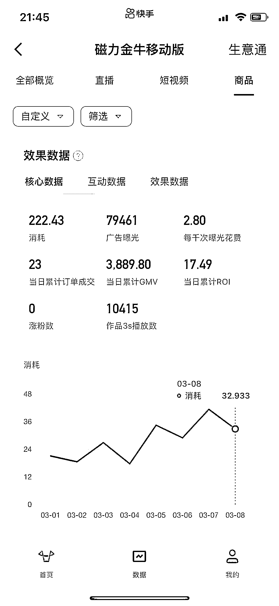

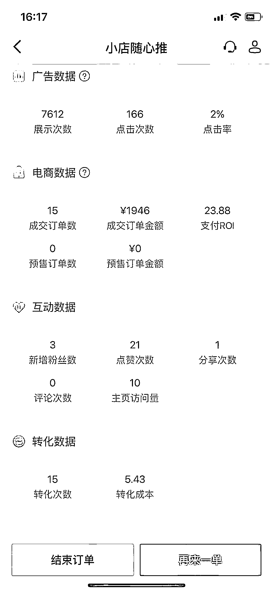

### （3）其他

汽车行业如果没有自己的资源，那就尽量把粉丝体量做大。有了体量，广告自然找上门。靠广告变现，又省事又高效，而且汽车类的广告单价普遍不低，非常舒服。等你的账号迈入百万粉，后台合作邀约会明显变多，有汽车品牌投放广告的，也有汽车用品来谈推广的。

除了广告，平台福利也是重要收入源。赶上合适的机会，也能狠狠赚一笔。拿头条系来说，当年刚出PICK计划时，传一部视频就给100元；直播推广懂车帝APP，一条新车线索可得XX元；另外中视频、问答、文章、付费专栏、图文或视频带货、微头条等等也都是收益点。之前圈友分享风向标时提到过“山水重庆”这个头条号，山东也有一个类似账号，靠全平台发山水重庆类文章，一天至少七八条，每年各种变现超过1000万。有收益的地方，只要深入进去，总能发现赚钱的乐趣。

这里放一张我的后台收益数据供大家参考，友情提示：这个数据不代表现在的情况。

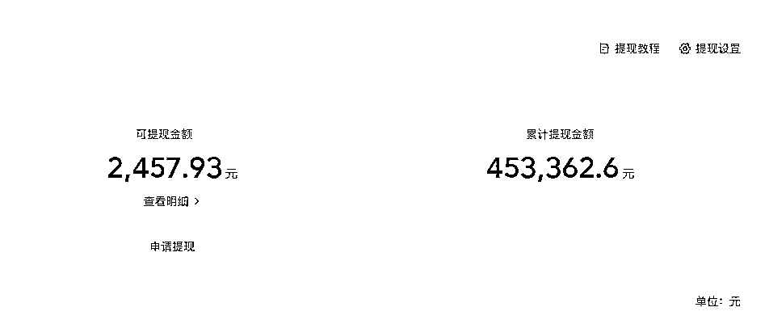

## 三、私域维护与代理分销

### （1）私域运营

重点是把朋友圈经营好。通过短视频和直播吸引车友加🛰️后，在朋友圈从早到晚展示产品和活动，用其他车友的订单评价和真实反馈做价值铺垫。但千万不要主动推销，让用户自己决定买不买。一旦买了、体验了，老司机一开就明白东西靠不靠谱，很容易变成高粘性、高复购的长期用户。

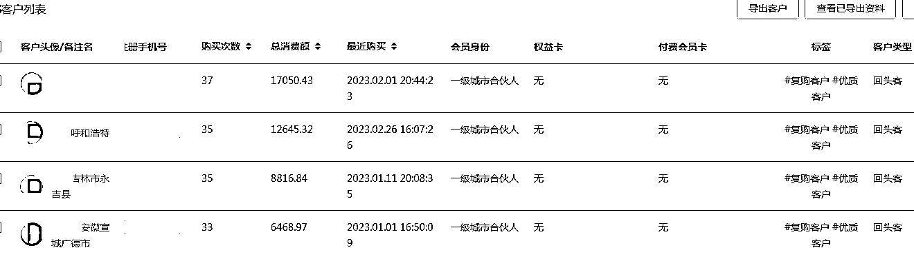

### （2）代理分销

核心一招就六个字：自用省钱，分享赚钱。产品好、利润足，借助有赞的分销员和分销商功能，把代理分销体系搭起来，找更多人一起做好服务和变现。

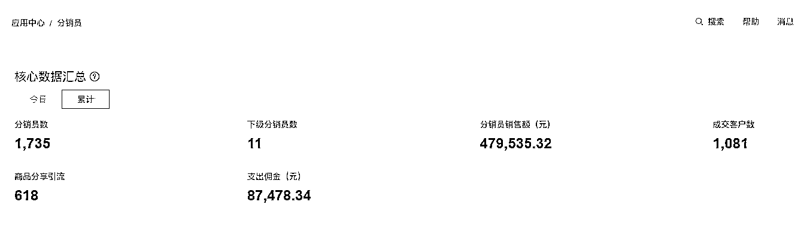

## 四、踩过的坑与后续建议

切入细分领域、选有积累性的项目，这套流程跑通之后，真的不需要太多人力，就能实现半自动赚钱。但老实说，我还是没能把规模放到理想状态，往上突破一直是难题。像机油、清洗剂这类汽车产品比较特殊：利润高、复购也高，但在一些平台上很难做付费推广，因此难以快速放大。

所以最后还是回到选品这件事上。一定要选高粘性、高复购、高利润的产品。自播的同时，多发展达人带播，再借助付费流量放大。如果线下有汽修厂，还能结合本地生活服务，收益天花板会高得多。

最后给大家推荐一个参考账号：小阿兰修车。一位邻家修车小妹，贴心微笑服务，内容形式跑得通，复用性也强，爆款不断，带货能力相当强悍，不愁没流量也不愁变现。每天都有大量老车主守在直播间，大半夜还不走，时不时就跑去小妹的汽修厂，给车子安排一次大保健。这样的模式，确实值得借鉴。