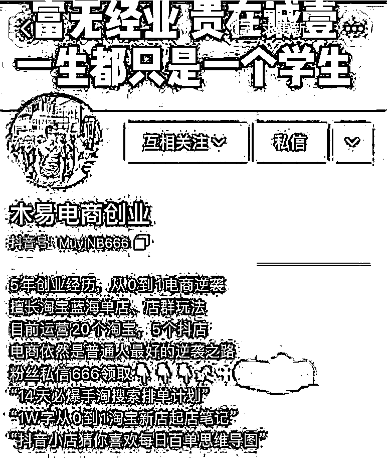
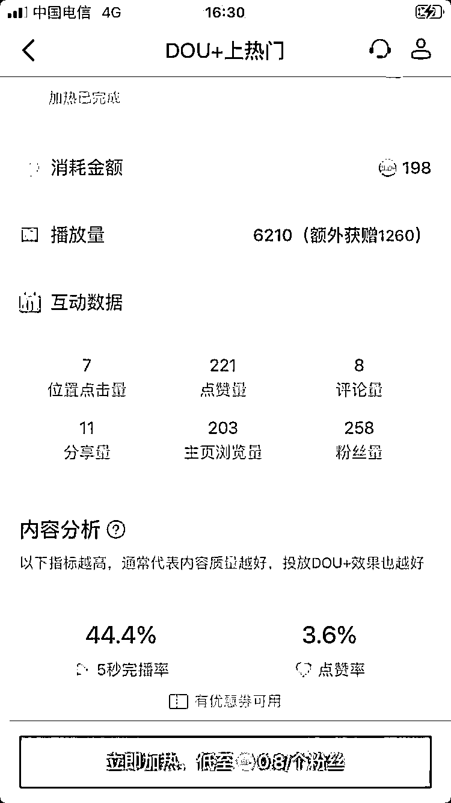

# 0粉新号：单条视频500+私域，48小时回款2万+

大家好，我是木易。这次参加抖音商业IP小航海，先报结果：近30天里，我用一个0粉新号发了20条作品，涨粉5700+，豆荚总共花了1700元，2天完成2万元变现。特别感谢赚钱的组织和孤狼老师带队，让我把从起号到成交的闭环真正跑了一遍。下面分四块讲：起号逻辑、公域转私域、私域运营与成交、复盘心得。

## 01 起号前先吃透的底层逻辑

抖音日活接近7亿。中国14亿人里，除了0—10岁孩子和部分65岁以上老人，绝大多数都在这个平台，商业价值不用多说。有流量就有生意，也就有变现机会。孤狼老师带我们做小航海，目标就是打造自己的商业IP，靠IP赚钱。他把自己0失败起号的经验，总结成四个阶段。

**第一阶段：注册账号与定位**

注册上，老号如果长期不用，直接办新手机卡注册全新抖音号，保证账号干净，后面操作更顺。

定位上，先结合自己的行业和技能，找10个同类对标账号，研究他们的内容和变现方式；起号前一定想清楚以后怎么变现、怎么引流，内容才会精准打到目标人群，转化率也更高。做商业IP，最终目的是收钱，不是堆粉丝数，得围着核心目标死磕。

名称头像上，公域展示面要让人第一眼知道你做哪行、能给什么干货、对别人有什么帮助，简介最好放钩子。这样作品转粉率更高，往私域导的势能也更强。我专职做电商，方向是淘宝蓝海和店群，所以ID叫“木易电商创业”。账号介绍如下：

10个对标账号准备：起号前至少关注10个同行业做得好的账号。目的一是拆他们的头像、简介、作品，后期做像素级模仿；二是投豆荚拉人群时，他们就是目标，他们的粉丝也是我最想要的精准人群，能更快把账号标签拉准。

**第二阶段：写文案、拍作品**

前5天准备10条文案、拍10条作品，连续5天每天发2条，再做定向人群豆荚投放，把标签拉精准。

刚开始写文案我很头疼，不知道选什么题。按自己想法拍了3条，数据很惨，5秒完播不到10%，点赞涨粉更不用说。后来我想明白：刚进新领域，小白别急着自由发挥。最快出成绩的方法，是先“抄”再“超”，跟着有结果的人学。

于是我在对标账号里挑10条1000+点赞的选题，用题词大师导出文案，再用Excel记录分析，重点看选题类型和前5秒文案。选题决定作品是不是目标人群感兴趣，前5秒决定完播率，完播高才更容易进下一个流量池。确定选题后，前5秒可以照原版来，后面结合实际情况二次创作，这样内容大概率不会差。但不要全抄，账号长期发展不利，粉丝也不喜欢连30秒文案都写不出的博主；借鉴选题完全没问题，同一个问题谁都可以有看法。后来我发了十来条别人爆过的选题，比如：新手做电商该卖什么？月入过万的产品怎么找？上架就出单的产品长什么样？直通车如何拉爆搜索？靠这些借鉴，我慢慢找到感觉，后面完播能到25%左右，豆荚涨粉平均做到1:1.4。最好的一条讲抖音小店底层逻辑，当时新方法在小店上有效果，没写稿，让同事录成访谈，结果直接爆了，抖音免费给了十几万播放，豆荚也做到0.8:1。这个平台内容为王，数据好坏最终还是内容决定。前期参考别人的选题和文案，找到感觉后再原创，先抄后超。

**第三阶段：豆荚投放、看数据、拿基础粉**

新号发作品，基础播放大约500。如果这500个播放里完播、停留、点赞、转粉等数据特别好，就有机会进更大的流量池，这就是赛马机制。

基础500播放是随机人群。你只讲某个领域专业话题，又没有定向标签，数据通常很差，很难进下一池。像我这种讲电商知识的账号，非电商从业者基本2秒就划走。定向豆荚的目的，就是用钱换时间，尽快把账号打上精准标签。按孤狼老师的标准，要做到5000基础精准粉，之后发主题作品才大概率被精准分发。5000粉后基础播放池更大，日后爆大热门机会也更多。不投豆荚也能起，但标签精准会很慢，可能3个月，也可能半年；做商业IP，时间更宝贵。

豆荚数据里，涨粉能跑到1:1就使劲砸。系统推荐100元约5000播放，定向100元2500播放。投放金额:增粉数达到1:1，说明内容优质，100元跑出人群画像后就能追投。我有条作品一天涨粉5000，数据约0.8:1，就一直追投，总共投了近1500元，抖音免费推了近15W播放。

我操作时，每次发新作品先投100元豆荚，选涨粉、12小时；2小时后去服务中心看实时数据，效果达不到2:1就把视频隐藏，豆荚费会自动退回账户，再公开让基础播放跑完。与其把1000元均摊到10条视频，不如集中打一条数据好的，一次打爆更事半功倍。几十条作品里，数据差的消耗到20元就停；有接近1:1的，就按200—400—800—1200追投，直到拿到5000粉。到2000粉节点，可以少花点钱试智能投放，如果数据和定向投放一样，说明标签已经比较精准。

**第四阶段：持续输出、保持日更、等大热门**

有了5000基础粉后，基础播放和几万粉、几十万粉大号差别不大。内容够硬、数据够好，赛马流量池的上限——也就是几十万、几百万播放的大热门——机会也差不多；内容不够强，几百万粉账号也可能只有几万播放。

过了5000粉门槛，人群标签拉准了，剩下就靠作品质量，豆荚不再是主要手段。有时作品刚发，点赞评论不错，准备几百块推一下，让它更快进下一池。孤狼老师有句话很对：抖音要做好，就要像生产队的驴一样持续生产高质量内容，最好日更2条，坚持一年半载，你肯定能成行业头部，其他手段都是扯淡。

## 02 把公域流量导进私域

做抖音要有清晰认知：粉丝数只是数字，不像👸号、快手粉丝那么值钱，作品触达率太低。没有持续产优质内容的能力，几百万粉账号和几万粉账号的基础播放量没什么差别。

要把抖音当公域流量入口。爆了热门、流量来了却没及时导私域，之后再想导就难了，粉丝也很难保证持续刷到你的新作品。我做IP前准备了四个🛰️承接流量，所以那条十几万播放的爆款，1天就导了500+人进🛰️。

抖音引流的方法：

1. **账号简介留联系方式**：查得不算严，但要避开“🛰️”“VX”这类字眼，可以用地球、卫星符号，后面加“+”和🛰️号，没被封过。简介每天能改三次，等于能换3个🛰️；被加频繁了就再改。
2. **留钩子**：想让别人加你，得给理由，至少提供价值或对方特别想要的东西，按行业提前准备。我的电商账号准备了抖音小店思维导图、淘宝拉爆手淘搜索排单计划表，对电商新人都是干货。
3. **视频中引流**：结尾晒一下干货思维导图、XX文档，说“需要的评论区留言，私我666”之类。但这类话可能导致作品不能投豆荚，话术要仔细打磨，别被系统检测到。
4. **评论区引导**：作品爆了却没留钩子，就快速在评论区留言并置顶。很多人看完视频会翻评论区，这样能提升转粉率。话术类似：有需要XX东西的铁子私信我666领取；一条不行就多发几条。
5. **私信回复🛰️**：抖音会监测私信，不能反复发同样话术，也不能太多次提🛰️、VX等谐音。话术要多变：你好，可以看我主页联系方式；你好，被加频繁了，你的联系方式/电话是多少；家我XXXX、佳我XXX，用错别字代替“加我”；做带“+我:XXXXXX”格式的表情包直接发。每次话术我只发5个人左右就改，避免被系统识别后禁私信7天，那只能看着流量流走。

## 03 私域里怎么运营、怎么成交

1. **变现产品先搭好**：有流量不代表有粉丝，有粉丝也不等于能收钱。做商业IP，终极目的还是变现；不能变现，再多热门和粉丝也没用。当年不少千万级剧情号停更，就是因为没有明确变现方式，内容成本又高。做抖音商业IP前，必须想清楚卖什么：课程、实物，还是服务，比如情感咨询、心理咨询。只有这样才有正反馈，才有持续产内容和投入的资金，单纯为爱发电走不远。我的账号定位电商，产品是面向新手的电商课程，主打抖音小店和淘系无货源。小航海前我就准备好了课件；流量爆发当晚，我花4小时把抖音小店课程录完上传小鹅通，虽然匆忙有纰漏，但先完成再优化更重要。第二天靠1对1咨询，加上朋友圈一直在运营，很快5个学员报名，直接变现2万。这里要特别重视：别临时抱佛脚，没人知道下条视频会不会爆；万一爆了，产品体系却没搭好，精准客户就全浪费了。人的注意力有限，知识付费领域对手很多，用户能刷到你，也能刷到别人，别指望客户停下来等你。
2. **私域的本质是信任与专业**：这里尤其感谢ZEN老板指点。很多人做私域，一上来就发广告，朋友圈每天十几条营销文案，转化率不会高（卖货除外）。私域真正要传递的，只有两样：可信、专业。成交没那么玄：你足够专业，对方正好有需求，事情自然就成了。IP要有温度，你是一个活生生的人，不是冰冷营销机器。把用户当流量、天天群发刷屏，结果往往适得其反。
3. **1对1沟通，珍惜被需要的感觉，做好客户分类跟进**：用户开始咨询，一定是对你感兴趣，或带着问题来。别敷衍，尽量专业回答，让他感到你是真心想帮。涉及付费核心领域知识时可以说明：我从事相关培训，这些服务提供给付费学员，很抱歉，其他问题可以多交流。正常人都能理解。
4. **朋友圈运营，做真实的“人”**：人有喜怒哀乐，朋友圈除了专业知识，多分享你对生活的看法、对问题的思考、对世界的认识，真实就好。不要生硬给自己打很多标签。看看陌生好友列表，哪些人你愿意信任，哪些人不愿意？标签其实是用户给我们贴的，大多来自他感受到的“真实”，不是常年营销广告能带来的。朋友圈要精细化运营，但很少有人能持续分享。好IP不止一面，真正的强者能化为多种形态穿越人间和偏见，能强硬也能柔软，能打散也能重塑。
5. **有温度的互动**：互动是朋友之间才有的行为。把用户当朋友，就保持一定互动，让他感觉你参与了他的生活，分享了他的喜怒哀乐。朋友圈互动主要有点赞和评论，但不能盲目随机，不能疯狂点赞评论，要有温度和共鸣。用户转发广告你点赞，那是跪舔，不走心。要对真实生活分享和感慨互动。比如宝妈晒宝宝，可以点赞评论：宝宝这么美，肉嘟嘟的，看到都想马上结婚生小孩了。接下来可能就聊起来，用户抱怨别早结婚、单身更好。这种互动能增强信任和认知。陌生人给你点赞或聊天，你也会翻对方朋友圈和聊天记录，看他是做什么的、什么时候加的。用户内心会主动给你打标签，之后有需求，成交就水到渠成。私域还有提升触达率、用户分组、连带率、让朋友圈像追剧等，大多是基本常识和小细节，这里不展开，以后成绩更好再汇报。
6. **投放思维**：看似免费的流量，往往代价最高，伟大的商业模式离不开付费推广。跑通闭环后要算账，看付费推广能否持续放大；ROI一旦跑正，这就是“钞能力”。我算过：12W播放时后台约600条私信，转到私域500人，2天转化5人，即时转化率1%，长期转化未知；这些精准粉留在账号里，长期运营转化会更高。从客单价、转化率倒推最低投放价格，20元以内的用户有多少接多少，投放逻辑就很清晰。12W播放—600私信可承接私域，转化率0.005%；500人加🛰️—转化5人，即时转化率1%。抖音豆荚系统100元5000播放，如果12W曝光全付费，约2400元，ROI接近1:9；这条我投定向，100元2500播放，花1500元产出2W，单次曝光只要0.02，抖音流量确实便宜。产品ROI能跑正，这就是无限游戏。算清账后，当天原本计划烧完1500再投5000看数据，如果还稳，就1W、2W、3W直接拉满。

最后复盘：这次小航海让我跑通了从0粉起号、豆荚拉标签、爆款导私域到课程成交的完整闭环。关键就几点：先抄后超找感觉，内容为王持续日更；流量来了及时导私域；产品提前备好，先完成再优化；私域靠信任和专业成交；投放要算账，ROI正就放大。再次感谢赚钱和孤狼老师带队，希望我的分享对大家有帮助。

# 04 小航海复盘：号停了，闭环通了

先交代一个不太顺的插曲。那条视频只活了18个小时，原因不是内容没人看，而是账号此前发过聊S单的内容，被平台判定违规，账号随即被屏蔽十天。十天内新作品发不了，豆荚也投不了，这场实验只能暂时按下暂停键。评论区后来有人问起，我也回复了：要等十天，号才会恢复搜索和露出。

不过，这次中断并没让我沮丧。真正重要的是，整条链路和闭环我已经跑通过一遍。接下来无非是多准备几个账号、多做几套内容、多上几款产品，最差就是重新开局。

**1 流量迁移了，别站在原地**

短视频早已不是“要不要做”的问题，而是“怎么拥抱”的问题。从九十九岁到刚会走路，用户的时间大量沉在短视频平台里；相比之下，淘宝电商、👸号、朋友圈的流量都在被分流，很难再回到从前那种热闹。

抖音这边，每条作品都有500左右的基础播放，小店的“猜你喜欢”也有机会持续出单，这种流量供给甚至到了溢出、承接不过来的程度。再看👸号，不少打开率已经不到1%；朋友圈也没好到哪里去。老胡做过一次触达测试：5500人的好友列表，最终只有近500人看到并点赞，触达率不足10%。大家刷朋友圈的频率，确实在下降。

老纪把抖音比作金矿，这话不假：懂的人能挖到金子。把播放量折算成钱，大约0.02元一次；对比淘宝直通车或👸号广告，互联网上很难再找到这么便宜的流量。变现永远追着流量走，流量池越大，生意的天花板才越高。

**2 面子放一放，60分也能开讲**

很多人不敢真人出镜，是怕亲戚朋友刷到，觉得难为情。我以前也有这个顾虑。可看看现在，雷军、罗永浩这些企业家都亲自下场为企业吆喝，我们还有什么放不开的？

花爷在IP课里提过：表达、朋友圈宣传、收费、被质疑、被误解，这些都不必惧。所谓“不要脸”，不是丢掉良心和底线，而是别让害羞、胆怯、畏缩捆住手脚。

同一个人，在高手面前可能只算60分，在初学者眼里却接近100分。拿电商来说，我现在一个月十多W利润，放到专业大佬面前只是“弟弟”，连及格线都未必够；但在刚入行的小白或非电商从业者眼里，这个成绩已经不错。评价本来就是相对且动态的。

如果非得100分才有资格分享和教学，那世界上的老师根本不够用；而且真正100分的人时间成本极高，大多数小白也付不起学费。价值传递本就是层层往下：满分者带90分，90分者带80分，80分者再带70分……一层一层传下去。

**3 敢卖，价值才会被放大**

如果你在某个领域有专业能力，做出过成绩，也跑通了闭环，就可以尝试把能力复制给别人。抖音有7亿日活，三教九流都能找到受众；有人教炒粉都能年入百万，我们这些互联网从业者，身上怎么可能没有亮点？

只要曾经通过任何一种方式赚到过钱，不论金额大小，都值得想一想：这件事有没有放大的机会？有没有人需要这样的服务？再小众的需求，经过7亿用户的杠杆一放大，都可能变成天文数字。

自己靠一件事赚钱，价值有限；能让别人做这件事也赚到钱，价值就大了。把有限的能力释放出来、流动起来，自己的价值才可能指数级提升。孤狼说得直白：抖音上做商业内容的人，本质上都是“出来卖”的，只是产品不同。话糙理不糙。反过来想，如果一个时代里你身上没有任何值得拿出去卖的东西，那才真有些可悲。

**4 私域和长期主义，慢一点更稳**

公域竞争越来越激烈，越要重视私域资产，坚持长期主义，别为了短期小利砸掉信任。那些愿意付费、愿意相信你的人，尤其要珍惜。

我设计电商课程时就是这样承诺的：一年服务周期内，我学到的各平台玩法、电商技巧，只要自己跑通并做出成绩，都会毫无保留地教给他们。市面上每年冒出的新玩法、新平台，我会先付费学习，跑通闭环、做出结果，再把踩过的坑和经验变成他们的捷径，尽量提供长期价值。学员觉得值，报名就快；未来带他们赚到钱、实现当初目标，续费也是水到渠成。

长远看，任何平台和项目都有生命周期，唯有信任能穿过时间。真诚待人，持续输出有价值的内容，让别人觉得你靠谱，势能才会一天天增加。

在龙哥盟的这场分享里，还提到李菁：她是畅销书作家、女性个人品牌商业顾问、生活美学摄影师，8年积累了6W私域流量，实现百万变现。她准备拆解的路径很清晰：明确个人IP、持续输出优质内容、按粉丝特点打造产品，最终跑通知识付费百万变现。她也抛出问题：个人🛰️号能不能做到百万变现？普通人行不行？答案就在这套完整经历里。评论区有人问是不是在小鹅通卖视频课，这类细节可以留待她的分享展开。

以上就是我从这次小航海里，关于抖音公域引流、结合IP做私域运营和变现的一些思考。评论区里有人夸“太猛了”“太强了”，也有人提醒图看不到——图我已经换了，号则要等十天后才恢复搜索。