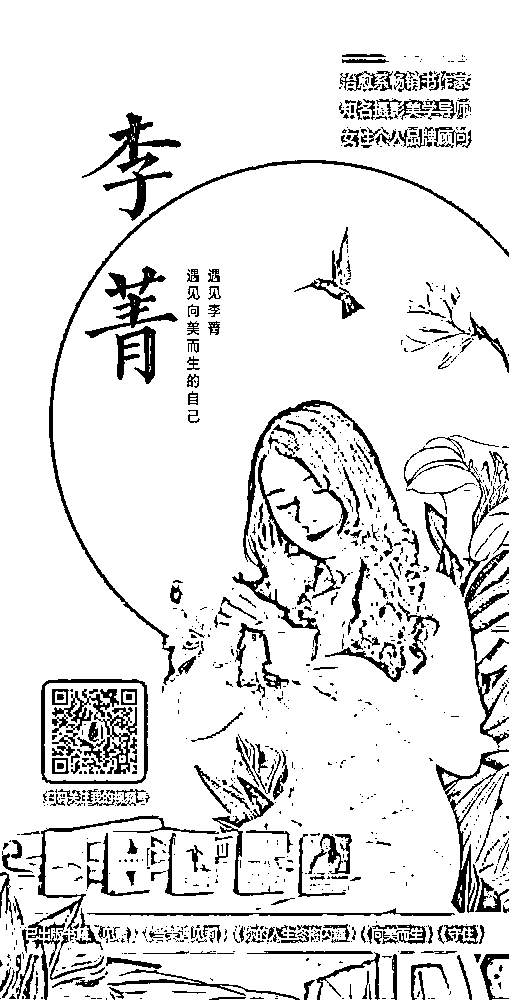
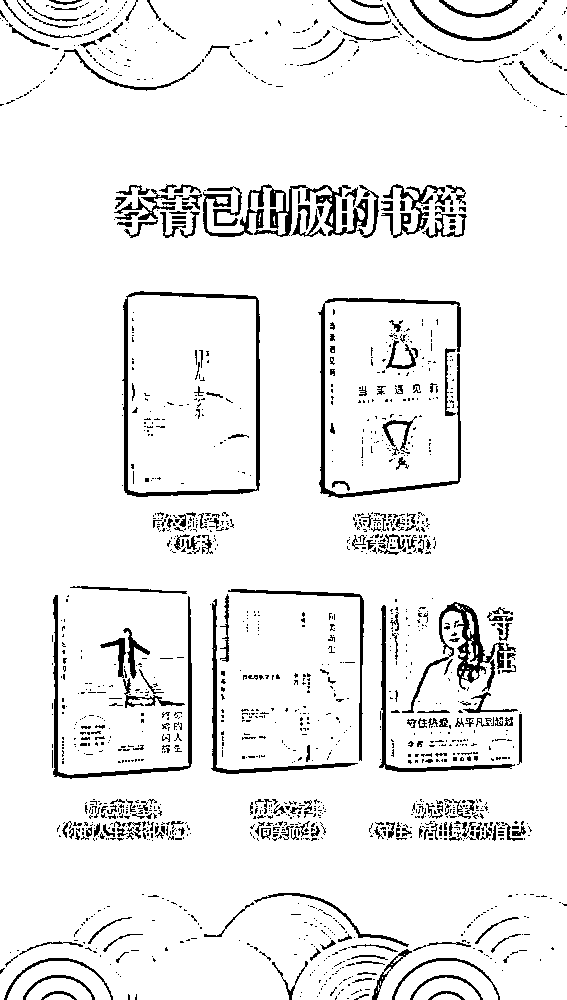
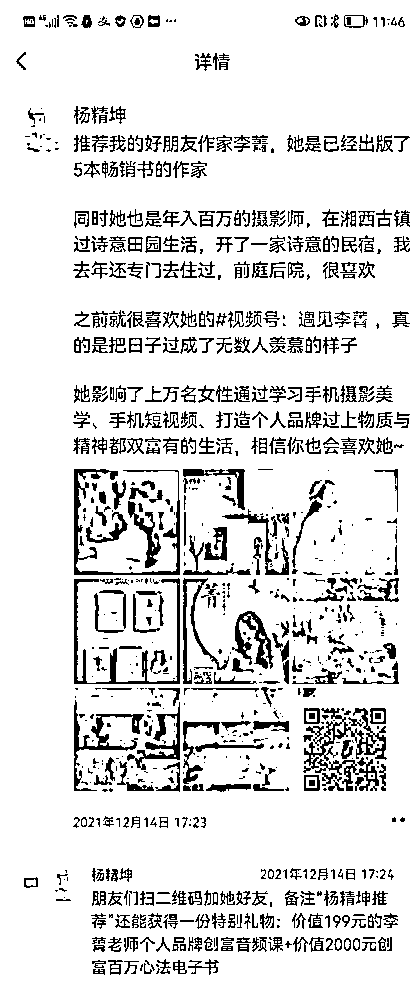

# 8年，6万🛰️好友，百万营收：一个湘西小镇女孩的自白

先做个简单的自我介绍吧。

如果只能给三个关键词，我会选：写作者、摄影师、个人品牌顾问。

**第一个关键词：写作者。**

我在知识付费这个赛道泡了整整6年。手机里攒下11个🛰️号，好友加起来超过6万人，全网各平台关注量50万+。这些年，我带过10000多名女性，帮她们靠个人品牌实现赚钱。

写了五本书：《见素》《当茉遇见莉》《你的人生终将闪耀》《向美而生》《守住：活出最好的自己》。我对书的痴迷到什么程度？家里藏书超过三万册。

**第二个关键词：摄影师。**

我是艺术学硕士，也做过大学老师。拍出来的照片，被梁实秋、雪小禅、张晓风这些名家的作品拿去做插画，也帮100位女性拍过专属写真。主理的视频号“遇见李菁”，拿过2020年金视榜文化博主TOP10，现在有2.6万粉丝。

**第三个关键词：个人品牌顾问。**

今天这篇文章，我想掏心窝子跟你聊聊：一个没什么背景的普通人，怎么用8年时间攒下6万私域好友，再靠知识付费把营收做到百万级别？

**目录：**

**1. 🛰️号为什么值钱？**

**2. 私域涨粉的高效玩法**

**3. 个人品牌变现的五步棋**

**—01—**

**🛰️号为什么值钱？**

先问你两个问题：

你手机里现在有几个🛰️号？

你的好友总数有多少？

别急着划走，这两个问题的答案，可能直接决定了你能赚多少钱。

我做的是知识付费生意。本质是什么？就是把自己的专业能力打包成课程、训练营、社群服务，卖给信任你的人。我在🛰️生态里搭了一个“菁凌研习社”知识服务平台，专门给普通人提供从零开始打造可变现个人品牌的产品：网课、特训营、年度会员、私教咨询……应有尽有。

一开始是我一个人站台讲课，后来请来各路老师一起开课；再后来，从单打独斗变成办公司、带团队，一步步把事业做大了。

2016年7月，我辞掉大学老师的职位，全职扎进线上知识付费，从手机摄影训练营做起。前三年，年营收始终卡在六位数，说不上多好，也饿不死。但我一直在想，怎么才能让影响力和收入再上一个台阶。

2020年，年营收终于破了百万。2021年，干到了200多万。

为什么突然加速了？我自己复盘，原因就两个。

第一，定位升级了。我不再只教摄影美学，而是转型做个人品牌商业顾问。当你能帮别人赚到钱，自己的收入自然跟着涨。

第二，流量池变大了。🛰️好友从1万涨到6万，意味着潜在学员基数翻了6倍，财富自然水涨船高。

记住一句话：如果你有一个自己的IP，哪怕只有1000个铁杆粉丝，也足够让你一辈子过得体面。流量背后是活生生的人，私域的本质不是拉人，而是连接人、吸引人，再用人去服务人。

讲讲我自己的故事吧。

2013年7月，我注册了第一个🛰️号，叫“吧啦”。那时候我还在读研，穷得叮当响。在西安念了三年书，中间还去台湾中国文化大学交换了半年，家里为了供我读书，欠下十几万助学贷款。毕业那天，我背着这笔债，不想再让父母操心，只能自己想方设法去赚。

2015年9月，第二🛰️号“作家李菁”出现了。那时我已经离开大学，在线上开了第一期摄影美学课，年收入只有五位数。

2016年8月，第三个🛰️号“摄影者李菁”注册时，靠摄影美学课，年收入已经到了六位数。

再后来，第四个、第五个、第六个……陆陆续续就都有了。

到今天，我手里有8个个人🛰️号、3个助理号，总共11个，好友总数5万多，今年营收做到了七位数。

发现没有？好友数在涨，收入也在涨。这两件事，从来都是正相关的。

🛰️把好友上限从5000提到10000，对做私域的人来说是个大好消息——意味着你的“门店”能装下更多客人了。

这几年，身边很多朋友因为疫情焦虑，生意停滞、入不敷出。而我住在湘西一个偏远小镇，每天守着🛰️朋友圈，就把知识付费做到了年入几百万。从个人IP进化到公司化运营，我靠的只是一个🛰️生态。

一个🛰️号，就是一家低成本的门店。你多一个号，等于多开一间铺子——租金几乎为零，回报却可能翻倍。

用心经营的🛰️号，值100万，这话我信。

**—02—**

**私域涨粉的高效玩法**

下面这些方法，全部来自我的实战。没有空话，照着做就能用。

**1、锁定一个主阵地，持续输出好内容**

互联网上展示自己的平台太多了：👸号、视频号、抖音、📕、简书……但不是每个都要做。

你得先选一个最愿意花时间的平台，当成主战场，然后把其他平台引来的流量，全部导向这个主战场。精力分散是大忌，主阵地做到头部，本身就是最好的背书。

我的选择是🛰️朋友圈。所有平台来的朋友，最终都会沉淀到这里。

早期加我的朋友，基本是通过我的文章找过来的。我的👸号从2014年1月开始更新，以前叫“吧啦原创文学”，现在叫“遇见李菁”，写了快8年，一天没落下。早期我自己天天写，现在公号有了4万多粉丝，我组建了签约作者团队，我主要负责写书，公号内容交给团队打理——这也算是给作者们搭了一个展示平台。

2020年4月中旬，我开始做视频号。腾讯把视频号直接嵌在🛰️里，不断改版给流量入口，本质上就是一个“人人都能创作”的内容窗口。

我前后做了五个视频号，定位各不相同。目前集中精力运营“遇见李菁”，拿了黄V认证，粉丝2.6万，出过多条10万+的短视频。最猛的一条破了100万阅读，凭它涨粉8000，视频号那边也有几千人加到🛰️。

做视频号有个心法：不要坐等粉丝来加你，主动把他们引到你的个人🛰️。我每天雷打不动私信15个视频号粉丝，留言里带上🛰️号，邀请他们进读者交流群。平台有规则，从没聊过天的用户不能直接发二维码，那就先发一段带🛰️号的文字，等对方回复了再发二维码，话术我会写好：

“你好，很开心认识你。感谢关注我的视频号。方便的话加我🛰️，我会第一时间分享直播信息，备注暗号‘视频号’，送你一份成长规划课。”

每天15个，日积月累，流量就活起来了。

**2、混优质社群，提供价值再收人**

第二个方法：买票进优质社群，然后在里面大方展示自己。

为什么要付费社群？因为愿意花钱进群的人，才更有可能为你的产品付费。

我几乎每个星期都会去某位朋友或老师的社群做分享。分享什么呢？讲干货、送价值。分享快结束时，顺其自然地引导大家：想继续链接的朋友可以加我🛰️，我准备了一份课/电子书送你。这份礼物，要提前做扎实。

不要不好意思发二维码，这个阶段你不是在卖课，而是在送礼物、交朋友。但前提是，你要先跟群主打好招呼，征得同意再发，这是最基本的尊重。

你要永远相信：分享力就是影响力。

**3、持续表达，把同频的人吸过来**

想扩大个人品牌影响力，最高性价比的动作就是分享。线上线下结合着来，输出你垂直领域的内容，就像播种子，播得越多，能量传递得越广。

过程中，很多潜在用户会慢慢被你打动，最后自动转化成付费用户。

线上分享的形式五花八门：真人出镜开免费直播，视频号、小鹅通、一直播、千聊、腾讯直播、快手、抖音都可以，一边讲一边还能挂链接卖书卖课。不想露脸，就录语音发到各个平台，或者直接在🛰️群里开讲。

还可以策划事件营销。找一群有能量的人一起做分享活动，彼此借力，影响的人会翻倍。

热点也别放过。之前《乘风破浪的姐姐》很火，有位做个人品牌咨询的老师，约了几位女性CEO，做了一整个系列直播叫“乘风破浪的女CEO”，聊她们创业背后的故事。这个系列给她带来了大量精准粉丝，甚至有人主动找她签约打造个人品牌。

这就是借势。

分享的价值不只是涨粉，还能倒逼你的表达力、思辨力不断提升。但不管线上还是线下，分享完一定要做一件事：把听众都拉进你的🛰️社群。只有沉淀到🛰️，价值才能续上。

**5、找人互推，快速借力起量**

2020年2月，我新开了一个🛰️号，不到一个月就加了4000个优质好友——方法就是互推。

找个🛰️好友多、调性和你一致的朋友，她在她的朋友圈里推荐你，你在你的朋友圈里推荐她。那会儿最猛的一天能进500人。现在🛰️管得严了，一天大概只能被动通过50个左右。

如果你好友只有几百人，也没关系，找和自己体量差不多的朋友互推就行。

别人推你，就是给你做背书。她的朋友因为信任她，才会来加你。所以你自己的朋友圈必须先经营好，不然人来了，也留不住。

互推的效果取决于对方的粉丝量和黏性。对方有6000好友和只有600好友，给你带来的增量完全不一样。我🛰️里6万好友，如果帮一位合伙人发一条朋友圈推荐，通常会有100到300人主动去加她。

另外，你的照片越好看、文案越走心，吸引来的人就越精准。人嘛，天生会被美和优秀吸引。

还有一个细节：提前准备一份免费音频课，作为新朋友的见面礼。有人为了这份礼物，也会主动来加你。

怎么找人互推？千万别上来就问“要不要互推”，太突兀。先约对方语音聊一次，建立基本信任，聊得投机后再顺势提出来。对方答应了，再发文案。

互推文案参考：

**—03—**

**个人品牌变现的五步棋**

**第一步：给自己贴一个明确的标签。**

传播的规律是：内容大家记不住，但标签一定记得住。标签就是在回答四个问题：你是谁？你代表什么？你能做什么？为什么你做得成？品牌，就是你和多少人在某件事上达成了共识；传播，就是把这件事反复讲给别人听。

比如我的私教学员露露，定位是瘦身营养教练。我让她把所有社交平台都用来讲瘦身和营养：朋友圈发知识卡片，视频号拍饮食干货，👸号写减脂案例。久而久之，身边想健康瘦身的朋友，第一个就会想到她。

**第二步：用优质内容持续刷存在感。**

持续更新，是让别人看见你的唯一捷径。

这些年，我出了5本书，给100位女性拍过写真，主编了3个👸号，“遇见李菁”日更了8年。做这些事，就是不断告诉大家：我的擅长点在这里，我的发光点在这里。

你持续更新内容，好比种花；用户是蜜蜂，想要收获什么蜜，就得先种什么花，把花喂好了，蜜蜂自然会被吸引过来。你在一个方向上深耕的程度，决定了你最终能企及的高度。

**第三步：沉淀精准粉丝。**

在涨粉之前，想清楚这几个问题：你的用户是谁？他们在逃避什么、焦虑什么、迷茫什么？找到精准用户，比盲目追求数量重要一万倍。

我这8年来，攒下11个🛰️号、6万🛰️好友。昨天还有位老师说，我的🛰️号至少值一百万——因为他明白，我今天的年入百万，几乎是靠这些私域好友撑起来的。每次研发新课，会有一批铁杆粉丝第一时间下单；好口碑带来新用户，新用户又变成老用户……品牌的价值就这样一轮轮滚起来了。

**第四步：按粉丝的需求做产品。**

产品不需要多花哨，但要有你的核心竞争力和信任背书。粉丝为什么买你？因为他们认可你这个人。

产品分有形和无形两种。有形产品，我做了一款手工小饼“菁凌见素小饼”，原材料扎实，口碑极好，复购率很高。

无形产品，是我的知识服务体系，从低价到高价，构成一个完整漏斗：

**1）网课。**比如手机人像摄影美学课，定价199元。网课的好处是价格低、决策快，用户看到喜欢就下单，基本没有犹豫成本；弱点是服务浅，买完听完就结束了，跟你的连接不够深。

**2）训练营。**比如手机摄影美学班899元、个人品牌训练营999元、视频号变现训练营899元。训练营能让用户和你的关系更紧密，信任感更强；代价是运营成本高、时间成本大，开营前必须把社群服务节奏规划好。

**3）会员。**我设了菁凌年度会员，价格是299元。做年度会员有两个目的：一是增收，那可以把价定高一点；二是聚人气，那就压低门槛。我做年度会员不是为赚钱，是为了让更多人进到平台，所以价格会亲民一些。此外还有菁凌合伙人会员，7900元一年，平台所有课程免费听，有一对一辅导。能走到这个层级的人，基本都是同频的、热爱美好生活的女性。

会员制度最厉害的一点是：让用户变成你的推广者。想靠老带新，就要舍得给佣金。我这边是这么设计的：介绍朋友来上课，年度会员分佣30%，合伙人终身会员分佣50%。大家先赚到钱，才会真心帮你传播。现在合伙人已经招募了300多位，光这一个产品就带来几百万营收。

**4）顾问。**这是金字塔尖的产品，比如个人品牌私教班，一年29800元；私董服务，两年49800元。高端服务重点不是走量，而是打造标杆案例。

从199元到49800元，每一个价位都有对应产品，用户按需选择，一层一层往上走——这是知识IP必须有的产品漏斗。你的经验越丰富、案例越扎实，定价权就越大。

**第五步：搭团队，定模式。**

找到适合自己的商业模式，比埋头苦干重要得多。一个人再猛，也干不过一群人。

以前我独自干活，现在我有4名线下全职助理，还有一个100多人的线上运营团队。

搭团队要记住：选人比培养人更重要。我住在湘西一偏远小镇，招人条件并不好，但4名全职助理都是从大城市专门过来的。选助理时，我最看重三样：价值观是不是同频，文字功底过不过关，对待社群运营有没有热情。

线上的百人运营团队，靠的是一套清晰的晋升体系：从学姐团到志愿者助教，再到金牌助教。先从老学员里挖出优秀人才进入学姐团，然后通过培训和实战，筛出那些价值观一致、做事靠谱的人当志愿者助教；如果在我们平台持续运营超过一年，就升级为金牌助教，线上兼职带班拿项目薪酬。这样，我就有了自己的运营人才库，而且这些人都是对平台有深厚感情的老学员，自带向心力。

这个时代，人人都是CEO。社交新零售的潮流下，每个人都可以成为一个品牌——左手卖课，右手卖货。你赚到钱的同时，还能带着一群人实现自我突破，收获的是尊重和认可。

很多人愁现金流。我做民宿那会儿，每个月都在算各种支出，淡季还得自己掏腰包给员工发工资。现在有了互联网思维，做个人品牌，左手卖课、右手卖货，行情最好的一个月能赚几十万，而且没有淡旺季之分。

以上方法，都是我一步步踩出来的，希望你拿去用起来。

最后，把我的座右铭送给你：

“虽然我不是最好的那一个，但我可以成为最努力的那一个。”

**评论区，满满都是鼓励：**

有人直呼“佩服”，有人说“这是绝对的精华帖”，也有人表示“正在操作中，非常有用”。最让我感动的是，一位读者说她花了整整4小时，边读边记边写自己的感悟，读完感叹：这大概就是个人IP的长期主义吧——慢即是快，每一步都作数。还有读者说，上次看到我和王一九老师连麦，觉得特别受启发。