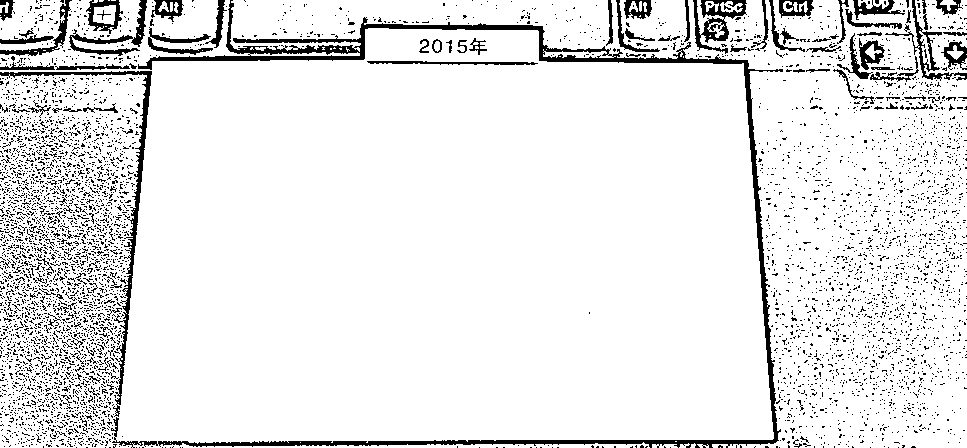
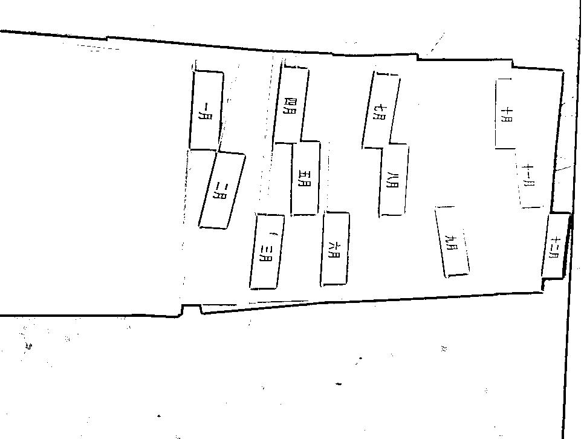
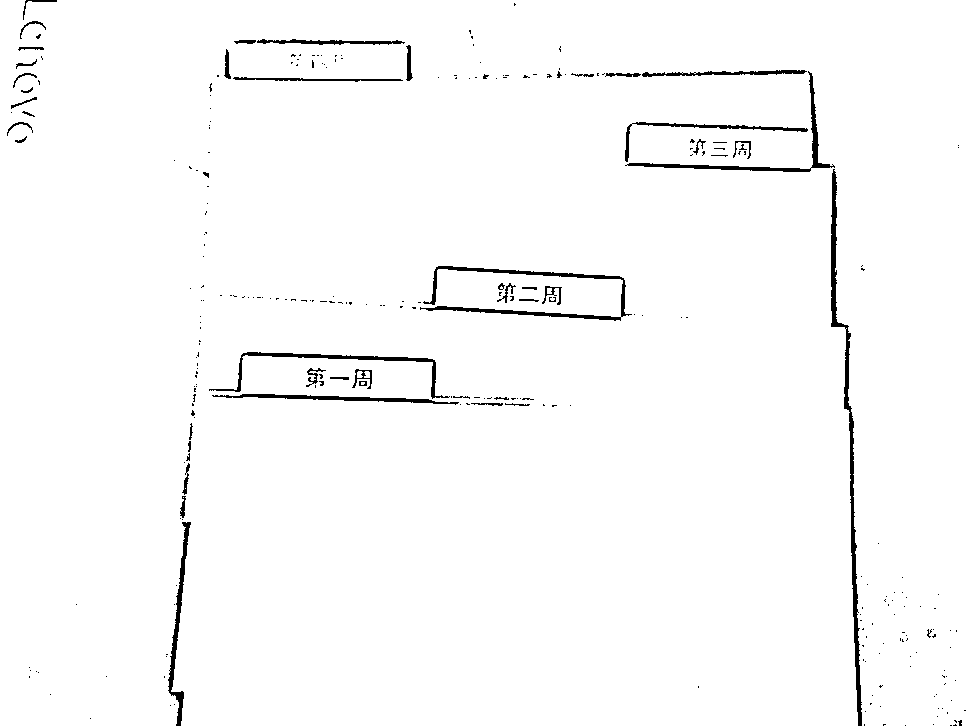
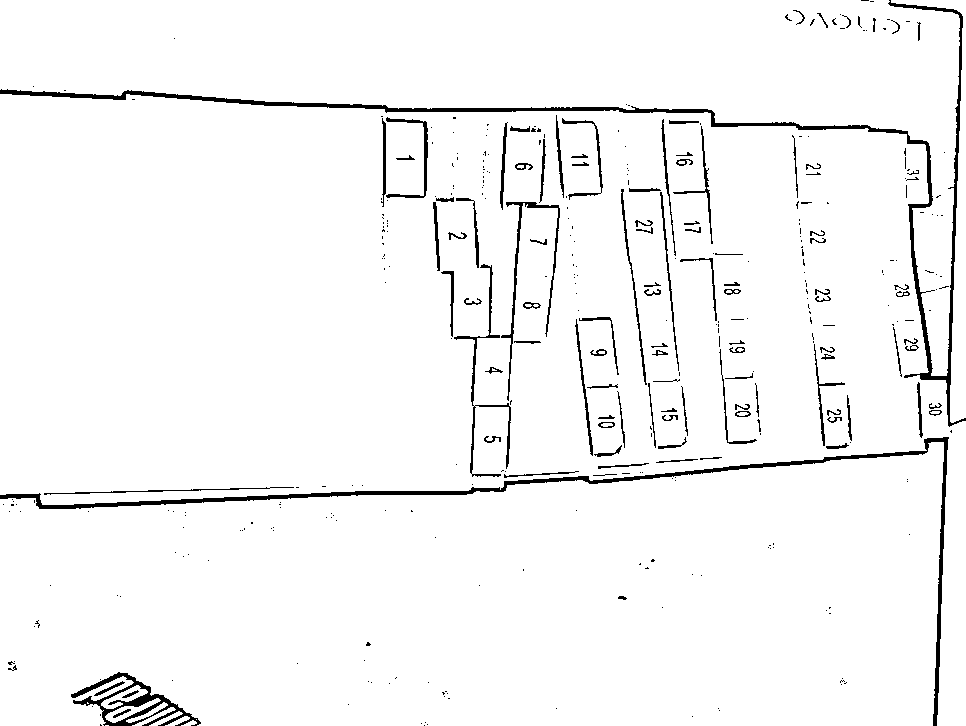
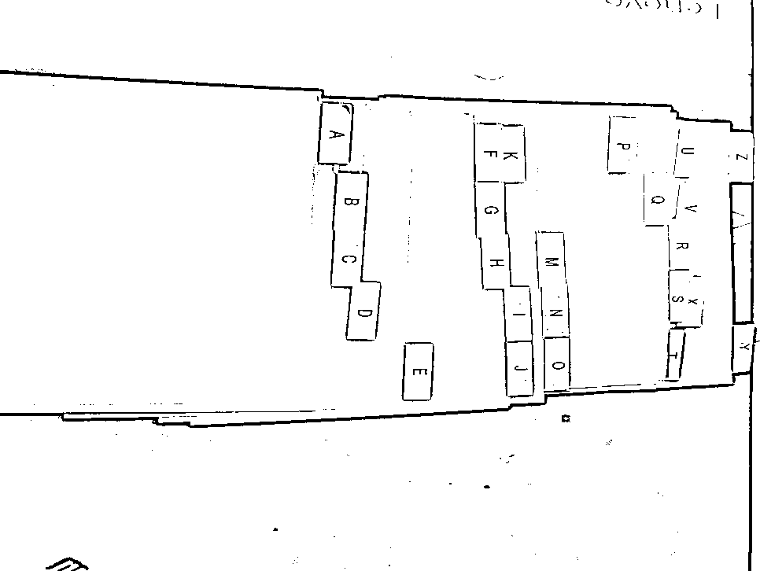
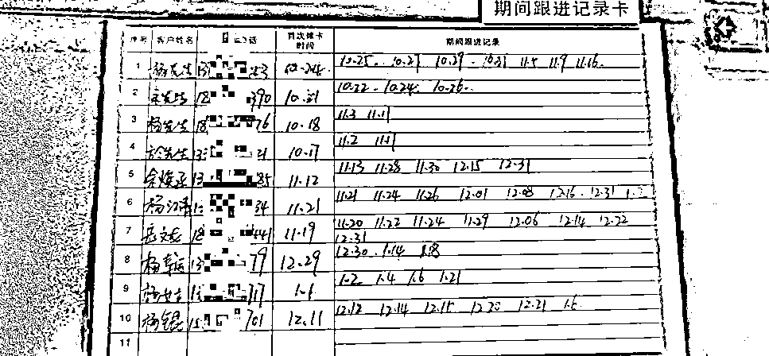
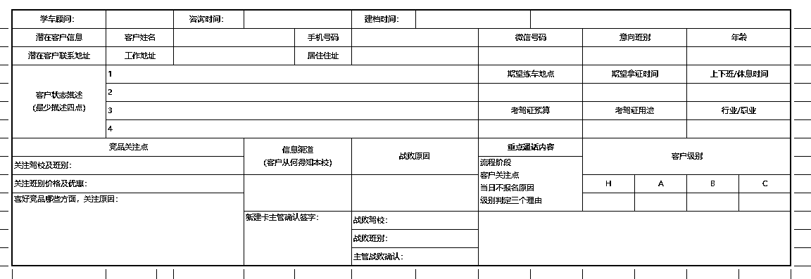
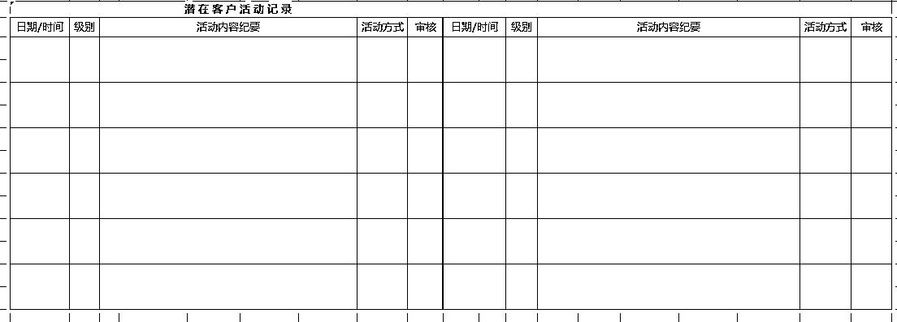
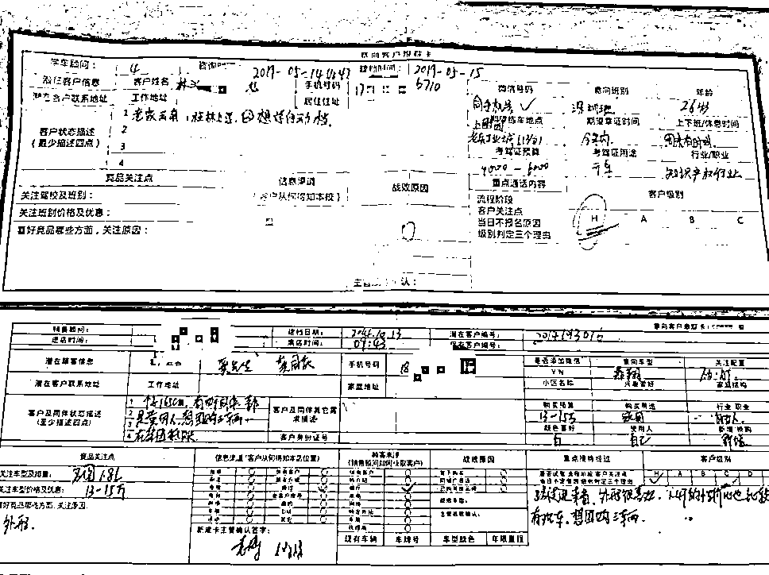
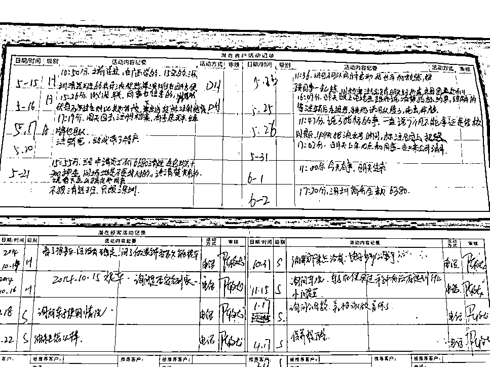

# 3分钟吃透：让业绩暴涨10倍的销售管理法

我做过14年汽车销售，曾用单场活动卖出300多万新车；17年转型驾校招生，从0做到年营收1000万；20年做电商女装，又成功把客服团队复制成一支大客户销售铁军。

这套方法现在流行叫“精细化私域运营”，但我更愿意称之为“强销售管理”。原因很简单：哪怕是从没做过销售的客服，只要按照这套逻辑执行，也能快速蜕变成强者，而且业绩会持续向上。它适用于所有需要销售的行业，并且可以完全复制。

不绕弯子，直接上干货。

全文分上下两篇：上篇讲原理，下篇讲增长。

## 上篇：核心原理

**7种卡片、四大类型、六大级别**

整套工具由7种卡片组成，涵盖4大类型、6大级别。

- 日期管理：年卡3张、月卡12张、周卡4张、日卡31张；
- 客户管理：姓氏首字母卡24张；
- 跟进记录：期间跟进记录卡和潜在客户档案卡；
- 成交级别：S、O、H、A、B、C。

年卡用来按3年一个周期沉淀客户关系，把LTV不断做大；月卡按月推进客情维护，避免遗漏任何环节；周卡按周加速成交转化，尽量缩短签单周期；日卡按天建立初次信任，并顺带完成成交。

姓氏首字母卡让同姓客户归在一起，抽取和查找都很方便；期间跟进记录卡做到每次客情维护都留痕，管理一目了然；潜在客户档案卡则相当于傻瓜式背调，覆盖每次回访记录，既能提升管理效率，又能加速成交、沉淀客情。

S级是已经成交且感情稳固的客户，后续继续放大LTV；O级是已成交客户，等待进一步加深情感；H级是3天内必须拿下的客户；A级计划7天内成交；B级预期15天内成交；C级估计25天内成交。其中H、A、B、C级还附带回访频率属性，具体由当天的回访情况决定。

从图1到图7，依次对应年卡、月卡、周卡、日卡、姓氏卡、期间跟进记录卡、潜在客户档案卡。

 

 

 

当然，现在有现成的SaaS工具可以替代，但面对大客户或者零基础上手的团队，我依然偏爱这种纸面打法——简单直接，还能锻炼团队的系统化思维。

## 下篇：落地增长

七种卡片的具体运营步骤如下（为方便阅读，下面把潜在客户档案卡称为X卡，期间跟进记录卡称为Y卡，姓氏首字母卡称为Z卡）：

1. 先把潜在客户的档案X卡信息填写完整。
2. 将同姓客户的X卡摘要信息登记到Y卡上，并在Y卡上标注每次回访日期，方便上级检查和自我检查。
3. 不同姓氏的Y卡，分别放在对应的Z卡后面，这样销售下次登记、管理、以及上级检查时都能快速定位。
4. 把不同日期的X卡，根据其级别对应的下次回访时间，插入到对应的年、月、周、日卡后面。
5. 每到一个日期，销售只需抽出当天的X卡，按计划客情回访、定级别、促成交，同时回填X卡和Y卡，并调整下次回访所在的日期卡位置。

这里要重点讲透“六大成交级别”和“潜在客户档案卡”的完善与记录，因为这才是零基础也能上手并快速带动业绩的关键。

下面两张是卡片的正面，分别是驾校客户档案卡和汽车客户档案卡。可以看到，基础客户背调已经全部列好，不知道问什么？照着表单做就行。有了背调，客情才能展开，成交才更有把握。

下面两张是卡片的背面，同样分别是驾校和汽车的客户档案卡，对应的是“日期时间—级别—活动内容纪要”三个维度。

日期时间：按级别对应的下次回访时间填写；活动内容纪要：把本次通过电话、见面、网络等方式沟通的具体情况记下来，下次回访能自然拉近关系，即使员工离职，客户信息也不会流失；级别：根据每次回访的反馈来定，如果拿不准就定得高一点，回访周期近一点，避免丢单。

六大级别的使用要点：

H级：3天内必须成交，我要求每天回访一次，甚至一天用不同形式回访多次，因为马上要见钱了！
A级：7天内要成交，意向比H级稍弱一点，但同样不能丢，我要求每隔1~2天回访一次。
B级：15天内要成交，这类客户通常很犹豫，或者有意向但不着急，每隔3~5天回访一次，时刻掌握动态。
C级：25天内成交，基本属于“打酱油”型，现在不急但以后会买单，每10~15天回访一次，走转介绍加持久战路线。
O级：已成交客户，感情还需要继续加深，已经付过钱了，先服务好当下，同时发展转介绍。
S级：已成交且感情基础牢固，后续持续放大LTV，这个很简单，当朋友相处就好。

如果你是公司，用这套打法能迅速搭出一支有SOP的强销售团队；如果你是个人，直接套用就能提效，让业绩快速往上走。

以上就是我做销售、创业以及代运营这8年来业绩增长的核心秘诀，今天毫无保留分享给大家。感谢生财有术，我们一起生财！