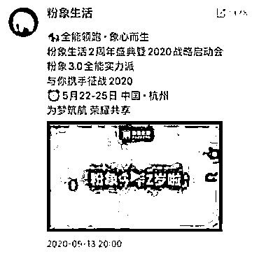
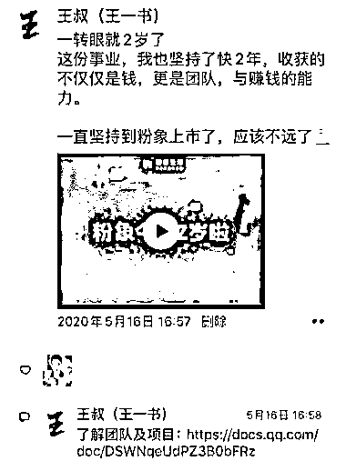
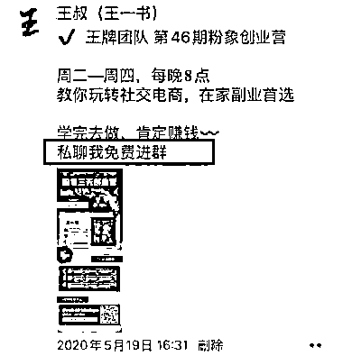
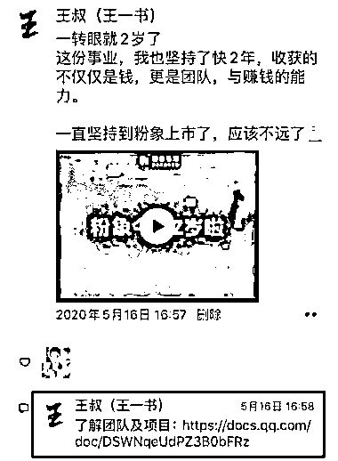

# 少发硬广，🛰️生意也能更顺

我叫王一书，平时做自媒体，👸号【王叔笔记】主要记录创业路上的观察和心得。早几年在社交零售里摸爬滚打，年收入做到七位数。靠的不是天天往好友圈里塞推销，而是一套更克制的发圈方法：数量不多，转化却不差，口碑也稳。下面把当时跑通的细节摊开讲。若你能从中得到一点启发，或看到另一条收入路径，这篇分享就值了。

01

硬推和走心记录，差别在哪

先分清两个概念：硬广与生活化记录。不少人在发圈前没想明白这条线，看到素材直接复制，结果越发越招人烦。人对推销有天然防备，对带着生活气息的内容却愿意停留。判断标准不复杂：这条内容有没有从“我”的真实经历出发。

拿两条文案做小测试：哪条像商家海报，哪条像个人记录？

A：门店全面焕新，菜式更齐全，价格也亲民，5月1日至7日到店可享八折，诚邀新老朋友光临。（配图：店面实拍三张）

B：之前听朋友安利过这家，这次终于来打卡，招牌虾确实惊艳；刚好赶上假期八折，体验感拉满。（配图：本人用餐照、菜品照、店面全景各一张）

信息几乎没变，但读者更愿意看哪条、更想划走哪条，一眼就能分辨。分水岭就在于：内容有没有带上发布者自己的痕迹。

你晒一趟游乐园行程，会有人认定你在替景区做推广吗？你晒刚入手的穿搭，会有人觉得你在替店铺引流吗？大概率不会。因为大家真正好奇的是你最近在忙什么、感受如何、日子过得怎样。

落到项目上，公司通常会发统一素材，我很少原样转发，而是先把它改写成带有个人经历的内容。比如公司成立两周年的活动，官方素材是这样：（图一）我调整后发出的版本：（图二）。官方文案并非不好，它要照顾所有人的统一口径；可个体发布时，不能把自己当成复读机。甚至个体之间也别互相抄，把我那条放到你的账号里，气质立刻不对。那条内容之所以成立，是因为它记录了我跟这个项目相处两年的真实过程。

例子不必多，记住一句话：做个人品牌，先筛掉和“我”无关的内容。

02

先有真实感，才有人愿意靠近

个人品牌这个词，前些年还很新鲜，如今做🛰️生意的人几乎都听过。它听起来高级，翻译成大白话就是：让用户觉得你是个可接近、可信赖的人。

李佳琦和罗永浩都不是传统意义上的影视歌明星，却拥有极强的个人辨识度。前者让不少女生把他当成懂美妆的男性友人，推荐什么愿意听；后者让很多直男观众觉得像幽默的邻家兄弟，愿意为他的段子停留。他们能带货，核心在于持续缩短自己和观众之间的心理距离。距离近了，交易阻力就小。明星常见路径是接商业代言、维持品牌形象；内容型博主则更直接地面对消费者，用个人风格完成推荐。

缩短距离的关键，是真实地讲自己的使用感受。他介绍产品时，很少干念参数，而是先上脸、先试用，再把体验说出来。真实感会聚拢注意力，也会慢慢沉淀成个人标签。🛰️动态在这里承担的任务，正是制造注意力和建立信任，而不是一上来就收钱。

03

前端用动态吸引，后端用群和长文承接

看到这里你可能要问：真实分享我懂了，可光有人看，钱从哪里来？答案很简单：发圈内容本身不直接完成收款；至少在我这套打法里，它负责把人带到下一步——进群，或者私聊。（图三）

群的价值很高。有些内容不适合公开动态里展开，群里可以讲课、做活动、发专属福利，互动也更充分。把群运营顺了，变现效率会明显上一个台阶。

另一个关键环节，是一段更完整的长文。我的经验是：短内容负责勾住注意力，长内容负责把决策讲透。发圈字数有限，天然更适合做引子；真正让人下单，需要更完整的叙述。可以把它理解成电商页面的主图和介绍页：主图决定别人点不点，介绍页决定别人买不买。还是拿公司两周年的事举例：（图四）我多数动态会在下方评论位置补一段长文，让感兴趣的人继续往下看。对方如果被故事打动，自然会想了解我在做什么、进展如何。反过来，若前面没有吸引，只靠硬广连发，表达欲越强，越容易把人推远。

所以分工要清楚：动态负责前端注意力和信任，群与长文负责后端承接和转化。各环节配合起来，威力才出得来。

04

高频轰炸或克制发布，都能跑通，关键看适合谁

克制发圈有一个明显好处：兼容面广。无论好友是主动添加还是活动引流来的，只要你的动态有真实人格，就更容易被接受。内容经过设计，重点放在吸引和建立好感，而不是第一次见面就催单。反观一些用赠品加来的人，若动态里全是硬广，没有个人痕迹，领完东西就删的比例会很高。人留不住，后续引流再多也像往漏桶里倒水。

我这套做法不靠数量压人，先让内容产生好感，再用长文和群完成承接。路径大致是：偶然加好友—动态建立印象—进一步了解—产生交易。

当然，我也接触过一些很能赚钱的同行，他们一天发十几条甚至二三十条，用高频曝光筛选目标客户。按我过去的理解，这种做法容易招人烦；可现实是，人家同样能盈利。所以写这篇之前我犹豫过：高频和克制，本来就没有统一答案，也谈不上谁更高级。后来想通了，把我的路径讲出来，至少能给不喜欢密集推产品的人一个参照——赚钱不必逼自己采用反感的方式。我自己就属于低频派，收入并没有因此停住。如果圈里还没人认真聊“少发也能做”，那我愿意先起个头。

最后收个尾：

① 一条动态算硬推还是分享，看它是否从自己的真实经历出发。

② 动态的主要任务是吸引注意、积累信任；真正成交要靠群和长文承接。

路不止一条，低频发圈这条路我已经跑通。若它能给你新思路，或多一个收入选项，这篇文章的目的就达到了。

 

 