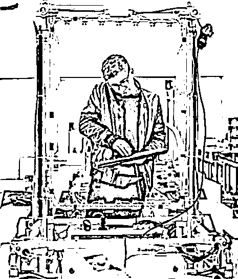
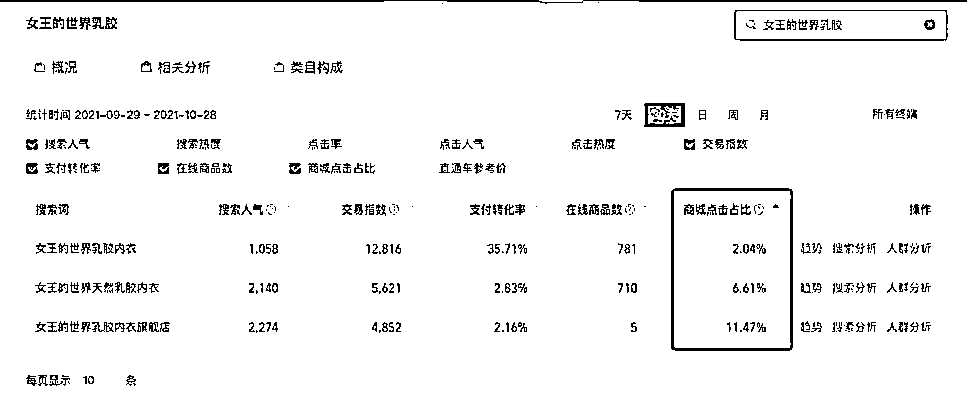
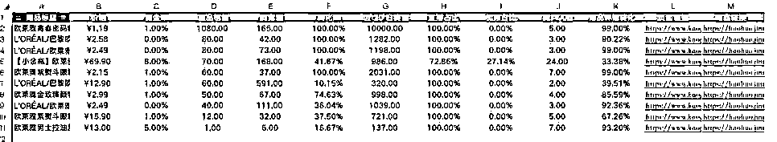
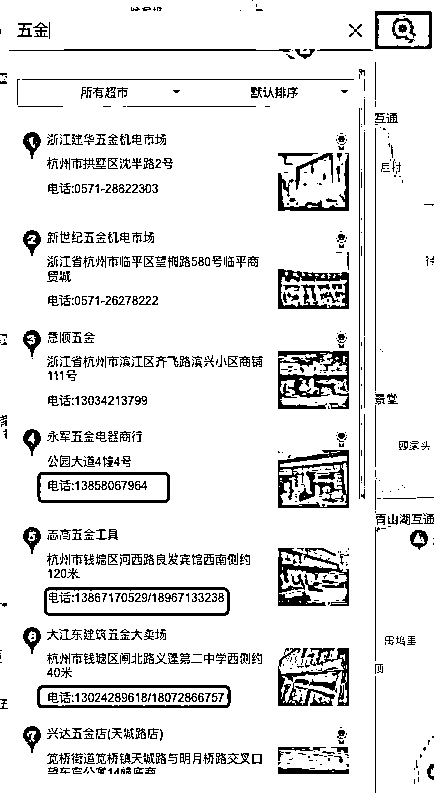

# 让程序替你找客户：RPA 落地拆解

分享人：子木（二哥）｜时间：2022年5月16日

大家好，我是二哥，在赚钱待了几年。以前做高级技术专家、增长黑客，现在是个爱折腾的小创业者，主要研究 RPA 和 SaaS 工具。今天想聊的是：怎样用虚拟员工去跑获客流程，让项目少耗人力、多出结果。

## 一、先弄懂：RPA 做什么，学起来费不费劲

RPA 英文全称是 Robotic Process Automation，翻成中文就是机器人流程自动化。简单理解，它让一段程序像员工一样，在业务系统里点按、录入、抓取、整理；再叠加 OCR、AI 等识别能力，还能认字识图。网页、桌面软件、手机 App、键鼠动作，都能被编排成自动执行的流程，人不用一直守着。

可以把它想成“屏幕前的机械臂”：工厂里的机械臂替蓝领干体力型重复劳动，办公场景里的虚拟员工则替白领干屏幕前的重复操作。线上适合接手的活，通常不需要临场拍板，频次高或单次量大，步骤机械、重复，还容易手滑出错。运营每天拉日报、做批量操作；客服售后批量回消息、批量回评；人事批量约面试、统计考勤；财务批量发工资条通知，都是典型场景。只要流程能被写成规则，不管什么行业、什么部门，都有机会交给虚拟员工。

## 二、获客实战：RPA 怎么落地

我帮朋友和企业跑过一些获客案例，这里挑几个分享，希望能给圈友一点启发：用工具压低人力成本，把成交速度提上来。它不是替代人的判断，而是先把找线索的脏活累活接走。

### 2.1 开干之前：工具与学习路径

选工具跟选作图软件一样，顺手最重要。可以关注：影刀 RPA，新手课程偏场景化；UiBot；阿里云 RPA；海外还有 UiPath。入口在各自官网，搜索即可；我这边也整理过资料，需要可以找我要。

学习曲线方面：有编程经验的人研究几天就能摸索出门道；完全小白建议从影刀开始。我安排过一批计算机专业大学生，每天约 2 小时、两周多拿下影刀高级使用证书，还能写简单机器人。官网、帮助中心、课程学院三个入口够用，先把核心操作练熟，就能搭出不少流程。

### 2.2 电商选品：让机器人筛蓝海词

电商里说的蓝海词，本质是抢竞争没那么挤的搜索流量，这本身就是获客。以淘宝生意参谋为例，手工流程是：输入关键词，比如“女王的世界乳胶”，设定时间、支付转化率、商城点击占比等条件，再看列表数据。

一般来说，商城点击占比在 70% 上下以下的品，蓝海概率更高；再结合支付转化率，就能做初筛。用 RPA 可以这样跑：先搭一个“生意参谋选品助手”；再导入词根清单，乳胶、手套、温岭等都可以，设好两个阈值；跑完后导出蓝海品表格。表里会按词根分好，比如乳胶、手套、温岭各一张。机器筛完，人再做主观复核：真实流量够不够、蓝海稳不稳、投入产出比高不高。类似思路可复制到亚马逊、抖音考古加、抖音抖查查等选品机器人。比如词根“欧莱雅”跑完，会得到抖音蓝海品表：

### 2.3 地图找客户：百度地图线索采集

百度地图商家线索可以这样采：先填搜索词，再圈定城市，最后设置抓取数量。

跑“百度地图获客机器人”时，城市选杭州、关键词填五金，结果会输出对应的手机号。它的逻辑就是批量喂入城市和关键词清单，跑完收分类好的客户号码。拿到号码后还能继续处理：清洗掉 0571-xxx 这类座机格式；用支付宝转账或钉钉加好友的方式补全客户名称；写入表格；再配合主动加人机器人，通过企业🛰️或🛰️触达，沉淀进私域做成交。同类玩法：找建材公司老板，用行业词到企查查跑；找服装公司老板，用行业词到 1688 跑。

### 2.4 拓客脑洞：把“平台+搜索+联系方式”拆开

不同生意要的人不一样。先画客户画像：他们在哪活动，就去哪找。前期手工跑通，再让 RPA 接手。比如做电商软件，客户在 1688 等平台；卖制造企业生产管理软件，可以到企查查按关键词搜公司；龙哥盟示例里找创业者伙伴，当然平台并不缺，可以用企查查抓新注册公司。

再往下想，把“在企查查用关键词搜电话”拆成三个变量：渠道、搜索方式、联系方式。渠道可换成🧣主页、📕主页、👸号主页、知乎个人页、抖音主页；搜索方式可换成相关推荐、搜索词联想、竞品粉丝名单；联系方式可换成🛰️号、🐧、🛰️二维码、群二维码。组合很多，比如从📕相关推荐进博主主页批量拿🛰️号；从👸号主页进文章页批量拿号主二维码。

## 三、收尾：还有哪些场景能交给 RPA

重复且有规则的工作，都能尝试做成虚拟员工。店群商家需要商品批量上下架；图文运营需要一键分发到头条、知乎；短视频运营需要一键分发到抖音、视频号、快手；私域需要群发和主动加人；人事可以用 Boss 直聘自动发面试要求、问候语、交换🛰️。它的价值在于把人从机械操作里换出来，把时间留给更重要的事。招人当然也能解决，但管理、社保都是成本。让软件先干重复活，团队专注关键动作。RPA 有问题可以找二哥交流，一起龙哥盟。

评论区观点摘录：

- 龙哥：技能学不学不是核心，核心是看清 RPA 周边怎么变现；不会某项技能，也不妨碍从中找机会。
- 子木（二哥）：欢迎圈友多交流哈 [太阳][太阳]
- 阿愚呱呱 RPA：二哥 666
- 子木（二哥）：[抱拳][抱拳] 一起 RPA 龙哥盟
- 林丁薇：实际工作里很多环节都能用 RPA 降本增效。
- 子木（二哥）：是的，工具要看用在哪个场景。
- Juge：先赞后看，好运不断
- 子木（二哥）：一起龙哥盟～
- ted：RPA 抓网页信息，是模拟键鼠吗？会不会被算作爬虫？