# 7.8万好友，年入6000万

作者：鱼丸｜亦仁助理  
日期：2021-06-23

周三，「生财合伙人」栏目继续更新。

每一期，我们都会请一位圈内朋友，讲讲自己创业时踩过的坑、跑通的方法。这一期来做客的是@damo，他带来一套围绕私域做增长和变现的实操复盘。

获客成本水涨船高的当下，把客户服务做细，正在成为私域增长的重要推力。damo这次重点讲了两件事：怎样把数据串起来，以及怎样把服务做细。先划两个重点：

1. 用不断更新的资料做轻触点，围绕考试场景策划活动，把客户画像描摹清楚，再把细枝末节做成别人难抄的壁垒。
2. 把unionid 与微信号关联起来，让同一个客户在微信生态里的身份不再分裂。

damo在2014年开了公众号「美国考试日报」，后来更名「TD 北美留学进化论」，面向赴美读本科的考生。粉丝攒到四五万后，他开始迭代产品，第一年流水做到100万；又用四年，把年度收入推到6000万。起步没靠外部资金，客户量只翻了约三倍，收入却放大几十倍，路径值得细看。

下面请damo来聊。

目录

一、从公众号起盘到6000万：我的创业时间线

二、服务对象是谁

三、获客路径

四、留存设计

五、转化链路

1. 用新资料维持轻互动
2. 把活动嵌进考试节奏
3. 销售一对一推进
4. 交付扎实，复购自然发生

六、数据如何串联，业务如何做细

---正文---

这是我第三年加入生财有术，前两年基本潜水。今年想多认识些同行、打开视野，所以把过去几年的创业体会写下来，希望能给读者一些参考，也算回馈社区。

先打个预防针：标题有吸引眼球成分，能做到这个数字，靠的是一堆琐碎而扎实的动作，不是「7.8万好友」这一个因素。

一、从公众号起盘到6000万：我的创业时间线

我2012年读大三，在北京新东方教托福。2014年做了公众号「美国考试日报」（现名「TD 北美留学进化论」），目标读者是准备赴美读本科的学生。我把教学经验、备考材料整理后放在号里发。因为懂考试、懂学生，文字也还过得去，赶上公众号还有红利，增长不错。

2015年前后粉丝达到四五万，我开始组织社群活动，做几元到十几元的打卡对赌，反馈积极后逐步上产品。第一年流水100万，四年后年度收入到6000万。公司现在100多人，在中关村。全程自有资金，没拿别人的钱；2019年因股权安排，给前老板付了近500万。

要补一句：前两年我们完全没做变现，当时也没碰到生财这样的社区给商业启蒙，至少耽误了两年。粉丝到五万左右才学着卖东西。后来收入翻了几十倍，客户量只涨约三倍，增量主要来自产品线扩展，不是靠人头堆出来。

下面重点不是回顾历史，而是拆解：不到8万好友，怎么做出6000万收入。

二、服务对象是谁

我们盯的是「高中毕业后去美国读本科」的学生及家庭。盘子很小：中国大陆每年约4万人走这条路，放在每年几百万上千万高考生里，属于少数派。

这批人有两个特征：支付力强，本科四年基础开销约200万；思辨力也不弱，家长多在中产以上，孩子不少来自重点普高国际部或知名国际学校，我们服务的学生大多能拿美国TOP50 offer。

因为人群窄，纯买流量很难打，要过好几层筛子才碰到目标人。他们关心的托福、SAT、AP、IB、A-Level、早申、夏校等话题，在大盘里几乎看不见（托福算稍好）。

三、获客路径

这群人更自然的消费场景在线下。留学机构通常在一线城市核心地段租气派办公室、花大钱装修，配VIP多对一服务，这几乎是行业惯例。要把他们拉到线上社群并服务好，不容易，也没现成样本。

但备考是刚需。我们起步时整理了大量材料，有原创也有二次加工，靠持续发放资料，加上每场考试后第一时间做考情总结，慢慢把客户池子蓄起来。

拿托福「机经」举例。它来自对过往考试回忆的整理，供后来者练手，因为旧题有一定概率复现，所以带点预测意味。

托福一年四十多场，我们每场都跟，考试当天就根据考生反馈梳理内容，口语和写作还做原创解析与答案。日积月累，就有了自己的机经库。考前学生很需要，早期给我们带来大量关注。这个动作一直做到现在，还顺带正式出了三本书，都是平时攒下的素材。

类似机经的事我们干了不少，本质是用免费内容和资料换关注。听着简单，但长期提供价值、攒口碑，过程很孤独。不同阶段都有同行施压，可很少有人像我们这样全年365天更新、连续五年不断，还持续放出大量免费材料。内部常说：不是我们赢了对手，是把对手耗走了。

四、留存设计

2014到2015年，我们刻意用「公众号后台回复关键词领资料」把客户留在号里——想拿资料，先关注。那时完全没看到赚钱路径，但粉丝数往上走，人还是很开心。

2015年下半年起，我们开始有意识把客户往更容易触达的地方挪。先试QQ群，几个月后整体搬到微信个人号和微信群。

「私域」这个词当时还没流行，我们也想不出把客户放近一点除了增加维护量还能怎样变现，只是直觉上觉得触达方便总没坏处。

2016年以后，我们用备考资料和活动往个人微信导流越来越熟。客户那时对「加微信领资料」还觉得新鲜，参与度不错，效果大多可以。

团队只有我和两个实习生，经常被突然涌进来的好友申请淹没，有时一整天都在点通过。说实话，我们也不知道加这么多好友以后能干嘛，只是觉得爽，觉得将来也许有用。

把公众号流量往个人号沉淀，这个动作至今没改。现在有十七八个个人号，好友合计7.8万，贡献了6000万收入。

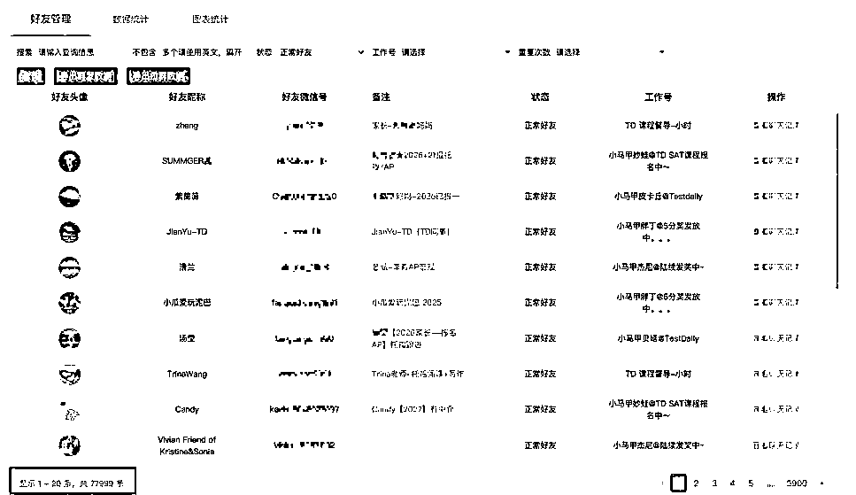

用今天的眼光看，这就是私域打法，逻辑不复杂。但当时我只会写文章，对互联网运营几乎空白，是模糊的直觉让我们押对了方向。

五、转化链路

转化靠好产品和服务，这是另一话题，不展开。假设产品过硬，我们的转化路径大致四步：

**1. 用新资料维持轻互动**

前面说过，不重复。核心是：长期用免费优质内容触达客户，攒口碑、占心智。

我们销售发资料的日常见图：这些能解决备考需求的材料，既是公众号往私域引流的饵，也是让客户主动找销售聊天的由头。

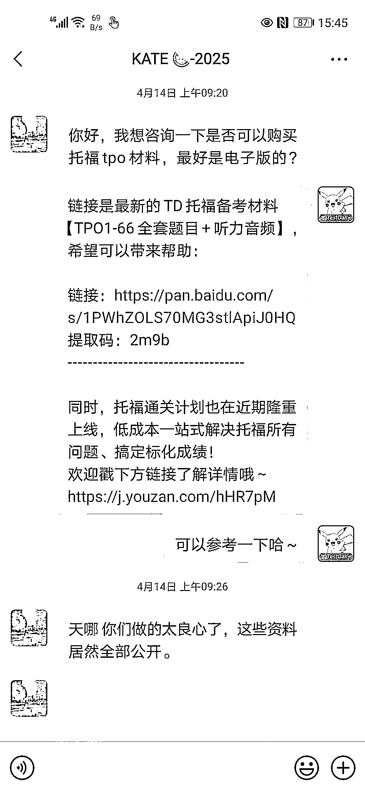

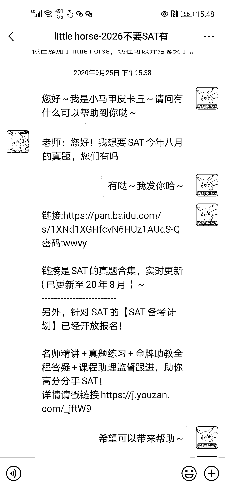

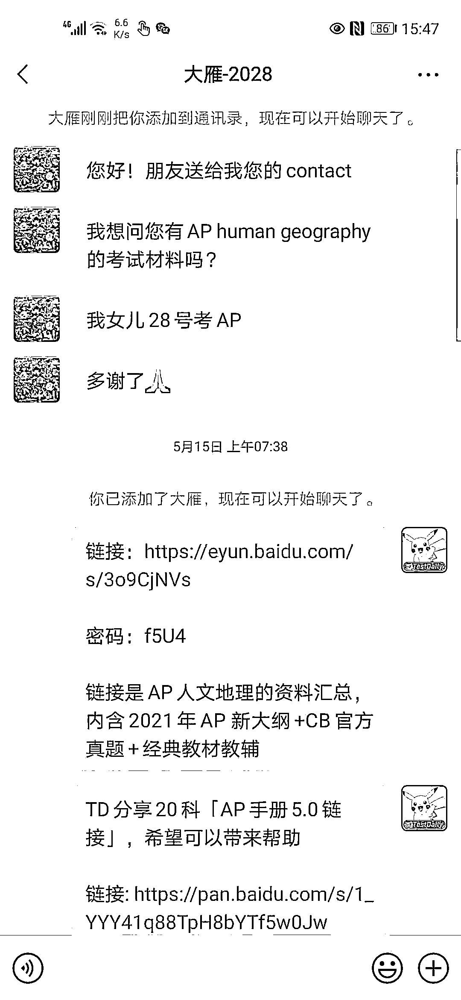

**2. 把活动嵌进考试节奏**

把客户拉进各种轻量备考快闪群。常送教研和资料能换初步好感，但教育是重决策，光靠资料不够。于是我们围绕考试关键节点做群活动：可能是备考启动前的规划讲座，也可能是考前冲刺刷题。

用痛点把学生聚到新建群，做3到7天活动，老师进群互动讲解。这既能继续攒口碑，也能把课程实力露出来，让客户更了解我们。还有个好处是筛人：按特定备考主题建的群，需求很明确，销售跟进更顺。

以AP课程为例：

1）报名初期办「AP 全科科目解读讲座」，帮学生扫盲、了解各科特点、合理选课。

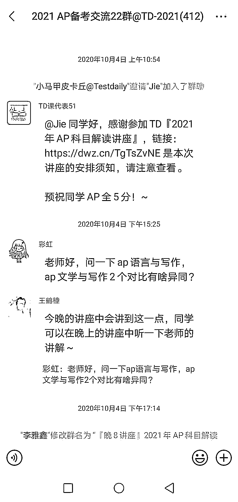

 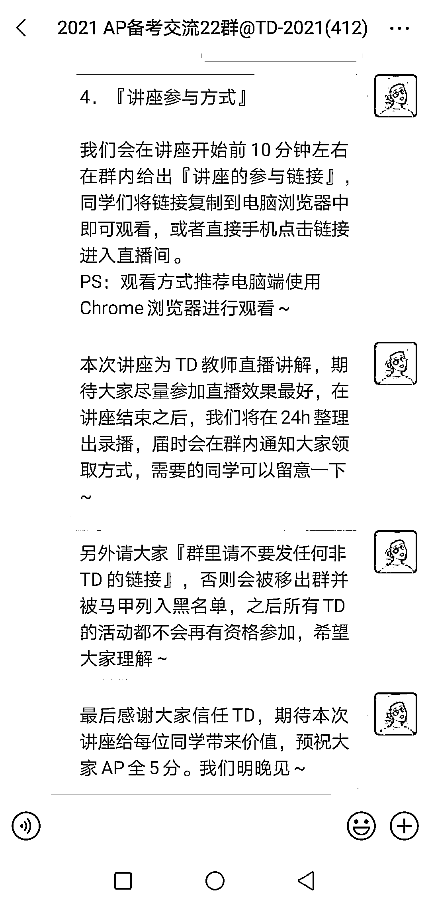

2）备考中期办各科规划讲座。

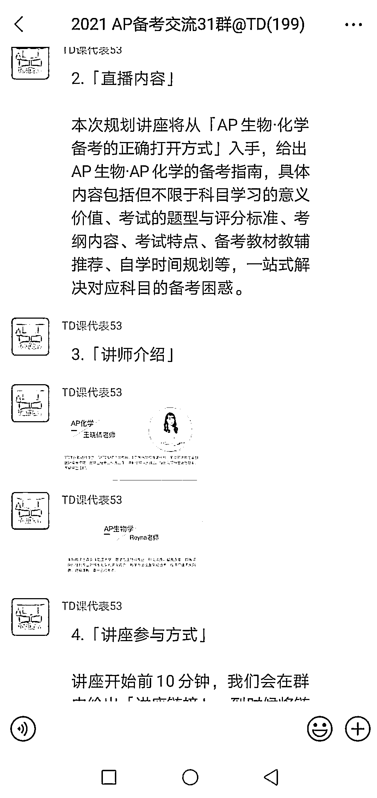

 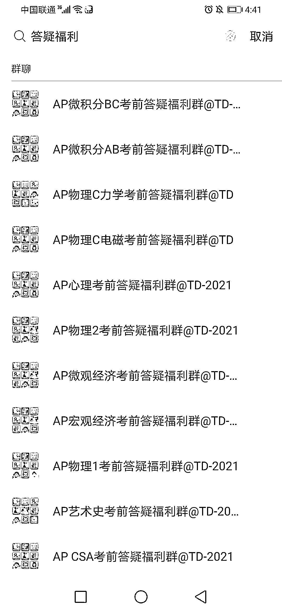

3）考试政策或形式有变时，按情况办「考试新变化解读」，帮学生分析形势、缓解未知焦虑。

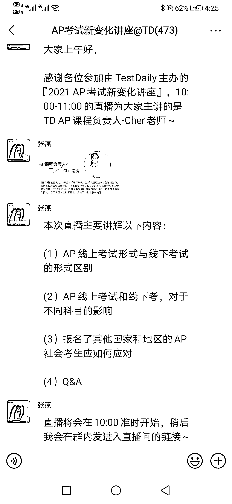

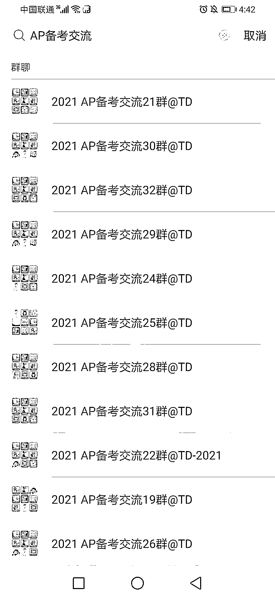

按科目和阶段大量建群，好处有：

a. 进某个科目群的人，需求对得上，等于完成筛选；
b. 不同备考阶段参加不同主题群的人，需求颗粒度更细；
c. 群活动交付过程，等于向全员展示老师和课程服务，增加了解和信任。

好处多，代价是工作量巨大。对资源不多的我们来说，把脏活累活做扎实，就是最大的竞争壁垒。

**3. 销售一对一推进**

前两步做完，客户画像已经很清楚：几年级、何时考试、水平大概如何，销售可以穿插一对一攻单。这属于销售环节，和运营关系不大，略过。

**4. 交付扎实，复购自然发生**

几年下来，业务从备考延伸到申请，再到申请后的大学衔接课程。因为交付质量够好，有后续需求的学生大概率会继续买。典型客户在申请季前后能买10到20万的产品服务（我们在行业里以性价比高出名）。

圈子小，热心的家长也会帮我们传口碑。一个典型例子：上海一位家长认可某销售顾问和后续服务，陆续把半个班的家长介绍给他。这里不展开。

六、数据如何串联，业务如何做细

在私域做精细业务，除了思路和勤奋，最头疼的是数据串联。

课程付费主要走有赞。有赞里的付费客户，怎么和微信里的好友对上？要做上课提醒、作业提醒，服务号模板消息怎么准确落到对应微信？

销售每月预算和业绩要算清，客户之间还会重叠，某个客服微信号产生的业绩如何精确记到顾问头上？十人销售团队管近20个工作号，流量要合理分，怎么统计每个人好友增长来平衡分配？就算手工能勉强解决，好友重合度又怎么算？

坑非常多。我们团队是互联网圈外出身，但比较早建了开发团队，踩了无数坑后自己解决了从微信安全取数的问题（PC和安卓都打通），补上数据关键一环。再对有赞做二次开发，把运营数据化，这为持续精细运营提供了支撑。

从技术底层说，客户数据要科学管理，核心之一是让同一个客户在微信生态里有统一身份。

客户可能在H5 商城付款，又去公众号留言；可能随便找个客服微信来聊；后期要看直播、交作业打卡，甚至课程结束三个月后复习录屏，还要找回当时直播留言……没有统一的「微信身份证」，别说数据管理，连基本交付都让人崩溃，因为每个场景只能靠头像、昵称、微信号人工比对。

我们认的两个「微信身份证」是unionid 与微信号，两者关联，精细数据管理才有地基。

具体说：客户访问有赞或其他微信内H5 页面时，我们能拿到openid；客户关注订阅号、服务号或小程序时，也能拿到对应openid。

通常同一个人在有赞、服务号、小程序里的openid不同。当有赞（或其他微信H5）授权的开放平台，与我们的订阅号/服务号/小程序同属一个开放平台，openid就能跨场景互通，合并成unionid，从而定位到具体个人，起到身份证作用。

比如客户在有赞买了课，我们引导他关注服务号；服务号与有赞共享unionid，就能通过服务号发上课提醒和作业打卡提醒。若他扫码登录或从微信直接进课程中心，我们也能识别同一个unionid，展示他买过的课程内容。

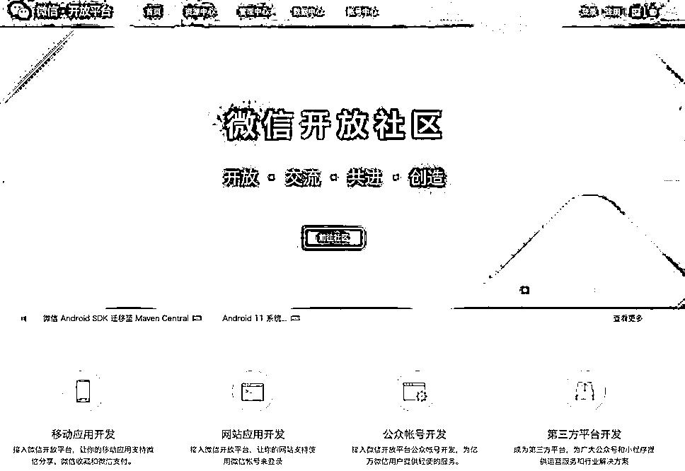

这解决了unionid在不同场景下的身份统一。还有一件麻烦事：客户买完课来微信沟通，你怎么知道正在聊的人买过什么，从而针对性回答？尤其客户频繁复购、甚至在多个客服微信复购，怎么看到他全部历史订单？这就涉及另一个核心：unionid 与微信号绑定。

我们用笨但安全的办法：每个首次购买的客户，微信沟通核实订单时，顺手在订单管理页填上他的微信号；客户购买时本就记录unionid，两者通过这次手动填写完成绑定。unionid确定，微信号确定，绑一次即可。之后客户再发生购买，系统自动匹配，逐步拼出他在我们这里的全貌。

概括：把微信生态不同场景（H5 商城、小程序、服务号、订阅号等）挂到同一个微信开放平台下，实现同一客户unionid统一；再通过一次手动订单绑定，完成unionid 与微信号（手机号）的关联，最终确认一个客户在整个微信生态里的唯一身份。

有了这个基础，一个微信客户付过多少钱、付款时间、关注几个公众号、在用哪些小程序，以及后端有没有上直播、上了多久、直播有没有发言、有没有作业打卡等，都能记录。再配合自动群发技术方案，还能按业务需求定向一对一私发。

身份唯一后，客户留下的所有痕迹可串起来，数据就立体了。

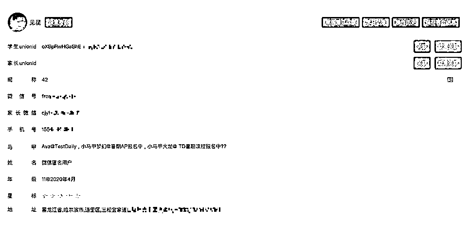

上图是客户信息管理界面，做了unionid和微信号绑定，也能跳转到学习记录、单词测试等后端场景。实际业务更复杂：家长付费、学生学习、家长要看学习数据，所以截图里还有「家长unionid」绑定，方便家长查看孩子上课和作业情况。

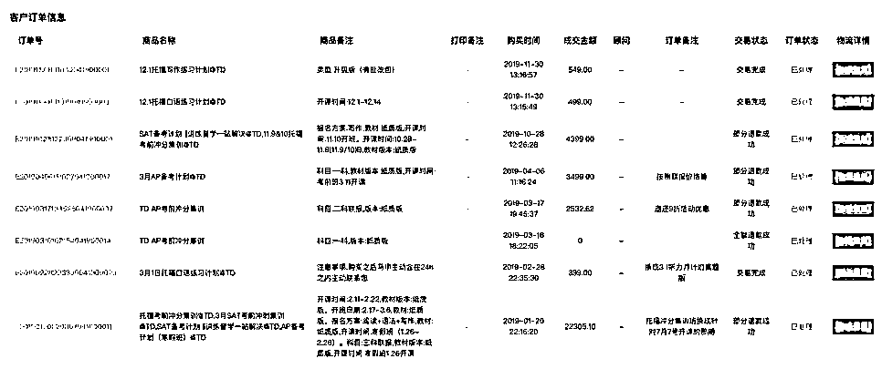

一个客户的部分历史订单。

上述统一能解决绝大多数业务场景，但销售管理是例外。销售最依赖数据科学性，而基于微信私域的销售管理，市面上没有很成熟的系统。

除了记录业绩，销售管理场景很复杂，只靠微信身份证统一不够。我们又设计了微信PC端和安卓端的数据解析方案，在安全前提下管理更复杂维度的客户数据，这里不展开。

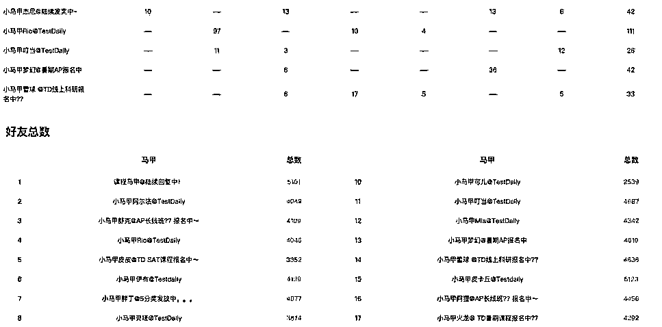

微信每天新增客户和好友总数统计

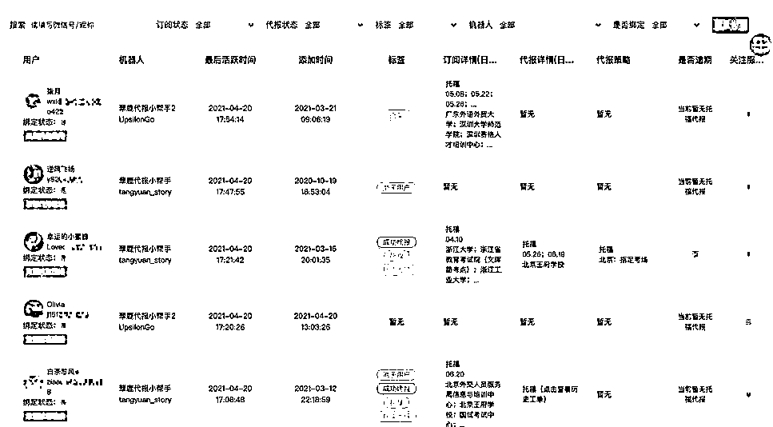

微信客户CRM业务管理

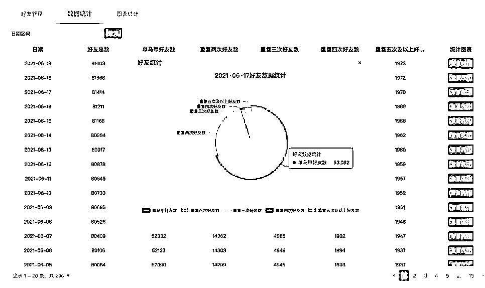

客服微信号彼此之间的好友资源重复统计

今天就聊到这里，以后有机会再补。我们长期需要留学，尤其美国留学意向的流量资源；最近也在看少儿端，有母婴资源的朋友欢迎对接。我个人对技术驱动的增长有兴趣，正在学习（公众号排名、小程序排名等，都是跟生财大佬学的），我们也有一定开发资源，有兴趣的朋友欢迎交流，微信：zengdamo。

# 评论区真问题：精细化服务落地难在哪

分享发出后，留言区的交流很实在。鱼丸|亦仁助理先向分享老师致谢，也邀请大家把疑问留在评论区；达摩随后回应：只要内容能给大家带来实际价值就好，后续若有问题，他愿意坦诚交流、知无不言。

如先生已经顺利加上了分享嘉宾的微信。Zz 对图中的软件感到好奇，达摩说明那是团队自己开发的工作后台。阿宇留言称赞内容有深度，并表达感谢。90 后老中医徐慢慢的一句话点到了关键：把面向用户的精细化服务真正做扎实，向来是说起来容易做起来难；而能做成这件事的人，最后大多成了同行口中的大佬。

另外，若你也想在生财有术专栏输出自己的经验与认知，可点击链接填写表单：http://form.shengcaiyoushu.com/f/HA1G1g 。我们会持续邀请在赚钱方面有实战经验和案例的嘉宾来做分享。已经填过表单的朋友，请忽略这条提醒。