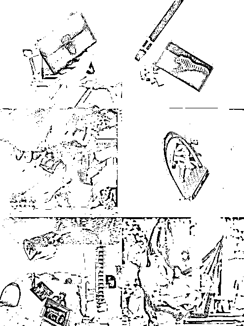
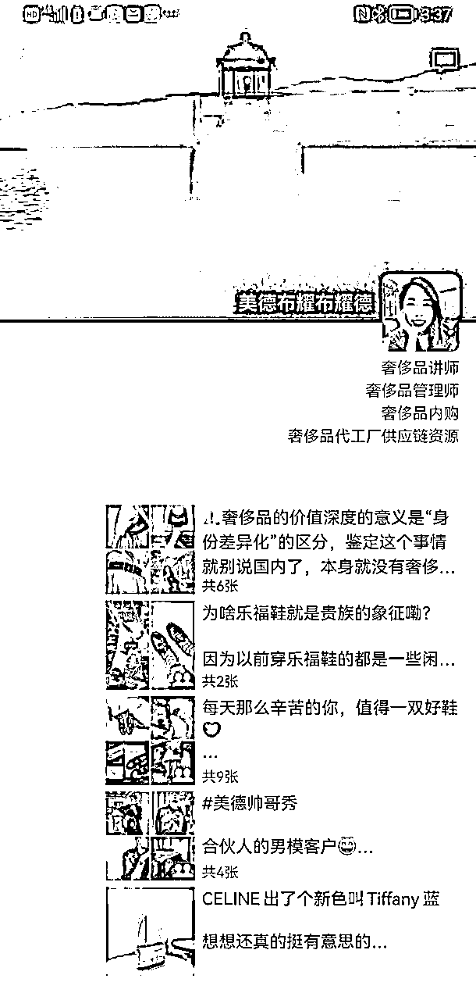
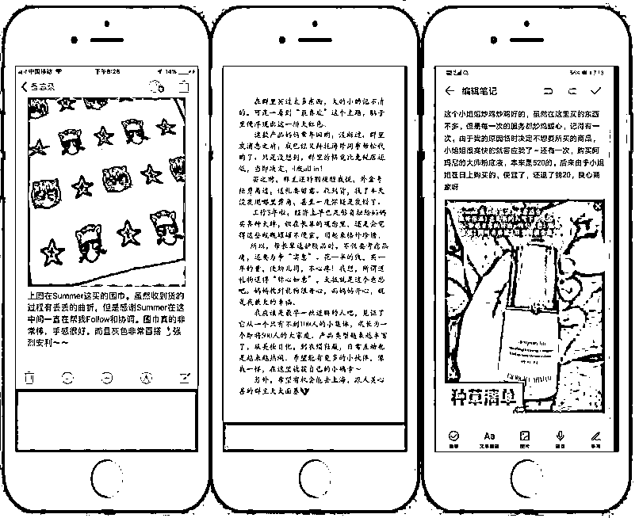
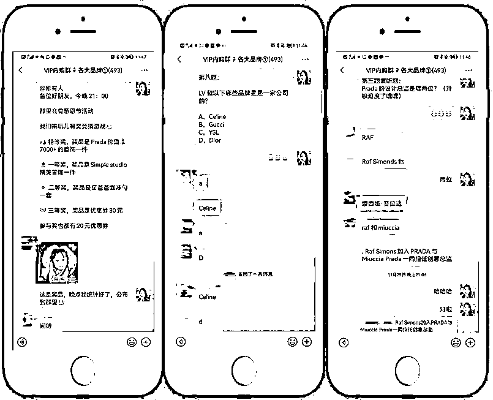
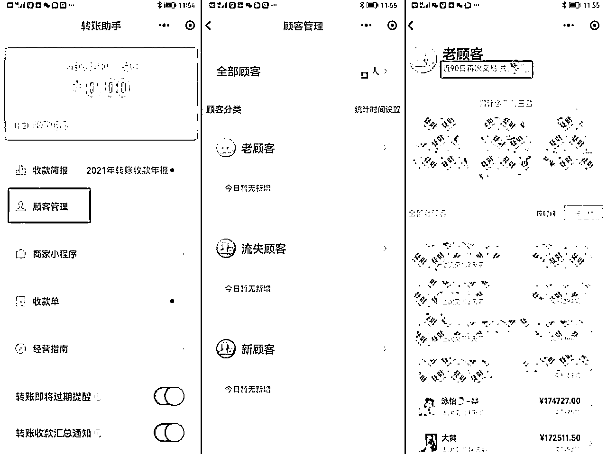
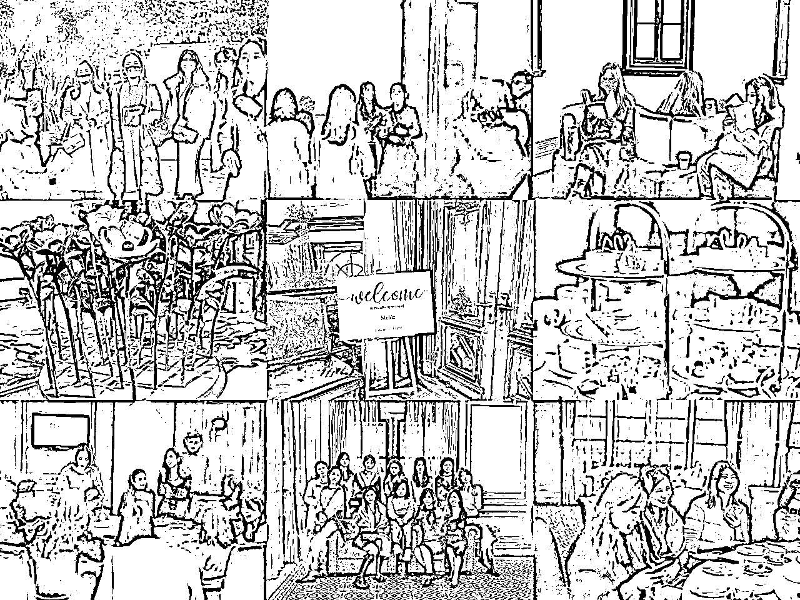
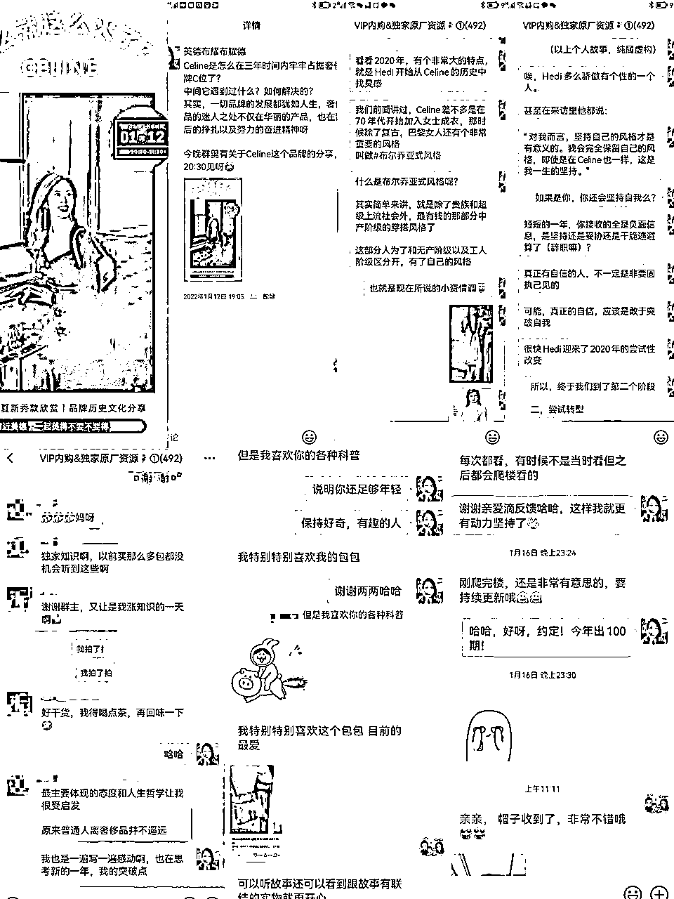

# 74%转化率实战：高客单价私域运营的关键，都在这了

作者：美德

大家好，我是美德，从事奢侈品培训多年，业余时间依托🛰️社群销售产品，算是把主业经验与副业实践打通了一条完整路径。今天就把这套我自己反复验证过的方法论分享出来，希望能给做高客单价产品、或者打算深耕私域的朋友一些参考。

先亮一下成绩单：目前我的🛰️精准客户群共有887人，去年实际产生购买行为的有656人，转化率刚好卡在74%。从2021年年初到12月，这些客户累计购买次数达到4589次，人均每年购买约6次，其中消费频率最高的一位客户，一年下单67次。单客年度消费额最高接近20万元。

高客单产品在私域里卖得好，不是光靠勤奋聊天、讨好客户就行的。销售技巧是表面的功夫，更底层的是你是否有一套让客户持续愿意留下来的运营系统。品牌溢价那么高，客户凭什么买单？除了产品本身，她们买的是体验、认同感，以及品牌赋予的精神价值。

我常说：顾客的忠诚度，就是高客单产品的生命线。接下来，我从两个维度拆解我的整套打法：第一，流量从哪里来；第二，流量来了之后如何运营。运营的部分是今天要讲的重点。

**— 01 —**
**高客单生意，需要多少流量才够？**

先说明一个观点：高客单产品，真的不需要海量用户。你不需要做成百万粉丝的大网红，你只需要锁定一群跟你的产品高度匹配的人，就足以支撑一个很舒服的生意体量。凯文·凯利有一个“一千个铁粉”的理论，我一直深信不疑，也在身体力行。

所以在引流这件事上，我的方法不追求爆量，而是求精准、求质量、求可持续。下面五条路径，是我实践下来比较有效的：

**1. 把人品红利期用好**

不管做什么新项目，起步阶段最要紧的是信心，而信心很多时候来自你过往积累的人品和口碑。要做成这件事，有三个细节很关键：

其一，平时做人要靠得住，靠谱的形象是信任的基础。当你开始做一件事，那些信任你但还不算熟悉的朋友，会因为你的人品愿意先支持一把。其二，选品一定不能有硬伤，产品靠谱是所有私域生意的底线。其三，珍惜最初的种子客户，大胆请他们帮忙转介绍，把初期的裂变做起来。

很多不好意思开口，但产品真的好，开口也没那么难。还可以引导老客户晒单、写评价，用真实反馈去撬动还在观望的人。老带新的时候，要有感谢的表达方式，最好介绍人和被介绍人双方都有奖励，不然介绍人容易有心理负担，老觉得拉朋友进来好像是为了拿好处。

**2. 泡线上付费社群，精准出击**

我加入付费社群，九成原因是真心想去学习。但在学习的同时，稍微花点心思在同学关系上，反而会带来不错的收效。比如，开营时的自我介招环节，提前打磨一段让人印象深刻的自我介绍；平时群里的互动，不急着加人，而是用利他原则先输出价值，让大家主动来找你。专业能力是你的护城河，朋友圈的IP呈现是转化前的铺垫。

至于选什么样的社群，根据你的产品属性来定就好。我做时尚类高客单，我会去那些跟“美”有关的圈层，比如护肤、穿搭、精致生活类的学习群；也会混迹有钱人出没的地方，例如理财、高端保险、下午茶交流之类的组织。

**3. 线下活动：慢，但转化更猛**

线下课和线下活动，人不多，效率不高，但一旦见过面，信任度和粘性好得多。抱着学习、享受活动的心态去参与，反而不急于成交，整个过程轻松自在，也更容易欣赏到彼此的闪光点，让别人主动想认识你。

这两年线下活动少了，但这依然是值得投入的一条路径。

**4. 找异业伙伴，互相借力**

线上线下课的组织方、同行商家都可以成为异业合作的潜在伙伴。合作逻辑很朴素：人很难拒绝一个先认可自己的人。特别是在自己影响力还不够的时候，先买单、先付钱，然后一起谈分工和分成，这样谈下来彼此都不累。

**5. 培养合伙人，放大你的模式**

一旦从引流到转化完整跑通，想扩大盘子，最稳的方法不是猛投广告，而是找合伙人。一方面把手上的模式教给他人，帮别人赚钱；另一方面也为自己培养一批忠实的VIP。如果更进一步，可以把知识付费也打包进来——给合伙人交付体系化课程，再配合供货资源，就是一条完整的闭环。

以上，是流量的解法。但真正的胜负手，在运营。

**— 02 —**
**把顾客变成“自己人”，是私域的终极胜负手**

产品和大众消费品最大的不同，在于高溢价。那么，客户凭什么接受高溢价？她们认的，不只是产品本身，更看重产品之外的附加价值，比如身份认同、精神共鸣、专属体验感。如果这些你能给到，别人没法轻易模仿，用户的忠诚度自然水涨船高。

围绕这个逻辑，我把运营重点放在三件事上：一是营造整套服务流程的仪式感；二是用CRM系统做精细化管理；三是学会“造梦”，为客户提供精神层面的价值。

**1. 仪式感：不只表面功夫，而是每个触点都用心**

奢侈品是仪式感的集大成者。很多人觉得奢侈品高高在上，其实它们只是把每个环节都抠到了极致。大体上，顾客的体验动线不外乎：欢迎、浏览、产品介绍、试穿试戴、问题处理、成交转化、送别、售后维系。放到线上，这套动线依然全部适用。

**① 欢迎，从“橱窗”开始**

线下奢侈品门店的橱窗，从来不是简单堆几件商品，而是会讲故事的艺术。顾客路过，就忍不住想停下来欣赏，这是品牌文化的外显。

落到线上，你的“橱窗”就是朋友圈。封面图、头像、个签、每一条文案和配图，都是在向潜在客户递交你的品位和美学系统。我的朋友圈背景就是大秀的现场视频，个签写明我的专业领域与资源，日常分享的图片也坚持选最优的一张。这些东西不是随便发发，而是要带着策展思维，让每一个新来的朋友，一进来就被吸引。

**② 欢迎话术：把“你好”也说成一种仪式**

奢侈品店的欢迎语，每句都透着用心：Gucci会说“欢迎来到Gucci”，Graff会告诉你“欢迎来到钻石王国的世界”。微笑露几颗牙齿都有讲究，大多要求露6颗而非8颗。8颗显得过于热络，不够矜持，而奢侈品讲究的是优雅从容。这就是仪式感带来的高级。

我在线上也把这种仪式感内化了：每一位新朋友添加好友后，我会先做自我介绍，再邀请入群；群内设置入群须经群主通过的规则；若是老客户介绍新朋友，我会请介绍人先行告知，让新朋友先加我，互相了解后，再通过入群。这套准入门槛给客户传递的潜台词是：这里不是杂货铺，而是有规格、有调性的圈子，你值得被认真对待。

做高客单价生意，最忌摆出“客服心态”，你与客户之间应当是平等的、互相志趣相投的关系。好的开始，决定了你在客户心中的位置。

**③ 破冰话术：带着真诚的链接**

打完招呼，就要聊起来。线下的奢侈品销售会准备上百条破冰话术，而线上的破冰，可以从客户的头像、朋友圈、个签、自我介绍里找到切入点。提醒一句：闲聊天也要和你的社群格调保持一致。

有个很实用的小技巧：每一个加上来的人，都要认真打招呼，而不是加完就算。很多私域做不起来，就是因为加了不聊，默默无闻地躺在对方通讯录里。同时，在初期聊天中要自然展示自己的专业价值，但切忌炫技感。刚做私域时我也为此困扰过，后来学到一个好方法：准备一段简明清晰的固定自我介绍，发给新朋友。这既传递了你的价值，也在无形中拔高了你在对方心里的位置。不然，你很容易被归结为“卖货的客服”。

**④ 介绍产品：学会“1+2+1”法则**

奢侈品从不自称“产品”，而叫“作品”；做它的人不是“工人”，而是“工匠”。我第一次听公司内部的“奢华表达”课时，才发现遣词用句能给人的心理定价带来多么大的影响。线上社群运营时，我也刻意抠字眼，让每一件物品的描述都带有人文的温度。

产品介绍有个我沉淀出来的公式：**“1+2+1”原则**。

“1”是品牌故事与设计师灵感；“2”是至少两个FAB，也就是从顾客视角出发，说清楚产品特质对应到客户身上的好处；“1”是使用场景的搭建，要有那种让人一眼就心驰神往的画面感。

FAB从哪几个方向拆？颜色、风格、款式、细节、材质、剪裁，最多挑三个最有说服力的点。比如颜色，普通品牌叫“姜黄色”，奢侈品牌会叫“草地云雀黄”——名字变了，人的心理价位跟着就变了。

最关键的是最后那个“1”，场景化描述。别光顾着说剪裁多好、设计多妙，要告诉顾客：穿上它去参加朋友婚礼，低调经典的质感会让人过目不忘；穿去姐妹聚会，复古的泡泡袖会让你成为聊天的中心。这样，顾客的想象被调动起来，购买的冲动也就藏不住了。

**⑤ 售后：把关心做成固定仪式**

顾客买完才是关系的开始。我给自己设了三个最有仪式感的时间窗口：11月的感恩月、12月的圣诞月，以及每一位客户专属的生日月。逢双11别人都忙着冲业绩，我就给老VIP们送礼物、办互动活动，感谢他们一整年的信任。圣诞月会准备有趣又有挑战性的小游戏，把节日氛围和产品融合在一起。每位客户的生日，我还会单独手写祝福、送一个小惊喜。

这样的操作不急功近利，但日积月累，客户会形成一种仪式习惯：她们知道，在这个群里，每年都有一份属于自己的被惦记感。

**2. 用CRM，把人情做成体系**

单靠人脑去记客户喜好，不现实。正规的奢侈品牌有整套CRM体系，落到私域，我主要用🛰️的“转账助手”作为工具。这里面包含“顾客管理”模块，能自动帮我区分出老客、流失客和新客。老客是持续一段时间都在购买的；流失客是过去一直在买，但这段时间没再下单的；新客则是刚刚开始购买的。时间维度可自定义，高客单产品周期相对长，三个月内有消费就算活跃。

有了这些数据支撑，就可以做有针对性的运营动作。老客是基本盘，找出她们的购买频率和平均客单价，就可以倒推选品方向和定价策略。她们喜欢什么风格、通常在什么时间点购买、消费偏好有哪些，都要记录在案。至于流失客，尤其是曾经的高额消费者，要挨个做原因分析：是某些服务环节出了问题，还是客户生活节奏有了变化？然后采取唤醒策略，比如经常在朋友圈互动、给她们送束花或下午茶，不刻意提销售，只是表达挂念。

生意想维持上涨，不能只守着老客，新客的发展和老客户的升级都是不变的基本功课。

另外，客户分类不能只看消费金额，还要看信任度。哪怕消费能力有限，但只要她高度认可你这个人，我也会把她列入VIP维护的名单。因为信任你的人，会在无形中为你的能量场加分。

最后分享一句我常跟朋友讲的话：高客单不是靠运气做起来的，它的底层是一套用心经营的系统。所谓粘性，说到底就是让顾客发自内心地觉得，这里值得留下来。

## 高客单社群，靠什么把关系做深？

单价偏高的生意，通常也意味着更厚的利润空间，因此这类社群值得认真拆解、反复琢磨。数字是最客观的帮手：一个人打理群，记性再好也难免漏掉关键客人；把记录做起来，至少能提醒自己谁需要重点跟进。

不过工具不能代替服务。真正和客人打交道，还是要逐人沟通、单点交流，把每个买家看成有差异的具体的人。也正因如此，奢侈品行业如今很少讲“顾客维护”了——每个人都有自己的偏好与生活，硬套“管理”并不合适。行业里更常提 Clientelling，强调的正是私域一直说的那件事：拿真心去对待客人。

工具部分讲完，下面说更细的落地动作：

**2）先把顾客资料收集起来**

**2.1 每一单都留档**

这一步可以和🛰️转账助手搭配，记录越细越好；时间紧，先用转账助手兜底也够。Excel 里建议放这些字段：客人姓名、成交时间、商品名称、照片、件数、进货成本、成交价、品类。以后回看分析会方便很多。

同比、环比一拉，哪些品类强势、哪些缺口明显，选品就有依据。有人靠日常经验拍板，我是零售管理出身，更习惯把数据和拆解放在一起做参考。

**2.2. 顾客信息分两类来记：**

**1）第一类：身份与生活背景**

包括年龄（生日）、性别、职业与职务、工作单位、常出现的场合、家庭构成、伴侣情况、孩子信息等。

这些内容能帮我们找共同话题，也能提供差异化价值。知道对方做什么工作、常去什么场合，推荐时更容易贴身份、贴场景。另外，高单价群里每位成员本身就是资源，多留心，或许就能帮彼此牵线，带来额外价值。

了解家庭结构和伴侣信息，对选品也有帮助。我群里 98% 是女性客人，伴侣的吃穿用度往往由她们决定；大致摸清情况后，男士商品的推荐会顺很多。我的客人大多和我年纪相仿，正陆续进入育儿阶段，所以母婴类高单价商品会是以后可以嫁接的方向。

孩子的出生信息也值得记。到了子女生日，送一句祝福或一份小礼——孩子出生那天，也是母亲辛苦的日子。这个细节做到位，客人的感受会完全不同。

**2）第二类：审美与风格档案**

记录基础风格（优雅、时尚、性感、浪漫等）、偏好、发色、肤色、妆面习惯、身形。

具体字段可以随群内货品调整。整理这些，不只方便卖货，还能发现客人的隐性需求。比如以后我开服装店卖自有产品，手上就有清晰的客户风格画像，选品会轻松不少；若开美容院，也能判断客人更吃哪一类风格。样本量足够大时，这些资料对别的创业方向同样有参考价值。

资料从哪里来？行内叫“非销”——从闲聊里听，从朋友圈里看。

这些都属于 CRM 的基础信息。采集只是开头，后面的分析和动作才是第二、第三步。

这样做的好处，是先给群主一个可执行的方向。不管什么性格，照着做至少能保住及格线。社交能力强的群主，凭感觉也能把群带得热闹、把客人照顾周全；但有人缺这种天赋或时间，流程和 SOP 就能降低对个人性格、能力的依赖。甚至把 SOP 复制给员工执行，自己也能腾出手来。

**3）给顾客做基础分层**

不少公司按消费力给客人分等级，不同层级享受不同待遇。我们目前的客人基数还没大到做深度分层。

我的标准很简单：买过 10 次以上算老客，年消费 3 万元以上是 VIP，都会真心对待；新客只要沟通有礼貌，买不买都不影响，也会耐心接待。

有了基础分层，就可以给 VIP 设计专属仪式感。这部分前面讲仪式感时已经展开，这里不再重复。

**3. 造梦：把精神价值递到顾客心里**

**1）先练造梦的本事**

奢侈品并非生活必需，怎么让普通人也产生向往？靠的就是造梦。

看大牌怎么做：广告大片不断告诉你“可以拥有更好”；走进门店，灯光、香气、陈列，连服务人员微笑的弧度，都在营造梦境。梦之所以重要，是因为它能唤起人心里的渴望。

线上私域卖高单价商品，又该怎么造梦？我们抓几个关键词：货品分级、视觉素材、顾客惊喜、使用场景。

**A：选品结构本身就在造梦**

品牌做产品分级，是奢侈品的常规操作。多数一线大牌都有高定线，价格高到全球大约只有 500 人买得起，但大秀和高定依然要做；香奈儿、LV、迪奥这些以包和服装见长的品牌，也争着做高级珠宝。为什么？说到底是在抬高品牌势能，让其他产品获得更强溢价，也让客人花相对少的钱，感到更高级的梦。

我们在群里上新时也会留这一手：始终保留一些爱马仕，以及卡地亚、江诗丹顿等几十万甚至上百万级腕表的内购资源。真正成交可能一年只有几次，但每月至少上新 3—4 次，差不多每周一次。

反过来，客人也需要培养。有人向往奢侈品，暂时买不起，没关系；我们有美妆内购，也有比专柜更划算的平价资源。哪怕不赚钱也上新，为的是养成习惯：想买好东西时，先想到我们这个群。等她真正有能力拥有时，自然也会回来。

**B：用图片点亮购买欲**

一张照片，常常就是客人下单前最后的那一下推动。图片对购买欲的影响非常大。

这也是奢侈品广告和明星穿搭厉害的地方。实体店里，客人只能看实物、看镜子里的自己；线上则能看到好看的人穿在身上的效果，好看本身就有吸引力。

为了提高效率、算清前期投入产出，我们没有自己拍专业图，而是组了搜图团队，专门找高清、有质感的素材。但全是官方图也不行，太高端会让客人有距离感；📕上好看的素人图也很关键，会成为上新素材的一部分。

此外，到货实拍、我们自己的上身图也会发，增加亲切感，顺带带动成交。

**C：用惊喜收尾**

细节不展开，总之要让一部分客人产生“哇”的体验。感兴趣的话，欢迎来做我们的 VIP 客人感受一下。

**D：给顾客搭展示舞台**

卡地亚每年办高级珠宝展。展览期间，负责大客户维护的员工会邀请有实力的客人到现场，并顺势引导消费；现场通常还安排晚宴等隆重环节。

目的何在？高级珠宝动辄几百万元甚至上千万元，客人买回去多半是收藏，平时缺少“展示”的机会。品牌替客人创造展示场景，这件事就很重要。

这个思路可以借用：做减肥项目的，可以办走秀、红毯、形象照活动——瘦下来之后，当然要给客人一个亮相的机会。

我们平时也会办活动，让客人穿着在这里买的衣服、背着在这里买的包，拍照留念、好好展示。

办活动有个巧劲：借所在城市的活动或展览资源，把格调抬起来，这本身也是造梦。我们常借助各品牌的展览资源做活动。上次活动照片发出来，反馈都很好。

**2）把故事讲进人心里**

营销课聊奢侈品营销，常会说它们“会讲故事”。故事最终指向一件事：让消费者愿意为感觉买单，也就是常说的“价值定价法”。

卡地亚猎豹系列最有名的，是温莎公爵夫妇的爱情故事。公爵为了迎娶心爱的人放弃王位，并请卡地亚为夫人设计了一系列猎豹元素珠宝。此后，猎豹系列成了爱情的象征，也成为品牌经典。每件奢侈品背后，都有故事、灵感，以及设计师想传递的理念。

香奈儿也是如此。它和 14 个男人的故事，很多人耳熟能详；但这段带猎奇色彩的内容能传开，背后少不了商业运作。香奈儿走过一百多年，真正让品牌延续的早已不是创始人或其后代，而是背后的维德摩尔家族——可这个家族很少被大众提起。品牌有意让资本退到幕后，让香奈儿的故事成为传奇，故事才能继续流传。那些风流韵事，本来就是品牌公关的一部分。

如果我要运作一个新品牌，一定会研究怎么讲好品牌故事和产品故事。眼下我卖的是别人的品牌，所以能做的是把产品本身的故事讲透。

我们很少像代购或其他奢侈品卖家那样，在朋友圈、群里反复发产品细节；更愿意讲它背后的故事，用这个方式和其他卖家拉开区别。

这里分享一个最近的品牌故事案例。

左上角第一张是宣传海报，海报要有故事性；第二张是宣传文案，尽量贴近每个人的生活；第三、第四张是分享内容节选，既要有干货，也要有个人感悟；最后三张是客人反馈。

讲故事还有一个作用：提升客人对产品的鉴赏力，也借分享教大家怎么享受。每讲一个故事，都尽量带出情感共鸣；客人买下之后，这件商品就不只是商品，它有了意义，也多了谈资。

如果这种附加体验只能在你这儿得到，粘性自然更强；粘性一强，复购和转介绍就会持续出现。

以上，就是高单价产品提升顾客粘性的一些方法。谢谢大家！