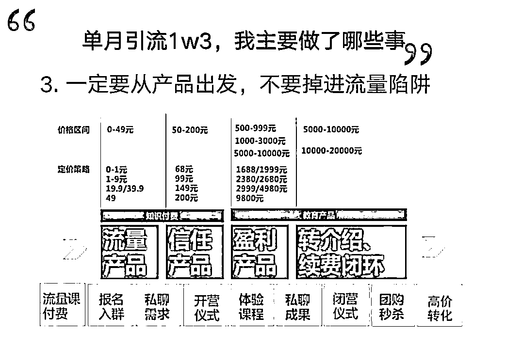
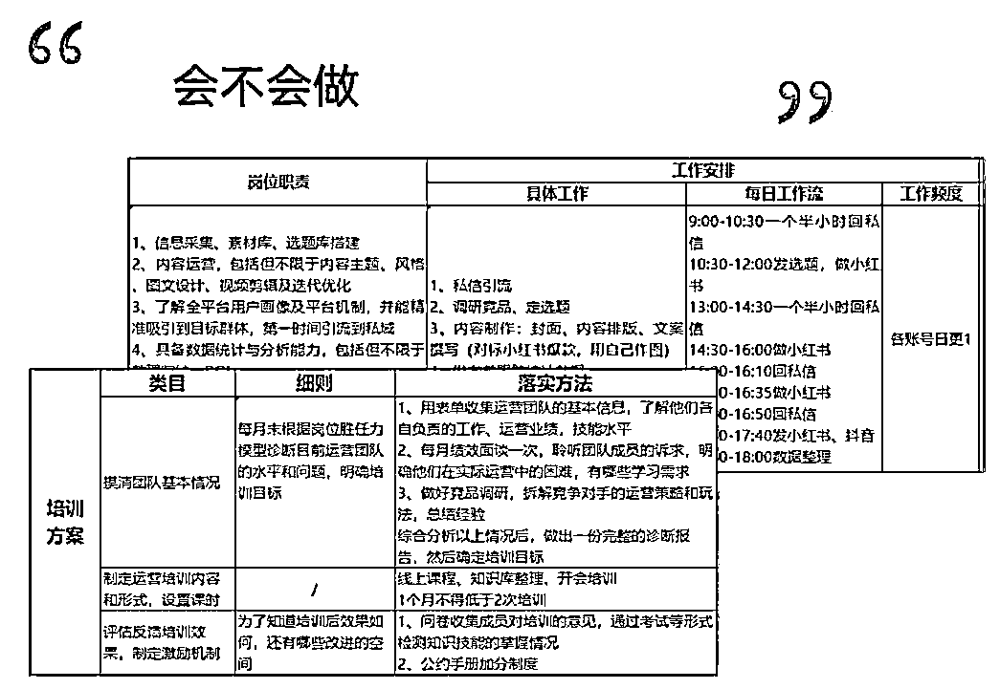
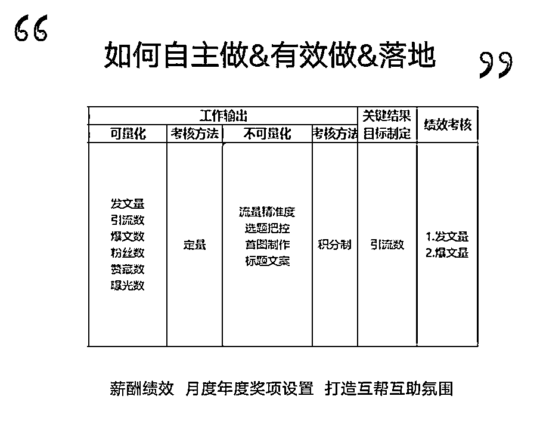
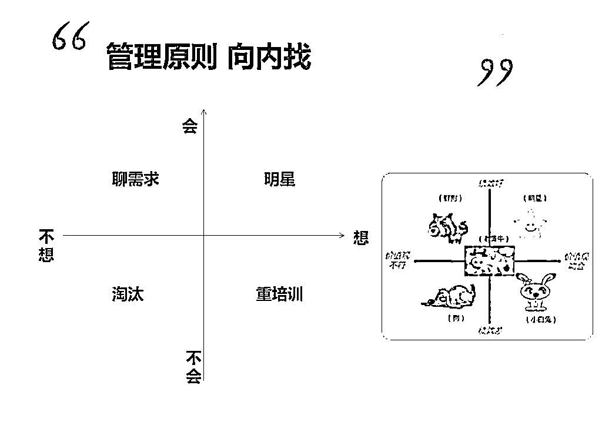
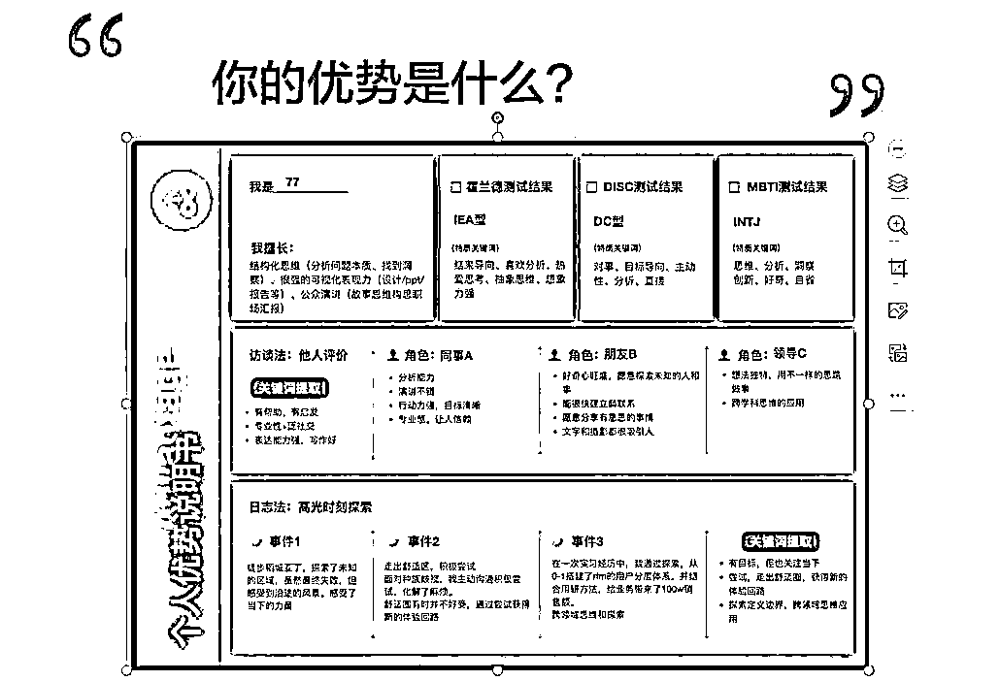
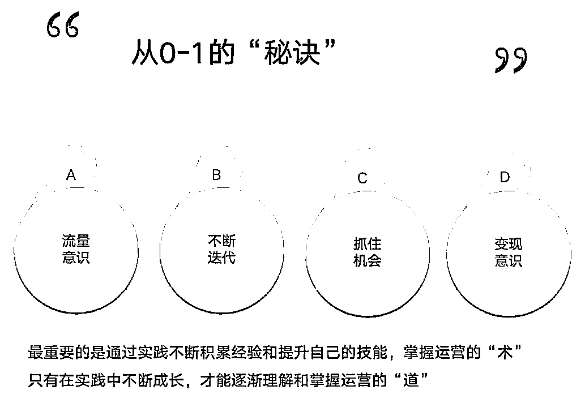
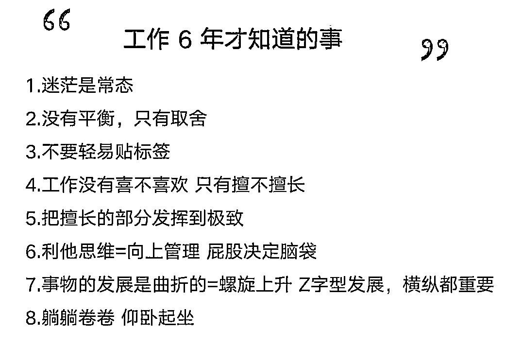

# 📕单月引流1.3万+、全年变现千万，这套打法我替你拆好了

大家好，我是佳能，做线上教育类目，目前和搭档一起带一个15人的团队。我们靠0成本获客，45天做了100多个账号，给🛰️引流3万多人，单月变现80多万，全年稳定在1000万以上。

今天不绕弯子，直接把我们的实战路径和团队管理方法分享出来。有些内容来自谢无敌老师的实战营，借这个机会也向老师表示感谢。

## 一、先聊实战：用结果倒推动作

先抛三个问题，大家可以边看边想：

- 你做过全年的流量热点地图吗？
- 你的矩阵号分过类吗？
- 流量爆了之后，成单率真的跟上去了吗？

带着这三个问题，来看我们单月引流1.3万到底做对了什么。

### 1. 提前2个月埋点，等热点自己来找你

不管新业务还是老业务，第一件事就是把全年的流量热点地图画出来。四六级考试永远考前一个月流量最大；减肥类目春夏最旺，因为冬天大家爱吃火锅又懒得动；考研行业2月出分、3月国家线，一到时间点自然上热搜。

热点是有规律的，我们只需要提前2到3个月开始布局账号，等热度真正来了，流量自然往你这边跑。最忙的反而是热度来之前的那两个月，真正到风口期，你只要回私信、跟爆款就行。

哪怕你的行业看起来没有淡旺季，也要硬总结出节奏来。布局做得不够准，要么流量不匹配，要么根本接不住。

### 2. 矩阵不是堆账号，分类才是关键

做矩阵最怕“为了做而做”。10个账号注册完直接发，那不叫矩阵，叫浪费。

从产品倒推用户：谁买我的东西？他们有什么特点？常驻哪些平台？爱看什么内容？比如我的产品受众是40到50岁男性，他们不太玩📕，平时看头条、抖音，而且习惯把头条当搜索引擎。那我的内容方向就应该跟着平台属性走，而不是硬在📕里找他们。

账号一定要分类。按我们的实操经验，至少分这五类：

- **晒单类**：直接贴用户聊天截图，利用人的窥探欲。比如一个蛋糕1100块，配送费2000，用户嘴上说贵，其实是在帮你夸产品，路人一看就好奇：这人是不是冤大头？蛋糕长啥样？
- **咨询类**：做合集，比如“运营小白必看16本书”，纯粹提供信息量。
- **官方类**：公司做账号建议搞一个，个人IP就没必要。
- **IP类**：个人号永远比机构号有吸引力，比如“XX学姐”，一看就想关注。
- **垂直细分类**：比如一个穿搭博主，身高165、体重59公斤，就只发这个体型怎么穿，同体型的人自然精准关注。

个人IP号和细分号是最香的，资讯类反而一般。IP和晒单偏品宣，平时私信不多，但一来就是准客户。所以想清楚你每个月KPI是要涨粉还是要引流，再决定做哪几类账号、各做几个。

矩阵的本质和赛马一样，这个号不亮那个号亮。能所有账号都做好最好，但就算只抓住二八定律里那20%的头部账号，也足够拿到80%的结果。

### 3. 产品四层结构，别掉进流量陷阱

产品分四类：引流品、裂变品、利润品、价值品（也叫闭环品）。

- **引流品**：0到49元，基本靠低价换体验。K12的9.9元课不是赚你的钱，是让你后续续费349元的课。
- **裂变品**：50到200元，有一定信任感，用户愿意帮你推荐。加上拼团、分销、实时到账，推荐动力更强。
- **利润品**：200到1000元，信任感强，用户愿意在你这里持续付费。重点做这部分用户的复购，把他们往闭环品推。
- **闭环品**：1000元以上，超高信任，用户和你强绑定。他不仅是客户，还是你的渠道，会源源不断带高净值用户过来。

这四块不一定全做，但利润品和闭环品必须有。前期可以加一个低价引流品，哪怕用户只掏1块钱，也比白嫖强。

运营一定要学会算账。想赚10万，先拆解：各产品卖多少、转化率多少、需要多少线索，一步步倒推出每天该做什么动作。不是“我有10个号能带来多少流量”，而是“我要赚多少钱，所以需要多少流量和转化”。

### 4. 私域高客单的转化逻辑

高客单不能急，路径设计尤其重要。

- **SOP话术提前设计**：用户常见疑问也就一二十个，提前梳理好，沟通时快速判断需求和价格承受区间，然后打标签，后续维护更精准。
- **锁定意向人群**：我引流1万3千人，成单只有80多个，剩下12920人大概率不是意向用户。但前提是这1万3千人都得是考研这个赛道的，只是消费能力不同。用户分层能极大节省时间，不同层级推不同产品。
- **做好长期维护**：5000以上就是高客单，最短成交周期一个月，正常1到3个月。急不来，必须养。
- **人设就是信任**：朋友圈、头像、签名、社群维护，都是细节。每天固定发5条朋友圈，时间和分类都要规划好。配图要讲究，用户没点开大图就知道你讲什么，才愿意点进来。这逻辑和📕封面一样——信息流一屏4篇笔记，怎么让用户偏偏点你的？

## 二、再聊管理：承上启下，打通执行

管理不是管人，而是要把业务流、工作流、培训、绩效全部打通。

### 1. 会不会做：流程和培训缺一不可

- **工作流**：从9点到6点，具体到每个小时做什么。新业务建议以半小时为单位规划，我们跑通后可以放宽。
- **业务流**：就是平台规则、发文技巧、爆款方法这些硬技能。我每周带20多人听课，听完必须手写笔记和思考。
- **培训**：分四块——部门业务能力、跨部门协作、公司认同感、职场素养。让员工不只是引流工具人，而是能找到方向、补上短板的人。
- **学习氛围**：运营必须不断输入，但培训后一定要考核。员工只会做你检查的事，不会做你安排的事。就像学生作业，不规定明天交，他今晚肯定不写。

### 2. 想不想做：薪酬、奖励和氛围

- **阶梯绩效**：以可量化的发文量和爆文量为基准，达到对应数量拿对应提成。比如引流1000以下一个提5毛，1000以上一个提1块，具体标准按ROI定。还要有浮动奖励，这个月目标2000，做到2500就额外给钱。
- **短期和长期奖励分开**：可复制的引流岗做月度奖励；不可复制的优秀人才做年度奖励，比如年终奖、13薪、项目分红。注意是项目合伙，不是直接给公司股权。
- **互帮互助的氛围**：早会把昨天的引流数公开，做得好的当众表扬、让他分享经验，笔记链接发到群里供参考。做得不好的私下单独谈，不当众批评。

### 3. 有没有效：计划、执行、复盘

月度、周度、日度都要盘点，确保工作饱和度。有人负责5个号，有人负责10个号，按账号类型和素材量定。📕做久了速度会越来越快，工作流建议半个月更新一次，否则员工划水时间会越来越长。

那种自己会思考、主动优化的员工，10个里未必有1个，所以底线要定好。

### 4. 能不能落地：数据、抽查、纠偏

不同平台、不同账号、不同内容、用户意向度都要分析。根据结果投入人力和精力，带领每个运营梳理自己的工作流。

每天汇总完成情况，通过结果抽查过程。举个例子：我们发现一个运营每天只引流四五个，一问，他说直接抄对标账号，再一看抄的全是点赞不过10的笔记。员工接收信息和我们传达的经常有偏差，所以抽检必不可少。

出了问题先别急着问责，先解决偏差。

### 5. 管理原则：向内找

每月初定好规则和打法，赏罚分明，用数据抓过程。📕看什么？三驾马车：选题、主图和标题。

员工按“会不会做、想不想做”分四类：

- **明星**（有才有德）：捧。物质上慷慨，精神上表扬。
- **野狗**（有才无德）：限制使用，必要时消灭。
- **老黄牛**（能力一般但任劳任怨）：放心用，但容易随大流。
- **小白兔**（态度好但业绩差）：多培训，变成老白兔就清理，否则人效会被拖垮。

一句话：捧明星，消灭野狗，清理老白兔，放心用黄牛。

管理可以适度放养，但前提是培训到位、协同到位、饱和度到位。拿结果说话，你越出色，越自由。

## 三、给0-3年运营人的真心话

三个问题先问自己：你了解自己吗？你了解运营吗？行业变动下，你怎么建立护城河？

### 1. 找到你的优势

和选📕赛道一样，可以用霍兰德、MBTI测试，也可以问身边人：“你觉得我擅长什么、短板是什么？”还可以复盘自己的高光时刻。

但注意，测试结果只是一个阶段，不是定死的。认识自己是为了取长补短，不是扬长避短。作为运营，不能只懂运营，要懂产品、懂销售逻辑，才能切中用户痛点。

### 2. 从0到1的“秘诀”

- **流量意识**：流量是公司的根，没有用户就没有成交。品宣重要，但光有口碑没有用户，赚不到钱。
- **不断迭代**：👸号裂变、抖音、📕，风口一直在变。不进场、不尝试，永远吃不到红利。
- **抓住机会**：找工作先选对公司和领导，进来后观察最重要的业务线，补齐对应能力，做出结果，让关键领导看到你。等岗位空缺，机会自然是你。所谓的抓住机会，其实是提前做好了准备。
- **变现意识**：运营是产品和用户之间的纽带，吸引用户是为了卖产品，不是为了吸引而吸引。用户要分层，获客要精准，销售业绩和你的每一个运营动作都相关。

**3、摸爬滚打六年，才真正明白的七件事**

**一、谁都会迷路，这很正常**

不管你是刚入职场的新人，还是已经干了三年五载的老手，迷糊和不确定感几乎没人能躲开。我越来越觉得，迷路本身就是走路的一部分。

那怎么办呢？我常用一个笨办法——丰田生产法里的“连问五个为什么”，一层一层往下刨。

拿运营岗举例。你学了不少技能，可心里还是不踏实，为什么？可能因为你拉来的用户量跟同事比起来差了一大截；也可能你只是知道了操作步骤，换个场景就复制不出来；再或者，你引流的成绩并不能说明项目拿到了结果，因为项目真正盯的是留存和转化。

一个问题想不通就再追一个，两个不够就三个，一直挖到你自己觉得心服口服为止。如果挖出来的根子在自己身上，那就补短板；如果不赖你，就别拿它折磨自己，把注意力放到真正能让你成长的地方去。

**二、职场路从来不是直线**

每个人的职业轨迹都弯弯绕绕。有个说法叫“生涯四看”——朝上看、朝里看、朝两边看、朝外看。

朝上看，是看你在公司里能往哪走。比如运营专员，往上通常是主管、经理、总监，这条线大多数人心里都有数。

朝里看，是在同一个领域里往深处钻，变成专家型的人。运营下面分活动、内容、增长、产品、用户、社群等细分方向，挑一个扎下去。但这条路很挑人——你得真心喜欢这件事本身。

朝两边看，是换岗位试试。比如做销售的想去碰碰运营或市场公关。这条路有风险：干好了可能变成跨界多面手，干不好就可能把原本积累的连续性给打断了。

朝外看，是不甘心只盯着本职工作，把精力分一部分给家庭或者个人兴趣，也就是常说的斜杠青年。好处是主业之外还能收获成就感和幸福感，难处在于主副业的平衡非常难拿捏。

说到这，就引出第二个要点：**没有平衡，只有取舍**。工作和生活之间是这样，主业和副业之间也一样。把这几条想清楚、盘一盘，你多半就能从迷雾里走出来，知道自己下一步朝哪迈。

**三、完美的工作不存在**

没有任何一份工作能百分之百满足你的全部期待。只要它大体上给到了你最在意的东西，那它就是适合你的好工作。所以别看见别人加薪升职就眼红心塞——每个人的花期不同，把自己活好才是正事。

也别急着给自己贴标签。做运营的人更该多面发展、多线开花，把自己活成斜杠青年。

**四、不喜欢不要紧，擅长就行**

关键不在于你喜不喜欢，而在于你擅不擅长。接下来要做的，是把你擅长的那部分从20%推到50%。你要学会把手头的活慢慢变成自己愿意主动去做的事，而不是公司派什么就只干什么。说实话，我也不喜欢我的工作，但我每天都在里面找乐子。

**五、把屁股挪到老板的椅子上**

都听过“屁股决定脑袋”吧。你坐到管理岗或老板的位置上，能不知道基层赚得不多吗？可基层要是不每天干满八小时甚至加班十小时，公司就转不动。

试着把屁股挪到领导或老板那边，想想“我怎么干才能让领导和老板获益最大”——这就是利他思维。向上管理不是仰着头去管上级，而是把脑子暂时装进领导的脑袋里，从他的角度去做事，看能不能帮他解决一些问题。

**六、累了就躺，躺完再卷**

躺平还是卷？我的看法是：实在累了就躺一躺，歇够了状态反而更好，这个过程中你还可能冒出新的启发。与其在岗位上没完没了地卷、各种焦虑、状态差到极点，不如适度躺一下，结果往往更理想。

希望每个人都越来越好，不管是在📕，还是在你自己的人生里。

最后，再次感谢我的贵人，无敌老师～

 

 

 

 

评论区：

万青 : 感谢分享，全程高能干货[拳头][拳头]

夏汉九 : 感谢分享，从管理者的角度剖析了工作中的问题，不管是打工人还是创业者都很有用。

周周 Mia : 宝子太棒啦~一个月就成长的这么快速

Sherry💎谢无敌 : 实操派写的文章，只说干货，不带废话的[呲牙] 大闵 : 感谢分享，很干

嗡嗡嗡起 JoyBoy : 我也是无敌老师的关门弟子[呲牙] 无敌老师 yyds 佳能 : Yyds

佳能 : 不好意思，第一次发言不知道从文章入口进，附上飞书链接，方便阅读：

https://v4y8yg9y6n.feishu.cn/docx/QRLidI7zHoJxWix3Dr1csKObnsc