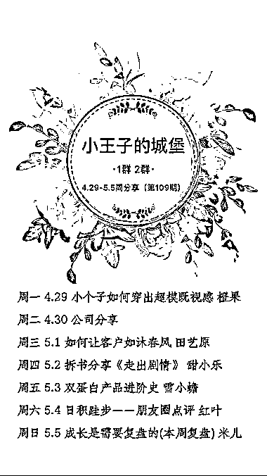
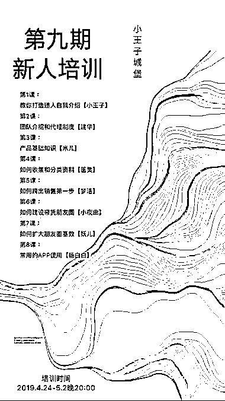

# 精华帖·239赞｜带8000人微商团队，我的培训框架

每星期一，龙哥盟会请圈内朋友来聊自己的独门本事。这次请来的分享者，在微商团队培训上实战经验很足，也是星球老成员。下面由她拆解自己的做法。

大家好，我是微商小王子，女，湖北人，现居北京。武汉读了四年大学，之后教了六年英语；2016年11月下旬进京，转成全职经营微商，到分享时约两年半。

入行原因很单纯：创始人说要在朋友圈经营个人品牌，挣钱是水到渠成的事。那是我头一回听到“个人品牌”这个词，于是开始在朋友圈照做。我们不靠暴力刷屏，也不机械复制，坚持原创并持续迭代。核心产品是胶原蛋白类，去年十月新增一中高端面膜单品。客单价不低，顾客多来自一、二线城市的高知女性，既想变美，也想成长。每月进账基本维持在十万元。队伍现约八千人。期间做过多次合并，每次约两成成员不再活跃，我视作他们不愿继续同行，也就自然淘汰。

早期我们追求复制和扩张：先在公司社群里学社群运营打法，再带自己的人独立，建起“小王子的城堡”，起步仅200余人。后来销售能手不断加入，往往还带着自己的队伍。每当群满500人，业绩最强的总代便带人独立，照搬同一套运营模式。如此循环，队伍不断分出去。两年半里裂变出20多支独立队伍，至今仍在正常跑的约一半。有人因各种原因让社群停摆，这也是我持续调整的原因。

真坐下来梳理培训，才发现工程很大。我们线上、地面结合，先讲线上。

**线上怎么带**

线上投入最多。起初所有事都由我扛，后来边摸索边调整，搭起职能小组，按公司化方式运转，让更多人参与。群分两类：普通群容纳各级代理和纯消费者；核心卖家群只收最高级别代理，目的就是业绩。

我设了七个职能小组，缺一不可：

1. **产品与制度组**：建产品和制度资料库，含产品知识、反馈图、代理政策等，逐月更新；普通群每月两次产品知识分享、一次制度讲解，并配合入门集训。
2. **销售训练组**：设计入门集训内容，负责核心卖家群每周谈单演练。
3. **文案与朋友圈组**：团队坚持朋友圈个人品牌和原创文案，该组建“灵魂文案”库，收集优质朋友圈分类存档，组织普通群每周文案演练与点评，也承担入门集训的文案部分。
4. **视觉海报组**：制作各类海报，含普通群每周课表、每日分享主题图、核心卖家群海报、季度招商会物料。
5. **社群运营小组**：管群互动和分享排期。每月二十八日联合各小组提交下月框架，如值周群主、月主题、互动玩法；每周四交下周排期并收海报。
6. **👸号运营组**：汇总群内每日分享，编辑后发团队👸号。
7. **督查与数据组**：统计日、月、季、年出货并分析；监督核心卖家群打卡，整月不互动不参与则移出；管团队财务，含各集训营和地面培训的财务记录存档、招商会备用金、日常备用金，提醒代理上缴备用金、发红包并记录。

普通群的目标是让成员消费得开心、聊得开心、学有所得。群里有大量纯消费者，多来自一、二线城市的高知女性，爱学习也爱美。课程排得很满：每周拆一本书、朋友圈点评、原创文案演练、产品基础、常用APP、育儿、手机摄影、女性婚前婚后财产保护、化妆、保养、经济法律、两性关系、穿搭色彩、职场、时间管理、代理故事等，每晚都有。分享者多来自群内代理和客户，她们中有医生、白领、全职妈妈、在读研究生或博士、小语种翻译、教师、企业管理者等，用自己的专业和爱好分享，既引发同类共鸣，也给她们展示空间。除了留住顾客，普通群还承担隐藏任务：把消费者转成代理。

有人钱不缺，但缺爱、缺价值感、缺认同，普通群能给；有人缺钱，也缺方法和认知，核心卖家群能给。

核心卖家群目标直接：业绩。日常是每日打卡五条原创朋友圈，每周做一次思维碰撞。这个群格局要更高，因为要培养能带队的骨干，也要挖掘销售强的代理。他们是我左右手，任何场合都能一呼百应。所以除了现金流，还要给思维：比如财商思维，让赚到的钱继续增值，而不是砸在豪宅豪车上；推荐优质课程，大家一起学，凝聚力也无形中增强。某种程度上，他们已是我人生中很重要的朋友，哪怕将来不操盘这个品牌，关系照样铁。

代理分市级、省级、全国总代三级，对应三套培训。

**入门集训**

面向投资4200或6600的市级代理，这个级别只零售，不能招商。每月一次，内容持续迭代，主体有：团队发展史、产品基础与代理制度、资料库搭建、常用APP用法、心态建设、引流、开口谈单、新人朋友圈怎么发。

**成交特训**

面向省级代理和部分状态不佳的全国总代，他们手里有货，可零售也可招商。入门集训时我们反复传递“升级要快，别被动”，鼓励升级，无论自用还是做代理。集训结束三四天是促升级窗口，我会在核心卖家群发动大家推动，随后启动成交特训。通常十到十四天，曾试二十一天，学员和导师都吃不消，后来定为十到十四天。形式有三种：场景模拟，两人一组先模拟销售再互评，夜间八点导师在线点评；直接实战，每天至少找三人聊，不少于十句，夜间八点导师在线点评；有吸引力的朋友圈发圈法，尤其强调招商文案。

**全国总代集训**

约每季一次，持续约十二天，常和其他大团队联办。内容有销售力、领导力、陌生市场开发等。中间穿插实战，按小组进行，约三十人一组，分成十五对，不再模拟，全是真打。搭档先互评，夜间八点导师在线点评。

整套培训跑完一季，会办线上招商业绩会，验收培训效果：看日常出单、代理状态、招商会表现。具体操作我之前写过，链接在文末；每场成交额约一百万元。

**地面怎么打**

地面培训分多条线。

一方面，品牌方几乎每月选某座城市做地面分享会。早期内容含产品知识、代理制度、总代故事；后来加入销售技巧等。品牌方到场，重要目的是增强凝聚力，能量对销售很重要。

另一方面，大团队做全国巡回地面分享，主题含能量激活、财商思维、销售演练等，偶尔请大咖。收费约一千元，为期两天。

品牌方还设有培训学院，我属于首批导师，只面向全国总代，从报名者里筛选。通常两天，内容偏实操：朋友圈、销售、带队、陌生市场开发等，兼顾理论与演练。

另有代理自办的小型地面集训，规模从五人、十人到二十人不等，主题灵活，形式多样，可单人组织，也可多团队合办。

各层级集训的导师，尤其成交特训和全国总代集训，都选自团队销售最强的人。他们长期泡在一线，清楚客户要什么、读者爱看什么、代理心里想什么，因此最合适。有些团队号称砸几百万请营销专家，我认为多半是包装。纸上得来终觉浅，绝知此事要躬行；没有一线反复锤炼，培训很难落地。

分享到此。感谢龙哥，感谢龙哥盟各位老板。想深入交流微商团队培训的朋友，欢迎加🛰️ wangzi9735，备注龙哥盟，谢谢。

https://mp.weixin.qq.com/s/cPhZP16b45LZwtVsKStU2Q

读者反馈：Auroraaa 连喊666；于洋说要先点赞再细读；小炳同学感慨收获大；森淼、杨涛、wier、张秋兴等也点赞；龙哥说明本篇赞赏全部转给分享者。