# 私域怎么配团队？行业差异与落地打法

作者：红师私域椰子青青  
日期：2021-12-20

## 内容导航
1. 社群类型拆解与班子组建
2. 各行业社群落地方案
　1）实体门店：餐饮、产后康复、商超连锁
　2）线上电商：直播/店铺、品牌方
3. 收束与建议

---

感谢赚钱提供分享机会，让我聊聊私域项目结构设计的心得。动笔的起因，是服务客户时发现，不少经营者与项目负责人常困惑：自家生意该配什么结构？最终要交什么答卷？脑子里往往缺一张清晰地图。

这次分享分两段：前半段谈结构设计与班子组合，后半段给门店、电商的落地案例，尽量让赚钱的朋友拿得走、用得上。

（篇幅有限，完整细节不展开，只保留关键结构，执行过程与数据不逐一赘述。）

**-01-**

## 先分清社群类型，再谈班子怎么配

我做过知识付费、实体门店、线上电商、社交电商等项目的操盘，经验告诉我：业务类型不同，私域结构就不同。单客跟进型业务，更吃🛰️动态与成交话术；团购型业务，靠货品更新和团长招募；实体门店围绕获客与关系维护；电商私域又是另一套需求。品牌组队不能套模板，必须因业务而异。

哪些品牌要筛客，哪些适合精耕，哪些可以粗放？负责人得有经验或顶层框架，理解底层逻辑后，不论接手哪类项目，都能应变。

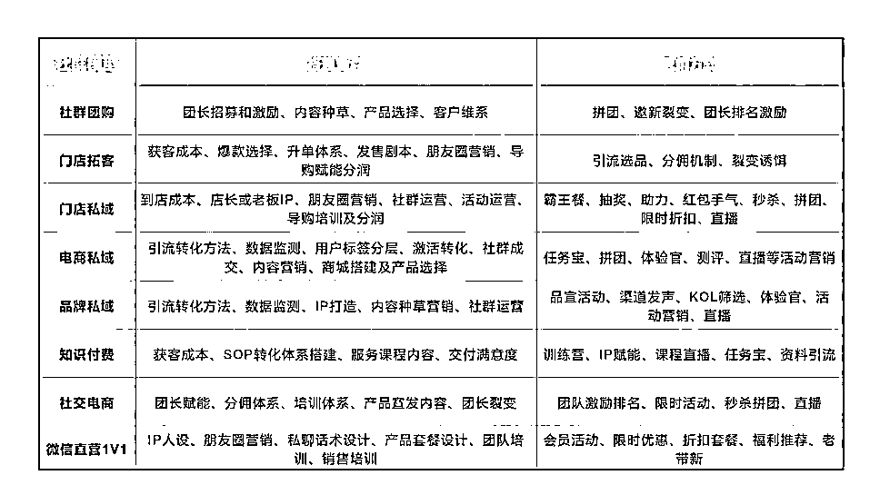

（各类私域的异同汇总）

客单价、消费频次、需求、渠道，也会影响客户模型。

比如快消品、高客单产品、低客单高复购产品，画像差别很大。准备启动私域前，先想清楚自己落在哪个象限，再决定用什么方式。

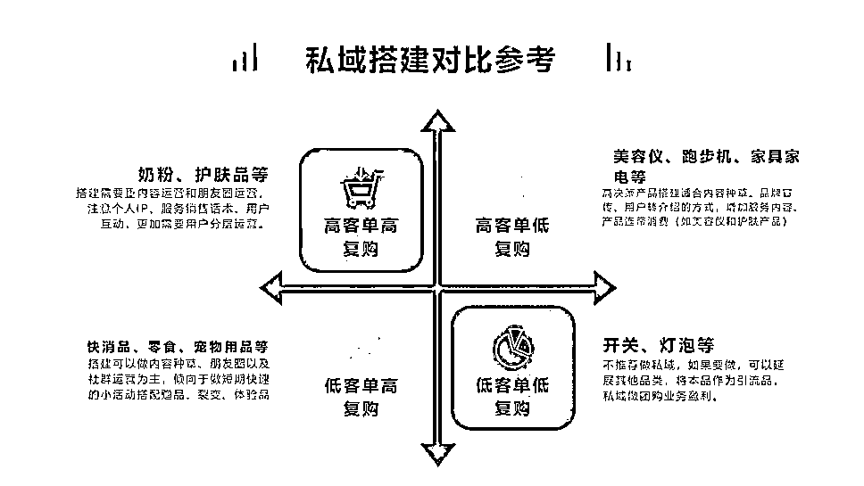

（四象限示意图）

班子配置通常两种：小团队、大团队。

**1）小团队**

小团队最头疼的是缺人。很多小团队只有一人运营，老板招人时又总想招一个社群运营包办所有问题，这很难。单人怎么起盘？

可按这个顺序推进：账号角色（IP）、🛰️动态、群组运作、内容、活动、商城。

关键提醒：精力有限且老板急于看效果，就先跑通引流转化闭环——立角色、做引流、导入社群，接商城（或用快团团等工具）开卖。先让业务动起来，后补活动、内容、社交动态，完全来得及。

**2）大团队**

大团队更难的是任务分配与时效管理。人多不等于效率高，分工不清、职责不明，容易吃大锅饭、互相推诿。

三人以上，起步先明确项目分工、责任到人、利润分配与激励政策。让每个人都有奔头，也知道自己该做什么。

激励可参考：部门奖金池按季度或年度发放；个人奖励按“一线员工→部门负责人”线路做业绩激励，设计时算到个人；一线社群销售用“底薪+提成”，激发积极性。

大团队可从团队管理、分工、账号角色、🛰️动态、群组运作、内容、活动、商城逐项展开。人多且完善，一开始就能做内容赋能，提升转化率和人效。

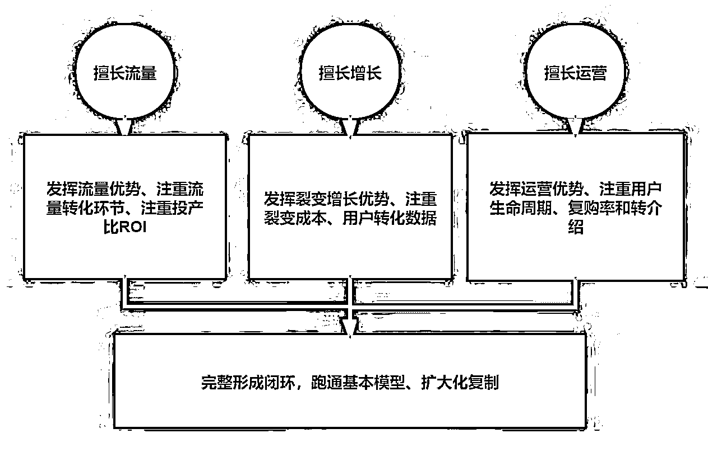

不同私域需求会衍生不同体系，也与团队基因相关。擅长流量的队伍，发挥获客优势，把ROI做漂亮，盯获客与转化成本；擅长增长的队伍，设计裂变钩子，关注裂变成本和转化活动；擅长运营的队伍，做精细服务，挖长期价值，重视客户生命周期。

讲完类型与班子，可能有人觉得复杂。下面用门店和电商案例，讲具体怎么落地。

**-02-**

## 各行业社群落地方案

**1. 实体门店（餐饮、产后康复、商超连锁）**

不少行业缺拓客，因为拓客短平快、见效快，对门店是刚需。所以私域圈很多操盘手从门店拓客切入，反复讲发售。但拓客类型很多，我挑三类有代表性的。

**1）餐饮**

关注点：到店动机、老带新、口碑扩散、KOL挑选。

餐饮运营人员要有营销意识，因为餐饮客户量大、服务偏重。下面用连锁餐饮门店方案，演示具体思路。

先模拟顾客进入私域的路线，从入店流程、触点、店员互动到行为结果，一步步推演，很快能做出门店群组方案。思路如下：

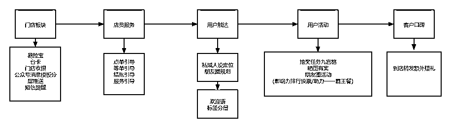

实际执行时，方案也要按顺序调整。我们操盘过的餐饮门店项目，方案如下：

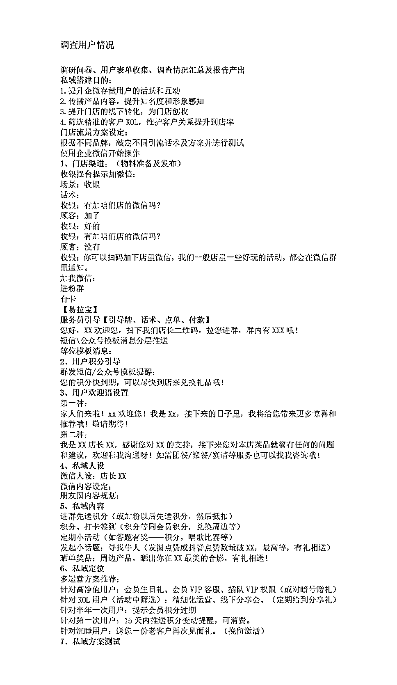

注意：餐饮拓客选好引流诱饵，运营看长期维护和到店复购。

整体思路里，把节点、时间、人员、统筹、执行标清楚，就能形成项目管理图。过程中要有闭环——比如从引流、承接角色、内容、话术、定位确定方案，做AB测试，观察数据再调整。

方案很难一次过，总有优化空间。换时间、换人、换条件，效果可能不同。操盘者要提前有迭代心态，这也是互联网人的基本功。

**2）产后康复拓客**

关注点：高客单、充值升单、导购激励培训、老带新裂变。

先看短期拓客。高客单门店常有拓客需求，用社群邀请、任务宝、分享卡等方式很有效，所以不少公司专门以拓客作为合作业务点。

这类门店客单高，要及时动员导购做销售，店内服务人员激励直接影响后期升单。导购文化水平普遍有限，活动方案要先培训再执行。

门店拓客本质是利用人性——贪、虚荣、炫耀等情绪驱动分享和转介绍。做方案多换位思考：如果我是顾客，会不会有兴趣参加？打通这个关键点，方案不会太差。

拓客核心是用好门店现有资源（没有就做地推或线上投放引流），推动二次分享、老带新。基于群组的多层裂变会产生波纹效应，达成1+1>2。下面活动方案最终结果：社群转化率20%到店消费，充值数十万元。

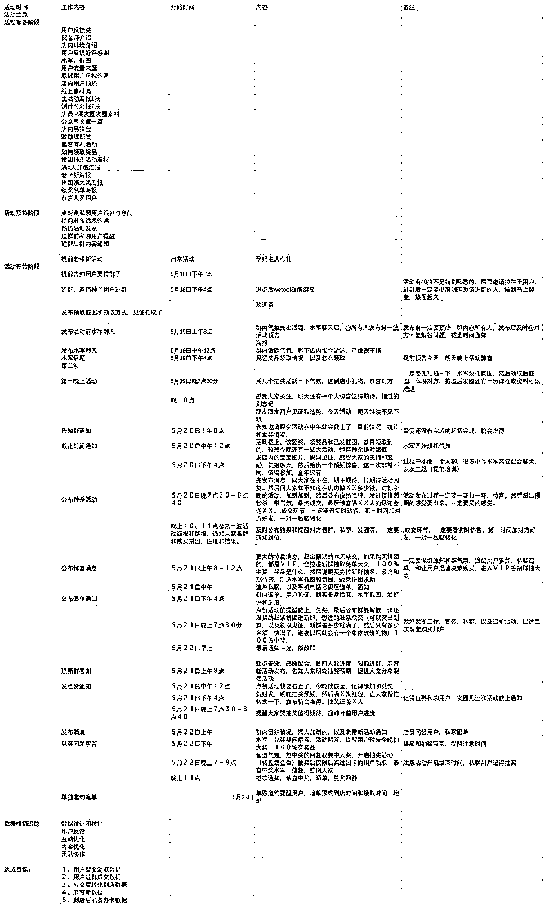

长期产后康复群组要重点做账号角色，强调服务和态度，做人性化顾问。运营中珍惜每次接触机会，给客户打好标签。写框架方案时把这些注意点写明，方案才完整。

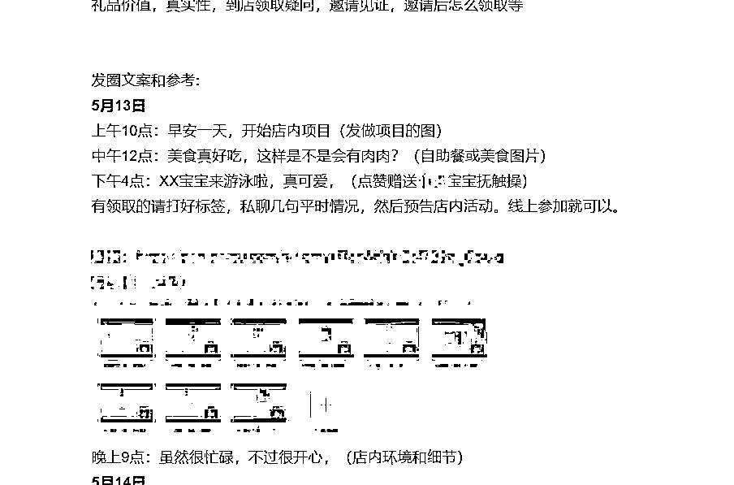

**3）商超**

关注点：低客单、门店导购、导购赋能、宣传效应。

我第一步通常画思路导图，理清框架。一般按基础流量、用户、活动、平台支持做闭环导图。从下图能看到方案雏形，有了框架图，后续就是优化流程和内容。

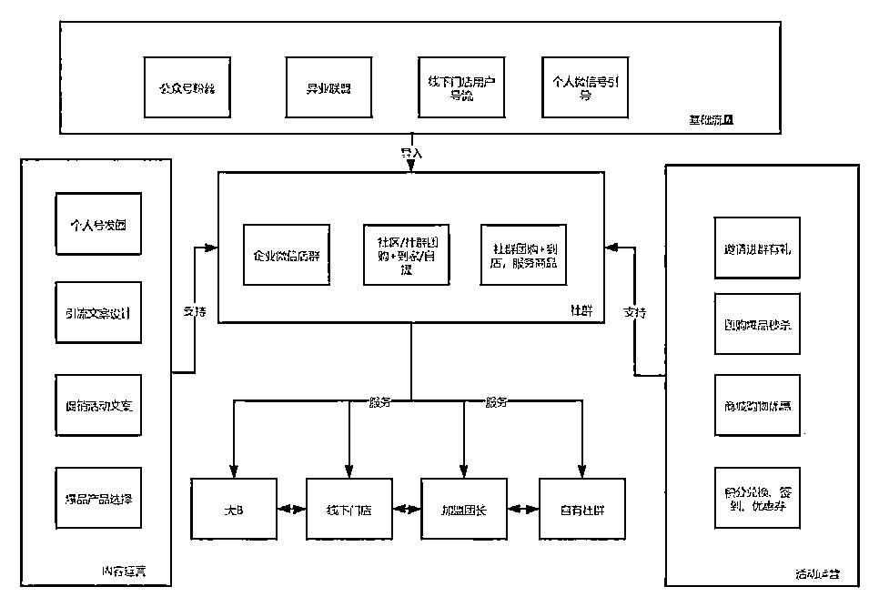

有了框架思维，再看活动方案怎么落地：

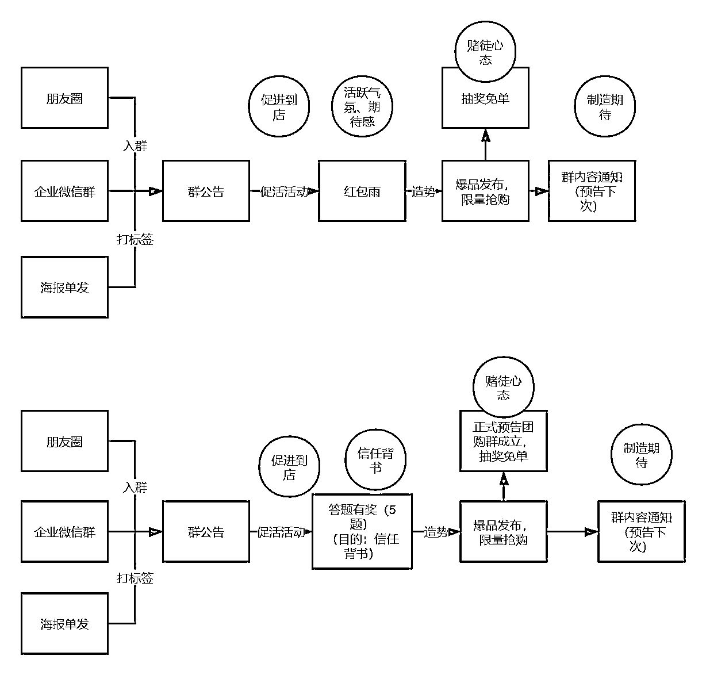

活动进入路径和餐饮项目一样，拆解顾客触点，设计两套方案供测试或讨论。据此写出整体活动方案：

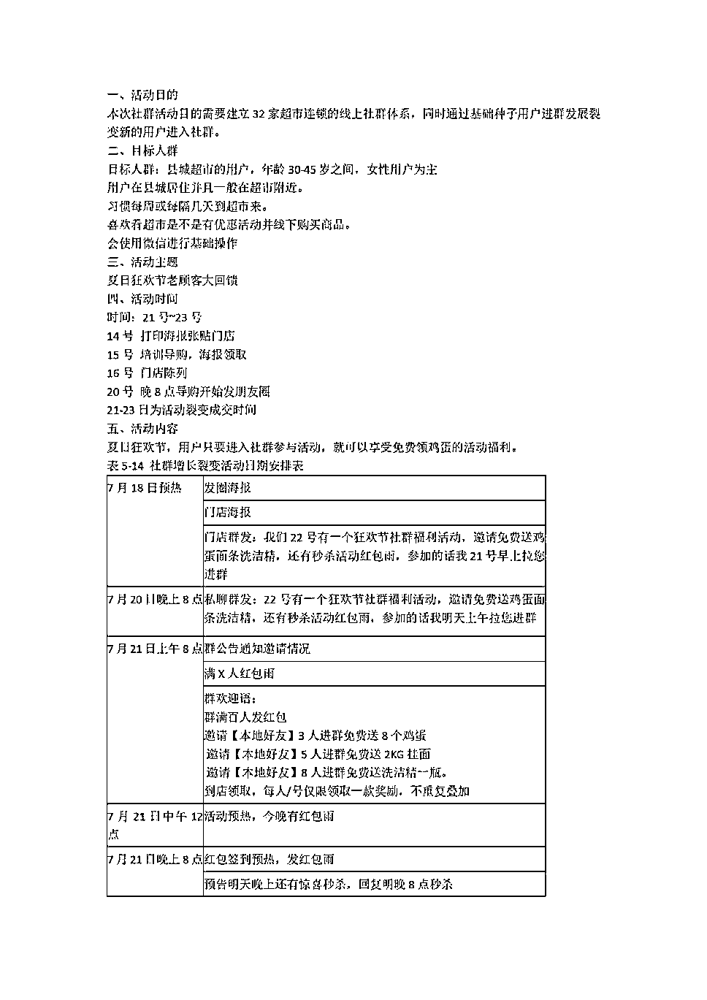

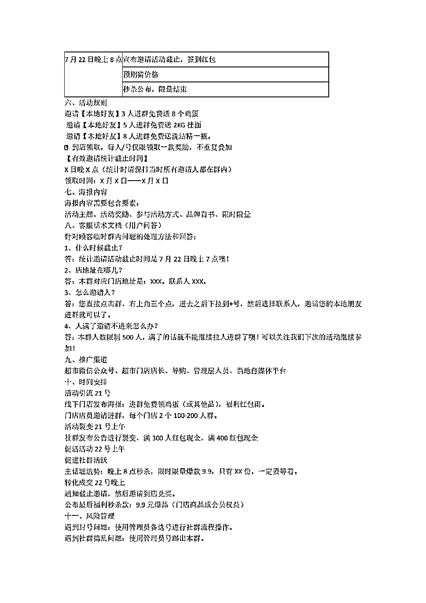

整体方案含邀请话术、时间、活动节点、培训计划、风控计划等。二次讨论确认后，进入项目甘特图执行。

活动最终结果：3天1.5万线上社群流量，100万线下充值消费额。

**2. 线上电商（直播/店铺、品牌方）**

**1）直播/电商**

关注点：抖音、淘系电商转私域的体系设计（引流、承接、转化、内容）。

用抖音母婴直播转私域案例说明。核心是模拟用户全生命周期，把自己当消费者走完流程、找对策。

比如母婴顾客进来：先想她从哪知道我们？如何快速建立联系，让她明白我们是谁、做什么？

接着，她是什么心态——好奇、惊喜、无聊还是负面？不同心态用什么回复提醒，才能留住她？

再是成交：经过一段时间激活运营，她有什么感受？会不会买？在什么场景氛围买什么产品、做什么决策？

最后是链接和再成交。一环扣一环模拟顾客进入，边推演边写话术方案，往往事半功倍。

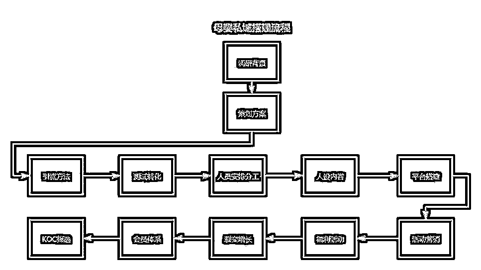

**步骤一：策划方案**

方案含群组体系、时间推进表、人员分工等；再细分执行配合、进度、运营节点。群组初期怎么活跃链接？中期怎么促活、设计话题活动？后期怎么留存激活？都要想清楚。

**步骤二：引流方法**

我们与抖音母婴绘本直播卖货IP合作，对方日出一两千单，通过包裹卡每天导流一两百人。流量精准，全是母婴粉。包裹卡用该IP形象，告诉宝妈加🛰️可交流育儿、领福利；来源、产品、链接都熟悉，加群意愿高。

测过很多版包裹卡，最终版本近乎0成本引流：做成刮刮卡，设奖品、优惠券、现金红包三类奖项，刮刮卡引流转化率11.9%。后来还测了另一种：奖品设计好，扫码抽奖100%必中；大奖够吸引（如某品牌海蓝之谜面霜价值几千），引流好，购买概率增加，删除减少。

**步骤三：刮刮卡转化**

一等奖小礼品，二等奖20元无门槛券，三等奖现金红包。中奖率最高设二等奖。顾客拿券进商城看优惠商品，29.9元绘本减20元券=9.9元，仍有利润。消费转化率20%，包裹卡环节近乎0成本转化。

**步骤四：人员分工**

管理中有“责权利”模型，责任、权力、利益三要素不可缺。分工就是明确责权利：每个人清楚职责范围、工作内容、考核标准，后面才不会有人不知道做什么。

**步骤五：账号角色与内容**

账号角色用IP宝妈身份，定位好物种草，送福利、推好物，增强黏性，形象亲切易接受。私域内容重点是🛰️动态：加好友后第一反应会翻动态了解情况、性格、爱好，所以内容要多样、积极、有种草感。搭动态体系先给内容框架，再写文案配图更简单。写动态有大量技巧思路。

**步骤六：平台搭建**

平台建议选大品牌，系统稳定，适合群组成交。

**步骤七：群组活动成交**

先用活动做活跃，如红包抽奖、限时秒杀、拼团，再推动成交。

**步骤八：裂变增长**

销售额稳定后，裂变增长很关键。常伴活动做，比如拼团促转化、邀请助力做裂变分享。

**步骤九：会员与KOL管理**

筛KOL不只看消费金额，也看活跃、关注度。精准沟通维护后，KOL能协助群组管理、话题活跃、推荐优质绘本，是外围“雇佣军”。会员分层按消费金额享折扣和积分；群内设签到积分，活跃换积分兑礼品，也带来销售关注。

**2）品牌**

关注点：某社交电商品牌私域设计、体系、🛰️动态内容、运营方式（团长赋能）。

品牌私域要突出品宣，体现品牌价值意义，不能只靠打折促销便宜，要增加粉丝互动、品牌宣传、品牌活动导入。某社交电商项目赋能200位团长，带动每月数十万群组销量。

方案如下：

一、流量入口结构  
1、获取方式  
2、裂变路径  

二、群组运营主线  
1、入群欢迎  
2、入群活跃（聊天剧本、话题设计、促活活动）  
3、推品成交流程  
　1、选品：引流款、复购款、高利润款  
　2、推品：素材、包装、推广方式  
　3、成交：流程、话术  

三、内容体系  
1、角色形象  
2、🛰️动态  
3、动态互动方法  

四、群组运营机制  
1、日常内容  
2、活动  
3、活动产品预算  

五、用户分层  
1、流量群  
2、快闪群  
3、VIP地区群  

六、团长招募机制  

七、首轮活动执行清单  
1、引流  
2、起群  
3、促活  
4、转化  
5、长期运营  

从方案看，思路按“引流、承接、运营、转化、内容、分层”展开。执行时员工照框架分配内容，写话术细节、做运营即可。比如群组运营时间参考，优化如下：

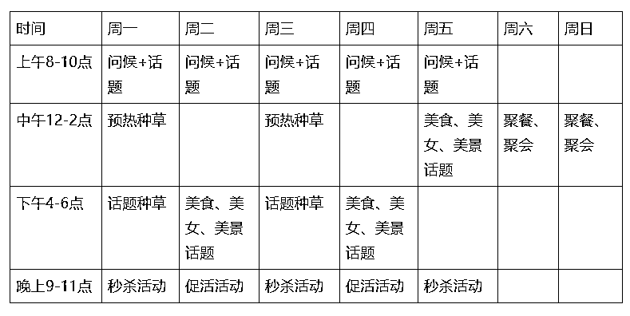

（延展：品牌有几种玩法，大体量品牌可重点筛忠实粉丝；未来需求延伸到KOL和VIP筛选，让用户创造内容、持续消费，会成为品牌首要目标。）

**-03-**

## 收束与建议

以上是部分案例方案展示。按类似框架，大家能找到共通点和差异点。不断总结不同案例，就能沉淀自己的方法论。剩下多实操、多与同行大咖交流，很快能搭出操盘体系。

实际还有更多行业玩法。操盘手或老板要找到行业特性，再搭专属私域体系。掌握足够模型、打通顶层逻辑，就能操盘多行业案例，而不是局限一种模型。

感谢看到这里。篇幅有限，私域电商、社群团购等未展开。欢迎交流，一起在赚钱多多发财。

留言区：
惠子：👍👍，请教一下，我们做线下板材地板五金，零售批发都涉及，这类门店社群怎么运营？
嘉应岛主：干货很足~
龙哥：内容很扎实，已加精。
黄林风：学习了
阿良：专业！
君途-👾：想学门店私域运营，方便留联系方式吗？
红师私域椰子青青：可以的 AARRR18