# 同城团购入局：不同人的实战路径

后台常收到类似问题：同城到店这门生意现在还能不能做？刚入场的人第一步踩哪里？有没有能照着跑的流程？

先看盘子。2021年，抖音同城到店成交约200亿元；2022年前六个月已经做到220亿元，半年追平前一年。核销端，去年只有32%左右，今年我估计能到35%—40%。所以在我看来，短视频和直播在到店消费里仍有增量。下面按不同人群的切入方式，讲讲我自己的实操经验。

我叫楚川，大学二年级开始折腾项目，至今十一年。校园传媒、淘系店铺、电商品牌、直播供货、短视频同城，我都踩过。最近两年专注同城到店，团队累计做出2.6亿+成交。

我平时爱复盘、爱迭代，执行上也不拖沓，愿意把跑通的路子和踩过的坑摊开讲，希望更多同行进入短视频同城服务，一起把生态做扎实。

接下来分五个部分展开：

一、我的经历与结果

二、几条要先想通的逻辑

三、眼下的市场体量

四、能落地的操盘方法

五、从业后的复盘

## 一、我的经历与结果

2020年秋，团队正式把重心挪到短视频同城。做法是自己搭内容流水线：五万多个素人账号参与分发，文案库超过百万条，累计产出千万级短视频，曝光破十亿；服务过四千余家门店，总成交做到2.6亿+。

**1. 团队怎么搭起来**

2020年8月，我还在直播电商供货公司带队。那会儿流量成本往上蹿，行业红利肉眼可见地退潮，赚快钱的时间窗不会留太久。我于是四处找新方向。

做品牌号和IP号时，团队留意到一个细节：作品挂不挂门店地址，数据表现不同。多轮测试后确认，即便是没权重的小号，只要发布时挂上热度高的POI，冲出一级流量池的速度会更快，曝光量也更高。转型做同城的想法，就是在这个节点冒出来的。

**2. 爆店码的增长窗口**

爆店码的根，来自2020年视频号那套“霸屏”玩法：靠私域池子做视频分发，在视频号里堆曝光促转化，游戏和营养品用得较多。

可惜视频号没真正起势。2020年9月，我向CTO提出：不如在抖音复刻一套。爆店码的雏形由此出现。

想法有了，就逼着技术团队研发、对接行业资源。到2020年10月，我们和另外几支团队几乎同时把产品跑通。

它的机制不复杂：顾客扫码后，系统自动把一条抖音视频转发出去，并挂上指定POI。

我们同步搭起素人账号池，花两个月看数据，逐步摸清同城流量的推荐路径，见下图。

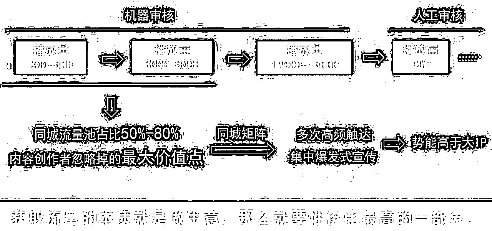

此后内容选题和运营动作都围绕同城流量展开：账号池要精细运营，把流量成本压下来，让投入产出比抬上去。

爆店码真正起量是在2021年1月到3月。那时抖音团购还没形成闭环，我们用爆店码做半闭环。

一些特殊行业的统一动作是：先招募素人账号，扫码发视频拿基础曝光；再让门店引导顾客扫码转发、领取满减券；同时鼓励商家把咨询和核销用户导入私域，做后续成交或二次成交。

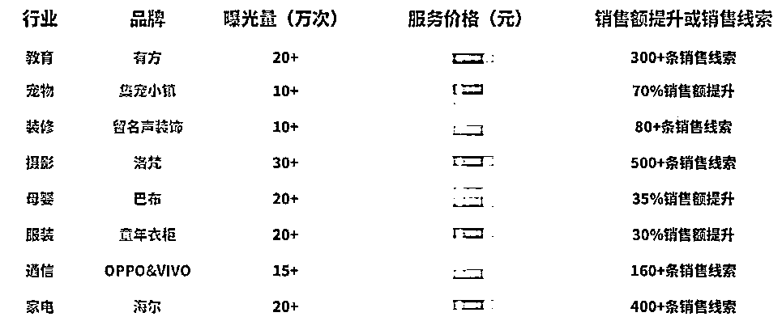

**P.S**：这里要注意，客户不同，交付内容和方式要区别对待。哪怕今天有团购了，也得从多个维度定服务**KPI**，只看销售目标或只按平台单方考核，都不合理。

全程4个BD，加上4位创始人，两个月拓展到400家商户。服务内容调整为：扫码转发工具、AI智能云剪、线下事件策划三件套。

服务过的客户包括：OPPO和vivo让销售上街发视频，领300元券和自拍杆；海尔空调、台铃电动车用500元券引导发视频，保留一周后找客服领88元红包；一家老火锅做朋友圈裂变扫码转发，播放量前三送霸王餐。

那阵子，擦边流量和平台禁入行业反而最好拉客，不少同行也吃到了增长。我们同样做了些野路子，赚了一段相对轻松的饭钱。

但这套思路，很多想入局的人值得好好琢磨：多角度想问题。下面举两个没执行的例子。

第一，净水器行业。这个行业分销商不少，但普遍缺内容能力。我们当时聊到“诺百纳”，对方每月信息流预算不低，主要按CPM买量，销售线索却少。

我给的方案是：把分销商和门店员工变成短视频出口，由我们提供内容产能，每人两天发一条，曝光和线索都有机会往上走。

项目没往下推，原因很现实——爆店码开单太快，团队腾不出手长期磨一个客户。但这套打法放到不少行业，我认为依然成立。

第二，银行生活节。长沙建行每年办66生活节，宣发预算不算少，但钱多花在大屏和电梯广告上，效果很难量化。

我当时的想法是：在长沙IFS周围铺海报、发传单，把参加活动的商家福利装进去；消费者转发视频就能领代金券，再到IFS消费核销；同时让参与用户默认关注建行官方号，把长期关系沉淀下来。

最终没合作，不是方案被否，而是我们没做过银行项目，连竞标资格都拿不到，只能提案。对方营销口其实很认可。我至今觉得这套玩法没过时，下沉市场可能还能跑。

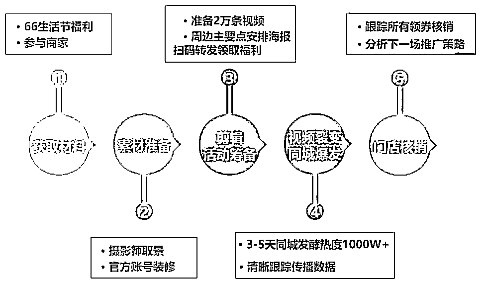

**3. 小程序服务商**

2021年元旦刚过，技术团队带来新消息：抖音小程序准备开放同城到店SaaS资质。拿到牌照后，可以给二级渠道或代运营公司做系统OEM。

3月，我们和标点云达成深度合作，成为其最高级别OEM伙伴，权益与正式入围的SaaS服务商基本一致。这里要谢标点云全力支持，让我们抢到了市场先手。

这件事也提醒我：得看清平台风向，不能被动被牵着走。我们前期研发砸了50万，几乎打水漂；山东一位同行养了20多人团队，投300万也没跑通，最后气得不行。

小程序与POI打通后，地址能直接挂团购套餐。团队当时很兴奋——这意味着同城业务进入团购阶段，曝光可以和成交挂钩，渠道方也能做出更高流水。

5月，我们挑商家试水抖音团购，推爆了一批店，团队也从这时开始扩编。蹦床是第一个被打穿的品类，随后快速复制到其他城市。

打法很直接：KOC、素人账号加直播（对，5月我们就开播，并用本地推流）。衡阳郊区一家蹦床馆，老板焦虑到月销只有两三万，找到我们时语气近乎求助。

我们用30天集中引流，把店做到爆满。到6月，累计曝光超千万，单月卖出50万，每周还排两场本地达人直播。那家店后来长期占住本地玩乐榜第一。

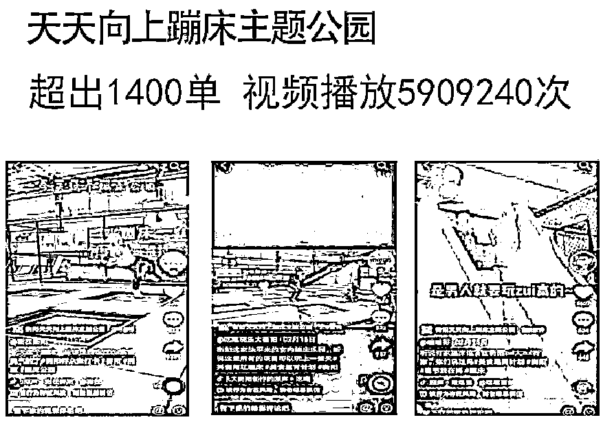

那段时间也是热门POI的红利期。我们手里多数素人号从一两百粉涨到一千粉以上，原因很简单：视频带上热门门店或景区地址，平台会给额外流量。

7月抖音上线团购带货达人板块，我们顺势给这些号开通达人CPS，一条视频能拿基础费加2%—5%佣金。

之后我们对千粉号要求更严，比如播放量过两千才结算基础费。慢慢一个百人账号池能做出20万播放，跟客户签约通常按15万播放量兜底，单价20—50元，毛利维持在30%—40%。

6月，我们在增长期把“扫码转发工具+AI智能云剪2.0+抖音小程序”打包推出，同时把各环节SOP补齐。团队从15人涨到60人，不靠流程提效根本转不动。

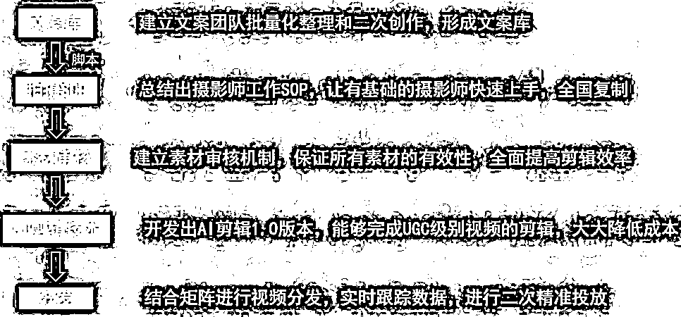

从文案、拍摄、素材审核、剪辑到分发，全部按规范走，单条短视频成本压到5元。我们最锋利的武器，就是素人账号池把品类打穿。

下面是SOP概况；BD、后台运营等细节需要较多时间沟通，可以私下聊。这套流程也有同行在用，大体能满足多数团队需求。

**4. 品牌全案服务**

到品牌全案阶段，我们已做到2亿流水，团队一度接近百人。旗下有满天星精选、祝融严选、出来玩等80个直营站点。

那时聊过100家KA客户，几乎所有人都愿意为全案掏100万以上，却很不愿意把10万预算单独投给抖音同城渠道。

于是我们把抖音探店放进服务清单，又补上👸号、📕、大众点评、视频号和外卖。

后来想明白了：渠道整合、对同城生意的理解、活动策划，这三项才是KA全案的基本功，也逼着团队持续升级。

市场上我们的报价不算低，但客户一直没断。做久了我发现，同城到店真正值钱的是商家运营，不是技术多炫。遗憾的是，团队快速扩张时没把这个优势继承并放大，这是我2021年最大的遗憾。

下面贴几张当时的全案服务内容，供参考，不算完美，欢迎拍砖。

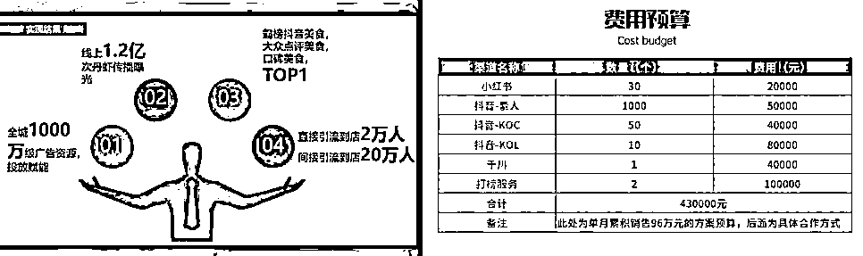

P.S：这就是150万方案和43万方案的差别，前者更完整，也更接近品牌方想看到的东西。

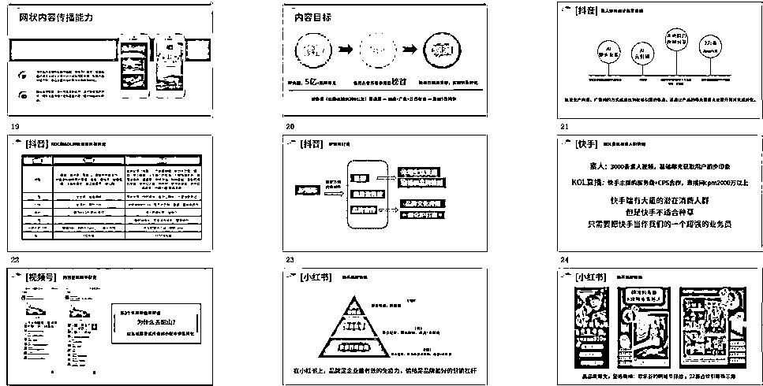

P.S：这是线上全案服务，各渠道都有规划。

**5. 官方直营和服务商管理部先后下场**

2021年11月，字节宣布在核心城市开城，长沙在名单里。他们的团队配置跟我们九成相似。正因为太像，深度合作无从谈起，对方只会更快抢市场。

字节还是那个风格：开城不久，我们的重点客户陆续收到官方短信，被邀去公司面谈。官方给出的条件很猛——商家拿出极限性价比套餐，再让出10%佣金，平台一分不抽。对市场上九成渠道商来说，这是降维打击。

我们当时仍觉得生意能做，继续硬撑。没想到11月到12月，平台突然卡审核，套餐上架被无限拉长。大量团队就地解散，我们则做人员遣散、优化和业务调整。

一直拖到2022年3月，官方成立服务商管理部，同城业务形成三股力量：小程序事业部、服务商管理部、直营中心，彼此关系微妙。

靠团队争取，我们又拿到官方服务商身份，归管理部，使用群峰系统。

**6. 供应链和流量服务**

2022年4月，团队再次复盘，想找更靠前的赚钱方式。我们把做爆的客户拆开看，发现共同点：手里有爆品，产品本身带流量，运营推广只是助推。

疫情之下，门店最缺流量，其次缺打造爆品的能力，这两件事正好能接在一起。

于是我们决定把品牌服务先放一放，直接用爆品供应链切商家，再叠加流量服务。想法成形后，马上小步测试，构思出下面这个闭环。

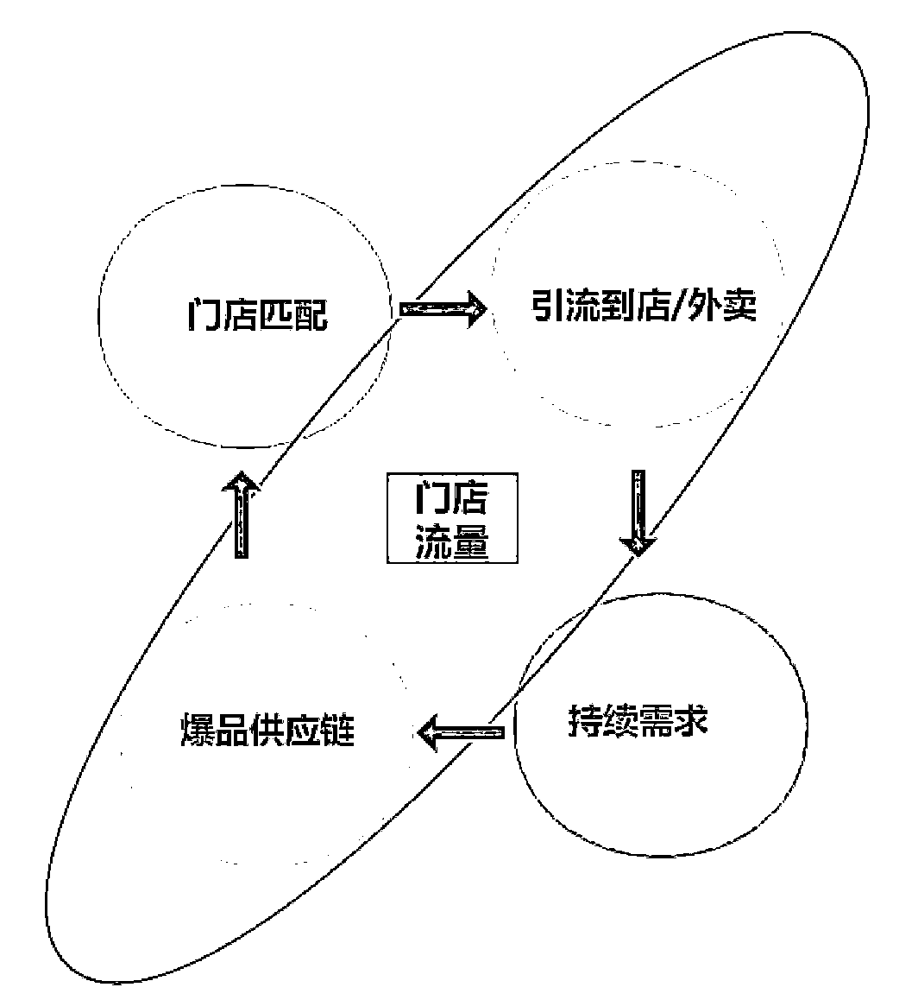

第一个试验品选的是长沙即将起势的小龙虾。我们找了一家300平、能接待的门店，对方此前没做过口味虾，正好当样板。

动作两步：一是和商家一起定团购套餐；二是请摄影师拍素人素材，再安排30—40位达人探店，总投入约3000元。

到2022年5月22日，套餐卖出1084份。按五成核销估算，一周预计到店190—200桌，商家投入产出约1:10。

随后我拉了财务模型，发现项目是盈利的，立刻又谈了20家商户。4—6月，单项目净赚20万，日均小龙虾消耗超过2000斤。

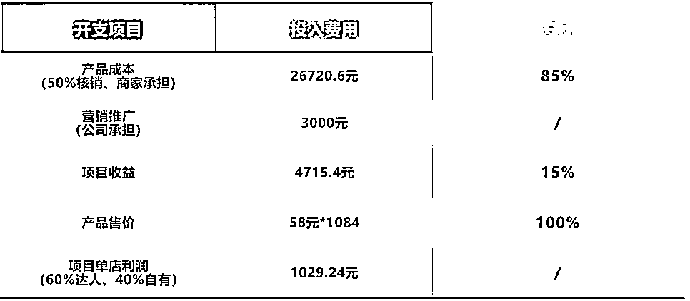

但6月后小龙虾供给泛滥，利润被摊薄，我们也没找到真正稳定的供应链。手里有供应链资源的朋友，欢迎深聊合作。

**7. 品牌孵化和投资**

眼下我们的盈利结构，是三段式：品牌孵化或投资、爆品供应链、品牌服务。短期靠供应链赚钱，长期吃品牌增值。已孵化四个千万级品牌，最典型的是虾浪。

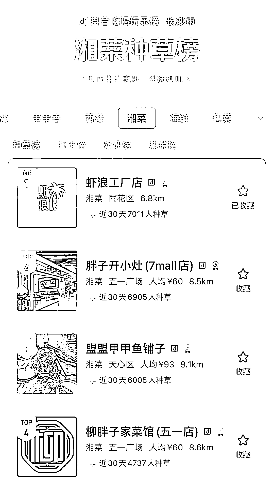

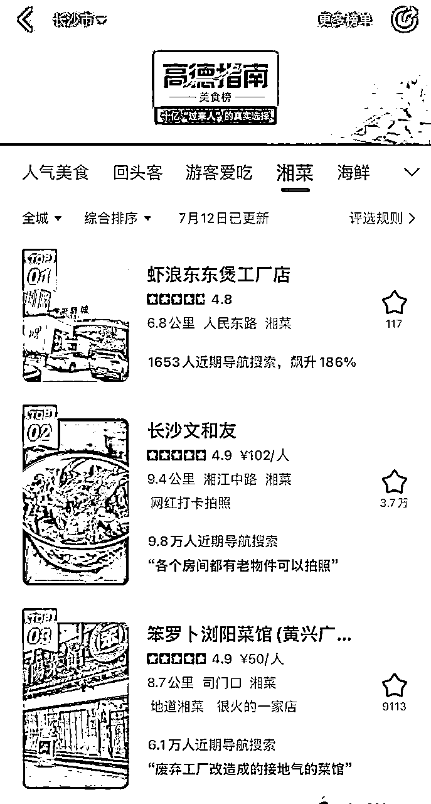

 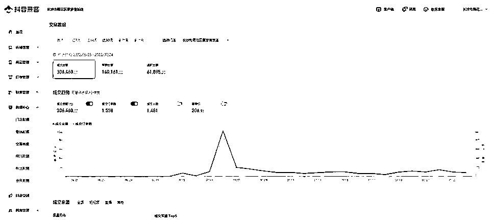

多维数据看，品牌单月营收120万，抖音核销14万，总成交30万，美团系核销45万，大头仍是顾客直接到店。

线上数据对比下来，引流效果清楚，只是部分人不愿线上下单，到店才消费。

所以，赚钱里有品牌的朋友想合作，可以细聊。团队评估通过后，我们可直接入股，后续品牌服务一并承接，品牌方只管实体运营。

## 二、入局前必须想透的几条逻辑

**1. 同城流量怎么分**

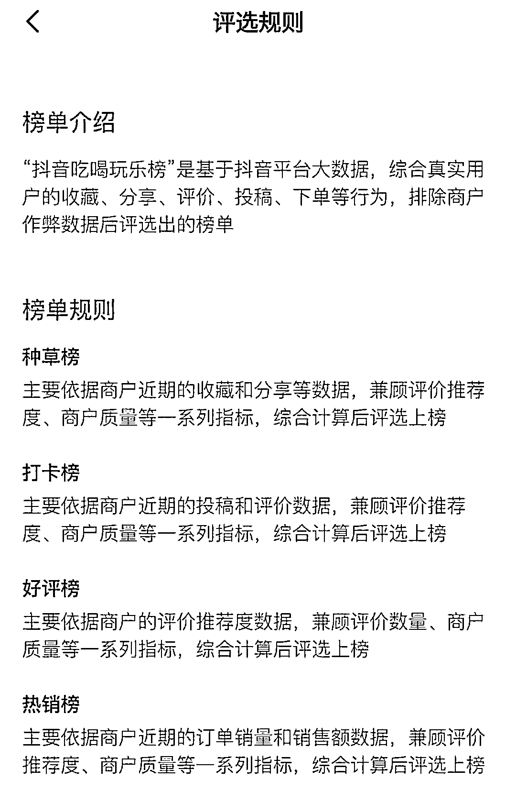

先建立一个清晰认知：能上榜单，平台就会给额外曝光。所以第一件事，是把四个榜单的评选规则吃透。

第二，四个榜都看推荐度，本质是用户评价；有效评价要攒够基数，这就倒逼你先把视频数量和用户数量做起来。

第三，商户质量很关键：门店适不适合打卡拍视频、有没有运营能力、折扣能不能跟上，这些都可以拿来筛选客户。

其余指标优先级没那么高——推荐度和商户质量一旦做好，别的事顺带就解决了。

第四，同城流量的推荐机制前面已经拆过，再叠加账号池运营，难度并不大。

**2. 短视频打图文，是降维**

“短视频+兴趣推荐”对“图片+文字”形成降维。

消费决策最吃场景，再多描述也抵不过视频里一句“卧槽，真香”。这一点抖音已经替我们验证。所以同城生意想做好，先把短视频做扎实；直播若不在能力圈内，暂时别碰。

给商家做服务时，也要跳出图文思维：怎么搭场景、让画面更有冲击力，才是重点。

抖音虽有图文，短期可能吃到红利，但长期走不远，天花板也有限。

**3. 电商和同城到店，分水岭在核销**

核销是命门。核销起不来，ROI再漂亮也撑不住。

我们去年流水看着大，核销只有32%，产出直接砍掉三分之二，我说亏钱不是矫情。

全年大致三成核销，放到电商里等于七成退货，那只有高客单勉强能跑；可同城到店偏偏多是低客单，这就是商业悖论。怎么把核销做高、把退单压低，值得每个入局者认真算。

也正因为这个指标，我多次劝人别轻易做同城直播。抖音上有人私信骂我不懂，我仍祝他们别上头、别亏到破产，这年头赚钱不易。

**4. 内容需求千人千面，别指望标品**

同城到店市场被短视频重做了一遍，这没什么争议。但平台根子是内容，内容需求天然多元，所以很难有真正的标品服务；即便短期有，也活不长。

如果一家公司只靠团购上架和内容代做撑基本盘，那地基并不稳：内容和流量没有必然关系，转化也无法套公式，最后大概率做亏。

按生意常识，没有标品就不该盲目铺商家——店越多，交付越重，管理成本越高。

我们在这上面栽过两次。

第一次，拿固定套餐去拓客，只有六成商家觉得有效，剩下四成投诉找麻烦；流程SOP化之后，交付质量反而越做越差。这说明内容不能当标品卖，行业不同、需求不同，极容易踩雷。

当然，交付里可以有一部分标准化，比如素人视频和技术运营，固定流程没问题。

第二次是品类服务：今年餐饮供应链和足浴商户，我们拿近似套餐去推，后期转化很差。问题就出在缺了商家运营——得把服务和产品跟客户实际情况调和，让达人、顾客、商家三方都能接受。

**5. 同城运营全景**

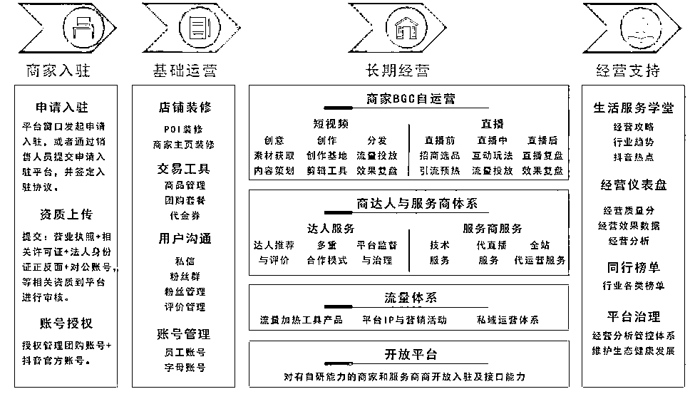

这张图基本把同城到店的运营环节和生态角色都收进来了。新入局者可以从其中某个环节切，也可以把服务做成全链路。

沿着抖音生态，还能衍生投资、孵化、行业供应链等业态。等团购本身利润变薄，就把赚钱点挪到别的环节。

## 三、眼下市场体量

**1. 市场体量**

（**1**）抖音同城到店：**2021—2022**年的成绩

2021年，抖音同城到店成交约200亿元；2022年前六个月做到220亿元，其中短视频贡献七成，直播贡献三成。我个人判断，2022年全年核销会在35%—40%之间。

# 抖音本地生活：狂欢背后的冷思考与实战指南

看过36氪7月的那篇报道，你应该能感受到抖音在本地生活上的野心——直播成交占比要拉到整体的一半。但直播天生带着“冲动消费”的基因，用户往往是一时兴起下单，真正冲着“非买不可”的刚需去的很少，这样一来，核销数字恐怕很难有漂亮的表现。所有打算进场的人，都得先看清这道坎。

先盘一下目前的盘子。抖音直营业务已覆盖超过50座城市，70万+商家入驻，服务商数量（不算官方认证的）在4万以上，还有320万达人活跃其中。生意链路看起来很直白，无非是达人牵线，服务商与商家对接，大家按10%到15%的常见比例抽佣。

时间来到2022年6月，字节在巨量网公布了《2022年生活服务软件服务费标准说明》。只要商家在抖音挂出商品或服务信息，比如名称、价格、门店位置，并且和用户完成了交易，平台就有权收取一笔软件服务费。这笔钱的计算基础是“消费者实际掏的钱+商家自身补贴以外的其他补贴”，再对照不同商品类目对应的费率。平台把类目划成了8档，抽成比例从2%到8%不等。按这个态势，6月的佣金已经突破千万，7月冲到5000万级别也很有可能。

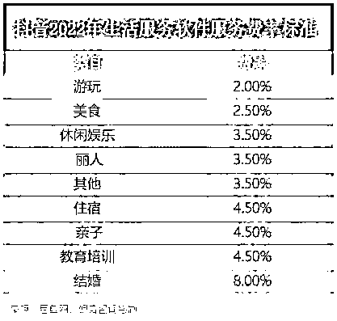

（**2**）抖音vs美团：兴趣推荐与主动搜索，真的在正面对抗吗？

从最纯粹的逻辑去推演，美团是10年代的产品，做本地生活讲究“需求在前，搜索在后”，靠图文展示，商家们比的不过是谁的价格更低、谁买的流量更多。抖音则是20年代的新物种，兴趣电商的算法让“推荐”成了唯一主角，短视频狂轰用户心智，无论传播的广度还是速度，都让美团系望尘莫及。这也是那么多人看好抖音本地生活的原因。

从2021年3月抖音正式跑通本地生活闭环算起，已将近一年半，发展节奏算得上快。但仔细看当下的生态，平台似乎没给从业者留出太好的活路。商家这边，大家拼的是破价引流，还得防着同类目的“猜你喜欢”截胡，怎么算都不太划算。服务商的日子也紧，商家把佣金压到极低，想拿出让人满意的交付难上加难。流量主更惨，在不少商家眼里都快成“讨饭的”了，职业素养也确实参差。这些问题，抖音自己不出手引导、整顿，光靠几家服务商是绝对摆不平的。

再拉出来对比一下美团和抖音，才能真正看懂两个平台的底牌。

共同点其实不难找：干的都是撮合加推荐的活儿，都得花钱买效果。

差异就得掰开来看。宏观层面，两者有代差——短视频和图文带来的感官冲击力完全不同，传播的深度和速度也不在一个量级，流量的密集程度更是天差地别。从供需关系说，美团是用户有需求，主动上门找；抖音是用兴趣的钩子，生生把需求勾出来。落到内容上，美团恨不得把全城商家都收进去，重点秀评价和排名，各个城市的页面一个模子；抖音呢，把站点入口、排名入口都藏得严严实实，只推那些自带传播属性的商家。

所以，眼下说两个平台正式开打还太早。抖音还需要时间，去赢得消费者、服务商、流量主和商家的信任。

（**3**）差距到底有多大？

2021年抖音本地生活的GMV大概在200亿上下，按平均抽佣3%粗算，2022年的佣金收入预计能有15亿。再看美团，到店和酒旅业务营收325亿（经营利润141亿），2021年GTV高达7021亿，总营收1791亿。

这组数字摆出来，差距不言自明。抖音还有很长的路要走，得真正读懂本地生活，摸清行业需求，想清楚平台到底怎么给赛道赋能、带着它往前走。不然，很可能就是“泯然众人矣”，几年后新平台杀出来，把这些成果全数拿走。

**2.**服务商的生存现状

（**1**）大环境

首先，平台政策变得太快。2021年直营中心亲自下场，小程序几乎被打没。其实小程序规则是月月在调，只是最后那一下变得太猛，好多人根本反应不过来。2022年搞出个群峰，服务商还没琢磨明白，6月抖音来客又来了，后面还跟着外卖平台，说不定哪天又冒出新后台。结果到了2022年7月，小程序又能玩了。一切都在变，全是未知数。

其次，核销率像根刺，扎得所有人难受。投入产出比说腰斩就腰斩，一个看着挺美的生意，转脸就不挣钱了。比如ROI做到6，可核销率只有40%，那实际投产比就是2.4，算上各种成本，基本白忙一场，搞不好还要倒贴。

再有，服务商已经不止4万家，达人更是超过300万，这圈子鱼龙混杂，得靠市场自己打滚，慢慢磨出一个健康的生态。

（**2**）服务商是平台的刚需所在

有一点得先达成共识：你真想在抖音做本地生活，想当服务商，那你就敢上。这是个刚需的活儿，官方用一连串动作表明了态度——自己干不完，也干不好，必须得借服务商的手，这就是你存在的价值。至于你能不能赚到钱、怎么赚，平台根本不管。

为啥抖音死活离不开本地生活服务商？抖音说到底是个内容平台，讲的是“记录美好生活”。可本地生活这摊子事，土壤不一样，活儿又脏又累。你得去跟那些认知还不到位的商家磨破嘴皮子，内容还得接地气，上门拍摄时你得拼了命地吃喝玩乐、卖力表演。这种苦差事，字节的员工是指望不上的。官方其实也试过，结果不咋地。2021年11月本地生活直营开搞，佣金给出10%，换来的却是探店内容低质泛滥，本地生活流量全线告急。再到2022年3月成立服务商管理部，这等于公开喊话：我需要你们。

（**3**）官方服务商

眼下官方认证的正规军分两类：本地生活SaaS服务商和抖音来客服务商。想抱官方大腿的，都可以去申请，具体门槛百度一下或者上字节官网查就行。流程没什么新鲜的：报名，跟官方的对接人聊，亮出你的计划和资源，再交上10万保证金，按商量好的KPI往下走。

我们团队这两类身份都当过，现在走的是“去字节化”的路子，为了少受官方牵制，索性把服务商身份退了。到底怎么跟官方处，还得看你们团队自己的生意模式，这个可以私下聊。

不过，你得清楚服务商的价值在哪，摆正心态，用不着妄自菲薄：第一，本地生活往短视频走是挡不住的趋势，行业需要有人把各类服务补起来；第二，市场有20多万亿的盘子，美团才啃下8%，这块大肉，需要海量服务商一起去分；第三，本地生活需要更多服务商去逼着商家升级换代，压一压资本做出来的餐饮垃圾，真正把消费升级落到地上。

（**4**）短视频和直播

依我看，当服务商还是先把短视频的功课做扎实，再琢磨直播。拿我们跑出来的经验讲，ROI做到10、核销率有70%的投放，也没想象中那么香，大家千万别头脑发热。

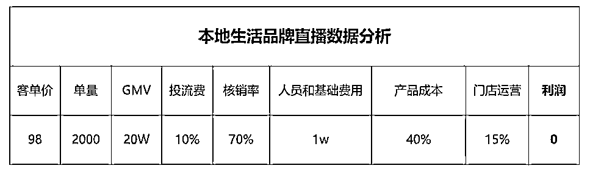

（**5）**入局建议

第一条，别傻乎乎地铺BD。你能借力的渠道多的是：行业协会、本地朋友圈里的意见领袖、商会……每个人手里都有资源，他们都能变成你的业务员。

第二条，选品是重中之重，选对了流量自然跟着来，像小龙虾、冰面包这种，就是活生生的例子。

第三条，矩阵必须做，千万别不当回事，这是真正能抬高产量的利器。

第四条，把流量的底层逻辑拆明白，运营的路数和技巧才能跟着打磨出来。

第五条，销售渠道越多元越好，学着做全案，把团购以外的钱也赚了。要是不会做全案，就去淘宝上买别人做过的案子，研究透了再改、再抄，不丢人。

第六条，官方大腿要抱紧，方法论、资源、案例都得去要。但别当应声虫，什么都说“好好好”，不然你的团队会很难受。

往后看，参考电商行业的路数就知道：短视频、直播、策划服务、品牌陪跑、达人派遣、战略咨询、投资管理，未来5年这盘棋绝对有得看。

**3. **达人的生存现状

（**1**）大环境

头一个，达人市场已经泛滥成灾。粉丝过千就敢自称探店达人，商家被折腾得烦了，张口闭口骂人家是“要饭的”“叫花子”。

第二个，达人撮合这买卖，链条给打短了。拉个群，本地达人呼啦一下就聚齐了，价格、资源全都摊在明面上，这生意反而没法做了。

第三，内容做得好，不代表流量就大。所以不少达人慢慢灰了心，不再愿意花心思打磨探店视频。当然，能稳定产出好内容的人，市场依然欢迎。可只要翻一次车，本地圈子里就会传开“这人效果一般”，以后再想提价就难了。

第四，本地生活这块的流量，忠诚度天生不高。KOL想一呼百应？难。每个地方的人对自己地盘上的吃喝玩乐心里都有杆秤，博主忽悠两句，大家真不一定买账。

（**2**）收益情况

先说佣金，普遍在6%-12%晃悠，再让核销率一搅和，到手的钱起码要打个对折。再说收费，拿长沙的V6级达人来举例，一次基础报价大概1500到2500元，关键是这个前置收费还在往下掉。百万粉丝的大号也没好到哪去，需求不怎么旺，卡在中间左右为难。

（**3**）入局建议

策划力才是硬通货。流量主得会“偷师”——地产、餐饮那些经典营销案例，只要把转化的核心搬到抖音上，裂变传播的机会就出来了。一旦成功，那就是你的代表作，是你的成名战。现在市场上，既有内容策划能力又能操盘营销事件的人少得可怜，谁做到了，收费拉高是铁定的。品牌方从来愿意为好创意买单。

千万别为了探店而探店。文案全是套话，表演干巴巴，表情僵得能当门板，跟商家、服务商交流也费劲，这些毛病都会让你的口碑一路跌。竞争已经这么狠了，风评一旦崩掉，商单只会越来越少。把专业度和职业素养立起来，才是你真正的本事。

团队别贪大，越小越精致，才越有可能赚钱。下面是我搭的团队模型，可以参考。

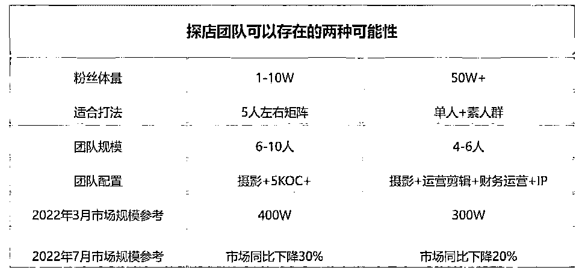

还有一句，真不建议去接纯佣的单子。那是个无底洞，一旦开了头，就是恶性循环，以后价格再也抬不起来。会去找服务商的品牌，不一定有钱；但主动来找达人的品牌，手里肯定有预算。你要做的，就是把专业功夫练到家，配得上你开的价。

**4. **品牌方的现状

（**1）**困境

首先，品牌方自己组局做达人探店，效果通常比直播强，为什么？因为交付握在自己手里，想怎么提要求都行。

其次，眼下大部分品牌最缺的就是到店客流，可偏偏不知道怎么从自己身上挖出核心爆品，增长更是没头绪。

再者，私域运营的能力几乎为零，但说实话，私域流量的获取门槛低得很，这活儿没那么玄乎。

最后，抖音带来的到店流量占比也就15%-25%，怎么把这部分流量的价值延续下去，压得很多品牌方喘不过气。不过话说回来，那些赶上抖音这波红利、又没上头硬冲GMV的品牌方，应该都有钱赚。

（**2**）入局建议

第一，抖音外卖值得花心思试试，好歹是多一条触达用户的通道。经营顺手了，那就是你自己的私域池子。等疫情真来了，这些储备就是你最大的底牌，至少能保证不亏得太惨。

第二，学会做店内爆品。不会做？那就看你这个品类的头部在干什么，跟着学、照着抄都行。好产品自己会带流量，能让你的生意轻松不少。

第三，创始人IP这事，重要性怎么强调都不过分。只要有精力和条件，一定要亲自上。它能带来的东西太多了：加盟、门店引流、拉投资、做技能培训……好处数不过来。

第四，可以想办法“白嫖”服务商，去谈纯佣合作。当然，我之前也跟服务商说过别碰纯佣，这就是个互相博弈的过程，最后合作怎么落地，就看双方怎么谈了。

第五，电商品牌的本地化，这里头空间大得很。你们得好好琢磨，怎么搭出新的消费场景，一旦跑通了，结果会很漂亮。

四、抖音本地生活的完整方法论

**1. **如何选品和组品

说到选品，我拿餐饮来举例。

第一步，把自己的核心产品找出来，也就是行业里的硬通货。要是门店本身没什么特色，那就走极致性价比的路子，套餐里硬菜得占大头，再配上点蔬菜、汤水打辅助。

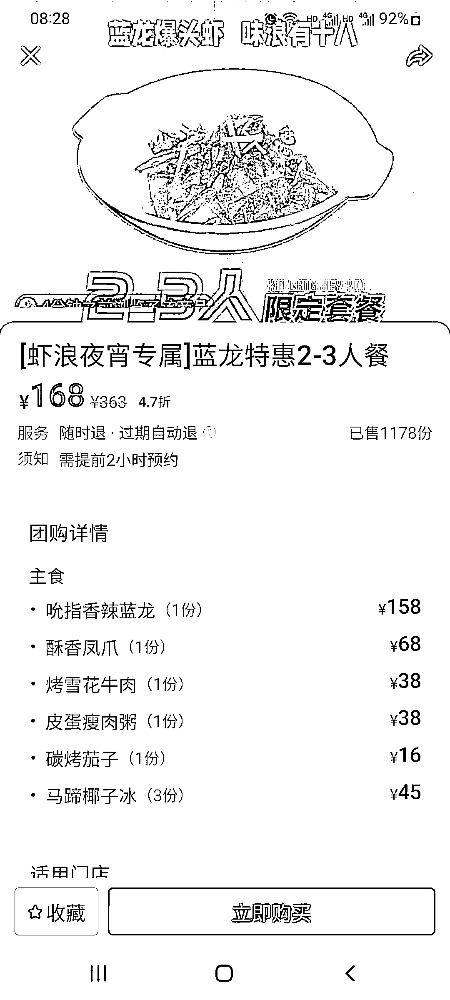

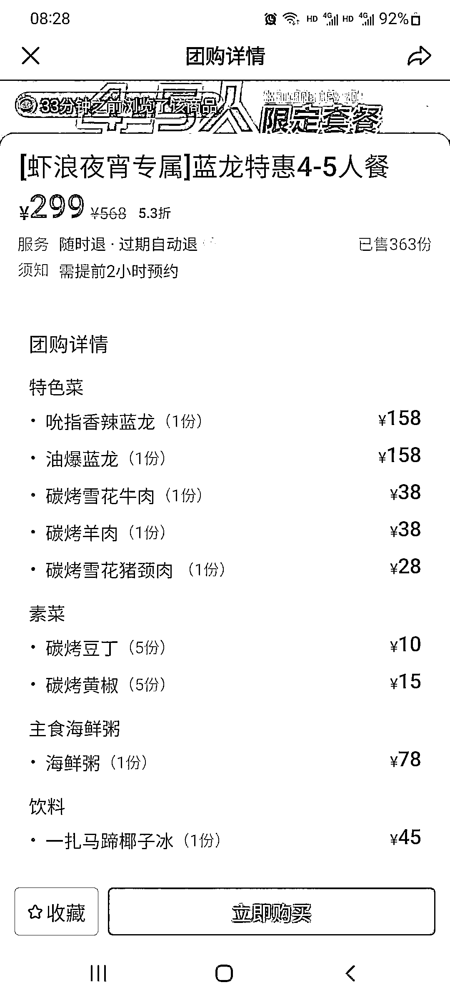

上面这些就是我们做过的方案，核心思路就是让套餐看起来堆得满满当当，性价比直接拉满，用户扫一眼就忍不住想囤券。这种设计还有个隐藏好处：就算你不会拍视频，画面糊成一团，只要“超值”这两个字传出去了，照样能带来转化。所以啊，选品的时候就得想清楚，要是你的东西成本控得住、出餐快、容易标准化、口味也不飘，那它就自带爆款相。

第二步，要是门店手里有单品杀手锏，那就别撒胡椒面，集中火力打爆这一款，所有营销动作都围着它转。

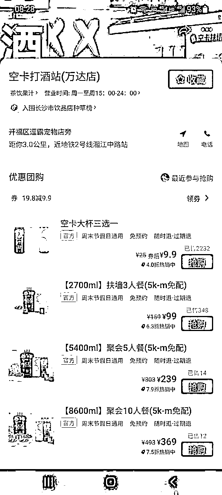

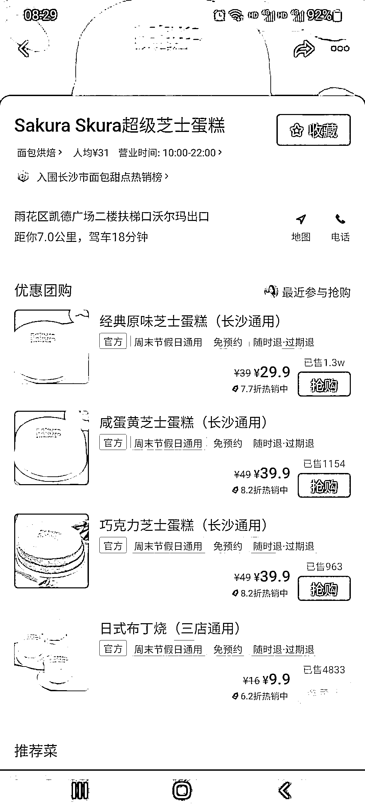

第三步，学会做应季或者节日的限定产品。这基本是商家该有的肌肉记忆，也是服务商必须练熟的本事。我举几个例子：

案例一：但凡情侣要过的节，都是鲜花店的黄金周。情人节卖玫瑰花束、520卖草莓花、圣诞节卖橙子苹果花……只要供应链能把控得住，短时间内就能造出不错的销量。对小团队来说，这绝对是个赚钱的好窗口。

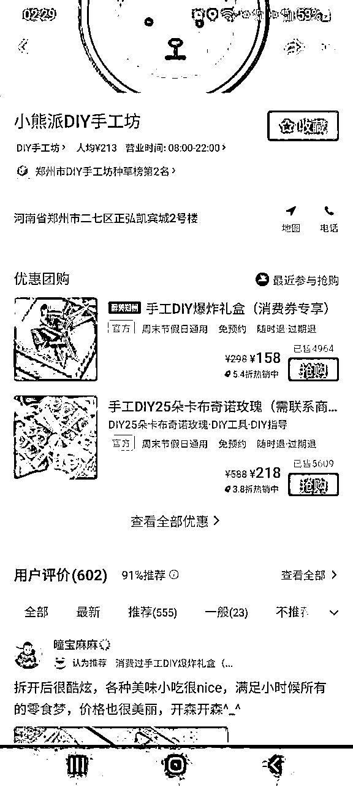

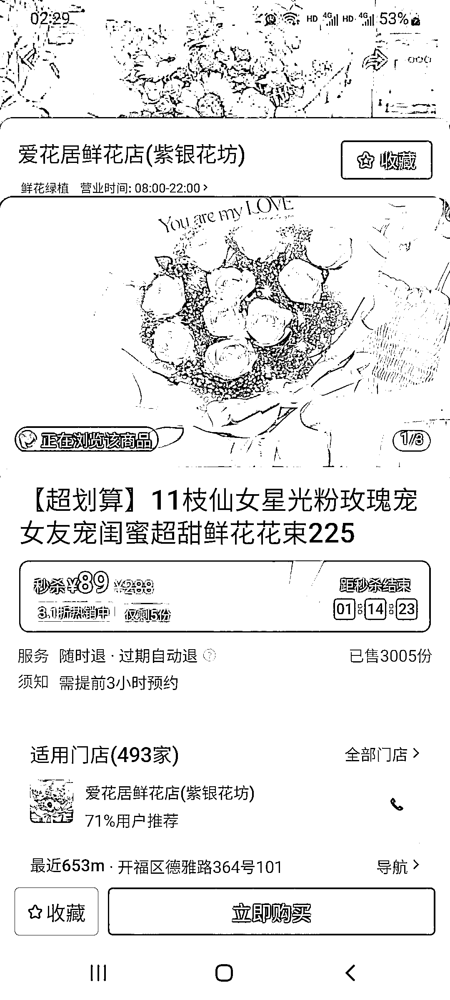

案例二：应季爆品，就是跟着月份或者阶段挑硬通货。像秋冬季的羊肉汤、羊肉火锅、大闸蟹，这些供应链早就成熟得不能再成熟了，比的就是你组品的能力。跟商家谈组货的时候，一定要记住，选品得有价格锚点。下面截图里的羊肉、大闸蟹，就是走供应链或者中央厨房的合作路子。

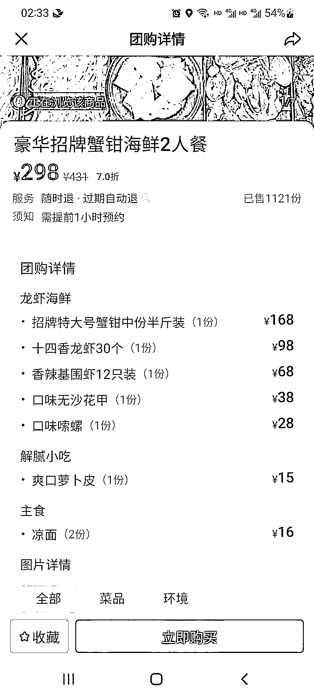

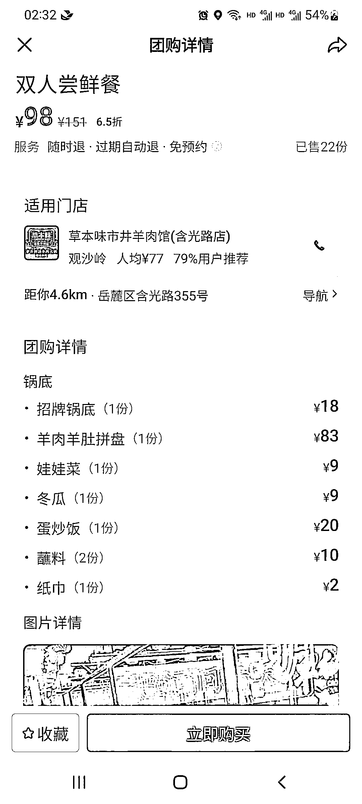

第四，要是餐厅既做不出极致性价比，手里又没什么硬通货，还有一招：蹭品牌的热度，或者蹭硬通货的热点。

举个例子：酒吧或者小酒馆，直接上百威、科罗娜这些年轻人耳熟能详的品牌，再配点店里的小吃，打包成一个高性价比的套餐，话题里带上品牌关键词，品牌流量和用户就这么白嫖过来了。另外，2022年精酿啤酒火得一塌糊涂，大家都觉得这玩意儿高端、价高，那你就反其道而行，把它塞进套餐里，当成引流款往外推。

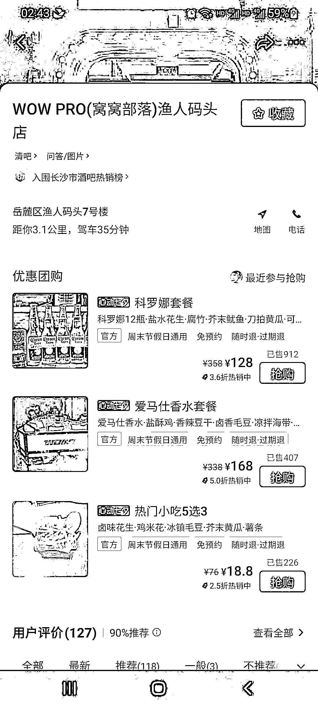

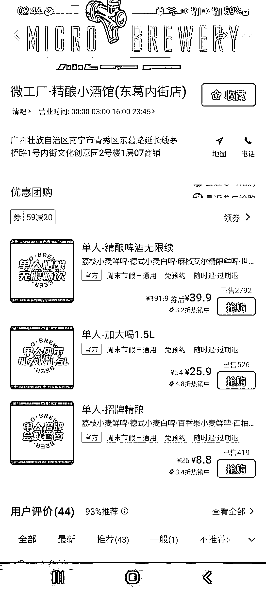

第五，如果行业卷到没边了，在美团、抖音这些渠道上怎么折腾都搞不出高性价比的引流动作，那就换个思路：用一个流量产品，把流量先引进来，然后想方设法把人留住。

举个例子，洗衣咖啡店，用咖啡来引流，再从中筛出洗衣客户，顺便把储值门槛拉高（咖啡会员一般充200块，洗衣会员则1000起步）。长沙有家“爱欢洗”就是这么玩的，我们还操盘了它在抖音上的冷启动。因为当时这家店正好换了套餐，那个冷萃+洗鞋的套餐没来得及截屏，所以这里没有图可贴。

上面这5招，是我们做抖音推广时一直沿用的打法。当然，背后还得有场景出片够好看、流量来了接得住、出品供应不掉链子这些基本功撑着，做大增长的时候，这些都是必须盯紧的。要是你抱着拿结果、赚钱的心态来干，最好别偏离这几条选品组品的主线。

还有些玩法能冲得快，但真心不建议碰，意义不大。比如什么1元可乐桶、1元一只小龙虾这种低价钩子，除了让用户反感，就是在光明正大地秀智商下限。要是实在想靠这种方式圈用户、捞私域，那就必须把客单价拉起来，把供应链死死攥在手里。下面这个小龙虾的案例就是这么操作的，人家每个月都能交出漂亮的成绩单。

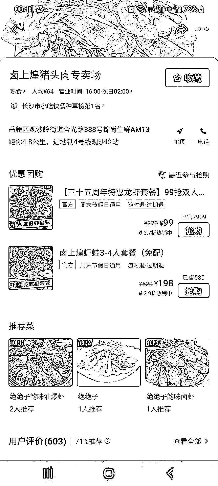

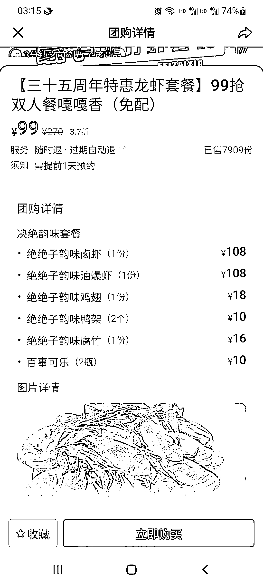

**2. 如何给**POI**加热**

前面提到过，抖音的榜单现在主要看用户推荐度和评价，GMV和收藏这些排在后面。而且本地生活这条赛道里，大家心照不宣的一个潜规则是：只要某个地址成了热门地标，你随便丢个视频出去，流量都能比其他POI高一截。

所以，把地址炒热，说到底就是视频量要够——靠素人视频矩阵堆出来。一般投100-200条视频下去，一个地址的基础热度就差不多了，好评率能稳在90%以上。“空卡打酒站”就是照我们的思路调了一波，热度蹭蹭往上蹿，这其实就是POI加热的用处。

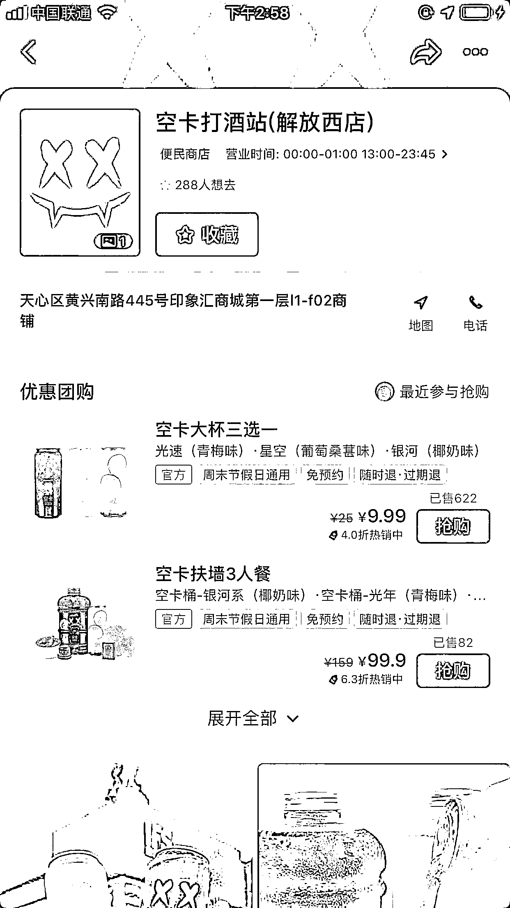

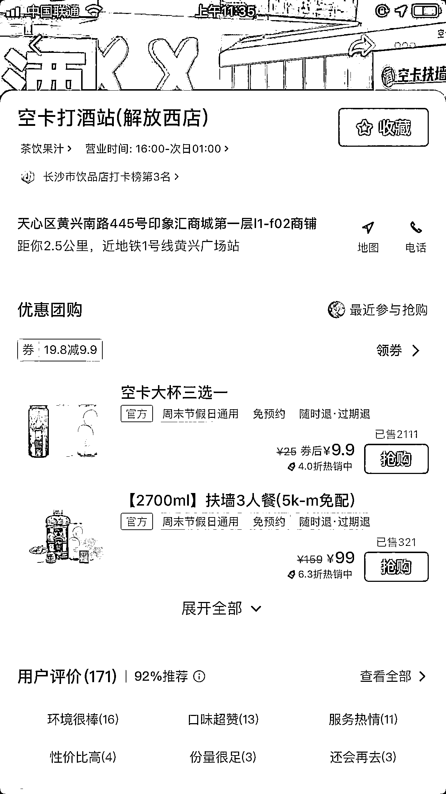

推广前后的差别，肉眼可见，后面再上达人，效果会好得多。这里得提醒一句：POI还没热起来的时候，别急着上达人，不然钱花了效果却惨不忍睹，这是我们拿无数次教训换来的经验。曝光基数一旦涨上去，销售额跟着往上走，热度就像滚雪球一样，越滚越大。

这个阶段，拼的就是运营内功：

第一，确认你要推广的POI地址本身没问题；
第二，确认团购套餐没毛病，每个套餐的标题都得写清楚，让人一眼看过去就有下单的冲动；
第三，组织素人把视频发出去；
第四，盯紧数据，谁出错了赶紧联系修正。要是哪条素人视频突然爆了，可以适当加一波投放助力。

说到素人，肯定有人问，素人上哪儿找去？这就要聊到招募了。我们这边是发一条视频给5-10块钱，不搞分佣那套。每家公司运营的基础不一样，跟素人的合作模式自然也可以变通。之前我们用过爆店码来分发任务，现在已经换成账号托管加自动发布，全程模拟真人操作在电脑端发。至于为什么这么改，原理就不展开讲了，核心还是为了素人更好管、发布更及时，而且流量比爆店码分发要稳得多。

另外，还有一个能提高爆单概率的小动作：在素人推广的同时，组织一批人去买团购套餐，数量控制在20-30单。这么做，一是把基础销量做实，二是给系统释放信号——这个产品正在跑，有转化。这是我们运营里抠得比较细的地方，逻辑跟电商补单差不多。等后期推广增量爬不动了，也可以在私域里导一波流量，把热度重新点起来。

**3. KOL**和**KOC**的招募

达人从哪找，主要看你想怎么玩。常规路径无非是抖音私信、本地达人的🛰️群里捞人，最后统一拉到一个大群里沟通细节，结算也能直接在群里搞定。具体文案如下。

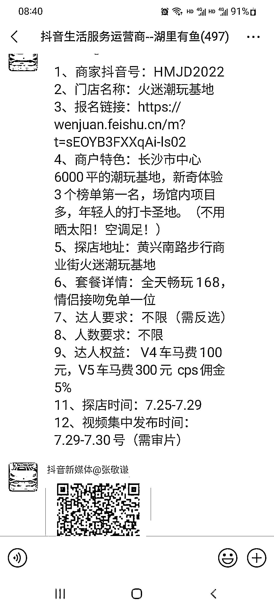

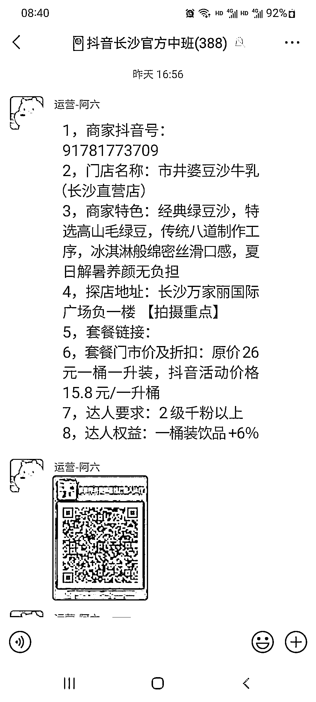
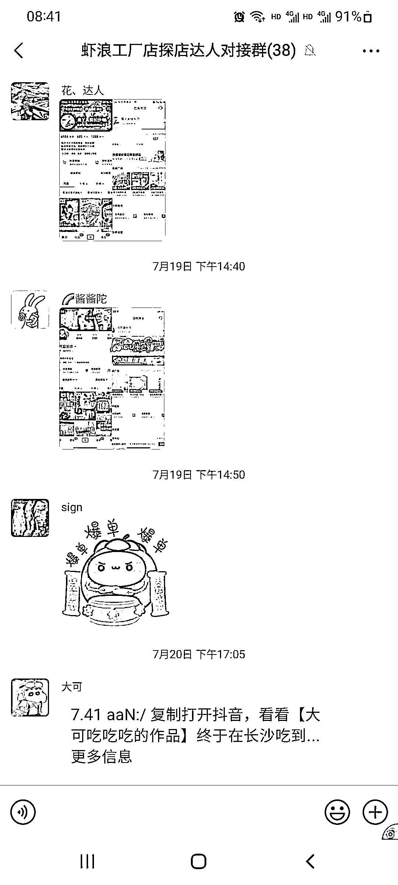

门店从0到1的达人招募完成后，通常还要做一轮反选。接下来，运营必须要求达人提交视频进行审片，避免内容出现敷衍、糊弄的情况。

这一步不能省。我们客户基数很大，达人撮合量也很大，一旦审片环节失守，客户容易不满，转化也会受限。这些问题都很致命。所以我的建议是：把投放效果与商家运营同事的绩效绑定。有了利益关联，他们自然会盯紧视频质量，最终对结果负责。

最常见的组合是：100到200个素人账号，加10到20个V3-V4达人，再加2到3个V5或V6达人。按节奏依次投放，就能打出声量。根据我们的测算，一波流量的持续期大约20天，最多不超过30天。流量退去后，还要接着做官方IP运营，以及素人和KOC的持续更新。

常规的推送顺序是素人、KOL、KOC，但实际操作中总会出现意外。这里说几种常见情况，以及对应的调整办法。

第一种：门店在素人阶段就突然爆火，但没人知道热度会维持多久。我们的做法是持续观察素人流量变化：通常素人矩阵的平均播放量在600到800之间，一旦超过2000，说明流量大概率已经见顶。这时马上安排KOL再冲一波，4到5天后流量放缓，再换KOC集中发力。在这种局面下，运营也可以让所有账号统一@官方账号，给IP账号带流量和粉丝。

第二种：在素人和KOL阶段，当两组流量逐渐接近时，就说明KOC该出手了。另外，如果KOL阶段的ROI没有超过2，至少要补单到2以上，再让KOC进场轰炸。

另外，当门店达人招募从1做到10时，文案和方法虽然不变，运营顺序却要调整。首先要确认当前好评率，以及POI下面的视频数量。如果数量不足，就按前面的标准补齐，然后再做常规的KOL、KOC招募。选好时间节点发布视频，大约3天后安排KOC的视频集中上线。

**4. **营销事件策划

营销事件必须纳入常态化规划。它的作用是吸引更多人自愿参与传播，把话题热度做大，让流量性价比最大化。下面是我们策划过的两个营销事件：

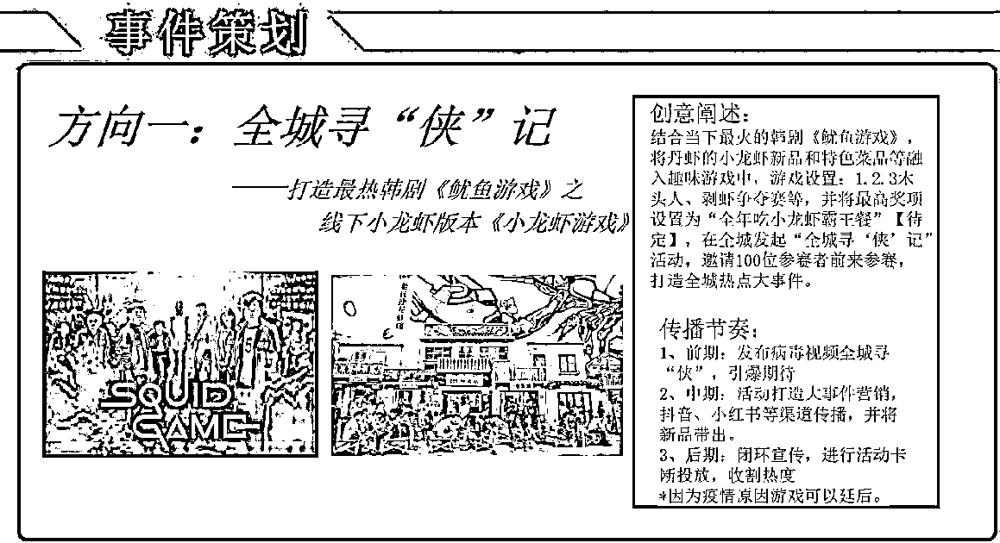 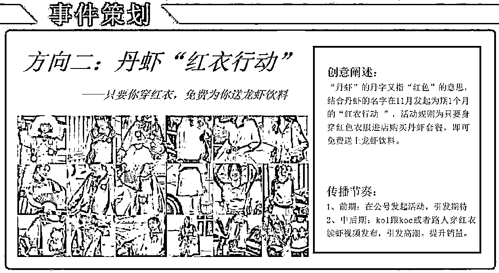

做事件策划，有几个角度可以参考。

创意雏形从哪来？如果不是大型营销策划公司，自己空想非常吃力。更实际的做法是收集抖音官方过往的成功事件营销，做好归档，再根据客户类型、季节特征灵活匹配和调整。这项积累本身就是核心竞争力。

还可以多渠道寻找灵感。比如在淘宝上买各行业的营销策划案，或者翻一翻内容分享平台的案例，把有价值的素材攒起来，组合之后往往能提炼出很契合客户的方案。这些思路经过大公司验证，交付给客户，他们接受度也比较高。

同时要围绕客户自身特点、核心卖点，配合季节或节日属性来设计活动，让用户愿意参与进来。最后，留意每个时间节点大众追捧的热点，让策划方向主动向热点靠拢。视频一旦引发跟拍风潮，就能获得额外的流量加持。

**5. **素人持续铺量转化和维持好评率

视频越来越多，到店消费的人也会越来越多。门店一旦火起来，服务和菜品能否跟上就成了大问题。我们以往服务的商家里，99%都会在这里出状况，连我们自己投资的品牌也不例外。

素人视频在这个阶段会重新体现价值：通常能把70%左右的好评率重新拉到85%以上，带动更多用户下单。好评率一低，转化就会下滑，甚至出现退单。很多品牌都吃过亏，所以最后一定要安排素人持续铺量。

而且前期声量已经打出来之后，素人视频仍然能带动转化。用户对品牌有了基础认知，时不时刷到一条素人视频，可能顺手就下单了。

这里多说一句，做这个环节要考虑全面。我们之前投资的虾浪，因为上菜慢，好评率只有75%，转化受到很大影响，退单率也高。但团队缺乏餐饮实战经验，只能慢慢调，好评率始终没有拉起来。后来是等这波流量消化完、内部调整到位，才用同样的方法重新推爆。

以上就是做抖音本地生活最重要的5个环节。结合前面这些经验，我觉得只要是干互联网的人都能看懂，也知道该怎么完成前期的冷启动。

五、抖音本地生活的从业总结

**1. **赛道深耕很关键

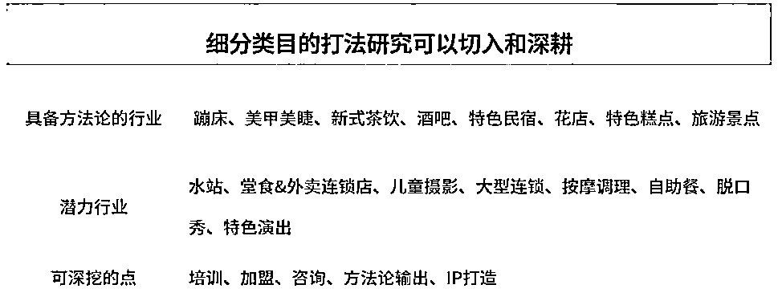 这是我在年初群响分享的PPT里做过的一个预判，预测2022年哪些行业可能走红。上半年基本得到验证，很多品类确实通过抖音取得了不错增长，比如美甲美睫、特色民宿、特色糕点、堂食&外卖、大型连锁、自助餐、脱口秀、特色演出、咨询加盟和IP打造。

赛道深耕的重要性怎么强调都不过分。2022年2到3月，我们3个人的BD团队专注做足浴店，签单速度极快，平均每天签6家。而2021年，BD团队平均三天才签1家，效率差距立竿见影。

下面从几个维度说说为什么值得深耕。

首先，比做全类目见效更快。单店模型跑通后，团队能形成初步方法论，对行业也有更深认知。足浴类目刚上抖音团购时，我们担心素人和KOC账号会被限流，于是让一家拥有80人服务团队的足浴店全员加入到素人矩阵。素材很简单：每天拍摄技师小姐姐跳舞的视频。结果很快吃到了区域流量，完成增长。

其次，容易沉淀出系统方法论。做完一个案例后，团队直接带着成功案例去BD其他门店。拓展到3到5家时，方法论基本成型，你也会成为这个行业里的奇兵，接下来拿单就是顺理成章的事。

第三，能突破地域约束。服务端大部分工作都可以线上完成，比如拍摄、达人撮合、套餐设计和上架，BD只需要维护好客情。因此BD可以慢慢往外跑，不停拓店、复制模式。也不用担心某个城市客户太多，流量被摊薄，结果谁都没服务好。

这三点是赛道深耕最快、最直接的回报。想清楚就可以动手。

赛道深耕的变现路径更多元，也更持久。它本质上做的是行业解决方案，最终你会成为这个行业的营销专家。对服务商而言，这比单纯做本地生活服务公司有价值得多，也能走得更久。

行业一旦做深，就能吃到全产业供应链的红利。整条链上涉及品牌服务、金融供应、设备供应、原材料供应。你只要找到一个环节切入，和商家深度绑定，收益就会非常持久。比如烘焙店，你的流量服务可以配套设备，增长点放在设备收益上，再用利润补贴品牌服务，想象空间非常大。本地生活的流量红利里，吃喝玩乐只占很小一块，还有大量高毛利行业等待渗透。思维一定要打开。

规模化也能快速起来。目前实体行业的类目服务商大多还停留在初级阶段。你只要掌握新媒体端的营销方法论，就可以去绑定这些服务商。他们的客户资源和行业沉淀跟你形成互补，这种新商业模型能快速复制成分公司经营，迅速起量。

垂直领域还能链接到意想不到的资源。当团队走完第一阶段、开始深耕垂直领域时，接触的资源基本是行业协会、商会、头部企业和相关分管部门。这时你去搭建盈利模式，或者借助资本放大，机会都非常可观。

**2. **策划能力很关键

策划能力相当关键，这一点我说过很多次。它不是单一技能，而是互联网思维、传播视角和营销思维的融合。公司里只要有一个人具备这种能力，就可能孵化出一家区域头部传媒公司。

这种能力主要体现在宣发端。以餐饮为例，负责人需要拆解品牌的亮点、故事和爆品，再结合具体打法策划事件营销。

长沙有家老牌机构叫头等传媒，创始人正是这种人才，操盘过不少漂亮案例，深耕多年后成为当地规模最大、历史最久的本地生活广告传媒公司。

另一个例子是长沙的五溪红小子。今年宣发时，只策划了一个简单的“麻辣小龙虾变装”话题，配合场景化冲击，就获得了千万级流量加持，销售增长也很可观。可见不用总纠结新灵感，从已有案例里学习、改良，照样能拿到流量。

 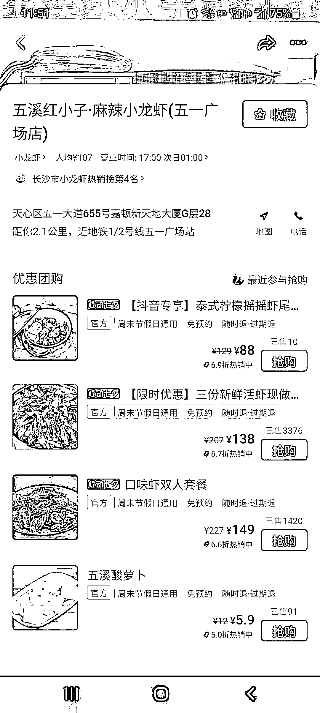   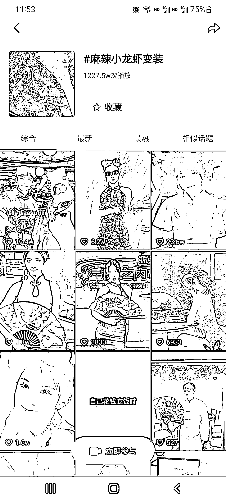 

以上策划虽然还属于初级水平，但已经能给品牌方一个不错的交代，完全可以当作优秀案例。

再往高维度延伸，就是品牌策划的介入。互联网策划公司转型做这块很有机会，传统媒体也需要这类能力加持。

第一，可以基于品牌特点，为品牌方制定全年营销策划，包括品牌定位、传播路径和整体规划。这些都是当下新消费品牌的薄弱环节。

第二，很多品牌擅长做大曝光、大传播，但流量的转化存在明显问题。对于流量运营、留存、渠道和平台规划，他们普遍缺乏清晰认知。

第三，策划能力也体现为对品牌营销闭环的调整。做完所有营销策划后，一定要给品牌方方法和建议，帮他们构建更好的商业闭环。

比如一个美甲美睫品牌，可以这样构建：

- 行业类目：美甲美睫
- 目标人群：18到30岁女性，以学生和白领为主
- 盈利方式：短期靠美甲美睫、美容项目维持基本营收，中长期从流量入口中转化医美需求，获得更大增长
- 人群需求：爱美，喜欢CBD高空远眺的风景，爱拍照打卡，喜欢吃但又注重健康
- 匹配场景：写字楼靠窗店铺，坐在窗边能看到车水马龙；套餐把美甲美睫与养颜茶饮、高颜值轻食糕点结合，再配上拍照服务

**3. **场景构建值得去深思

场景构思极其重要，是新消费品牌下一轮增长的核心。它牵扯到电商品牌本地化、老品牌焕新等命题。比如现在的洗衣咖啡店就是在构建新场景，tea stone也做出了产业链级别的新消费场景。这类项目一旦推起来就很有机会，你只需要思考怎么突破。

有了基础场景构思，落地动作可以这样展开：首先明确品牌客群是谁；其次弄清客群需求，思考如何嫁接新的流量产品；然后按照前面提到的POI加热和达人撮合方式推爆；如果条件允许，再叠加私域运营。

关于场景构建，我分享一个马上可以落地的案例。这是一个新美甲美睫品牌，先把这个价值百万的概念给你们：获客渠道是抖音、美团、高德，后期全程转向私域运营。这套组合拳打出去，一定会有声量，也是对传统美甲美睫行业的降维打击。我个人预判，这样的场景组合会越来越多，增长会被快速复制，拓店速度会越来越夸张。互联网下半场，会有一批人扎根在类似赛道里疯狂吸流量。

抖音本地生活这波红利很难撑过3年，如今已经过去1年。打算入局的人，一定要想清楚。

评论区：

老张运营：楚总，方便留个联系方式吗？我们公司在长沙，刚入局抖音本地生活。

楚川：抖音榜单的组成已经更新了，我在朋友圈同步过，回头也在赚钱发一份。另外POI质量分也出来了，能带来一些意想不到的惊喜。

楚川：私信我。

Kuki：楚总太厉害了，膜拜，真想拜师[玫瑰]。我们也是做抖音本地生活的，做了两年，交付能力太差，能跟您细聊一下吗？

楚川：可以深度沟通。

雪樵：内容很实用，怎么联系您？向您学习[抱拳]

楚川：chuchuan2020

龙哥：感谢分享，已加精华。