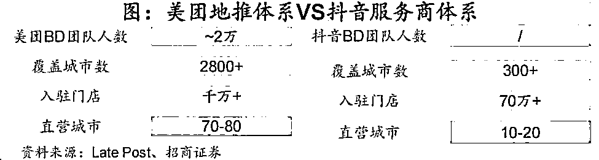
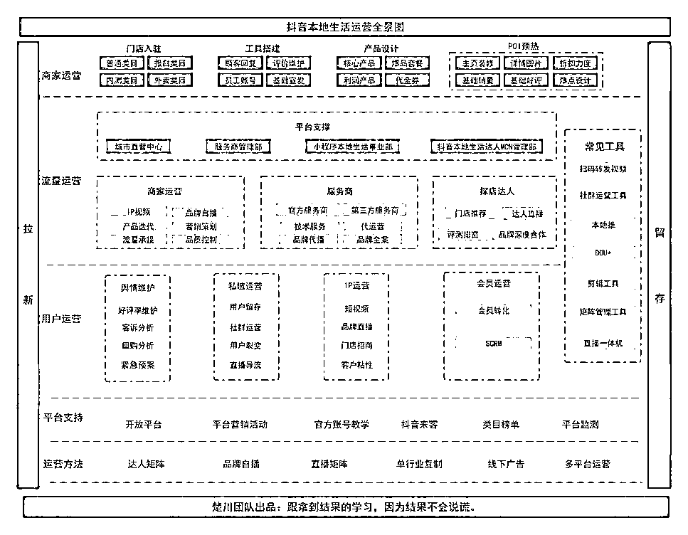
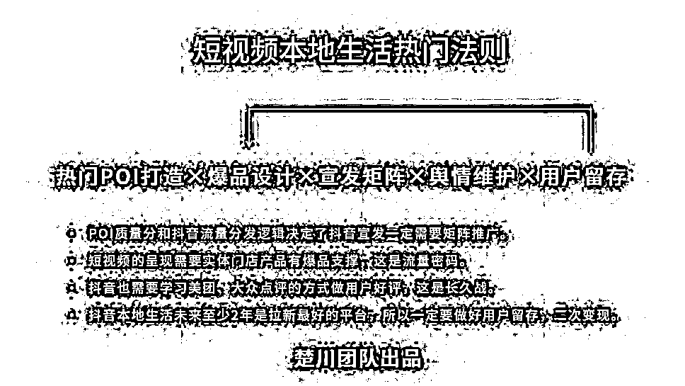
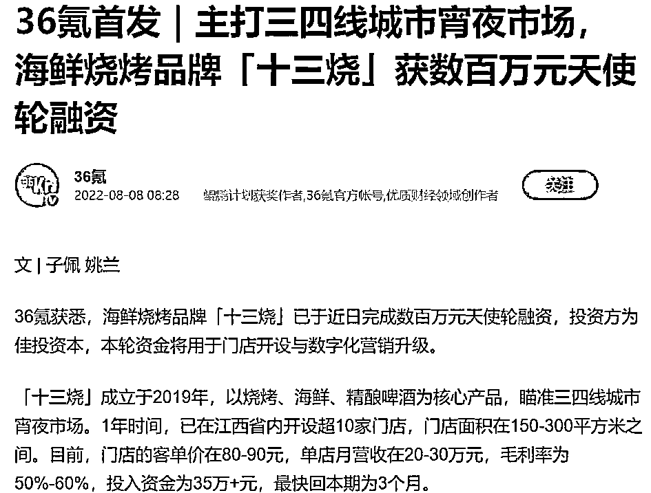

# 2023，同城生意怎么多赚十倍

先抛判断：线下门店估值在低位，同城流量却便宜得少见，今年赛道大概率迎来最陡的上升曲线。已入局或还在观望，都该把油门踩到底。——楚川

## Part 1 成长复盘

### 1、关于我

楚川，创业十年没停过，做同城到店三年，累计陪跑4700家线下店，从吃到住、从玩到购都碰过。

三年磨出一种本事：平台变、行情卷，生意也得赚钱。2022年公司净赚超过一千万。

### 2、为什么开口分享

我们走过加盟IP、投放、达人、品牌、供应链、官方服务方、技术方等环节，该踩的坑基本踩遍，所以能给同行和新人一些实在建议。

2020到2021年我扎在一线，没空分享；2021年跌到低谷后，我重做组织与流程，把自己从琐事里拔出来，才开始对外讲经验。

现在最大的坑是消息不对称。去年2月我讲过一版，才过十二个月，平台和市场已翻新数轮，和当时完全两码事。

### 3、2023先对齐的共识

- 电商/IP那套内容逻辑，搬不到同城到店。身边三公里的吃、喝、玩、乐，才是周边用户要的，决策轻、频次高，超高客单另说。内容把团购信息讲清楚就够。探店片被嫌土，却常能出单。别把电商和IP的刻板印象硬套。
- 影像比图文更容易扩散。做同城生意，抖音先做透：拉新便宜、扩散快、覆盖面广。其他平台别一上来铺太开。我们三年各平台试过，坑替大家踩了，还是抖音更顺手。
- 同城生意在，账号矩阵就得在。平台优先推3-5公里，靠一条片子吃满流量不现实。要用上百条内容，在低阶流量池反复触达周边人群。算法不改同城推荐，矩阵就是基本功。
- 做抖音要有“抖感”。新人先别焦虑，每天至少两小时刷内容、看开播、拆生态，投入不够大概率做不起来。能讲清平台生态和到店闭环，才算入门。
- 这行活苦、活杂、活累，实操不能断。停久了就手生，因为变化太快。别被快钱诱惑带离一线。吃、喝、玩、乐门槛低、红利大，最后拼谁肯干苦活。愿意下场的才分得到肉，赚快钱上瘾的人受不了这个节奏。

## Part 2 2023怎么破局赚钱

### 1、十倍空间还在

- 图文平台和影像平台在到店赛道的较量才起步。美团2021年报披露活跃商户880万，基本覆盖地级市；抖音到店在一线、新一线铺得比较齐，二三线还有大片空白。不缺客户，盘子够大，视频号、快手也盯着。

- 投流入口往本地推集中，开播得安排，成交要冲。年底投放逐步收拢到本地推，最大杠杆在开播。接下来拼团队投放效率与单场产出，视频辅助不能少，开播运营决定最终回报。外卖2023会全面打开，百元以上客单也会涨。开播+外卖组合，才可能做出十倍增长。

### 2、用系统视角看懂同城到店

- 2023进入精细化阶段，先摸清生态拼图。抖感是第一步，接着把门店、达人、代运营、平台规则串起来看。行业经过两年多，各方认知已被教育两轮以上，早期只收割、堆门店数、盯GMV的粗放打法失效。现在起盘就得算盈利，否则后面撑不住。
- 2022年11月，我把三年经历、公司运转和经营SOP整理成一张同城到店运营全景图。建议从业者先把这张图吃透，跑一段时间再按自身特点调优。优秀操盘手要懂每个生态位，才知道钱藏在哪、团队往哪走。
- 抖音在各大平台里获客最便宜，所以流量入口要压在这里。全景图里我反复标“拉新—留存”。联联周边游、千千惠跑得猛，靠的就是私域池。起盘别只拉新不留存，谁能把流量沉淀并转化，谁就有话语权。
- 流量端，2023要打“视频+开播”双轮打法。我接触的团队九成以上只做一头，这是割裂的。视频是开播的地基，电商早期也靠内容蓄水、挂链接起量。同城到店同样先把内容做扎实，再上直播，交付时组合推进。算法会放大这种协同，具体打法可私下聊。
- 工具别神化，也别妖魔化。爆店码、抖音小程序、外卖小程序，门店和代运营都被割过。可到店生意终归是门店经营、流量经营、用户经营、平台经营四件事，工具只占小头。没工具生意照转，也没有哪款工具能让人躺赚。眼下有效的仍是那几类：爆店码更适合代运营，不建议单独塞给门店；后面拼细节，要会用本地推和多账号管理工具。
- 平台运营上，抖音是主场，再整合其他线上入口和线下广告。整合全案我们停了大半年，不过小团队值得试，我们做的时候有利润。一个全案报价可过百万，超出能力就外包。入局者要摸清各平台特点，不是要求高，而是同城到店的方法就那些，多出的精力要拿来看全局。早一步看懂，早一步吃红利。

- 陪跑四千七百家店后，我磨出一套“五步打爆门店”的实操SOP。今年我在自己和朋友社群里多次讲，有人抄走，甚至拿到开播现场去卖，能帮到人就好。1.0版是2022年6月画的。现在我又补了4点说明，方便理解。门店从0到1，按这套走，再配合前面的推广流程，基本不会偏。接下来我会继续做三件事：给新人指路、让入局者看清自己做的事、也让自己保持清醒。实操我会一直做，体感不能丢。
- POI预热是入门第一课。就像实体店开张请朋友来撑人气，完成位置认证、把货挂上去后，也要把POI烘成热闹场景，把位置炒热，转化自然上来。
- 没有爆款就别投流。爆款是命门，选对款等于成功八成。前期先筛出门店的拳头产品，后面才省力。别逆势硬推，没爆款还砸流量，转化会很难看，甚至反噬。原则就一句：爆款没定，不碰抖音推广，否则就是赌。
- 账号矩阵和开播运营玩转了，钱才转得动。顺序别反：矩阵优先，先跑通整套落地流程，再上直播。2022年前半段我还不建议开播，因为行业当时先把内容做起来；现在要两条腿走，做1+1>2。
- 口碑维护是长期活。抖音起量快，一天能冲百万级曝光，好评比例容易掉，差评也会来。舆情要盯，路径可参考美团、点评。不维护，转化率往下走，退款率往上翻。
- 下面两张图，是我按当下同城到店视角拆的流程和环节，放心照着学。实操久了能把两张图复述出来，说明你真懂生态，也更可能拿结果。

### 3、我看好的8个小方向

我预测过多次同城到店会火的品类，命中率约九成。每次分享后都有人认真落地、提前卡位，然后吃到结果。下面按2023全年看：

1. 文旅：怎么爆？组好品，猛铺量。共存阶段到来，前半年发酵，后半年可能猛涨，百倍增长也不是没可能。
2. 交友：2023还会爆。三年线下社交被压住，大家太缺真实连接。人设包装、多号铺量、私域接住，高客单很能打。
3. 同城零售：借达达、顺丰同城、饿了么运力，做高客单和新奇特组合。我们今年已验证，明年系统顺了，会给团队带来福音。
4. 演出：脱口秀、演唱会、影院都算。素材质高量多，混剪空间大，分发账号多，就是靠量冲。
5. live house：长沙2022已给各城打样。现场好歌手、热歌配现场片段扩散，基本能起飞。
6. 小型社区店：满足居民高频刚需的餐饮品牌，模式已验证，大有可为，也是很好的私域入口。
7. 有实力的团队可考虑品牌孵化。我已孵化4个千万级品牌，餐饮“十三烧”跑得最好，已在36氪发天使轮，年后完成A轮。2023我想再孵2个以上。

8. 细分行业代运营：用一套打法吃下抖音整块流量，比如鲜花、美业、家政、便利店，签下上千家门店，研究爆款和垂直策略，搞钱很快。

### 4、我接下来做什么：让团队复制一个七十分的我

今年在群响、淘客公园、龙哥盟、中国区域互联网大会、航加、猪八戒网，以及美团核心管理层做过交流，反馈都正面。所以我想让一些团队复制我的能力，复制一个七十分的楚川。

眼下同城到店最大的限制是消息不对称，最大制约是缺实操。今年我会和团队双向选择，把经验与能力嫁接到对方身上，加速大家在同城到店赛里拿结果，让有能力的团队少因消息不对称浪费时间和资金，少因缺实操犯战略错。

以上是楚川对2023同城到店的判断和建议，愿大家接住这波爆发。想链接的团队和个人，加🛰️：chuchuan2020。跟对的人，2023一起拿结果。