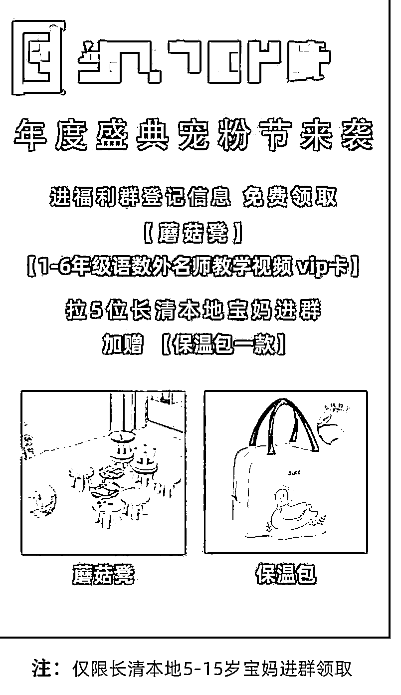
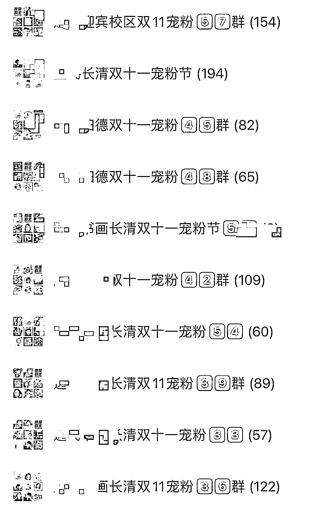
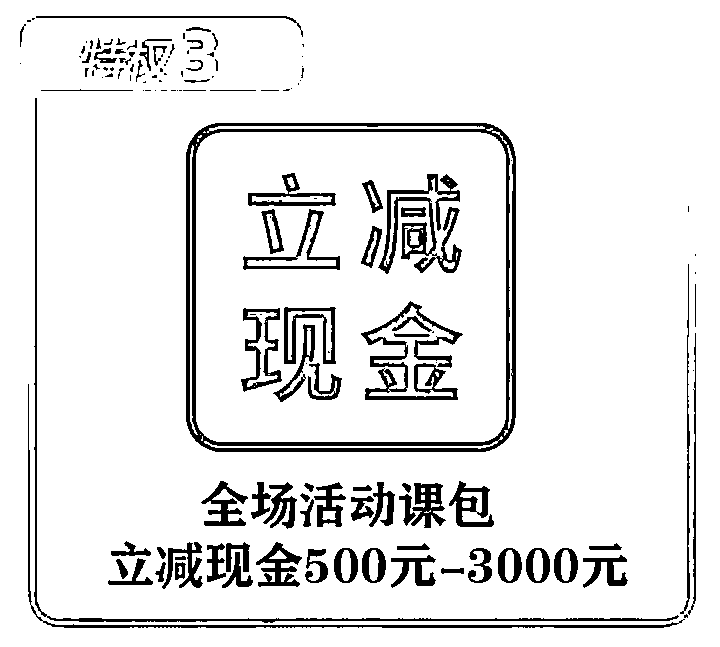
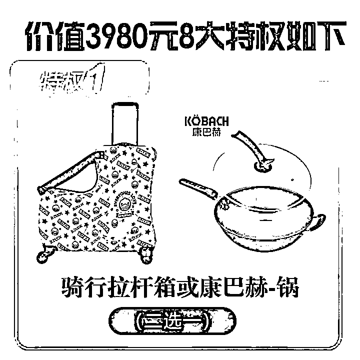
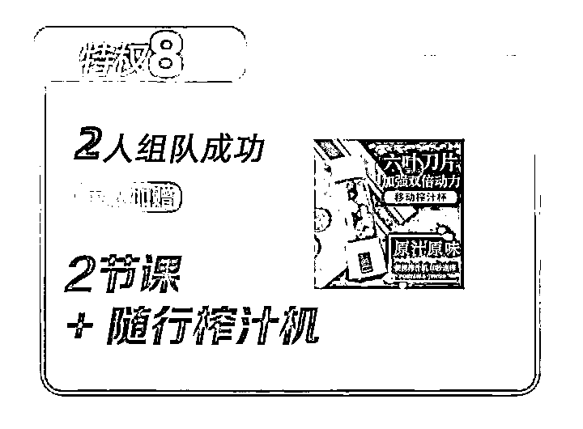
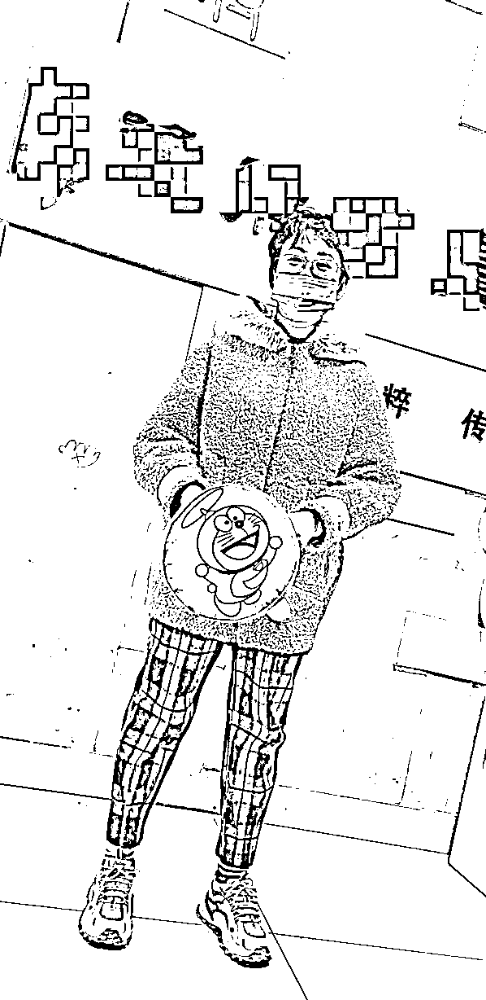
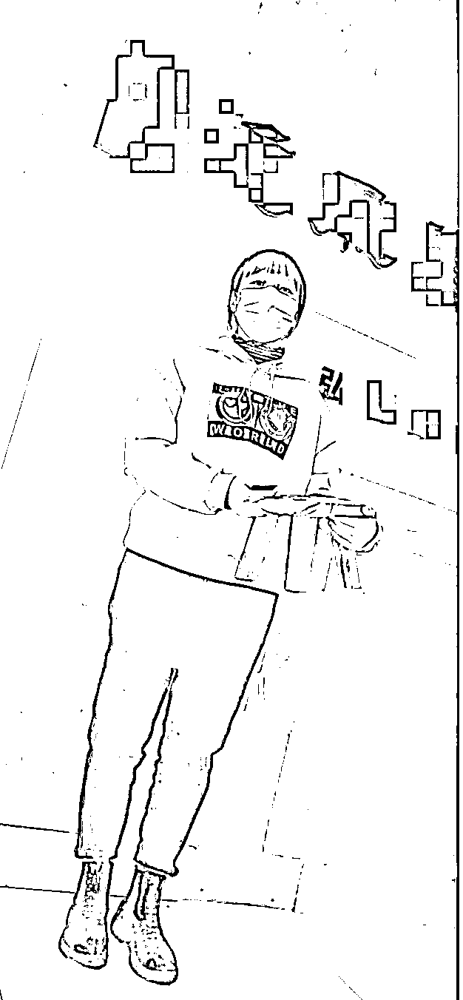
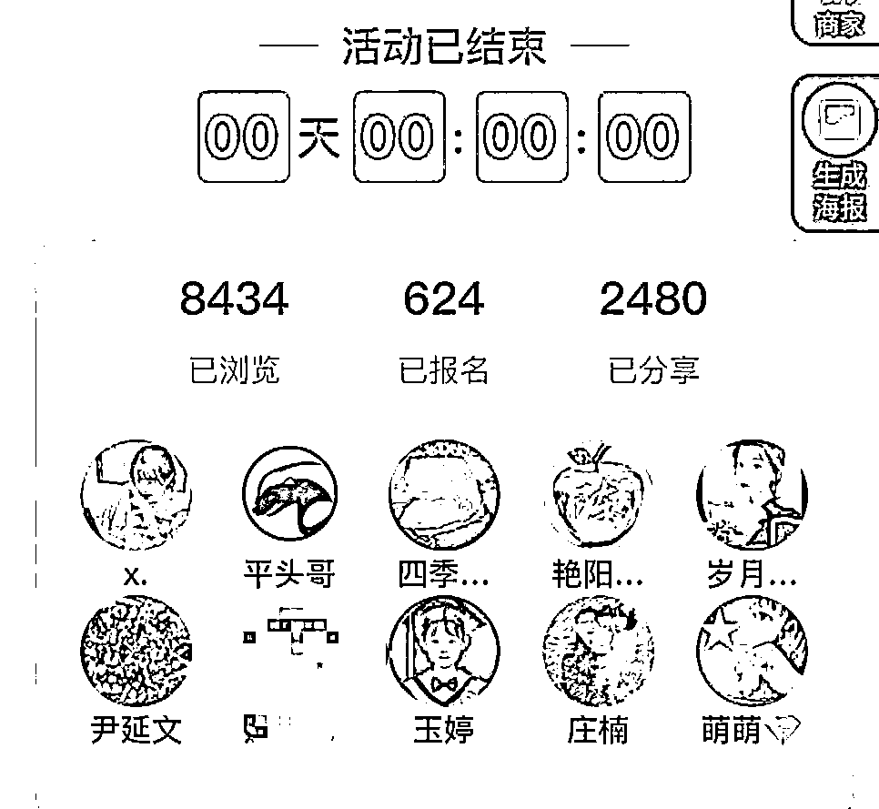
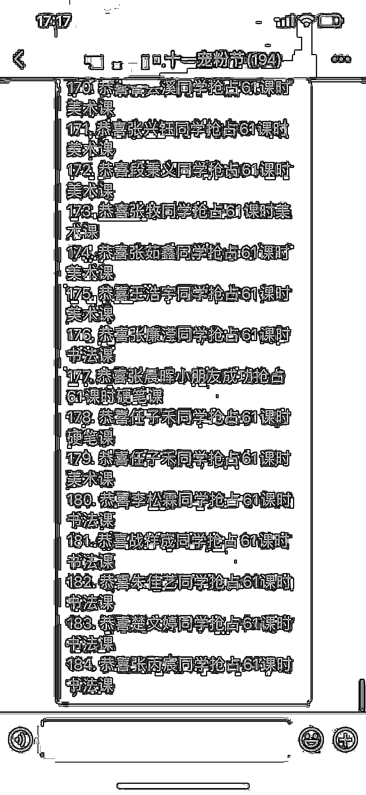
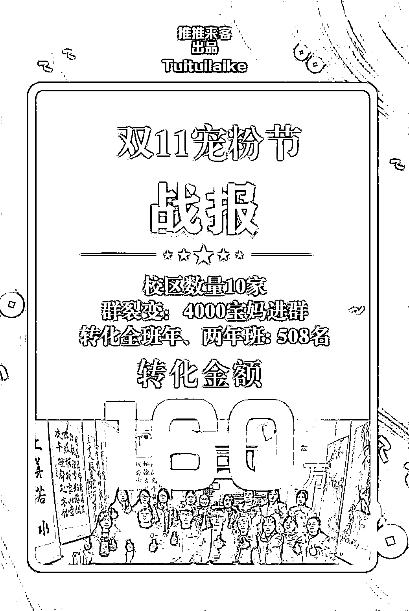

# (精华帖)(121 赞)20天回款160万，这家书画店做对了什么

双十一期间，我们团队给一位合作过的老客户做了一套成交流程。地点在济南长清，一家少儿书画校区，20天左右回款160万。那会儿口罩还没完全过去，这个成绩在长清当地把机构彻底点燃，收款也做到了区域天花板。下面把细节拆开聊。

现在不少做门店服务的人，一上来就讲涨了多少粉、做了多少播放量。我的看法很直接：不能给实体店带来销售额，这种服务就是空转。应该从门店最终能收多少钱，反推服务该怎么做。

这次20天做出160万，核心环节分三步：

1、先让同城流量烧起来

2、让老私域自己长出新流量

3、把到店的人变成成交

**1、先让同城流量烧起来**

这家店是少儿书画培训，实体门店的需求很清楚：产品要能持续触达本城精准人群。门店流量重心就在同城。

同城流量有两个主阵地：

1、🛰️：快速触达用户的渠道是同城群。

2、抖音：快速触达用户的渠道是抖音同城。

**1、同城🛰️群这条线**

一个城市里打开率最高的群，主要是业主群、村居群、商家群、团购群，这些是城市私域流量的主阵地。活动开始前，我们带着门店员工去线下加群，先攒到1000个左右同城🛰️群。

有了这1000个左右的同城群，接着做两件事：

1、把同城群里的宝妈沉淀到自己的群。

可以这样设计：宝妈进群送一个小凳子，再邀请5个人进群，加送一个保温包。

用这个办法，群里滚到约4000人，宝妈占比超过95%，等于握住了近4000个家庭。领礼品要登记手机号和姓名，所以一份礼品同时完成了个人号沉淀和家长信息收集。

2、把这1000个同城群逐一推送活动链接。前一阶段已经沉淀了一波宝妈流量，这时要连续推送活动，完成曝光。别因为怕被踢就缩手，持续推就行。

**2、抖音同城这条线**

平时正常更新账号、做IP，当然可以。但如果一家实体门店没有成熟的抖音账号，就没法借它引爆同城流量。我们的做法是把散水汇成大河：此前送出去的小凳子、保温包，都要让进群宝妈到店领取。

于是用抖音爆店码，让这些宝妈分发抖音视频。来一个宝妈领礼品，就多一条视频被发出去；1000人来领，视频就上千条。这些宝妈账号的权重不算低，刷到视频的又多是她们社交圈里的人。

上千条普通用户视频铺开，本地这个位置就被烘热了。想再加一把火，可以找v3-v4博主来加热。

再挂基础团购品做引流，推一推，本地很快就能攒起一波流量底子。

**2、让老私域自己长出新流量**

**2.1 先让自有流量裂变**

外部公域流量完成第一波曝光后，还要让自有流量曝光。自己的流量池里，最值钱的仍是个人🛰️。但每推一次产品，都是在花用户资产；只花不补，资产早晚见底。

所以推送产品时，要同步做裂变。说到裂变，拼多多是绕不开的鼻祖；拼团这种形式，到目前仍是最能打的裂变玩法，没有之一。

私域裂变要设计裂变品。这次设计的是66元宠粉节定金卡：花66元就能锁定一个标价3980元的优惠资格。

课时福利：报课时全场可减500到3000元，为现场高客单成交铺路。

礼品福利：礼品走价值感路线，比如康巴赫锅、骑行拉杆箱。

裂变规则做成2人团：再拉一人付66元，双方得几节课和礼品。

先让老用户下单66元定金卡，再借他们的手往外裂变，完成私域流量裂变。

**2.2 再裂变出新流量**

前面讲到，我们有4000多位宝妈进群，1000多名宝妈加了🛰️，达到礼品领取条件的，引导到店。接下来：

1、群里开卖66元定金卡，买过的人继续拉人；

2、对新加进来的🛰️推66元定金卡，买过的人继续拉人；

3、对来领小凳子的家长推66元定金卡，买过的人继续拉人。

**3、把到店的人变成成交**

前面通过公域的同城群流量、抖音流量，加上自有私域和私域裂变，把66元定金卡卖到624张。

下一步，就是把这624张卡和到店人流做成成交。

这时门店要造节促销：

1、现场氛围要做出节日感；

2、成交节奏要制造紧迫感，让老客带新客。我们设计了群接龙，只要成单就接龙，彼此影响；

3、成交方案做成阶梯式：价格分档、礼品分档。越早下单，越能先挑礼品，价格也更低。

最终，三步走下来转化160万，前后跑了二十多天。瑜伽、水育、教培、医美这类门店都适用，把这套逻辑搬过去，做到几十万并不难。

评论区：

- 末末。：请问您在哪里做招生引流？
孙策：山东。

- 家蒙：引流转化能力才是硬实力，落袋为安，这成绩确实强，说一句呼风唤雨不过分吧。
孙策：[抱拳]

- 灵动：感谢精彩分享，有个疑问，1000多个同城🛰️群是怎么来的？
孙策：带着员工去线下加就行，社区群、商家群、美团优选群，使劲加，耐住性子加，数量能上来。

- Elizabeth：这是有10家店吗？
孙策：10家。