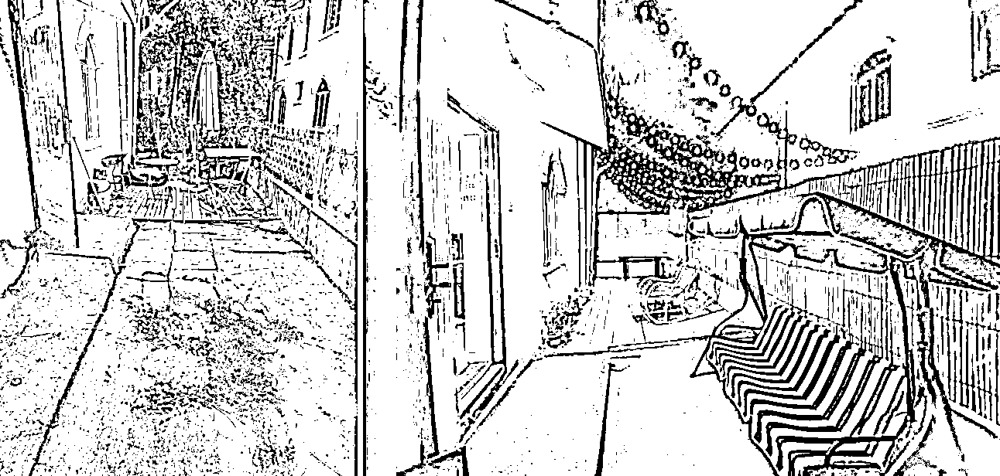
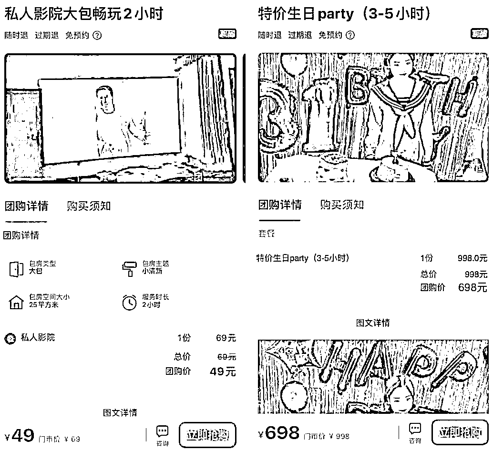
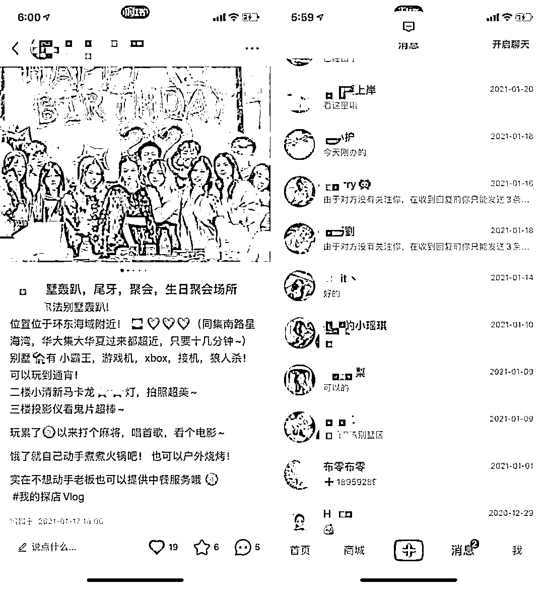
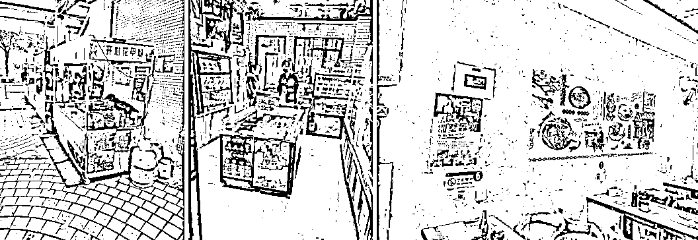
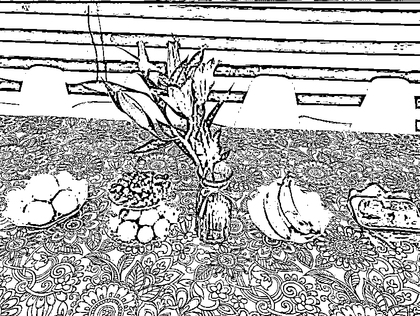
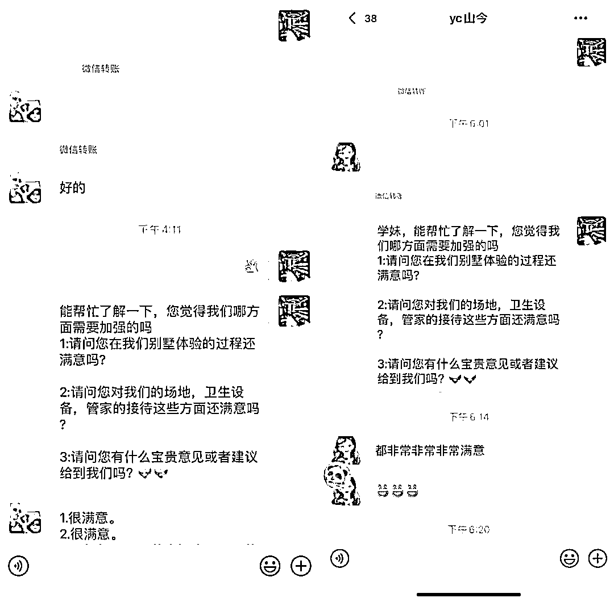
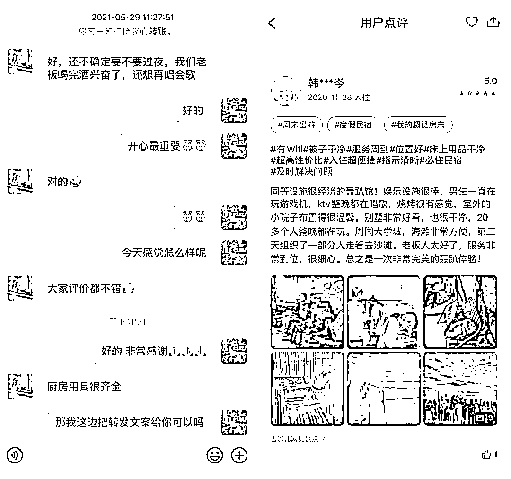
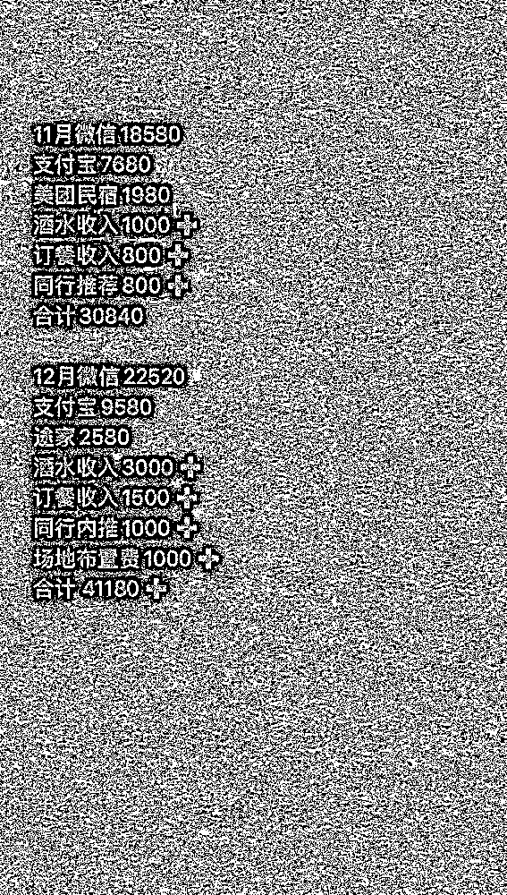
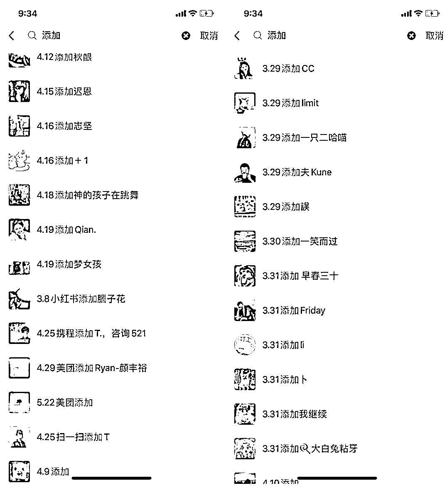
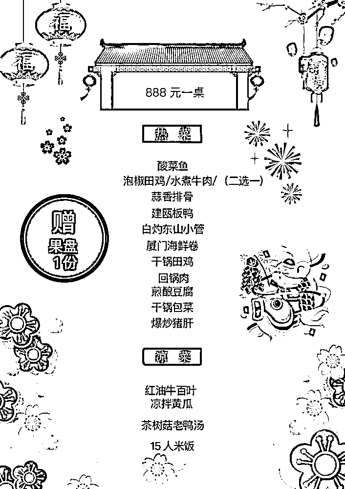

# 交完8000元学费后，这处聚会场地靠细节翻了身

我是Mage。2022年3月31日，我把这段线下小生意的起落整理在龙哥盟。大约6600字，八到十分钟能看完。结果先摆前面：最早凭感觉接盘，租金先亏8000；后来靠同行分析、重新定位、场地改造、全渠道获客和老客维护，做到单月净利三万多元，新单里约七成来自老客带新。若你也想碰线下实体，希望这份复盘能帮你少踩一点坑。

## —01— 凭冲动接场，先交8000元学费

时间回到2020年4月。那会儿国内首轮疫情才缓下来，我在公司做管理岗，手头事情不算多，却感觉上升通道变窄，便想找份副业添点收入。刷🛰️动态时，我发现以前光顾过的一处聚会场地，老板被疫情拖得撑不住，正找人接盘。

线上聊了几回，他把过往流水发我：单场两三千，单月八到十场，额外能多出万把块；开销看起来只有租金，也不必天天守店，有客再来。我脑子一热，拿十万元转让费、八千元月租，签下一栋三层、带小院、约三百平方米的房子。宣传怎么打、经营怎么跑，我压根没细想，只觉得哪怕每月只接三五单，也能把本钱兜住。

真接手后才发现不是那回事。五月至七月，预订稀稀拉拉，团购页也少有人问。我起初把原因推给疫情，觉得线下消费还没缓过来；其实五月已经在回暖，只是我没跟同行对照，陷在自我安慰里。租金按季付，到下一个付款日一算，租金、物业、水电三项合计亏了两万六；单看租金，就是八千元打了水漂。

六月底，🛰️动态里有人转发龙哥盟的招募信息。我起初没报名，后来在二手平台淘到一些精选长文，读完觉得干货很足。有篇帖子（https://t.zsxq.com/jmEYNNR）让我受益最多，后面的不少动作都从那里找思路。也谢谢这个平台，让跨行小白有地方补课。

## —02— 过程：先改场地，再把客人引进来

我的经历大致分三段：刚接手时几乎零准备，觉得在🛰️动态里吆喝几声、把店挂到本地生活平台，客人就会自己来，结果五月至七月每月租金都打水漂；八月至十月，我逼自己坐下来复盘，先把同行摸一遍，重新想清楚卖给谁，再改场地，线上线下一块儿拉客，账面开始转正；十一月到次年二月，服务上的小差别慢慢攒出口碑，团购页和红书端开始起量，迎来密集预订。

### 一、场地整改

我先从房子本身动手：把长期空着的小院刷了一遍，添了秋千和氛围灯，专门给客人拍照；旧设备换掉，三层彻底清理。部分前后对比：

### 二、获客与运营

**1. 用低价入口把平台流量引进来**

原先仅两档套餐，吸引力不够。我补了几款入口产品：四十九元两小时影音房；一百九十九元中包欢唱（酒水另算）；五十八元四人棋牌三小时；六百九十八元三到五小时生日场，附送拍摄剪辑。部分图片：

租金固定，周五至周日旺，周一至周四场地常闲着。这些低价款不为利润，只为填档期、把平台客人引进来。到店客人把活动转发到自己的🛰️动态，可享六折，大多愿意发，我因此慢慢攒下一批精准客。单次转发少则几人、多则十几人加🛰️，多数本身有需求。这些套餐几乎不赚钱，纯属引流。

**2. 找本地红书达人做置换**

我免费请达人来体验，条件是帮我在红书发一篇笔记。

**3. 线下贴海报**

我在周边0到8公里的办公楼和高校贴海报，通常和场地方谈一百到一百五十元/三个月。位置好的点位，每周能自然加三到五人；主动扫码来的用户，意向更高。之后按添加者所在区域优化点位，效果好的继续续投。

**4. 和旅行社、布置团队、户外拓展做异业合作**

户外拓展效果较好，单月可推两三单。不少小公司报团建时不太抠内容，多由拓展机构推荐。合作通常给场地费10%到15%的佣金。

**5. 高校代理**

通过海报，我在附近一所高校招到代理。他本身在校内有些资源，那一两个月陆续推了10单。校园资源可以一届传一届，别小看。薪酬有两种：给底价，让他自己加价；或固定10%提成。

**6. 入驻民宿平台**

节假日我会接到旅行团单，常是两三起。游客方面，我入驻了途家、美团民宿、爱彼迎、小猪等平台，流量较大的是前三家。每个平台多开两套以上房源，相当于多一份曝光。

**7. 🛰️转发裂变**

上面这些渠道，最后都能引导客人转发。我认为这是最好的宣传方式，但强求会引起抗拒。通常分两种：客人预订时要优惠，就提前谈好，比如所有人转发12小时且不屏蔽，给折扣，直接省事；或者我给每场客人拍短视频记录，结尾带上宣传二维码。

从运营数据看，平台用户忠诚度不高，选择多；🛰️老客池最稳，二次消费平均一成到一成半。有些客人很喜欢我们的风格，自己来过三回以上。

### 三、红书置换流程及注意事项

这部分我重点讲。

**1. 先筛人**

打开红书，定位所在城市开始刷。目标主要是18到35岁、爱分享打卡的人。点进主页后看四点：第一，关注量，太少置换不划算，太多一般要广告费，5000到3万比较合适；第二，看她发的是不是本城吃喝玩乐，如果全是美妆护肤，泛粉多、本地精准粉少；第三，看拍照和文案功底，至少刷到会让人想点进去；第四，也是最重要的，看赞藏比，5000粉至少要有10万以上获赞和收藏，也就是关注量与赞藏大致在1:20以上，算比较优质。

**2. 打招呼与接待**

我一般会私信：你好，常看你的内容；我在XX区经营一家聚会场地，觉得你的图文风格很合适，想请你和朋友免费来玩一趟，若体验满意，麻烦在红书发一篇分享。拿着账号批量发，有意向回复后，再给场地照片、位置和可约时间，加🛰️等探店。一般发10个博主会有3到4个同意，最后到店1到2个，其他可能没空或等朋友生日。达人到店时，我会挂一条十元横幅，写上对方昵称和欢迎语。操作简单，但对方会觉得被尊重，更愿意认真拍照宣传。

**3. 催稿与资源复用**

体验结束后要尽快催稿，最好1到2天内发到红书，并要求尽量30天内不删。如果手里掌握大量本地达人资源，还可以走品牌推广、店铺营销等变现方式。

另外，美团、大众点评入驻后可以直接发手机号或🛰️号引流。平台会提示不要用第三方交易，但基本没什么问题，我没被罚过款。入驻费按行业和城市评定，我当时是7800元/年，加3000元推广工具，共10800元。推广工具类似直通车，平台成交也要抽佣，所以我一般直接引到🛰️成交。

途家、小猪民宿、爱彼迎这些平台入驻简单，提供租房合同和基本信息即可，平台统一抽一成。有时一单3000元就被抽300元，不少。这些平台审核严，不能发🛰️和电话，被查到会罚款，不管是否成交一次50元，严重可能降权。为了规避检测，我试过各种方式，概率较低的一种是把联系方式掺在地址里，比如“135号街660路138号X先生”，也会被检测，但概率相对低。

红书打招呼太频繁会封号，我一天打10到20个，控制数量，多账号操作。认识的达人多了，当地会有一些群或组织，想办法进群，置换更方便。

预订的房客都要填登记表，一是收集信息，二是增加合规性。信息包括姓名、电话、身份证号、入住时间（月日点到次日下午点）、聚会类型、人数、场地租金、定金。下单后关房，方便入住当天店长配合，同时留下主理人电话。退订规则也写清楚：入住前房客单方面非不可抗因素违约，定金不退；入住当天定金转为房租一部分，支付剩余尾款，另留押金；离店当天查房确认是否有其他消费，定金多退少补。

生意最好的是周五到周日，房源紧张时24小时要接两场：白天场10:00到17:00，晚场18:00到次日9:30。中间只留1小时保洁，其实不够，但我会提前和客人说明，大部分能理解；有些客人不一定会待满预订时间，提前走就能提前安排保洁阿姨，时间紧时我自己也上。

获客渠道之外，我在线下接待上做得比较细。比如夏天提前1到2小时开空调，桌上放切好的冰西瓜。客人从35、36度的室外进到场地，有空调和冰西瓜，感受完全不一样。我还会免费帮他们记录团建短片和图片，活动结束后发过去；过夜客人，晚上提前调好热水，房间插好驱蚊灯，每个房间放鲜花。

这些事额外成本不高，但客人感受差别很大。客人离场后，我会发一份满意度问卷，再根据需求实时调整服务和策略。

客户运营上，我会建🛰️群，把咨询过但没成交的客人拉进去。每天固定发红包问好，金额10到20元，发20到30个包。红包个数别太多，太多大家只能抢到几分钱，反而不爱抢，群就不活跃。

每周发1到2次其他客人团建的视频，通常发聚会和生日两类。每个礼拜固定做一场定时秒杀，一般放在周三、周四，把还没预订出去的档期拿出来，价格是原价的5到7.5折。已经来过的客人也建一个群，每周轻度营销1到2次即可，太多容易反感退群。这些客人知道群在聊天列表里，有需要自然会想到你。

上图是2020年12月的账单：🛰️收入22520元，支付宝9580元，途家平台2580元，酒水和订餐收入4500元，同行内推和场地布置2000元，合计41180元；扣除房租、水电、物业、卫生费11050元，最后盈利30130元。

## —03— 复盘打法：先定客群，再找流量，接着促成交，最后做回头客

轰趴也分大中小类型，客群定位不同，流量来源也不同。主要客群有四类：企业团队、亲友局、学生社团、假期游客。针对不同客群，要配不同推广方案，尽量都覆盖到。

企业团队，一般是HR或老板找场地。我进了一些HR招聘群和场地周边办公楼的物业群，偶尔发广告配合红包。亲友局我没找到特别好的切入方式，主要靠团购平台和转介绍。游客方面，入驻市面平台并多开房源增加曝光。学生方面，在校内设代理，和部门合作。用多种渠道获取流量，再用细节做存量和复购。到目前接近三分之二的单子来自🛰️老客推荐。

轰趴属于服务业，挣的是服务的钱。除了场地预订，我还提供订餐服务。像这样一份套餐，利润有15%到20%。有时一场场地费才两千多，但客人让我提供预订加酒水消费，能带来一千多元利润。

后续能提供什么服务，取决于你对客户了解多少。比如今天是什么类型聚会，有没有准备食材酒水；没有的话，就可以推荐自己的套餐和酒水。还有就是同行互相推荐和布置场地。比如我周六场地已经布置好，客户又急着订周六，我就把客户推荐给同行，一般有10%到15%的返佣。

## —04— 收尾复盘与给新手的提醒

做轰趴也有不少棘手问题。场地在住宅区，可能扰民，轻则物业找上门，重则报警。日常修缮问题也多，比如跳闸、设备故障、换灯泡和门锁之类。

2021年，我把这栋房子转给了一个朋友，主要有几个原因。第一，当时经营还可以，但国内小规模疫情频发，人们虽然不恐慌了，聚集性活动仍会受限，一爆发基本一两个月才能恢复，这段时间没生意还要实打实亏房租，疫情过后一两个月也基本以保本为主。第二，住宅区和业主、物业的关系难处理。这栋房子所在小区间距不宽，虽然做了隔音，晚上10点以后稍微嗨一点，旁边居民就有意见，动不动投诉物业，严重的报警，片警很快上门，严重时让客人散场甚至我要去派出所说明情况，轻微也是警告不要扰民，对在场客人影响很不好。第三，从长远看，轰趴行业目前法律监管还不严格，如果要留宿，需要办酒店经营许可，但不是商住两用的办不了；没有相关证件，法律层面算违规经营。第四，可复制性不强，没有大的品牌支撑，知名度不好扩大。如果投入大量资金在装修设备上，目前国内这种形式的回本周期也不确定，属于未知。第五，外部竞争变大，一些民宿、客栈也改成轰趴馆，用极低价格抢客源。

最后，想对想做实体的小白朋友说几句：实体真的没那么简单，不是开个店就有钱送上门。技术、口碑、品牌、差异化，才是你在市场上的竞争优势。你手上的现金流能否支撑至少三个月的房租和人工成本，这是必须有的抗风险能力；如果这一点都没有，一旦碰上不可抗力，很容易崩盘甚至负债。如果你还是铁了心做实体，那一定要运营好🛰️里的老客池，加🛰️是必不可少的动作。

最后要谢龙哥盟的邀请，能在这里遇见同路人很幸运。愿各位都有所得。