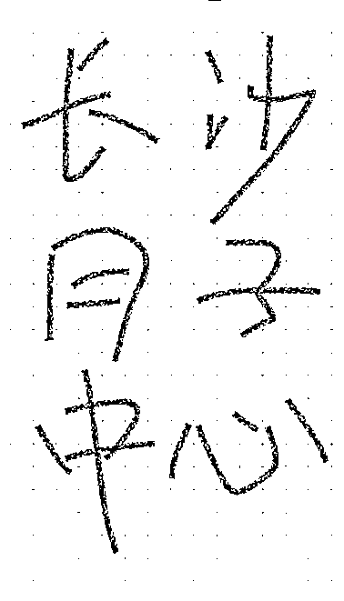
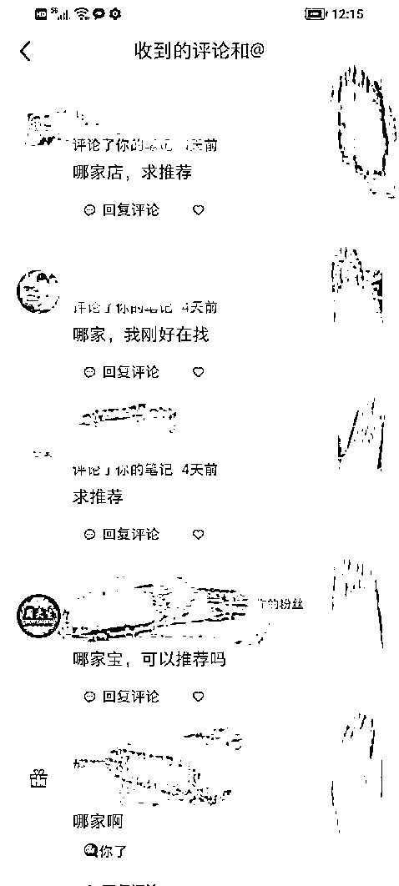

# 小红书本地高单价：粉丝是虚的，加微才是实的

最近我把本地高单价项目在小红书上的获客流程跑通了，今天把整套打法拆开讲。

先说清楚前提：这条路不靠涨粉，靠的是留言和私聊。你只需要盯一个数——最终成功加上微信的客户有多少。粉丝量没有意义，所以下面每个动作都围绕“加微”展开。

**第1步：把新号养成“像真人”**

注册养号，现成教程很多，我直接讲自己的做法。用手机移动数据注册，前期先别连Wi-Fi；注册时只勾选与自身行业相关的话题标签。注册完刷二十分钟上下，然后退出。这里以长沙一家高端产后休养机构为例。

隔几小时再登录，搜行业词：长沙产后休养、长沙月嫂、长沙产妇护理等。只浏览、不互动，持续约三十分钟。做本地生意，搜索词务必带上城市名。

次日仍搜同类词，开始轻互动：点几个赞、收藏、留一两句言，挑几个帖子即可，多刷多看，尽量像普通用户。第三天查看推荐流是否以本行业内容为主。如果是，说明基础养成了；再延续一两天，号便可用，可以准备发布。

**第2步：让系统认清你的内容归属**

养号过程本身也在给用户侧贴标签，但内容侧的识别还没建立。系统此时只当你是个关心该行业的普通人，并不清楚该把作品推给谁。贸然发业务内容，分发会失准，数据自然不好看，流量也起不来。

所以要借同行、也借热心网友的力。这点很关键。

先发提问帖：围绕行业抛问题，让同行与热心人替你回答，从而完成内容侧标记。仍以产后休养机构为例。

标题：长沙产后休养机构哪家更靠谱？

内容：手写一张图即可。如图

文案：姐妹们，预产期在七月，最近准备实地看看产后休养机构，长沙哪家更靠谱？价位合适、服务在线的，求推荐。

若前面步骤做到位，这类帖子会引来同行留言，也会有热心人点评优劣，还会有真实客户收藏点赞。内容侧标记便逐步形成。随后根据数据决定下一步：互动偏少，次日再发，标题换汤不换药，换到另一个区，例如“长沙开福区产后休养机构求推荐”。封面图要重做，别复用同一张。

这样帖子表现会好转，系统完成标记，把你当真实用户而非营销号。标记完成后，作品能触达目标客户。此时应发面向客户的帖子，例如：姐妹们，近期有在看产后休养机构的吗？一起交流、抱团考察。观察是否有目标客户留言，有就说明号成了。

**第3步：用有价值的内容建立信任**

标签稳定后，发什么系统都愿意推给目标人群，但仍不能随意。要提升信任，开始输出行业内容。素材可直接在小红书搜，例如“机构照护与居家坐月子的差别”“挑选产后休养机构要看什么”“入住前注意哪些细节”，整合后发布。看收藏点赞表现，数据好，号就成熟，可以获客了。

**第4步：导流加微**

笔记有两种打法。

其一，延续真实用户人设。前面起号时本就是模拟普通客户，导流笔记也保持这个口吻。内容可写对比多家、实地探访，从价位、环境、售后、口碑等维度自然带出门店。

例如：我跑了四家产后休养机构。河西那家环境好，但报价超出预算；河东那家环境和服务都合意，价位也能接受，目前更倾向它……第三家……第四家……发完后通常会有客户留言或私聊，问第二家是哪家。此时私聊推荐，给出自家微信，交由销售邀约到店转化。后续再发“我定下来了”“已经入住”“今天的月子餐”等。

这类笔记完全按真实客户视角写，代入感和信任感都强。高单价项目不会出现大范围爆量，私聊直接留微信号问题不大。我有个号连续留了一个多月，没被限制，日均三到五个咨询，一个月有一百多位意向客户成功加微，粉丝才三十来个。所以别纠结粉丝数，留言和私聊才是关键。

真实人设号的短板是生命周期短。以产后休养机构为例，从备孕找店到坐完月子，号就走完周期了。好处是素材不愁，重新起号再来一遍即可。这类号权重很高，即便停更，在话题标签下排名依然靠前，获客能力很强。我有一个号两个月没动，仍有人私聊求推荐。

其二，直接以商家身份出现。标签打好后，除了模拟客户，也能从商家角度写。因为内容会推给目标人群，所以可以直发广告。关键操作：把关注你的同行全部拉黑，降低被举报风险。笔记按广告与行业内容约一比二的比例发，再逐步隐藏前期起号用的提问帖。这种号生命周期长，起量慢，但人群精准。

这套方法适用于各类高单价本地项目：产后休养、美业、家装定制、月嫂、培训、驾校等。

几个常见问题：

有人问，拉黑同行后对方就举报不了？系统不会把作品推给被拉黑者，对方看不到更新；但换小号举报仍防不住。另外，搜索里依旧能搜到笔记。

有人做“上海落户”两周发了十几篇，阅读点赞都低。别只看这两项，先看私聊和留言。若都没有，说明标签没打准，按流程重走。若留言少、私聊仅几人且多为合作意向，多半是口吻不对——用专业分享的口吻效果可能偏弱，可以换台手机新起号，改用客户视角试。

至于真实人设导流环节的具体模式和话术，可以再交流。

以上是我跑通的本地高单价小红书获客流程，有问题欢迎找我聊。