# 支付宝这个冷门流量口子：摸透它，门店和线上生意都能稳定来人

分享人：封伟-自动化变现 | 2022-11-01

这套方法我亲自跑通过，能照着复制，本质是让支付宝生态里的流量自己找上门，线下门店和线上业务都吃得开。核心就一句：把支付宝的被动引流玩明白。

先交代清楚：不同赛道在支付宝能推的深度差别很大，下面这些数字出自一个咨询细分领域，只当参照；真正值得抄的是思路和执行顺序。

若遇到表格错位、链接点不开或配图加载失败，可以点这里看原文：
https://p9rxk6ovll.feishu.cn/docx/Tu7uda7qWoKCj1xvMlmcbtfBnqh

**1. 我踩出来的支付宝被动引流路径**

当初是项目缺新的流量入口，才拿支付宝试水。过程大致三步：

1. 七月把生活号和小程序挂上去，后面基本没碰，居然也有些动静；
2. 大约三十天前，我开始有章法地打磨支付宝侧的流量结构：品牌词、搜索结果、优惠券、生活号都做了一轮配置。日常只维持生活号每星期更一篇稿，别的运营没做。三十天下来，新进来 4550 位用户，成交 394 笔。单量谈不上多，但跟👸号比，这成绩属于“不太费劲还挺稳”；
3. 搜索带来的访客占比特别高，达到 82.5%，转化表现把🛰️、抖音都甩在后面，SEO 效果很容易跑出来（具体怎么调，放在 4.1 搜索推荐里讲）。

分阶段的数据如下。

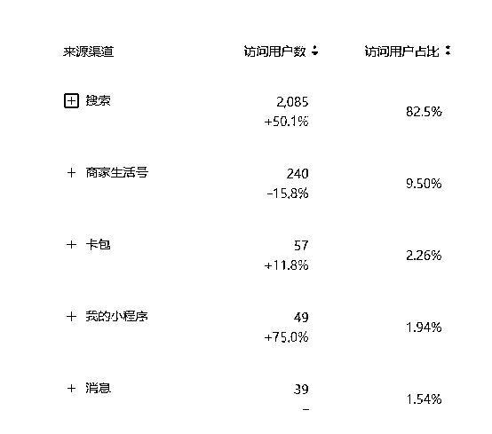

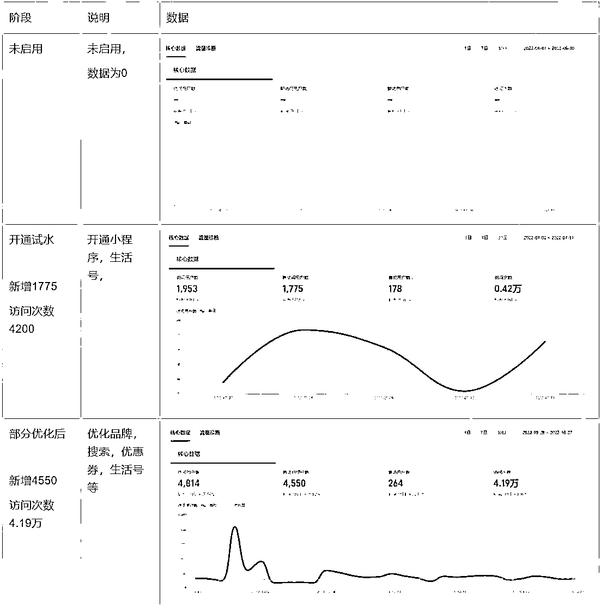

细节展开之前，先交代两件事，好让你动手前心里有个整体框架。

**2. 支付宝的流量分布在哪几类**

可入驻的经营类目下有一千多个数字服务项，出行、政务、民生、生活服务都被包了进去。尤其生活服务这块，平台型玩家也好、街边门店也罢，都能分到曝光。

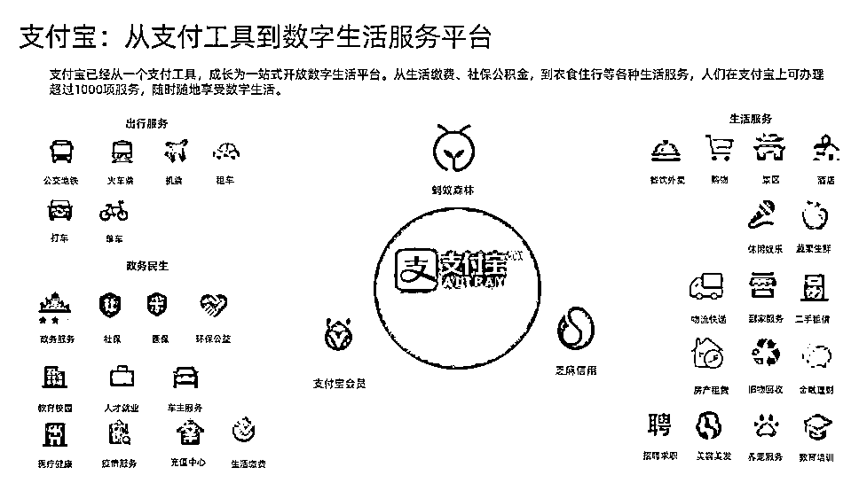

按官方口径，份额靠前的几类包括零售、餐饮、医疗与健康、城市服务、共享租赁、交通出行等。入口侧则分两块：到店扫码（较上年同期 +100%）和线上搜索（较上年同期 +87%）。

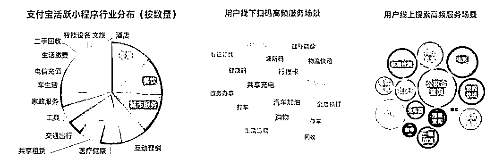

再看几个份额不算高的类目——白酒类批发、回收、空调清洗——跑出来的数据其实也不难看。所以开头我才反复说明：我的成绩受所处赛道影响，只作参照，方法和关键动作才是重点。

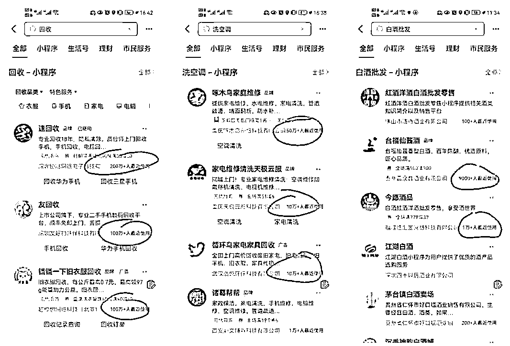

**3. 支付宝的流量盘子怎么分**

可以拆成内、外两部分。内部指商家平台、开放平台后台里能自己动手配置和运营的那些功能；外部指阿里系其他产品可以打通的入口，像 UC、夸克、高德，一旦接上，流量能翻着番涨，不过落地要靠技术开发。

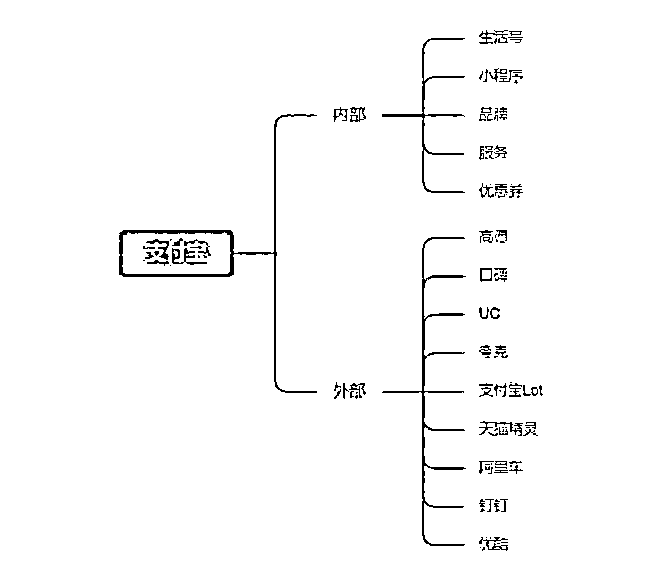

**4. 被动流量的实操手册**

**4.1 平台内部的流量**

连公域的门朝哪开都不清楚，私域运营就无从谈起。做支付宝也是同一个逻辑：第一步把公域的入口位置摸清。它跟🛰️不太一样——支付宝更强调“入口铺量 + 小程序做承接”。小程序不会写代码就交给外部团队，有技术就自己上。我做跨端联动时也拿小程序当承接载体，比如同一份内容分发到多个渠道，再把公域的人导进自家私域。

整套路径是：公域负责拉人，私域负责承接、成交、唤回、复购与转介绍。

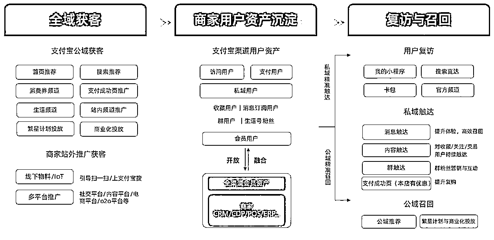

**公域部分：**

入口有首页推荐、支付成功页、搜索推荐、生活频道、消费券推广、会员频道、商业化投放、繁星计划投放等。

**1. 首页推荐**

H5

系统会按人群画像做个性化首页推荐。只要符合准入规则、素材过审，就有机会被推上首页。

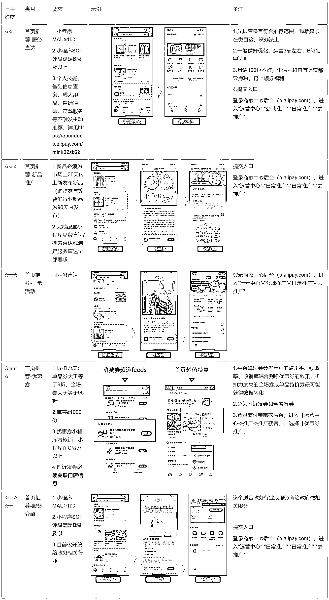

**2. 搜索推荐**

H5

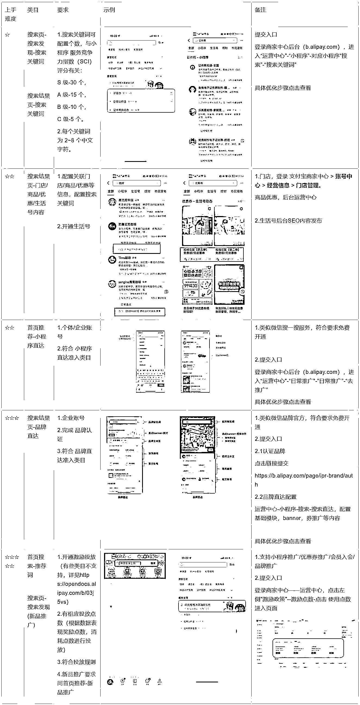

这是普通人也能玩的 SEO。

**1. 搜索关键词**

一部分搜索词带类目门槛。想让曝光最快落地，抓手就是关键词：进入“运营中心”—“小程序”—选中对应小程序—“搜索”—“搜索关键词”—“添加关键词”，单个小程序上限 15 个词。

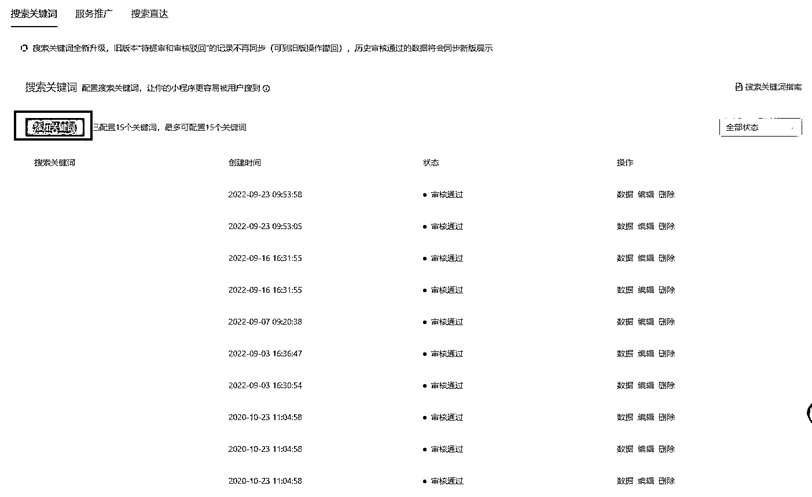

第二步，看看同类目里哪些词在涨、哪些词长期霸榜，挑合适的提交上去。

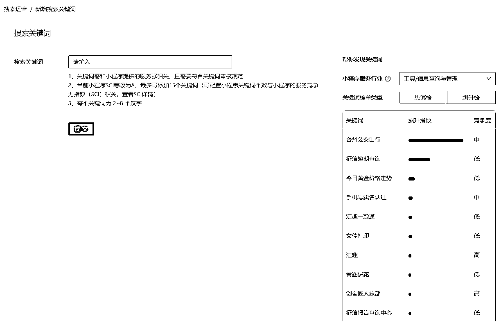

过审后就有曝光机会。

真正的重头戏是关键词维护：定期看数据、定期替换，这才是 SEO 的功夫。在“数据中心—小程序分析—搜索—用户搜索词—曝光用户数（倒序）”里筛出一段时间内被搜得最多的词，补进上面的关键词列表。反复看、反复换，把没量的词踢掉，让挂着的 15 个词长期都排在热门位置。

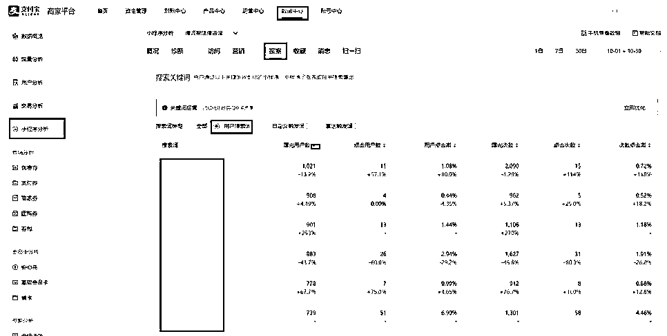

**2. 品牌直达**

运营中心—小程序—搜索—搜索直达，把基础模块、banner、券推广等配好，服务、小程序、生活号、优惠券可以同屏展示。

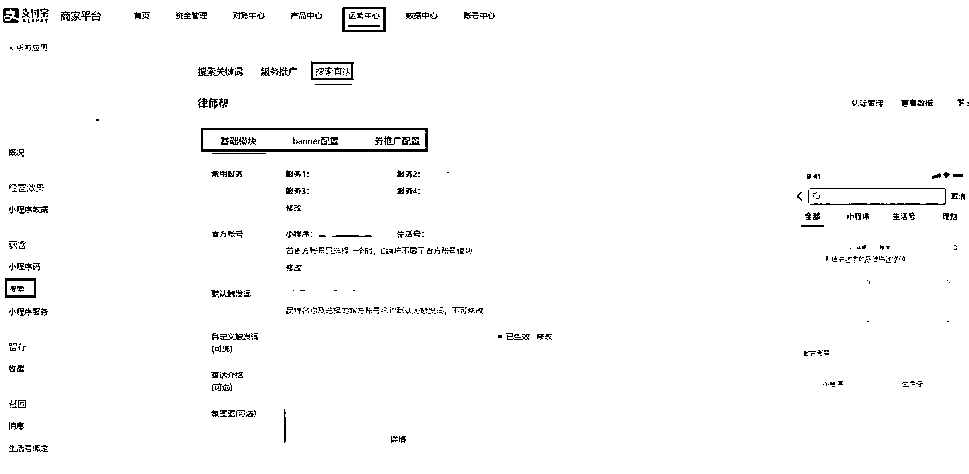

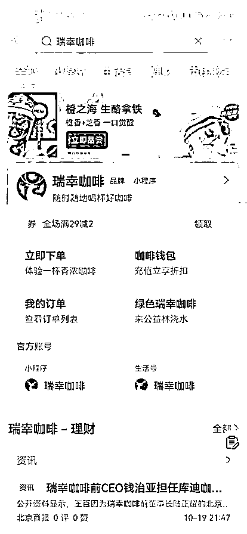

**3. 小程序直达**

入口就在关键词旁边，属于服务推广。一个服务能建 3 个服务关键词，多一次被搜到的机会。

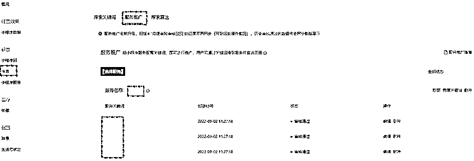 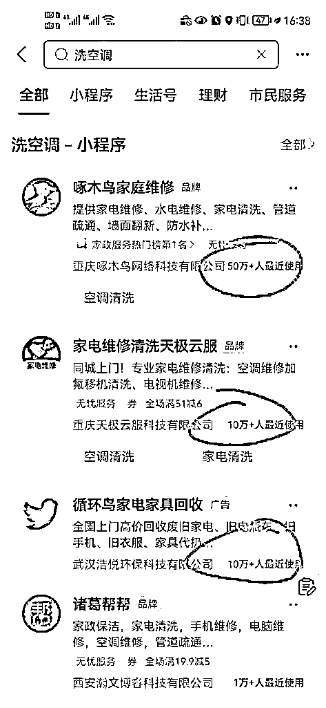

按页面要求填好服务信息提交，通常次日就有结果。比起🛰️搜一搜，这里的过审率要友好得多，而且服务可以多平台创建（高德、UC、夸克等，这块留到外部流量再展开）。

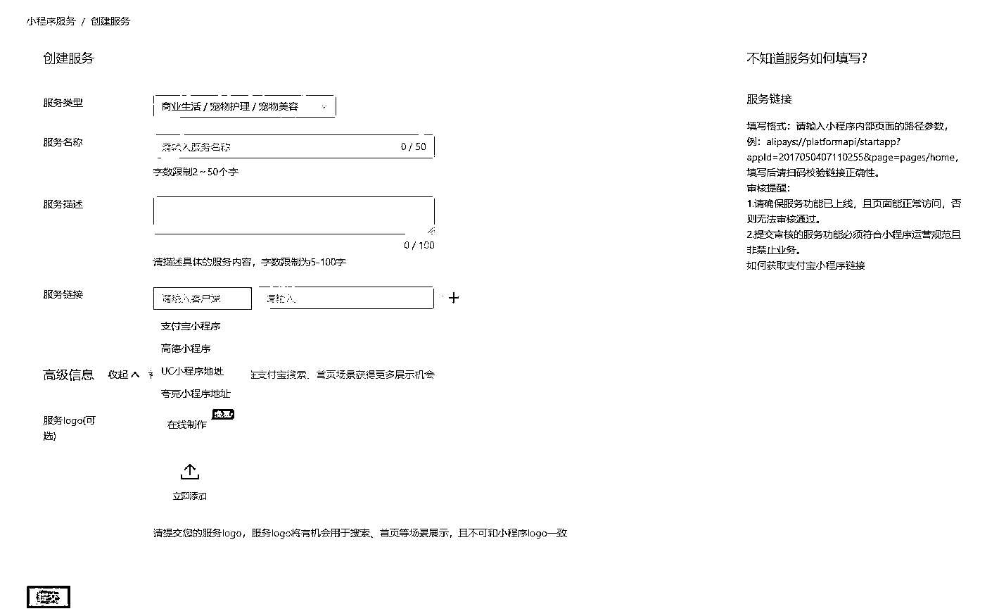

**3. 消费券推广**

H5

靠营销权益帮商家拉新、促成交。配置入口：运营中心—公域推广—优惠券推广／会员卡推广。

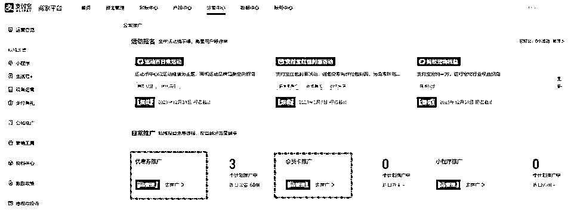

可露出的位置有：支付成功页（支付有福利）、消费券频道的推荐流、首页超值特惠、搜索结果推荐。

活动玩法覆盖拉新（直领券、团购券）与复购（券包）；会员玩法覆盖入会礼、安心充留存、付费会员卡特权。

投放半径上，可选门店周边 3—5 公里的附近发券，也可以锁定一座城市做全城发券。

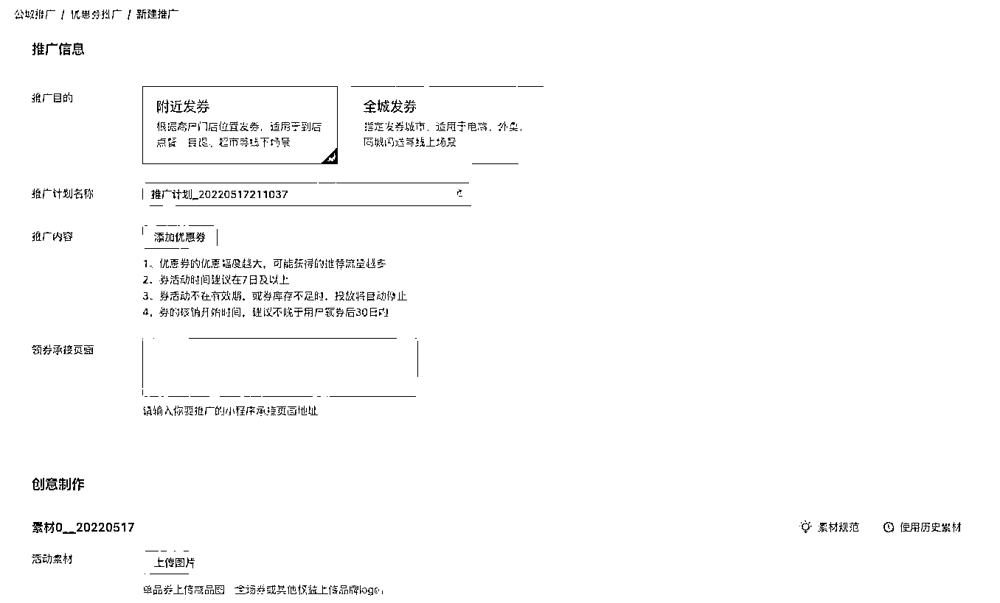

**4. 支付成功页**

H5

付完钱那一屏能承接优惠券：既能把自家券摆出来，也能在别家商户的支付完成页露出你的券，拉新和复购一起做。

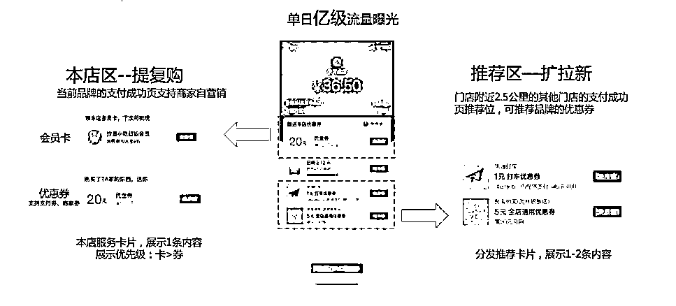 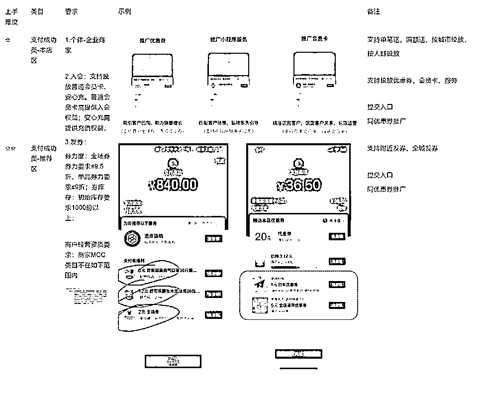

**5. 生活频道**

H5

围绕生活号的内容（视频、笔记、直播、图文）做展示，并可挂载服务、小程序、POI，体验上接近抖音。这一块我挖得不深，有兴趣的可以自己试。

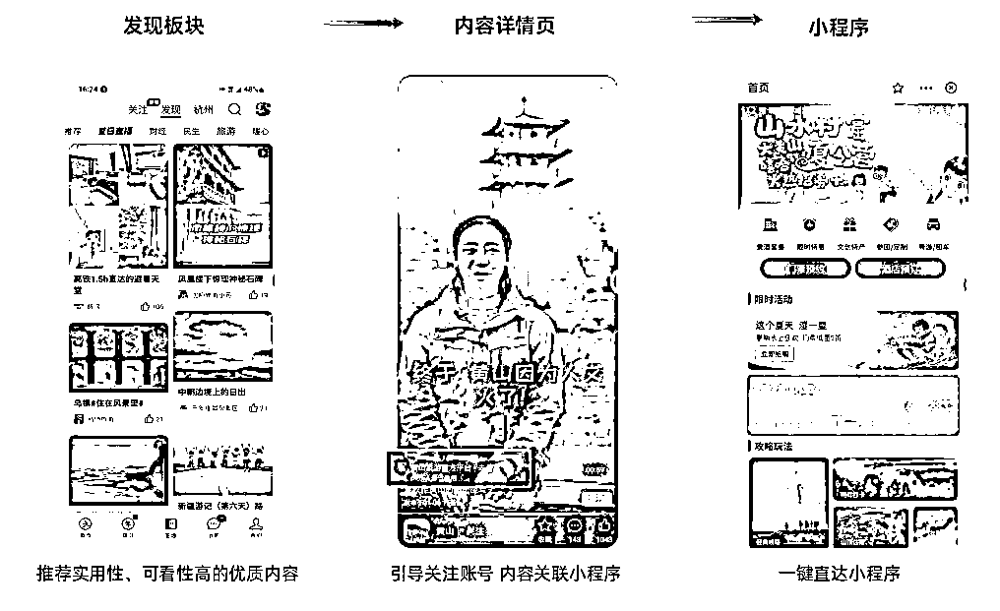

**6. 会员频道**

H5

把前面的推荐、搜索玩法与线下场景接起来，会员的全生命周期就能管住。会员卡形态与🛰️接近，但优势在于付费、储值能直接跑通，开发量省不少。

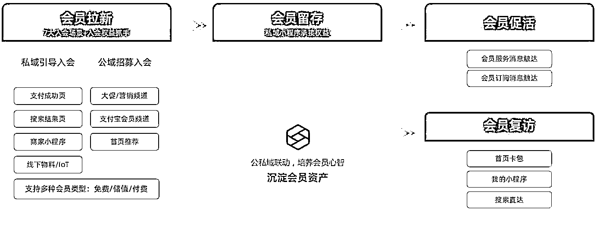

常见三条线：

- 拉新：公域投放、搜索露出、接入 IoT 支付、支付推荐等手段，从公域把会员捞进来；
- 留存：把权益配齐，比如入会有礼（支付券、商家券）、充值即会员、付费即会员；
- 促活：在首页和消息通道推送支付、会员、优惠券等信息（思路类似🛰️模板消息），也可以让会员卡一键跳小程序。

**7. 繁星计划投放**

H5

这是给商家的公域投放激励：用激励点数在投放位推广，覆盖首页、消费券、搜索页、搜索结果页、支付成功页等，细则可回看搜索推荐那部分。报名入口：https://b.alipay.com/page/policyCenter/policyContent?policyCode=20211229294532574&policyType=FLOW_POLICY&policyVersion=0

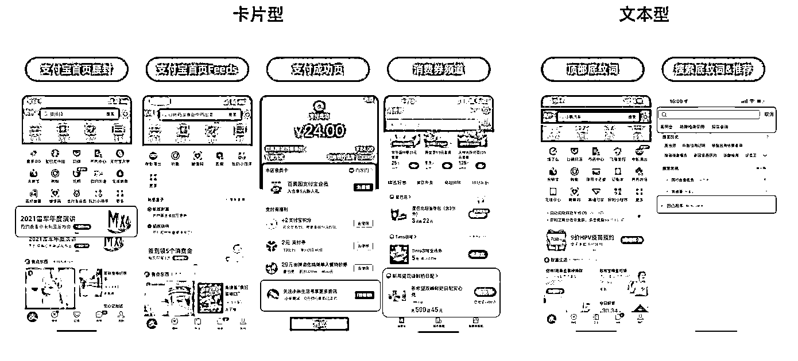

**8. 商业化投放**

H5

逻辑和🛰️广点通相仿，计费方式有 CPC、CPA、CPM。后台：https://adpub.alipay.com/

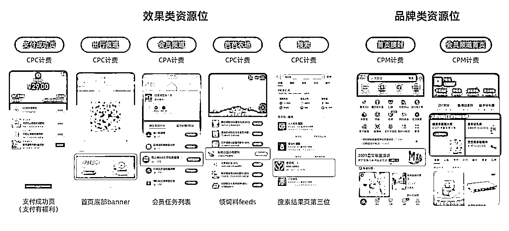

**私域部分：**

可用的抓手不少：生活号、小程序、收藏引导、订阅消息、群用户、商家会员、门店、线下物料、IoT，以及社交、内容、电商、O2O 等多平台渠道。

其中生活号值得单独说。

H5

1. 首页可以默认展示品牌信息，服务、优惠券、小程序、商品一并铺开，用户一进来就能完成第一轮转化，形态上接近抖音蓝 V；也能把官方小程序设成首页推荐。
设置：运营中心—生活号+—主页设置。

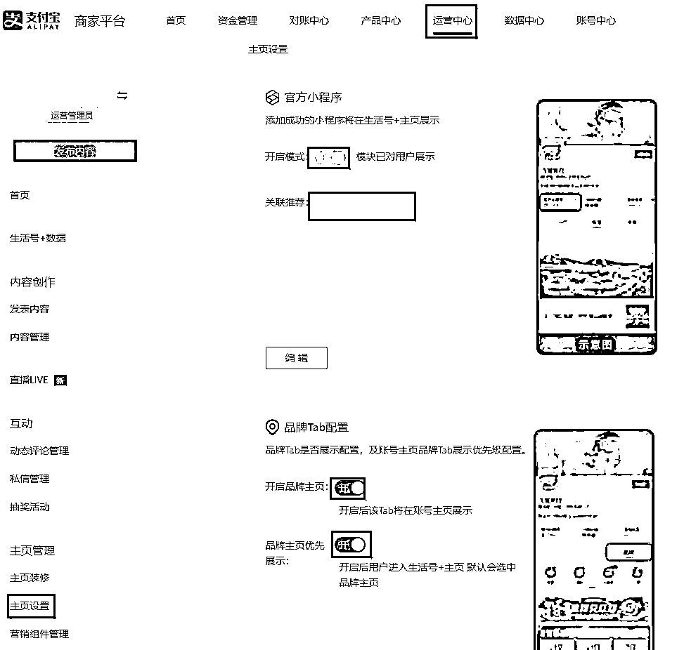

2. 直播
眼下无人直播的约束不算多，做这行的可以顺手把内容同步过来。

3. 主页装修
优惠券、咨询、小程序都能灵活跳转，对小程序转化很友好。配合生活号运营，小程序的服务和券数据会被带起来，反过来又利于推荐和搜索展现。可配的形式包括图片式菜单、广告横幅、营销组件、商品组件、PK 投票、服务组件、生活圈、自定义菜单、外链等。

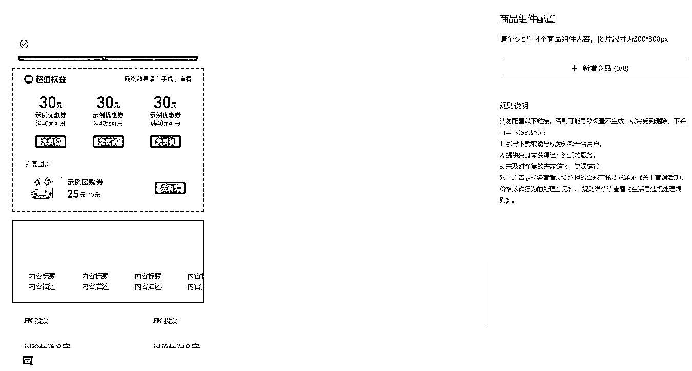

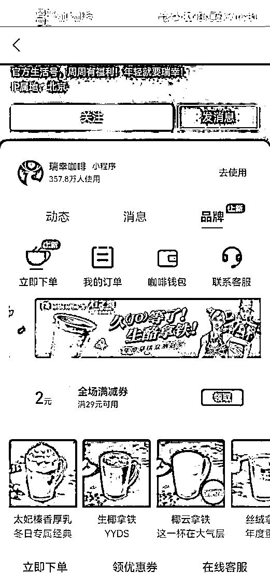

4. 外链直发
与👸号不同，不用第三方开发对接，群发就能直跳小程序、卡券；关注、菜单、关键词回复也都能把用户送到指定落地页，且支持群发。
配置：生活号+—素材管理—新建图文消息—跳转到网页。

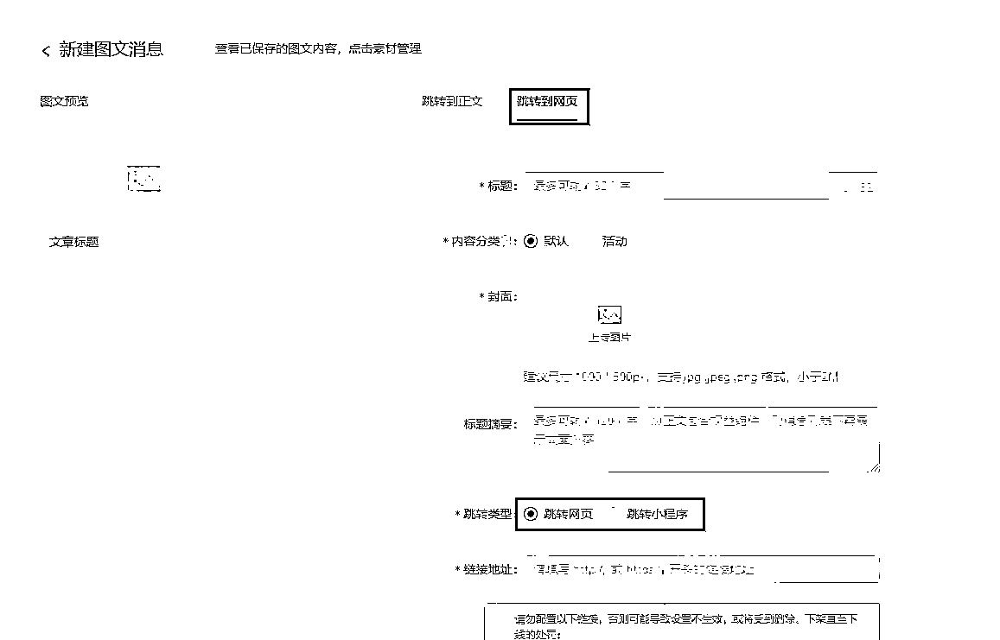

5. 几个趁手的工具
抽奖活动、关注有礼（等同👸号的关注送券，后台直接建，无需对接）、关注组件（小程序、H5 一键关注生活号）、生活号服务、卡券。用活了，对私域帮助不小。

**4.2 平台外部的流量**

前面提到的流量盘子还记得吧？支付宝生态外的不少渠道都能打通。

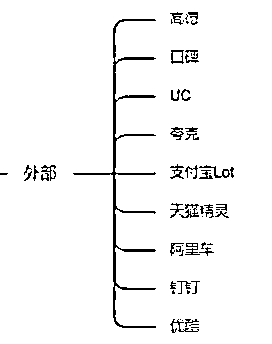

拿小程序举例：

1. 登录支付宝开放平台 https://open.alipay.com/，小程序能同时发布到多个平台，一份内容多处吃流量。

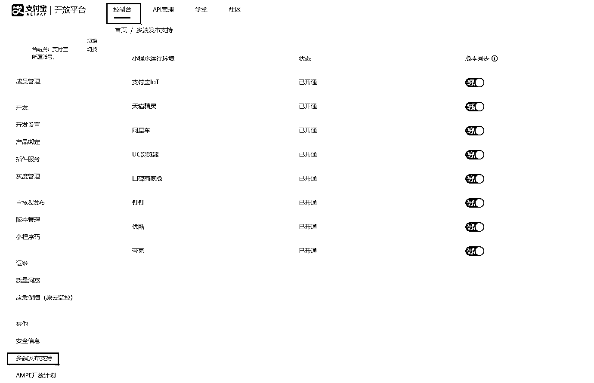

2. 建小程序服务时可以往多个平台投（同一条不能重复投），借其他产品的搜索流量顺手捡用户。

3. 平台生态还能做深度对接。以高德为例，它开放了接口，小程序数据可直接通过 POI 呈现。假设你手上是个家政平台小程序，接上高德后，每家已入驻的家政门店在高德上都能展示你的商品，你等于坐着抽成。

个体户或普通门店，按我之前在“实体店如何有效互联网化”里的说法，把口碑等商家能力开通即可，系统会自行向高德同步，地图流量直接转化为基于位置的订单。

（表格或配图异常时，可回看文首的原文链接。）

评论区：

糯米糕：支付宝小程序加生活号这套被动引流的数据很能打，对实体店来说就是实打实的钱。

封伟-自动化变现：谢谢支持，营销玩法本身很多，只是愿意深挖的人少，竞争压力不大。

潮州痞子蔡：想问下单是在小程序里直接完成的吗？你做的是哪个类目？

封伟-自动化变现：小程序内下单，做的是商业咨询。