# 门店做线上：九成老板堵在这几处

不灌水，摊开就讲。

**把基础信息搬上线**

这块藏着一堆常被跳过的门道，从最早办执照到后面备物料，挨着捋一遍。

**1.工商注册**
看着跟网络工具没交集，可你要是想让搜索引擎多待见几分，取名那会儿就该把行业词塞进去。日后无论开通抖音号、认证👸号和小程序，还是入驻美团，搜索表现都能沾光。
拿👸号排名说事：有商家用公司抬头去认领“红包”这类敏感词，硬是白捡了一大波自然流量。
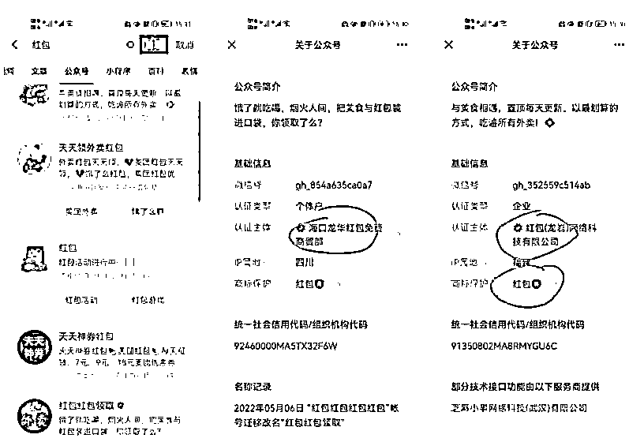

**2.商标授权**
走加盟或特许路子的，手上有品牌方的授权文件，拿去办账号认证，官方背书和搜索流量等于一并借来。
看个实绩：某品牌的抖音榜单里，一位个体经营者坐到了全国第三。
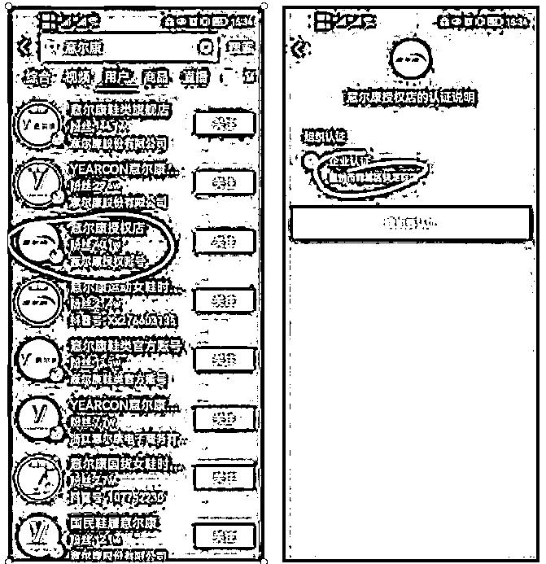

**3.地图标注**
常规打法就三个口子：高德在自家App内提交；腾讯地图走“腾讯位置服务”👸号；百度地图也在App里标点。三处齐活，日常够用。
全网渠道名单就长了去了：高德、苹果地图、百度地图、🛰️位置、腾讯地图、朋友圈、企业🛰️、🐧空间与🐧地图、TM、闲鱼、滴滴出行、西瓜视频、携程、高铁管家、花小猪、货拉拉、陌陌、饿了么、哈啰出行、快手、📕、🧣、大众点评、曹操专车、快狗打车、哈啰顺风车、58同城、T3出行、凯立德、阿里巴巴，另外还有抖音位置（设行业门槛，部分类目收不进来）。

材料先备齐，再逐个平台递申请：
①门脸照，左、中、右三个面各拍一张
②标注名，尽量和门头招牌写法统一
③完整文字地址（省份、城市、区县、街道、门牌号）
④门店座机或联系手机
⑤精准定位
亲自动手的话，材料没错，一般工作日当天就批下来。

**4.号码标记**
电话打出去，对方屏幕能认出这是哪家店、做什么的。
可用的口子：
腾讯手机管家号码公众平台 https://yun.m.qq.com/
360来电通 http://dian.360.cn/
百度号码认证（收费）https://haoma.baidu.com/home

反面例子来一个：家里装修那会儿接到自称家具厂售后的电话，屏幕却标着“月饼配送”，我二话没说就掐了。这号码要是拿去做外呼销售，名单再准，也白白漏掉多少单子。

**彩铃与400号码**
等待接通的空档，可以播自定提示。客服线尤其值得做文章——按不同时段、不同进线渠道换话术，比如下班后自动切到“加🛰️/关注👸号”的引导。
挂机短信：通话一断自动推一条短信，具体找服务商开通。抖音自带免费挂机提醒，蓝V账号可直接用。
🛰️通话/视频铃声：等待期间循环你设好的广告音，企业宣传、IP曝光都合适。
操作路径：先把指定铃声视频发到视频号；再进🛰️“我—设置—新消息通知”，找到“提示音与铃声”，点“来电铃声”，选“更换”，搜索该视频号的那条视频。
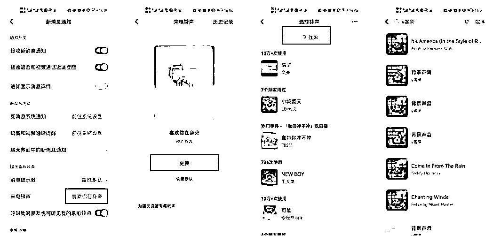

对了，我们按不同实体行业做了个广告铃声生成器，内置各行业的现成文案，改几个字就能出片，直接传视频号，省时省力。
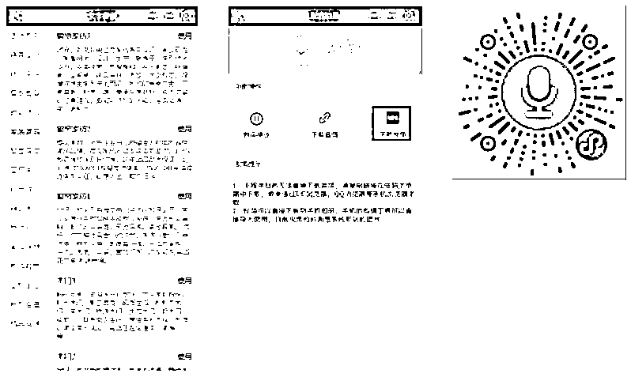

**5.物料**
包装、车贴、冰箱贴、广告牌、灯箱、DM单、小票、展架、大屏。
主流玩法有：动销抽奖、产品溯源、扫码抽奖、签到抽奖、大屏抽奖/签到墙。
自家有产品、或者能左右包装设计的，用动销抽奖、溯源、扫码抽奖来攒客户。没有自有产品也不打紧，小票这类载体同样能承接转化，把人引到线上完成下单与服务。
参考案例：某螺蛳粉品牌在包装里塞了张卡片，扫码攒积分兑换。可惜门槛定得偏高，营销效果打了折扣，这点该向蒙牛取经。
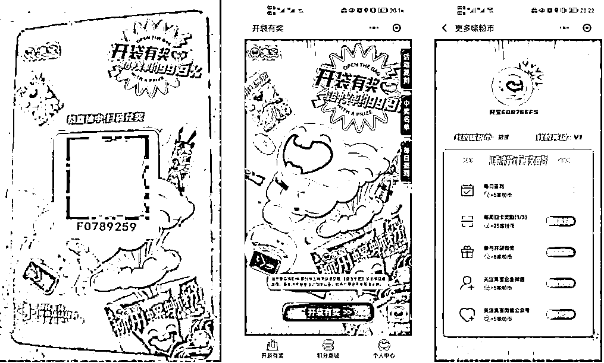

提醒一句：包装上的码建议用活码，落地页在后台随时可换，万一出岔子不至于整批物料作废。
我们自己做产品时也玩过类似套路，跟合作的厂家在包装码上互相导流，凑成组合套餐去攻市场。
既然聊到物料，顺手安利个免费海报工具：🛰️“收款小账本”小程序里的海报中心，操作傻瓜化，比那些张口就收费的同行实在多了。嫌模板不够，再去美图秀秀补。
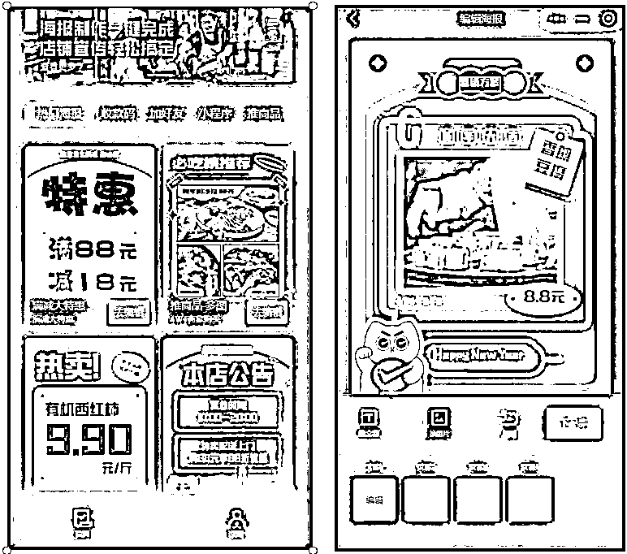

**公转私**

**1.同城社群**
企微群、🐧群、豆瓣小组，这几个是主战场，混进去就有机会捞人。
🐧群此前写过，这里重点讲开放式的同城🛰️群——能直接搜到，进群率百分之百。常见入口有：银行（招行等）、出行App（高德、滴滴）、连锁品牌（瑞幸、唯品会）、本地生活（罗森、哈啰）、商超（沃尔玛、永辉）、商场👸号、社区团购（美团）、快递站点、餐厅点餐码（部分设置成关注才进群）、小区业主群等等。
挑与你客户画像对得上的群进。
想用一个码进多个群也行：企微群多用活码，换几个账号反复扫，会跳到不同的本地群，实际拿到的群数远超二维码本身的数量。
滴滴同城群：
瑞幸同城群：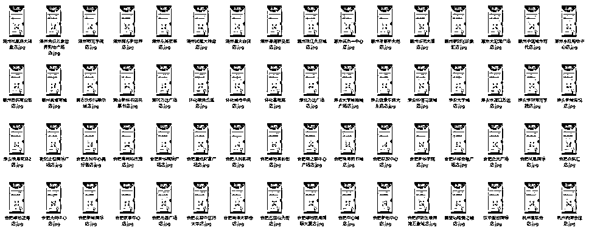
永辉同城群：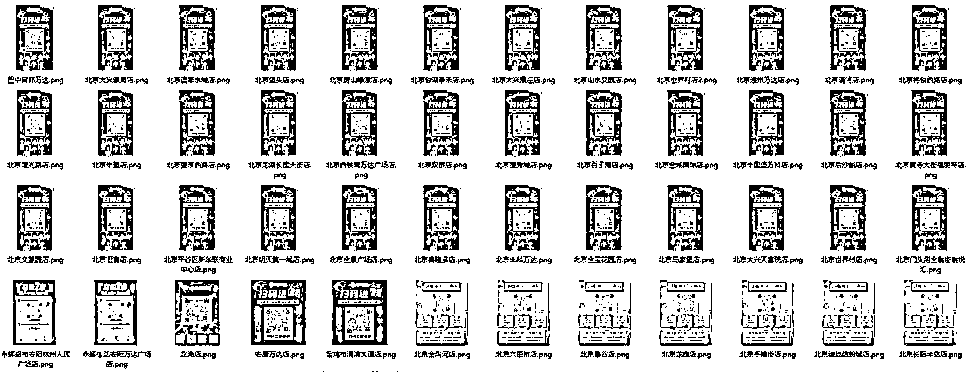

**2.同城活动渠道**
豆瓣、🐧、地方论坛（三四线城市尤其值得看，用户注意力虽被切碎，但本地论坛和社群里的人气仍在）、本地生活团购平台（多为本地站长依托自有平台孵化，入驻成本远低于美团）、物业社区、垂直平台的同城分站（例如妈妈网重庆站）。
两个重点：
豆瓣同城——活动建好后反复更新举办日期，把浏览量刷上去，排名很容易靠前。
本地生活团购——之前给一家理疗店做线上引流，对接的是当地“企鹅生活汇”，爆款活动免费上架（平台零入驻费，只抽佣），再配合其他优化，那个月业绩直接乘以十，老板从一脸愁容变成了笑脸相迎。
顺带说个不要钱的团购去处：
美团、抖音之外，支付宝口碑是免费的，而且开通后会自动同步到高德，用户在高德上就能直接买单。
本月我接到一通电话，正是那位康复理疗客户——有人在高德上下了单，主动上门核销，他既惊喜又纳闷，追问我这推广是怎么做的。
类似地，飞猪、同程等也会往高德同步，做住宿业的别错过；其他业态也不妨去高德搜一搜自己。
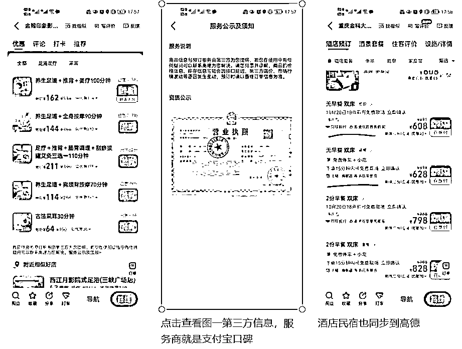

**3.自媒体**
转不进私域的流量，等于白做。
投放这块不细说了，预算充足再试，配合门店活动去打，通常选本地👸号和本地团购号。
重点两条：

**线上怎么把人引到店**
支付宝生活号/小程序：与口碑、收银打通，全平台公域发券，眼下只有支付宝能免费实现，做连锁品牌的要上心。
附近的小程序：支付宝和🛰️都有入口。
百家号、抖音、快手、📕：门店、团购、电话一触即达。
百家号知道的人不多，用“地域名+关键词”做认证，很快能挤进首页，搜索表现相当能打。
支付宝的券玩法花样繁多，高频复购的老板别视而不见——首页、品牌区、支付成功页、生活号、小程序，处处可发。
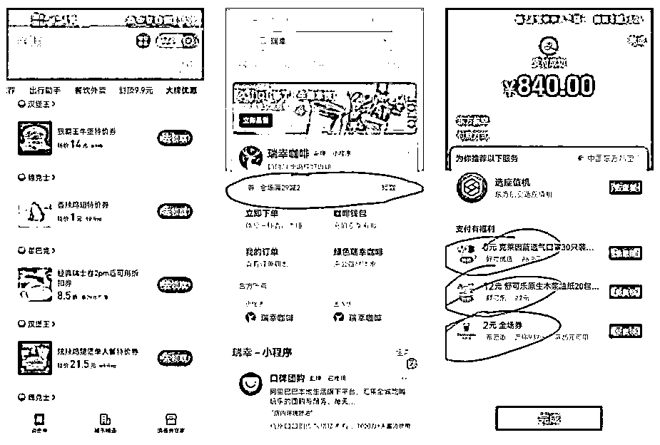

百家号认证后，百度移动端和PC端首页都能露脸。不过在我看来这次优化并不彻底，菜单、品宣位、自动应答这些能往私域导的口子全空着，堪称反面示范。
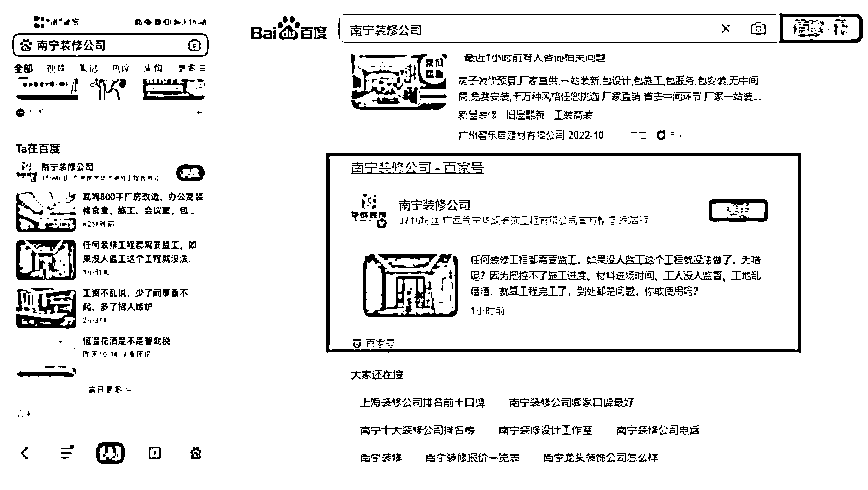

**自媒体丝滑转私域**
讲自媒体引流的文章一抓一大把，简介挂链接的招数也不新鲜。既然我们专做自动化转化，就掏点顺滑的路子——一步直达个微、企微、👸号、文章、H5、🛰️群、视频号、🛰️客服。
各平台可用的口子：
抖音：私信、菜单、群聊、抖店、门店、团购、电话、App
头条号：菜单、关键词、电话、私信、机器应答
百家号：门店、电话、菜单、私信、机器应答、关键词
快手：私信、电话、小程序、App
🛰️：视频号、小程序、👸号、搜一搜服务
支付宝：口碑、生活号、券、小程序
📕：门店、电话
🧣：私信、文章、关键词
以电话为例，前面说的挂机短信与铃声就派上用场了。
再如抖音、头条、百家号、快手、视频号、支付宝的机器应答，都能直接引导加🛰️。抖音上我们备了好几套工具，卡片形式转化效果最好；私信自动承接则可全自动跑。
https://p9rxk6ovll.feishu.cn/docx/B7QvdusuHo9IyoxDal2c6n7Gnkb#BUoWdIqCso8wuixuWSGc4bTUnJb
🛰️搜一搜服务同样值得做，本地服务上线即可承接转化，装修、搬家、培训这类都适用。详细打法见我旧文《躺获20多万用户后，细谈🛰️搜一搜服务通关攻略》。支付宝、百度也有类似入口。
有谁想得到，一个上门维修业务在支付宝能攒下九万多次点击。
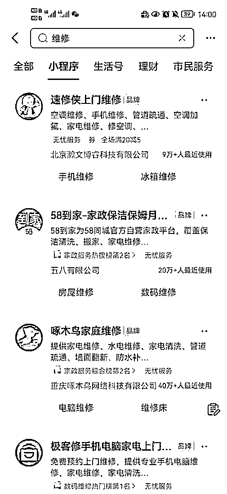
我们花两周在支付宝做优化，免费周曝光从零拉到了一万，后续单独开篇讲。

**活动运营**
常见套路：红包拓客、阶梯拼团、报名拓客、商家联盟。
拿红包拓客说，让员工和合作商家去卖活动卡，触发一级裂变，佣金自动进🛰️零钱；老客带新客形成二级裂变，佣金同样自动到账。
餐饮、美业、休闲娱乐等行业的客户用这套打法，一天稳定新增三十到八十个客源，还多是三四线的小店。
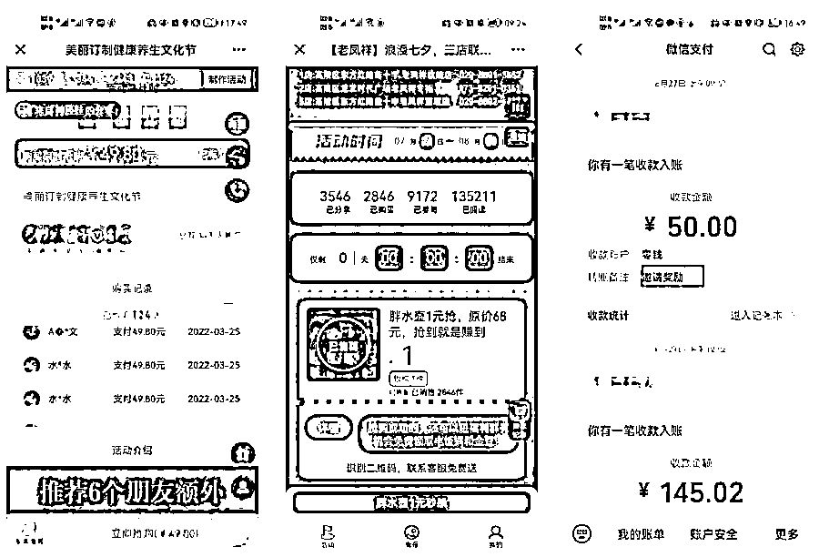

**场景构建**

**进店/询价**
个微：加好友给会员价。用的就是🛰️“收款小账本”里的朋友会员功能，把权益配好即可。
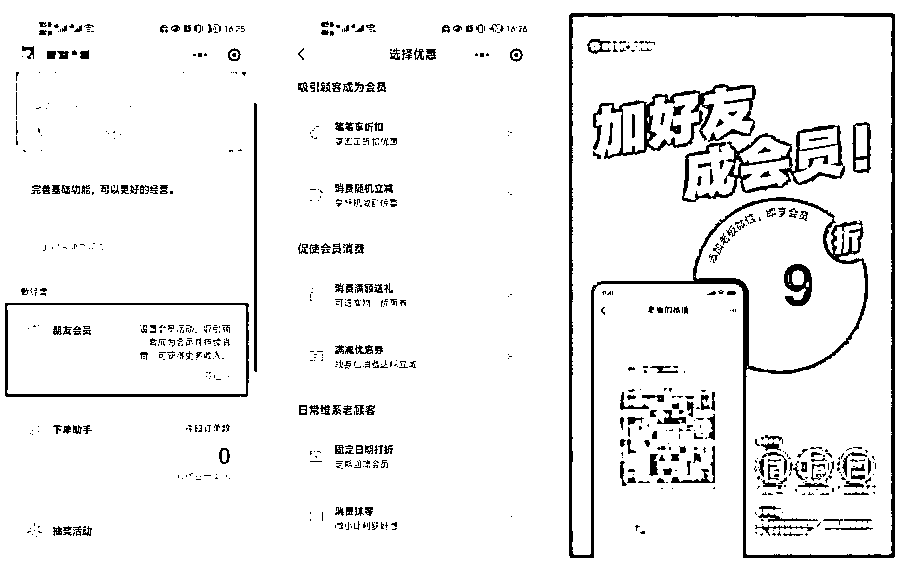
企微：自动应答，发福利、拉群。

**线上下单**
支付宝端，免费的用口碑足够。
🛰️端，免费的用官方“收款小账本”，钱直接进零钱，开通流程极简。
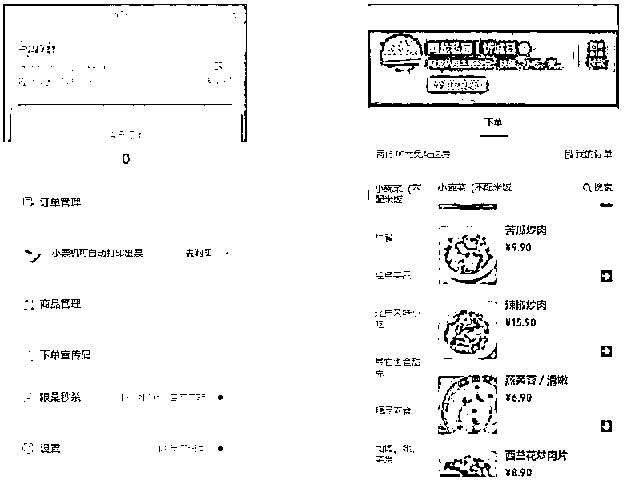
建议先拿免费工具跑单，模式验证了再谈开发小程序。这类开发虽不算贵，但小店前期真没必要。
之后要花钱了，先想清楚功能服务于什么——引流？锁客？裂变？全员分销？复购？还是老带新？

**支付环节**
付完款引导加🛰️、进群
付完款弹出视频号/直播预告/小程序
付完款展示广告或跳营销页
付完款自动塞券或赠品，券和奖永远领不完
我们是支付服务商，有开通需求可联系。以🛰️为例：
支付后推小程序
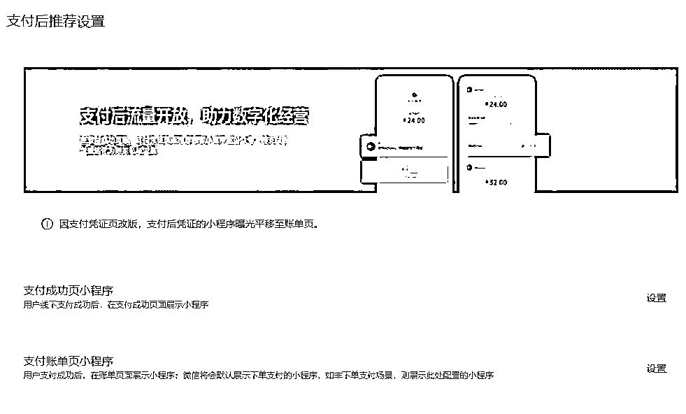
支付后展示视频号、视频、直播
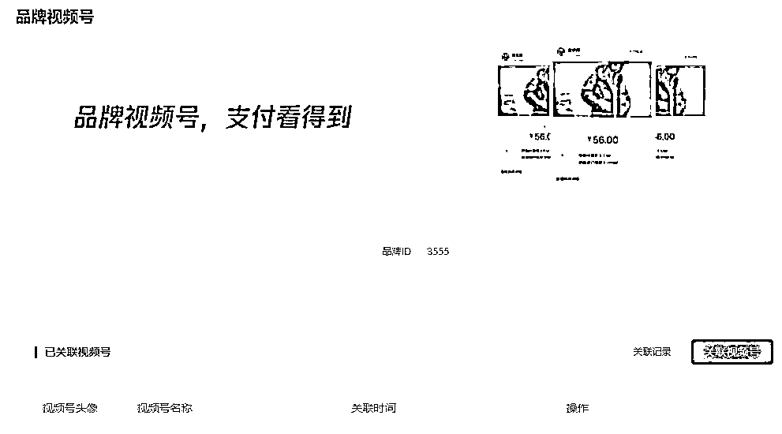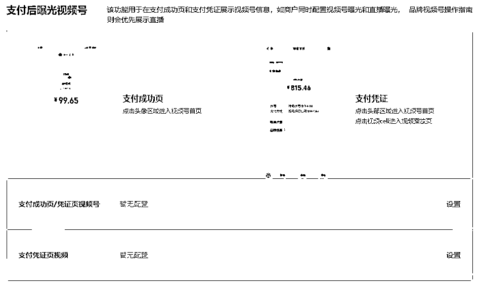

**扫码点餐**
扫码时先判断是否已在私域，没加的先自动推送点餐链接。
餐饮行业尤其适用。
案例：新客扫码点餐流程，先把人转进企微，再由自动应答发点餐码。
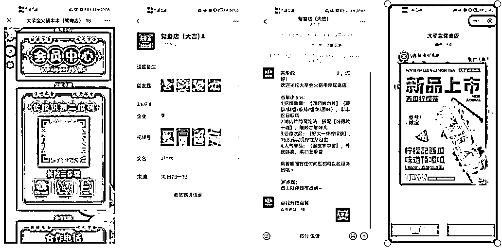

**连WiFi**
扫码关注小程序或👸号即可上网，借此入口做服务、攒用户。
酒店、民宿、农家乐、医院、商场都合适。
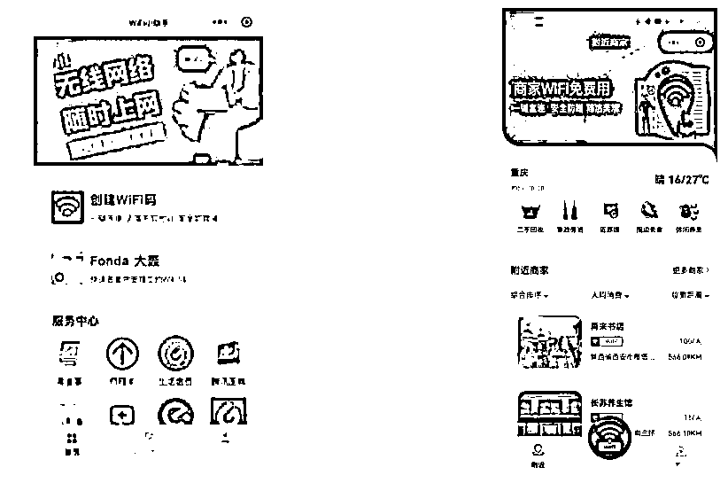

**福利与抽奖**
朋友圈那套略过。
重点讲两个：
扫码自动跳视频号抽奖/领福利（带位置和关键词，蹭搜索）
扫码自动跳抖音抽奖/领福利（带团购、位置、关键词，蹭搜索）
在此基础上还能叠加集赞等玩法，借公域流量放大裂变。
抖音活动打法，靠爆款冲到本地品类前三，听着老套，赢在细节与落地。
案例：
某蛋糕店三天卖出1001份，单场活动从线上往店里导入5000人
某脆皮鸡饭一周登顶小吃快餐榜，成了当地网红店
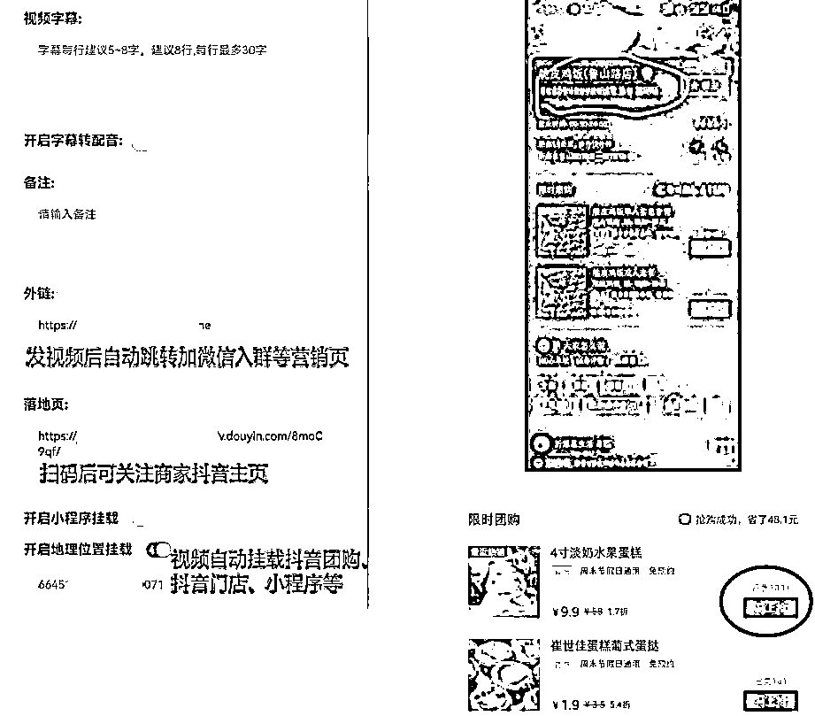

**公域里留住人**
用多端小程序铺开，渗透抖音、快手、🛰️、百度、支付宝等公域池，靠内容和活动把会员领到手，再往店里带。
案例：此前给一个火锅连锁做全网获客方案，各种玩法拼装后做成了工具。
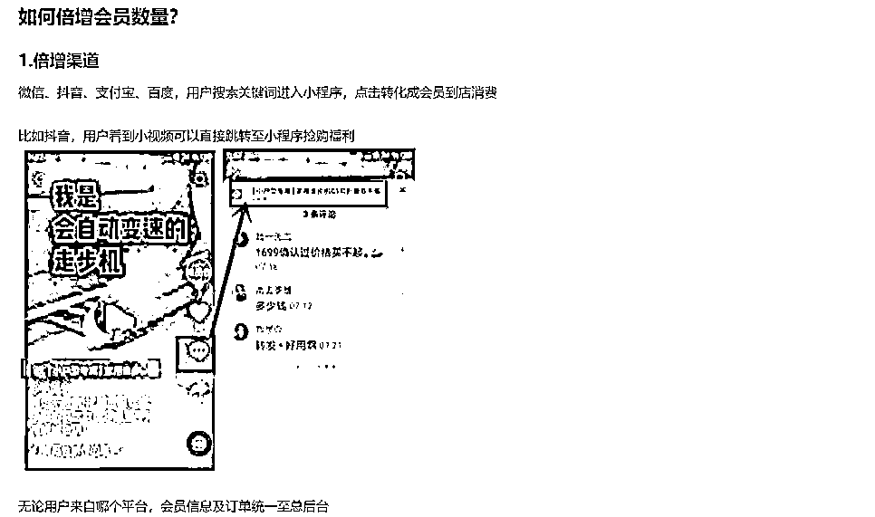
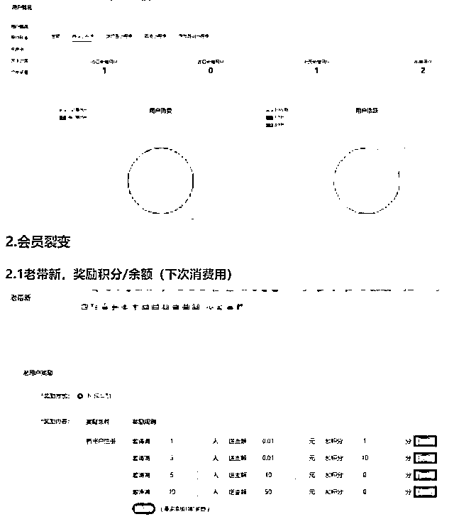
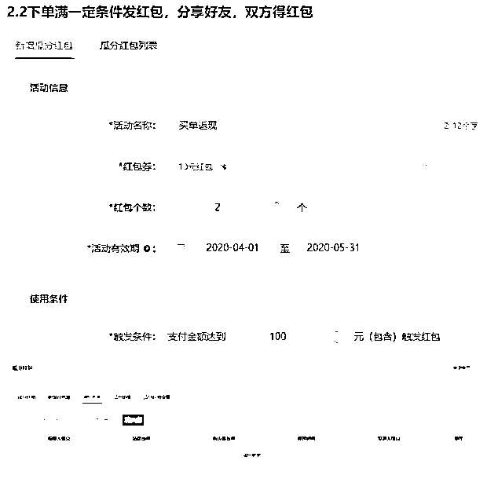
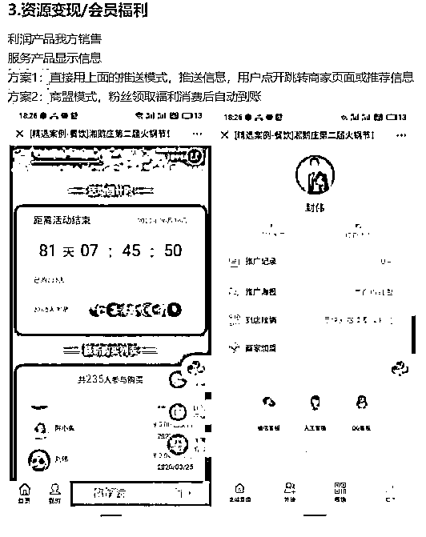
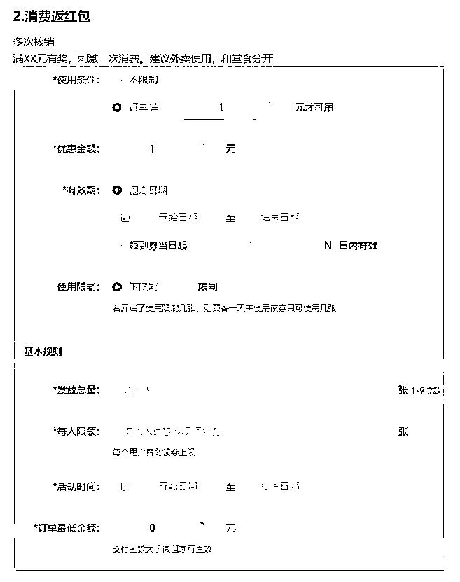
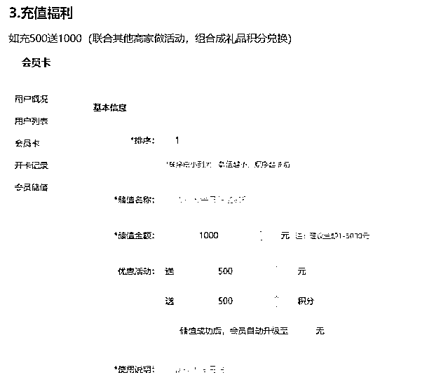
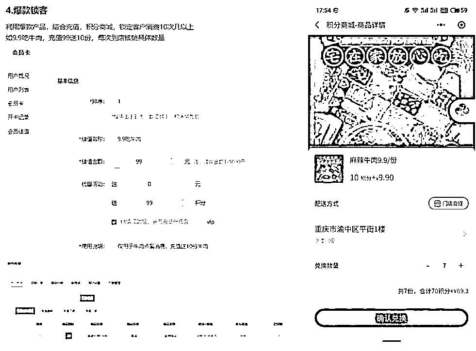

**2B营销**

**数据库打法**
2B线索一般来自四类：平台商家、地图、企业数据库、垂直网站。
平台商家：美团点评、抖音、口碑等，数据较新。美团和抖音更靠谱，点评和口碑不少店关了页面还挂着。
短板：拿到的是客服电话，不是决策人。
地图：百度、高德、搜狗等。
短板：闭店信息不更新，只适合当补充库。
企业数据库：天眼查、企查查、启信宝、爱企查等，能直接摸到法人，优先筛个体户，对接的就是老板本人。
短板：看不到销量，类目精准度存疑。
垂直网站：携程、同程、慧聪、阿里巴巴等，短板是得配采集软件或定制脚本。
我个人用企业数据库配美团居多。
例如龙哥提过的政务申报项目
https://wx.zsxq.com/dweb2/index/topic_detail/585118482242144
落到业务上，大概这几步：
挑平台：天眼查、企查查、启信宝、爱企查都横向比过，数据量与性价比双高的是爱企查，60元包月，日导出上限二十万条联系方式。
https://aiqicha.baidu.com/m/usercenter/memberspread?cq=xlTM-TogKuTw2dXN7vO2-dFYEu5HwYinjQmd&VNK=65c2add9
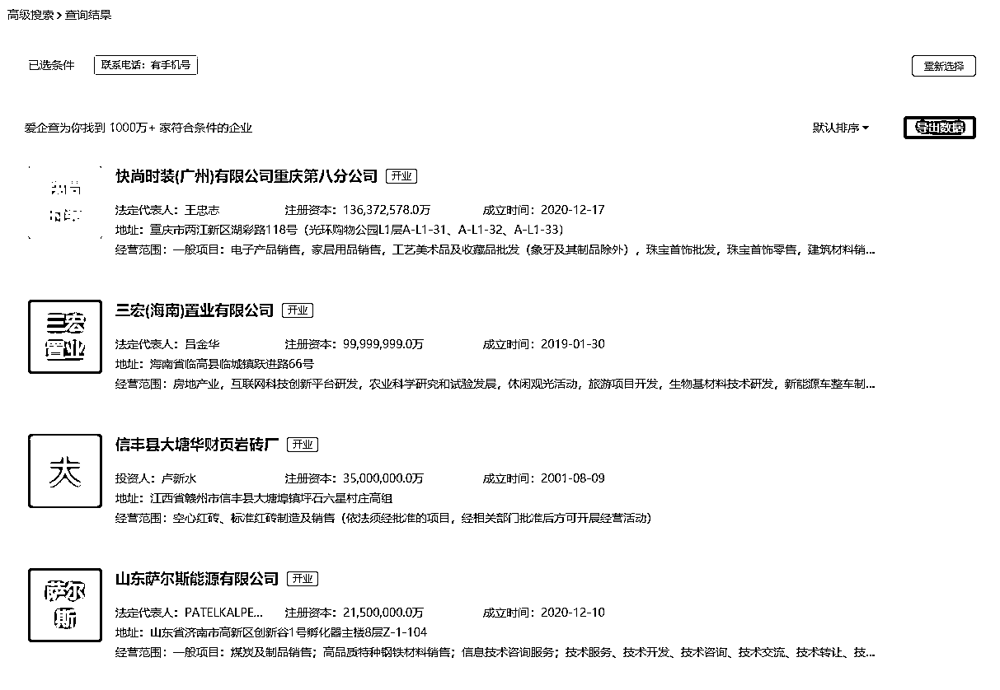
导数据：
设定筛选条件——杭州市、营业中、非个体、留有手机号、非高新企业，筛出385122条。
数据清洗：
1.用软件批量剔除未绑定🛰️的
2.清掉空号废号
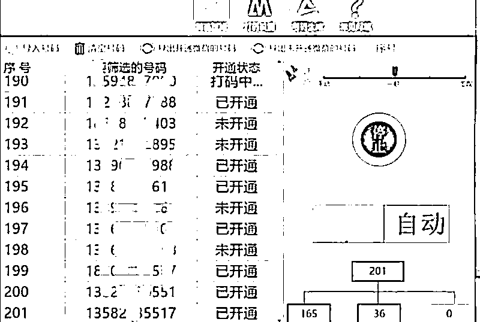
触达：
1.模板短信群发，抬头写企业名（一天可完成）
2.企业🛰️批量导入通讯录或上下游，自动加好友（一天可完成）
3.精准名单人工外呼，加负责人（分周期突击）
业务延展：
1.按可筛字段（有无高新证书只是其中一项）切项目
2.围绕现有业务做上下游延伸
3.按数据库特征匹配对应服务

**抖音线索挖掘**
抖音玩的人多，单独拎出来讲。
抓取方式大致几种：简介抓取、关键词截流、直播截流、抖音小店（热销品、店铺）、抖音门店（按区域、类目）。
**账号信息抓取：**
常见做法是借助第三方平台批量扒简介和抖音号，整理成表。市面上数据平台我几乎试了个遍，量最大的竟然不是蝉妈妈。
缺陷在于：对方主页没留联系方式，你就抓不到。
**关键词截流：**
一年前的老工具，至今仍好使，能持续动态盯住目标人群。
比较准的两条路：竞品账号关键词截流、爆款视频截流，拿到抖音号后发私信。
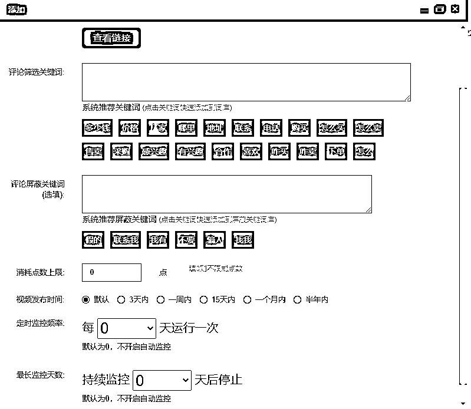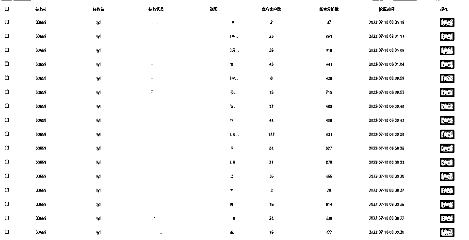
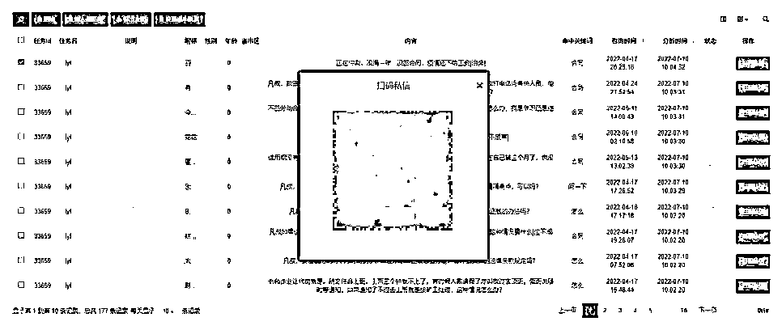
**直播截流：**
思路同上，只不过监测对象换成直播间。
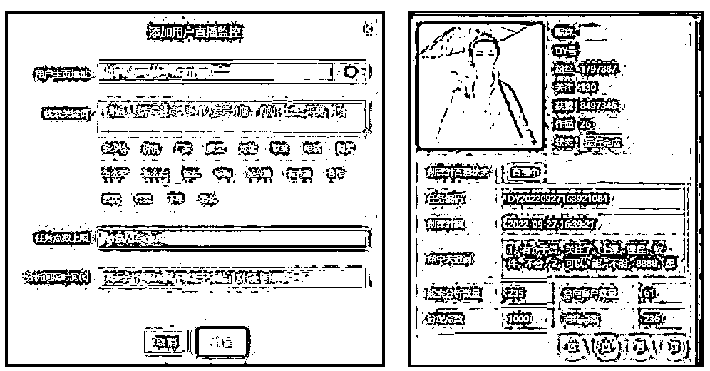
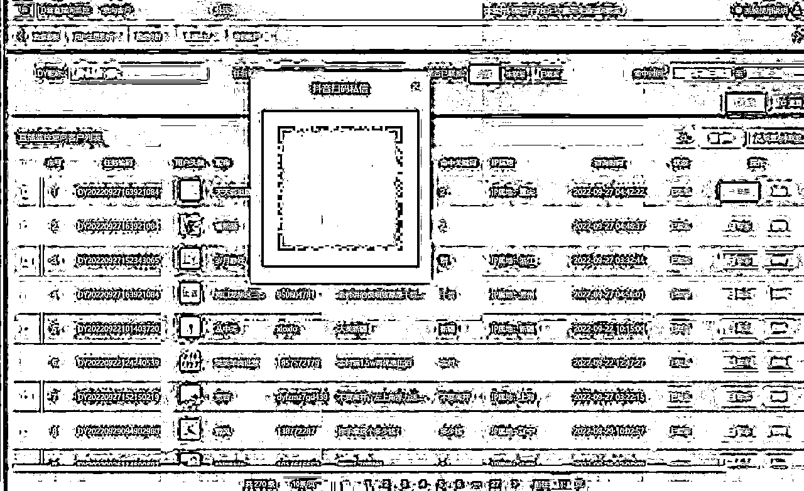
这两招的成败都系于私信能否触达，常见解法三种：
1.多账号手动扫码——免费
2.脚本定时粘贴——工具
3.App自动私信+主页留痕，中断可续——工具（推荐）
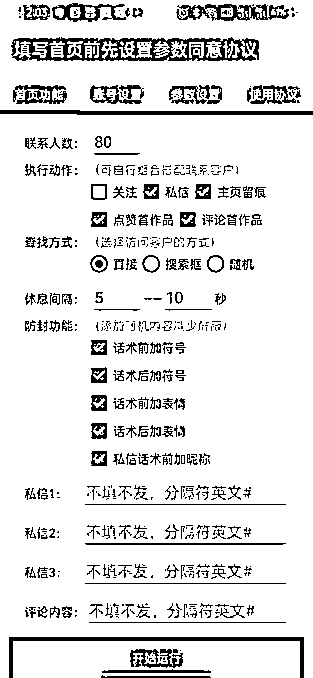
**抖音小店（热销品、店铺）与抖音门店（分区域、类目）抓取**
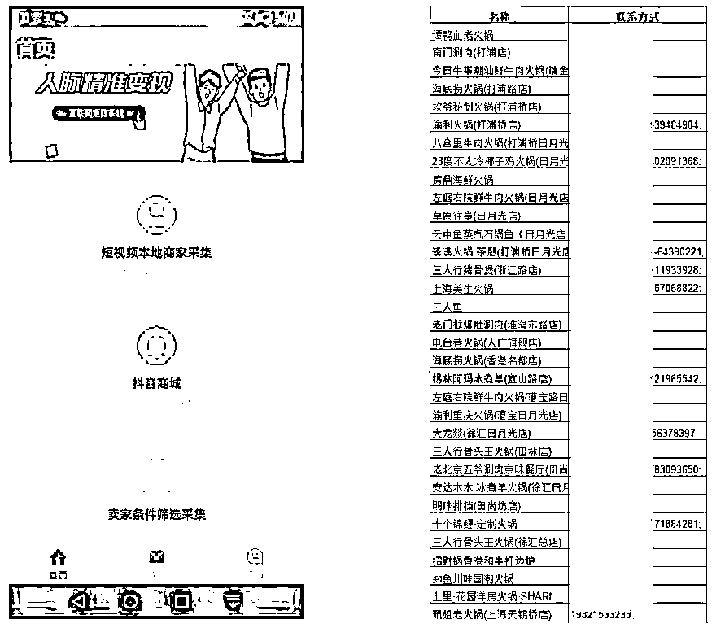
效果演示看视频
https://p9rxk6ovll.feishu.cn/docx/B7QvdusuHo9IyoxDal2c6n7Gnkb#LYOwd6IW2ooM2kxuu0lceKOmnFc

**报价单变订单**
让报价单自己长成订单。
2B下单系统有三条技术路线：
1.标品场景：客户看完报价直接下单（类似阿里巴巴，支持阶梯定价），消息即时推给对应业务员跟进。
2.经销场景：给经销商配权限，等级不同看到的价格不同，登录后才可见并可下单，支持授信与账期。
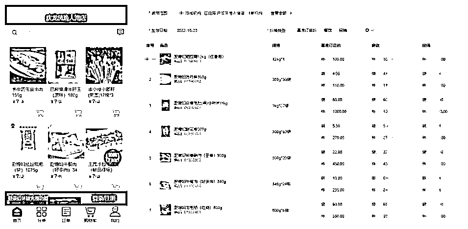
前端未登录看不到价，后台按等级管价。
3.常购清单：把每个客户常买的东西预先固化，下次一页搞定，复购和效率一起提。清单支持随时维护。
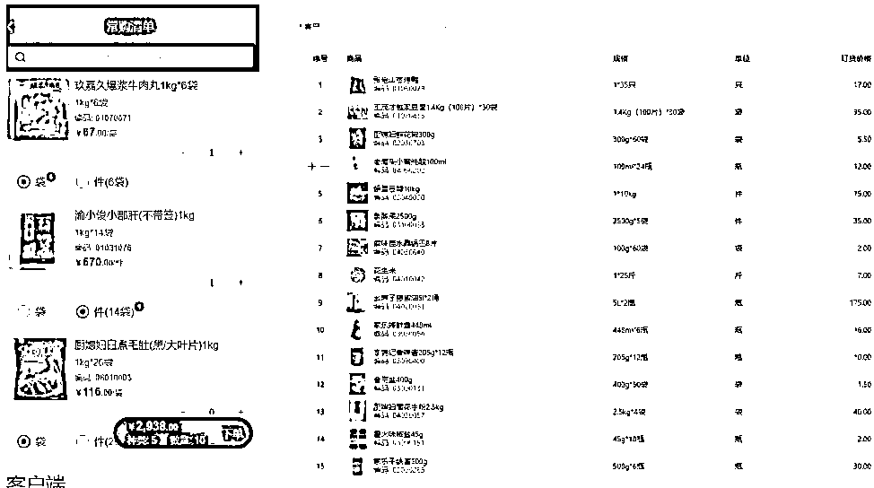
客户端一键复购，后台维护清单。
靠这套方案我们把本地经销商串了起来，平台销售额做到1.5亿，细节见我此前写食材供应链那篇。

**平台借力**
借平台之势，把公域客户沉淀成私域。
头部平台无需赘述，说几个垂直的：
2B餐饮食材批发：大厨网、快驴、美菜等
2B/2C社区团购：联联、各地本地团购平台。此前帮一家理疗店做线上引流，对接当地企鹅生活汇，爆款活动免费上线（零入驻费、抽佣模式），那个月业绩翻番。
2C外卖：美团、饿了么，不止餐饮，便利店、小百货、超市、服装都能送。
2C银行：每周优惠、买单立减等活动。
愿各位实体老板熬过疫情，一起龙哥盟。
图片若加载不出来，点链接：
https://p9rxk6ovll.feishu.cn/docx/B7QvdusuHo9IyoxDal2c6n7Gnkb

## 门店数字化转型，这份教科书太赞了！

一位朋友感叹道：这份资料简直是把门店数字化转型讲透了，内容全面又系统，堪称教科书级别！

另一位伙伴也连连称赞，说内容非常完整，感谢分享。不过他也提到一个细节：飞书链接需要权限，暂时打不开，有点小遗憾。

没多久，分享者本人现身回应：别担心，权限已经全部开放了，现在可以正常访问啦！

一场关于知识共享的小插曲，圆满解决。好东西，值得更多人看到。