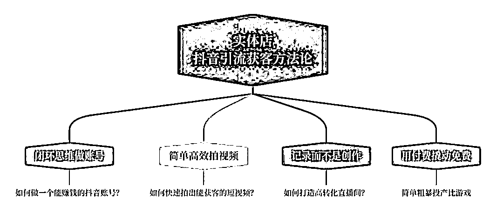

# 实体店获客：抖音同城流量实战打法

跑了一圈实体商户，聊下来的感受很一致：铺面获客愈发吃力。东西不差、用料不低、定价也良心，客人偏偏不掏钱。这真不能怪消费者，可选项实在太多了。电商货架上随便敲个关键词，翻几十屏都翻不到底；想吃顿火锅，涮肉、冰煮、川味、新派……招牌数都数不过来。供给过剩、产品雷同、同行互卷，顾客当然眼花缭乱。

到如今，开实体店还沿用老一套坐店等客，跟拿着长矛去对冲导弹没什么区别。对实体商家来说，把内容阵地搭起来、开直播，已经划进生存底线，而不是“要不要做”的选择题。货好却卖不动，太亏了。学会借线上流量拓宽客源，是每位店主都该补上的硬本事。今天分享一份给实体商户的方法论：用抖音往店里引客，帮你把抖音用成撬动客流的杠杆，冲破拉新的卡点，让生意在大环境走弱时照样往上走。

**1. 账号先想清楚怎么收钱：能变现的抖音号长什么样？**

多数人栽在同一个坑里：动手前压根没设计好赚钱路径，发了几条片子，数据挂零，就下结论说平台不行，开头潦草，收场也潦草。既搭进去时间，也把心气磨没了。

开店的朋友应当反过来，账号还没发第一条内容，就得把成交链路提前铺好，做一个从上线那天就能收钱的号。

个体户做号，路子是捧红一个人，先攒关注再谈生意；企业不是这么玩。你手上现成有货有服务。拍法就两条：省事、直给。省事，指流程别搞复杂，最好能批量复制；直给，指卖点怼到用户眼前，内容围着痛点打，流量进来就转成交。企业的目标不是粉丝量，而是落袋。

正确次序是货盘在前、流量在后：先让最小的成交回路转起来，再借平台流量把规模撑大。对开店的人来说，这反倒占便宜——货已经摆在手里，只要琢磨怎么搭、怎么配、怎么包装，让产品以这个平台最讨巧的姿态出现在顾客眼前，购买自然发生。

**2. 拍摄别复杂：能带客到店的片子怎么拍？**

回到那个问题：产品以什么姿态出现在这个平台上最讨巧？

三个词：价格够狠、画面够抓眼、人设够懂行。

**2.1 价格够狠**

拿连锁咖啡品牌 Tims 来说，推过一款 39.9 元的套餐，名字就叫“什么都有”，店里还挂出 1 元、9.9 元的特价单品，用低价先把人拉进店，再靠店员的话术做升单。

**2.2 画面够抓眼**

先说第一层：画面得抓人。未必要精致，哪怕丑得有个性，照样能让人停下滑动。建议店主们多去刷本地探店的账号，拆解人家的镜头、取景、角度和收音。第二层更重要：你得让进店的人忍不住举起手机。东西够稀奇、够少见，顾客才会主动拍照发圈，分享欲一上来，裂变就发生了。楠火锅和荣记的海鲜海盗船就是现成的例子。

**2.3 人设够懂行**

你得让顾客感觉到，这行你是老手。比如“郑州的修车行当我做了 20 年”“茶叶卖了 15 年”“有客户专程开两小时车找过来”。一条片子拆开看，无非视觉、听觉加字幕三件事。先找准用户卡在哪，再亮出你产品的长处，把需求放大，让好处去接住它。长处可以是价格厚道、服务到位、品质过硬、老板实在。片尾务必给一句明确的指令，发布时挂上门店定位，把线上的人往线下引，闭环才算收口。记住，拍片不是给自己看的，把客人带到店里消费，才是这件事的真正落点。要的是成交，不是内容自嗨。

**3. 少点创作，多点记录：直播间怎么才能出单？**

直播是个体力活，一场下来很熬人；而且效果高度绑定主播，能扛流量的主播，碰运气都未必遇得上，开价还高。街边店、社区店玩不起这种高举高打的配置，更该走低成本、能复制的路子。有个省力的思路：把镜头当成监控，做记录。

1.拍制作流程

2.拍使用场景

天津有家“小齐四个菜”，直播内容就是厨师颠勺加闲聊；安徽的“小胖卤味”，干脆把手机往柜台上一架，拍排队结账的人流。同城开播不必死磕在线人数。店主常抱怨直播间冷清，可换个角度问：你铺子一小时能进几个人？道理是通的。客人在平台上刷到你，愿意多停几秒、留个言，觉得东西对路，付款走人，和线下进店逛一圈没本质差别，只是多开了一个卖货窗口。

**4. 花小钱换大流量：把投产比这笔账算清**

试水的回路跑顺以后，可以考虑投钱买量，让付费流量去带动自然流量。投放拼的不是预算高低，而是手里有没有好素材。素材能打，钱才花得值；素材带不动转化，投再多也是打水漂。眼下同城投放更对连锁品牌的胃口；单店商家建议先把视频内容做扎实，再拿小预算试水，跑出正反馈后逐级加码。投法没有标准答案，判断标准就一条：投产比为正，就接着投。如果大家感兴趣，后续可以单独聊一期投放的实操细节。

2023 年，同城端的流量还有红利可吃，实体商户借势起飞的机会就在眼前。愿各位踩准这波节奏，把抖音用成撬动客流的杠杆，撕开客源口子，让业绩逆着大环境往上走。

评论区：

暂无评论