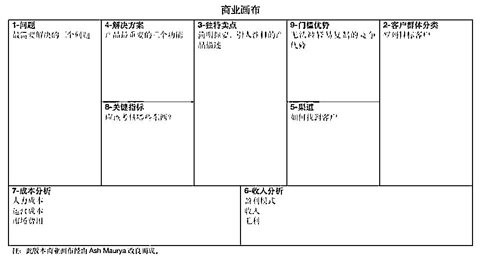
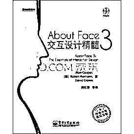
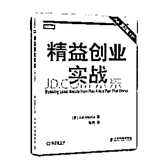

# 37岁卖房裸辞，半年赚了15万：我的7个决策心法

我是亚萨，一个37岁才醒过来、然后辞掉工作的人。

先简单介绍一下自己。以前在北京做互联网产品，做了8年；之后去了一家传统金融公司，干了5年创新营销。平时主要碰的是从0到1的商业项目设计与规划，用户规模在10万以内，另外还负责数仓系统建设。

2020年10月开始做计划，2021年7月正式行动：不干了，卖房，离开北京，定居昆明，开始做线上知识内容，也就是自媒体。

这篇文章想从35+职场人的视角，讲讲我眼里的风险和机会，以及我是怎么做判断、下决心完成转变的。

很多赚钱的圈友比我要小。我能提供的东西，一是某些环节可能对你有用的小方法，二是人到中年的真实状态带来的共鸣——后者比方法论更有价值。我眼下的真实体验是：焦虑到了顶点，平静才会来；恐惧被触发，希望才发芽。希望这篇文章能带给你一点新的东西。

下面，我把自己整个决策过程中用过的思维模型和方法整理出来，供大家参考。

## 目录
一、目前的状态
二、离职前：35+职业危机怎么分析与破局
1、职业风险不会摆在明面上，要定期评估
2、人生角色很多，不止是处理急事，也得安排长线
3、做出重大决定后，资源会被激活，要盯着它去了哪、生了什么
三、做产品阶段：8年产品人给的三条建议
1、定位：把自己擅长和喜欢的事分开罗列
2、算账：把每个方向的收支模型都算清楚
3、验证：用最小可行产品（MVP），证明业务跑得通
4、产品设计中，我自己踩进去的坑
四、从专岗到全流程，不擅长的事怎么办
1、入门用自学，快速跑通
2、进阶用信任代理，借力打力
五、写到最后

## 一、目前的状态

创业半年多，我已经跑出来两个业务。

一个是面向C端的，做家庭教育方向的知识课程；另一个是面向B端的，给和我一样做自媒体的小团队提供项目策划咨询服务。

这两个方向半年来的产出：

C端这边，我独立开发了一门课，叫“亲子冲突管理”，是训练营形式。到现在招了60多人，收入5万上下。目前短板在流量上，比较难获取，我还在想办法突破，后面会提到初期踩的坑和现在的对策。

B端这边，我合作开发了三门课——寿险线上获客训练营、收纳管理课、儿童作家亲子写作课。这些加起来大概有10万收入。下个阶段想把服务流程的SOP理一理，然后分好工。

半年整体进账大概15万。比起上班的时候收入是降了，但至少第一步算是迈出去了。

## 二、离职前：35+职业危机怎么分析与破局

### 1、职业风险不会摆在明面上，要定期评估

离职以前，我所在的平台其实不差。那是家世界500强传统金融机构，我坐中后台的中层管理岗，在北京朝九晚五，干了5年，拿过几个全国年度奖项，成绩说不上突出也不算差。

但这些表面光鲜经不起拆解。我仔细分析之后，反而心里发慌。

先看公司内部的机会。

想维持现状，完全没压力：公司是传统金融体系，继续待下去三年五年都能混。但想往上走，就很难。传统企业的晋升有自己的逻辑，对我这种互联网背景转过来的人不友好——第一，不是原生金融体系出来的；第二，没有深厚的关系基础；第三，这种体系讲究信任，不是短期能建立的。再说传统金融的晋升节奏本来就慢。几项叠加，我的判断是：5年内晋升的几率约等于零。

再看外面的机会。

我接触了一些大厂的金融岗，能拿到offer的就两个。岗位很少，匹配度高的机会也在减少。于是摆在面前的路只有两条：要么留在原地耗时间，要么重返大厂再拼一次。第一条路要长线投入，不确定能不能出结果；第二条路要短期梭哈全部精力，而金融创新的口子已经收窄，业务稳定性差，风险很高。而两个机会做选择，基本等于没有选择。

其实工作还是能找到，但隐藏的风险是——慢慢会变得没得选。

到这个程度，说明“去大平台当职业经理人”这条路，我能开发的空间已经见底。收益虽然还行，可被替代的风险在上升。打个比方：上面是天花板，下面的楼梯也在晃。

继续待着，生活不会太差，但未来没有保障。有人说，朝九晚五可以发展副业呀？不行，岗位环境不允许。另外还有一个变量，我放到第二点讲。

分析完之后，我焦虑了很长时间，然后决定正面解决。思路很清晰：先找一个能长期积累、又适合我的方向，再处理切换的时机和风险。于是我放弃了大平台，收拾好能带走的东西——卖房就是其中一件，主要为了清掉债务，避免没有稳定收入时动作变形——接着把以前积累的资源重新盘了一遍，准备走自主创业这条路。

这一段我最深刻的体会是：风险不会写在脸上，要主动分析和排查。这样能把眼光放得更长，而不是把自己交给一个不由自己控制的环境，等着被命运安排。

### 2、人生角色很多，不止是处理急事，也得安排长线

还有一件事，最终让我下了辞职决心——职业角色和家庭角色之间的冲突，我调不开了。

职业这边，市场化企业里当职业经理人，公司会不断抬高对你的期待，业绩上要你出成绩，态度上要你全情投入。你拿的钱多，就得创造更多价值。加上岗位少，能进来的人都不简单，竞争压力很大，最后就是内卷。而且，企业内部积累的竞争实力是不能带走的——你每年辛苦做出的东西，大部分最后都体现在绩效和奖金里，然后归零。说白了，你赚的是一份没有杠杆的死工资。

家庭这边，需求也在变大。我家两个孩子，我们对教育看得很重，平时是用Homeschool（在家教育）的方式，英文全学科教。老大10岁了，马上进入前青春期。我很明白，这个年纪的男孩对父亲的需求会升级：要更多相处时间、更高质量的沟通、对父亲的一举一动有观察、模仿和质疑。这些需要会在未来几年不断加码。

亲子陪伴这件事，没法投机取巧，只能真金白银地砸时间。但北京的通勤成本是全国第一，哪怕朝九晚五，我几乎也剩不下时间给孩子。

想破局，就必须取舍。我选了那个不可更换的角色——爸爸。

事业这边，放弃的本来就是一个潜力见底的位置，换条路未必更差。

有意思的是，自从我冒出“要改变”这个念头以后，看事情的方式全变了。仅仅是去找新可能这件事，就给我带回很多好处：加了赚钱和别的付费社群，视野一下子打开了；心态从“打工”转成“做事业”，看到太多需求，也看到自己长期的价值，自我评价高了很多。

在当时的处境下做这个选择，我觉得自己赢了两次：不管收入涨没涨，人整个的格局是真的升了一级；另外家庭里那种孩子不会说、别人看不见的需求，被我接住了，对得起自己，孩子也获得了一份这个时代少有的陪伴。这些都是勇气换回来的。就像开头说的：恐惧被惊动，希望才会现身。

### 3、做出重大决定后，资源会被激活，要盯着它去了哪、生了什么

做重大决定的过程，实际上也是把手里所有资本重新盘点、重新分配的过程。什么是重大决定？就是消耗大量资源、最后带来巨大变化的那种选择。相当于拿现有的一切，有选择地去激活某些部分，好让决定能真正落地。将来会不会后悔，取决于盘算得到不到位。

开一个项目，可能花钱，可能求人，可能牺牲眼前的机会，也可能是在消耗别人对你的信任。这些全部属于资源激活的范畴。那么每一项被激活的“大资源”，到底图什么？有多大的确定性？上限和下限在哪里？这些都要想清楚。

拿我的项目举例子。做亲子冲突课的时候，课程质量要求高，交付也不轻松，但因为我线下的父母课堂做了5年，积累了一批特别信任我的种子用户。于是我把价格定在1500元上下，流量不大，信任够高，顺利成交了接近50人。这就是把之前的信任资源，在算清楚之后做了一次变现。

当然，项目不同，资源激活的方式、代价、收益也完全不同，要一事一议。而且还可能互相牵扯，甚至产生负面影响。比如利润高的短线产品，可能把和用户之间的信任一次性透支；创业初期如果把时间和精力全部押进去，家人那边也得替你扛着压力。

怎么在动手之前尽量想透？

我的办法是分内外两条线，把所有可能的影响列出来。

外线偏功能，看决策能带来什么看得见的好处，比如财富、地位、名声有没有增长。内线偏情感，看决策能带来什么内在的回报，比如家庭、关系、精神层面有没有满足。

这两条线不是对立的，而是需要动态地找平衡。通盘想一遍，是为了避免走极端——一头全部押上，另一头严重亏空，让人生失衡。这也正是很多前辈常说的“事业家庭要平衡”的重要原因。

内线听起来很虚，但今天这个时代，信息和效率都高得离谱，工作对人的要求早已不只是单项技能，而是整体状态。内外都照顾到，人才能稳住、能赢。

我的一个观点是：情绪稳定，是当代成年人第一生产力。

为什么？脑力劳动为主的时代，一个人的产出靠的是专注、冷静、深度思考、灵感这些东西。但你工作的时候并不是一个人待在真空里，各种变量随时出现：跨部门协调、谈判、说服、坏消息、立场冲突……想要长期保持高效，必须有办法调节自己，不让外界的波动轻易影响状态。这就是情绪稳定。

能处理好自己情绪的人，到哪里都被当成靠谱的人。哪怕对面坐着暴跳如雷的老板或者客户，你还能逻辑清晰地回应，而不是被吓住或者发火，这样不仅关系没搞僵，还在关键时刻证明了自己能持续创造价值。这就是可信赖的样子。

而内线投入带来的回报，直接体现为强烈的幸福感和稳定的情绪状态。

按这个框架看，一份上升空间不大的经理人工作，继续坚持只会损耗内线，外线又看不到太大增量——这是我下决心离职的第三个原因。

## 三、做产品阶段：8年产品人给的三条建议

离开了职业经理人这条路，我面对的核心问题就变成了：到底做什么？在这个问题上，我认为有三步最关键：第一是认识自己，第二是算清盈亏，第三是做出最小测试件。下面还会讲我踩过的坑。

### 1、定位：把自己擅长和喜欢的事分开罗列

自己开始做事，短期要拼成功率，长期要拼内在动力。擅长什么，对应的是前者；喜欢什么，对应的是后者。

拿我来说，8年互联网经历，大多在做从0到1的产品项目，也碰过一些内容运营。商业模式怎么设计、业务流程怎么搭建，这是我的基本盘。于是我可以自己开发课程，也可以把这种设计能力打包出售。

创业之后的路线，基本就是照着这两块展开的。

那这个认知是怎么来的呢？一方面靠履历、圈子、信息来源去总结；另一方面，人有些隐藏的擅长，自己未必看得见。比如我以前没发现自己很会做知识总结和分享，后来做了盖洛普测评，才确认这一点——这里推荐大家也测一测，官网或者找认识的教练都行，赚钱的醒醒就是这方面的专家。盖洛普还帮我避开了短板：说服。我本来就不擅长说服人，创业反而让我彻底不用做这件事了。

把“能做的”“爱做的”“成事概率高的”这几个圈画出来，取它们的交集。交集里可能有好几个对象，没关系，先全部收进候补名单，进入下一步继续筛。

### 2、算账：把每个方向的收支模型都算清楚

大概知道自己能做什么之后，就要坐下来，把每个备选方向的账都算一遍。具体是几件事：

1）先定这个业务的盈利方式；
2）把成本怎么分布、资源投入的规模和节奏拆开；
3）预估一下启动阶段的周期和收入水平，算一算利润（=收入-成本）；
4）想好什么情况下止损。

这样选一个方向落地，第一阶段的目标就框出来了。当然不一定和实际情况完全相同，但至少作为参照物，能帮你不断修正方向、控制风险。

### 3、验证：用最小可行产品（MVP），证明业务跑得通

MVP是《精益创业》里的说法。赚钱小航海和大航海里常说“给谁用、给什么、解决什么问题”，其实就是MVP的另一种表达：用户是谁——目标人群；给的是啥——产品；解决什么——需求。它包住了业务最核心的逻辑，之后的枝枝叶叶都从这里长出来。

起步阶段最重要的一件事，是怎么用最低的成本，验证核心逻辑是不是真的有人买单。这是做产品时最关键的一步。

做MVP，我把它拆成四个环节：

1）搭框架：包括需求摸底、确认人群、设计商业模式、定产品和验证点。这部分我常用《精益创业实战》里的商业画布。框架做完，做一个不用很大规模、也不用自动化的原型。下图是我的示意：

比如线上课程，可以先定教学目标、大纲、主体内容和作业，具体讲话的话术倒是可以先放着。

2）小范围投放：按定位找一批种子用户，先把产品投出去，顺便把话术、运营方法这些环节在生产中打磨出来。

3）收反馈：收集用户的反馈，比照之前设定的验证点，做定量或者定性的判断。这一阶段得来的反馈通常有三类：正向、负向、超预期。每一类都指向不同的调整方案。

4）迭代：根据反馈，重新分析需求，把产品里需要改的地方改掉。

用定位、算账、测试这三步，就能比较快地判断一个项目有没有能力从市场换回足够的资源。而且因为有一整套验证框架，后面持续做的时候也能拿它来查漏补缺。

等产品验证慢慢稳定下来，东西才勉强算成形。后面再根据业务规划慢慢补细节。但每次投钱投人，都要记一笔账，哪怕只是主观算一下投产比，也比拍脑袋强。

### 4、产品设计中，我自己踩进去的坑

做产品我原来挺有信心。直到家庭教育项目上线之后翻了车，才意识到自己又开始凭经验做事，对陌生的市场缺少敬畏。

第一个毛病是花钱不收着点。创业前期我一直提醒自己省成本，可真做起来，还是沿用上班时的习惯，先把计划里最核心的部分做出来，结果第一门拿出来卖的就搞成了训练营。前面投入的时间非常多，上线后因为客单价高，只有之前私域里少量高信任的用户购买，拉新完全没戏。课程还要不断交付，挤占我的时间，业务节奏也被打乱。

这个坑让我明白：就算是同样的事，场景变了、前提变了，就得重新从0推演。

第二个问题也来自职业惯性：在产品还没接受市场检验的时候，我就凭个人判断给它加了一堆功能，比如🛰️群互动、知识星球提问。结果不温不火，用户觉得没多大用，我这边交付成本却变高了，还得按承诺把坑填完。说白了，是把以前觉得好用的东西直接搬到了新场景里。

那做事情到底能不能靠经验？能，但前提是这个经验来自对口的行业。这种情况下完全可以凭经验快速判断，测试时微调就行。

可如果你跨进一个以前没有深入过的行业，做设计的方法就必须从“靠经验”换成“靠数据”，也就是我前面强调的MVP策略——用一个“最小”的东西快速去试。成本低、效率高，能帮你快速摸清新行业的门道。

产品在市场上初步跑通之后，接下来就要碰整体运营。这个阶段我遇到的问题很具体：大量事情我根本不会，甚至没碰过。

## 四、从专岗到全流程，不擅长的事怎么办

前面说了，我的老本行是做产品规划。运营和获客，是真的短板。我知道每个领域都有认知门槛，特别是想真正练到精通，短期内做不到。靠自学把每个环节都学到专业级，既不现实，时间和条件也不允许。

所以，在我需要系统用到但又不熟的领域，我的打法是：先用自学打底，再用信任代理补高。

什么叫自学打底？所有业务环节，网上都有大量通识课，找一家靠谱的机构或个人，先快速过一遍，把基本概念搞懂，然后自己边学边做一遍。

不管你有没有团队，我都建议自己把全流程跑一遍。

这样做最大的好处，是你能摸清每个环节的关键点在哪儿，以及这些点之间怎么衔接。这些经验和关系，放到成熟企业里就是岗位KPI。以后业务做大、要搭团队时，这些体会就是你的管理底色。

创业初期还有另一层意义：当你跑完全流程，手上的事就能分成四类——必须自己干的；自己能干的；不想干的；干不了的。

分完之后怎么决定？看财务测算。如果资金充裕，除了“必须自己干”的，其余都可以通过招人解决。当然，招人也会增加管理的工作量，这块也要放进业务流程里评估。

我的情况是，控成本是我时刻提醒自己的事，所以业务没稳定之前，我不打算建团队，先一个人Solo。基于这个原则，也拒绝了几个线下的机会。

创业的机会成本太高，我必须先活下来，才能有资本犯错，等业务稳定了，再考虑加人。

但分类里“干不了”或“做得不达标”的项目依然悬着，这部分必须有个快速方案。

这就是“信任代理”。

先说明，这里的定义和克里斯·布洛根《信任代理》那本书不一样——他讲的是“信任是互联网时代的新货币”。我说的信任代理，是一种协作方式：在需要专业能力的地方，找一位既精通这个领域又善于协作的专家，把你需要把关的环节交给他，用合作的方式获得专业支持，快速越过障碍。

## 五、写到最后

回头看，这七个思维模型其实是一条完整的决策链：先盘风险，看清处境；再平衡角色，做出取舍；接着梳理资源流向；然后定位、算账、用MVP验证；最后靠自学和信任代理补短板。这套东西不一定适合所有人，但它至少让我在37岁卖房裸辞之后，完成了从0到1的第一步，也把主动权夺回了一些。

先厘清一个概念：这里说的“信任”，不是拍脑袋的主观好恶，而更接近一种由共识沉淀出来的客观评价。具体来说，行业里被广泛认可的口碑，分量高于自我宣传；社会层面已有共识的选择，优先于刚冒头的新兴势力；有学术研究背书的结论，也比野生经验更值得参考。若某个领域还处在极早期——比如元宇宙——那对任何“权威”都要多留一分警惕；业务真涉及这块，自己亲自下场，往往比把事交给代理更稳妥。

所谓“代理”，本质是委托合作的一种安排，也可以理解为借助外脑，或直接购买服务。

拿加入赚钱来说，它其实就是信任代理的典型运作方式。赚钱聚集了专家的认知，相当于给用户加了一根信息杠杆。借助它，我们能迅速拿到业务的关键情报，比亲自做调研省力得多。而赚钱积累的成果与用户口碑，本身就是“信任”的客观依据。

我在给客户做产品咨询时，常常要快速摸清一个行业的底细。这种场景下，赚钱就是我的第一信息源。同时，我也在赚钱结识了花爷、芷蓝、梁靠谱等不同领域的专家。上他们的课、和他们交流咨询，对我的业务帮助非常直接，也很及时。

举个例子：做获客和营销方案时，我起初毫无头绪。正是根据他们的建议，我搭出了分梯队的工作流程，再顺着这些思路去测试功能产品，明确了很多，也避开了不少弯路。

信息时代让人与人的连接有了更多可能。借助新的协作方式，我们能用更低成本、更高效率组建起更多元的团队。信任代理，就是搭建这类团队时一个基础的筛选模型。作为受益者，我也真心把它推荐给赚钱的伙伴们。

五、总结

风险并不都长着一副明摆着的样子。看得见的风险，通常还能找到绕开或对冲的办法；真正需要重视的，是那些藏在暗处的风险——对它们进行审视和评估，是我们稳步向前时不可或缺的一步。不管身处什么阶段、遇到什么境况，这个提醒都值得记在心里。

当然，评估做足之后，拍板那一刻更依赖勇气。我不是劝每个人都像我当初那样裸辞，只希望你在某个必须做选择的时刻，愿意相信自己。人生那些关键节点上，勇气常常会换来命运的奖励。

人生角色从来不是单一的，不同角色之间会相互牵动，也会彼此赋能，关键在于动态调平。角色权重的排序，归根结底来自你的价值观。不必照搬某个固定模板，选一个日后想起来会为自己骄傲的答案就好。

做重大决定时，往往也是大量资源被调动的节点。把内部与外部两条线都评估清楚，可以避免上头，也能少掉坑；更重要的是，你会清楚每项资源消耗多少、产出多少，从而及时调节，让资源有机会积累出复利效应。

在当下，信任代理已经是有广泛共识、且投入产出比很高的协作方式。从某种角度看，它能在竞争中帮我们放大优势。一定要学会组建自己的虚拟团队：既能获得支持，也能向外输出价值。

产品设计这件事本身有门槛。落到实际应用里，还得结合业务情况做专业分析与指导，尽量请专家来评估，弯路会少很多。我推荐两本书，帮大家快速抓住产品设计的关键内核。

市面上产品经理相关的书不少，但多数人并不需要把系统的产品设计方法论全学一遍，所以我只挑两本对理解商业设计核心概念有帮助的书：

1、《交互设计精髓》，重点看需求分析和用户调研两部分。

2、《精益创业实战》，重点看商业模式设计和需求分析两部分。

以上就是我这段经历的分享，希望对大家有帮助。谢谢阅读。

评论区：

梁靠谱：萨哥这波分享太燃了！

张亚萨：向靠谱看齐！

宋大刀：亚萨老师太优秀了！！

张亚萨：谢谢大刀！[愉快]

倪大胖：继续向前！

晨阳牙牙：焦虑被点燃时，平静才会靠近；恐惧被触动后，希望才会现身。谢谢萨哥分享！

张亚萨：有帮助就好。

清扬：很有共鸣，感谢分享！