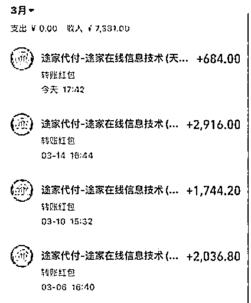
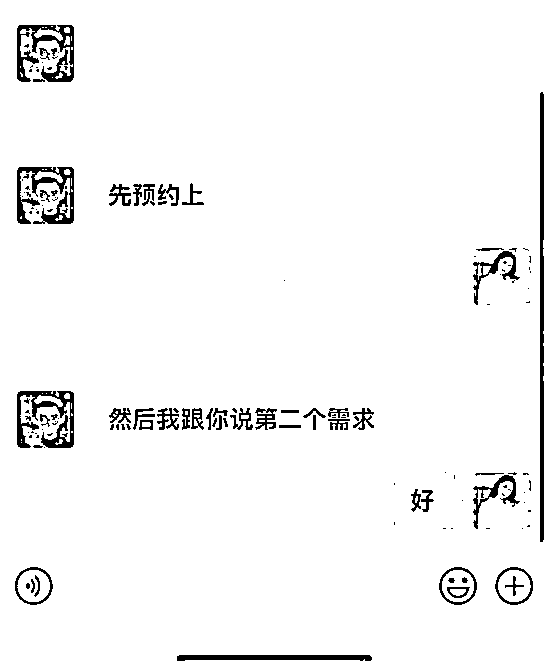
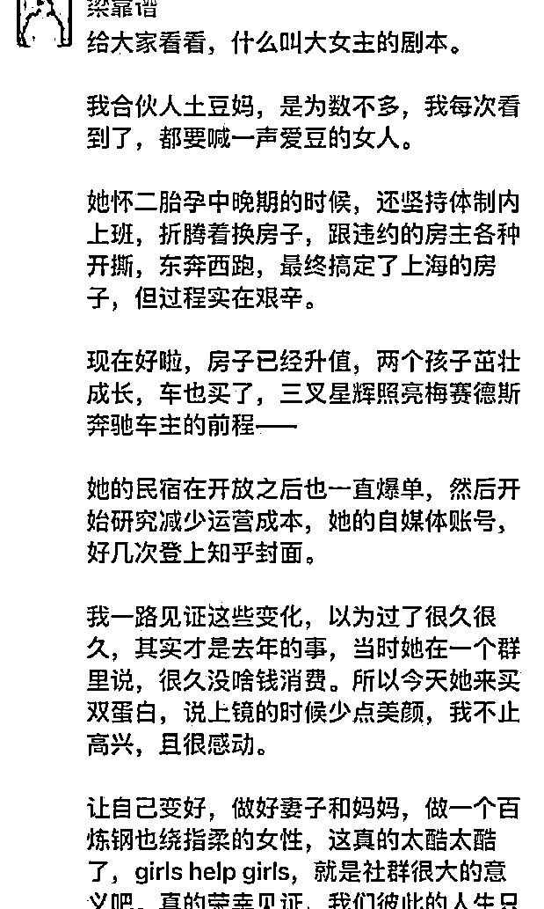

# 公职身份不挡路：我把副业做到年入20万+

常有人想多挣一份收入，却先被身份和眼光困住：在社交平台发内容，担心被领导同事刷到；做代购，觉得不体面；拍短视频，又怕露脸。编制内、公职岗位或特殊行业，顾虑往往更多。这些心理负担拖得越久，脚步越难挪动。若你正卡在这里，不妨看看土豆妈这段亲身实践，或许能打开一点思路。

## 关于我

我叫爱折腾的土豆妈，在沪上公办园工作，属于编制内幼教，已做十四年，担任中层职务，负责招生条线。五年间六次房产交易，三套住宅做过翻新。

关于我五年六次置换房产、累计获利百万的长篇记录，详见：https://t.zsxq.com/0cE7ISGkM

## 我做过的四类副业

**1、跨境母婴用品代购**

2012年怀着宝宝时，我最初只想给自己囤货，就在社交平台邀熟人凑单，靠口碑慢慢扩散。货物从境外站点下单，再转手卖给国内买家，边进货边出货，挣到了最早一笔积累。孩子花销基本由这块覆盖，盈利数字倒从未认真核算。2018年前后受若干因素影响，相关经营陆续收尾；如今回看，把那个三百余人、回头客密集的客户群直接关掉，确实很不明智。

**2、民宿小房东**

我算半个民宿房东，峰值时管理四套，眼下两套仍在出租。把郊区住宅与四十平方米的学区小房重新投放后，租金翻番。前三年行业冷清，不少同行退出，尤其去年格外难熬，好在撑过来了；直到2022年末才逐步回暖。2023年3月的前二十天，仅某一渠道的住宿进账就超过七千。

**3、家居社群主理人**

2021年6月，自家二手住宅动工翻新，我顺手建了装修观察群；到2023年2月，该群由免费转为收费，第一次有了会员费。七天内新增三十多位成员，现有一百二十余人，仍维持199元限时价。

**4、付费答疑**

2022年末，我开始接个人答疑，话题集中在买房、择校与翻新。起初义务帮忙，后来收随喜红包，再后来每小时199元，近期升至三小时999元；我的时间与经验，标价一路走高。前几日还收到紫菜老师圈友来问房产和翻新，可见跨界知识服务并不受身份限制。

## 破圈背后的思路

**1、先认清岗位边界**

先认清岗位约束：单位若明令禁止直播销售，或不得牵涉与校园有关的资金往来，那就绕开，不去试探边界。

**2、给自己设硬杠杠**

我给自己设了硬杠杠：同事与幼儿家庭都不是客户，尤其是家长，哪怕孩子早已离园也不碰；每年手上会过上百份家庭资料，也不拿来变现。凡涉及本园招生范围内的择校、买房建议，我一律义务解答。这就是我的底线。

**3、从兴趣找切口**

兴趣往往是最好的突破口。我试过把折纸做成礼盒出售；如今则围绕居家改造、空间布置持续输出内容来获得收入。日常生活人人都逃不开，公职身份想拓展边界，不妨从生活切口进入：民警记录锻炼，教师整理育儿方法，医护分享低脂餐。八小时之外，本来就属于自己。我不过是利用业余时间打理自家房产，租金收益与职业无关，也不存在领导干预，所以做得坦然。

**4、本事不够，先动手**

只凭热情很难持续变现，多少要有些基本功：不能直播就录短视频；不愿露脸就做图文；连图文都嫌麻烦，就取个笔名专心写文章。鲁迅、巴金、冰心这些名字都能另起，别急着说“我做不到”。先把从零到一的路走通。星球里的训练营、陪跑营，挑一个跟上，先挣到首笔收入。我2020年进入生财有术，2022年加入玩赚星球，试过TikTok、知乎好物、小红书等，收入不算多，但路径都跑过。网感、排版、剪辑、写作手感，这些都在变成我的底气；投入的每个片段，都不会作废。

**5、做好独处准备**

离开舒适区，难免遇到一种拉扯：单位里长期不变的节奏，会慢慢磨掉人的心气，也拖住行动。我甚至怀疑过，自己的价值判断为何与周围如此不合。这里上下班时间固定，日子几乎能预见到退休；耳边的闲谈多是柴米油盐、伴侣孩子、穿搭美妆。有人反复问我：又添房？又翻新？花二十万租房子？你也真能折腾。办公室里，有些话题我不愿加入，比如有人握着多套安置房却不肯处置，把全家挤在狭小住所里，又抱怨长辈；我想给建议，对方却不想改变。至于我关心的房产置换、用翻新提高租售比、社群经营、ChatGPT、知识服务，他们连名词都陌生，我也就不多解释。如今在岗只谈公事，不再自我消耗；午饭和午休尽量避开闲谈，找个安静处刷群里的动态、听感兴趣的课、记录副业思考，独处反而自在。

## 我实际用过的破圈动作

**1、把普通动作做久，自然被看见**

把旁人难坚持的普通动作做久，自然会被人看见。无论写作、更新社交动态、锻炼、发布图文还是拍视频日志，方向不明时就挑最容易执行的一项，持续做。比如@梁靠谱 为何会留意我，还屡次在群聊、直播里提到我，甚至专门写动态推荐我？原因只是我坚持每天做复盘：短则二十来字，长则两千字，连续六百余天，生二宝那天照样更新。对方一路看着我处理房产、翻新住宅，还顺带迎来二宝。

**2、愿意输出，机会会靠近**

愿意把所得摊开讲，流量、影响力和收入常常结伴而来。多一些输出，才可能多一些回报。我那篇记录五年间六次交易学区房、累计获利百万的长文，就带来了数位收费咨询客户；紫菜老师也主动联系我，聊房产交易与翻新。前些天得知亦仁老师在弄翻新，我主动递上自己的社群方案，得到肯定。近三十天做社群格外有劲，路子走对了，推进也顺。

**3、别太把自己当回事，坦荡挣钱**

别把自己看得太重，挣钱并不丢脸。很多公职朋友背着无形枷锁，其实大可坦荡一些。不敢在社交平台发内容？把联系人逐一打标签，只分【看广告】与【不看广告】；拿不准的，先放进后者。像清理旧物那样分完类，发内容还有什么好怕的。

**4、边干边调，先跑起来**

边学边干，边干边调。常有公职朋友说：我什么都不会，也不知道能做什么。进了生财还愁没有项目？每月都有航海活动，先选感兴趣的跟着学，赚钱的手感会慢慢出来。芷蓝反复提醒我，做自媒体终究要有清晰的个人品牌定位，以及后端可售卖的产品；而收费社群就是很适合新手的基础款。于是今年一月底春节前后，我把经营一年半的免费群转为收费群。最初定99元/年时心里没底，后来反复打磨内容与规则，甚至认为这样的社群完全值更高价。从零到一这件事，即便没成，损失的也不过是原本刷手机、追剧、网购的时间，代价近乎为零，值得大胆一试。

不管你在编制内还是编制外，是在职还是已离职，先卸下过重的顾虑，动手做起来。说到底，今天，你有没有动手给自己折腾点新可能？