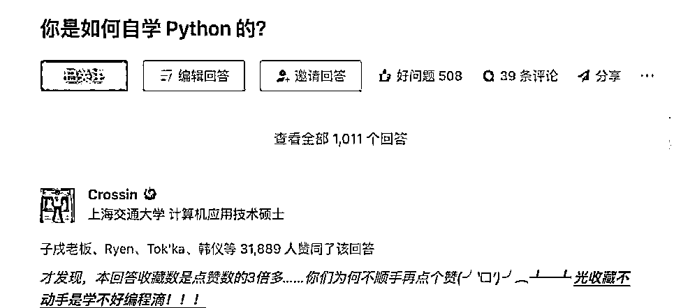
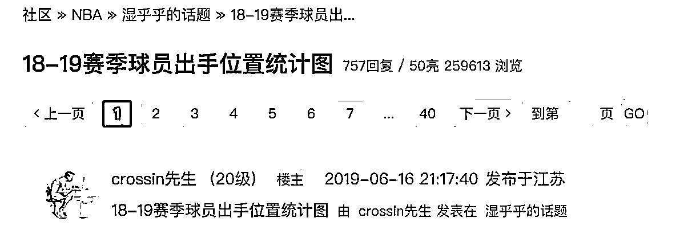
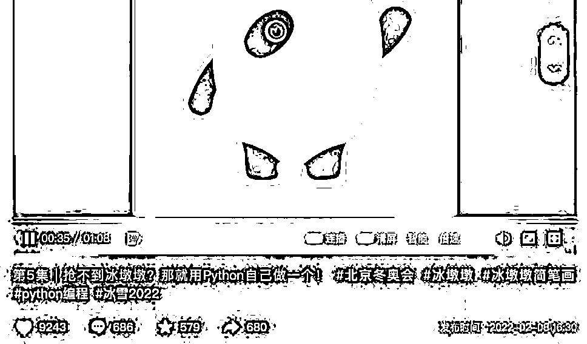
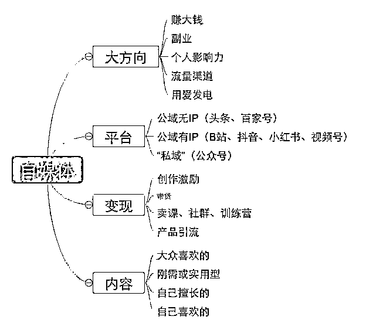

# 十年内容路：赚过，也错过

我是 Crossin，运营“Crossin 的编程教室”，主要做 Python 教学和案例。2023 年 6 月 15 日，小灰老师邀我写一篇分享，于是把这些年的经历和教训摊开来聊聊。

原本没打算在这个节点总结：订阅号阅读量比前两年差了不少，个人事务也多，更新处于半停摆；同时我在试水视频，流程和打法都还没定型。所以这篇谈不上胜利者经验，也够不上反面教材，更像一份阶段复盘。

下面不少旧经验已不适用于今天，照搬大概率无效；只想看建议的，可以直接跳到第六部分。

## 一、十年轨迹：从订阅号到短视频

2013 年，我开了🛰️订阅号，连载 Python 入门内容；同期入驻知乎，回答编程类问题。那时订阅号还小众，没有清晰商业模式，“自媒体”这个词都不常见。好处是内容硬、更新稳，容易被大号看见并推荐，号主之间也愿意互相导流。知乎正处上升期，用户多是学生和职场新人，技能知识氛围浓；早期外链限制少，回答里放二维码可行，百度对知乎内容收录也友好。技能分享加导流订阅号，是难得的窗口。

之后几年我仍在游戏行业上班，订阅号只是副业，更新不勤，粉丝却慢慢涨。期间接了两单广告，每单约一千元，其中一家尾款还没结，但总算有了收入。

2016 年我离职，转为全职做内容；年中推出付费服务，下半年注册公司、搭团队、参与孵化。知识付费刚起势，移动支付普及，用户愿意为线上内容掏钱，机构尚未大举进入；品牌投放少，变现只能靠课程、训练营等自营服务。知识星球（当时叫小密圈）和龙哥盟刚出现，我是早期用户。付费产品迭代多版，也从龙哥盟学了不少。第一版会员没有课程，只建群做问答，几十个名额很快抢完，这让我有信心继续。

2017 年尝试团队化，想打通“内容获客—培训服务”的闭环；但我管理经验不足，团队效能没出来，个人产出也被拖累，两边都别扭。整体没亏，粉丝也涨，但状态不好，2018 年初团队解散。

同年试水抖音短视频，一周做出千万播放的爆款，可惜与编程无关，也没找到结合点；此时订阅号品牌投放爆发，我把重心放回图文，抖音搁置。

2019 年心里想转视频，行动上不够重视。订阅号广告市场火热，商单多，是较舒服的阶段；我找了几个远程兼职帮手。B 站逐渐出圈，我虽是老用户（更早混 A 站），却没意识到那里也能发编程内容，结果又早起晚到，虽有几期播放不错，但没当主阵地。

2020 年我正式成了“内容个体户”。疫情对订阅号主冲击有限，线下停摆反推线上流量，网课多卖了些；我恰在一月初退掉办公室，回到单人自由职业，躲过一笔损失。可久了之后，培训机构金主也难，2021 下半年广告明显减少；视频挤压图文、知乎转故事化，我的订阅号数据很难看。那段时间我半躺平，学指弹吉他、打鼓、攀岩，还去公园跟大爷大妈抖空竹。

2022 年中下决心转短视频，主做编程教学，主阵地抖音和 B 站，同步视频号、📕。数据不算爆，但在稳步涨，暂时继续以内容为主。

## 二、爆款复盘：运气、误区和教训

这个知乎回答拿到三万多赞。它不只曝光高：早年百度搜“自学 Python”，该问题排第一，我的回答又在首位，里面放了资料链接和订阅号二维码。前几年我约八成关注来自这一条回答。有机构想花几千元插入广告，我回他们：太低估这条回答的价值了。

编程教室最早的合作伙伴之一是资深虎扑用户，早期在虎扑导流，带来不少人，所以初始用户里 jrs 不少。虎扑流量惊人，但社区属性强，导流是技术活，得“自己人”才顺手。后来我也发过体育加编程的内容，比如这篇。

这是我刚玩抖音时的爆款，把当时两种热门套路拼在一起再做反转。现在看，它可能让我掉进追爆款的误区，没在编程内容上持续深耕，反而丢了这块阵地。

这条视频借了冬奥会热点（可能不少人刷到过），纯属意外走红，全网传播。但爆款不归我：代码被营销号大规模搬走，总播放我估计上亿。我这边订阅号一天涨四千粉，B 站后来发吐槽抄袭的视频又涨约三千。

这是去年转视频后的小爆款。数据不能和早年抖音比，但“专业内容加热点”的方向我认为对。

订阅号始终没出过 10w+，较好的在 2—3 万阅读，比如下面两篇：

 

原因一是平台机制，二是我的内容偏干，不走情绪路线，二次传播弱。

## 三、收入：别只看数字

这部分很多人好奇，但参考意义有限：内容账号收入差异极大，也不和流量完全同向。

我头几年几乎没钱；最高峰年入百万，但那是流水，要扣课程研发和运营成本，后来也没延续。把 2013 到 2022 当一个项目看，总收入约两百万；从 2023 往后，短期我回不到那个水平。

绝对值看，约等于上班族工资；若去大厂写代码，收入会更高。但我不喜欢管人，也不愿被管。做内容至少给了我这种自由；能不能比上班赚得多，随缘。

## 四、做对的事：六条老经验

能靠一个账号不上班，中间有若干正确动作。

1. 赶上🛰️订阅号、知乎、知识付费三波上升期。运气占比大，但前提是我先去试了；不伸手，风来了也接不住。

2. 持续更新。虽然踩中窗口，也熬了几年才起量；频率有高有低，但没断线。爆款是概率事件，更新基数大才有机会撞上。我的运营不算猛，内容也不算奇，主要靠写得久。

3. 冷启动借了外力。很多人死在初始阶段：认真写完，阅读个位数，很难撑。早期大号推荐和虎扑导流让我跳过这一步，基本从五百粉起步，创作体验好很多。

4. 从读者视角做内容。发出去是给人看的，不是朋友圈自嗨。我看不同内容的数据，也做问卷，据此调方向；最后定位在入门、短篇、有趣或有用。

5. 专业内容接热点。如今借热点是基本功，早年并非人人有意识，我起初也不懂；运营中慢慢摸出门道，做出几篇还行。

6. 变现链路自己握。我会开发，最早搭了教程站，后来接付费课和学员系统；从内容里的入口到订阅号承接，再到课程服务，全流程可控。大环境差时，也有相对稳的收入通道。

## 五、做错或错过：三笔回头账

事后假设，不一定照做就更好。

1. 内容和变现都想自己抓。完整闭环是优势，也拖了增长：个人精力有限，全自己扛等于用速度换稳。若把那些时间全压到创作上，性价比可能更高，流量也许还能再上台阶。

2. 团队化太早。不是团队化不对，是不适合我；同上，牵扯大量精力，效果不及预期，或许缺个互补合伙人。

3. 视频转晚了。我较早判断视频会替代图文，却没像当年做订阅号、知乎那样积极转。也得承认视频门槛高，尤其写字习惯的人，面对镜头需要勇气。

## 六、给新人的实在话

前面是个人流水账，想看结论可从这里读。建议基于我的经历，所以上文是背景。先把我理解的选择摆出来：

下面几条围绕这些选择展开。

1. 先问为什么做。方向不同，打法不同。门槛低、天花板高，但通往顶部的路很挤且更挤。

若你因本职工作不爽，想裸辞全职赚大钱，我得泼冷水：好窗口已过，没有过人天赋很难冒头。

若想做副业、多一条尝试，我强烈支持。我这两年间接帮一位朋友转成内容创作者。但记住：别辞职！别辞职！别辞职！先动手，立刻，今天就开始。若说不辞职没时间，那辞职后大概率也更新不了几期。等稳定更新，再考虑是否全职。

即使赚不到钱，输出专业知识和独家观点，对职业发展也有帮助，常带来意外机会。

另一种适合：有现成生意，用内容做宣传获客。如今纯网红大 V 很难，但把账号当专业展示窗口有机会，平台流量机制也在倾斜。比如开饭店，纯靠内容养家不易，认真做美食内容把店里销量翻倍不难；业务能线上化，如培训、咨询、卖保险，效果更好。

当然，纯粹出于爱好、不求变现，开心就好。

2. 发视频应多平台同步，但风格各有侧重。新手从 B 站、抖音、📕里挑最合自己调性的。它们有推荐机制，冷启动坚持一段通常有反馈；也有 IP 概念，做得好会被关注、追更，粉丝正循环。头条重内容轻 IP，适合批量营销号。订阅号我归为“私域”（说法不严谨），没有公共推荐流；现在机制似有变化，也开始重推荐。但图文已是过去式，除非文字功底很强或实在做不了视频，才选订阅号。如今订阅号规则较松，更适合当最终变现渠道。

3. 内容要与方向、变现模式一致。拍搞笑短剧受众广、流量能做大，但多靠内容激励或直播带货；做专业内容如编程教学，流量不会大，来的是垂直用户，提供所需服务可提高客单价。有自己生意更容易，吸引潜在客户后他们会主动联系。若在抖音卖课却天天跟风搞笑段子，爆款也无价值。做垂直内容别羡慕别人爆款：他十万播放可能只赚几十块，你十个播放可能带来一个高价值客户。

4. 前面说从观众角度选内容，反过来也要补一句：自己讨厌的内容很难长期做，至少得不反感。理想方向是用户需求（爱看或实用）、自己擅长、自己喜欢三者的交集；不能兼顾就取可接受的平衡。

5. 心态上，先动手，再谈坚持和“脸皮厚”。

做内容不需要万事俱备，今天想做就能开始；不放心用小号试，边做边想边调。若总说“等我怎样怎样再开始”，要么方案有问题，要么在拖延。预想和实际差很远，不动手体会不到细节。完美主义者总觉得视频不够好，想改到满意甚至重拍换题；我的建议：永远在下一条改进。做好了就发，发出去就是成功。

坚持不用多讲，但常被低估：大家爱归因能力、环境、运气，可在内容这条路上，坚持是第一位，是先决条件——量不够，方法论没机会上场。同时坚持很难，初期缺正向反馈，放弃太容易：今天加班、明天聚餐，就可能断更。

我劝一位想尝试的朋友“脸皮要厚”，她果然想歪。网上确实有低俗的“不要脸”，我说的不是那个。即便正常写文章、拍视频，也难免镜头恐惧和尴尬；再叠上惨淡播放，新手容易崩溃。此时只能硬着头皮继续更。

我们受的教育像在暗示凡事只有一次机会，搞砸就完了。做内容不是，至少新手不是：只要不碰违法违规，尽管试，持续更新，感觉是在更新里长出来的，不是在纸面学习里想出来的。

评论区有多年老粉伟业、合作老友书豪、正在起号的小新等朋友留言，也谢谢爱飞的鱼、龙哥、米斯特 LIu 的交流；我回豪哥一句：矩阵号做得风生水起。