# 十年复盘：真金白银换来的创业课

圈友们好。最近一直忙，写东西少了。这回花半个月，把过去十年创业路重新梳理成一篇长文。很多经验代价不低，前前后后交了几千万学费，分享出来，愿对你有用。

## 一、写在前面

其实这个念头去年就有了。那时创业九年，想等满十年再落笔。一来给自己做阶段复盘，二来给同行者留点参考。今年7月1日，我离开返利网、正式创业满十年。原定六月底收尾、七月一日发布，偏偏那段时间心里烦乱，具体不展开，总之坐不住。一拖就到九月。若再搁置，这篇大概率真要黄掉——日程表里它已被反复延后。

前些天读到曹大（caoz）那篇创业十万加，心里很有触动。他开头大意是：十年前，他总鼓励人出来闯；五年前，开始分辨谁适合谁不适合；如今，他几乎会劝每一个想创业的人止步。原因不复杂：时代给的机会口子窄了，创业要付的机会成本高了。没读过的，可以找《还在做创业梦？醒醒！》看看。

我也在创业路上走了十年，算个老兵。项目做过不少，几千万真金白银砸进去。身边常有人来问：“我想出来干，给点建议？”多数时候我泼冷水；只有极少数人，能力强、手里有资源、有积累、节点也合适，我才会点头。被劝的人有时不理解，觉得我不愿看他“暴富”。等真下场挨过打，又回来讲：“老胡，你当时说得对，可我听不进去，现在有点悔。”我通常回：没亲身趟过，很难真正共情；把这段当修炼，也未尝不可。

“创业”听着体面，真扎进去才知分量。它并非一路从天使轮到A、B、C轮，再IPO，住大别墅、迎娶白富美、站上人生顶峰。不是那样。过去履历再亮，从启动那天起，面前就是一片未知地，只能贴地匍匐。雷随时可能踩到，一脚就出局。战战兢兢、如临深渊、如履薄冰、长期焦虑、整夜睡不着，这些会是常态。大概率结局是忙一场却落空，连自信心一起赔进去；更重的，家庭也可能散掉。真正独立创过业、尤其是五年以上、亲手把0到1跑出一点结果的人，会更懂。

因而这篇不堆辞藻，不为转发写鸡血，也不吹牛。只把这十年实打实的经历和心路摊开。内容长，我拆成六块：前言；与电商结缘及三次小规模创业；返利邦阶段；玩好货阶段；兔子优选阶段；后记。下面进入正文。

## 二、与电商结缘，以及三次小规模创业

讲十年之前，先交代我怎么和电商搭上线，以及三次小打小闹。它们对我认知的拉动不小。

2004年，我在北京，刚出校门，进了一家私人小企业，帮老板做网站，老板主业卖牧羊犬。住处在朝阳区楼梓庄，养了两百多条。最贵那条叫“威士忌”，德国进口，花了300万。2004年的300万，对我像天文数字。它住在老板别墅车库里，24小时有人照看。贵在血统：祖辈、外祖辈都拿过国际大奖。我也是那回才明白，狗也讲族谱。

我的活是网站运营维护：摄影师拍完狗，我处理图片、上传，再管论坛。买家、配种客户都靠网站和论坛留言了解情况。事不多，甚至闲得发慌，但日子舒服。办公就在别墅里，衣服保姆顺手洗，吃饭有厨师做。最大问题是太闷：整天只有我一人，缺交流、少学习氛围。

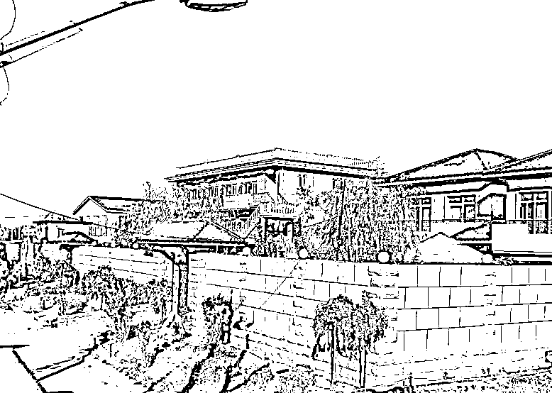

闲下来我就上网看新闻。2004年12月底，马云获“中国经济年度人物”，我听得热血上头。他说过：马云能成，80%年轻人也能成；蚂蚁雄兵能胜大象；男人长相常与才华相反；今天不做电子商务，未来无商可务；平凡人也能干非凡事；今天残酷、明天更残酷、后天美好，只要不放弃，熬过明天也许能见后天太阳。看完我像被点着，一心想进阿里。可人在北京，口袋没钱，突然跑去杭州不现实，只能按下。

北京也待得孤单——同去的同学大多回了家，我又不适应干燥气候。2004年底，我辞职。回家过完春节，转去上海。原本想独闯深圳，那时天不怕地不怕；家里坚持让我去上海，亲戚多，吃住有照应，找工作方便。

到上海，先在一家培训学校教计算机，第二份做广告设计制作。虽不在电商公司，我却一直盯着行业，每天刷“电子商务世界”“艾瑞网”等。2005年10月，进了一家垂直B2B网站做设计，后转运营。业余开淘宝店，卖高仿大牌运动鞋，货从阿里巴巴B2B（今天1688）拿，再到淘宝出——就是后来常说的一件代发、无货源店铺。

开店第三天，我赚到网络第一笔钱：20元。买家在湖南怀化，没有支付宝，专门跑邮政银行汇款。交易完成，我高兴了整整一周。网络竟真能空手套白狼，赚到真金白银。正是这20块，让我对电商上了瘾，也改写了后来的路。

2005到2008年，我边上班边看店。2008年前只卖运动鞋，后来加开女装店，同样一件代发。两个店每月添几千块，加上工资，日子还过得去。农村苦出身，我平时节省，不乱花。

女装店让我撞见一个需求：很多女顾客通过旺旺问，买了衣服怎么搭。我一个直男哪懂，只能复制问题问供应商，再把答案复制回去，全靠Ctrl+C、Ctrl+V。问的人一多，我便想：做教女性穿搭的网站，或许有戏。毕竟小小女装店，每天咨询都这么多。

随后拉上做技术的朋友，搭了个女性资讯加购物的站点，取名“女性部落”（ladybolo）。内容从各大门户搬，页面右侧挂文章里提到的相似服饰鞋包，供应链来自阿里B2B和淘宝大卖家。

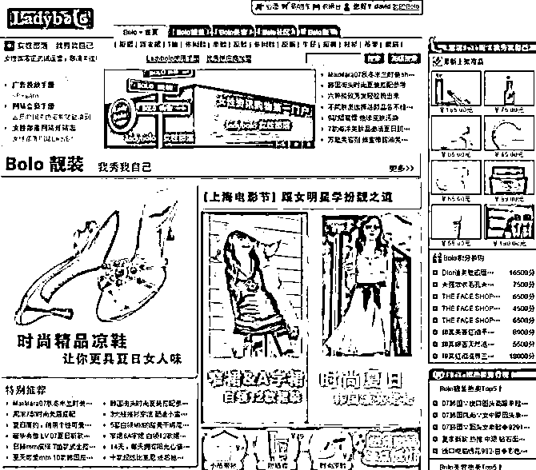

那时我们钱少，不投付费广告，也不懂SEO这类免费流量玩法。推广只有两招：去论坛发帖；自己拍视频传优酷，在片子里塞网站广告。流量有一点，少得可怜，一直没起色。撑半年，关了。这是我第一次做平台型创业。

关站归关站，2008年初它竟拿到上海互联网站长大会“最佳草根创业之星”奖。评委有原新浪创始人王志东、大众点评CEO张涛、艾瑞网CEO杨伟庆、百姓网创始人王建硕等。给奖理由：资讯与购物结合得不错，方向有价值。算虽败犹荣。

后来蘑菇街、美丽说冒出来，我才想通：当时不该走图文内容导购，该直接做读图导购。可那会儿淘宝卖家图片普遍糙，没模特、没专业摄影，观感差，读图模式也难成；而蘑菇街美丽说出现时，淘宝商品图已精美许多，店家大量请模特和摄影师，图片导购自然顺。一个商业模式方向对，落地解法与天时地利人和同样要命，做过产品的人应有体会。

“女性部落”停后，2008年初我和朋友南下广州，在淘宝开店卖二手笔记本。广州产业链成熟，国外淘汰机进来，换硬件、修一修，能弄成七八成新。我们判断：网民会随互联网暴涨，网吧用户迟早要在家置电脑，笔记本需求会起，得抓这波。

生意起初确实好，一天发几十台。麻烦也扎眼：淘宝竞争凶，没付费推广，只能压价，让买家按价格排序时靠前，一台均利两三百。发货还得保价，又添几十成本。客户收货常纠缠：说好硬盘100G，怎么显示80多G？内存512M，怎么只有475M？懂行的知道正常，客户不懂，只能赔几十上百安抚。七算八算，一单剩百来块。

更狠的是退货：收回来的机器，要么摔坏，要么是个空包，电脑没了，损失大。库存也压人：拿得多单价低，可货堆着卖不动，全变成本。整体一盘账，模型不成立，赚不到钱。半年多，又停。

我七月回上海，那阵子真懂了“创业不成一场空”。身上现金几千，交完房租剩几百当生活费，像样衣服都不敢买。后来找同学借几千，才熬过去。朋友也回了上海，转卖女鞋，做得不错，一年几百万。

我没再开店，去朋友公司干了半年多。2009年初，经另一位朋友引荐，认识返利网创始人Gary，加入返利网，重回职场。

三次小创业，可总结的不少。最早淘宝店模式其实很好：轻，且能规模化复制。比如做店群，开几百家运动鞋店、几百家女装店，赶上中国电商和淘宝快跑，一年几千万甚至上亿都可能。后来天猫起来，注册品牌做天猫店也是好路。那些年赚大钱的人，不少就是做淘宝无货源店群和大卖家。而我偏偏去做平台，九死一生，错过随淘宝壮大的红利，至今仍觉得是最大赚钱机会之一。当时认知太窄：嗅觉不慢、入局也早，却没想到能这样放大，只当副业玩，本质还是小农思维。

卖笔记本踩的坑，让我多年怕直接卖货，不敢碰货，只做偏轻的流量项目。有时也是品类问题：最近认识几位在抖音卖货的朋友，售后少，毛利还能过50%。

## 三、“返利邦”阶段

三次小创业后，我停了三年，安心在职场攒经验。那几年细节，可以翻我先前写的返利网上市背后小故事。

2011年6月30日，是我在返利网最后一天。7月1日，我搬进上海宝山顾村海宝创业园区，启动淘宝返利网站“返利邦”。

初心不绕：看好淘宝返利的大盘子。我在返利网时，主要做京东、凡客、唯品会、当当、亚马逊等B2C返利导购；淘宝占电商九成市场，却没开放数据接口，淘宝返利做不了。但我一直判断：一旦淘宝开接口，市场会很大，所以持续盯着。

为验证，我先做小试验：自建网站，调用淘宝联盟频道，告诉用户从这里去淘宝下单，成功后到后台提交订单号即可返利。实际返利全由我人工处理。

冷启动在百度贴吧：发帖说淘宝购物还能返利，配返利到账截图，简单介绍站点。靠这帖子攒下几百种子用户。每个注册用户，我逐个手动发邮件；每笔返利到账，也人工通知，维护得很细。后来又加邀请好友奖励。踏实跑两个多月，月佣金轻松过5万。

模式跑通后，我没急着融资，想再测一阵，看能否低成本、规模化放大，找到增长方法。

2011年某个周末下午，我在办公室加班。一位认识多年的朋友在QQ上问：“老胡，要不要出来创业？我给你介绍投资人。”两周后，我们在上海中山公园附近和投资人吃饭。对方信任我，一周后签了份两页纸的简单投资协议，投资款直接打我个人银行卡。

说实话，出来时我犹豫过：返利网刚完成A轮千万美金融资，薪酬福利都在涨。纠结两天，还是决定走。想法朴素：创业不成，大不了回去上班；被创业磨过，能力也许更强。

于是，投资人给69万，我自己添5万，共74万启动资金；带一个技术、一个客服，三人开始草根创业。

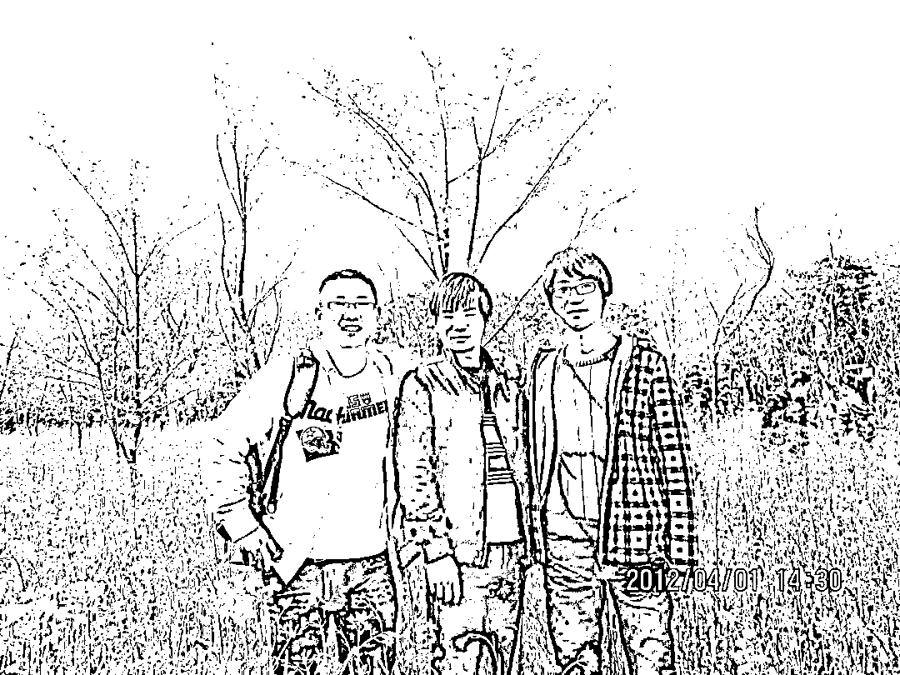

办公室为何选宝山顾村那么偏？技术开发住那边。为方便他，我在附近园区租了间小屋，只能坐四人，月租1200。干三个月，换到可坐八人的办公室。当时目标：一年后进城，至少搬地铁站附近，方便未来同事通勤。

我们花一周开发新站，导入老种子用户，随后推广。起初只强化邀请好友功能，靠它做前期裂变。

后来朋友介绍，我找到微博草根大V合作。本意试水，谁知那天中午广告一发，流量猛到把服务器冲崩，吓得够呛。等访问回落看数据：注册用户成本仅2毛；一周后看购买，产生购买的用户成本才2块，基本一周回本，太划算。

这次投放把我三观刷新了：一个草根大V竟有这么大能量。之后我调整策略，停掉其他付费渠道，集中打微博。但最大技术坎一直在：微博推广一来高并发，服务器就扛不住，瞬间崩。技术侧始终拿不出方案，我们也不敢猛投。技术瓶颈直接卡住网站发展。

低成本、规模化增长的路找到了，却被技术锁住，没法放开跑。我陆续找过几个PHP技术人员，始终没遇到合适的技术负责人，团队实力偏弱；之后一年也没找到能扛事的人。

只能慢慢走。这个项目第一年只投15万，却做到1000万+年佣金收入。

2013年才算补齐产品与技术两块短板，网站完成一次大改版，高并发流量压力终于能接住。但另一边，拉新成本已经涨得离谱：2011年每新增一个注册者不过几毛到几元，到这时却要二十至三十元。想像2011年底那样靠低价快速铺量，已经行不通。

于是运营重心转到产品打磨和体验优化上，指望新流量进来后转化更好，从而把单个成交用户的获取成本压下去。效果有一些，可对大盘增长贡献很有限，只抬升了一小块。

那段时间，产品体验、用户路径和数据分析确实下了不少功夫，在同行里能排到前列——细节这里不铺开。

但这只是内部功力。真正关键的用户增长始终没撕开口子。我们也试过多种渠道，测完发现获客太贵，不敢放量。

好在产品驱动带来一条可用的增长线：我们成为业内第二家推出单品高佣金返利导购频道的平台，频道名“超级返”。我们搭了商务拓展团队，直接找淘宝商家谈高佣金返利合作，说白了就是用高额返利做商品特卖导购。频道刚推出时数据很猛，首月佣金就超过200万。

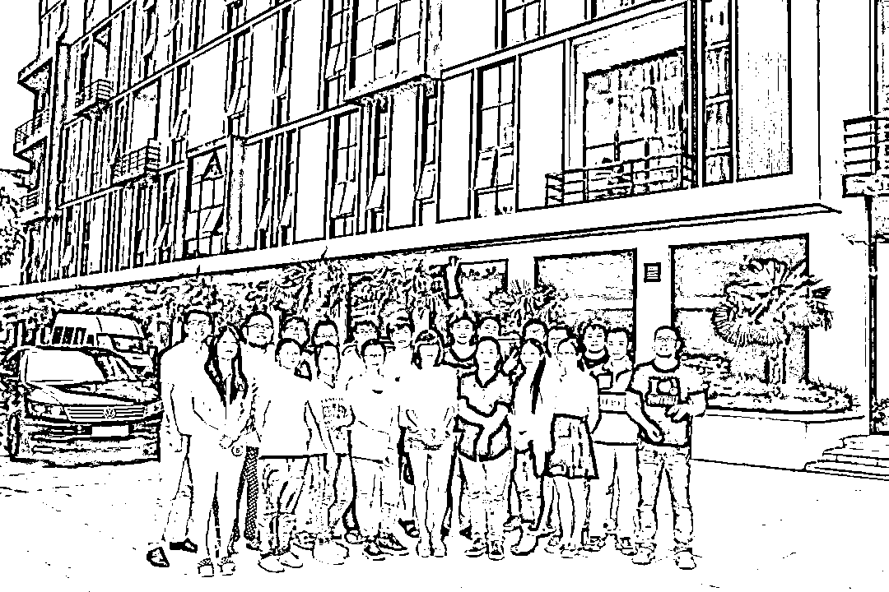

（返利邦团队当时的合影）

不过“超级返”面世后，对原有搜索返利产生分流。老用户发现这个频道返得更多，便改从这里下单，搜索返利的使用随之下降。

当时普通搜索返利毛利润率能到60%，超级返只有10%。因此我们始终没敢把这个频道铺大，只把它当作增强用户黏性的产品来养。

另外2013至2015年间，淘宝联盟几乎年年对返利网站出重政，每一轮调整都可能是致命一击。这让我不敢在返利业务上重仓，担心刚投入就因政策转向而归零。

那几年做返利，赚是能赚，但前景充满巨大不确定，像头顶悬着一把随时会落的剑，天天提心吊胆。

这段往事，感兴趣可翻我此前写的《老胡：白话版解读淘宝联盟506社交淘客新政》，里面有那几年淘客政策变化的详细梳理。

2013到2015年，我们越来越感到返利淘客业务的天花板，内部开始试水其他方向，寻找转型出口。值得拿出来讲的有三个小项目。

第一个是2014年初的积分墙。熟悉这行的朋友知道，那几年积分墙很火也很来钱。这也是公司头一回从PC互联网往移动互联网转，而此前团队对移动端几乎零认知，纯属门外汉。

我们的返利用户本来就爱占小便宜，而移动应用推广里积分墙正热，我们也清楚这模式能盈利——本质是用户下载APP，我们给返利，和返利业务逻辑相近。

于是招了一批移动应用开发人员来做。产品刚成形，苹果市场就出新规：积分墙类产品禁止上架。真是当头一棒。

对第一次碰移动互联网的团队来说，当时全懵了。上不了应用市场，就等于没法推广。虽然提交审核时做了不少隐藏，还是被苹果识破；每回上架要等一两周审核，结果总是失败，团队又沮丧又迷茫。

走企业分发？用户体验很差，而且每个企业证书的下载次数还有上限。

只做安卓市场？利润率又低。我们那时啥也不懂，纯移动小白，不知道如何破局，突发状况也处理不了——准确说是不知从何处理。三个月后项目放弃，只留安卓应用继续维护。

后来才听说，其他公司也在做同类产品，有的走公众号，有的买大量企业证书走企业分发，总体还是赚了钱。

虽然我们的积分墙没做成，但做这个产品时认识了一位朋友，他们后来把同类产品做到国内头部。也因为这段缘分，后面还有故事，以后再说。

第二个是2014年中O2O正热，我们跟风做了“趣健身”，想把健身房年卡改成次卡。可除非自建健身房，这模式根本跑不通。我们只投了少量钱，后来就停了。这个项目在我去年那篇减肥文章里详细写过，感兴趣可去公众号“老胡地盘”看《不运动一月减肥15斤，我是如何做到的？》。

第三个是2015年初，我们看到微信朋友圈的价值，做了公众号“蚂蚁差事”，让用户兼职转发广告赚钱。用户转发指定广告文章，朋友圈有人浏览，就按浏览次数发奖金。这模式有点像后来的“趣头条”。

不同在于，我们会把每篇广告包装成有一定可读性的文章，帮客户推广。产品推出后效果很好，用户量涨得飞快。

但最大问题很快出现：狼多肉少。用户每天大量涌进来，广告主却少得可怜。没有广告主，用户就没广告可转，也就赚不到钱，非常尴尬。

当时公司没有专门广告销售团队。为解决这个，我跑了不少广告公司，包括大型4A，希望从他们手里接客户，提供朋友圈广告转发服务。可广告公司对此兴趣不大——他们主要做品牌广告投放，对这种CPM业务接得少。

项目又跑了三个多月，广告主供应跟不上，用户逐渐流失，最终内部停掉。

后来“趣头条”起来，2016年我和趣头条董事长谭思亮聊过，才恍然大悟。

同样是信息分发，同样是让用户看广告赚钱，趣头条更聪明：直接做独立APP，提供新闻服务，在新闻里嫁接各类广告，再把广告收入当资金池，对阅读者做激励分配。最后在美股IPO。

这样做的好处是不会出现我们当年那种狼多肉少。新闻每天源源不断，用户每次看新闻都能赚钱，钱来自广告收入资金池。同时趣头条既接各大营销联盟的CPM广告，也自建广告联盟对接其他有CPM需求的广告主，模式更稳。

这里插一句。前两年我和不少模仿趣头条的新闻APP创始人聊过，他们也是让用户看新闻赚钱，但没对接广告主，而是直接和百度联盟合作，从每日分佣里拿一部分激励用户。

我当时问：百度联盟佣金不高，给用户的分成也低，用户怎么会用？

他给了一个让我信服的答案：2015年前上网主体是白领和年轻人，激励太少他们没兴趣；2015年后大量下沉市场人群和中老年通过智能手机上网，这部分人在意小收益，看新闻每月赚几十上百块有吸引力。他们能做起来并盈利，关键是抓到了大量下沉市场和中老年用户。

就这样跌跌撞撞到2015年7月左右，我和积分墙时期认识的那位朋友聊。他们发展很快，月营收能到5000万以上；我们这边一直没找到好方向，几个产品都没跑出来。于是聊要不要两家合并发展，最后从合并谈成了全资收购。

决定公司卖不卖那几天，我极其纠结。卖，不甘心这几年的付出，毕竟有做大平台的梦；不卖，独立发展又很难，挑战太大。

那几天茶饭不思。创过业的人懂，平台或公司从零做大，像养孩子一样舍不得。创始人对项目感情都深，而我偏偏重感情。

纠结几天后，我回到创业初心：当初为什么出来创业？一是想做大平台，做到10亿美金级别，未来融资上市；二是想赚钱，让自己富足些。我也不是非要大富大贵，中产小康就够。

这么一想，我果断决定签协议卖公司，拿到一笔当时看还算不错的钱。

后面简单了。2015年9月初他们完成全资收购，我和团队从宝山搬到上海外滩附近办公，仍保留独立办公室。

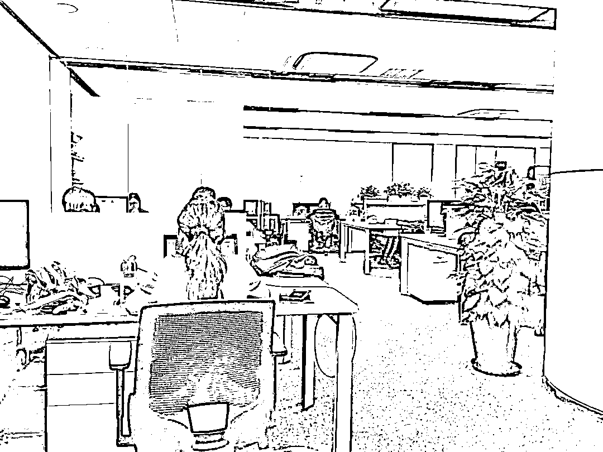

（被收购后我们位于外滩旁的独立办公室）

今天回看，当初决定没错。因为2016年淘宝联盟又对返利淘客出了更狠的政策，业内叫“619新政”，2016年6月19日推出。我此前文章写过，感兴趣去公众号“老胡地盘”翻《老胡：白话版解读淘宝联盟506社交淘客新政》。

至此返利邦时期的故事基本讲完。那几年我个人成长很快。今天看很多是一眼看穿的常识，只是当时认知有限，身在局中不知道。简单总结六点或坑。

**1、对流量红利和窗口期完全没概念。** 比如2011年微博推广，每拉新一个注册者成本两毛，每促成一单购买成本两块。我竟对窗口期和红利感知迟钝，每次投放ROI卡得很死，追求极致性价比，做推广决策还幻想红利期很长、可以细水长流。现在看是笑话。

**2、做平台，技术团队要足够成熟、能支撑。** 这点极关键。我们处在流量红利和窗口期，每次推广流量一大服务器就崩，短期又找不到合适人解决，微博红利期推广处处受制，错过低价规模化获客好时机。再如2012年双11，服务器崩了一个多小时，大量用户下不了单，高并发应对上技术团队很不给力。所以做平台，不管C端还是B端，尤其大流量高并发业务，必须有足够强的产品和技术团队托底。

**3、敢于打破行业规则，把用户体验做到极致。** 2012年初有用户说某同行1元就能提现，我们却要满10元，希望我们也降到1元起提。我清楚1元提现对资金占用和消耗极大。当时同行普遍50或100元才给提，我们10元起提已算低标准，可新网站竟敢1元起提。返利网站用户确认收货就能提现，这笔钱其实是平台先垫，淘宝联盟要次月20号后才结算；若全面1元提现又叠加快速扩张，现金流消耗会非常可怕。但那个同行真干了。因为大量用户怀疑平台是否真返利，他们用“收货后马上提现”解决信任问题，体验极好，后来做成行业头部。几年后我和他们创始人在活动上吃饭聊起，他说当时垫付压力很大，个人找朋友借了上千万现金撑住。我听完竖起大拇指，由衷佩服。他们网站很简单，基本一个搜索框，核心是返利金额够高、提现门槛够低，再加强市场推广，就能快速起量。所以找准核心关键点、把体验做到极致、敢于破规则，对C端平台无比重要。希望大家做平台记住：找到影响增长和转化的核心关键点，做极致化优化迭代，让用户爽到爆，你就能冒出来。

**4、找到靠谱合伙人，哪怕他只能做到你的70分。** 我从返利网离开时没带一个人，后来从外面找了两个小伙伴，但始终没找到靠谱技术合伙人，技术成了前期发展瓶颈。市场又一直我自己操盘，很看重每次投放ROI。后面也面试过一些人，总体感觉一般，达不到我要求，所以这活一直我扛，个人精力有限拖了整体业务。总结：创业要找到价值观一致、能力互补的合伙人或负责人。哪怕他只能做到你的70分，也要把某块工作交给他负责顶起来。这样CEO才有时间出去学习碰撞、提升认知，再回公司反哺业务。否则创始人的认知天花板就是企业天花板。

**5、做平台不能只盯净利润，关键看现金流。** 这是我后来总结的。当时做超级返，佣金涨得快，但毛利率低，甚至影响自然搜索返利利润，所以没敢大搞。但回头看，返利网那几年靠超高返利导购一年能做20亿+佣金收入，且不是所有用户都会提现。这样看利润率低，现金流却很好。现金流一多，经营上腾挪空间就大。只要现金流好，利润率低也能支撑做很多别的事。京东早年的发展很典型：快速扩张时一直不盈利，但和供应商有结算账期，手上现金流充沛，能拿去做很多事；后来京东还把这笔现金流反过来做供应链金融，给商家贷款。

**6、业务瓶颈期，转型也要围绕核心方向探索。** 前面说了，2014到2015我们内部陆续做了好几个项目都没成。最大问题除了认知，我认为是转型没围绕核心方向，而是跑去做积分墙下载、O2O健身、看新闻赚钱。别的团队能成，是因为他们本来有相关积累；我们对那些行业只是表面看懂，遇到实际问题不会解甚至解不了，自然做不下去。如果当时围绕淘客业务转型，比如做基于QQ群的社群淘客，或继续恢复发展超级返，甚至在招商淘客上深挖，都可能不错。我们当年是淘宝联盟第一批开放“鹊桥”权限的合作伙伴，也就是后来招商团长的早期产品。核心方向我们懂、熟悉，跨界过去就成小学生了。

四、再出发：玩好货阶段

2016年元宵节后，我还是想独立创业，年前已和收购方谈好：交割完成我就离开，但不带走任何人，原有团队全保留，项目继续推进。

交割完成后，我一个人从办公室出来，在电梯间等电梯，心里没有窃喜，也没有彻底放松，反而满是失落。

创业四年多，过往画面像电影片段在脑中闪。回想这几年到底得到什么？

到头来不过拿到一些现金，其他似乎一无所获；这些钱也不够实现财务自由，我还得重新创业，从0开始。那种感觉很差，焦虑和失落塞满内心。

很多人可能不理解，觉得我凡尔赛：项目顺利卖掉，现金也到手，该吃吃喝喝、旅游享受才对。

真不是。我是那种不想也不能停下来的人，需要一直在路上跑，哪怕这会把自己拖进创业的无尽痛苦。可在我看来，真正的成长和修炼不是花天酒地、夜夜笙歌，而是过得苦一点才对。人间正道是沧桑，这样才有安全感和归属感——也许我就是这苦命。

我还年轻，暂不想退休。一旦停下，就觉得自己和主流社会脱节，和朋友慢慢没共同语言，对很多东西失去体感；同时我相信自己还有无限可能，所以必须继续折腾。

那段时间做什么，我也没想好。离开后每天看书、跑步、顺便减肥，本来还打算报班学英语，因为想以后去美国自驾游，英语得学好。所以我没急着找项目开启下一段创业，先阶段性调整，同时留意外界新机会。

2016年3月1日，我在家看天猫商家大会。阿里集团CEO逍遥子说，随着4G普及和通信资费下降，未来机会属于短视频，阿里会持续推进短视频在电商领域应用。

这个“短视频是未来”的判断我超级认同，看完大会非常兴奋。

以前做返利导购，多年围绕图文，消费者感知有限，基本靠价格优惠刺激下单。若能用短视频带货，不仅能360度展示商品，还有专人出镜，通过短视频全方位介绍货品，让消费者对产品感知更强。短视频场景的带货转化力，一定会超过过去的图文。

说干就干。我马上找一位在宁波创业的朋友聊这个项目，他也很兴奋，索性把宁波公司关掉，搬到上海一起干短视频。他负责整体产品，另有一位合伙人辞职加入负责技术，三个人的核心团队很快搭好。

接着找投资人聊方向。当时我们啥都没有，只有三个人和一个大概方向，按2000万人民币估值融了200万（出让10%），加上自己投的一些钱，总启动资金近300多万。

这次创业没一开始就租独立办公室，而是选了联合办公空间——杨浦区长阳路优客工场。办公室定好后马上投入产品规划和开发，产品名“玩好货”。

本来想叫“好货”，但相关域名被注册了，只能改成“玩好货”，还专门花5000块买了wanhaohuo.com域名（至今躺在我阿里云账户里）。前期全是我们三个人干，没招员工。

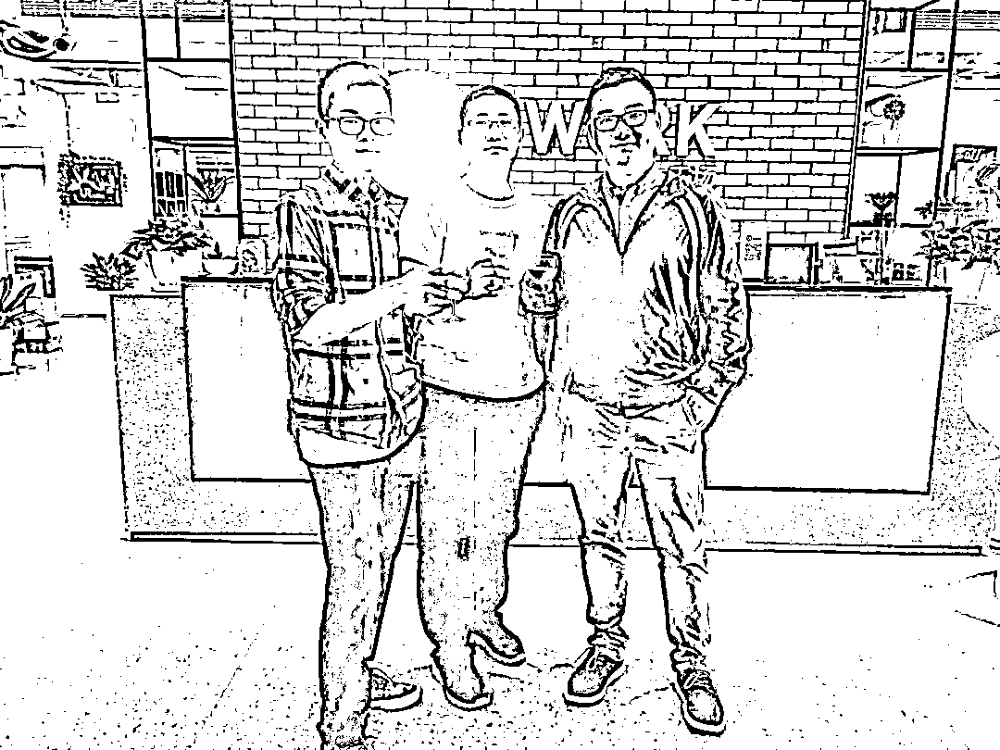

（我们三位创业合伙人）

等产品底层和后台开发得差不多，我们才开始正式组建团队，最先招的是财务和人事。

那一次创业，我们打定了主意要全力以赴。按照计划，半年内拿下A轮融资，一年内完成B轮。复盘之前的经历，我认定财务和人事必须放在重中之重，所以项目一启动，这两个关键岗位就早早到位。

差不多到第三个月，一支精简的队伍已经成型。除了财务和人事，前期核心力量集中在产品和技术上，同时也有少量商务人员。

这套模式包含一个独立APP，主打短视频导购。用户点开APP，刷到的都是和购物有关的短视频；看中商品可以直接在站内下单，我们再把订单通过接口同步给淘宝，让商家发货，佣金则来自淘宝客的百川接口。懂技术和资深淘客的朋友应该秒懂，专业细节不再赘述。

既然依赖百川接口，就得跟商家逐个谈“渠道专享价”，请他们给我们设置最低的隐藏折扣。这有点像淘客的隐藏优惠券，但不是券，而是直接减钱的专享价。没有这个价格优势，用户一比价就跑了。所以，商务团队必须铺开。

另一个需要大量商务的地方，是内容供给。如今购物短视频全网泛滥，可2016年时几乎找不到。那时候淘宝商家还在用图文，没人把短视频当主图或详情页。我们于是让商务去谈达人和商家：帮淘宝商家拍短视频，不收钱，但他们要寄样品给达人；达人拍完传到我们APP，挂上商品，最后靠淘宝客佣金分成。

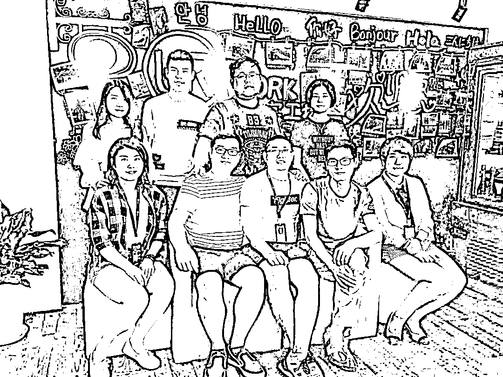

（玩好货早期小团队）

中间的过程就不细讲了，直接说结果和复盘。

2016年底，项目正式停掉。之后我陷入了一段轻度抑郁，持续两个多月。那段时间不想说话，看什么都提不起劲，对生活失去了热情，每天只剩下自责。

抑郁不是亏钱导致的，而是那种落差感：年初朋友们刚祝贺我套现再出发，项目推进中，一批批投资人来谈合作——虽说很多是借着投资的名义来学习和取经——这让我们都觉得短视频项目前途无量。可结果呢？不足一年就草草收场。

我也开始怀疑自己，仿佛一无是处。明明从理论上分析短视频电商一定有未来，为什么偏偏做不成？是我们的判断错了吗？后来2017年做总结时我写过：不是这条路不行，而是我们没找到正确的走法。

为了自救，我专门去看了心理医生，但问题并没被解决。最后救我的，是跑去海南环岛骑行了十几天，回来后整个人都好了很多。想了解的可以翻我写过的《老胡的2017总结：我总算混过去了!》

重点说说“玩好货”留给我的几条教训。

**1**、趋势是对的，但入场早了。

放到今天看，短视频和直播带货早已全民化，方向当然正确。可在2016年，这还是个巨大的未知数，质疑声很多。当时国内做电商短视频的APP也有十几个，不少还拿了融资，但绝大多数没能跑出来，最后转型了。问题不在趋势，而在于当时的环境根本不成熟。

那时候抖音还没出生，淘宝商家连短视频都没有，我们却急着做短视频导购——实在太超前了。

拿美丽说、蘑菇街举例，如果他们诞生在2008年，大概率也做不大。当时淘宝卖家的图片都很粗糙，也没有专业模特和摄影师，硬做图片导购，同样会卡在素材差、观感差、留存转化上不去的困局里。

时机不成熟，意味着所有环节都要自己扛，这对我们来说太重了。

光做一个独立的导购APP就已经不轻了，接下来还要搞定拍摄、找达人、付拍摄费（当时每条200元）、选品、商家供样、谈专享价，最后还得自己去做APP推广和增长。每个环节都很重。

需要解决的问题一环扣一环，而我们只是个创业小团队，启动资金只有几百万，根本撑不起这件事。

今天回看，2016年底停掉它是无比正确的决定。天时地利人和一样都不占，创业不能只盯着趋势，还要看客观环境成不成熟、上下游产业链撑不撑得住，否则就是当先烈、当炮灰。

**2**、与其自建 APP，不如挂靠大平台做内容。

前面提到，需要解决的环节实在太多。如果重新选切入点，我会彻底换思路：不建独立APP，也不需要产品技术团队，而是直接入驻成熟平台做内容。当时抖音还没出来，但快手在下沉市场已经很火了。

如果当时组一支内容团队，去快手做电商导购或相关内容的矩阵号，事情会轻很多。

不用开发APP，就不用养大批产品技术；不用大量BD去磕淘宝商家，找几个能产出内容的达人合作就行；更不用推广独立APP，直接在快手上养账号、吸关注，流量来得容易得多。

到了2017年抖音出现，我们还能同步入驻，做最早的创作者，赶上那波短视频红利。如果真是这样，今天可能就是另一番景象了——可惜没有如果。

这一点可以延伸出很多。如今创业，绝大多数情况下别去做独立平台，成功率实在太低了，更现实的是围绕大平台做生态业务。

就好比我们淘客，一直是围绕阿里做电商导购，跟着阿里生态成长；公众号、微商、社交电商、私域带货，还有微信里的各种工具与服务，都是吸附在微信生态上，随着微信壮大而壮大；短视频和直播，则是傍着抖音、快手生长。

所以认准方向后，直接进平台去做就够了。跟着平台一起长大，我们只需要专注解决一两个小问题，平台的大船往前开，我们搭着船乘风破浪，要简单得多。

这一点真的非常关键，重要到说三遍都不够。

**3**、纯短视频电商导购，很难独立存活。

这条也很有价值，我去年就计划写一写淘宝短视频的看法。

跟朋友交流时，我的看法是：如果阿里当年预见到短视频和直播的趋势，就不该只在淘内做，而应该单独立一个APP，并且这个APP不能只装购物内容。

假设阿里的战略部门在2016年就看见这个趋势，两条腿走路：一边在电商业务里加短视频和直播，另一边单纯做内容型短视频，类似看到抖音后让优酷团队也上马，采用腾讯式的多产品赛马，也许真能跑出来。

原因很简单：用户打开一个短视频APP，满屏都是带货，浏览价值会大打折扣。除非是PGC精心制作的高质量内容，否则很容易让人反感。

当时“玩好货”里的内容绝大多数是UGC带货视频，一条三分钟左右。让用户盯着手机看三分钟一个人讲产品，确实枯燥。推广后留存和转化都很惨。

再说浏览效率。短视频确实能多角度展示产品，也有人出镜讲解，但还是比不过图文——三分钟刷图文，能看好几十件商品。

所以，淘宝的短视频和直播做不到抖音、快手那种效果。淘宝能做起来，核心是靠手淘的巨大流量池，而且用户本来就是来购物的，短视频和直播在这里只承担转化提效的角色。淘宝后来推出几个独立的短视频/直播APP，都没做起来，本质也是这个原因。

抖音和快手本质是泛娱乐内容平台，用户刷到的是生动、有趣、能学到东西的内容，由此产生依赖和沉浸；在这种氛围里穿插购物类内容，用户不会觉得打扰，反而觉得新鲜。加之粉丝本来信任达人，达人推荐的东西自然愿意买。

不过，目前购物类内容在抖音快手上的整体占比还不算高。我猜两家平台都有意控制这类内容的流量，不然会挤压常规内容，影响体验。从这个角度看，抖音未来做一个独立电商APP几乎是必然。

快手会不会做独立电商APP，目前不好说，但问题已经比较明显。快手日活只有抖音一半，却想在电商GMV上和抖音打平甚至反超，那就只能把更多流量分给电商内容。长期看，这对常规内容的挤压会越来越明显，用户的浏览体验自然会受影响。

**4**、创业团队别给自己划太多边界。

决定停掉“玩好货”时，团队也聊过其他方向。我当时的想法是，为公众号作者做卖货供应链服务。

也就是找一批好货，上架到有赞这类平台，再去谈公众号作者帮忙带货，发货和客服都我来承接。后来确实有团队做成了，赚了不少钱。

可另外两个合伙人都是产品技术出身，供应链不是我们的强项，既没信心也没兴趣。内部讨论转型时很难统一意见，最后就放弃了。

现在想，这就是自我设限。虽然短视频项目亏了钱，但公司账上还有上百万现金，转型其实有空间，可惜我们没动。

这一点可能不算关键，但值得记一笔。创业团队别给自己太多条条框框，本来就是光脚不怕穿鞋的，干不死就往死里干。方向不懂就去学，人不够就招，只要公司账上还有钱，就该多试。也许新路就在尝试里走出来了；试不成、现金流断了，大不了死掉。创业本来九死一生，胜败都是常事。

梁宁有句话我很认同：战争以一方失去战斗意志为结束。

遇到天大的困难不是问题，穿越周期也不是最难的，核心是主导者的战斗意志。企业之所以死亡，往往是因为主导者的意志先破产了。只要意志还在，资源、机会、下一把，都还能再来。

史玉柱就是最好的例子。珠海巨人破产后，他四处找人，凑了50万，做出脑白金，东山再起。这就是主导者战斗意志和作战技巧的典范。

五、转战“兔子优选”

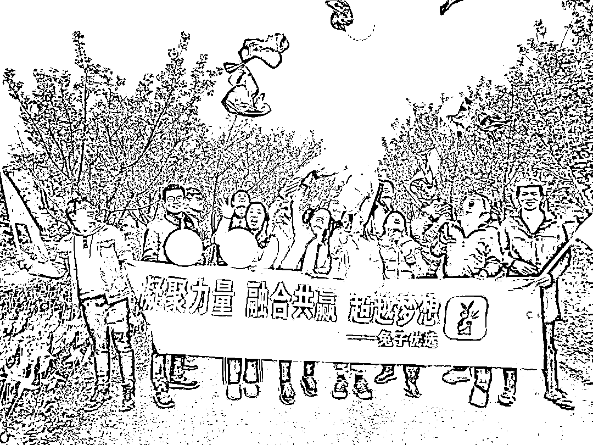

（兔子优选期间创业团队）

短视频项目结束后，2017年我基本在休息调整，过得挺轻松。春天每天早起跑3到5公里，回家泡杯茶，坐在阳台躺椅上晒太阳看书，还给自己定了几个小目标。这些之前也写过，详见《老胡的2017总结：我总算混过去了!》

3月，我去香港旅游顺便办事，没坐飞机，改坐高铁，因为想去沿途走走。第一站从上海到厦门，见了两个朋友。他们刚结束一个家装分期项目，正在找新方向，聊下来提到了一个机会：现金贷超市，简称“贷超”。

我虽然一直做电商淘客，但本质上也是流量变现。身边已经有朋友在做贷超，非常赚钱，商业逻辑和淘客几乎一样。

理解起来很简单：以前我们给淘宝导流，靠购物赚佣金；贷超则是给各种现金贷APP导流，按CPA结算。一个用户能被反复卖给几十上百个贷款APP，利润极高。

聊完后，两个朋友拉我一起干。但我年初就定了2017年要休息，不想再启动创业，就没答应，只是保持着联系。

哪知道这两位为了拉我入伙，每个月都发业绩报告来。我眼睁睁看着他们的利润从几十万涨到几百万，再到上千万。

休息到2017年9月，我觉得差不多了，该做点事。但上海到厦门太远，不方便，我就跑到杭州，打算和另一个朋友合作启动贷超。10月到11月都在学习和筹备，正要动手时，12月1日央行发了个公告，开始整顿现金贷。

公告明确要求小额贷款年利率不能超过36%，禁止暴力催收。

看到这两条，我就知道贷超这方向没法玩了。利率上限直接砍掉现金贷的利润空间，禁止暴力催收又堵住了回款手段。因为当年大量现金贷APP基本没有像样的风控，最管用的就是人工催收。

现在回头看，庆幸当初没碰贷超。前两年不少干这行的朋友都栽了进去，还是电商卖货和导购更稳。

不做贷超后，我一时也不知道干嘛。人已经到了杭州，总得在这边继续找项目。看来看去，发现了社交代理淘客这个新玩法。

调查下来，这个模式刚刚兴起，有些APP增长快得惊人。我做了多年淘客，一眼就看明白了：本质是淘客加社交代理裂变。于是我找了个朋友，帮我开发一个独立demo，上架到苹果商店，先小范围测。

产品取名“小群助手”，就是希望帮助手握微信群流量的人，用淘客来变现。冷启动很简单，之前文章写过多次，这里再讲一次。

身边很多朋友知道我做淘客多年，但自己想学又入不了门——传统淘宝联盟太复杂，门槛高。社交淘客代理APP就简单多了：下载注册，然后分享商品就能赚钱。

于是我在朋友圈发了条消息：免费教大家做淘客赚钱，但每人要交99元押金——一个月内赚到99元就退款，赚不到不推，感兴趣的点个赞。

那条朋友圈有50多人点赞，我最终挑出30个符合条件的宝妈，15人一组，分两批在微信群里培训，花了两个星期。慢慢地有人开始赚钱了。培训完差不多就过年，我在老家休息，也没怎么看后台。

年后回来看后台，吓了我一跳：半个多月，最初的30个宝妈用户竟然带来了2000多个APP用户，淘宝联盟的收入也从几千块涨到了20万。这太惊人了——按传统投放逻辑，要做2000用户和20万佣金，至少得砸10万营销费用。

看到数据那一刻，我才真正明白，市面上其他几家社交代理淘客APP为什么能迎来爆发式增长。2018年3月，我正式决定all in这个方向。我找了一位朋友聊，就是之前在上海一起做短视频的合伙人。我们本来商量好到杭州发展，他从宁波来，我从上海来，起初没打算合伙，只是各自探索。

但我决定投入后，和他深聊了一次。他也特别看好社交代理淘客，随即停掉自己在做的项目，决定一起合伙。接着找投资人，和上次一样，按2000万估值出让10%。

跟前一次一样，起初没招任何员工，就我们两个人。他负责产品和技术，我负责其他一切。我们从西溪湿地旁的腾讯众创空间搬到华星现代产业园，跟好省联合办公。由于“小群助手”的demo是在好省底层上开发的，所以我们得先从好省的架构里剥离出来。

剥离用了差不多一个月，期间只招了一个财务，兼管客服和给用户打款。2018年5月，我们从华星搬回腾讯众创，重新招兵买马，快速组建了十多人规模的产品技术团队，对APP做全新重构。8月8日正式上线，“小群助手”更名为“兔子优选”。

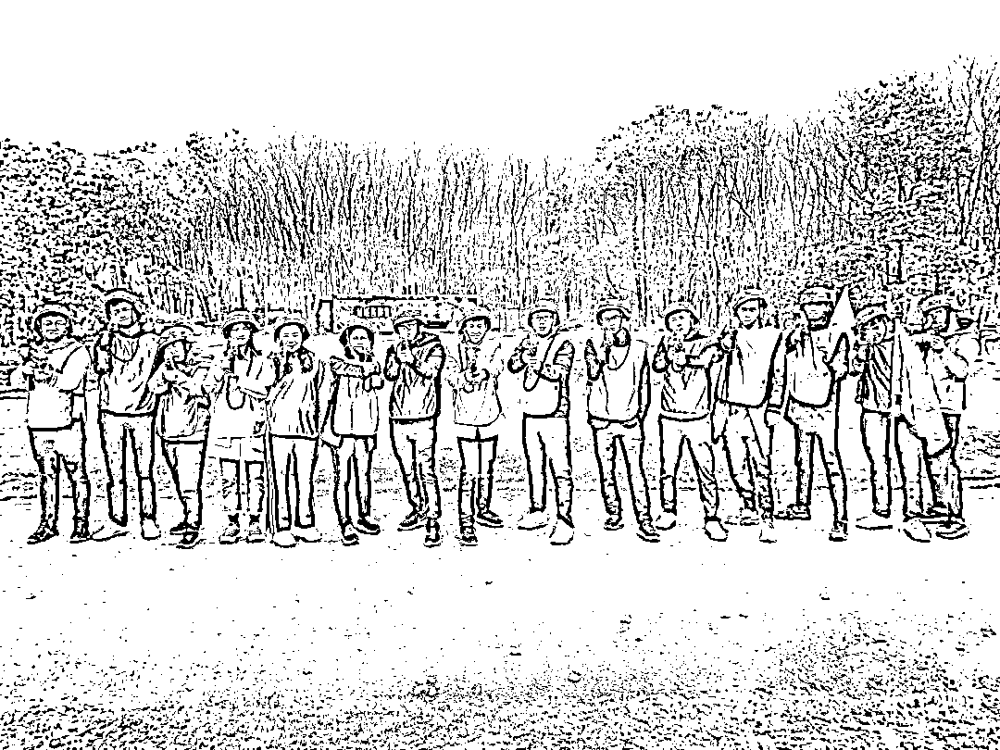

（兔子优选期间我们团建打真人 CS）

更名重构后的“兔子优选”，界面和体验已经和市面上主流社交代理淘客APP不相上下了。那段时间发展很快，佣金从几十万做到上百万，只用了两个多月，代理用户也快速突破10万。

但很快瓶颈来了。我们最初靠普通宝妈裂变起步，并没有大KOL或微商团队长进入。加上我们刚从纯流量玩法切换到代理制，认知还远远不够。

当时我犯了个严重错误：以为靠普通人裂变就能快速起量。毕竟拼多多就是靠微信生态里的普通人分享做起来的，我们也靠这条路径做到了百万佣金和10万用户，数据好像证明这条路走得通。

但我错了——我把“社交电商”和“社群电商”混为一谈了。

拼多多是典型的社交电商，靠拼团、砍价让C端用户去裂变；而社群电商更重KOL的运营、培训和管理，靠这些小B去扩张团队。两者完全是两套打法。

前者模式简单，抓住C端裂变就行；后者复杂得多，必须结合微信群的培训和日常管理，本质上是微商那套小B运营逻辑。

那些年我们深耕电商导购，可对微商、社群电商的理解几乎是一张白纸。我脑子里还是老一套流量打法，总想着把产品打磨得更顺，让 C 端用户替我们完成裂变。现在回看，这个判断错得很彻底——不是这条路不能走，而是它只配当配菜，不能当主菜。

到 2019 年中期，账面数字看着还行：用户超过 50 万，日活过 10 万，月佣金突破 300 万。可增长来源依旧是老用户自然裂变。大微商团队没拉进来，甚至不知道该去哪里找。朋友牵线聊过一些微商，多数没下文：有人不感兴趣，有人不愿放下手里的微商项目，还有人觉得淘客利润太薄、没意思。

于是盘子越走越慢。产品和代理层级设置逐渐落后于同行；当普通用户资源被消耗得差不多，自然裂变速度掉下来，运营开支却月月抬高，收入不再增长，焦虑随之而来。

当时我们与别的社交代理淘客 APP 的差距，主要卡在两处：

1、代理层级只设了 2 级：初级叫合伙人，高级叫团长。层级少，代理之间的利益纽带很快会松掉，后来不少社交电商平台也栽在这上面。代理抽成机制最好在起步时就定清楚，中途再改，震荡会很大，代理大批出走，平台可能遭受致命打击。我们那时已有一定体量，若重设层级，现有代理收入会受冲击，军心容易散。因为只有 2 级，团长抽成给得高，很多中小团长每月能拿几千；而层级更多的平台，普通团长收入偏低，头部大团队长升到最高级后月入可达几十万甚至上百万，明星效应很强。我们就卡在历史包袱里：改利益分配、加层级，现有团长作为既得利益者会不满，收入会降；不改不增，头部团长看到别家头部收入更高也会不满。进退两难，当时没找到好解法，结果一些头部团队长离开，增长和发展受影响；新的强团队长也没引进来，增长更慢。后来我看到同行的解法：一种是不太迁就小 B 感受，直接改，流失就流失，重点让头部大团队长满意，头部收入上去后自然会带住下面的人；另一种是另起炉灶做新平台，一开始就把分配机制和代理体系设计好，再把老平台用户按原有层级迁过去。

2、在多平台支持上，我们也做得不够。很长一段时间只围着淘宝转，没有接入更多平台。原因是我判断这类 APP 核心仍是淘宝导购，其他平台是配角，无论用户选择、订单数还是佣金体量都小，投入太多心思不划算。而且接入更多第三方平台，可能让淘宝联盟不高兴，也会加重运营负担，要添商务、客服、财务，对大盘增长帮助有限。那时淘宝联盟并不希望淘客代理 APP 接其他电商平台，不过有同行照接不误，联盟有意见就安排下线，后来也管得松了。做返利导购多年，我太清楚 B2C 平台的结算、丢单等问题会带来多少麻烦，人力财务又有限，所以选择以淘宝为主。这里我又错了：独立 B2C 的订单和佣金占比虽小，可仍有一部分用户有在其他平台购物拿佣金、查优惠券的需求；更关键的是，接入平台越多，不管对用户是否有用，代理都会把它当成推广噱头，发展下级时可以说“我们接入了多少家，主流平台都能返利，衣食住行吃喝玩乐都覆盖”。说白了，多平台接入是给代理做推广赋能。

这两个问题叠加，挑战越来越大：增长变慢，原有代理流失，收入开始入不敷出。我们开始反思，独立平台太难做，于是动了卖掉兔子优选的念头。先后谈过导购领域头部公司和港股上市公司，几轮谈判都没谈拢。后来想，不如和同行合并，省得继续管平台。接触多家后选了和好省合并，原因很直接：双方互相持股，产品逻辑和代理体系又非常接近。2019 年 9 月完成合并。此后平台的产品和技术开发不用我们管，只负责团队长管理和佣金发放，模式轻了许多，成本也不高，就把这项业务当作公司现金流业务来运营。

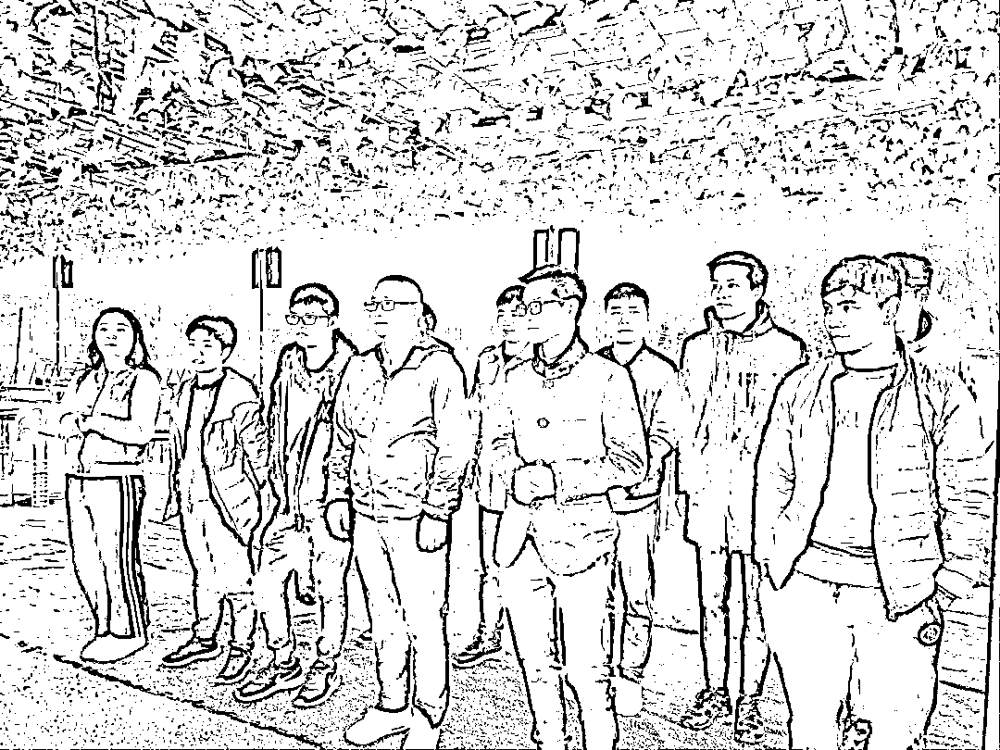

兔子优选这段创业，谈不上成功，也不能说失败。复盘下来，我有几点体会：

1、社交代理淘客，说到底拼的是对 KOL 和大 B 的高效运营管理。普通小 C 不能当小 B 来运营，更不能指望只靠小 C 裂变推广撑起整体增长；那部分只是长尾流量，不是主力增长发动机。

2、代理抽成机制必须在开局就设计明白。后面再动，难度极高，甚至会给平台致命一击。真到了非改不可的时候，就要下决心坚决执行，别被部分团队流失吓住。平台运营得从自身全局出发，否则长远看，对团队长也未必是好事。

3、创始人要亲自扎进代理运营管理里，找到一线体感。我们做兔子优选时，模式本身基于微商代理体系，可我们几个纯互联网出身的人，发朋友圈都觉得不好意思，更不愿和代理打成一片，总觉得那样太 LOW、拉低身段。这个问题不轻。传统互联网人常觉得自己做的是高大上的事，喜欢低调神秘，连朋友圈都要有格调；代理团队长恰恰相反，他们天天高调晒收入、宣扬自己在做的事，在微信群里和旗下代理混在一起。只有在一线，才能找到真实体感，才知道怎么管理和运营团队。

4、做平台是九死一生，不像做生意，前期千万别太盯着盈利。我们之前利润还可以，每月收入能覆盖开支，心态还稳；后来入不敷出甚至亏损，新增长点又没找到，心态就乱了，总怕把投资人的钱亏光、对不住人。其实不该太纠结，投资人给钱就是让创业者去亏损、去把事做大的，不然要这笔钱干什么？道理我懂，只是当时拿的是朋友的钱，不是专业机构的钱，心理压力大。今天回看，不管谁的钱，只要是投资人身份，亏光了也不该有太大心理负担，当然责任主要在我。

5、创业别轻易做平台，这条路 99% 的人不适合。我前后做了近 10 年平台，累计投入几千万，每年利润又投回公司，最后发现远不如那些不搞平台、纯粹做生意的朋友。今天用户红利消失，创业者别再做平台创业梦，最好的窗口期已经过去了。今天首先别轻易创业；就算创业，也要用做生意的心态，先让业务赚钱养活团队，别总想着烧钱扩规模、以后再盈利，那种路子绝大多数人走不通。这些年我也不是没看到做生意机会，只是觉得去做会让公司重心偏移，平台可能就做不起来，不愿为现金流放弃平台梦，现在看像个笑话。

兔子优选这段先写这么多。其实还有很多可写，怕越写越多，3 万字都不够；以后有机会见面再分享细节。

六、写在后面

交了大量学费、吃了许多血泪教训后，从 2020 年起我给自己定了条铁律：短期内不再轻易开发产品、做平台，也不再去想什么十亿美金平台公司梦。至少眼下不做这些，先做力所能及的事，习惯接受自己是个普通人，不再好高骛远，从小生意起步，有机会再慢慢放大。2020 年，我把兔子优选亏损的投资款全部还给了投资人，还给了些额外回报，算是圆满收尾。所以这两年，公司业务基本按做生意思路走，原有代理淘客业务继续运营。有空就写公众号，把自己的思考和老经验分享出去，既给人参考，也希望能帮更多人少走弯路。常有陌生人加我微信，说通过文章了解了淘宝客行业、少踩了坑；有人真进来做，也赚到钱，生活越来越好。每次看到这些话，我都很欣慰，甚至眼眶发热，那种成就感比赚 1000 万还强。公司也在做其他淘客变现业务：今年帮淘宝特价版做市场推广，带动不少淘客圈同行进入淘宝特价版推广，很多人赚到真金白银，也找到了 2021 年的业务增长点。我们还联合返利网做了“满天星”外卖 CPS 系统，帮更多淘客轻松入门外卖淘客，产品易用性和靠谱程度在行业里靠前，已有上千位淘客使用，覆盖千万以上外卖用户。今年 7 月又和拼多多合作，正式接入“群买买”推广，短短 2 个月发展超过 15 万店主，月 GMV 破千万，帮很多大 V、KOL、微商团队长通过群买买变现，也让大量普通用户拿到不错的副业收入。项目增速很快，我们正在设计体系化运营策略，有信心不久做到月 GMV 1 亿的小目标。总之，先按做生意思路踏实经营，帮公司积累现金流，帮团队伙伴提升能力和收入，找到更多有能力、价值观接近、志同道合的人一起往前冲。当下担子不轻，但我会尽全力扛住，持续修炼自己，因为人生就是一场修行。

如果，未来公司有足够稳定的现金利润，我可能还会考虑开发自己的产品。说到底，我骨子里有产品情怀，相信好产品能改变行业、提升效率，也能帮到更多人。至于做什么产品，现在不知道，要看市场需求；这只是我的产品情怀。用数字说，如果一年能赚 1000 万，我愿意拿 500 万投进去。

到这里，这篇 10 年创业总结基本写完，全文超过 2.6 万字，感谢大家花时间读。还有很多没写进来，比如项目判断、市场投放、管理、招人用人等一大堆血泪，但主要复盘和总结都在这了，其他以后有机会再分享。创业路上，不管经验总结多少，我们仍会不断犯错、不断失败。跌倒不可怕，只要愿意再爬起来，战斗意志还在，一切都能重来。所以人得持续学习、试错、交学费、提升认知，这是创业者最重要的功课，甚至没有之一。

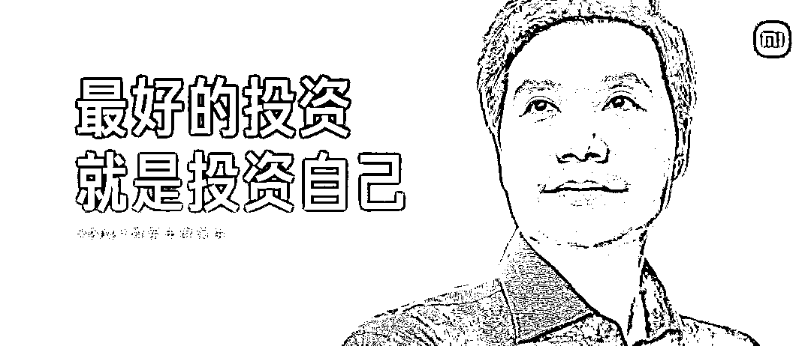

人生终点都一样，差别在于这几十年看到的风景不同。还是要尽情享受这个痛苦又煎熬的过程。等老了回头再看今天，眼前挑战和困难都不算什么，反而会觉得人生精彩、有意思、没白活。最后送自己，也送大家一句话：“身如蝼蚁，也要怀鸿鹄之志；命似薄纸，更须有不屈之心。”让我们一起生财有术，共同致富。

评论区：

纵横领域：身如蝼蚁，也要怀鸿鹄之志；命似薄纸，更须有不屈之心！

老胡：[抱拳]

正在兴旺家族的星佳：三十岁后才明白，成家过日子、成为人生赢家，并不只有创业一条路。可惜年轻时总把创业当成所有问题的唯一答案。

老胡：是啊，创业不是唯一的路，你的选择就很好。

贾飞：收获太多了。

正在兴旺家族的星佳：确实选择大于努力。以前觉得创业要改变世界，有了孩子后，觉得能把家人照顾好已经很了不起。不过创业会上瘾，胡总加油，带更多人致富、过上更好生活[呲牙]

老胡：你看得好快呀

老胡：好，带领更多人一起生财有术，共同致富[愉快]