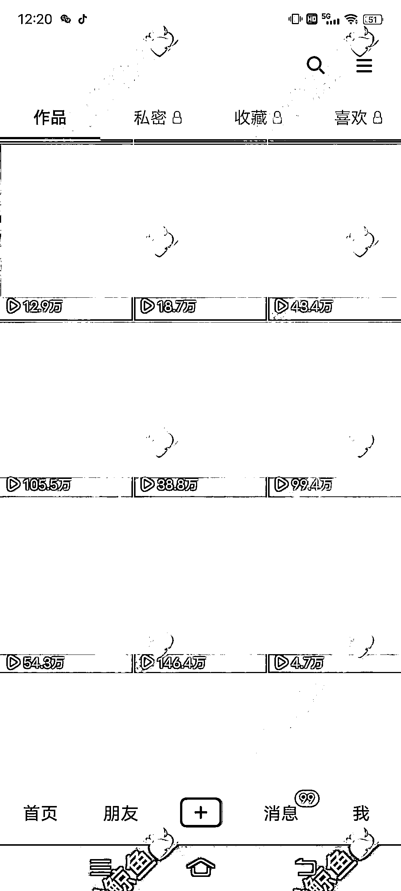
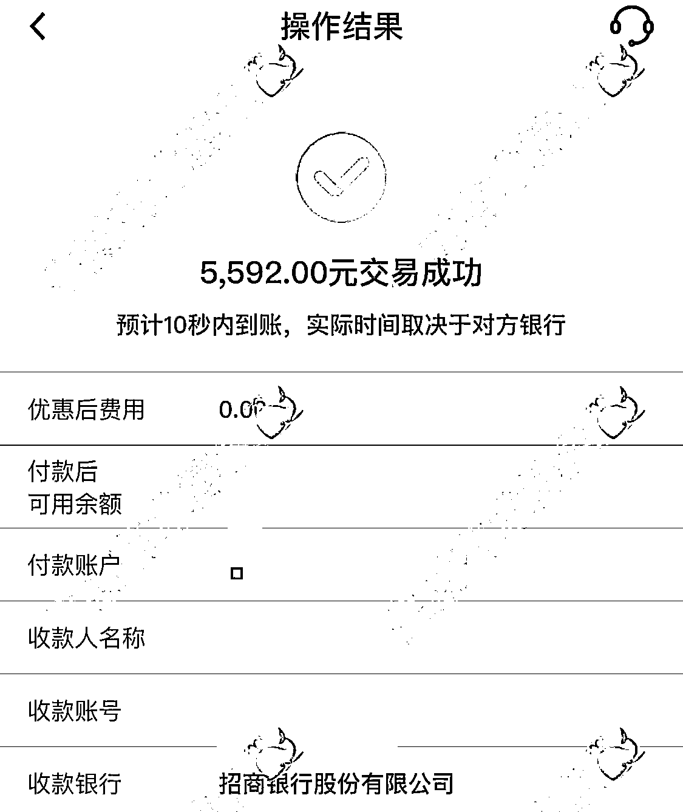
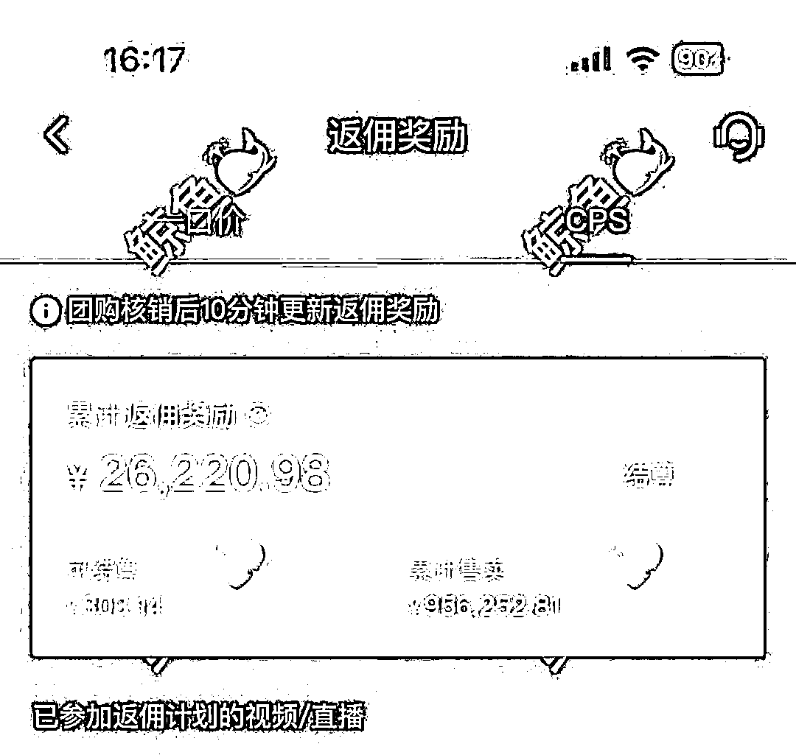
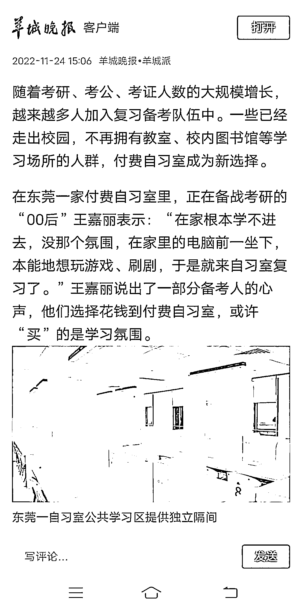
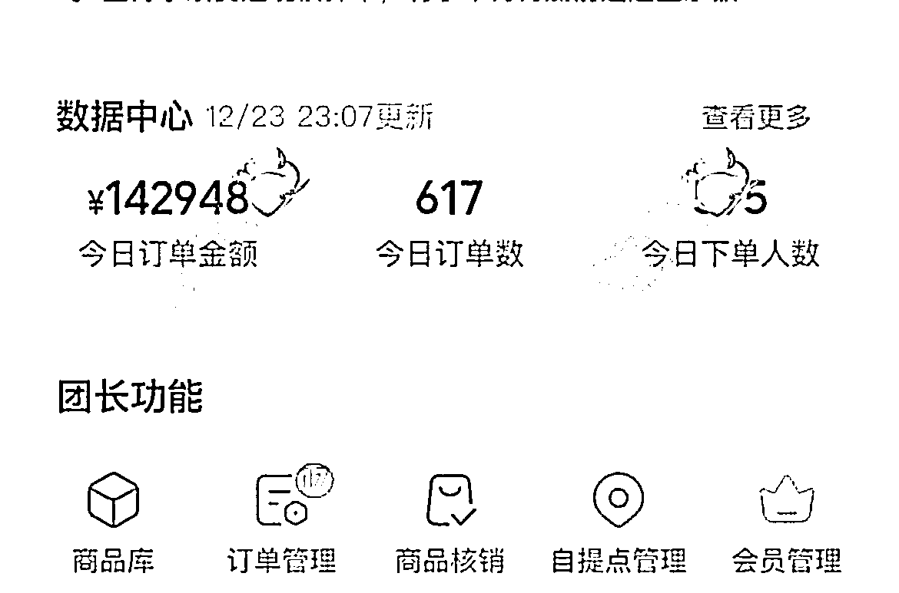
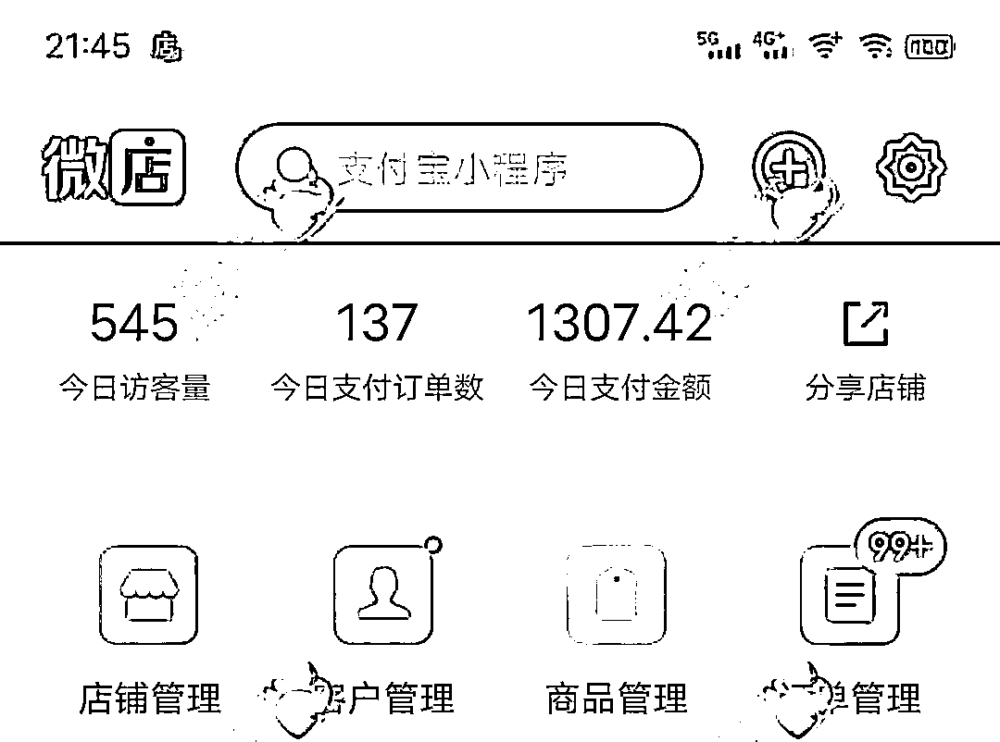

# 背着30万债，半年跑出30万+

我是鲸鱼🐳。2023年2月6日，我把进入龙哥盟后半年的经历写成复盘，后来这篇内容被加精，也收到200个赞。过去我在大厂做算法产品经理，如今主攻抖音搜索流量。

2022年，我加入龙哥盟。半年里，我实操了五个商业项目，说不上多传奇，但每个都拿到了结果；也让我从欠着30万元，走到实际变现30万元+。具体是：

1. 小说推文：做出过3条播放量破百万的视频，冲进过抖音热点榜，一条视频进账五位数；也帮几位学员把单条播放做到百万。
2. 抖音本地团购：两周做到22万元成交额；把打法整理给同城朋友，建议他切入本地服务商，后来帮他做到130万元成交额。
3. 线下自习室：我做了约一年半，从亏损拉回盈利；靠各平台搜索流量优化，收入提升五成，还被羊城晚报报道。
4. 抖音SEO带货：一天成交额做到14万元，累计成交达到100万元。
5. 抖音SEO红包封面：靠自动化成交，每小时进账约一千元。

我也在龙哥盟的抖音SEO训练营里担任过实战导师；今年还在摸索直播流量的玩法。

这篇文章会讲四块内容：这半年怎么走、项目怎么拆、实战有哪些体会，以及我观察到的2023年11个赚钱机会。希望能在圈友成长和赚钱的路上，帮上一点忙。

完整版为了阅读体验，放在飞书文档：
https://c6rqsbk2f3.feishu.cn/docx/YgztdSawloxke4xyYG4cnfmwngh

 

 

留言区里，龙哥问我：“你做什么都能出结果，最核心的三点原因是什么？”当时我正研究直播，回得晚了些。我回他，主要是三点：

第一，待在高质量的信息场里。每天泡在赚钱的精华帖和风向标里，碰到项目，我会把关联帖子尽量翻一遍；高手的判断会拓宽我的视野，也加深我对项目的理解。长期浸在里面，拆项目时更顺手。

第二，每个项目几乎都有人拉我一把。小说推文受张柯指点，线下自习室得燕楠姐点拨，本地团购听了赚钱小航海教练的分享，抖音SEO带货有令狐和hawli姐姐帮忙，红包封面读过晓文老师的文章；平时遇到卡点，靠谱和醒醒也常给我建议。

第三，快速下场干。夜里我会观察有没有商业异常值；刷风向标、看精华帖时，只要冒出新的理解，我马上记下来做拆解；有时凌晨拆完，仍会去跑测试验证。实战过程中，数据我会留痕，也会琢磨背后的流量逻辑。有一次我一下报了3个小航海，资料到手就开始研究、拆分项目，迅速开练，结果都跑通了；其中有个项目就是在小航海里跑通后继续放大的。

我始终认为，项目既要研究透，也要快速落地。不实战，连第一笔收入都拿不到，更不用说放大。光看不动，正反馈不会出现。很多人嘴上说项目卷，其实真正扎进去实战的人没那么多。持续学习和执行确实有点反人性，但只有跨出这一步，才有积累、成长和不断到来的正反馈，能力也才会逐渐成为壁垒。

剪刀刀说我这各项事业百花齐放，恭喜恭喜；王燕楠说苦尽甘来，一起龙哥盟；散人说实战最重要；M_Alex问我是不是在东莞。我也回了句：一起龙哥盟，跟着楠姐一起赚钱。