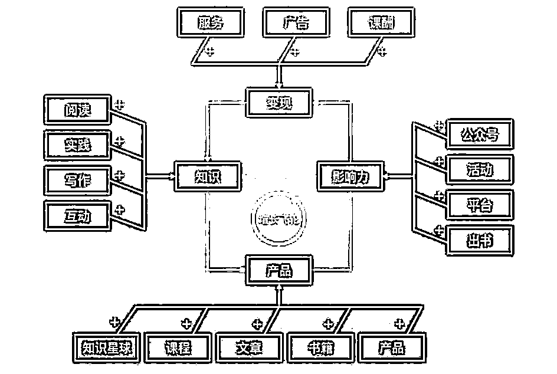
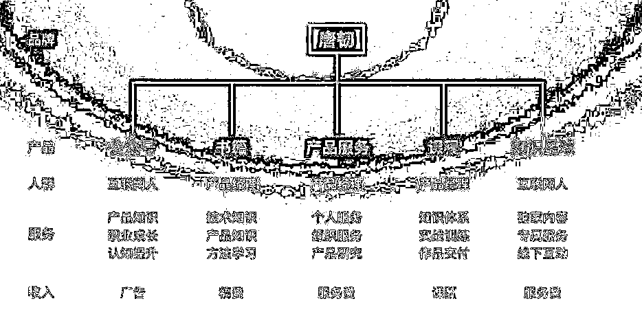

# 把自己当产品，怎么卖？

作者：亦仁

先抛一个问题：如果“你”本身就是商品，你打算怎么卖？

生财有术星球里曾有个案例：公众号“设计师日记”的主理人，盯着互联网设计师这一细分人群，做信息、服务、培训和社群，星球已有8000+活跃付费会员，算是把“自己”卖明白了。

今天再介绍一位产品圈的圈友——唐韧。他面向产品经理人群，如何给自己定位、设计“卖自己”的生意，结果如何？往下看。

---

大家好，我是唐韧，以前是不太出名的程序员，现在是不太出名的产品人，自由职业者，也在往创业者走。感谢亦仁邀请，来生财有术分享。

我是同名公众号“唐韧”的作者，读者主要是互联网产品经理、设计师，也有技术、运营和泛互联网从业者。今天聊两件事：一个5万用户的公众号如何做出百万营收；垂直社群怎么运营。

先交代经历。2008年做Web开发，2011年转移动开发，Android和iOS都能写。2012年开始写作，成为微信公众号第一批注册用户，至今写了8年。2014年参与互联网医疗创业，作为创始团队核心成员，从零到一经历团队和业务搭建，也从技术转成产品经理。2018年初离开创业团队加入京东，负责京东健康旗下京东大药房产品，年交易额近80亿。2019年7月离开职场，成为自由职业者。到分享时正好裸辞一周年。这一年注册公司，从自由职业者逐渐转向创业者。

持续写作让我从技术文章写到产品文章，领域宽了，也积累了一批读者。公众号“唐韧”眼下有5万多关注者。对2012年就开始写的人来说，这个量不算大。但持续输出、主攻垂直领域，从2019年开始带来收入回报。

离开职场那天，读者数是23291，如今50588，涨幅117%。上一整年共推送276篇，篇均打开率约一成到一成二。知识星球建立近3年，用户从离职时628人增至1989人，增长212%。面向垂直人群的在线课程《产品经理的技术必修课》，学员由3000增至5000，涨幅67%。这门上线近三年的课今年正式下线，进入新迭代期；第二本书也在准备。过去一年码了150多万字，日均4000多字。

这些事都带来收入，另外还有公众号广告。广告位要提前两个月排，因为账号够垂直，这个领域用户基数也不算小，再加上我卡频率，每周最多两条，不提前两个月基本排不上。星球成员多半来自公众号铁粉，关系会更近一步，像朋友。我不把读者叫粉丝，更愿意称用户和朋友，所以行文偏聊天，不走媒体腔。产品人习惯把手头的事当产品来磨：定位、设计、运营、看数据、做反馈、再迭代，每轮调整都像一次版本升级。说到底，我做的是个人品牌和服务，也给自己画了一套增长模型和产品模式：做什么、为谁服务、怎么赚钱。两套机制是一年多前定的，执行到现在效果还行，说明当初战略没错；当然执行中问题不少，只能边做边优化，遇到就解决。我比较看重的是，享受过程的同时还能有收入。

这些事里，知识星球最耗我的时间精力，我也一直把它当产品做。下面就复盘：星球怎么从零做到2000人，以及5万粉公众号怎样跑出百万营收。

## 01 创建

2017年9月12日午后，我在知识星球App注册账号，开出自己的星球，取名“唐韧的读者朋友们”。定位是给公众号内容做延展和升级。公众号每天只有一次推送机会，且多为长文，那些短小但有用的内容就送不到读者面前。于是我想：用知识星球的工具属性做付费社群，由我提供内容，会不会有人愿意付费？主题围绕产品经理学习、工作和行业交流，面向产品经理及对产品感兴趣的人。这个付费产品交换的是我的时间、精力和知识；读者付门票费，有效期一年。

我邀请一些读者单独沟通，讲准备做什么。有人愿意相信，觉得公众号内容不错，付费社群应该也不差。最早10位读者成了首批成员。三年后，仍有7人没走，这份信任和陪伴整整持续了三年。也有一部分人不信：看不到有价值内容、一年难坚持、中途跑路就是被割韭菜。我理解，类似情况确实多。但3年1000天，这种情况没在我这发生。那些担心被割的人，这回没能说中。

## 02 设计

定位清楚后，内容型社区还要搭信息架构，也就是星球内容体系。读者加入后要快速认知星球价值，需要清晰架构。最初版本松散，没有结构化体系，多数是我工作里的思考和实操记录，分布比较随意、零散。后来意识到不利于系统、有主题地获取，便准备结构化。做法不复杂：拆出不同内容板块。

第一个板块叫“PM_Insight”，寓意产品经理日常思考和洞察。这里分享我对产品的思考，后来单独做成专栏。每周一上午9点，由我或星球同学发一篇长文，主题是用产品眼光看世界、用产品思路破难题。固定主题会培养期待，期待又会变成稳定认知，活跃度也就上来了。

一个板块不够，又推出“主题分享”。围绕特定领域主题分享，形式有PPT资料、直播等。现在固定为每周四晚上9点直播，每周举行从未间断。分享人来自星球优秀成员，也会邀请外部嘉宾。

前两个板块仍停留在输出与分享，成员各学各的，关系没连起来，说白了就是缺交流。为解决，引入“好书推荐”板块，支撑它的是星球读书会。读书会还有个特别规则：入会先交49元读书基金，这笔钱不消费，放在基金池里。坚持共读21天，完成挑战者平分读书基金。为了加点挑战和趣味，漏打卡要补9.9元。21天下来，基金池总额会高于最初预存；完成挑战的人拿回超过投入的钱，还顺带读完书。机制下，原本独立的个体越来越多认识彼此、产生交流，分享读书笔记、互相推荐好书、结束后分享心得。读书会已办10期，累计输出11000多条读书笔记。

个人输出和集体共创两条线都有了，后面就是继续加固。又陆续开辟产品、读书、写作、职场成长等板块。板块看着各管一摊，实际彼此配合。社群内容体系的关键，是让用户持续感到稳定：不断更、不跳跃、不出格，和运营公众号一样。

## 03 运营

骨架搭好后，既要继续丰富和创新，也要主动插手经营，这就是运营。内容板块从零到一，基本是问题驱动、解决问题。第一阶段用“问题驱动运营”来形容很贴切。

有人说公众号广告伤阅读体验，本质还是成本账。如果一直输出却毫无收入，这门生意立不住。何况我全职做，需要收入，广告是公众号目前最合适的商业模式。星球里不放广告，门票等于会员费，跟视频网站会员免广告一个道理。任何商业模式成立，都是彼此相当交易。

运营久了又发现：八成以上内容由我生产，多数人只是看。这虽符合常规，但社群要有活力，得拉更多人一起写。否则每天都是我供内容、大家等更新；我的精力和更新频率，未必追得上成员增长，矛盾就出来了。

办法是推出星球内“成长进阶日记”，让每个人都能输出，内容包括产品思考、时间安排和成长复盘。光喊口号没用，于是定规则：连续写满365天成长进阶日记，门票双倍返还，再送第二年免费资格。规则一刺激，内容立刻丰富，数据直线往上走。到现在，星球几乎每周都上全网付费活跃榜，还多次进前三。这个策略解决了内容供给，各项指标也起来了。

新问题随之而来：数量有了，质量怎么守？筛选本身会让真正能写优质内容的人冒出来。遇到既能产出好内容、又愿意分享、行动力强的人，我就邀请进团队。现在有专门5人小组，每天筛内容、挑精华。只给精华还不够，激励太弱。接着要想：用什么激励让优质作者继续拔高？于是我推出“糖球计划”，灵感来自亦仁的“龙珠”，这里专门致谢。糖球相当于站内价值货币，靠优质内容发行，评上精华得一颗。能生产，也要能花，于是设计更高阶权益供持有者消耗：进糖球俱乐部、拿额外福利、兑换星球门票等。后来又设星球会员日，定在每月30号，当天给成员发福利，上次送过CHERRY键盘、猫叔签名书、朋友Sky的星球设计日记门票、星巴克储值卡等。两套策略一起发力，内容数量和质量都往上走，更重要的是，一批优秀的人被看见。这些人是我未来想拉来共事的；只有团队协作，产品才能继续做大做扎实。我们这支团队，服务的就是近2000位星球成员。

后来为了更垂直，名字从“唐韧的知识星球”改成“唐韧的产品星球”，图的就是一眼看懂。名字既体现品牌，也点明品类，我觉得比原来强。

## 04 团队

星球成员已近2000，多数是产品经理，也有各行各业、不同岗位的人。每天不少人在这里输出内容，也有人结识新朋友、合作伙伴，甚至人生伴侣。据我所知，有成员在星球找到对象，也有人找到工作。我更看重的是，有同学学了一年拿到升职加薪，涨幅还不小。这些都让我很欣慰。星球规模不算大，但氛围暖，人友善，内容质量也稳。

要服务好大家，我一个人肯定不够。所以年初开始有意识搭团队，成员来自星球活跃分子，创造力和行动力都强。大家散在全国各地，全线上协作；目前二十多人分别负责内容建设、读书会、写作营和成长赋能计划。所有人都是本职工作之外兼职参与，我们分了小组、定了机制、明确了目标。对我或其他人来说，这就是一个有产品、有用户的真实操盘项目，做成什么样全看执行。一个人能做好，但慢，也走不远；一群人能做大，也能走更远。相信团队、相信每个人，我们一直用行动兑现“一起见证彼此成长”的初衷。以后还会吸收更优秀的同学一起做事。

## 写在最后

以上就是我做星球的一些经历和打法。做公众号也一样，不能靠感觉，要有策略、有方法、能执行，还要能坚持。从创建到产品设计、运营、团队建设，确实砸了不少时间精力。好在初步效果已经出来，我相信后面会越长越好。目标不复杂：聚一群人，用产品眼光看世界、用产品思路解难题，陪彼此成长。起步容易，做好难；一直做好，更是难上加难。真正上手过，才懂打磨一款产品有多费劲。好在我没停，而且参与的人越来越多，这确实是一种幸运。接下来，继续思考、继续行动、继续向上。谢谢大家耐心看完，也谢谢亦仁给机会在生财有术分享。想交流可以找我：公众号“唐韧”，私人微信ryantangv，加好友备注“生财有术”。谢谢。

 

评论区里，亦仁提到审核耗时较久、错过了推送；有人道辛苦、谢分享；也有人感慨看完更想离职，只是副业收入路径还没跑通；还有读者谢谢分享并感谢亦仁。