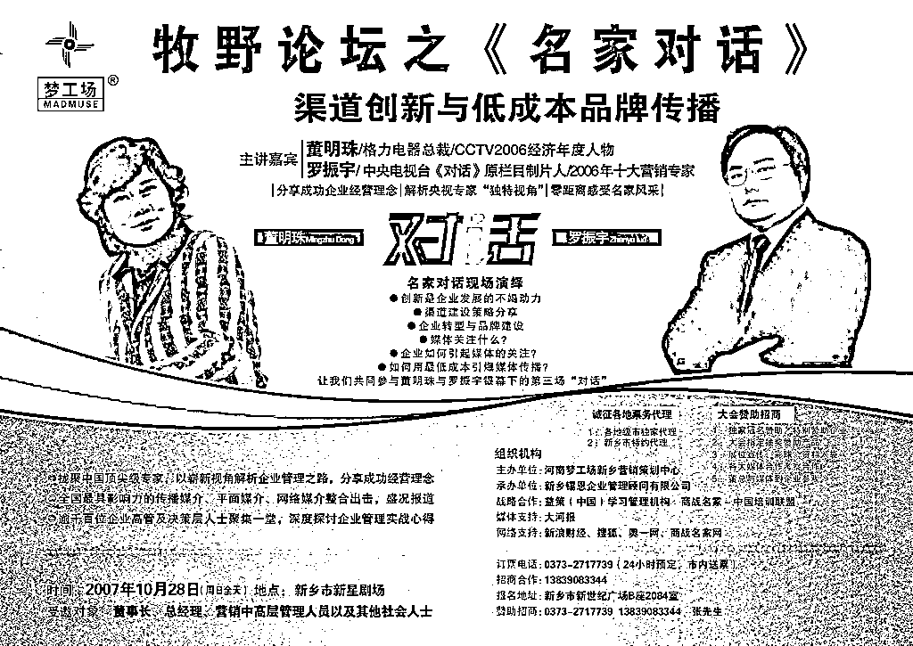
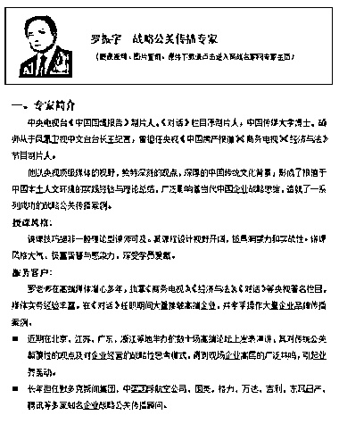
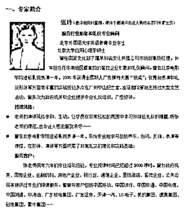
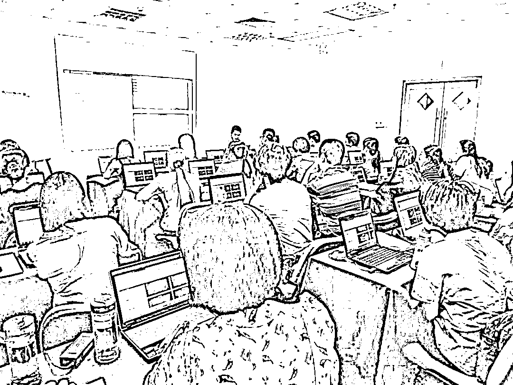

# 30岁转行，第一年收入近100万：这个职业，我劝你早点知道

大家好，我是水月。之前在星球分享过社群淘客的玩法，承蒙亦仁老大加精，受宠若惊。今天继续兑现承诺，再掏点干货出来。

对淘客项目感兴趣的，可以翻我之前的帖子。

今天不谈淘客，聊聊我的老本行——企业培训师。

为什么一个跟互联网八竿子打不着的职业，值得在这儿占个位置？

四个词：赚钱、自由、长久、有奔头。

够不够？

我30岁那年切换赛道做了企业培训师，头一年到手收入将近100万。当然，百万年薪在大佬眼里不算啥，但这行的回报远不止钱：

1、对学历背景要求不高，可复制性强
2、课酬逐年稳定上涨
3、能一路干到退休
4、顶尖老师年入千万不稀奇
5、一个人就能运转，不用组团队
6、自由职业，强度自己定
7、接触的人脉又广又高端，还在持续扩张
8、自带金领光环，社会认可度高
9、衍生的副业机会多到数不完
10、往前能走咨询，往后能回企业当高管

按现在的商业环境，能同时满足这些条件的项目，基本只存在于梦里。所以我今天来“解梦”。

前几天刷到剽悍一只猫老师的《一年顶十年》拆书知识地图，发现自己的经历简直就像这本书的真人版落地案例。索性趁热打铁，把这套玩法完整写出来，既当补充案例，也算给自己做个复盘。

全文框架：

一、我是谁？为什么碰上了这行？
二、选择凭什么比努力重要？
三、企业培训师到底在做什么？
四、钱的分配方式长什么样？
五、哪些人能入这行？
六、客户从哪里来？
七、一门课是怎么打磨出来的？
八、课怎么讲，才有人愿意听？
九、这条路能走多远？
十、真想开始的话，要备点什么？

正文走起。

一、我是谁？为什么碰上了这行？

我出身西部一个小山城，大专学历，学的是IT。从286时代就自己捣鼓电脑，第一份工作是卖电脑，月薪300。后来辗转干过设计、网管、渠道、销售、市场，最后才落到培训师这条道上。

现在我是广东多家国字头500强企业的特聘讲师，本地几家头部培训机构也把我挂在王牌讲师名单上，主讲思维、沟通、效率类课程，日课酬1.2万。

台下坐的是什么人？从试用期新人到快退休的老将，从中专学历到博士后，基本都是企业的中高层。

我在培训咨询圈泡了7年，才开始转型做讲师，如今做了8年没挪过窝，将来也不打算挪——自由职业者本来也就无所谓“跳槽”。

毕竟这行越老越吃香，只要课程质量过硬，按行规每年涨30%课酬，企业照样买单。

而且教育的底层框架更新极慢，每年换换案例就行，根本不用伤筋动骨。

收入和成长空间有多大？我认识的朋友里，日课酬2到5万的老师不在少数，名气大点的更是高到外人难以想象。

这还只是企业内训。如果你自己招生自己讲，开一次公开课赚的可能抵得上别人一年的工资。

想多赚就多接项目多推广，想歇了就带家人出去走走，日子怎么舒服怎么来。

看到这里你应该明白了：这是一个能越滚越大、越做越轻松的超级长线项目。

所以，不管你现在处于什么状态，只要你还在意收入、人脉、名气和自由这四样东西，这篇建议你一个字都别漏掉——毕竟连很多企业老板都在靠讲课圈人脉、攒声誉。

那么问题来了：这行这么多人，凭什么我在这儿写？

进培训咨询圈那几年，我所在的团队最开始只有4个人，但干过的事可不小。

我们策划了董明珠和罗振宇的全国巡回论坛，一共14场。当时董总还是三把手，正憋着劲往上走；罗振宇还是央视实习、遭遇瓶颈想出走的年轻人。后来的故事大家都知道了。

我们还策划过唐骏和张伟俊的全国巡回论坛，12场。唐骏当时在盛大，正琢磨下一站去哪，结果在我们福建的一场论坛上直接遇上了新华都的老板。张伟俊是国内第一位“老板教练”，也就是今天各种私董会玩法的祖师爷。

我们创了国内第一个中国培训联盟，连续办了好几年联盟大会。全国几百家机构、几千位老师都跟我们称兄道弟，我几乎给其中大部分人改过推广文案和课程大纲。

今天市面上那些培训经纪公司、工作坊，很多用的还是我们当年的框架和玩法。

这些名人的崛起，也许不一定是我们的功劳。但聪明人从来不做浪费时间的事——他们比谁都清楚，埋头苦干和放大成功，哪个更值钱。

说句实话，当时我们也就是闷头做事，后来才回过味来，自己不过是在给别人的突围当垫脚石。

如今四个人里，还在培训行业的只剩我一个。

后来我又经历了培训初创公司、专业咨询公司、从零搭建市场销售体系这几轮洗礼。

最后把自己从头推到市场上，稳稳当当了8年，攒下了上万学员的背书。

所以，能站在我这个角度写企业培训怎么玩的人——还真不好找。

二、选择凭什么比努力重要？

有个经典问题：“选择和努力，哪个更重要？”

打工那会儿我会说“都重要，领导说的更重”。

做了培训师之后，我的答案变成了：努力很重要，但选择更重要，不接受反驳。

从月薪300到月薪1万，我换了无数公司、无数岗位，全靠死磕，整整花了12年。现在回头想想，都觉得这人拼得不像是自己。

从裸辞到日薪1万+，我刷爆了所有信用卡吃饭，宅在家里大半年开发课程，就成了。过程中同样很努力，但跟之前相比，根本不值一提。

一开始我以为，是那7年的行业积累成就了我。后来跟各路老师深聊才发现，根本不是这么回事。

三个例子就能说明白：

1、当年找我们团队推广的张玲老师，最开始只是个比我小很多的黄毛丫头，北电毕业没进过剧组，讲课生涩得不行。现在？业内响当当的名字。

2、后来认识的王佩丰老师，一毕业就干培训师，公司请了几个销售负责拓客，他平时除了上课就是钓鱼带娃，日子过得叫一个逍遥。

3、还有40多岁才被我们发掘的李伟老师，之前在TCL培训部当负责人，刚出来时日课酬8千，现在6万。要是一直待在企业里，根本不敢想。

这样的例子一抓一大把。我当然也靠努力才看清了问题的根源，但如果一开始就有人指条明路，前面那辛苦的12年就是积累，而不是原地打转。

所以劝你一句：如果干得很累又看不到头，不妨停下来问问自己——身边是不是有更好的选择，只是被你忽略了？

三、企业培训师到底在做什么？

“培训师”三个字，涵盖的人和玩法可多了，先帮大家捋一捋。

大家普遍认知的培训师：

销售类讲师：2C为主，保健品、直销、保险这些带货路径的老师都算。这类老师基本隶属公司，拿底薪加提成，说白了就是销售，工资不高也不稳定。

打鸡血类讲师：2C/2B通吃，陈安之那套成功学的徒子徒孙，加上各种被神化的NLP、教练技术课程。特定年代的产物，当年确实赚过，现在已经没那么癫了。

企业培训行业的正经培训师：

企业内训师：只服务自己公司，多由管理人员兼任。有的企业把授课算进绩效，有的发点课时费，课程围绕自家业务和知识展开，基本没法市场化。

在职培训师：本职是公司管理者，偶尔被机构或企业拉去讲课。算兼职，公司未必允许，对外课量少，半市场化状态。

企业培训师：2B，主力是跳出来的大企业高管，也有专业技术人员。主讲通用管理类课程，完全市场化。

我做的就是最后这个——企业培训师。没有大企业背景，所以走的是专业技术人员路线。

四、钱的分配方式长什么样？

企业培训大致分为内训和外训。内训就是请老师到公司里讲，外训相反，是公司派人出去学。

内训学员来自同一家公司，主办方是企业自己；外训学员来自各家公司，主办方通常是培训机构，也叫公开课。

一门培训课一般有三个角色：甲方公司，乙方培训机构，还有机构请来的老师。

大多数老师是专业出身，既没精力也没能力做推广，更不想操课程前后的琐碎心，于是中间商就这么出现了。

内训的分账方式大概是：老师拿课酬的40%-50%，培训机构拿30%-40%，剩下的是税费。

公开课的逻辑就不一样了：成本是课酬加场地加杂费。如果老师自己就是主办方，那就只剩场地和杂费。

按我的经验，一个人收2800，3个学员就能覆盖成本，5个就有利润，30人的教室坐满的话，收入抵得上做10场内训甚至更多。

觉得2800一人的课贵？那要是告诉你有个课叫“思维导图”，两天收8千，怕是有人要骂街。

但话说回来，大家的智商差距没那么大。能收这么贵还有人排队来学，课程本身就说明了一切。

五、哪些人能入这行？

先看人群：

1、大企业的高管辞职出来做培训师。有人可能会想到“在行”——企业培训师去在行是降维打击，反过来让在行的去给企业讲课可就难了。

2、专业技术人士转型做培训师。注意，像SAP这类技术型老师很难市场化，顶多只能混个甲方岗位，所以我说的是通用管理类方向。

再说年龄：

我30岁入行，常年被夸“年轻”。但前面提到过两位刚毕业就做培训师的例子，所以年龄根本不是事儿，肚子里有货才是硬道理。

至于形象和口音：

真不用担心。大部分老师都是常人，带口音的一抓一大把，包括我自己。只要客户听得懂，就齐活。

培训师认证有用吗？

这东西是给内训师或企业管理人员镀金用的，对市场化培训师毫无意义。而且，国家已经把这个认证取消了。

TTT认证呢？

TTT就是几个外国老师搞出来收费的玩意儿，没效力。国内改良版STT也一样，这事没几个人知道吧？

所以普通人想入行，就一句话：无限拔高你的专业能力。

六、客户从哪里来？

3年前我发现一件事：大型企业里，网络运营知识是个明显的空缺。

于是我找了广州一支搞裂变挺出名的团队聊，想看看能不能把他们的知识体系引入大企业。虽然各方因素影响，这事到现在还没完全落地。

但至少证明了一点：大企业客户是谁都想要的，以前没人做纯粹是不会做——这跟很多新入行的培训师撞上的问题一模一样。

他们最大的困惑就是：好像所有企业都有需求，又感觉哪儿都不对劲，摸不着门道，也不知道从哪下手。

培训机构和课程也是分行业、分专业的，这里不展开，只聊聊最常见的通用管理类课程，客户怎么挖。

1、想开公司当老板的朋友：

2B的业务，客户肯定是企业。管理类课程要求企业有“管理”需求，小猫两三只或几十人的小公司不在范围内。

我们的判断标准很简单：看公司总人数。按一人管10人算，100人的公司也就10个管理者。

这样的公司一年派一两个人，上两次公开课就到顶了，内训成本扛不住，基本可以放弃。

500人以上的企业，就有资格研究销售额和利润了。培训经费一般占利润的2%左右，你可以算算自己能分到多少份额，再决定值不值得花时间。

行业类型也得筛。互联网公司我基本不看——员工几个月就跳槽，哪个老板愿意给竞争对手做嫁衣？

总结下来，500强、行业前5的企业，才是我们的目标客户。

有了目标，接着找关键人：培训负责人、HR、老板都可能。找到人，把本事亮出来，这事就成了一半。

2、只想安心做老师的朋友：

不想找客户？那就更简单了。

去当地培训机构谈合作，登门给他们的销售试讲，让他们见识你的水平，顺便教会他们怎么推你的卖点，完事。

或者自己注册公司，雇几个销售按上面的法子帮你开发客户。

大城市一天的课酬，够付销售一个月工资。只要课好，攒下几个客户就能过得很滋润。

3、小总结：

市场销售的门道当然不只这些，但上面的逻辑已经是核心中的核心。这行只要不偏离主干道，早晚有结果，不过是快慢的差别。

七、一门课是怎么打磨出来的？

做课是一门成熟手艺，百度随便搜搜或者买本书就能了解。流程无非是：定课题、找资料、搭框架、填内容。

核心方法都一样，但实现路径五花八门，针对不同人群和基础，各有选择。

这里分享一个最快的路子：抄作业。

1、找到同课题对标老师的课件
2、从中选出最完整的一份
3、把课件里的要点扩写成小短文
4、参考其他课件调结构、补内容
5、找不同的人试讲，反复调整优化

按这个流程，全职每天投入6小时，课题不难的话，两周就能出一门课。

下班后每天抽2小时做，一个月也能弄出能上台的版本，后续再讲再打磨。

别犯完美主义——50分就能上战场。新人压根不知道什么叫完美，经过市场检验的产品才是好产品，别一上来就大动干戈搞创作。

八、课怎么讲，才有人愿意听？

讲课这事就复杂了。别看现在网络教育平台的老师满天飞，用企业培训的标准去衡量，能打的不到10%。

很多“老师”直接拉到企业去讲，不被轰下台、不被扣课酬都算走运，被学员当场呛声也不稀奇。

除了水分大之外，更多的就是照读PPT，甚至请人代念课件——比如某位知名PPT老师，几乎把我上面说的问题占全了。

讲课的真章，同样有很多现成资料和书籍可以参考。

篇幅有限，先给一个入门方法：

1、把同类课程的视频都搜罗来
2、删掉连目录都写不明白的
3、剩下的用2倍速各听两节
4、再删掉自己都听不下去的
5、精选出两门课，2倍速听完
6、结合这些经验调整自己的课件
7、开录自己的视频课
8、一遍遍推翻重来，死磕练习
9、发到教育平台看学员反馈
10、开始线下实战，面对面讲

按这个流程练，次数够了，你的授课水平已经能赢过90%的网络老师，也能赢过60%的企业培训师。

后面还有更精细的提升路径，以后再聊。把上面这步做扎实，就已经可以出门闯荡了。

九、这条路能走多远？

开头提过剽悍一只猫的《一年顶十年》，咨询行业也有一句话：做咨询师，一年顶打工三年。

虽然只有三分之一的功力，对普通人来说也够夸张了。

原因在于角色完全变了个样。打工的视野就是公司那一亩三分地，做咨询和培训，服务的是各色大型企业。一年下来，做项目少的也碰四五个，做培训多的有几十上百家公司。不同老板的管理风格、不同企业的通病和药方，全在你眼前摆着，经验几乎是推着你往前跑。

所以就像我开头说的，干一段时间之后，往前可以自己做咨询、开公司，往后可以轻松回企业当高管，不想折腾就悠哉讲课、投点项目，进退自如。

十、真想开始的话，要备点什么？

说到最后，答案其实很清楚了：入这行最大的投入，就是资料和时间。

以前线上教育平台不发达，我开发课程除了自己买书，干脆把家搬到了图书馆旁边。

现在全网都是课，虽然质量参差不齐，但作为开发课程的素材库，简直是如虎添翼。再买几本课题领域的精品书，齐活。

时间投入第七节提过，按我自己的效率估算的，每个人情况不同，加减随意。

把每天的时间花在做产品和练功夫上，去打磨一个有机会让自己快速突破、而且能终身受益的作品——这笔账怎么算都不亏。

你唯一要做的，就是现在开始。

写在最后：

送大家一个信息：一门自己开发的精品课，哪怕不做培训师，挂到网上也能持续带来收入。

我做第一门课时，国内连半个教育平台都没有，于是把课程挂到了国外的Udemy。到现在8年了，还在给我产生收益。

后来网易云课堂从仿Udemy起家，我把课程放过去，顺便开创了他们的“1元做销量”策略。这门课，今天也还在给我赚钱。

短期与长期、风口与稳定、数量与质量、焦虑与安定，永远是相对的。我们只能选一边，不太可能全都占上。

别总抱怨没有好项目，先问问自己的心到底在哪里。

最后翻出几张老照片，让大家看看年轻的董总和罗振宇（话说罗胖的样子是真没变过啊）。

倒数第二张，是9年前我第一次开课的现场；最后一张，是前几天的课堂。

好，分享到此结束。内容有点长，希望对大家有用，谢谢各位。

https://t.zsxq.com/mQVbIYn

 

 

 

评论区：

李春辉 : 龙珠预定[呲牙]

胡哲 Hugo : [抱拳]

韩俊杰 : 太牛了！核心逻辑非常清晰，操作起来！有点结果了再找大佬请教[强] 九京 : 太赞了👍必须加老师微信学习。

胡哲 Hugo : 希望能帮到你[抱拳]

胡哲 Hugo : 互相学习[抱拳]

李宏 : 简直了，拜读

胡哲 Hugo : [抱拳]