# 半年进账20W+：📕商单要顺着品牌方找流量

不少人做📕，第一步就是找对标、拆爆款，甚至靠洗稿快速上手。短期也许能蹭到流量，但这条路很难长期走稳。账号要想持续发展，先得让用户清楚知道你是谁、你能解决什么问题。说到底，最底层的框架还是3W1H：用用户思维和数据分析，去盯住用户特点、需求与痛点，再想办法满足需求，让流量持续爆发。

我是七天假，主业是互联网C端产品经理，也做过百万级流量产品的负责人。去年上半年入场📕，半年做到粉丝2W+、赞藏30W+，变现超过10W+；累计发笔记80篇，其中千赞以上27篇，千赞率33.7%，百赞以上75篇（含千赞），百赞率93.7%。这份数据带来了100多个品牌的合作邀请，但精力有限，我拒掉了很多，后来只接自己喜欢的品牌，并尽量多次合作。有些品牌担心我和竞品合作，还会直接签全年协议。

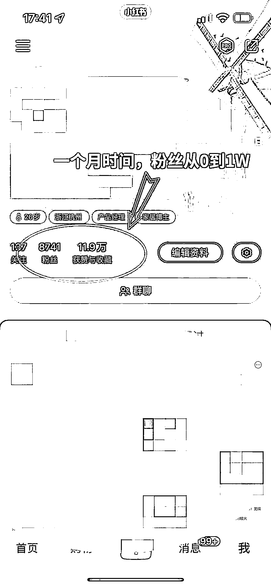
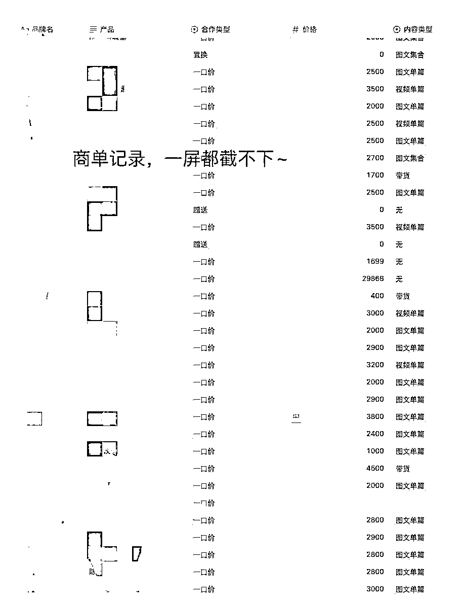
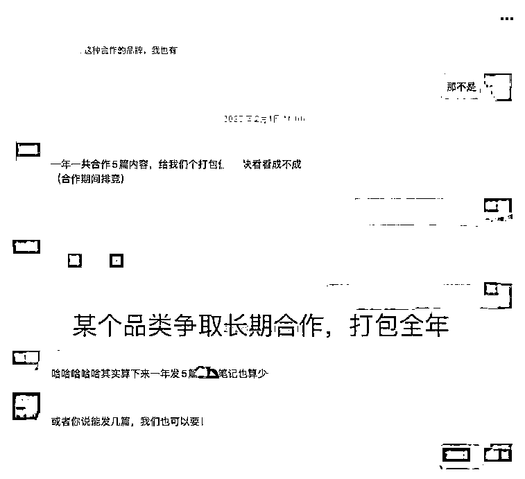

这篇主要复盘我纯做博主、接商单的实战经历，会围绕四块展开：快速起号、用3W1H保持爆文、品牌沟通与复购、零散经验和避坑提醒。

## 一、先交代一下我的底牌

我做内容习惯拿数据和案例说话。上面这些成绩不是靠运气堆出来的，而是从起号、选题、内容结构到接单一步步磨出来的。下面就把我实际在用的方法拆开讲。

## 二、开始与起号

### （1）起号先做心态建设

先问自己一句：你真的有那么渴望赚钱吗？

我做项目前会先确认心态。很多人以为自己很想赚钱，实际上并没有那么想。我之前做过知乎好物、抖音IP，结果都失败了。知乎好物当时已经月入3k，我觉得“这样也行了”，一想到扩大规模很累就停了；抖音更新了30多条短视频，没什么成绩，全是机械重复，懒得思考、懒得改变。说到底，是我赚钱的欲望没有自己以为的那么强。我有主业，收入还不错，做着做着就疲了、懒了、怕了：怕走出舒适区，怕努力没结果，最后就放弃了。

后来我做了一件事：辞职。离开996、年薪40W+的工作，逼自己断掉退路，专心搞钱。我的📕就是在提离职后的那一个月做起来的。事实证明，逼自己一把确实有用。不过不建议大家照搬，我还有工作，只是换岗降薪了；降薪那部分，后来也从📕赚回来了。

### （2）起号前先读懂推荐算法

我做过内容推荐产品负责人，对推荐算法有一定了解。想拿到高流量、被算法青睐，先得知道算法怎么运转。

#### ① 站在平台视角看算法

你猜📕推荐算法产品经理的OKR或KPI是什么？核心无非首页点击率、内容互动率和停留时长。对应到创作者身上：标题和封面要让人想点，内容要让人想赞、想藏、想评论，还要有让人一直看下去的魅力。这样的内容更容易被推荐，也更容易拿到流量。

#### ② 推荐机制分两条线

推荐算法的本质，是基于千人千面，把用户可能感兴趣的优质内容推给他们。笔记刚发布时，系统并不知道内容好不好，所以不会一上来就大范围推，而是先小范围测试。

##### 1）按内容推荐（也就是分词算法）

这条最好理解：系统会给你的内容打标签，再推给对标签感兴趣的人。比如你写窗帘笔记，系统打上窗帘标签，就可能推给近期看过窗帘的用户。

启发与注意点：

1、标题和正文尽量多提核心关键词，帮助系统识别标签。

2、别打不相关的标签。标签跑偏，内容会被推给不感兴趣的人，算法对你的评价也会被拉低。

##### 2）按人推荐

这条更复杂，大致分三层：

第一，优先推给你的粉丝，看他们如何反馈，系统再判断内容是否优质。

第二，推给曾点赞、收藏过你内容的人。系统会认为：既然他对你某篇内容感兴趣，也可能对你另一篇感兴趣。

第三，推给和你的内容互动过的相似用户。逻辑是：这个人喜欢，兴趣相近的人也可能喜欢。

启发与注意点：

1、不要买粉，尤其别买活粉。买来的活粉会拉低系统对内容的评价，后续流量也会受影响。

2、不要刷赞。刷赞会误导系统判断，把内容推给错误的人群。

3、爆款会带火其他内容。所以每篇都要认真做，确保有价值；一旦出爆款，账号就可能起飞。

### （3）起号阶段：爆过的内容大概率还能爆

我很认同一句话：火过的内容，一定还会再火。

刚起号时，你不了解平台偏好，也不清楚用户喜欢什么，最好的做法就是模仿。爆过的内容，往往正好符合算法的三个偏好：标题封面抓点击、内容激发互动、让人愿意看完。内容背后，是算法逻辑，也是人性。

模仿多了，平台网感就出来了，你会慢慢知道用户爱看什么。但只会借鉴还不够，洗稿和模仿形成不了核心竞争力，也很难被品牌方看中。接下来就要用一套我实际在用、效果还不错的内容框架，做出高质量且品牌方喜欢的内容。

## 三、用3W1H内容框架，把流量推起来

只靠洗稿和借鉴，人设立不住，用户也记不住你。要产出原创且用户喜欢的内容，可以用3W1H：

who：用户是谁？是哪类人群？有什么特点？

what：他们的需求和痛点是什么？

why：为什么会有这些痛点和需求？

how：怎么解决，如何满足需求、解决痛点？

### （1）who：先看清用户是谁

做装修内容时，我会先画用户画像。比如：

① 25到30岁女性，多为结婚新房装修，在意细节和美感，预算通常偏紧，喜欢收集便宜好物和平替。

② 30到40岁女性，宝妈，多为改善型住房装修，预算相对充足，更关注孩子所在环境，会有针对孩子的选购需求，比如有熊孩子该怎么选沙发、哪种乳胶漆更耐脏。

当然人群还有很多，这里只是举例。描述越具体，越能代表一类人。做优质内容前，先弄清用户是谁，后面的内容才有方向。

### （2）what：把需求和痛点挖出来

需求其实很固定。做装修时，我会先用穷举法，把用户需要了解、需要购买的东西全部列出来。

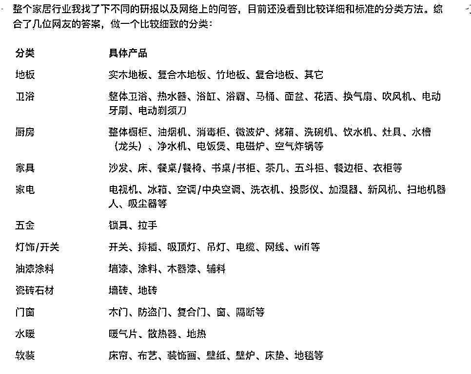

列出来的是什么？就是选题库。可以按清单做成不同内容系列。

需求找到了，痛点怎么找？我会去淘宝提问、知乎专业帖和评论、📕爆款笔记及高赞评论里挖。拿电视举例，看看用户到底关心什么。

在📕搜“电视”，点开排名前2的电视笔记，看高赞评论，排除吐槽和单纯询问，会发现大家在讨论尺寸和广告。

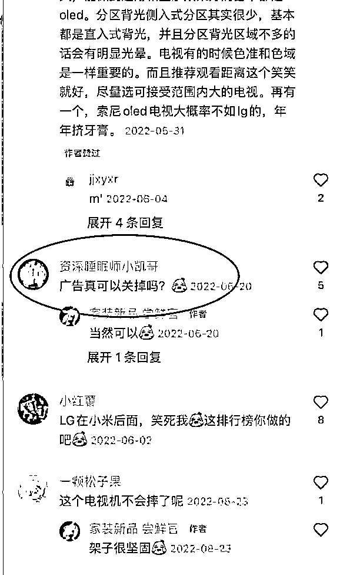

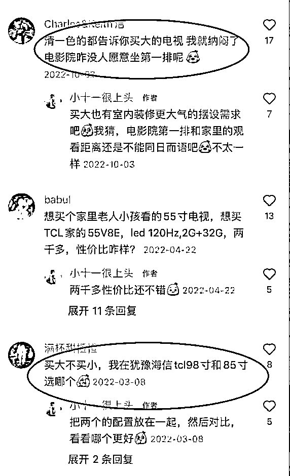

再去淘宝搜电视，找销量和评价多的，打开“问大家”页面，能看到用户关心质量和广告。

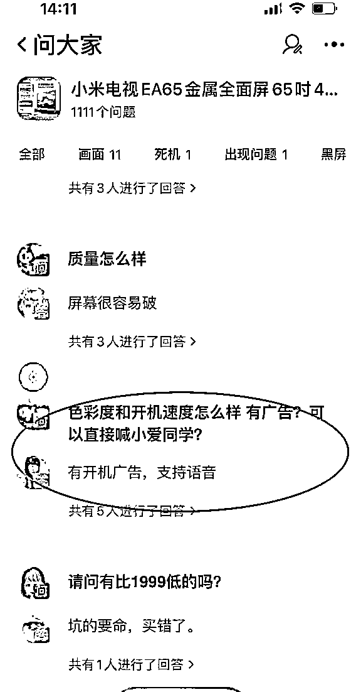

知乎也是同样套路：找热门帖子、看高赞评论。这样就能总结出用户买电视时的问题：

① 应该买什么样的电视？

② 哪个电视质量好？质量好的电视有什么特征？

③ 电视广告多不多？哪个广告少？如何去掉电视广告？

基于这些问题，就能确认N个选题，再分别做内容。年前我用这个方法挑了“如何去除电视广告”这个选题，做出了一个爆款。内容当天就爆了，但视频里有二维码之类的内容，被限流了，后面也懒得改。

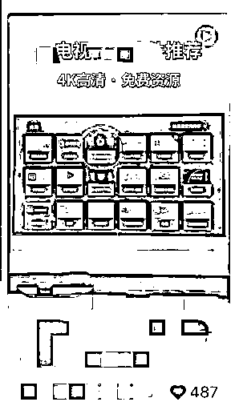

### （3）why：多问几层为什么

到what这一步，选题其实已经明确了。why和who，是在帮你理解内容结构、追根溯源，让内容更贴合用户心理。

遇到问题时，多问自己几个为什么。还拿电视广告举例：

用户为什么嫌弃广告？因为不喜欢广告，只想快速看到自己想看的内容。既然用户不喜欢，电视厂家为什么还要放广告？

① 为了盈利。但这个理由不够充分，厂家完全可以把电视卖贵一点，用“无广告”做差异化卖点来盈利。

② 因为电视本身没有视频资源，要依赖各大视频网站，而视频网站需要盈利，所以有广告。

这里好像走进死胡同：我们没法直接解决电视广告问题，因为这似乎不归电视管。那就换个思路：既然视频网站要盈利才有广告，能不能找一个没有广告的视频网站，帮用户解决看电视必须看广告的问题？

答案是可以。市面上有这类网站，只是很多人不知道，大家熟悉的往往只有爱奇艺、腾讯视频等。

why这一步，核心是多问为什么，从现象看本质，从根上解决问题。

### （4）how：给出能落地的解法

到了how，反而最简单。只要痛点找对、问题找对，又会搜索，答案很容易找到。

但记住：搜到的答案不要复制粘贴。先基于前面的分析做增删改查，再按自己的风格定制内容。

这就是3W1H的全貌。听着简单，实操很难，难在找痛点和挖根源。没人引导时，容易判断失误，或者只看到浅层问题。这需要真实环境里练习，练多了，才能一眼看穿本质。

再举一个例子，方便理解：

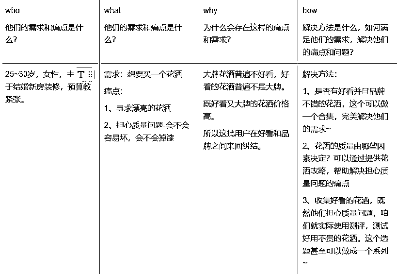

用这个方法，从需求里至少能找到2到3个选题，继续衍生也没问题，只要你会思考和搜索。

## 四、变现：把商单接成复购

### （1）先弄懂商单从哪来

📕商单其实不难拿，流量好了，品牌方自然会找来。一般有两种方式。

一种是主页放邮箱。📕对邮箱限制不算严，基本不违规，建议都放一个，方便品牌方联系。图里邮箱只是示例，不是我的。

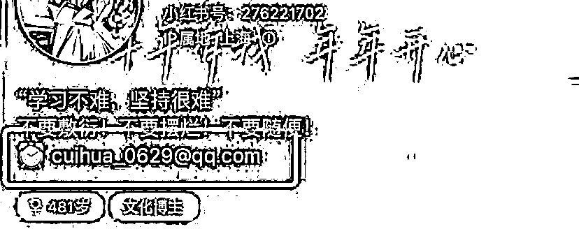

另一种是蒲公英，📕官方商单渠道，现在1000粉就能开通，这里就不展开了。

### （2）怎么让更多商单找上门

很多人会问：我的内容流量挺高，为什么找我的品牌方很少？

原因是你没进入品牌方视线，内容不符合他们的预期。换到品牌方视角看：他们找博主，也会通过📕搜索、推荐或第三方数据分析，围绕要推的产品关键词来筛人。比如电视品牌要推广，肯定会找发过电视或相关品类、而且流量不错的博主。

所以，想接更多商单，先想想你的领域里有哪些品利润高、品牌多。围绕这些品做内容，只要流量起来，相关品牌方就会找上门。我观察到的现象是：电视笔记一旦火了，会有N个电视品牌来找你合作。

### （3）怎样让品牌方持续复购

今年刚开年，我就签下了某个品牌全年笔记的预定协议。还有品牌听说我要和竞品合作，追着给我打了1小时电话，一定要和我合作。

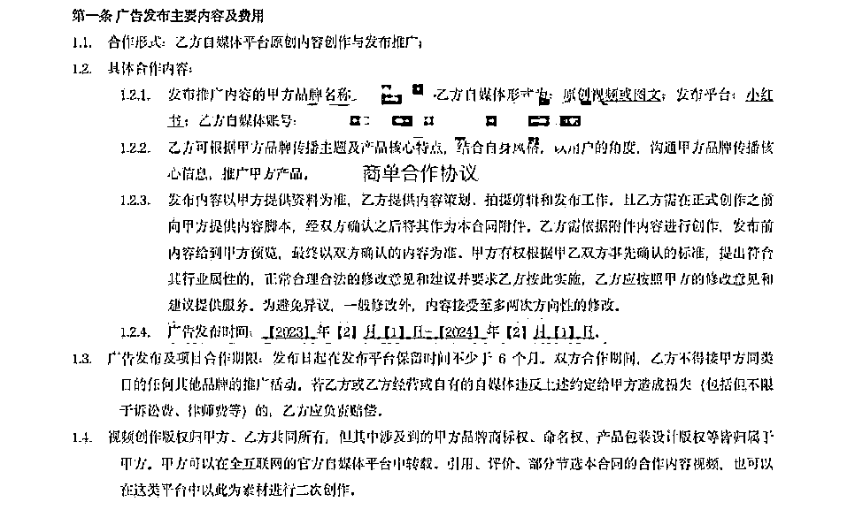
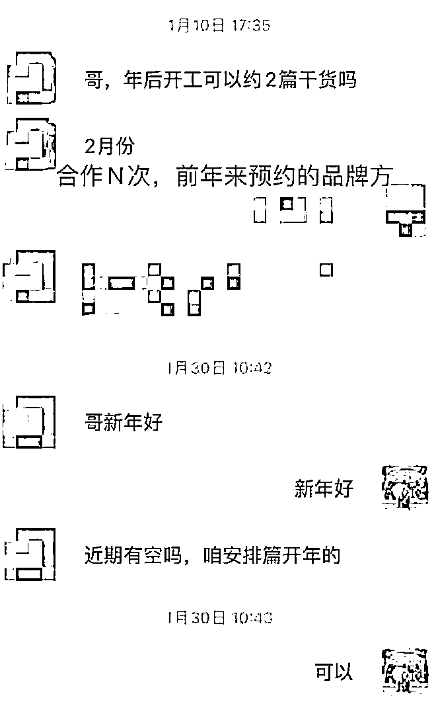

我是怎么做到的？秘诀就两点：对每篇笔记认真负责，并努力做出爆款。

你用心与否，别人能感受到，作品和文字里都藏不住。换位想想，品牌方更愿意和认真负责的人合作，还是和“拿钱办事、结果无所谓”的人合作？因为我认真，爆款变多了，后续接单也更顺，形成了正向循环。

我认真到什么程度？有内容已经写好，品牌方也觉得还行，但我不满意，直接推倒重来。

当然，光认真不够，还得有技巧。怎么让广告笔记也有较高流量？我常用这几招：

#### ① 做出新鲜的使用场景

写内容时，别站在品牌方视角罗列功能卖点，那太像营销文，用户一眼就划走。要结合产品使用场景，把自己当用户，真实使用后再分享感受和效果，最好是新奇、有别于大众的体验。看几个案例：

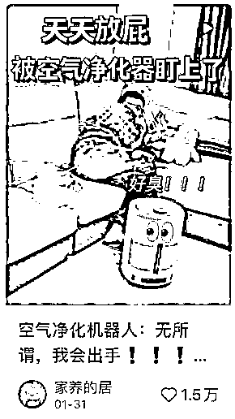

这是科沃斯空气净化器的合作，核心卖点是智能移动，哪里有问题就净化哪里。作者实际使用后发现，放个屁它也会跟着走。这就是很新鲜的真实场景，后面自然带出使用感受和功能介绍，一篇很种草的广告文就出来了。总结公式：新奇场景+真实感受+穿插功能介绍。

PS：新奇场景可以按前面的选题方法找，这个作者就是在淘宝提问入口找到的。

#### ② 先抑后扬

现在📕种草和广告太多，用户已经审美疲劳。他们不想只听“这东西多好”，更想知道“它哪里不好”。

先说缺点，再讲优点。这样既能吸引对空气净化器感兴趣的人，又不会真正劝退想买的人。

PS：灵感来自一个朋友，他说现在想买什么，先去📕搜“XXX避坑”。

#### ③ 用合集做推荐

📕用户喜欢合集，这一点无数前辈和我自己都验证过。接到商单，可以把要推广的品放进合集里一起推荐。金主的产品放前面、详细介绍；只要不是推荐竞品，品牌方一般不会介意你顺带推别的品。

再分享几点接单感受：

① 写广告可以不提缺点，但别夸大和欺骗。用户不傻，出来混都是要还的，别赚昧良心的钱。

② 遇到产品不行或搞不拎清的品牌方，要学会说不。宁可不合作，也别发自己不满意的内容。发了还删不掉，会很糟心。

## 五、几条零散经验和避坑提醒

（1）做内容的目标一定是制造爆款。爆款能涨粉、能变现，也能带动历史内容的流量。

（2）跟着爆款做内容，往往更容易再爆。别浪费自己的爆款流量，出了爆款就抓紧继续创作。

（3）别把焦虑流量当常态，用心做内容，时间会给你答案，等爆款来。

（4）认真负责是做好一件事的基础，没有什么能随随便便成功。

（5）看到机会就抓紧放大。我就错过了一波流量最大时的放大机会，最近正和小伙伴规划放大这件事。

我是七天假，有问题或者想交流📕，欢迎一起聊。