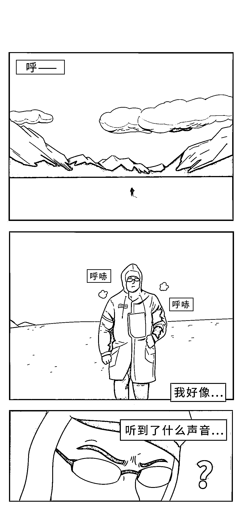
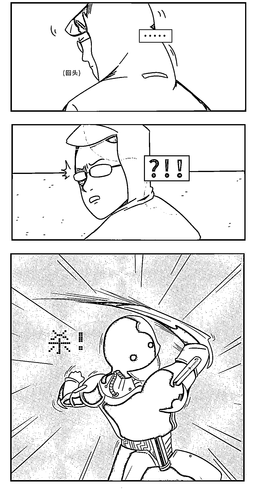

# （精华帖·124赞）写代码的人跑去画漫画：三年实战复盘

作者：不会笑青年｜2022-09-29

2019年秋，我和一位朋友合伙开了个只面向程序员的👸号【不会笑青年】，自己则离开写代码的岗位，全职做漫画内容。两年多下来，这个号积累了约22万关注，全网各平台加起来50万，变现总额超过200万。下面我把从技术岗转到漫画号这条路的完整过程摊开讲，想弄明白个人👸号到底怎么运营的朋友，应该能从里面找到可用的东西。

我是不会笑青年，今年四月进赚钱，翻了不少前辈的帖子，也结识了一批新朋友，视野被撑开了不少。

先交代背景：我在西安写了十年代码，后来做到技术管理，年薪三十万出头。日子稳当，可我也清楚，往上的路已经不太宽了。2019年8月，我下了决心换赛道。

全文分五块：

一、内容创作

二、引流增长

三、收入情况

四、经验分享

五、普通跨界者，如何实现0到1突破的一些思考

## 一、内容创作

### 1.1 从零到一：漫画文案是怎么起步的

2019年8月，被好兄弟微笑哥一撺掇，我动手写起了人生第一篇条漫脚本。那会儿心里两股劲搅在一起：一头雾水，外加按捺不住的想试。

一头雾水好理解——在职场泡了十年，刚辞职，自媒体没碰过，条漫更是一张白纸，全得自己趟。想试则是看到市面上冒出几家条漫号，作品有意思、读者也捧场，而程序员这个垂直方向还是空白。我对“搞创作”本来就有热情，加上对程序员这个群体熟，心里是痒的。

就这么着，我上了条漫这条船，一晃三年。

那开头具体怎么破局？

#### 1.1.1 漫画制作的流程

漫画这门活儿拆开来不复杂：脚本加绘画。

脚本归我。它是整篇作品的骨架和灵魂，怎么落笔得我自己琢磨。绘画负责把文字变成画面，这要有画师配合；至于怎么找到人，后面讲。

#### 1.1.2 脚本怎么写？

闭门造车效率太低。最开始我盯着同行的号看，可看到的都是成品，原稿拿不到手。

不过看多了，条漫的常见路数也能摸出个大概：对比、盘点、叙事、设悬念、拉互动……大体都是这些固定打法。

挑两个套路给个例子：

对比型漫画：https://mp.weixin.qq.com/s/tglPT8ipyUuvg6JJmm-F6A

悬疑型漫画：https://mp.weixin.qq.com/s/f2l3u3D9z3re0jlLMLbqng

照着这些形式，我憋了两三天，模仿出一份自认为还过得去的初稿。交给画师，对方一句话把我打回：这稿子画不了。

后来才懂，条漫脚本跟普通文章压根是两码事。它要的是能被画出来的场景——每一格长什么样，得用文字交代到细处。

这种“画面思维”的写作，跟平时码字差得远。写文章，顺着逻辑把想法讲明白就成；写条漫脚本，脑袋里得像放片子：这一格有哪些物件，镜头拉远还是推近，人物当下什么脸色，周围什么氛围。这些交代清楚了，画师才接得住。

打那以后，我看别人的条漫会专门盯分镜怎么切；连看电影都常常从剧情里跳出来，琢磨哪几个镜头用得妙，随手记下，回头塞进自己的稿子。

那阵子一篇稿子改到满意，推翻重写是家常便饭。熬了一个多月，才拿出第一篇勉强能看的东西。

跟画师磨合了几期，我尽量让对方画得顺手些，也慢慢把脚本模板定了下来，主要是这几条：

① 按场景切块，每块分“场景描述”（把画面细节写足）与“配文”（真正印在漫画上的字）；

② 格式统一，场景与配文用不同颜色区分，扫一眼就明白；

③ 稿子开头附上“漫画大意”和“人物设定”，让画师先对整体有数。

今年的一篇普通脚本放在这儿：https://www.kdocs.cn/l/cdOozHZ1PZUi

按这套模板交稿，画师的感受好了不少。一位头回合作的画师朋友说，看着稿子，脑子里画面就浮出来了。这话我听着挺受用。

当然，每篇东西仍要我和画师来回磨。默契上来了，磨的时间就短；合作过几十回的画师，基本一遍就过。

到2019年11月，摸索了三个多月，我对写脚本这件事总算有了底。

#### 1.1.3 画师怎么对接？

最早那位画师是朋友，兼职帮忙。可号一旦跑起来就得按时更新。我们定的是每周三更——对原创条漫来说，这个节奏不低了——光靠一个人顶不住，得同时拉几位画师进来。

人去哪找？花钱招。

从哪儿招？一开始我们也没谱。写了份招募文案，往各个漫画类论坛挨个发，发得够多，还真有回音。

陆续有人来联系。我们一般先试一期，合得来就长期合作，早期价格约每篇两百到五百。

这里也说说踩的坑。

实操下来，前期花在这上面的精力不小，因为合适的人不好碰。

判断水平分两步：先要对方过往作品，在我看来最好是条漫；画风过关了，再进第二步——试稿，用我的本子让对方画前两格，真刀真枪看效果。

再就是价钱。专业条漫画师开价普遍不低，单篇一千到两千的不少；也有的按格子算，一格五十到一百。这个档位基本超出我的预算。

所以今天长期搭伙的这几位，是我聊了上百号人之后筛出来的。

### 1.2 高质量脚本怎么打磨

从2019年下半年起，行业里有头有脸的条漫号我基本都盯上了，前前后后读了几千篇同行的东西。自己写了快三年，原创也过了三百篇。关于怎么把稿子写出质量，我攒了些心得。

#### 1.2.1 好脚本的内核

我把它拆成三样：好玩、新知、共鸣。一篇合格的条漫，三样里至少得站住一样；三样齐了，那就是上品。

好玩：漫画跟纯文字不同，不必端着讲大道理。有意思，多数人才愿意往下滑。这是条漫的第一关。读者合上页面是乐的，这内容就没白做。

怎么做到“好玩”？结合我自己的例子说：

① 会夸张。这几乎是制造笑点的万能钥匙，好使。你回想一下，生活里把你逗乐的对话，多半是有人把话说大了。

郭德纲的段子、开心麻花的戏，很多包袱就来自演员把夸张用得自然。

沈腾是这方面的高手。一伙人路过某地，有人嘟囔“这儿蚊子真多”，他接一句“何止多，我们都贫血了”，全场立刻笑翻。

“蚊子多”被夸成“我们都贫血了”，画面感一下就活了，趣味也就出来了。

所以我看同行作品时会留心人家怎么使这一手；自己落笔时也故意埋几个夸张的点，让内容轻快起来。

比如我某篇漫画的开场就用了这招。程序员圈里有个共同遭遇：身边朋友总以为你是【修电脑的】，而绝大多数程序员对此极其反感。我借了同行的夸张法子，安在这个梗上。

程序员：亲爱的，为你做什么我都愿意！

对方：能帮我修个电脑吗？

镜头一切，抬腿就是一脚，友谊的小船说翻就翻。程序员对“修电脑”这三个字有多烦，一下就演出来了。

拿这个小片段当引子，读者自然想往下看：他为什么这么抵触修电脑？

可见，夸张是让作品“好玩”的一件利器。

② 会反转。平铺直叙容易寡淡，有起有落才抓人。用一次反转，让读者尝到“没想到，但合理”的滋味，内容就有嚼头了。

比如我那篇《工作五年，我是如何在帝都买房的》。

主题：外地年轻人想在一线城市安家，太难。

走向：前半段读着像励志片，你正要为主人公的拼劲感慨，结尾他碰上了一位实力雄厚的丈母娘——意料之外，细想又合理。

再如《富婆的套路真的太深了...》。

主题：世上没有捷径，对程序员而言，代码才是真爱。

走向：前半段你以为是程序员小伙攀上富婆、一路开挂的现实爽文；结尾揭开，所谓捷径全是套，赔了夫人又折兵，代码才是吃饭的本钱。意料之外，情理之中。

加上反转，故事的趣味性能明显上一个台阶。

③ 新知：读者看完得觉得有赚，拿到点实在的东西。

比如一个新角度帮他打开了思路，或者得了正向的激励；再不然，巧妙塞进去一点知识——像程序员小灰的漫画算法，就属于给读者送新知。这条不只对条漫管用，图文、视频同样吃这套。

我写过一篇《中国程序员 VS 美国程序员》，用调侃的笔法把中美程序员在各方面的差别摆出来。读者读完，一边乐，一边对美国同行的整体状况有了个大概印象。

顺着这个路子，我又查资料做了《中国程序员 VS 印度程序员》《中国程序员 VS 日本程序员》，这个对比系列的数据和反馈都相当好。

④ 共鸣：人需要情绪上的呼应，漫画恰好能给。读者看完觉得真，仿佛自己就在画里。有代入感、能参与的内容，自然讨喜。

要共鸣，核心是真。素材来自真实的生活，你自己趟过、再写出来，有相似经历的读者一看就被击中。

共鸣可以说是我作品最鲜明的标签，因为我大部分内容都取自程序员群体的日常。

加班、开发和产品的拉扯、为什么背双肩包、为什么爱穿格子衫、为什么老挂着耳机、走到哪都带电脑、为什么懒得关机、为什么偏爱深夜写代码、为什么爱写博客……这些细节我熟，写出来自然容易戳中人。

像《你TM到底几点下班？！！！》，把程序员“下班难”的处境还原得明明白白，确实是生活里发生的事，数据不错，评论区也热闹。

所以我的条漫下面留言特别多，常能看到“太真实了”“能不能把摄像头拆一下”这类话。

故事真，才容易打动人。

一句话收束：好玩、新知、共鸣，是好脚本的内核。一篇至少占一样；三样全占，就到位了。

#### 1.2.2 技巧套路

① 选题：一个选题定下来，推文阅读量的大半其实就定了。

选题的头一条原则是贴着人性走。比如“王姨我不想努力了”“赚钱或买房”“拒绝裸聊”这类，牵扯到钱、性、捷径、八卦的话题，人天生就想点开。当然，内容本身还得满足上面说的三要素，不然会翻车。

我这三年推下来，凡是贴着人性的选题，阅读量起码比普通推文高出三成以上。

2020年12月，我粉丝才五六千。蹭了个小热点写了《王姨，我不想努力了》，当天阅读冲到四千，打开率直接过七成。要知道，一般👸号能有5%的打开率就算可以了。

再说个反面例子。元宵节我做过一篇讲元宵节由来的科普，资料查了一大堆，画师也是团队里最好的，文案和画面我都觉得挺完美。满怀期待发出去，数据却惨得不行，像卯足劲一拳砸进棉花堆。

复盘下来，问题还是出在选题。选题对了，阅读量差不到哪去。

② 标题和封面：跟内容一样重要。

早期我只顾内容、轻视标题，后来发现自己还是嫩了，这俩真是半斤八两。做标题党不丢人，但得有底线，至少得跟内容对得上。

比如我接过一篇程序员面试的广告。标题要是“有关程序员面试的反思”，你多半懒得点；换成“16:00进面时间，16:08就出来了，问的实在是太……”，好奇心一下就被勾起来了——到底问了啥。这个标题后来被甲方拿去当通稿，铺在很多技术号上。

标题直接决定打开率，千万别端着。做自媒体，阅读量跟收入是连着的。稿子辛辛苦苦打磨出来，最后栽在标题上，太亏。

再送个小窍门：就算大主题跟这些方向不沾边，也可以尽量往那边靠。我有一篇，核心是【激发程序员灵感的10种方法】，照实写标题，数据肯定平平。

这十种方法里有一条讲到程序员鼓励师，这不就和大美女搭上了？标题改成【鼓励师加成太刺激了，代码不一会就写完了……】，这篇直接冲到六万多。对我这个号来说，算是高位了。

封面跟标题分量相当。得让人扫一眼就想点进来。逻辑跟前面说的选题一致——往人性上贴，往往事半功倍。

③ 开头和结尾：稿子质量的关键。

不管文章、漫画还是短视频，这条都成立。开头抓不抓人，决定整篇的读完率。

开局就摆冲突，或者把全篇最炸的几格提到最前面，让读者带着问号往下找答案，体验会好很多。

比如这个开头：

这个开场，从一个穿冲锋衣的程序员的惊险遭遇切进去，读者自然被勾着往下看。当然，这篇本身是冲锋衣的推广。

做定制广告漫画时，这一点尤其要紧。前面所有铺垫，都是为结尾把广告引出来服务的。开头立住了，转化率才有戏。

结尾：一个“意料之外、情理之中”的收束，或者一句亮眼的金句，能把整篇的段位抬高一截。

比如这个结尾：整篇都在比较程序员和公务员，两边各有优劣、难分高下；临了一句急转，现实又不失幽默，读者的印象一下就深了。

说到底，自媒体玩的就是对人性的把握。技术再硬、故事再好，不做包装、平铺直叙地摆出来，照样抓不住大众的眼球。

用有趣、有共鸣、会夸张、贴着人性的方式去讲有价值的内容，传播才跑得动，流量才放得大。

上面这些都是技巧，对中小号尤其管用；到了真正的大号层级，这些反而不那么重要了，把高质量内容稳稳交出去就行。

### 1.3 高频输出怎么维持

原创写多了，“思路干涸”我也撞上过好几回。慢慢调，倒也摸出了一些门道。

#### 1.3.1 拓宽选题来源

① 自己的真实经历。在IT圈泡了十年，行业里的痛点、梗我拿捏得比较准。早期原创里，一半以上都间接来自我的日常。

我觉得这也是持续产出的根基。做某个领域的内容，你得对这块地足够熟，专业性和敏感度才守得住。哪怕是转载别人的东西、接第三方投稿，你也看得出好坏。

② 知乎、🧣、虎嗅、36氪、抖音这些平台的热点。每天刷一遍各类榜单，这大概是做自媒体的人的共同习惯。

有的号主一见热点，恨不得连夜赶出稿子吃流量。这套对我不太灵，因为漫画做出来天然要晚几天。所以我盯的不是热点本身，而是借热点去找那些更多人真正关心的话题，再拿来做内容。

举个例子：《要求整治程序员高薪的那个人，被打了！》

这是知乎上的热帖，#整治程序员高薪，热度一直没下去。我当下结合自己的看法，把它画成了漫画。

发出去阅读很快过了两万，还被几十个号转载，其中有几个是行业头部，全网曝光保守估计在百万以上。

可见，借热点话题是提升创作能力的有效路子。

③ 参考其他条漫大号的选题。学同行、找对标，这经验搁哪个行业都成立。

全国各类型的条漫号我几乎都关注了。一边学人家的手法，一边从他们的爆款里挖选题。我虽然主攻程序员，但有些热门话题是可以跨行搬的。

比如看到一篇讲家长带娃的漫画很有意思，我马上想到程序员带娃会撞出什么火花，转头就去采访身边当爹的程序员，素材一到手，一篇不错的稿子很快就出来了，发出去反响也挺好。

就是这篇：《自从程序员老王当了爸，生活太太太太太太爽啦……》

④ 读者投稿。这条没什么可多说的。号做久了，加你🛰️的人多了，读者群也多了，总有人热心给你递选题，合适的直接就能开工。（👸号引流到个人🛰️私域的具体操作，我在下文会讲。）

⑤ 大量阅读。我买书不少，种类也杂：行业大佬的著作、历史、科幻、职场、哲学都有。每晚睡前留一段固定时间读，这段时光我挺珍惜。

书里不少有意思的点，也能拿来当选题参考。

比如读完《三体》，一边被刘慈欣的宇宙观震住，一边顺手画了好几篇科幻题材。下面这篇我自己挺满意，评论区还有读者看出了三体味儿，反馈很好。

《地球程序员 VS 外星程序员》

以上就是我从多个方向找选题的方法和经历。

#### 1.3.2 随见随记

做自媒体之后，我养成了这么个习惯：不管在哪儿，只要撞见能当选题的素材，掏出手机当场记。

一个电影镜头、一张图、路边看到的事、我爸发来的一条🛰️、跟老婆的某句闲聊——只要可能跟选题沾边，我就顺手存下。

不用记多细，几句话就行。工具就是手机自带的便签。

每天固定干活时，再把便签里的东西誊到在线文档。日子一长，一个选题库就这么攒出来了，创作节奏也跟着顺了。

#### 1.3.3 给自己设deadline

这一招有点自虐，可确实灵。

这是我和微笑哥搭伙办公时定下的规矩：手机定时，比如三小时内必须交出一篇稿，超一分钟，罚一个俯卧撑。

才华，都是被期限逼出来的

我一直很认同一句话：别老把天分和运气挂在嘴边，真正能逼出你潜力的是一个截止期限，外加一个你交不出稿就会挨揍的人——到那时候，你会被自己的本事惊到。

有一次我晚了两个小时才交稿，被罚做135个俯卧撑，接下来整整两天，我的手臂连举起来都很困难。从那次起，我再也不敢对期限抱有侥幸。

**1.3.4 ** 调整状态

我调节状态最依赖的是跑步。它同时帮我解决两件事：减脂和解压。一周安排两三次，每次跑个5到10公里，跑完整个人的精气神都不一样，工作起来也更顺手。

这方法表面看稀松平常，但我心里清楚它有多重要。身体永远排在事业前头。只有身体健康、精神饱满，你周围的磁场才会是正的。

**1.3.5 ** 短篇漫画

去年我们做了一次重要的转型。早期我们习惯参考同类的漫画账号，默认一条作品的场景数至少要有20个。

慢慢做下来发现，一些偏轻松的话题，完全不需要拉那么长。篇幅短、内容精，读者看着不累，效果反而更好。

现阶段的短篇，我们规定场景数上限是12个。这么做一石二鸟：更新频次上去了，制作开销也降下来了。

目前，我产出内容里的九成左右都是短篇。和漫画师重新谈过合作价，短篇定在长篇的六成，这样一来我出稿更快，钱也花得更少。

**1.3.6 ** 赛道选择

刚开始画漫画那阵，我对选题没有任何限制，看见什么有趣就画什么。结果账号越做越杂，IP形象一直立不起来。

后来我们拍板，把方向改为“全网唯二的程序员主题条漫号”。效果立刻就不一样了。一来这行我熟，产能跟得上；二来足够垂直，广告方自己就会找过来。

关于赛道，我曾经踩过一个大坑。那时👸号名义上叫程序员号，实际执行并没有守住这条线，只要话题有意思，我就会给它画成条漫发出来。

账号里程序员的内容也有不少，但更多是各种杂七杂八的题材。看着别家条漫大号广告一单接一单，我们始终颗粒无收，这肯定不对劲。

复盘时想通了一个关键：那么多条漫大号在前面挡着，我们这种小号凭什么被广告主看见？体量这么小，除非有足够强的差异化特征，否则根本进不了候选池。

顺着这个逻辑往下走，我们把所有话题都收回到程序员领域。

只在程序员条漫这个点位上死磕，待到做到比较靠前的位置，被看见就是顺理成章的事。积累了一段时间后，条漫推广的合作开始找上我们。

第一笔单子是华为云旗下算法竞赛的推广。对方找到我们时说，我们是让人眼前一亮的宝藏号，垂直、实在、开价合理。

第一单落地那天，我们高兴坏了，还开了一罐啤酒当作庆祝。

**1.3.7 ** 制定工作计划

号做大了之后，事情多得让人头疼：日常更新、文案撰写、跟漫画师配合、商务洽谈、新方向的尝试……没有一份详尽的计划表打底，很容易顾此失彼。

我的习惯是记流水账，按天把做完的事写下来。毕竟年龄摆在这儿，不记下来转头就忘得干干净净。

二、引流增长

刚接触👸号的人，多半会觉得好的内容就是一切。可在圈子里待过一段时间的都知道，涨粉这件事跟内容几乎是同等分量的。下面我把不会笑青年用过的几种增长方式认真总结一下：

** 2.1 **大号带小号

这是不会笑青年最早的起家路径。微笑哥用他的主号【纯洁的微笑】，通过文章推荐、文末带一笔、内容转载这些手段，给我们导来了最早的那批种子用户。

这也是大量号主在起号阶段用的手段：一个大号拖好几个小号，用主号的文章和流量把小号带起来，完成冷启动。

这波操作大概给不会笑青年带来了四五万粉丝。

**2.2 **抽奖方式

我们通过第三方小程序做抽奖，送过现金红包、无人机、Mac电脑等等。这类活动从不会笑青年早期一直持续到后期。

头一回是1888元现金红包的抽奖，发布当天粉丝数就涨了4000多。

第一次送Mac，当天也多了3000到4000粉。印象比较深的是后来和几个号主一起搞联合抽奖，陆续送出了十几轮Mac，不会笑青年的粉丝规模从17万蹦到了20万。那时通常是10个号主联手，每个人每期的费用在四五百上下。

好处摆出来很直观：见效快，活动发完就有一轮肉眼可见的增长。

缺点也得跟上：
① 留存很一般，涨1000个以后掉五六百太常见了。
② 边际收益越来越差，头一回效果好，第二轮减半，再往后基本没什么浪花。
③ 存在平台风险，动不动被举报。尤其是最近，圈子里已经连续出现多起投诉案例，不少号被平台以“诱导关注”为由处罚。

所以现在，我强烈建议不要再用这种方法。

**2.3 **互推方式，包括单推、群推

找跟自己体量相差不大的号主，一个或多个都可以，约定彼此推荐，实现粉丝互换、共同增长。这也是👸号圈内最普遍的做法之一。

好处跟抽奖类似，短期见效明显，只要推了就有反应。

效果行不行关键看文案水平。精彩的文案能把转化率干到阅读量的30%上下，粗糙的文案连1%都可能到不了。

最常见的操作不外乎送资料、发红包、给福利。

问题同样鲜明：圈子里的粉丝慢慢就同质化了，积累到一定程度会影响广告效果之类的指标。互推属于一次性行为，没有长尾收益。能解近渴，不能解远忧。

两个小窍门：
第一，优质转化文不用非自己写。这类内容没有原创限制，效果好就收集起来，在不同号主之间反复利用。一个号上跑出过数据的文案，放到同类型账号上，表现一般也不会让人失望。
第二，找对标账号可以借助榜单，比如二十次幂这样的工具。我本人做技术内容，那就去查技术号排行榜，找到阅读量和自己处于同一水平的账号，挨个去联系。

**2.4 **外部流量方式

我最推崇的增长方式是这个。核心思路：在👸号之外的内容平台发布有价值的内容，比如技术教程，借此把其他平台的流量引到👸号。

知乎、🧣、B站、📕、抖音，还有各种垂直小网站，都有机会。

B站现在已经比较开放，视频里可以大方说出👸号名字。但很多平台不是这样，拿知乎来说，二维码和👸号信息属于明令禁止的内容，必须自己想办法绕开。

技巧来了：如果平台有限制，就别直接放敏感信息。在文末放一个你自己的在线文档链接，诱导用户点进去，再在文档里做第二次引导。还怕的话，就再叠一层链接。转化率打折没关系，总比被平台整个屏蔽掉好得多。

优点我都看在眼里：长尾效应极强。外站做到一定规模后，躺着也能每天流入几百上千的粉丝，而且是高质量、高黏性的用户。

不足的地方，严格讲不叫缺点，叫门槛。

好比知乎，需要你固定频率地输出，把等级和盐值一点点养起来，增加账号的权重。权重不到位，内容曝光就上不去，这没法速成，只能长期投入。

B站的门槛则在于视频制作。我自己也是边做边学，现在的策略很朴素：找对标账号，复制他的形态，然后保证每周都有内容产出。

今年1月起我也开始做视频，其中面试系列反响还行，几条片子给我积攒了大约3000个粉丝，至今还在缓慢增长。

别忘了，外站本身也带着巨大的流量池和变现空间。

因此综合所有的条件，我认为外部流量是当下最好的选择。

**2.5 **内容吸引

内容创作者当然应该用内容说话，这个道理放到哪里都成立。可具体执行起来，难度超乎想象。

看后台数据，不会笑青年前前后后画了200多篇漫画，涨粉最猛的一篇也只带来了几百个关注，这还是被大量👸号、网站、外站转载后的成果。

一篇能传播上千万人次的爆文，确实有机会单篇引来几十万粉丝。但那种爆款的诞生，是内容本身、发布时机、受众画像、运气成分各种条件揉在一起才发生的。对普通创作者来说，可遇不可求。我们能做的，就是把每一篇都好好打磨。

但还是要想办法把内容做好，这是一笔长期投资。一方面增强自己的IP势能；另一方面，万一哪一篇突然就爆了呢？

**2.6 **资本方式

去年年底，我们又开了一个新号，名字叫“了不起的程序员”。

这个号的涨粉策略，走的是资本路线：买下别的技术号，随后通过账号迁移和粉丝合并，把体量快速做大。

市场上也有专门的涨粉公司，给钱就办事。我始终没有考虑过：花钱买来的粉丝，质量不行、活跃度不行、感情也不深。

这种用钱砸流量的方式，没有太多讨论的价值，总体我也并不推荐。

三、收入情况

我进👸号这个圈子，时间点不算早，能赚到的不过是红利的尾部。

👸号最能赚钱的阶段是2021年前。当年一些头部个人号主，年收入500万到1000万不成问题，实力雄厚的公司号就更不用说有多恐怖了。

再看今年，👸号倒还不是不能做，但赚头弱了很多，收入可能连之前的一半都不到。一个是短视频在分流，一个是整个大环境不乐观。技术号尤其惨，以前的金主爸爸们，如今有的巨亏、有的干脆跑路。

**3.1 **目前公号的主要变现方式还是广告，一般有下面几种方式：

广告还是大头，我把主流的分法列在下面：

**① **外部广告一口价形式。

甲方商务考察点一般是两个维度：第一个是粉丝画像，年龄、性别、行业、地域；第二个是近期阅读量，这通常直接决定报价。

按以往行情来说，普通图文号一个阅读量通常在一块钱左右，全行业差不多都这样。

我的条漫号会溢价，原创条漫的单阅读量可以报到1.5到2.5元。而今年，报价整体降到了0.4到1元这个区间。

换言之，以前一篇阅读量1万的推送，赚个一万多没有问题；现在再想拿这么多，基本不可能了，落到五六千是常态。

**② **外部广告分成形式。

甲方把内容发在你这里，按用户点击或真实成交给你算分成。这种模式我一般不会接。正经的大平台倒还好，但太多平台数据造假，水分大到没法查，浪费时间精力。对中小号来说，尤其不划算。

**③ **群投或者朋友圈分享。

成熟的号主都会想办法把用户沉淀为私域流量，具体就是加个人🛰️、建读者群。

现在不少广告商已经不在👸号里直接下单了，而是倾向投社群或朋友圈。我的🛰️好友大约2.3万人，去年一条朋友圈的广告报价4000块上下；一个200人的🛰️群发一条，可以收到100到150元。

**④ **自己产品变现。

如果你有现成的产品或产品资源，比如知识星球、技能课程、实体产品、甚至付费咨询，那完全可以借助👸号来卖。

行情不好的时候，靠自身产品变现反而成了圈内流行的玩法，我注意到很多技术号主都开始这么干了。

**3.2 **如何联系商务？

今年商务合作整体呈下滑趋势，跟报价一个走势。

以我的账号为例，2020年和2021年是商务主动找我的蜜月期。号的影响力在变大，每天🛰️上都有8到10个商务要来合作——数量多到让我这个乙方都有点飘飘然。

到了今年，一天能有一两个咨询就谢天谢地了。多数时候，得自己主动去接通路。有几个经验可供参考：

进一些甲方和号主的合作群。群里的资源可以共享，不少广告商其实是中介，肩上同样有KPI的压力；自家接到了广告，不妨顺带着推荐给同行。大家抱团取暖，肯定好过单打独斗。

接到甲方需求后，尽量做到“微笑热情五星级服务”：第一时间响应，设身处地替对方的转化效果想办法。

比如对标题和封面多打磨一下，在社群和朋友圈帮忙扩散，或者免费赠送一个次条位置。这些都是成本不高但能加强合作黏性的事。

两年时间，市场已经换了一副面孔。红利这东西总是转瞬即逝，机会扑过来时不懂得全力抓住，等到溜走，剩下的只有叹息。

注意事项：

当然，不是什么广告都能接。那种一眼看着就不靠谱的单子，给多少钱都不能碰。像一些没什么名气的理财产品，一上来就承诺年化15%的回报，这种内容坚决不做。

四、有关过程中的经验分享

**4.1 **不要太轴

没做不会笑青年之前，我们对条漫领域做过一些功课。了解到头部条漫大号的一条广告可以报价几十万甚至上百万，而且这种广告形式不招粉丝反感。真做起来了，对传统图文号几乎是摧毁性的打击。

抱着这样的认知，我们在做条漫号之初给自己定了极高的目标，一心只接原创高价广告，起点拉满。

但现实会亲自动手教你做人。个人👸号手里能用的钱和人都太有限了，脱离资源谈理想，市场直接给你上课。

从2019年底起号到2020年10月，来找我的商务络绎不绝，可按照我们自己划定的标准，能谈成的少得可怜。漫画号的每一篇创作都有成本，再不调整，可能真的撑不住了。

20年国庆之后，我们改变策略，图文类的推广也开始接下。那年的最后三个月，收入已经把全年的开销赚了回来。手里有了余粮，腰杆子自然挺起来了，先活下来，才有后面的原创条漫广告。

**4.2 **抓住红利

万物皆有周期，👸号逃不开。红利期那会儿，我压根没有把变现当作一件正事来抓。当时给自己立了长期主义的人设，要保证原创含量、要照顾读者体验，还规定每周最多接几条广告。

出发点虽好，但说白了，还是太幼稚。

普通人这一辈子能撞上的红利窗口没有几个，遇到一个就该牢牢攥紧。还没完成最基础的财富积累，就摆出一副谈格局的样子，很傻。

倘若把前两年的机会用足了，把广告排期全部打满，收入至少是现在的两三倍。

**4.3 **普通人现在还可以从0做起👸号吗？

我的意见是：能做，但跟几年前比起来，难度提升了好几个级别。如果手里没有外部资源，又想靠👸号快速变现，那真的别做。

一个新号要做到开始盈利，阅读量至少要过1000；而要达到1000的阅读量，你的粉丝数通常要突破1万。

当前👸号已经明显过了最好的时期，光凭内容就能持续获得粉丝的时代翻篇了。如果没有相应的资源来做冷启动，很难做起来。

我们过去带过的一系列小号就是参照：一个技术号从建立到开始赚钱，通常需要3个月到半年，而且这背后还是有大号资源在支撑的。

所以，普通人现在想从0开始做👸号，我的结论只有一个字：难。

哪怕是那些已经站在山顶的大号主，面对广告锐减的现状，手里握着一堆流量却不知道如何换钱，这依然是需要好好琢磨的难题。

五、普通跨界者，如何实现0-1突破的一些思考

平时写文案、弄👸号，这是我的工作。多数人可能一辈子都不会踏入这行。但我想说的是，这个摸索的过程，对任何领域的尝试都有参考价值。

当你想做一件从未做过的事时，怎样完成由零到一的跨越？我的想法大概有七点：

第一，创造的前提是模仿。去看看这个方向上跑得最快的人怎么做，学得不像也不要紧，先让自己有个出发点。
第二，在自己能承受损失的范围里，反复试错，反复修正，说不定会走出一条属于自己的路。
第三，一边做事一边沉淀，量变引起了质变，一切才算真正开始。
第四，找到适合自己提速的方法。比如我就需要一条deadline，想想那135个俯卧撑就浑身疼。
第五，做规划，做时间管理，让每一天的产出都可控。
第六，人和人的智商，其实没有谁比谁厉害多少，真正拉开差距的是执行。好点子每个人都有，能坚持把它做下去的人，屈指可数。
第七，执行必须要有反馈回路，过程和结果同样值得重视。我有个前同事，每天朋友圈打卡英语，打了几年，连最基础的交流还是磕磕绊绊。这种打卡，说白了就是表演勤奋罢了。打卡本身没有价值，只有拿到结果才算数。

好了，今天先聊到这里。希望我们每个人，都能在自己的领域里打开新的局面。共勉！

评论区：

芷蓝 : 太棒了，尤其是针对文案的一部分。
不会笑青年 : 谢谢芷蓝[呲牙]
黄岛主(虚拟项目) : 学习下
不会笑青年 : 向岛主学习
黄岛主(虚拟项目) : 多交流
Nommy : 有关注，谢谢作者分享
不会笑青年 : 感谢～
李智 : 赞，很真诚的分享，受用了！……提个问题，公号红利已去，广告业务下降，未来你们会靠什么变现呢[呲牙]