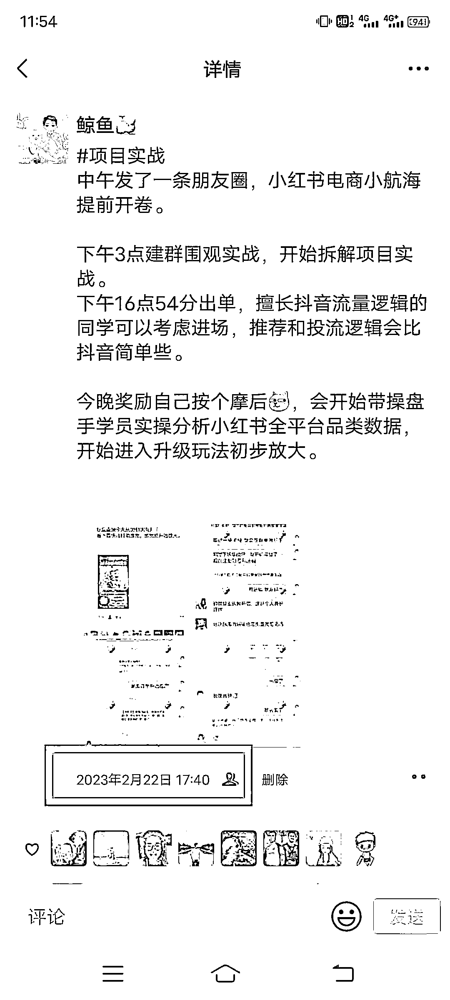
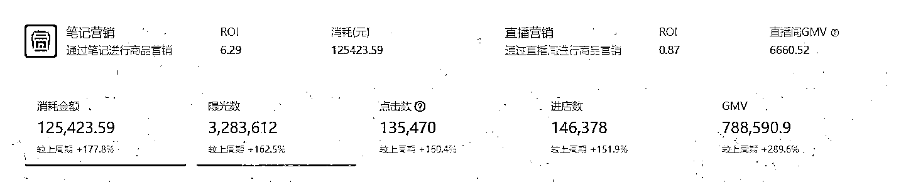
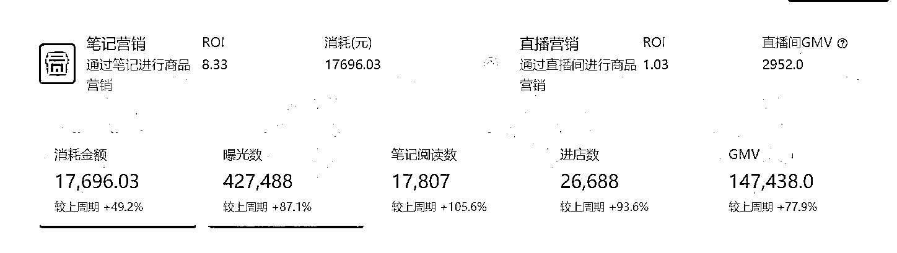
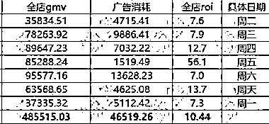
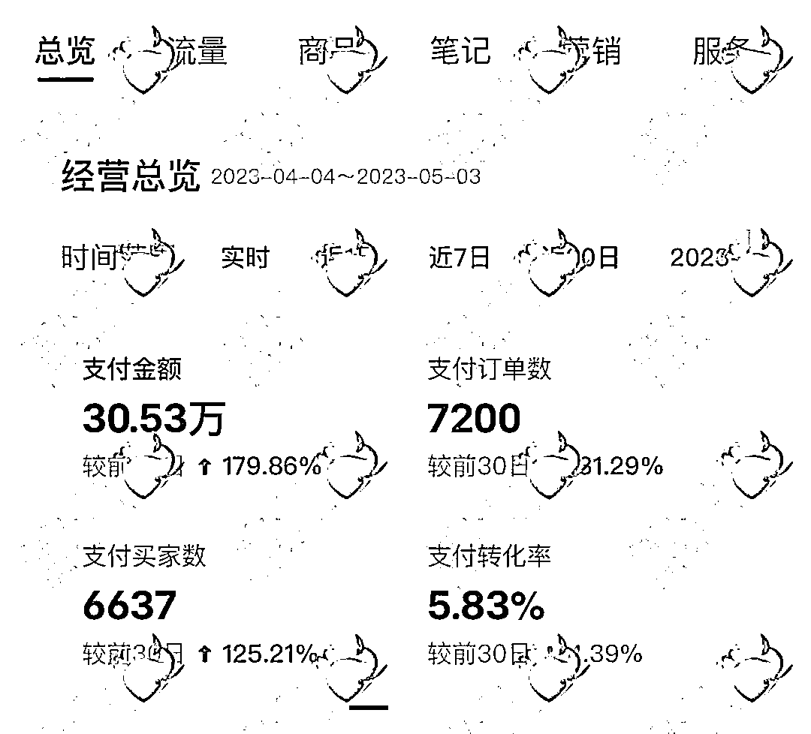
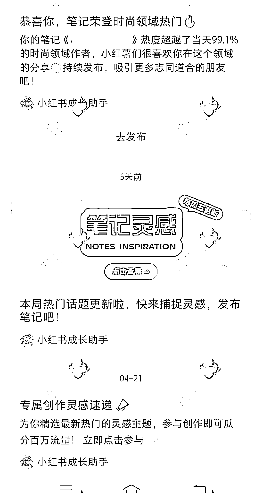

# 零基础📕：两周单店78W GMV的投流复盘

我是鲸鱼，曾在大厂负责广告算法产品，后来转做商业流量操盘，主攻抖音、📕的投流带货、精准获客以及SEO。2月，赚钱小航海给了我方向：📕电商值得做。虽然我当时在这块完全零基础，但判断窗口期还在，决定提前抢跑——2月22日，两小时内就出了第一单。

首单之后，我把在赚钱获得的认知落到实战里，围绕自然流量与付费投放两条线，连续打磨了两个月。成绩是：两周内第一家店做到78W GMV，第二家店14W GMV；单周投放ROI在10以上，最高冲到56。这里要感谢龙哥盟带来的认知升级，也感谢我的贵人老师。

为了让这套玩法不只停留在理论，我已经带学员跑自然流实操，单店GMV突破30W，现在正协助他们用付费投放放大结果。下面这篇复盘，会从自然流量与付费投放两端拆解📕电商带货；自然流部分会讲当前常见的搬运混剪玩法。无论你是刚起步的小白，还是准备上付费的玩家，都可以参考。

排版原因，详细文档放在飞书：
https://ra0vtgukn5c.feishu.cn/docx/F3BjdXRJFoPmE3xPsxgcZGLDnZb

   

 