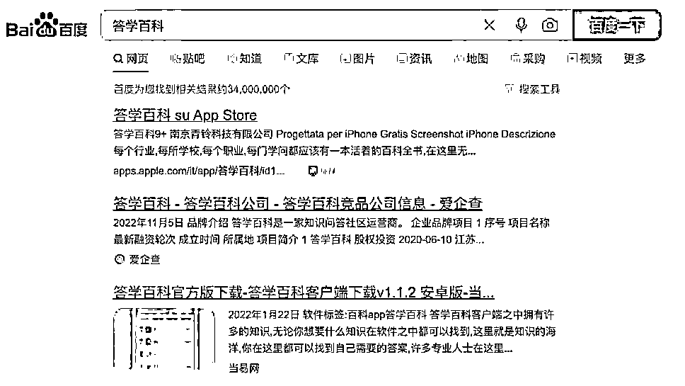
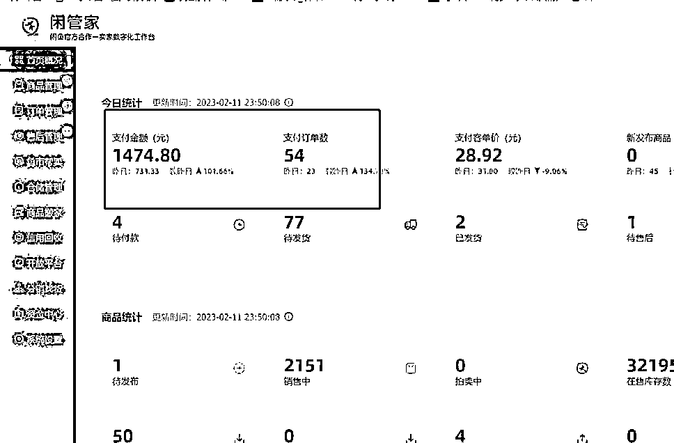
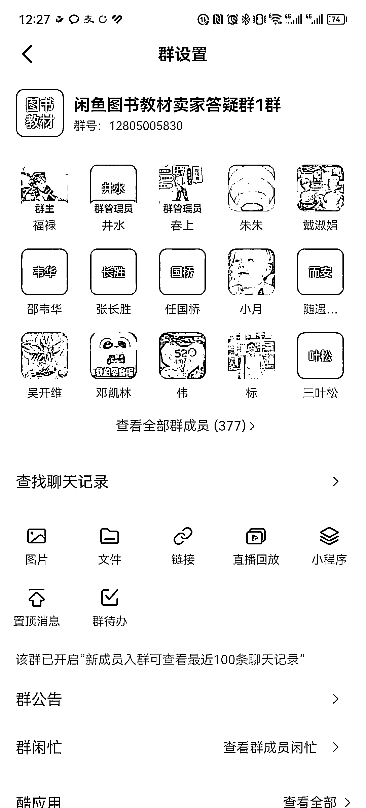
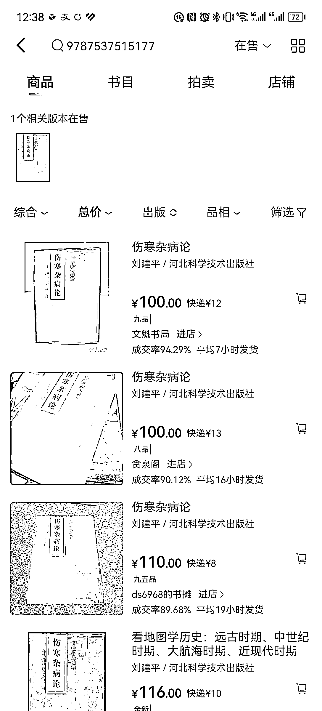
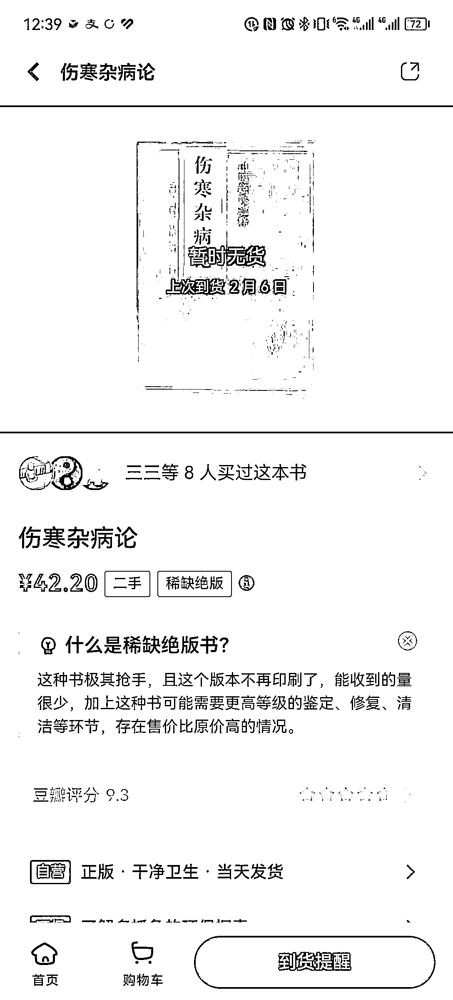
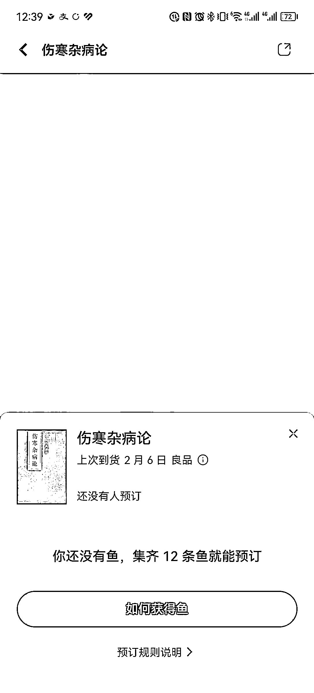
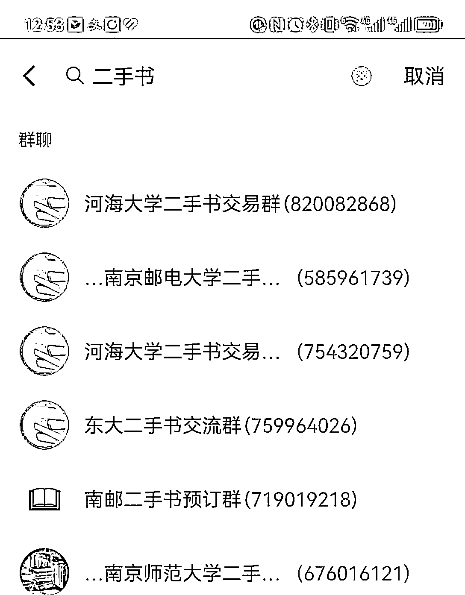

# 旧书生意两年复盘：五条路径与关键细节

圈内朋友好，我是老瞿Qu，给自己定的目标是成为龙哥盟里最熟悉旧书买卖的玩家。两年下来，我有一座约1000平方米的库房，存放旧书近200吨；2022年自有库存卖出约400万元，净利超过百万元。

我早年在世界500强房企做到较年轻的中层，辞职时拿了100万元融资，启动“答学百科”APP，想和知识星球正面竞争（现在百度还能搜到）。

项目没跑通，却阴差阳错扎进旧书行业。这一做就是两年，也把库房做到了前面说的规模。2021年闲鱼官方内测旧书类目，我第一批进场；2022年运营了5个纯代发店铺。当时平台单店最多挂3000个商品，只够覆盖畅销款，而库房里有七八万种书，于是我把业务拆成两块：实体库房和闲鱼零库存代发。5个代发店全年利润超过60万元。2022年闲鱼旧书类目入驻审核停了一整年，直到12月才重启；目前我的店铺号已扩到30个，按趋势看，2023年代发端利润有机会超过实体库房。

下面聊聊我对旧书行业的观察，以及几种主流路径的具体操作。

## 一、旧书行业现状分析

**（1）八成以上高校教材预订放开**

国家鼓励资源循环利用，超过80%的高校不再强制学生统一订教材，学生可自行解决。这给旧教材交易腾出了空间。

**（2）大学生接受度逐年提高**

教材在大学里的实际使用周期并不长，旧书通常只按标价1-4折出售，价格优势明显；加上盗版打击趋严，传闻原先几家大盗版商出了事，正版旧书反而受益。大学生对旧书的接受度一年比一年高。

**（3）消费降级带来增量**

经济环境偏紧，家长给孩子买旧字典的需求变多，旧字典在闲鱼上成了供不应求的小爆款。

**（4）校门口旧书店批量退场，电商占优**

校园旁旧书店多由年长者经营，疫情三年学生不能出校，一墙之隔也做不成生意；他们又缺乏线上运营能力。与此同时，学生网购旧书的习惯已经养成。我们低价盘下几所学校门口的旧书店，迅速把规模做到200吨，赚到第一桶金。

头部玩家套路大致是：郊区设仓，租金压到0.2元/平方米/天；靠小程序扫码、校园代理、废品站合作收书；体量500吨以上；淘宝、闲鱼、小程序多端卖；日发几千至万单，快递控制在2元/单以内；有人连仓库周边菜鸟驿站也拿下，进一步摊薄物流。

## 二、闲鱼零库存代发玩法（新手优先）

这是目前最值得推荐的路径。平台首选闲鱼，正处红利期，淘宝和拼多多不建议碰。单人可借家人身份准备两份书刊经营资质，撑起六个店；精细维护六店差不多是个人上限，年利润约20-50万元。开学季单店日销1000-2000元，平日约500元，利润率约30%。

**（1）项目门槛**

① 资质：淘宝代办约1500元，含个体户执照与出版物经营许可证，1-2周下证。警惕假证，拿到后去政府官网或打工商电话核验，别信对方给的查询站。

② 设备：闲鱼风控严，尽量一机一号，二手红米7/8约200元。

③ 网络：五六个店共WiFi实测无事；一二十个店建议流量卡。

④ 入口：目前类目申请是邀请制，APP不一定看得到入口；可进官方群拿申请链接，审核过后才能传证照。

**（2）项目优势**

① 红利：普通号只能挂5本书；2020年9月前的突破bug已修复。2021年官方邀200多商家测试，认证后可挂3000本；2022年通道关闭，12月重开。现在APP不能直接申请，得走官方群链接审核。

② 省选品：旧书最好卖的是大学教材和小说，教材3-5年换版，小说更久，上架后无需天天选。

③ 售后少：单价低，实测售后低于5%，比投影仪等电子产品省心。

④ 不压货：无需垫资，无库存和现金流压力。

⑤ 起号易：商家不算多，执行力够，首月5000利润、次月破万不难。

**（3）项目劣势与风险**

① 前期铺货需耐心：首图实拍，文案标准化又有差异，每日20-30本；别用群控软件，效果差。通常铺到300-500本才稳。

② 非躺赚：客单20-30元，订单多后采购发货耗精力，比短视频带货琐碎。

③ 别搬别人账号，举报易封。

④ 单店天花板低：最好店旺季1-2万/月，淡季约5000/月，赚辛苦钱。

**（4）实操步骤**

① **办证注册**：一份资质可对应支付宝、闲鱼，主体一致。单人最多3个支付宝对应3个闲鱼号。

② **申请**：官方群链接开通书籍销售权限，再在APP上传资质执照；无群链接则无入口。

③ **选品**：孔夫子畅销榜；淘宝旧书大店销量榜；对标闲鱼头部店。

④ **上架**：用闲管家网页端，效率高于手机扫ISBN；在孔夫子或淘宝价上加30%。

⑤ **销售**：有单去孔夫子/淘宝下单，上家发出后回填单号。

⑥ **优化**：自然流量为主，起步可小号点想要/下几单做数据；每店限3000商品，书种几百万，定期下架无销量品；《三体》热时可跟热点，但畅销盘变化不大。

**（5）如何放大**

① 矩阵：单店上限低，一人精细管六店。

② 工作室：采购发货外包，比如小区宝妈，南京3000元/月，不管吃住社保。

**（6）适合人群**

① 新手首份副业，红利期易出结果。

② 工作室长期项目，资质门槛挡住内卷，预计2-3年不会太挤。

## 三、绝版旧书玩法（小众，适合能批量解决店铺号的人）

之前有圈友分享过，我实测后态度偏谨慎：同样的精力，不如多开几个闲鱼店。这里简述玩法。

（1）在孔夫子或淘宝找几家绝版书商；

（2）去多抓鱼APP搜同款，看是否存在价差；

（3）有价差的绝版书，多抓鱼往往无现货，需要等回收回来才能买，所以点击预订排队。越稀缺的书价差越大，排队人也越多。排队要鱼币，鱼币靠向多抓鱼回收书获得。

家里没书可回收时，常规做法是：先从多抓鱼买一本旧书，比如10元，再回卖给平台，约得2元现金加4个鱼币，相当于鱼币成本2元/个。抢书前要算清投入产出。比如价差50元却要10个鱼币，实际利润就剩30元。

（4）排到后会短信通知，下单寄到家。

（5）再到孔夫子或淘宝挂出售卖。

我们测试时，一个孔夫子号预订了一千多本，当月抢到的绝版书利润在200-500元之间；还要收快递、发快递，链条比代发模式复杂。以上只是小规模数据，因闲鱼代发利润更大、操作更顺，我们战略性放弃了这个分支，但不排除有人做得更好。

举例：这本《伤寒杂病论》在孔夫子最低价112元（含快递）。

而在多抓鱼只需42元（包邮），中间有70元利润。

预订时发现需要12条鱼，这本书2月6日卖出过一本。

假设每条鱼成本2元，70-24=46元，再扣6元发货快递费，最终利润约40元。接下来就是排队，来货后按顺序短信通知，24小时不买算弃权，顺延下一位。

绝版书是旧书项目里更细的分支，小众，适合能批量搞到很多店铺号的人批量预订放大收益。单号收益不高，收书、销售、再发货整条链也不短，需要投入不少精力。

## 四、自建旧书库房玩法（重资产，资金充足再考虑）

这是比较传统的模式，整体偏重，不建议轻易入场，适合有一定经济实力、想做长期稳定项目的人。

**（1）项目门槛及难点**

① 资金投入大。目前库房回收成本约6000元/吨，一吨约2000本，算上运费约3元/本。行业利润率约30%。想做到年利润100万元，库房需要约1000平方米、存放200吨书，光书成本就到120万元左右。5、6月收的书，9月开学季基本能回本，但要保持库存，且最终约20%的书会当废纸处理。

② 流程复杂。比一般电商难：一是收书没法按需进货，主要靠毕业季集中回收；二是书种多到惊人，我们200吨库房有近10万种书，必须上ERP软件辅助管理。

③ 数据库维护难。新手面对几百万种书，不知道哪些该收哪些不该收，得靠小程序扫码判断，但数据库建设需要时间积累。

④ 回收难度大。每年5、6月毕业季最忙，收书是纯体力活。行业内70%以上的书来自学校废品收购站，这里面的门道很多，要处理好学校保安、收废品大爷等各方关系，需要资源积累。

**（2）项目优势及机会**

① 稳定可预期。根据库房毕业季时的吨位，基本能算出全年销售额——库存吨位的1.5-2倍。比如高峰200吨库存，加上平时小规模补货，年销售额300-400万元。

② 延展性强。大学的旧书交易群很容易组织起来，自带流量，未来还能接考研机构广告投放，赚额外收益。

③ 可做深耕学校的书单预订。在大量收书的学校，让学生按书单订阅整套旧教材，开学前预订、开学后统一配送。线下整套书单客单价能做到100元以上，利润率50%以上，对比线上15元左右的客单价，优势明显，核心在推广到位。

④ 发货效率碾压代发。自有库房当天就能发货，代发要等上家，慢很多。结合ERP系统，一人一天发上千单没问题；代发模式买书发货的环节非常耗精力。

**（3）入局注意事项**

① 成本控制必须到位。库房租金要压到0.2元/平方米/天以下，3kg以内的快递控制在2-2.5元/单，这两项是大头，选址和快递价格一定要谈下来。

② ERP系统可共享。图书行业常用旺店通ERP年费约2万元，新手可找头部公司共用账号，通常给2000元即可；或让他们代销你库房的书，抽成10%。因为旧书回收难、淘宝店群都已上架、书种又多，他们很乐意帮你卖，毕竟能扩充自己的库存。前期淘宝店等级不高时，这也有助于提升销量。

③ 回收数据可共享。千万别自己开发小程序，费用高、数据库维护成本太大。市面上已有成熟方案，带回收和销售功能，关键是内置书籍回收数据库，能省大量精力、提高收书效率。

## 五、另类玩法

**（1）淘宝旧书卖家联盟玩法（偏灰，适合有出版社资源的人）**

淘宝做旧书最大的坑是：出版社一旦投诉售假，你很难拿出解决方案。投诉1次警告、2次扣保证金、3次关店，而且对店铺流量冲击很大。淘宝不关心你卖的是不是旧书，他们要的是进货单证明清白。但旧书都是废品站论吨拉回来的，哪来进货单？所以无解。

大出版社通常不投诉，搞事的往往是小出版社。这就催生了旧书卖家联盟——有出版社资源的人组织起来收保护费。加入联盟就没人投诉你；不加入，被盯上就举报你售假。最后你只能找他们撤诉，2000元一个链接，一投诉影响的是整个店群，10个店就是2万元。处理完还劝你入盟，美其名曰保护你不被出版社投诉的“正义”组织。

据说这种组织收入不低，基本躺赚——一边收保护费，一边帮你消投诉。这玩法有点缺德。有经验的人会直接放弃某些小出版社的书（比如上海音乐出版社）来规避风险。另外，很多出版社其实是授权给这些机构维权，出版社本身不想惹麻烦。如果你被这种组织盯上，也可以直接找出版社理论，出版社通常会否认，这时候你反过来举报出版社和所谓正义组织联合诈骗。虽然没人真的受理，但威胁几次，出版社害怕了就会撤诉。对付坏人要用坏人的手段，我自己试过，确实管用。

**（2）参加政府比赛或扶持大学生参赛（暴利，适合有学生资源的人）**

在国家推动资源回收利用的政策下，旧书包装一下很容易过政府比赛评审。只要有个仓能让评委看一眼，讲讲模式、画画饼，拿政府资金并不难。2021年我们只有一个100平方米的小仓库，就拿了南京紫金创业大赛三等奖，20万元直接到账，外加10万元无息贷款——一二等奖基本是芯片之类的高科技项目。未来也可以把资源给学生，支持他们参加挑战杯、大创等比赛，这种资源回收类项目很受欢迎。我们目前精力有限，还没实操。

## 六、行业综合实操建议

现在各平台监管越来越严，群控软件、批量铺货、无人直播被打压得很厉害，只有精细化运营、深耕某个类目才更容易出结果。淘宝和拼多多的旧书已经相当内卷，反倒是还在测试期、日益商业化的闲鱼旧书类目算红利期，适合小白进场。别被一张书刊经营资质吓住——它既是门槛，也是帮你挡住内卷的屏障。

至于实体库房，我们目前200吨体量，也参观过几个500多吨的库房，整体感觉都比较稳，特别是把区域快递承包下来之后，吃得更香。

# 想入场，先接受它的“重”

如果你已经想清楚要长期扎根，这个方向可以进场；不过实体行业的短板同样明显：模式偏重、得先压资金，也不可能今天说不做、明天就抽身。提前祝大家在2023年都能找到赚钱的门路。

评论区里也有真实反馈。小嵩说自己是受益者，感谢老瞿，去年12月4日开店至今，近30天的成绩直接晒图。老瞿回应：关键还是你把执行做到位，这事不像短视频那么依赖技术，肯干就行。小嵩也认同：确实没技术门槛，新手也能试。

还有人问官方群怎么进；每天要投入多久？小嵩的回答是：上书几个小时，偶尔拍单，其余时间可以做别的。至于和买家沟通维护要花多少时间，他说不固定。