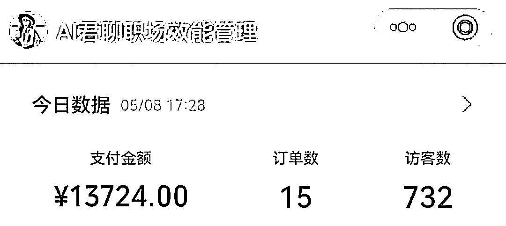
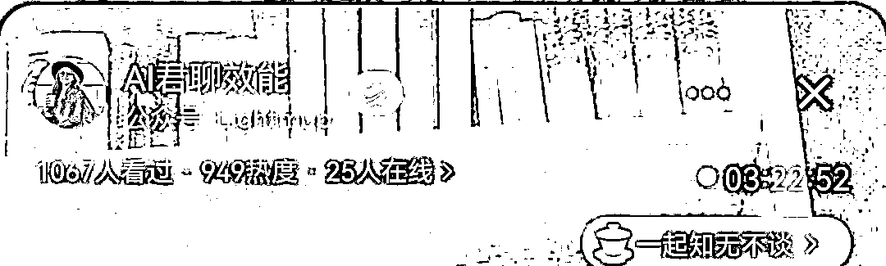

# 首次视频号直播就卖爆了？一场直播净赚 1.6 万，关键不是靠流量

作者：AI 君

日期：2022-05-16

先自我介绍一下，我是 AI 君，95 后，去年从大厂裸辞，现在是一名自由职业者，主要做自己的课程。

关注龙哥盟第二年，之前总觉得自己经验不足，一直在潜水观摩，最近受几位朋友鼓励，决定把自己的一些实战心得分享出来，希望能给到大家一些参考。

之前在抖音直播大航海中，我全程跟了下来，但直播间场观始终突破不了 200，成交更是为零。看到不少同航的伙伴都做出了不错的成绩，说实话也怀疑过自己是不是天生不适合做主播。好在我没有放弃，而是把阵地挪到了视频号。

结果让我自己都没想到——视频号头一次直播卖课，单场成交额直接破了 13000 元，再加上后续尾款，当场实际利润达到了 16000+，而且卖的全是我自己做的课程产品。

这个成绩在圈内大佬面前可能不算什么，但我觉得对普通人来说很具有参考价值。一个没有名气、没有流量加持的素人，纯靠前期的策划和准备，就能打出这个结果，说明这条路是可以被复制的。所以今天决定拿出来和大家聊聊，也希望能给那些在抖音直播铩羽而归的朋友提供一个新思路。

很多人做视频号直播，习惯性地沿用抖音的逻辑——先吸粉、再养号、最后指望场观提升带来转化。但视频号其实有一条更顺滑的路径，就是不做泛流量，直接做精准成交，把私域的转化潜能拉到最大。

我直播时的场观和在线人数都不高，平均也就 30 多人同时在线，公域流量几乎为零，全是靠🛰️私域里的好友和朋友们一层层扩散带进来的。就是这么一波人，集中完成了一次高效的成交转化，比群发促销、1v1 轰炸的效率要高太多了，而且成本极低。

整篇文章会包含三个部分：

一、如何策划一场成功的直播带货？完整流程是什么？有哪些关键点？

1、宣发到位，提前预热

2、先留人，再转化

3、以老带新，增强信任

所以，如果你本来就在做私域卖货，但不太擅长从公域搞流量，那不妨试试这套打法。只要策划到位，单场做出这个成绩完全有可能，前期只需要花一点点时间熟悉视频号的操作就行。

接下来，我会把我直播前前后后的所有策划思路毫无保留地分享出来，帮大家用直播快速拉动成交。

这套方法不光我自己在用，身边好几个朋友也验证过，完全是可以复制的。

4、产品分层，阶梯价格

5、善用钩子，增强链接

6、不断播报，放大信号

二、为什么用户愿意在直播间下单？怎么有效促进转化？

1、必要性——内容设计

2、稀缺性——嘉宾选择

3、紧迫性——价格策略

三、常见问题与注意事项

1、如何促成第一单

2、充分调试非常重要

**PART1**

如何策划一场成功的直播带货

一场成功的直播，核心不是主播多能说，而是背后的策划有多到位。

先把基本操作熟悉一遍，等要开始带货了，千万不要上来就打开直播间硬聊，一定要提前把直播间的节奏和流程设计好。

直播间很像一个菜市场。你蹲在那里支个摊子，一言不发，路过的人大概率只是看一眼就走。大家会不自觉往人最多的摊位凑，买的人越多，围观和跟买的人就越多。

产品好只是底子，底子好并不代表用户就一定买单，关键是要把「你的东西很好」这个信息有效传递出去。

怎么传递？就是靠策划去营造一种「我这里的东西非常抢手」的氛围感，这种氛围才是推动用户下单的催化剂。

视频号和抖音的底层逻辑完全不一样。抖音的观众大多数是陌生人，而视频号的观众里，藏着很多你已有的私域好友和早就在心底认可你的人。这些资源极其宝贵，必须用起来。

任何多人场域里，想带动群体行为，关键是抓住里面的**KOC**，用他们去撬动其他人。

视频号直播间的观众，按信任度可以分成三层：

第一层是陌生人。通过直播推荐或者朋友的转发进来，对你完全不了解，也没有任何信任基础。

第二层是熟人。可能是同学、同事、朋友，或者某个群里认识的人。知道你是干嘛的，但从来没在你这里付过费。

第三层是用户。在你这里花过钱，哪怕只是几块钱的课程，或者几万块的服务。这群人，是我们要重点抓住的**KOC**。

那如何把这三层人顺利转化并带动起来？我总结成六个关键动作：

**1、**宣发到位，提前预热

开播前的第一波宣传必须做足，通过各个渠道先把这三层人拉进来。很多人不是一开始就想了解你和你的产品的，但直播间这个场景有它的魔力——它能在几十分钟内完成从种草到转化的闭环。所以，先把人拉进来是第一位的。

前期工作具体包含这些：

（1）创建直播预告，引导大家预约。

现在视频号和👸号配合得非常顺滑。如果你有👸号，这段时间要多发文章。

一来可以写一些和本次直播主题相关的文章，在文中插入预约入口；二来👸号主页会直接展示直播预告，用户进来就能看到；发文频率上去了，曝光量自然也跟着涨。

最关键的是，当你开播时，关注你👸号的人能在订阅号消息里直接看到你的直播——这是个非常重要的流量入口，别浪费。

（2）确定核心价值点，多次在朋友圈宣发。

开播消息可以先整体发一波。内容、嘉宾、奖品、优惠——这些都可以作为价值卖点，从不同的角度反复讲。

内容吸引来的是最精准的目标用户；嘉宾能辐射到某个特定圈子；奖品和优惠看起来泛，但能最快调动一批人的兴趣，还能让你的潜在客户更愿意进入并留在直播间。

除了这些，朋友圈里还有两个特别的宣发角度。一个是「挑战单场 GMV xxx」，特别是当你的产品本身就涉及变现教学时，这个卖点对目标用户来说非常有吸引力。

另一个是个人故事。讲讲你为什么做这件事，背后经历了哪些思考和挣扎。私域里都是认识你的人，真实的故事往往最能打动他们。

可以说视频号直播是私域成交的未来趋势，所以要赶紧入场；也可以说这个场景对做私域的朋友特别友好，是效率极高的转化场。或者干脆就着分享主题讲讲你为什么要聊这个内容、为什么做这些产品——都是很好的切入点。

（3）创建直播群。

我的习惯操作是：👸号文章里引导大家预约直播，朋友圈和社群里发海报让人加群。

开播提醒是系统自动发的，不太稳定，而且不一定能直接触达用户。私域就要用私域的打法——用群来造势，把氛围炒起来。

提前在群里预热，提醒大家关注直播时间。开播的时候，把群勾选上然后发个红包，系统就会自动推送一条开播提醒到群里。

直播过程中，我们也会在群里持续播报进度——现在进行到哪一步了、有位重磅嘉宾马上出场、刚才聊到了什么精彩内容、大奖还有几分钟开——把人不断拉进直播间。

（4）设计好分销机制和转发奖励，为核心用户定制转发海报。

第三层 KOC 用户，绝对要单独给足关注。他们直接决定直播间的氛围质量。

嘉宾和核心用户，不妨站在他们的角度想想他们需要什么，再给他们定制专属海报和转发话术。

我当时是这么跟 KOC 用户说的：「你们就真实写写在这里的收获和故事就好，能把别人的产品推销出去，本身就是你影响力的证明。」这个说法，既帮他们提升了变现能力，又给到了实实在在的利益，他们自然愿意发。

**2、**先留人，再转化

直播刚开始，绝大多数人都在观望。这个阶段的核心任务只有一个：把人留住。

「留住」靠两种价值：一种是你的内容能给对方启发；另一种是实实在在的利益刺激。

内容上，要精准切中人群和痛点。我们直播时针对不同人群做了不同的内容方案。我身边的目标用户主要两类：一类是 0-3 年职场人，正在经历迷茫期；另一类是 30 多岁，面临职业转型困境。

这两类人群，我们不会给通用答案，而是请来和他们年龄相仿、刚刚走过这个阶段的人来分享。同龄人讲自己的真实经历，共鸣感是最强的。

利益层面，就是最简单直接的抽奖。我们直播时全场不间断抽奖，一个红包几块钱，连续发几个小时成本也不高，但留人效果出奇地好。

抽奖也需要策略。我们的规则是凭转发截图领奖，不同档次的奖品有不同要求，用来匹配不同层级的需求。

个别小红包没有任何门槛，让第一层陌生人有点甜头、愿意多待一会儿；普通奖品要求转发一次，这正好是第二层熟人能够接受的程度；终极大奖需要多次转发才能达到条件，基本上只有 KOC 用户才够得着。这样做，既留住了人，又不断把朋友的朋友拉进直播间。

转发话术我们都会提前准备好，根据场景写好了直接发在公屏上，尽量降低用户的转发门槛。

只要直播内容本身够好，用户对你的信任度也足够高，再加上有现成的话术和激励机制，转发的动力很自然就来了。特别是 KOC 用户，他们会非常主动地帮你扩散。

另外要明确一点：留人的目的不是为了刷场观数据，而是确保他们能等到该听的内容，而不是划走就消失。所以每一次抽奖和开奖时，都要顺便重复介绍产品卖点和优惠政策，把这波人及时接住，转化成实际购买。

**3、**以老带新，增强信任

直播间的氛围是有传染性的，要懂得用上一层用户去带动下一层。

陌生人进来大概率不会主动互动，但熟人们一般都会给你评论、点赞、刷个小礼物。对熟人一定要积极回应和互动，用他们的热情去感染第一层的陌生人，让新人感受到这个直播间是热烈的、亲切的，进而对人和圈子留下好印象。

而真正促成转化的，是靠核心用户去带动前两层。核心用户是付过费、用过你产品的人，他们天然带着信任感。只要稍微设计一些分销激励，让他们主动开口讲自己的经历和做推荐，效果比主播自己说十句都强。

试想一个场景：你点进一个直播间，里面仿佛是一群老友在闲聊天，其中有几个还是你认识的人——你不好奇吗？不想加入他们吗？

如果还有几个你很信任的朋友，都在推荐同一个产品，并且用亲身经历证明它真的有效。和你有类似处境和问题的你，是不是立刻心动了？

视频号直播进来的人大多数都带着关系链——不是嘉宾的朋友，就是用户的朋友。所以，直播间氛围感一定要做足，和观众的互动一定不能少。

还有一个特殊的互动场景值得好好用：当有人给你送礼、给你评论时，正好借这个机会互动和宣传。

念名字感谢时，顺便介绍这个人和你是什么关系、你们之间有什么故事。如果对方是你的学员，直接说说他报名课程之后的变化——这会让其他观众对你的信任度直线上升。

**4、**产品分层，阶梯价格

直播间用户是分层的，信任度差距巨大，所以产品也要做成阶梯式，分别承接不同层级的信任，才能把成交额做到最大化。

直播间的场景是即时性的，要让一个陌生人在这几分钟里下单一个高客单价产品，几乎是不可能的事。哪怕是大佬的直播间，卖得最好的也往往是几百块钱的产品。所以，一定要设计一些低客单价产品，让新用户可以很轻松地完成第一次下单，从而带动整个直播间的节奏和氛围。

具体操作上，可以上架几节试听课、几十块钱的小课或者一本书，客单价控制在 10 元以内、或者小几十元，用来承接第一层用户的冲动消费。

然后是正常价格的主打产品，这是给第二层朋友的。直播间整场转化的重点也应该放在这批人身上——他们和我们的老客户之间存在交集，用身边人的真实案例去说服他们是最有效的方式，具体策略后面第二部分细讲。

还有一些高利润的定制化产品，是做给资深用户准备的。这批老客户可能已经买过你的主打产品，信任度极深。这时要重点让他们看到那些更具个性化、更高阶的课程产品，满足他们的进阶需求。

视频号直播间只能挂一个链接在直播主页，其他的都需要点进去才能找到。所以主页通常先挂个低价产品，快速售罄后赶紧换成正常价格的主打产品。至于那些高价值产品，高信任度的老用户其实会主动去翻出来下单——他们对你的产品线早已如数家珍。

这种高利润产品只要出几单，整场利润就拉上去了。

**5、**善用钩子，增强链接

对于直播间里的二度人脉（朋友的朋友），信任度偏低，想让他们当场付费，链路长得很——得让他们先听到内容和案例产生认可，还要有热烈的氛围加持。

但视频号直播的价值不局限于单次成交。能把一个陌生人转化成对你有点认知和信任的潜在用户，就已经赢了。

因此，直播过程中要有意识地设置几个钩子，引导用户和你建立深度连接。

第一个钩子：引导关注视频号。可以在抽奖环节设置「关注才能参与」的门槛，简单有效。

第二个钩子：引导加好友。需要添加个人🛰️才能领奖，或者加上好友就赠送课程或礼包。

这样你就获得了长期触达的机会，后续可以慢慢培育，持续转化。

**6、**不断播报，放大信号

当一个产品有很多人在买、并且快速售罄时，这本身就在向围观人群传递一个强烈的信号：这个产品很抢手。这种氛围能有效打破观望心理，带动更多人跟单。

但关键前提是——这些信号一定要被放大，有效传达给用户。不然卖了就卖了，跟没卖一样。

常见的放大手段有三种：

（1）主播直接口播：「xxx 刚刚拍下了我们的 xxx 产品！」「xxx 产品只剩最后几份，马上售罄！」

（2）如果正在和嘉宾连麦不方便打断，就让小助手或朋友在公屏上持续刷屏这些内容。

（3）直播前建一个直播群，在群里同步播报成交动态，同时发朋友圈转发，在直播间外围再造一重声势。

**PART2**

如何促使用户完成下单

用户下单的心理机制，关键在于同时解决三个问题：

第一，必要性——用户为什么需要这个产品，而非可买可不买？

第二，稀缺性——用户为什么要买你的产品，而不是别家的？

第三，紧迫性——用户为什么要在直播间此刻下单，而不是以后再说？

这三个问题，恰好可以分别用内容设计、嘉宾选择和价格策略来分别回答。

**1、**必要性——内容设计

用户下单，一定是因为产品解决了他的某个刚性需求。这个需求，要靠内容去唤醒。

最好的呈现方式就是「一个核心观点 + 多个真实案例」的组合。

直播不是来做知识分享的，是来卖货的。所以不要讲得散，要精心设计从内容到成交的完整链路。

直播间的节奏非常紧凑，观众的耐心极其有限。千万别像写文章一样展开来讲，一个核心观点，讲到每个人都记住，就已经超额完成任务了。

这个核心观点是什么？就是你的核心卖点，或者说目标用户的核心痛点。

举个例子，我的直播主打产品是付费社群，那整场直播从头到尾反复强调的一个词就是：打破圈层。

视频号直播间的初始观众一定是你私域里认识你的人，上来就讲道理是大忌——这个场景不对，他们根本听不进去。要讲你的真实故事，讲他们认识的那些人的故事。讲这些，他们才愿意听，也是最有效的。

我卖课过程中最大的体会是：最有说服力的成交方式，就是让用户亲眼看到——「我认识的某某某参加了你的课程，然后真的发生了改变」。尤其是那种大家都认可的人，效果会被倍速放大。

所以直播间的内容设计就是：全程围绕一个核心观点展开，不断用自己和身边人的真实故事去佐证它。

案例的讲法可以用「成绩 + 原因 + 问题 + 核心观点」的简单框架。每 5 分钟形成一个完整的案例闭环，循环往复。

直播间的人一直在流动，耐心极差，所以内容闭环要小而完整，重点要极其突出。别像日常聊天或者写文章那样平铺直叙——每讲完一个案例，都要收回核心观点，再重复一遍，确保给每个观众都留下深刻的印象。别嫌重复烦，直播非常需要重复核心内容。

比如我自己的直播，先分享我一路走来取得的一些成绩，然后话锋一转：能做出这些成绩，是因为我进入了一些高价值的付费圈子，视野和思维打开了。而在此之前，我其实也走了一大段弯路。所以，如果你想要一个不一样的结果，就一定要打破旧有圈层。

然后我再讲我的学员加入圈子后的改变、改变是如何发生的，最后收回到「必须破圈」的核心观点上。

因为这些故事全部都是真实发生的，也的确是我最在意的东西，所以观众很容易产生共鸣。再加上现场有不少受益的学员在互动，整个场域的氛围感自然就出来了。全程不需要反复硬推自己的课程和产品——真诚的效果，本身就是最好的销售。

还有一点：直播间最怕沉闷和枯燥。一个人连续讲太久，谁来都疲劳。条件允许的话，最好在直播现场找个朋友一起，不需要他有多能说，能帮你接几句梗、时不时强调一下重点，就非常加分了。

**2、**稀缺性——嘉宾选择

你的产品相比别人，提供了什么无法替代的价值？

对知识付费产品来说，最有说服力的证明就是——你的用户质量。而用户质量，要用嘉宾来集中体现。

嘉宾的选择极其讲究。很多人喜欢在直播间连麦大咖，觉得咖位越大越有面子。但大咖对拉高场观也许有帮助，对实际成交未必有用。

请嘉宾有两个目的：一个是为你做背书，另一个是帮你介绍产品。所以要找那些真正了解你、认可你的人。他得说得出来你的成绩、你的产品。

这里要特别提醒：嘉宾的推荐到底是设计好的客套，还是发自真心的认可，观众一眼就能识破。所以宁可邀请那种名气和 title 没那么大、但真的愿意为你说话的人。

嘉宾一上场，其实就已经传递了两个信号：一，你的人和你的产品是靠谱的；二，你的产品是真的有效的。

选嘉宾最好的两类人选——一种是你的老师，一种是你的学员。

在某领域有独特见解、跟你绑定很深、在某个小圈子有影响力的人，都是绝佳选择。有独特见解和影响力的人，可以让他们直接聊观点和认知，观众爱听又有收获。更重要的是，这本身就在传递一个极强的信号：这么多厉害的人都在你的课程和社群里，我进来了就能链接到他们——这本身就是极其稀缺的价值。

另一类是绑定很深、受你影响很大的学员。他们可能不是那么有名气，但他们的故事一定极具代表性。当他们讲自己的真实经历时，观众会产生强烈的共鸣：看，我要是买了你的产品，我也能像他一样一步一步变好。

这类人能非常精准地筛选出同类人群。用户会下意识地觉得：这个圈子适合我，和我同频——这同样是你的稀缺性所在。

嘉宾不需要你去规定他们讲什么内容，做好机制设计、绑定好同盟关系就行了。真诚的流露和发自本心的推荐，才是最打动人的。

**3、**紧迫性——价格策略

做私域成交的朋友，你平常可能在朋友圈、社群里也在卖这些产品。如果直播间还是卖同样的东西，就必须给用户一个「凭什么我今天就要在直播间买」的理由。

最常规的选择是降价促销。但视频号是个熟人场，有个很麻烦的问题：用户平时可能看到过你卖这个产品的价格，直播间一降价，反而容易让人觉得你的产品不值这个钱，还会干扰你后续正常的私域成交价。

这里给大家三个更好用的替代方案。

第一个，把新产品作为直播间的主打售卖品。比如你原本有课程 A 和课程 B，直播间可以出一个打包价格，用「新组合 + 优惠价」的方式制造新鲜感和额外价值。

第二个，用赠品代替降价。担心每单都送亏了，或者怕以后用户都来要赠品？那就巧妙地利用直播间的抽奖机制：凡是下单购买的用户可以进入专属奖池，抽取一个限时大奖。机会感和仪式感都拉满。

第三个，选在准备涨价之前开一场直播。这样直播间里的价格就是「涨价前的最低价」，顺理成章形成错峰优惠。直播结束后直接执行新价格，完全不破坏价格体系。

**PART3**

我拆解几个大家最容易踩坑的点，以及对应的避坑建议：

**1、如何促成第一单**

万事开头难。直播间第一单来得越快，后面就越顺利。最有效的方法是——提前在核心用户里埋好伏笔。直播前就和几位信任度最高的铁粉打好招呼，请他们开播后在第一时间下单，帮直播间打破冷启动。第一单的出现会立刻给围观者注入信心，后面成交起来就顺畅得多。

**2、充分调试非常重要**

设备、网络、声音、灯光、链接——直播前务必全部做一遍完整的测试。最好提前至少一天跑一次全流程彩排，找两三个朋友一起模拟真实的直播场景试聊，把可能出现的意外提前暴露并解决掉。临时才发现问题，神仙都救不回来。

以上，就是我在视频号直播的完整复盘和方法论。希望能对你在视频号做私域成交有所启发。如果有什么问题，欢迎在评论区一起交流。

直播间从 0 到 1：破第一单与避坑实录

很多直播间容易忽略的一点是，无论采用哪种推广方案，当天购买就是最划算的——这句话一定要在直播间反复强调。最好的办法是把它做成海报贴在直播间墙上，每到一个环节就让主播大声重述一遍。毕竟直播间的观众是来来往往的，只有反复喊出来，才能确保这条关键信息被每一个进来的人都听见、记住。

**Part3**

一些常见问题和注意事项

**1**、如何促成第一单

卖货过程中最难的不是后面源源不断的订单，而是从 0 到 1 的那一刻。做过直播的朋友应该都遇到过这种局面：产品有优势、预热也做了，该准备的流程都没落下，可观众就是毫无动静，一个都不买。这其实是一种“群体观望”心态——大家都不想做第一个尝试的人，于是互相看眼色，越没人买就越没人买。要打破这种僵局，核心思路就是把第一个人“推”出来。一旦有一两个真实成交出现了，后面的单子就会像开了闸的水一样顺畅。那具体怎么做呢？两个方法。

第一个方法：在直播之前就让目标用户“种草”。仅仅靠当天喊一句“今天有优惠”，说服力其实非常有限——因为路人根本不知道你平时的价格是多少，很难判断这个优惠是真还是假。而且，种草到转化是一条很长的链路，想要靠一场直播就完成，难度不小。更稳妥的做法是提前做好铺垫，让宣传和档期紧密配合。比如你打算 5 月 8 日开播，那在这之前的几天就要持续放出产品的相关信息，同时明确告诉大家：“5 月 8 日来直播间，会给你们最划算的价格”，并且引导用户预约直播。这样一来，带着购买意愿进直播间的人就会在开播后第一时间快速下单，把整个直播的节奏带起来。

第二个方法：用低门槛的引流款来破冰。就像前面第一部分提过的，可以为第一层的用户设计一些小额商品，比如低价试听课，或者像书籍这种价格透明的标品。这类产品不是你要主推的重点，它们的任务就是快速帮助成交、撕开局面。因为价格低，用户做决定的心理负担也小。库存方面可以放得少一些，营造出“手慢无”的氛围，让它更快售罄。当第一批用户带动下单之后，“群体观望”的僵局自然就消解了，后面的成交就可以顺着预设剧本顺势推下去。

**2**、充分调试非常重要

在我看来，充分调试是直播前非常重要的一步。视频号有很多功能设计很不符合常规的使用习惯，所以强烈建议大家一定要提前试播，把整个流程完整操作一遍。试播的时候可以把观众指定为自己人，这样别人完全看不到。另外有几个特别容易翻车的细节值得注意。

第一，视频号的直播预告功能。预告一旦创建成功就不允许再编辑了，所以必须反复确认内容没问题再发出去，否则之前的预约积累就算白费了。另外一个教训是，开播前一个小时尽量不要做调试。我当初就因为试镜头翻过车：开了个私密直播，结果系统直接把它认定为正式开播，还向所有用户推送了开播提醒。可大家点进来又进不去，最后只能重新开播，之前的预约基本上全废了。

第二，视频号的小商店。现在关联小商店必须先要有营业执照，这一步要提前准备好。操作其实很简单：营业执照 + 法人身份证 + 法人🛰️验证一下就可以，不需要法人本人到现场。不过最后提现时，钱是打到企业对公账户的。所以如果你打算挂靠别人的执照，一定要找足够熟悉和信任的人，否则货款提不出来，会相当麻烦。另外，在选品类型上也有讲究：如果选了虚拟产品（电子券码），卖出之后需要逐一找用户核销，订单量一大就会特别费劲。建议可以直接选实体货品，15 天后系统会自动确认收货，省心很多。

今天想分享的经验就到这里，希望对你有所启发。如果你还有疑问，欢迎随时来和我交流。最后要特别感谢赚钱提供的平台：之前参加抖音大航海，让我熟悉了直播相关的操作，也学到了很多干货，为后续打下了扎实的基础。同时也要感谢 @芷蓝 和 @文静 在我做 IP 定位的过程中提供的帮助。

评论区精选：

- 网友：学习了
- lucky：前面几条视频破了100万播放，但后面就没曝光量了，这种情况要怎么处理？需要注销重来吗？
- 彦师：我这边有公域流量，但目前还没开展带货
- 老宁：建议再发3-5天，还是有出爆文的机会；如果这段时间基本没有视频入选推荐，那大概率就不会再爆了。
- 陈雪🦉碎碎念：终于蹲到 AI 君来分享啦
- 蔡文静好文静：太细致了
- AI 君：害羞
- 林沐沐：我之前因为不懂，随便发了一些抖音上的旧视频，现在被限流0播放，应该怎么办？账号还有救吗？可以重置吗？还是说这个🛰️号就不能用了，只能换一个🛰️号重新注册？盼回复，谢谢