# 视频号定制喊麦，中老年用户的钱更好赚

视频号里做定制喊麦，瞄准的是中老年群体。这个平台上的中老年人数量大，而且愿意付费，价格也能收得起来。从微信指数看，相关关键词的热度并不低，流量来源主要就是视频号。

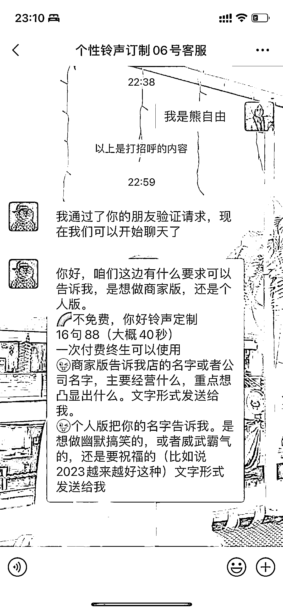

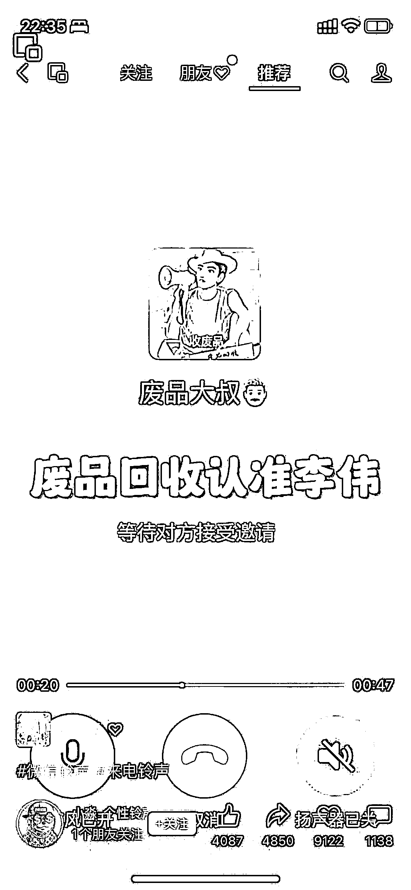

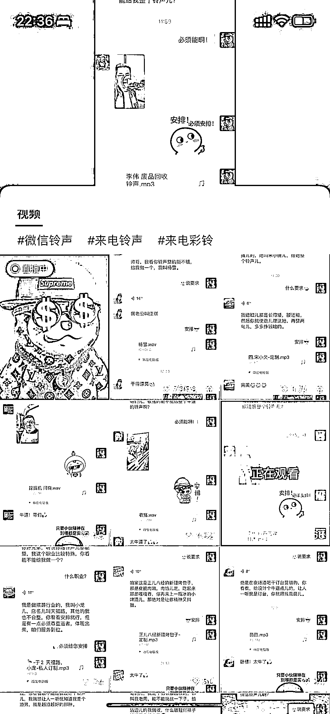
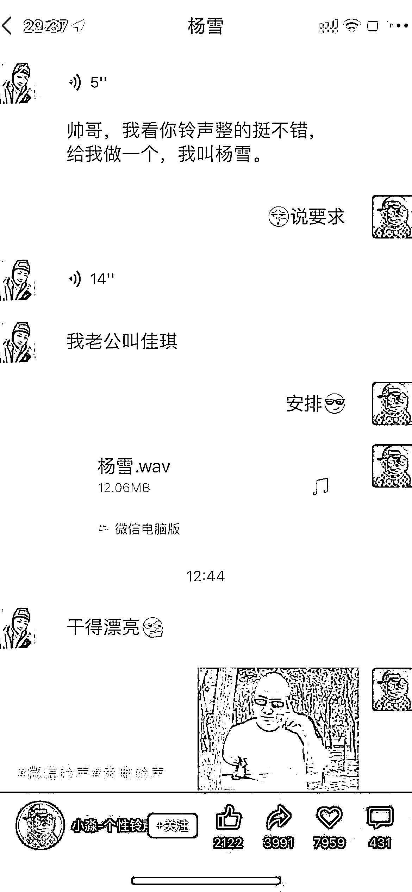

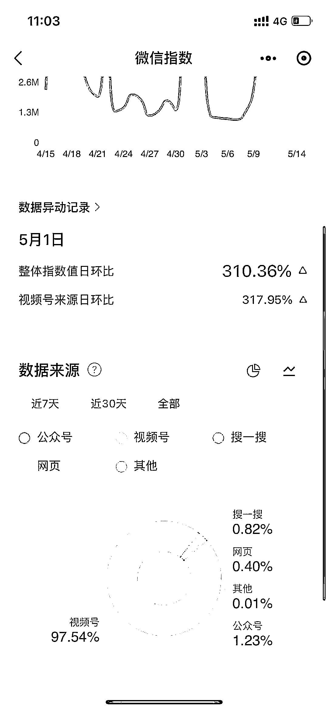

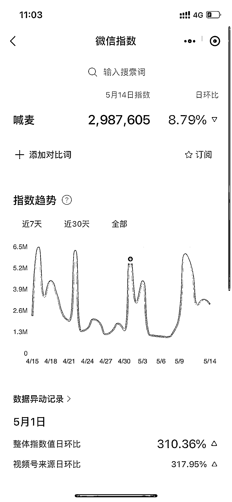

评论区：
Unbrick：如果结合ChatGPT这类工具做定制化，批量处理还是有点麻烦。
姜姜：这个可行。
亦仁：中标，术值+1。在上方专栏点击 #中标，可查看所有中标风向标。
晨哥：用什么软件能做呢？
熊自由：这大哥是人工喊麦的，可以去闲鱼淘一个会喊麦的东北兄弟。另外，视频号姓氏头像那个项目，评论区需求也很高。

# 视频号姓氏头像，评论区全在求图

做视频号姓氏头像，需求肉眼可见——评论区里全是求头像的。制作方法很简单，用小程序生成姓氏头像，配上背景音乐和装饰就行。变现逻辑是推广小程序，用户看广告解锁，或者直接充值会员。会员门槛很低，周卡3.9元，月卡9.9元。视频号里中老年用户多，他们不但给自己做，还会顺手帮朋友做一个。

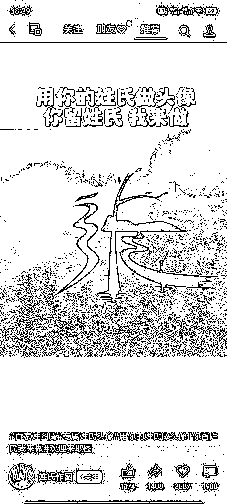
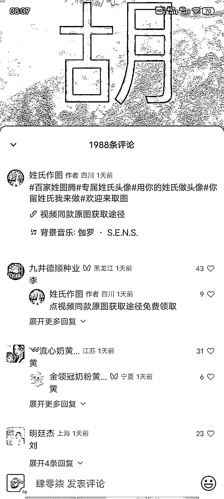

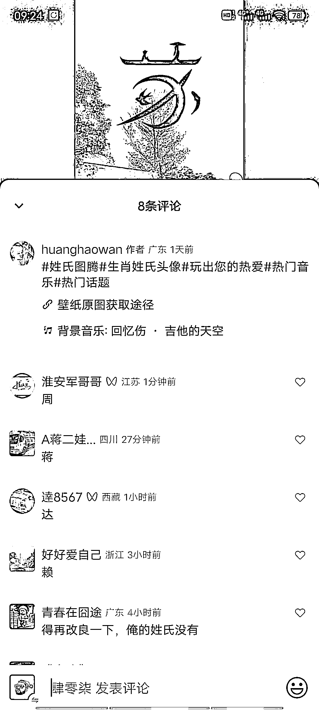

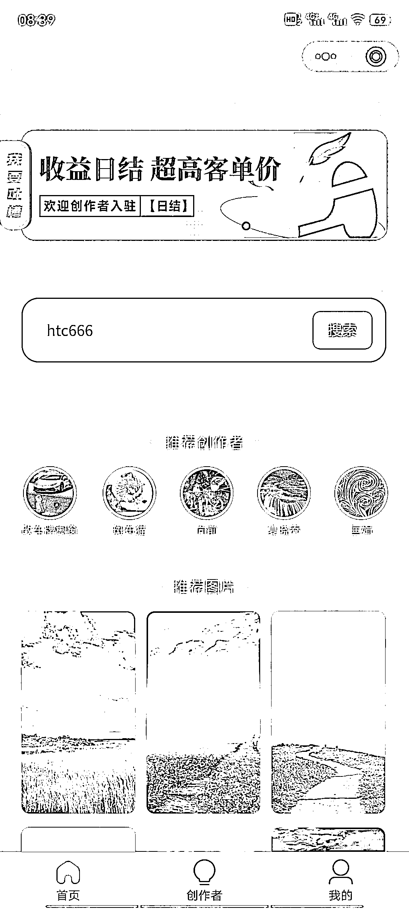

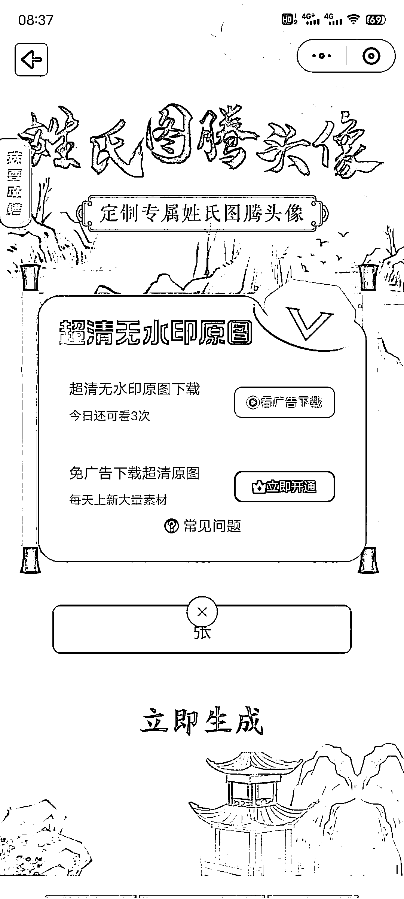

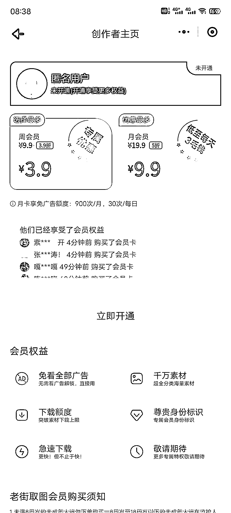

评论区：
毅恒(收售租二手机)：试过了，这个动态文字是怎么做出来的？小程序里没找到。
亦仁：中标，术值+1。在上方专栏点击 #中标，可查看所有中标风向标。
白宝香：在抖音也看到过。
依稀阳光：我也看到了，进去要先看个小广告才能输入，生成第一个是楷体，再想看还得看30秒广告……想找到满意的估计得多看不少广告，或者干脆充会员。
胖大魔：广告本身也是一笔收入。
闰土：老哥，招到人了吗？
毅恒：还没有。