# 银发赛道：客单价与利润双高的新蓝海

在很多人的认知里，网购是年轻人的事。可现实是，一批从未被认真对待的用户，正从短视频直播间里走出来，成为电商领域最值得关注的新增量。他们直接跳过了图文货架时代，一脚踏进视频电商，需求朴素而旺盛。

我是张集慧，2019年成为生财社群会员，此前产出过9篇加精内容。最近这一年多，公开分享很少，因为大部分时间都泡在银发电商项目上。这篇复盘写了一年，希望能给正在寻找长期机会的朋友一些启发。

本文会聊六块：

1、银发电商现状  
2、银发人群分析  
3、银发消费特征  
4、银发产品打法  
5、银发抖音号运营  
6、未来机会点  

先看一组反常数据：近30天抖音直播带货榜前十，小杨哥、东方甄选等头部主播的核心购买人群都在31到40岁。唯一特别的是新疆和田玉老郑，排在第三，单月销售额约1亿，50岁以上粉丝接近一半。一边是绝大多数头部账号几乎没有老年消费者，一边是个别账号靠着老年粉丝做出高客单、高利润，两个极端背后，是长期被忽视的群体差异。下面结合我近一年做老年内容、带动数千个账号、做出多个十亿级话题的经验，给出一些粗浅拆解。

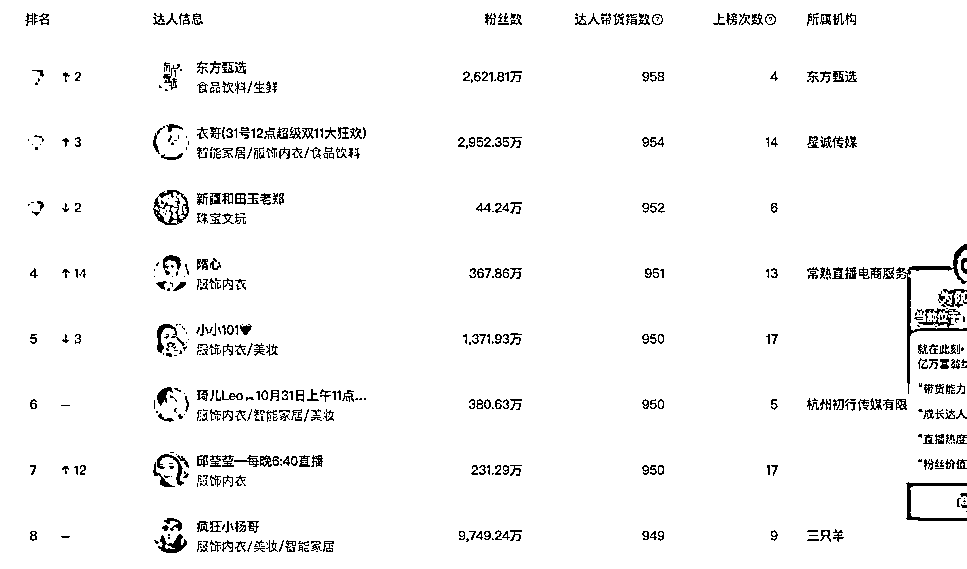

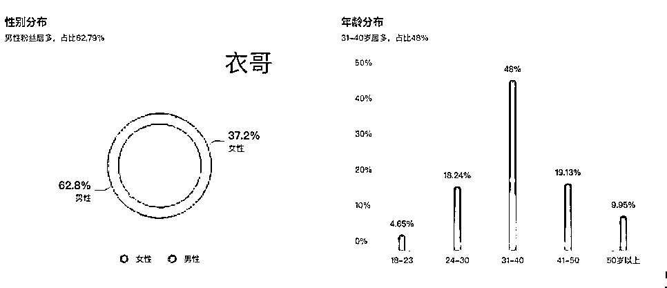 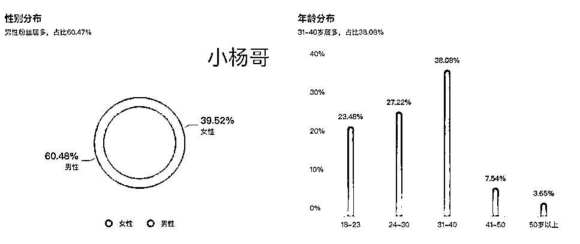 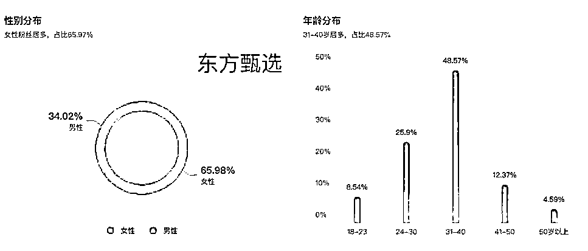

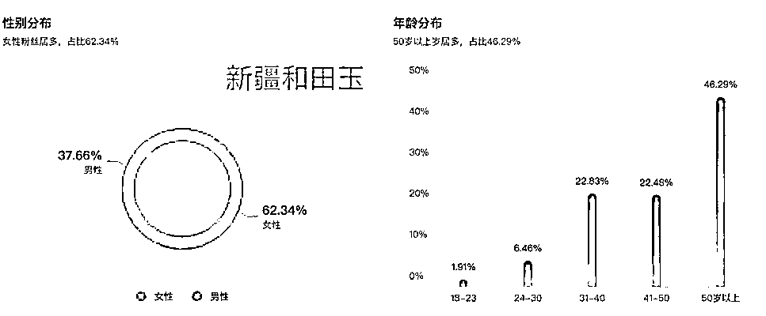

## 1、银发电商现状

我进入这个市场，起初是退无可退。2019年做过抖音，有播放量但无法变现。最惨的一次，40万播放只卖了19元一单，之后对抖音有了阴影。2021年上半年，我在不同平台试了八个月，方向换了很多，什么都没做成。最后只剩抖音没试透，索性硬着头皮再来，当死马医，即便失败了也没有更多损失。

既然要做，先选容易的战场。31到40岁人群被盯得太紧，我不擅长硬拼，只能看两个极端：儿童和银发。先尝试儿童类内容，数据很一般，仔细一想，儿童内容的真正受众是父母，还是31到40岁人群，依然是红海。于是转向银发人群。

银发内容有个特点：供给极少，导致爆款可以反复利用。同一条视频，哪怕只换个背景，发到不同账号，依然能拿到500万以上播放。

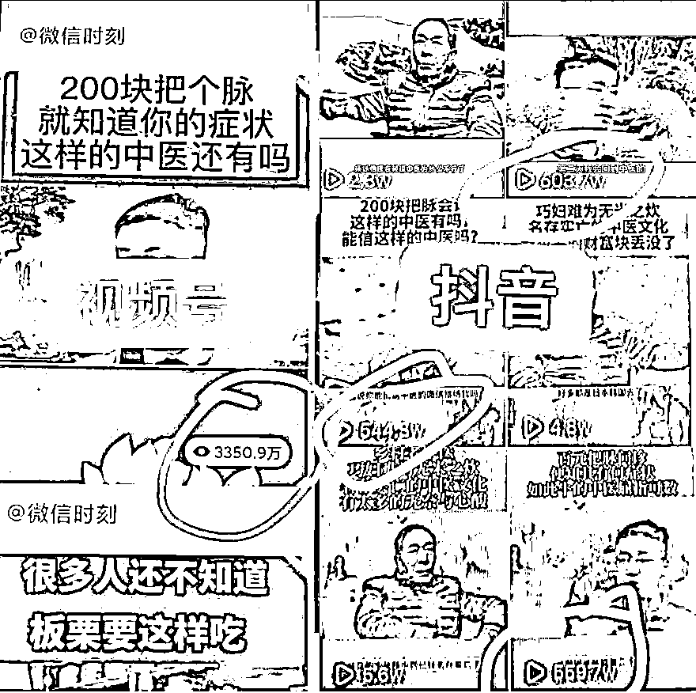

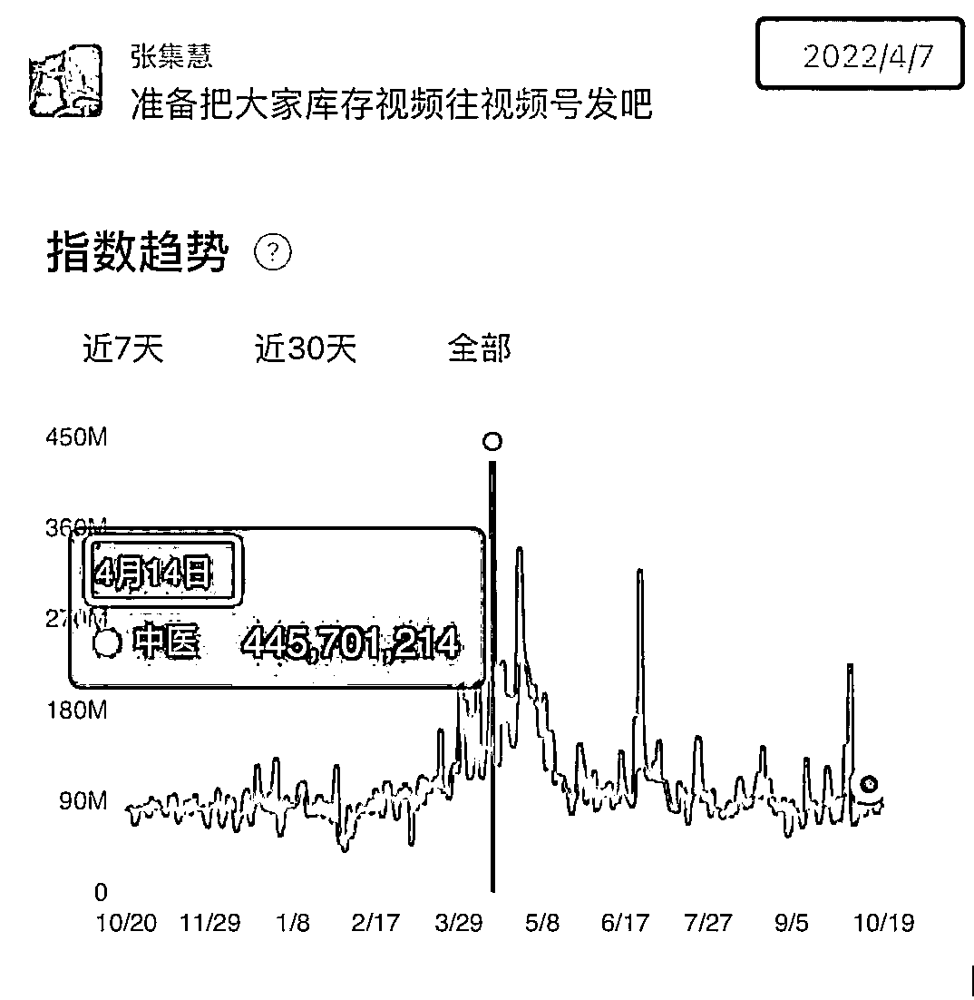

今年4月7日，我在社群提议把抖音上的中医类视频同步发到视频号。一周后，视频号中医流量冲到峰值，那条在抖音已经火过的视频，在视频号播放量超过3300万。这波内容也带动视频号生态，5月起，大量创作者开始涌入。

销售端同样有信号。中老年商品类目还在早期，专业团队不多，多数靠自然流量，不做投放，很多类目也不允许投放，所以佣金50%以上都能落袋。下面这些单品曾拿到分类榜第一。

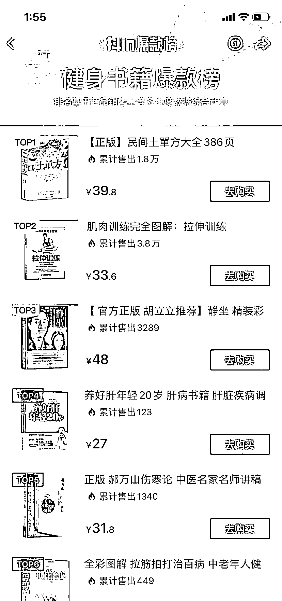

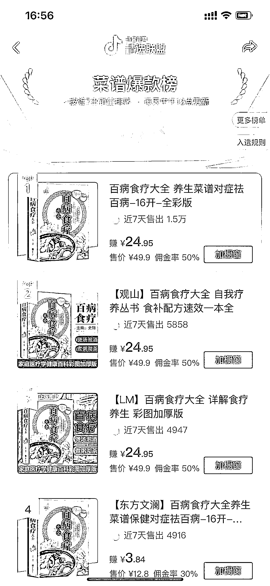

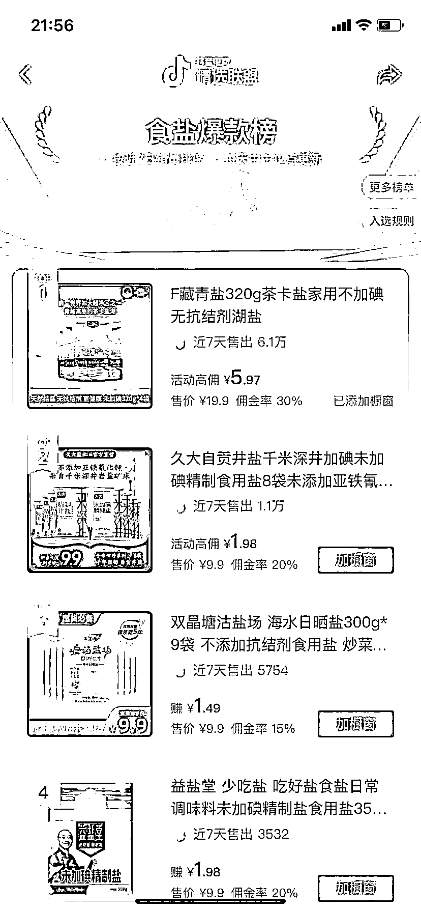

一条454万播放的视频，佣金8.1万元。部分历史截图已丢失，有些图打了码，请见谅。

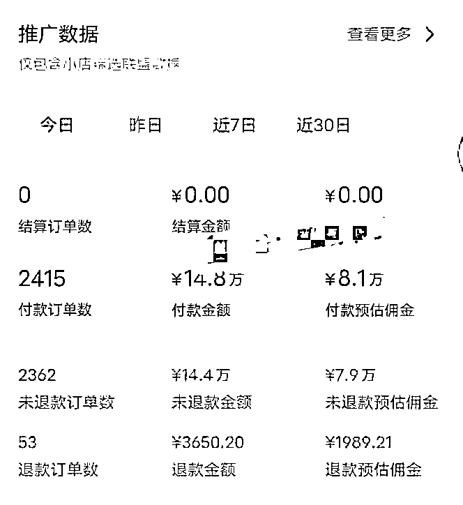

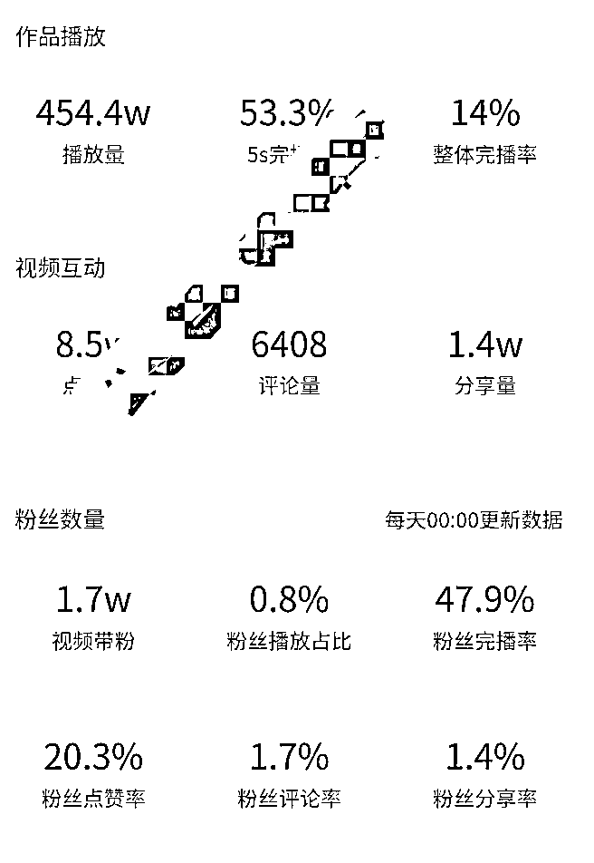

土单方套装客单价约150元，佣金可以到60%-74%；食疗食补类产品单价100元左右，但因为属于消耗品，有人一次买半年甚至一年的量，客单价自然被拉高。

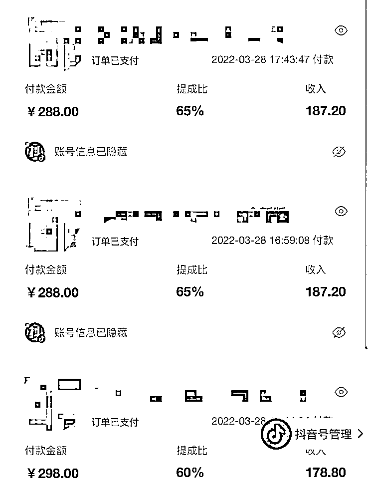

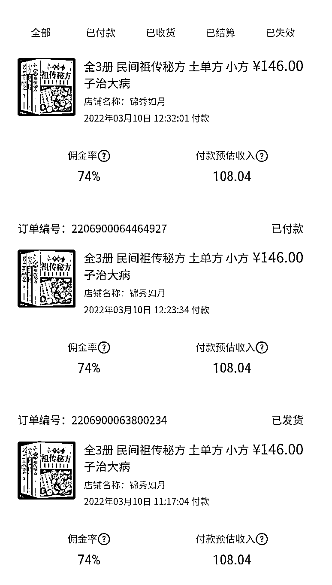 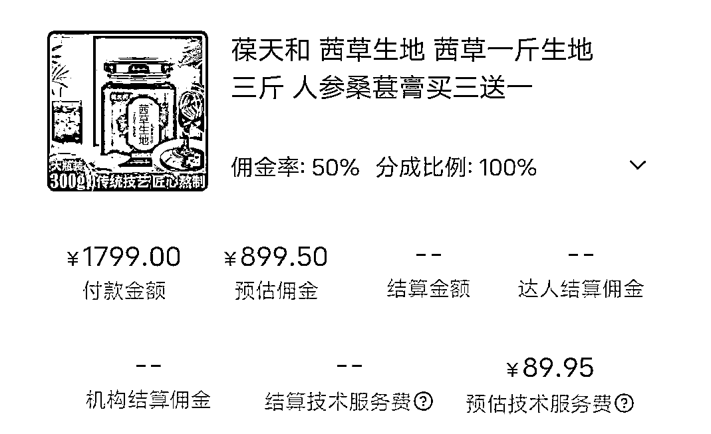

如果你看完这些数据还有兴趣，可以继续听我啰嗦。银发市场的核心问题在认知层面。赚不到他们的钱，往往是你压根不了解他们。那层窗户纸一旦捅破，你会发现不需要什么黑科技，不需要复杂的技术分析，只要用心想知道他们想要什么，然后给到就行。前提是多角度、深层次地去理解这个人群，而不是看几组表面数据就觉得自己懂了。

## 2、银发人群分析

很多人觉得老年人怎么可能网购。但淘宝上线快20年，网购已经成为全民习惯，老年人也会心动。他们的消费力没有完全释放，有几个具体原因。

第一，硬件限制。最早的网购人群离不开电脑，上班白领顺手就能逛淘宝；智能手机普及后，年轻人移动端购物更加方便。老年人大多退休在家，家里有电脑但会用的人很少，年轻人在手机上刷物流信息时，老年人的手机只能打电话。这几年千元机普及，老人换掉功能机，成为智能机用户，网购渗透率还会继续提升。

第二，支付门槛被打通。支付宝和微信通过拉新、补贴等活动，让老年人慢慢接受扫码支付。如果一上来就让他们在电商平台输入密码付款，很难。日常买菜、缴费都习惯了移动支付，他们才觉得风险可控，接受先付款后收货。

第三，购物体验完全不同。淘宝、京东以图文为主，年轻人早就适应。视频带货展示更直观，老年人一接触智能手机就刷到抖音、快手、视频号，面对全方位展示很难不心动，于是“买买买”。

## 3、银发消费特征

一说到老年人，很多人会想到舍不得花钱、斤斤计较、谨慎下单。但真实的银发消费者有几个明显特征。

第一，健康是顶级痛点。营销圈有句话：小孩怕笨，女人怕丑，男人怕不行，老人怕死。健康是老年人最刚的需求。从健康切入，很多生意会好做很多。尤其是中医内容，老年人几乎无法抗拒——既有几千年文化传承，又和自己多年的生活经验互相印证，天然有信任感。因此，中医书籍、养生食疗类书籍都可以成为销售品类。

第二，购买力被严重低估。一部分老年人的可支配收入远超年轻人。中年人要还房贷车贷，日常开销反而紧张，政策刺激内需效果有限也说明问题。老年人没有大额负债，日常消费占比不高，钱是真实存在的，关键看你能不能撬动。

第三，价格敏感度极低。淘宝京东的老用户已经被训练出比价习惯，便宜五毛钱都开心。老年人刚刚接触电商，还处于新鲜期，能买到东西就很有成就感。他们不知道比价，也不知道什么价格是合理的。比如书籍，在书店里按标价卖，成本可能只有一折。一本书值10块还是80块，他们心里没有锚，只要觉得有用、喜欢，80块也买。不像土豆鸡蛋，价格烂熟于心，涨五毛钱立刻觉得贵。

第四，很多所谓老年数据是伪数据。早期一些面向老年人的类目，真正买单的是老人的子女，消费决策是年轻人的视角，买的也是年轻人认为老年人需要的东西。这种数据和真实老年用户的需求完全错位，拿去参考会失效。

## 4、银发产品打法

前面聊这么多，是想先建立一套认知框架：银发市场处在萌芽期，他们是一批全新用户，直接跳过图文电商进入视频电商。因此，过去的打法要调整，不能拿年轻人的套路硬套。

第一，内容先行。这个市场没有成熟数据可以参考，现在进场的人都在拓荒。如果先选品、再做内容，全凭猜，失败率很高。内容直接触达用户，点赞、评论、转发就是最好的反馈，从数据里挖需求才高效。老年人垂直内容极少，不是没有需求，而是大家不知道怎么变现，没人愿意用爱发电。缺内容，就去填内容，有流量就有生意。我当时验证的第一个思路就成功了，不是运气，是这个领域太缺内容、痛点太多。路径是：健康—中医—中医相关产品。为什么选中医？因为内容要有排他性：特定人群非常喜欢，其他人群很少关注。这样才能吸精准粉，过滤无效流量，后续变现效率高。

内容分两类。一类是流量型，负责拉新，要有噱头、话题性，最好引发争议，这样的数据通常更好，中老年人对喜欢的内容转发意愿比年轻人强得多。另一类是带货型，负责转化，要突出产品，能短则短，直击痛点。两者协同，相当于线下门店的引流款和利润款，缺一不可。

第二，选品有讲究。内容驱动下，选品范围会受限制，需要根据内容方向来确定。有几个点很关键。

首先是客单价。一定要做高客单，不要迷信低价好卖。低价引来的是贪便宜的人，平台推来的流量消费力也弱。以中医书籍为例，买家会担心便宜的质量差、有错漏，几十元的价差其实不影响决策。我抖音店铺卖得不错的一个单品，多SKU里买3本146元套餐的占57%，买单本59元的合计42%。老年人有个朴素观念：觉得值的东西，要买就买好的，买就买全套。

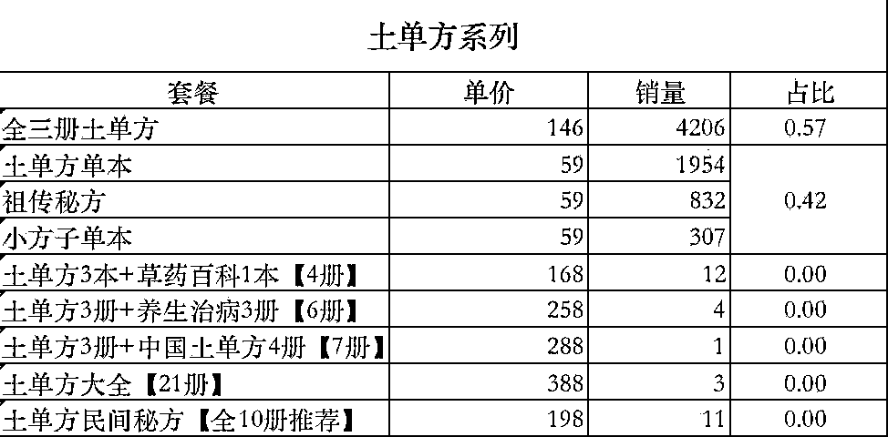

我们卖几百元已经觉得不低，但看到几家精品图书店，几千客单价出的单也很好。银发人群的消费力，想象力之外。

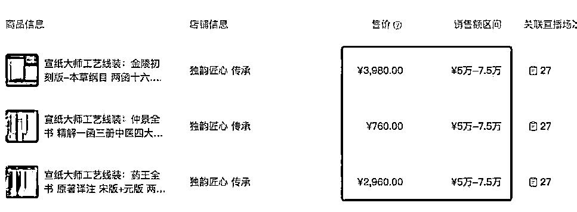

然后是卖点提炼。细节决定转化，比如标题、封面。很多商家做不到这些细节，所以自己开店、自己优化很有必要。

封面优化：观察竞品的买家评论，比如土单方，用户评论说书很大、字很大、看得清楚，我就把“大字大本”加到封面图上，效果立竿见影。有用户看了低价链接，回来买我的高价产品，其实版本一模一样，但他们以为我是大字大版。同行看到这几个字也不觉得是卖点，在他们眼里，书本来就是大字大本。

标题优化：封面和标题最直观。比如土单方，我加了“即将失传”几个字，制造紧迫感，让人感觉方子很珍贵，错过就没有了。几个字就能逼单。

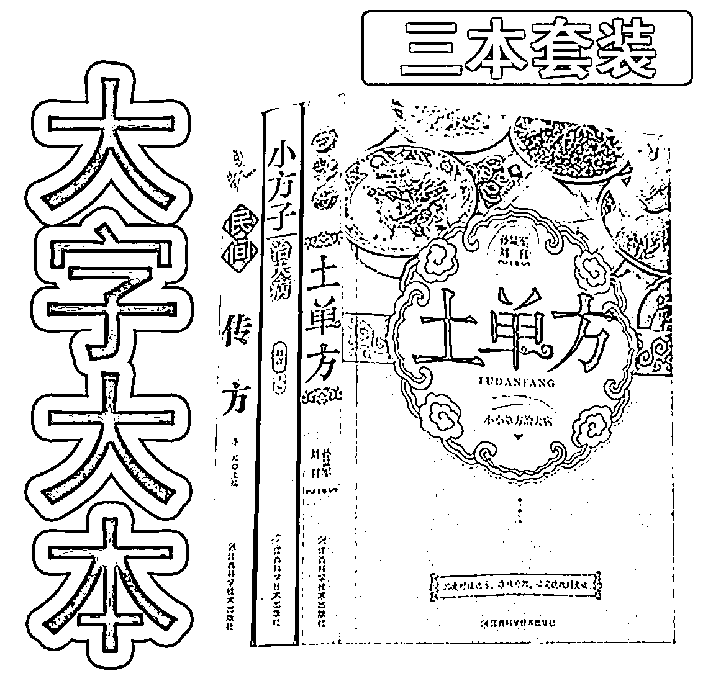

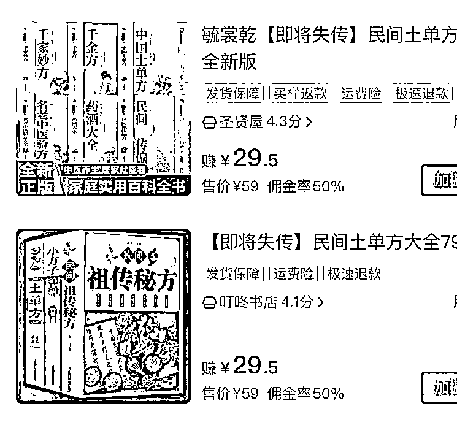

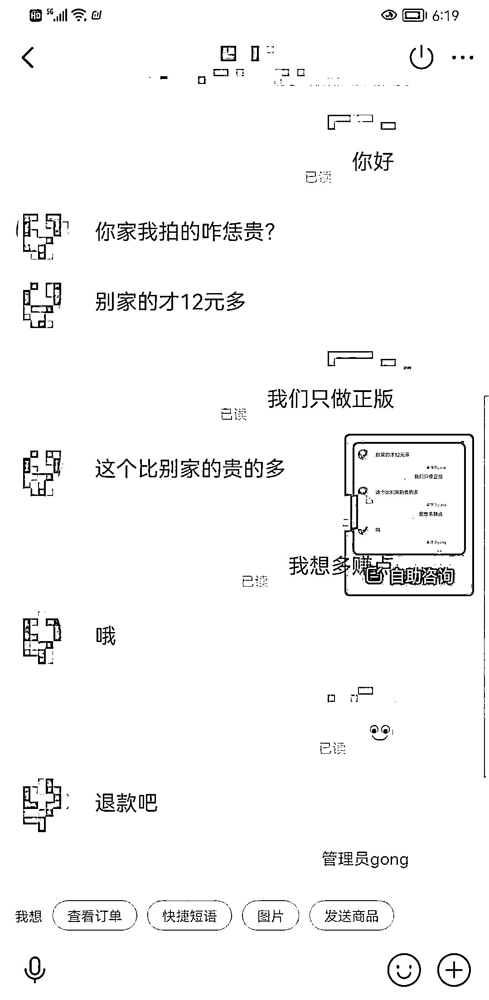

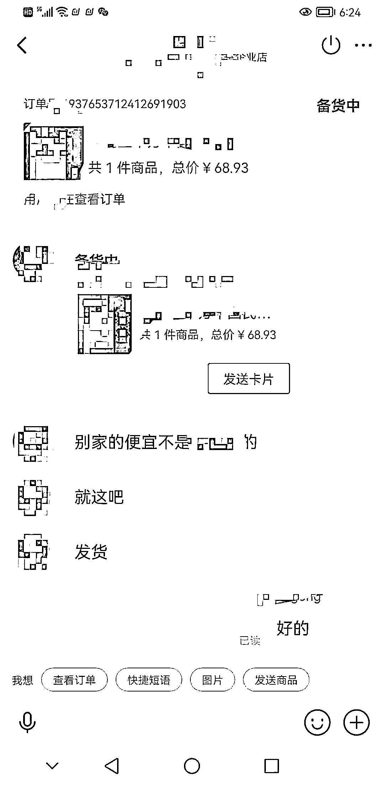

关于包邮：多年网购和商家内卷下来，包邮已经是默认规则，虽然羊毛出在羊身上，但直接把运费写在页面上，会吓跑很多消费者。银发用户还没被教育，他们不理解包邮概念，收邮费也觉得很正常。我这边邮费收入过万，等于白捡。当然，这种窗口期不会一直存在，用户会被市场慢慢教育，以后也会抵制邮费。我想说的是，在用户习惯养成的过程中，有很多赚钱机会，不要被既有思维锁死，多从银发人群的角度去尝试。

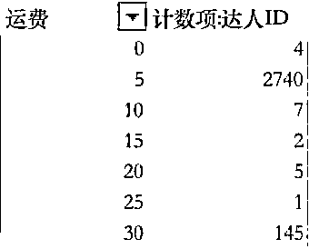

## 5、银发抖音号怎么搭

这篇文章以宏观分析为主，真正落地做号的内容，足够再写一篇。这里只讲核心要点。

注册时，账号的昵称、简介、背景图、文字配色都要从银发用户视角出发，多看看做老年内容，尤其是中医内容的账号，细节可以借鉴。建议一次性多注册几个账号，IP号或带货号都批量启动，跑一段时间后挑数据最好的重点做。因为同样的内容、同样的人，放到不同账号上，数据可能天差地别。

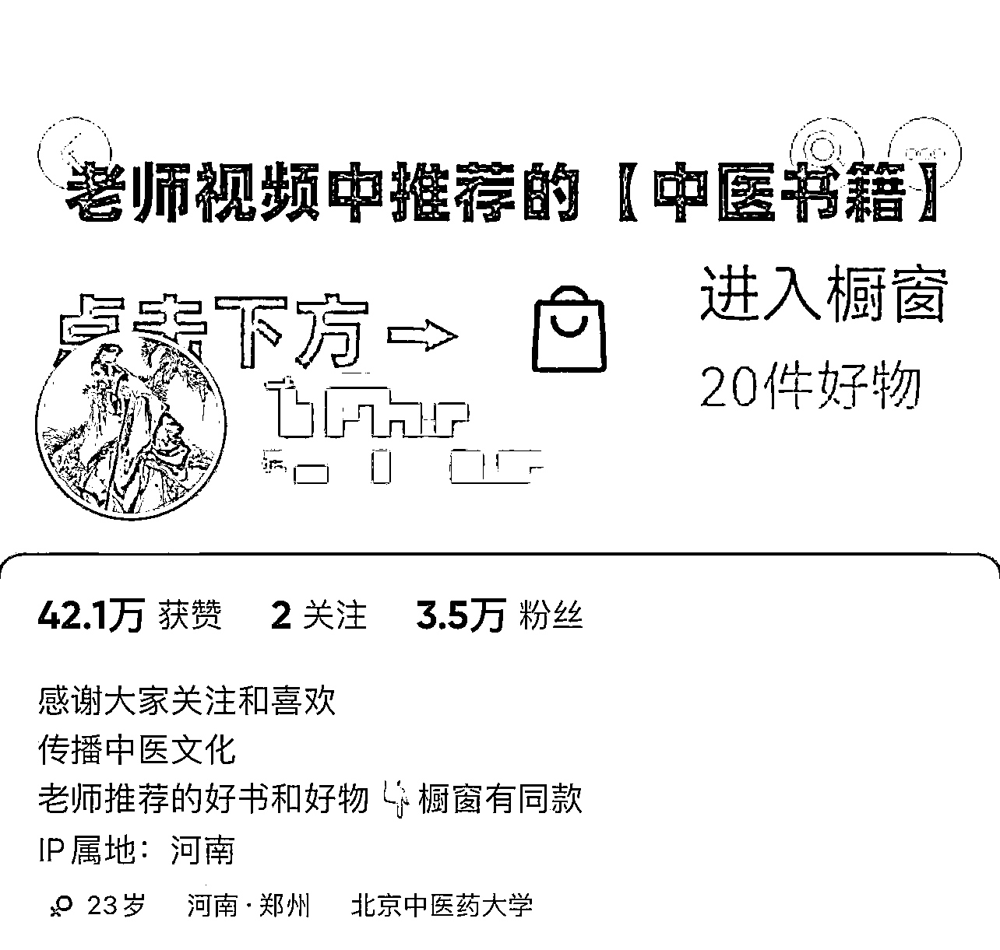

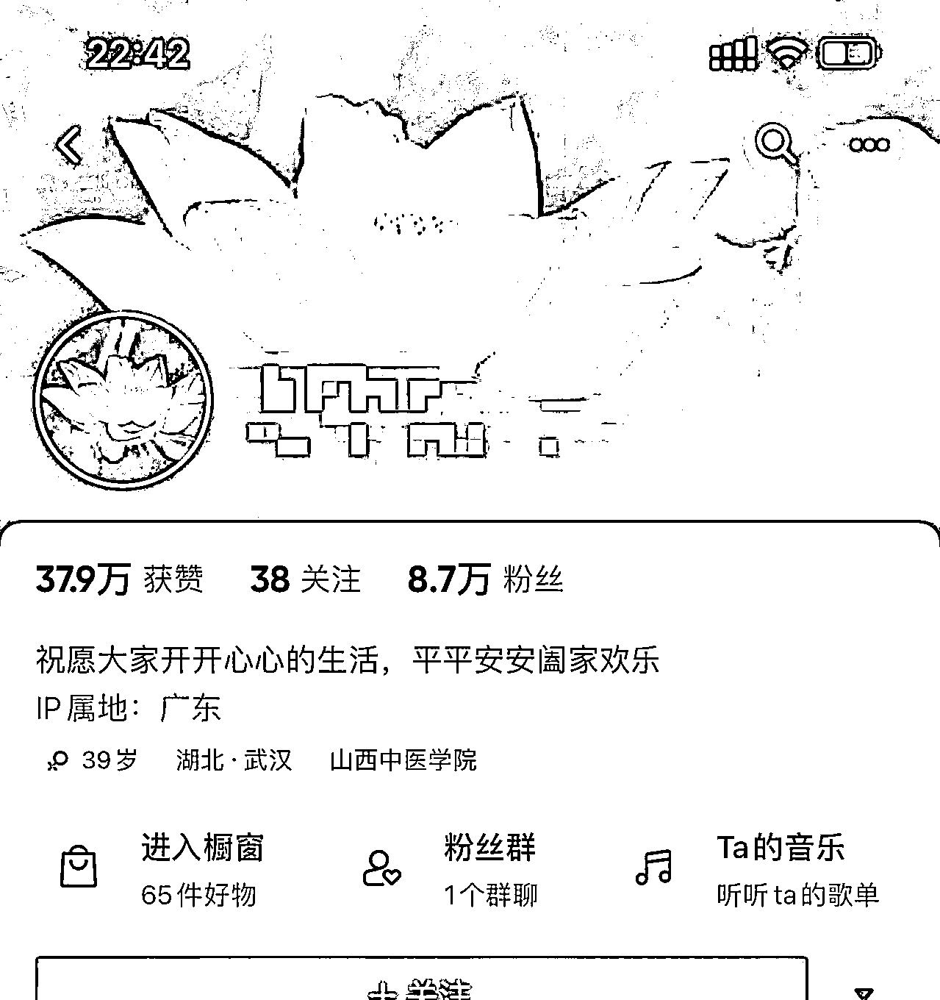

运营方面，先清掉一些错误认知。

第一，抖音没有养号。一个账号同时具备用户和创作者两个身份，拿用户身份去刷视频，想给创作者身份养号，逻辑不通。就像一个男人在家里既是儿子又是父亲，自己父亲贫血，买药给儿子补，有用吗？

第二，想做带货先踏实做内容。1000粉只能靠垂直内容慢慢吸引。买1000粉开橱窗，如果连让人关注你都做不到，怎么让人下单？做内容、吸粉，也是你熟悉目标用户、打磨内容的必经之路。

第三，不要迷信一机一号。一听说做多号就想到号群、违规，那是针对黑产的说法。平台对黑产才会封设备封IP。你正常带货，抖音抽10%技术服务费，你做的号越多，平台赚得越多，没理由限制你。平台还提供多账号切换功能，难道是为了自找麻烦？我们线下几十台手机、上百个号连着同一个WiFi，也没出过问题。

内容层面，进入新类目的最佳路径就是模仿。账号细节可以模仿，内容也可以模仿，不要一上来就想创新，更不要用自己的固有思维觉得别人内容不行，然后推翻重构。

## 6、未来机会

平台会迭代，玩法会过时，热点会切换，但人的行为和消费习惯一旦养成，变化周期往往以五年十年计。与其追着一个又一个项目跑，不如盯住一群人深耕。银发人群的线上消费才刚刚开始，围绕他们的真实需求，还有很大的挖掘空间。之后有机会，我再把具体操盘细节展开聊。

那些点赞动辄几十万的视频，表面看着稀松平常，它们到底凭什么火？

第一，关键在内容本身。赵霖教授军人出身，说话干脆利落、句句有力，谈的又都是老百姓身边的事，尤其跟老年群体息息相关。站在年轻人角度，这类内容可能毫无吸引力，甚至觉得“没意思”；可你反过来想，挑一堆年轻人爱看的内容硬塞给老人，他们会接受吗？答案一目了然。

第二，画面观感的问题。单看视觉效果，这些视频几乎没有一个能算精致：字体排版随意，文字堆得杂乱，颜色对比强烈得扎眼，毫无美感可言。那为什么这种粗糙非但没拖累播放量，反而像在助攻？原因在于，标题的使命就是在画面出现的最初几秒内锁住用户。文字传递信息的速度远胜视频——一个十几秒的视频也许才讲完一件事，而十几个字就能提炼出核心，让人一秒钟抓住重点。既然要抢眼球，文字就必须足够大、足够亮、足够醒目、足够突兀，才算完成目标。到了这个节骨眼上，美不美根本不是主要考量。

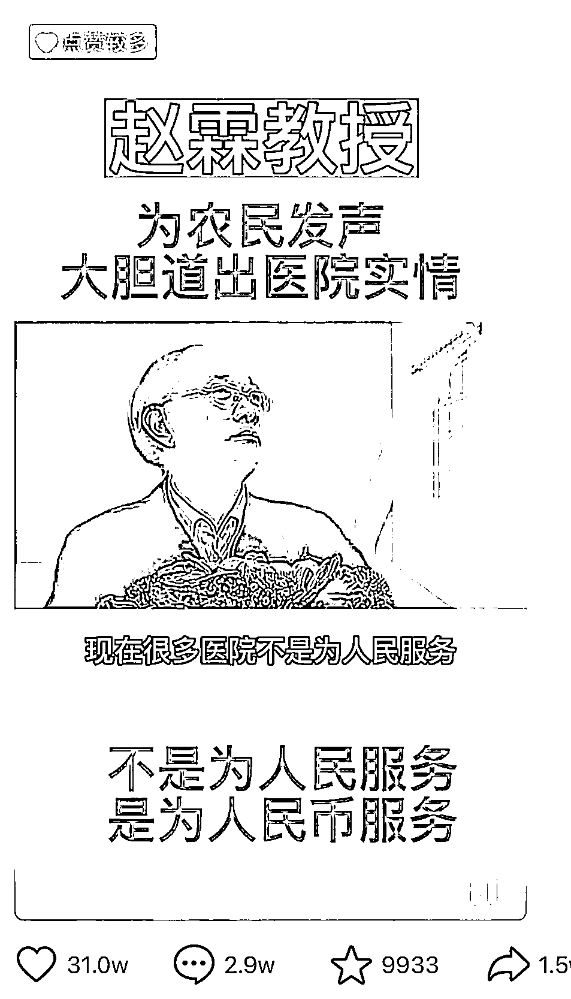

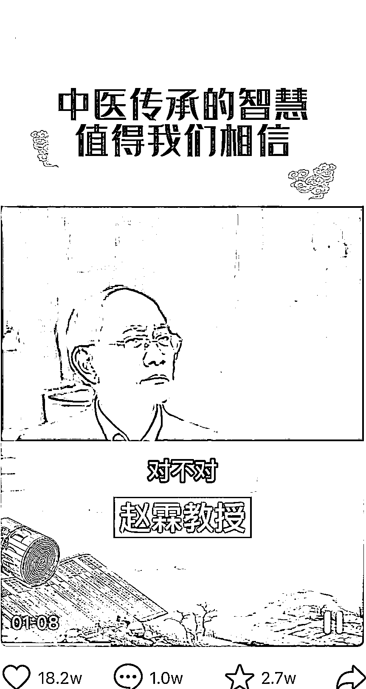

账号注册完毕，内容思路也理清了，接下来无非是持续发视频，等粉丝满一千后开通商品橱窗。

**c.**带货

千粉开橱窗后，头一件事就是选品：带什么货才好卖？我最初卖的是书，书的好处前面已经提过，这里不多讲。那么，什么样的内容才称得上好的带货内容？就拿《土单方》来说，这本书收录了大量民间土方，多数用来对付咳嗽、牙疼、皮肤小毛病之类的问题。这些毛病说大不大，跑一趟大医院未必值得，去了也常常不见效，于是人们自然而然把希望放在民间偏方上。

这种情况下，可以借助一些“土方子治病”的故事、传说片段，反复营造“土方管用、省事、又简单”的氛围。这种氛围一旦立起来，视频里哪怕不开口催买书，用户也会主动下单——毕竟随便进趟医院，一百块都未必挡得住，而花几十元买一本收录几百个方子的书，怎么算都划算。

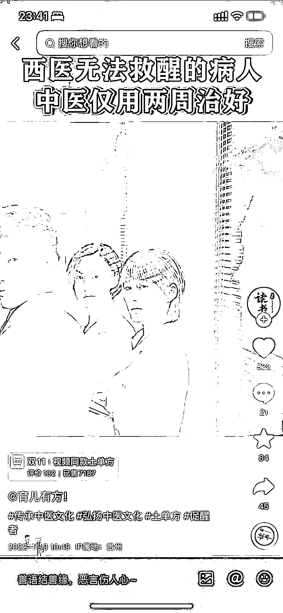

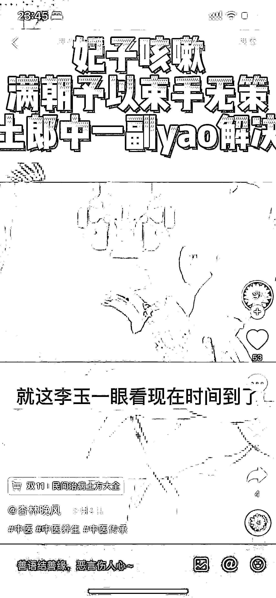

以上，就是做一个面向老年群体的带货抖音号的大致流程。只要有点剪辑基础，现在就可以上手，很快能见到反馈，远没有想象中那么难。这仍是一片蓝海，几亿人的需求，目前才满足了冰山一角。

**6、银发族群的未来机会**

老年人走过大半生，相比于底层的生理需求，更在意的是安全需求层面的东西。哪怕生理需求和安全需求同时出现，也应该优先往安全需求方向做——因为那个层面能做的事更多，也更有价值。

再从选品角度看，蓝海思维依然关键。简单复制衣食住行这些底层需求虽然容易上手，但人人都会想到，用不了多久就会被挤成红海。

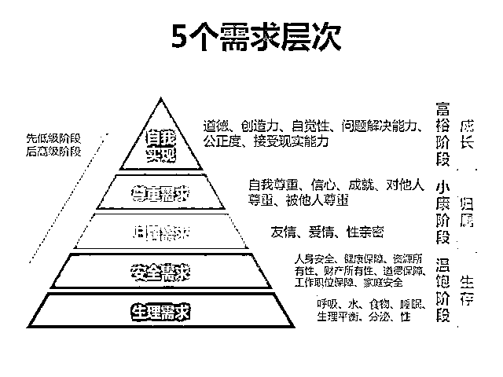

**1.文化类产品**

书籍类

书籍这条路是已经被验证过的：客单价高、利润可观、退货率极低。但市面上不少书籍产品依然有短板，很多书按年轻人的需求来排版，字小得连年轻人都看着头疼，何况是老年人。

所以，内容创作者在推荐书籍时，应该把老年人的真实需求作为卖点，把他们的关注点持续传播出去，让市场慢慢感受到这些细节。当整个生态完善起来，作为其中一环的我们也能从中受益。

课程

课程同样是一个庞大的需求。老年人退休后热衷学习，无非是不想让晚年生活变得枯燥。他们更多是发自内心想学，不像年轻人那样带着极强的功利心。因此，面向老年人的课程内容更需要用心打磨，必须做出真正触动人心的好东西，而不是重营销、轻内容的空壳子。

这里有个现成的例子：光是广场舞这一个方向，就催生出了“糖豆”这样的平台，数据做得相当不错。如果围绕广场舞在短视频平台上继续延展，可做的产品还有很多。

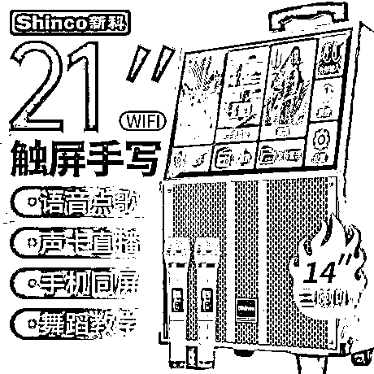

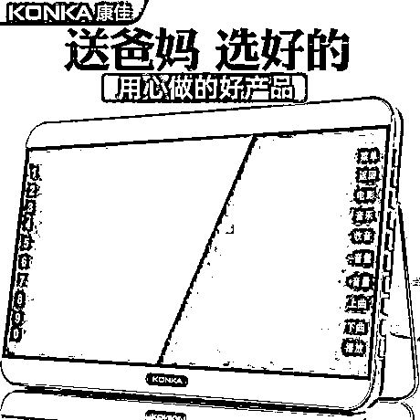

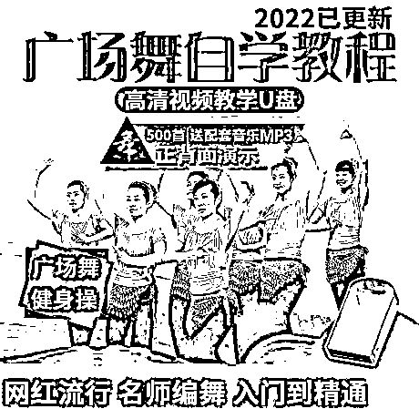

生活用品

看着父母日渐老去，行动变得迟缓，听力视力都不如从前，儿女们常常不知道该怎么办。有时候买回产品，却发现很鸡肋，因为我们总是站在年轻人的视角去猜需求，并不真正了解老年人需要什么。问父母吧，他们心疼儿女花钱，一般也只是推辞过去。

好在如今老年人开始自己网购，不用再麻烦儿女，也真正清楚自己的需求。厂家在直面真实消费者的反馈过程中，也会把产品改进得更加合用。

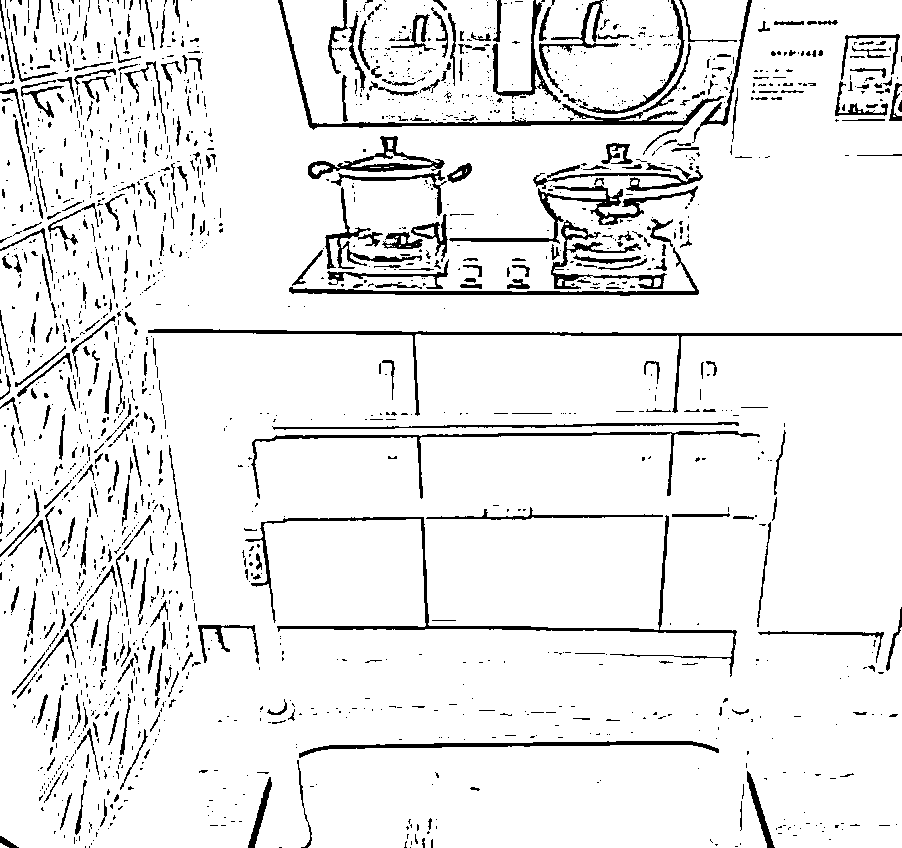

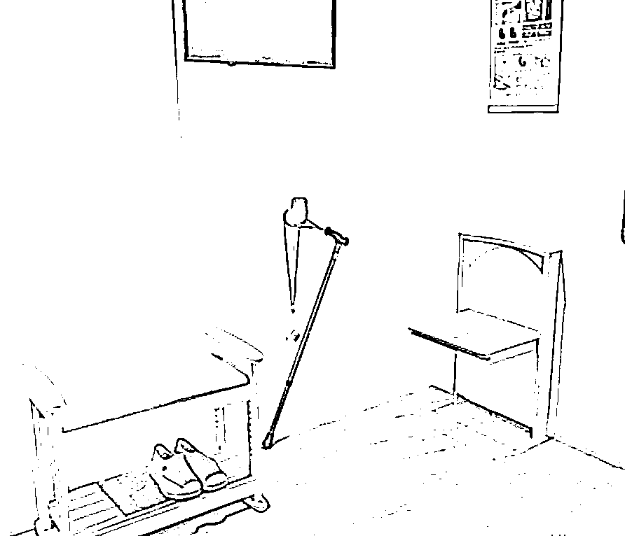

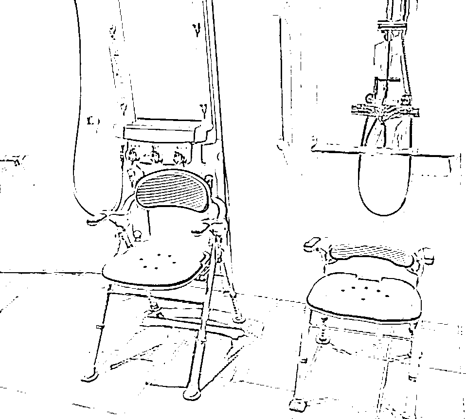

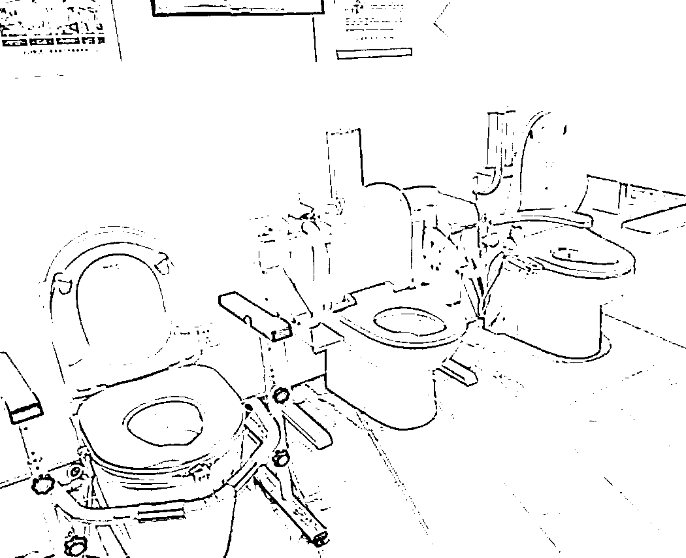

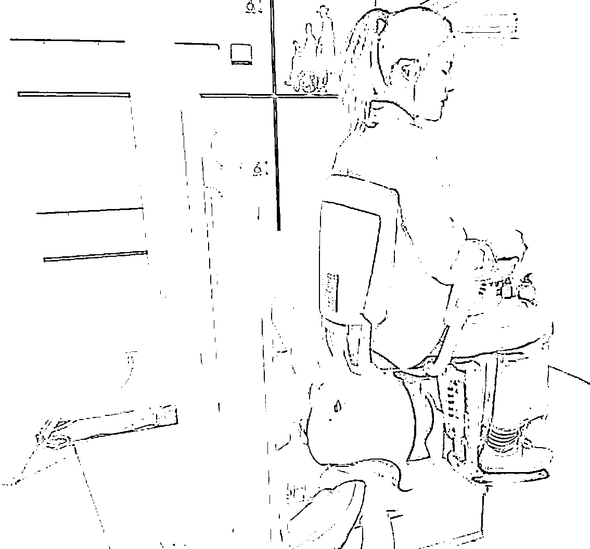

老去之后，我不想成为一座孤岛。

占中国总人口近五分之一的老年人，往往被排除在主流叙事之外。媒体的聚光灯很少照向银发族，而身为晚辈的我们也难以想象，一个人走到暮年时，到底需要什么、期待什么，又在恐惧什么。

最近在一篇报道里看到，豆瓣有一个“适老化改造促进会”小组，简介写得很有温度，我把它转载过来：

当我们或父母步入生命的黄昏时，现在的老年人所面临的困境——想和孩子交流却看不清手机上的文字、需要坐公交却不知如何出示健康码、去银行取款时柜台员工听不懂方言、早晨起床时稳不住重心差点摔倒——都会换上新的面貌，进入我们日新月异的生活场景，带来深重的困扰。

因此，我们应当把这个世界，改造成一个老年人也能安全、幸福度过余生的世界……而这需要社会与市场逻辑的转变，需要每一个人关心老年人的困境与需求，并为之行动起来——无论什么身份，都可以贡献力量：更换家具、购买辅具、开发或选择老年版App、增设或捐赠无障碍设施……

就从这里开始吧！

随手翻几页，就能看到大量老年人的产品需求，很多需求甚至连对应的产品都还不存在。

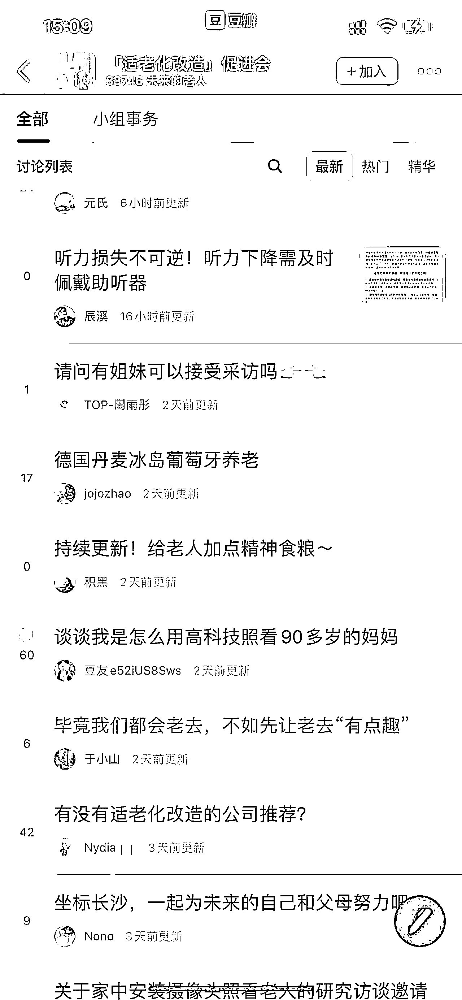

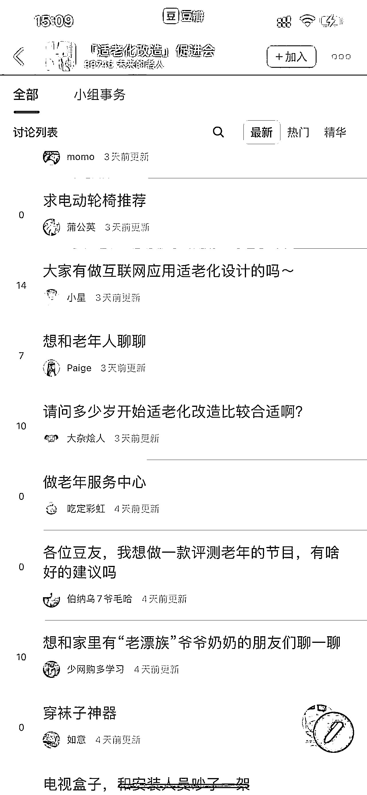

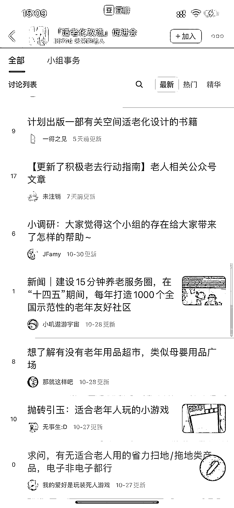

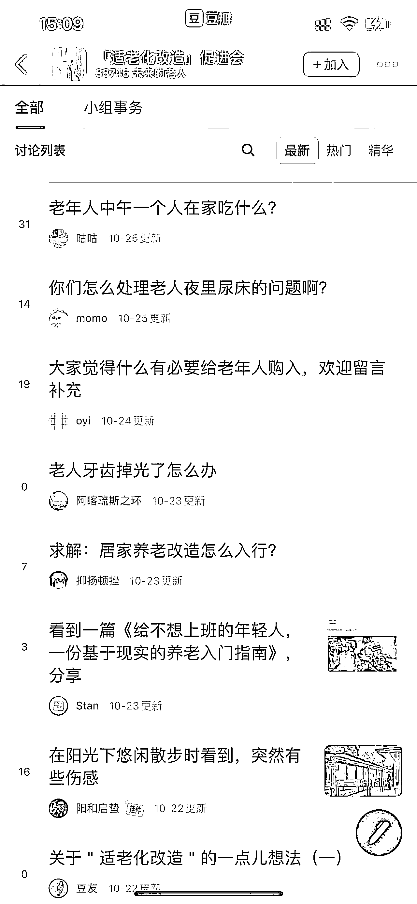

感谢你能看到结尾。这篇文字里没有多少“科技与狠活”，如果你希望看一篇文章、得到一个信息，马上就能赚到钱，那可能会有点失望。但如果你也像一年前的我一样，厌倦了短周期项目，想沉下心来做一些长久的事，想抓住未来几年有潜力的方向，那么不妨把目光投向老年人这个群体，他一定不会让你失望的。

评论区：

- 末末。: 太棒了，给了我很多启发。
- 江南style: 写得太好了，为了看这篇文章，我锅里的鸭子都糊了[尴尬]
- Luke王子: 感谢分享
- 花天卓: 感谢分享，新年快乐！
- 施霖终生学习者-链接: 慧姐[强][强][强]
- 草木青: 慧哥真厉害，
- 高建中-扬州-婚礼庆*: 老年人对健康确实是刚需，关键是如何站在老人的角度挖掘需求、满足需求
- 小太阳发光: 慧哥永远的神