# 2.6亿银发市场，机会藏在哪？

作者：刘三点
日期：2022-01-10

最近几年，短视频平台上冒出一批中老年网红，其中“时尚奶奶团”名气最大，全平台粉丝累计超过1500万。另一边，全国住进各类养老机构的老人超过200万——从进门时的能力评估，到签合同、定护理等级，每一环都藏着商业切口。中老年人群盘子够大，任何赛道都值得围绕他们重新做一遍。

先自我介绍一下：我在美国待了七年，今年年初回到国内，现在做养老机构的产品策划。本科在UC Davis读景观建筑，研究生去了USC南加大，方向是老龄服务管理。

写这篇文章，我更想谈的是老龄化这个大背景下的走向，以及趋势里长出来的新生意。也希望更多有想法、有行动力的人进入中老年赛道——一边赚到钱，一边帮千千万万老人过上更有质感的晚年。

---

经常有人问我：90后女生，怎么偏偏选了养老这行？

其实是个巧合。有一年暑假回国，朋友拉我陪她去给她爷爷挑养老院。那个画面我到现在都记得：光线暗、气氛沉、满眼都是不快乐。里面的老人不高兴，护工不高兴，连去参观的人心里都发闷。

我当场就下了决心，得做点改变。晚年不该是这个样子，我也不愿意任何人以这种状态度过余生。后来就选了这个专业。

全文分三块：

一、老龄化走向
二、老龄化催生的新机会
三、银发经济

**-01-**

老龄化走向

老龄化已经是各国绕不开的民生课题。欧洲、北美之后，东亚正在成为下一个老龄化加速区。

有预测认为，2030年前后，东亚65岁以上人群会超过10-25岁人群；中国则在2030-2035年之间出现老年人口多于新生儿的情形。

我国的形势更棘手，有几个突出特征：

老年人口总量惊人；速度快——除日本之外，我国是全球老龄化提速最猛的人口大国，留给政策调整的窗口很窄。

“活得久但不够健康”的问题明显。我国老人平均健康余寿比发达国家少约10岁；实际退休年龄只有53.3岁，叠加“未富先老”，同等老龄化程度下，我们肩上的养老、医疗、照护担子比发达国家更沉。

高龄、独居空巢、失能半失能等群体迅速膨胀，照护供给缺口很大。

地区差异明显。城乡之间老龄化程度倒挂，农村始终高于城镇；区域上看，东部在放缓、中西部在提速，随着中西部年轻人往东部走，这个趋势还会更明显。

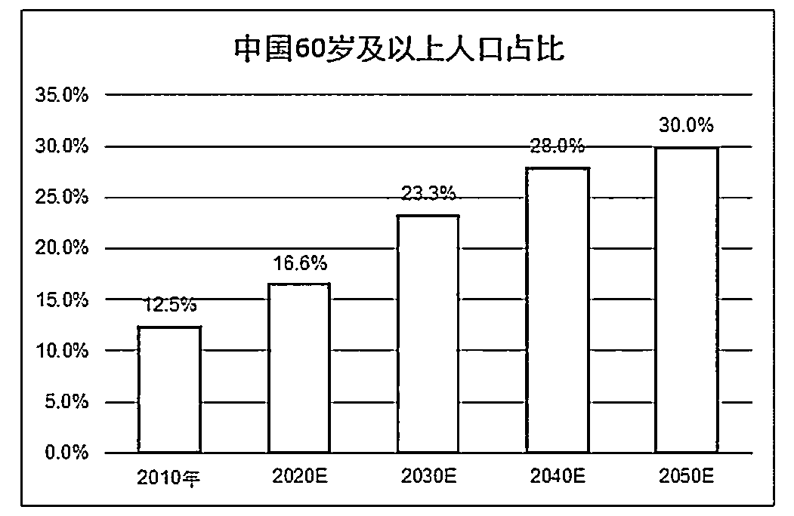

七普数据里的老龄化信号

2021年5月11日，国家统计局公布了第七次全国人口普查公报（下称“七普”）。这份数据对判断人口结构走势及其经济后果很关键。

普查标准时点是2020年11月1日零时，登记时间为2020年11月1日至12月10日，对象包括境内自然人和境外未定居的中国公民，逐户逐人登记。

摸清人口数量、结构、分布，普查是最可靠的手段。我国已做过七次，年份分别是1953、1964、1982、1990、2000、2010、2020。现行制度下每十年一次，尾数“0”的年份为普查年；其余年份搞抽样，尾数“5”的年份做1%抽样，俗称“小普查”。

这里要区分一下：普查覆盖全部目标人群，抽样则靠抽样比推算。前者没有抽样误差，漏登更少，数据更准。也正因如此，用普查结果回头修正中间年份的历史数据，是普查的另一层价值。

下面我从规模、年龄结构、城乡结构、区域结构、人口素质五个维度，梳理七普反映出的五个人口变化趋势，以及背后的经济影响与市场机会。

先立一个前提：老龄化将长期是我国的基本国情，挑战和机遇并存。

中国人口变化可以浓缩成“一慢四快”。

第一，增速放缓。

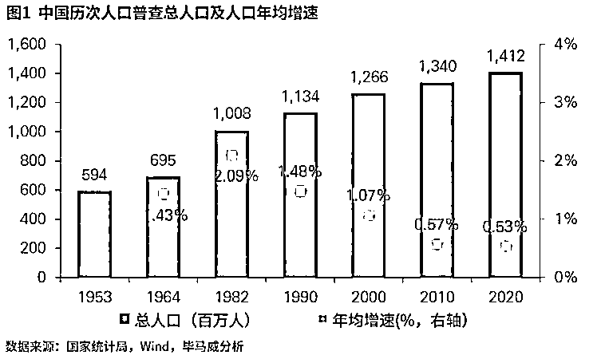

生育率低是主因。

我国历史上出现过三波婴儿潮：建国初、1962-1973年左右、1986-1990年左右。出生人数本来有周期性波动，但计划生育政策让第四波没能出现在2010年前后；同时15-49岁育龄女性在2011年冲到约3.8亿峰值后一路下滑，2010年之后出生人口就进入了下降通道。

政策松动曾带来短期反弹。“双独二孩”“单独二孩”分别在2011年、2013年落地；2016年“全面二孩”实施，当年出生1883万人，2017年1765万人，二孩占比从2013年的约30%升到2017年的约50%。

存量需求释放完之后，2018年起出生人数回落，不过二孩及以上占比在2019年仍有59.5%，“二孩效应”虽然减弱但没消失。也正因如此，2020年0-14岁人口占比较2010年还回升了1.4个百分点。

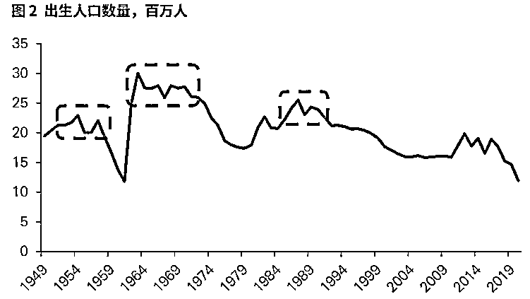

第二，老龄化提速。

七普表明，我国劳动年龄人口的比重和总量双双走低。

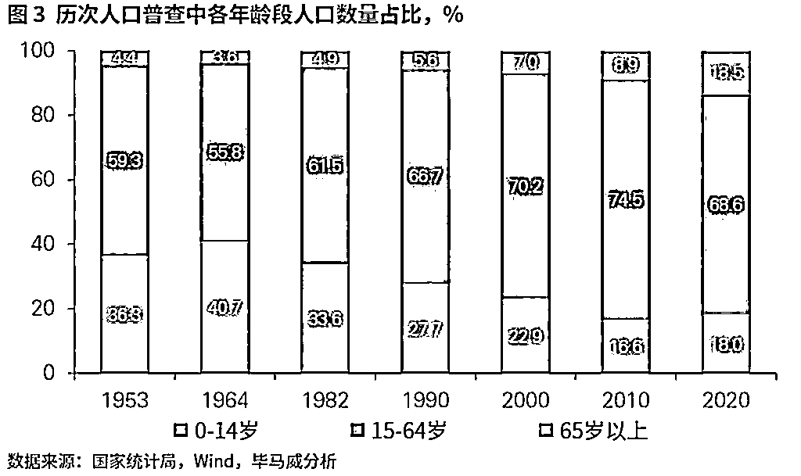

老龄化加深，有三个看点：

1）规模大、程度深：60岁及以上2.6亿人，占18.70%；65岁及以上1.9亿人，占13.50%。国际惯例是65岁以上超过7%算老龄化，14%算深度老龄化，20%以上算超老龄化。我们目前还在轻度阶段。

2）横向对比，中国老年人口体量惊人：65岁以上人数超过美日德法英韩六国之和。

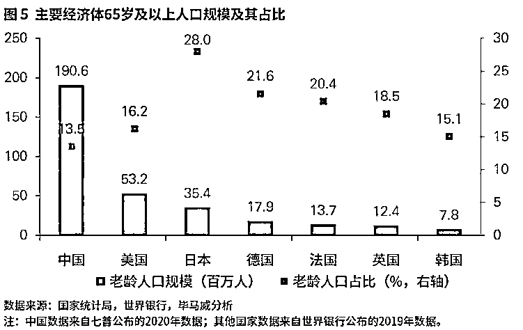

3）未富先老：2020年人均GDP约10504美元。日韩达到相近老龄化水平（65岁以上占13.5%）分别是1993年和2016年，当时人均GDP为35766美元和29289美元，比我们高出一大截。这就是典型的“未富先老”。

更要注意的是速度：2010-2020年，60岁以上和65岁以上占比的提升幅度，比六普时期分别快了2.5和2.7个百分点。而六普相对五普，65岁以上占比只涨了0.5个百分点。世界银行的数据也印证，2008年之后我国老龄化明显提速，2017年增速超过日本，目前在主要经济体里只比韩国慢。

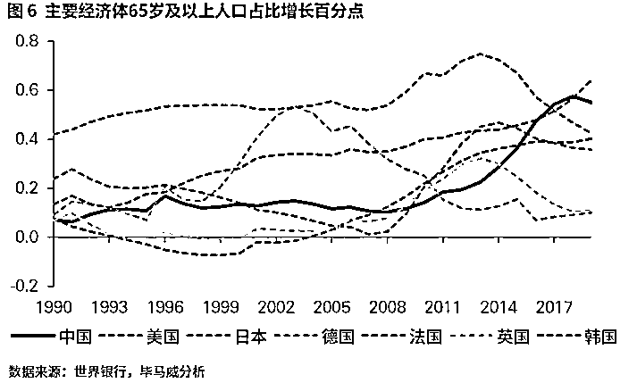

第三，城镇化推进。

城镇化率从2010年的50%升到2020年的63.9%，年均提高1.4个百分点，处于快速推进阶段。改革开放以来，我国与世界的差距不断收窄。1980年时比中等偏上收入国家的平均水平低28.3个百分点，到2019年差距已不到2个百分点。

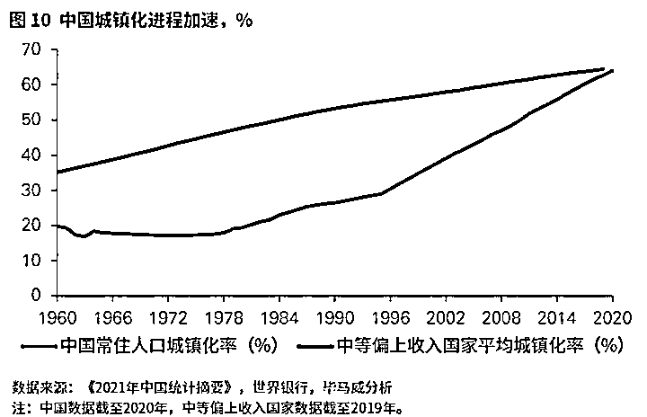

第四，人口流动活跃。

2020年流动人口3.76亿，比2010年六普时多了69.7%。换句话说，大约每四个中国人里就有一个在流动。其中乡村流向城镇的约2.5亿，比2010年增加1.1亿，占流动人口66.2%。这说明城镇经济活力在增强，人才配置效率在提高，城镇对迁入人口的容纳度也在变大。

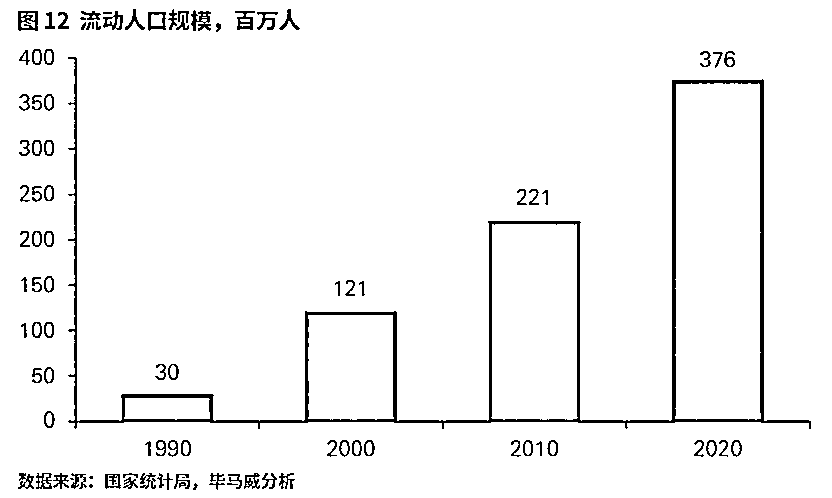

第五，人口素质提升。

受教育程度整体上移，大学毕业生越来越多。教育部预计2021届毕业生909万，2022年将突破1000万。但另一面，怎么造出足够多的合适岗位消化这些毕业生，也是个现实问题。

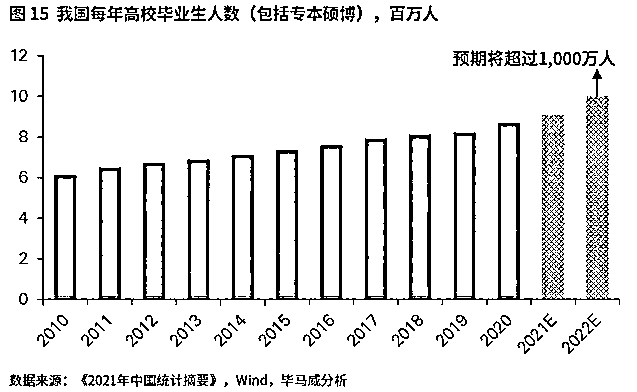

**-02-**

老龄化带来的连锁反应与新机会

一、连锁反应

1. “一老一小”两块消费市场都很宽

联合国对2020-2030年中国人口的预测显示，未来十年增量最快的是35-44岁、55-64岁、65岁及以上三个区间。人口结构一变，消费结构也跟着变。婴幼儿和银发这两头空间都很大；同时家庭规模缩小，还带火了单身经济、宠物经济。

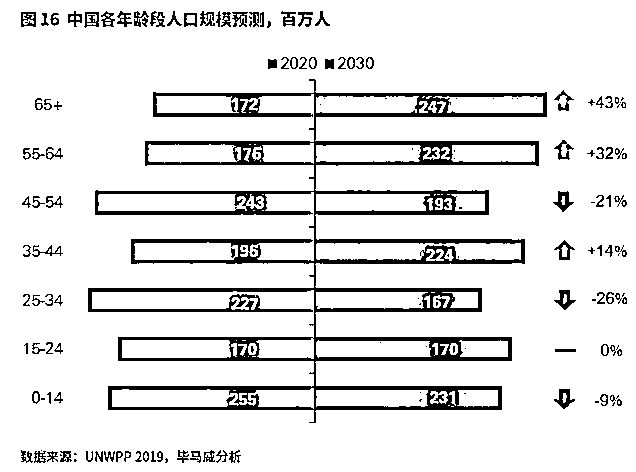

联合国预计未来十年我国60岁以上人口将增加1.1亿。基数大、增速快，挑战虽重，但也把老龄产品和服务的需求撑大了，银发经济的前景和潜力都相当可观。

除了医疗、康养这些老牌赛道，老人对休闲、旅游的需求也在上升，不少人退休后还去老年大学充电、发展兴趣，老年教育服务因此兴起。

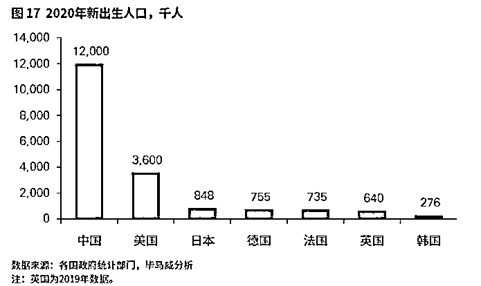

出生率虽然走低，但2020年仍有1200万新生儿，约等于美日德法英韩六国新生儿总数的1.8倍。2021年5月31日中央政治局会议进一步提出放开三孩，并部署税收、住房等配套支持。如果后续能在降低生育、养育、教育成本上见实效，适龄人群的生育意愿有望回升一些。

同时，90后、00后陆续成为父母，接棒育儿消费主力。这批人受教育程度高，看重科学育儿和品质消费，推动育儿产品升级。而且年轻父母往往要独立带娃，普惠托育、智能玩具、育儿护理等细分市场因此有了新增长点。

2. 国货品牌加速上位

经济实力增强、产品质量提升、文化魅力释放，三股力量叠加，让消费者对国货的好感明显上升。百度数据显示，2009到2019十年间，中国品牌关注度从38%涨到70%，几乎翻倍，甚至超过境外品牌。

80后、90后尤其明显——他们成长于中国经济和数字化高速发展期，国家认同感和自豪感更强，又偏爱个性表达、乐于尝鲜，是国货最主要的拥趸。

未来十年，这批人普遍进入35-44岁，恰好是人口增长最快的区间之一。消费群体扩容，给中国品牌留出了巨大的成长空间。

为了接住年轻一代的消费升级，国货质量在提升；中国数字经济的创新优势，又让品牌能更快捕捉需求、做“千人千面”的营销、推个性化定制，从而拉高品牌价值。

今天的国货早就摆脱了“无趣”“廉价”的旧标签，转而代表“新潮”和“高品质”。可以判断，国货品牌价值会快速上升，新国货全面崛起只是时间问题。

3. 社区养老与商业养老保险空间很大

老龄化压力日增，“十四五”规划已把积极应对老龄化上升为国家战略。要化解矛盾，可以从几个方向入手。

（1）社区养老和机构养老要发力。

独生子女一代成为社会中坚，家庭养老的担子越来越重，社区和机构养老能帮忙分担。社区端，完善居家养老服务网络，推进公共设施适老化改造；机构端，加大产业支持，多渠道扩大床位供给，提升专业照护水平。

同时要加快第二、第三支柱养老金。目前体系“头重脚轻”：第一支柱占比超过七成，以企业年金和职业年金为主的第二支柱覆盖窄、占比不足三成，个人储蓄型养老保险和商业养老保险构成的第三支柱几乎可以忽略。2019年数据就是第一支柱逾七成、第二支柱不足三成、第三支柱微乎其微。而美国等发达国家早已转向以第二、第三支柱为主导的商业化模式。未来必须加力推动第二、第三支柱，养老金体系才能更均衡、更可持续。

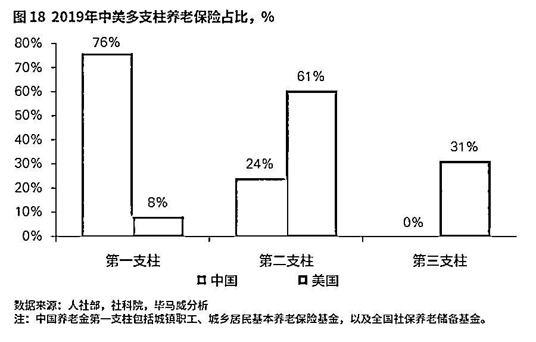

（2）自动化、智能化升级提速。

七普显示劳动人口比重和数量都在降，低生育率还会继续拖累未来劳动力供给。人少了，用工成本上升，但也会逼着企业加快自动化改造。疫情后制造业资本开支明显加大，比如2021年前四个月制造业固定资产投资同比增长23.8%，跑得比房地产和基建都快。这说明企业在加码机械设备自动化，减少对人工的依赖。工业自动化装备市场因此被看好。

中国经济正处在转型关口，人口红利消退，新一轮科技革命又强调数字化，传统产业只能往智能、高端走，才能保住国际竞争力。不少行业龙头已经走过早期数字化尝试，进入数据贯通各部门的阶段。有了这个基础，再用云计算、人工智能等技术挖掘数据资产，就能反哺产品和服务创新，催生新业务、新模式。

智能化不只是提效，还能帮企业发现新需求、增强应变能力，应对全球市场的快速变化和技术迭代，推动提质增效。

（3）人才红利接棒创新。

人口结构变化正在把“人口红利”切换成“人才红利”。“十四五”规划明确创新是核心驱动力。国际环境越复杂，越要加强基础研究、攻关核心技术、提升关键领域自主可控能力，而人才是根本。

过去十年，大专及以上文化程度人口占比提升最多，从8.9%升到15.5%。企业要抓住这波人才红利，加大投入，重点培养创新型、应用型、技能型人才，为未来竞争蓄力。

一头，企业可以引进高端人才，增强创新能力和国际竞争力，在产业升级中创造更多适合大学生的岗位，形成良性循环。另一头，企业可以和高校、科研机构合作，承接国家重大科技项目、共建产业创新中心，攻关基础学科、关键技术和前沿领域。这样既能推动产学研融合、激发科研人员活力，也能加快成果转化，助力关键技术自主可控。

二、老龄化催生的具体机会

1. 养老机构

想入行的人常问：养老院、养护院、护理院……名字这么多，到底差在哪？

叫法虽多，国家标准里其实有统一称谓——老年人照料设施。按2018年10月1日实施的《老年人照料设施建筑设计标准》（JGJ450-2018），它指为老人提供集中照料服务的设施，分全日照料和日间照料两类，属公共建筑。

展开说：全日照料设施提供住宿、生活照料等服务，是养老院、老人院、福利院、敬老院、老年养护院等的统称；日间照料设施提供日间休息、生活照料等服务，是托老所、日托站、老年人日间照料室、日间照料中心等的统称。

分类方式可以有很多。从产品策划视角，我习惯按辐射范围分三类。

1）社区居家型。类似日间照料设施，覆盖整个社区的长者，提供日间照护、上门服务、康复理疗、文化娱乐等。部分社区机构会设几十张床位，做长托、短托、临托。床位是收入基础，入住率则直接决定营收好坏。

2）护理型机构。面向需要照护、自理能力不足的长者，提供居住、医疗、保健、康复、护理等配套。一般配有生活起居、文化娱乐、康复训练、医疗保健等设施。常见的有养护院（民政牌照，以养护为主）、护理院（医疗机构，以医疗护理为主）、养老院（自理、介助、介护兼收）等。

3）CCRC（持续照护退休社区）。这是复合型老年社区，把自理、介护、介助服务打通，让老人身体状态变化时仍能留在熟悉环境里，获得对应等级的照护。CCRC多选在郊区，离城区较远，因为体量大，特别看重生态和气候，常用园林、水系营造人与自然相融的居住氛围，让长者在近郊享受田园感，怡情养性、延年益寿，很适合长期居住。

**银发赛道：开养老院未必是普通人的机会**

送长辈住进照护机构，如今在不少家庭眼里已不再等同于推卸责任。条件好的颐养社区，有时还会被看作子女事业有成的侧面证明。原因很现实：家里抽不出人手、请来的保姆未必懂专业照护、长辈独居又冷清，于是机构养老被越来越多人纳入选项。

年纪大了，吃穿用度的执念会淡，内心是否被看见反而更重要。可居家养老时，子女赶着上班、孙辈忙着上学，长辈常是一个人守着空房。长期没人说话，对身体的消耗不容小看；甚至有说法把它和每天抽一包烟相提并论。

机构养老的一个好处，是把岁数相近、人生路数差不多的人放到一起。同一段岁月留下的记忆，让聊天容易接上话，代沟少，心门也更容易打开，朋友和归属感慢慢就有了。

现在不少机构，尤其民营机构，早已不是只管吃住。房内电视、空调、小冰箱一应俱全，公共区域设阅读角、棋牌区、理发点、锻炼房、康复训练室……闲暇安排五花八门，每日有项目、每月有主题，老人能结识新伙伴，也能发挥余热。管理架构与服务流程覆盖日常照料、情绪陪伴、医养衔接，专业度让入住者安心、家属少操心。作息也有章法：三餐定时、搭配讲究，集体活动与充分休息交替，精神状态更饱满。

不过，行业热不代表谁都能进场。对普通创业者来说，养老机构前期投入重、回本慢，不是友好的选择。

老龄化反而带火了一批入行门槛相对低、普通人可试的新职业：

**1）老年人能力评估师**

2020年7月，人社部会同国家市场监管总局、国家统计局公布9个新职业，这一行位列其中。到2020年11月初，全国做这行的人已超过10万：有人在第三方评估机构专职，有人在养老机构里兼任。评估路径大致三种：第三方独立完成；机构先评，相关部门再抽查或普查；机构自行评估。

任务包括：登记老人基本资料与健康情况；判断日常生活活动能力；测评认知、精神、感知沟通及社会参与；据此划分能力等级；形成综合评估报告；就能力恢复提出建议。

为什么缺人？我国领高龄津贴的老人有2680万，领护理补贴的61万，享养老服务补贴的354万，合计超过3000万人要靠评估确认资格。筛查、补贴发放各环节都离不开评估。再加上全国200多万入住机构的老人，签合同、定服务等级也要先做初始评估。宏观制度与微观服务两头都需要这个岗位。

统计口径下，人才需求约150万，实际从业者不足10万，缺口以百万计。由于2020年才被列为新职业，外界认知度还不高，反而意味着窗口期。薪酬方面，核心城市月入近万元，普通地级市约五六千元；随着需求机构增多、缺口仍在，待遇还有上探空间。

**2）适老体验师**

这个替老人打通数字生活的行当，曾被央视新闻带到大众面前。2020年末，工信部启动互联网应用适老化改造专项行动，让老年人在数字化进程中有更多获得感，适老体验师随之出现。

界面绕、搜视频不会、字小看不清……围绕这些麻烦，体验师参与设计听音识图、无障碍剧场等功能。为摸清老人的真实习惯，他们有时蒙住双眼模拟老年用户，有时进社区征集建议，帮长辈追上智能时代。

各大互联网企业按工信部要求推进改造。工信部电信服务质量通告称，第三季度专项行动取得阶段性成果，158家网站和APP完成初步改造。改完后，老人看新闻、线上购物、购票打车都更顺手。

“阿里40万年薪招老年产品体验师”的消息曾引发关注；这个岗位不只面向年轻人，老年人也可能被聘为体验师。银发群体网购、娱乐需求快速上升，市场随之扩容。

改造推进一年，效果已经显现。部分平台不止放大字号、精简界面，还安排专属客服，更彻底地解决老人数字困境。往后，平台若想留住老年用户，得深入研究他们的需求与偏好，提供更贴合的内容、产品和服务。

此外，健康管理师、公共营养师等证书也因老龄化走俏。一般自学两个月左右可考，拿证后能申领国家补贴，就业口径较宽。

**-03- 银发经济**

提起中国大爷大妈，很多人脑中还是“踹樱花树、喷泉泡脚、盘子铲虾”那一套？还是衣着老土、仪态欠佳？还是觉得他们会用手机搜一搜、买点东西、跳跳广场舞，就已经很潮？

看看网上崛起的银发IP。

2019年6月，一段几位奶奶身着非遗蜡染旗袍、在北京三里屯走秀的视频刷屏：抖音首发后，很快冲上抖音、🧣、快手热榜，连续七天累计播放突破5亿。

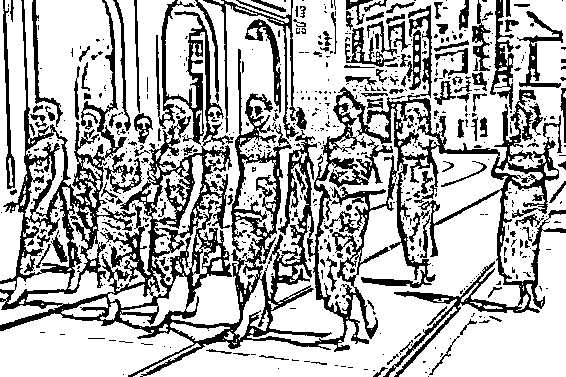

她们来自“时尚奶奶团”——平均年龄超过65岁，头发已灰白，妆容却依旧精致。这个团体传播中国时尚文化，展示中老年女性的精神面貌、生活状态与生命状态；同时搭建中老年生活方式平台，鼓励更多中老年女性活出自我、开启新人生。她们穿旗袍走遍世界各地，传播中国文化与美好生活理念，把中国老人的时尚态度带到国际舞台，让世界看见东方女性的魅力。

时尚奶奶团曾受邀在上海的日本、菲律宾、法国大使馆以及明星活动中走秀，也多次参加伦敦、纽约时装周，国内多家电视台递来邀请函。目前各平台累计拥趸逾1500万，已发展为引领中老年女性开启新生活方式的成长平台，鼓励这一群体不被年龄定义和束缚，敢于表达、欣赏自我，活出精彩。

往小处看，中老年产业已初具规模，各细分市场都在重塑消费者画像，创业者也在寻找表象之下的真实消费需求。往大处看，国力日益强盛，需要向世界展示中国老人美丽、优雅、自信、大方、从容的精神风貌，塑造良好国际形象。短视频平台与近两年兴起的中老年网红产业，正好参与创造和传播新的中老年形象，把越来越多中老年人带进互联网。

看中这一趋势的，远不止何大令和她的团队。“罗姑婆”操着流利四川话，教年轻人如何在爱情里取舍；“老饭骨”细致拆解经典菜肴，让年轻人愿意回归家庭生活。他们帮中老年甩掉了“封建落后”“生活技能落后”等标签。

任何行业都可能因老年群体重新细分，遇到的问题也大同小异。中老年网红大多先以内容聚粉，再通过广告、代言或选品带货变现。直播带货虽是风口，银发网红走起来却不容易：“罗姑婆”目前仍以广告合作为主，“老饭骨”融资后转向线下品牌孵化。

做事成败，发心是基石。成功企业往往要么解决了一个社会问题，要么提供了另一种生活方式的可能。在老年行业，若能以传递美好生活为入口，给成千上万中国老人更多丰富多彩的生活选择，打破传统限制性信念，商业价值也会随之而来。年轻人有美业，按“每个行业都可在银发群体中再细分”的逻辑，中老年美业是否也值得想象？大家可以自行发挥。

下面梳理老年行业在娱乐、健康、科技等方面的数据与市场动向：

**1. 有声书**

QuestMobile《2021声音经济洞察报告》给出这样一组数：2021年10月，声音人群规模达7.28亿；有声听书月活增长最猛，同比2020年10月上涨166.9%，在五个细分方向里跑得最快。年龄结构上，60后、70后对有声书的偏好指数（TGI）高于年轻用户；在愿意为声音付费的人里，这两个代际占27.9%。

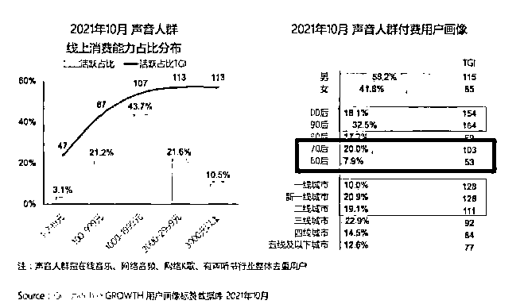

当短视频抢走大量注意力，靠耳朵消费的内容也在向长辈渗透。听书在中老年中越来越常见，付费意愿同步上升。流量大盘见顶后，中老年是重要增量，在线音频还有空间。

**2. 银发健身**

乐刻统计60岁及以上会员发现，最近两年这一人群每年约增30%；银发女性偏爱上午8点到10点锻炼；她们每周到店次数比其他年龄段多1次，女性私教活跃率是男性的1.3倍。每两位到店银发女性中约一位参加团操，Zumba类舞蹈最热，瑜伽随后；男性团课活跃度几乎为零。（新京报）

老年群体健康意识增强，运动健身需求扩大，但传统健身房多盯着年轻人，面向中老年的商业健身机构仍是空白。中共中央、国务院《关于加强新时代老龄工作的意见》提出，要提升老年文化体育服务质量。可以预见，老年运动健身市场将迎来新发展。

**3. 银发族线上消费**

QuestMobile显示，2020年国内50岁以上人口为4.51亿；到2021年10月，其中移动网民月活超过2.5亿，人均每月上网143.9小时；三四五线城市人群占62.1%。近七成银发人群通过线上付款，千元以上消费能力者占54.3%。女性看价格和品牌，男性重时尚、品质，对消费体验要求更高。

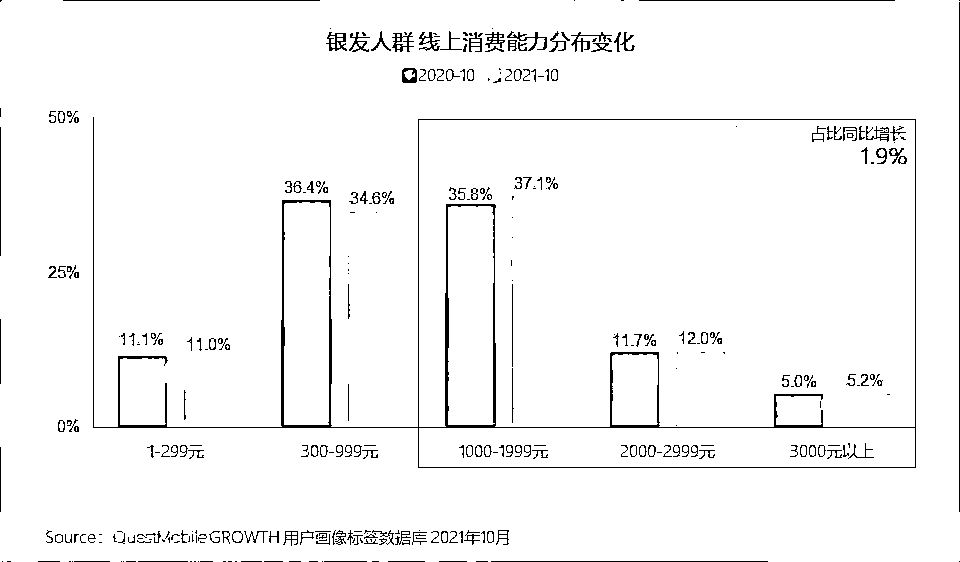

50岁以上人群已约占全国人口的三分之一，互联网渗透率持续提升，线上正成为其生活场景的重要部分。未来，银发群体的多种需求很可能借线上满足；但目前面向他们的线上内容、产品和服务仍然偏少，潜力可观。

**4. 电视节目**

CSM的2021年基础研究报告提到，50岁以上银发e族电视观众有3.58亿，占全国电视观众的28%；每天近七成银发观众看过电视，人均收视215分钟，收视率14.9%。从节目类型看，电视剧、新闻/时事、综艺是主要选择；与全体观众相比，银发e族在财经、法制、新闻/时事、体育和戏剧类节目上的资源使用效率更高。

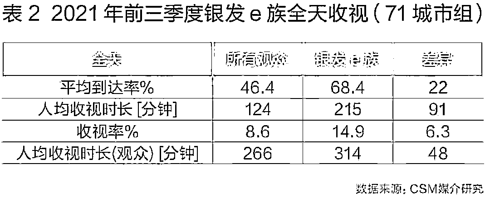

银发网民已达2.8亿，但仍比银发电视观众少7500万。电视仍是抵达银发人群的主要媒介。对传统电视台而言，应围绕老年需求与喜好设计创新节目、增强粘性；对老年行业企业而言，这也提供了新的获客思路。

**5. 中老年化妆教程网站**

资生堂旗下面向50岁以上女性的个护系列PRIOR启动新项目“熟龄魅力”（意译），并开设专门网站传播中老年化妆教程，目标是在三年内把PRIOR做成熟龄一代的首选品牌。发布会上，76岁的宫本信子、67岁的黑泽和子、69岁的大岛美雪等演艺名人以代言人身份亮相。永旺、亚瑟士健步鞋、连锁药店WELCIA等日企也将参与。

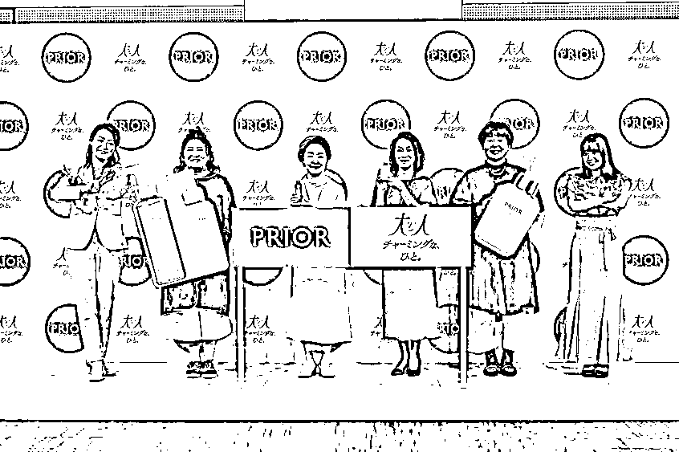

PRIOR于2015年推出，主打美容护理，涵盖护肤、底妆、护发等系列，售价约200至600元人民币。产品线成熟后，资生堂把重点放到市场教育与渗透上，以化妆教学视频打开市场。在国内，这类视频也已成中老年赛道的引流密码；线下则选择与永旺、连锁药店合作，为国内老年化妆品品牌提供了新思路。

**6. 天猫医药健康联合薇娅直播间，发起“银发经济公益活动”**

在国家卫生健康委人口家庭司指导下，天猫医药健康与薇娅直播间共同发起“银发经济公益活动”，举行关怀困境老人义卖直播，聚焦60岁以上、身心需要照料的老年人。公益收入全部捐给中国人口福利基金会，用于困难老人等特殊群体的健康与扶助。

从字节跳动“银杏家园”助老公益，到天猫此次公益行动，巨头围绕银发人群的动作已不只是适老化改造，也在用公益推动老人生活更美好。这也说明，银发经济的核心不在“经济”，而在“银发”；只有真正以提升银发人群生活品质为出发点，生意才做得长久。

**7. 中国老年人体育协会广场舞专项委员会成立**

中国老年人体育协会广场舞专项委员会成立大会在国家体育总局老干局活动中心举行，中国老年人体协副主席温文当选该专委会主任。专委会由中国老年人体协、各省老年人体协、华奥星空科技发展有限公司及合作企业代表组成，办公机构设在华奥星空。会上，湖北、山东、河南三地老年人体协代表通过网络连线分享经验，介绍省内推广广场舞的尝试与做法。

广场舞长期被视为中老年女性的专属标签，也被不少企业当作切入中老年市场的重要渠道。如今专委会成立，说明广场舞在老年人运动、文娱、社交等方面的价值获得国家层面重视，正式进入老年人体育运动体系。未来，广场舞还会衍生更多形态，围绕它建设的线下运动、健身空间也有机会。

**8. 韩国将开发VR老年驾驶培训课程，计划于2025年开始使用**

为压低老年司机事故率，韩国警方正在开发定制驾驶培训项目，计划借助VR评估65岁及以上驾驶者的驾驶、认知和记忆能力，判断其是否还能继续持证。项目为期三年，背后是韩国不断加深的老龄化：当地约四成出租车司机年龄超过65岁，去年老年司机造成的道路交通事故超过31000起。

VR在老年场景中的应用越来越宽：此前有企业尝试VR+旅游，为老人提供虚拟旅行；也有企业把VR与游戏结合，用于认知症治疗；如今又延伸到驾驶培训。可见，VR在老年人群中的商业空间仍在拓展，未来还有很多方向可探索。

**9. 伊利欣活签约70后刘国梁为品牌推荐官**

伊利旗下中老年奶粉品牌欣活官宣：70后知名乒乓球运动员、教练员刘国梁出任品牌推荐官。刘国梁有近40年乒乓球职业生涯，现任国际乒联执行副主席、中国乒协主席、世界乒乓球职业大联盟理事会主席。欣活表示，希望与刘国梁一道，用专业配方守护中老年人健康。

婴幼儿奶粉市场增速放缓，正从增量市场转向存量市场。与此同时，老龄化加深，中老年奶粉逐渐成为乳企竞争重点。近两年，伊利欣活、蒙牛悠瑞、雀巢怡养等品牌持续加码中老年高端市场，新品密集推出，营销方式更多样，竞争不断升级。

**10. 美国老年人社交学习平台GetSetUp获得1000万美元战略投资**

美国老年人社交学习平台GetSetUp近日完成1000万美元战略融资，投资方为LightShed Ventures、Cowboy Ventures。

银发市场的机会，正从线下延伸到线上，从内容延伸到服务。谁愿意真正走进老年人的世界，理解他们、服务他们，谁就更有机会在下一轮增长中占得先机。

# 银发经济升温：学习、听力、健身、旅游都有新机会

## GetSetUp：用同辈教学，把学习和社交一起解决

GetSetUp 在一年前曾拿到 1000 万美元天使轮融资。这家平台成立于 2019 年，主打实时互动、同伴互教的模式，面向老年群体提供课程学习与社交服务。老年用户可以通过视频了解不同软件的操作方法，也会接触到医疗、金融产品和服务相关内容。

老龄化释放的市场空间并非中国独有，许多国家都在面对相似机遇。与此同时，老年人参与生活、工作并继续贡献社会的时间普遍拉长，由此形成了跨国的文娱、社交和学习需求。

同辈教学的价值在于：它一方面帮助老人缓解孤独、带动认知提升和社会参与，另一方面也为部分老人打开增收渠道，从价值感和收入两个层面回应需求。对国内创业者而言，这一思路有参考意义。

**11. 资本加码智能助听器：智听科技完成数千万元 Pre-A 轮**

近日，智能助听器公司智听科技（全称深圳市智听科技有限公司）完成数千万元 Pre-A 轮融资。本轮由青松基金、小米战投、顺为资本出手，华芯资本和至澄资本担任融资顾问。此前，公司还获得过力合创投的天使轮投资。智听科技成立于 2017 年，是一家医疗器械企业，主攻听力检测与助听系统的智能化开发。

世卫组织的统计显示，在 65 岁及以上人群中，大约每三人就有一人存在残疾性听力损失。另一边，国内助听器的市场渗透率尚不足 5%。传统产品价格多在万元以上，加上使用体验不理想，成为老人不愿买单的两大障碍。

面对传统助听器市场的痛点和巨大空白，近两年一批新兴智能助听器公司开始冒头，也把资本目光引向这里。下一步，谁能把研发做深，并找到更贴合老年群体的产品形态与验配方式，谁就更有机会推动行业改变。

**12. Vivo 拿下 100 万美元种子轮，55 岁以上居家健身受关注**

AgeClub 获悉，美国数字化老年健身平台 Vivo 完成 100 万美元种子轮融资。参与方中既有医疗保健与长寿领域的知名行业领袖，也有风险投资人。Vivo 提供在线训练健身服务，课程专门面向 55 岁及以上人群设计，以远程方式交付，用户在家就能跟练。

中老年运动健身赛道在国内外都不缺项目，也跑出过成功案例。近期的新变化是，过去健身生意多以线下健身房为核心场景，如今针对中老年人居家锻炼需求的项目正在增多。美国 Vivo 之外，国内乐刻等头部健身品牌也在借家庭场景触达中老年用户。

这释放出一个信号：中老年群体被视为健身市场的重要新增量，已逐渐成为共识；围绕他们在不同场景下的锻炼需求，还会长出更多创业创新机会。

**13. 首批智慧旅游适老化示范案例公布，14 个项目入选**

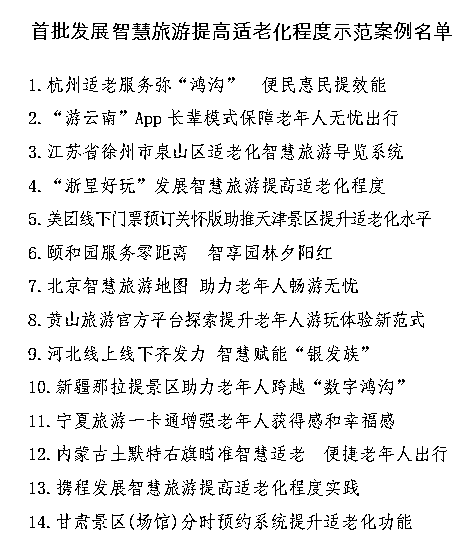

文化和旅游部资源开发司近日发布通知，公布首批“发展智慧旅游提高适老化程度”示范案例名单，包括“杭州适老服务弥‘鸿沟’便民惠民提效能”在内，全国共 14 个案例入选。此次评选意在借智慧旅游推进适老化，帮老年人跨过“数字鸿沟”。

从数据和现象看，老年群体正成为旅游市场回暖的重要推力。与年轻人相比，他们时间更充裕、消费能力也不弱，出游意愿和需求更旺。随着旅游适老化逐步落地，老年人出行遇到的第一道门槛被削平，出游热情还会被进一步点燃。接下来，围绕老年游客的需求与痛点做更深层改造，提供更高质量的场景、内容和服务，会成为旅游市场升级的新动力。

人口老龄化能延伸出的思路远不止这些。我这里只是粗线条梳理市场趋势，供大家参考。对中老年赛道感兴趣的朋友，欢迎在评论区聊聊。

## 评论区也有真问题

龙哥：谢谢分享，已设为精华。

刘三点：多谢龙哥🙏

老黄：我做过一个月中老年交友，对标美国 outtime，但项目终止了。这个市场最大的风险在国情，很容易被定性为“诈骗”。客单价不高问题不大，可一旦客单价起来，就容易暴雷。交付很难十全十美，就算降低预期也不行。所以我认为，真正买单的群体是年轻人，而不是老年人。我接触的都是高知、拿退休金的中老年人，同样不好做。我想明白了服务谁，却没想透钱从谁身上出。以上是个人经历，和大家一起交流赚钱。

Destiny：感谢分享。我们团队目前在上海做养老社区，想深耕养老行业，期待加🛰️私聊：Loius19357。

池月白：老年人在互联网上的商机值得挖掘。

聪_CC：信息齐全、数据扎实、结构清楚，全文仔细读过。无论从行业需求趋势，还是从父母长辈身边的实际需求看，这都是值得思考的多赢创业方向，希望后续还能看到相关分享。

夜翔梦多：从事养老行业，方便加🛰️交流吗？yexiangmengduo

哇咔丸：我们机构想做老年人兴趣课，但不认识老师。