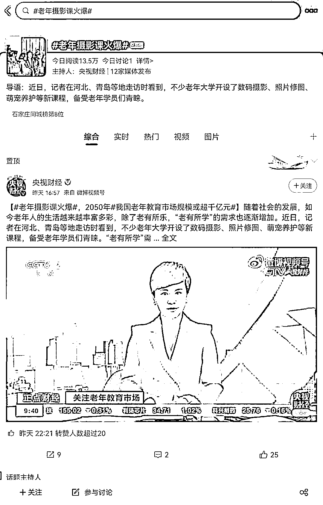

# 中老年培训，需求正在冒头

作者：嘟｜日期：2022-11-11

央视的一则报道，把视线带到了中老年群体。正在服务或关注这类人群的圈友，不妨把“中老年培训”放进下一步的观察清单。

评论区里也冒出不少真实信号。有圈友说，自己所在小区已经有老年摄影协会；另一位分享，家里长辈学中医、针灸课程时兴致勃勃，乐在其中。还有人正打算切入中老年培训，招生力量已有，却缺合适的老师。对此，嘟建议去生财发布资源对接，寻找同领域伙伴一起合作，对方也回应认可。

亦仁也把这条内容记作中标，并给术值+1；想继续翻看同类内容，从页面上方进入 #星球栏目，在 #中标 分类里就能看到全部中标风向标。