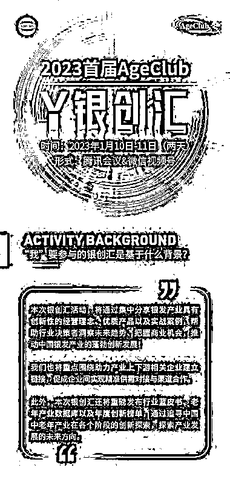
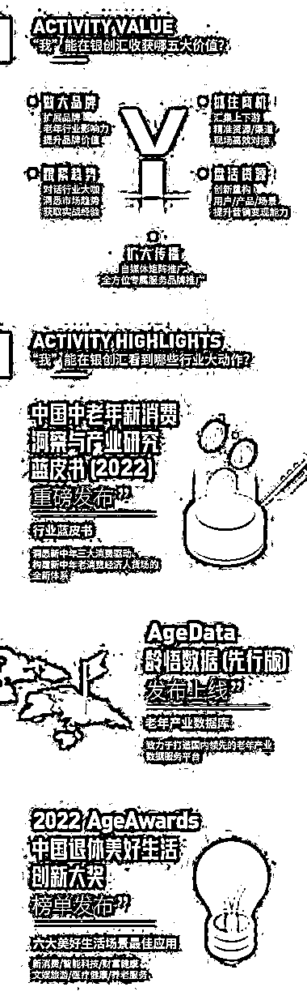
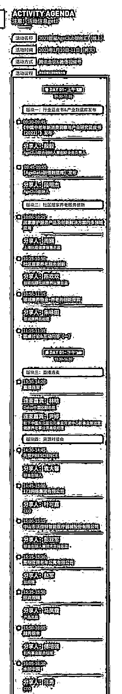
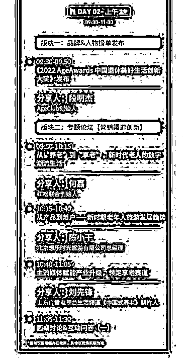

# 中老年赛道还有哪些机会？这场两天分享会别错过

最近在留意银发经济相关动态时，我注意到一个专注养老行业资讯整合的平台，正在筹备一场为期两天的线上分享会。为什么这事值得关注？因为近两年中老年赛道的崭新机会层出不穷，不少圈友做中老年场景的带货，反馈数据都非常亮眼。我始终觉得，这个赛道还远远没有到饱和阶段，真正的大机会可能还在后面。如果你也对这个方向感兴趣，不妨抽空去听一听。

 

评论区：

龙哥 : 中标，术值+1。

在上方 #星球栏目  专栏中，点击 #中标，可查看所有中标风向标。