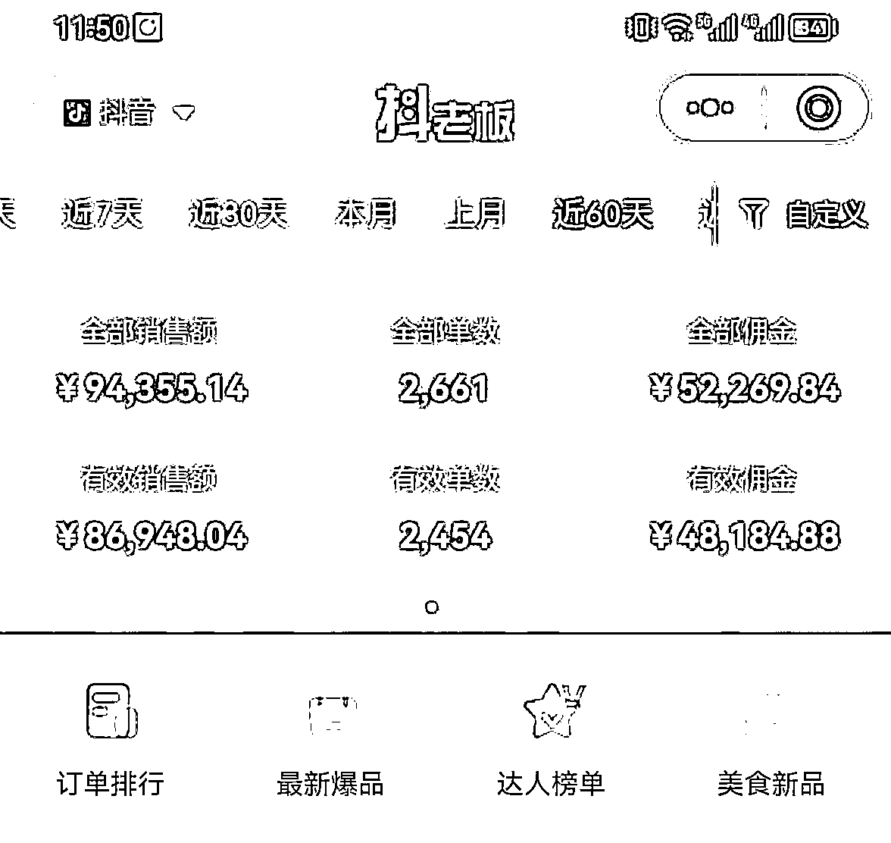

# 兼职两月，我在抖音靠中老年书单号赚了5W+

作者：刘逍遥｜2023年4月12日

先做个自我介绍。我叫逍遥，95后，目前在手游公司上班，也是生财有术第七期的圈友。2019年我开始接触互联网项目，最早做影视解说类自媒体账号，覆盖西瓜视频、大鱼号、百家号等平台；后来做过中视频计划；现在把主要精力放在中老年书单号上。

这次复盘想聊三件事：
1. 为什么选中老年书单号？
2. 一个没碰过带货的新手，怎样靠兼职在两个月里赚到5W？
3. 实操后的体会，以及我对这个项目后续拓展的想法。

**1. 为什么选中老年书单号？**

2022年10月，我刷到一场抖音直播。直播内容大致是“四个舌头”，卖的是养生茶。那场直播开播一小时，商品就出了几千单，留言区几乎全是追问主播、急着下单的声音。这个场景让我很受触动。

我简单拆了一下：养生茶客单价不算低，最便宜的茶包也要58.8元，但它抓住了大家担心生病的心理，痛点切得很准。于是我动了做茶包类产品的念头。可我对带货是零基础，就去知乎找资料。我当时的判断是，中老年群体对网络玩法的理解和需求并没有那么清楚，内容一旦获得他们认同，掏钱的意愿并不低；而且不少人都有退休金，消费能力不输年轻人。就这样，我开始做中老年书单号。

完整记录放在飞书文档里：
https://ki9cyy7wy03.feishu.cn/docx/ByU7dOhOUorzQqxgGilcS463nfd?from=from_copylink

**2. 新手兼职两个月赚到5W，我怎么做的？**

从没接触过带货，到用兼职时间跑出结果，这段过程没法在一篇短文里讲全，我把完整细节整理进了上面的飞书文档。起号部分，我参考的是拱卒大佬的文章，流程写得很细，到现在依然适用。

**3. 实操后的感受与拓展想法**

实操之后，我对这个项目也有一些延伸思考，这部分同样放在飞书文档里一并记录。

**评论区补充**

评论区里，周彦充问怎么起号；平凡小吴希望把链接贴出来。起号流程可以看拱卒大佬这篇文章，讲得很详细，现在依旧可用：
https://articles.zsxq.com/id_j1haltrgav93.html

另外，along 问我之前做影视解说类账号，现在不做了是出于什么考虑，这次先不展开。