# 锁定中老年客群，不露脸教简谱，直播一年入账30W+

文/LLL 2023-03-17

打开抖音或视频号，你大概率刷到过这类直播间：屏幕上是放大的简谱，主播逐句领唱，评论区跟得整整齐齐。这类内容看着朴素，背后却藏着一条能跑通的变现路径。

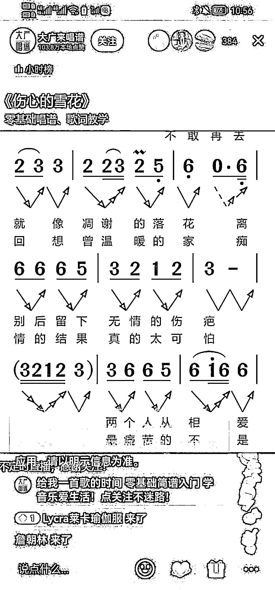

这个方向盘子不宽，体量也有限。玩法不复杂：用特定的打谱软件教普通人认简谱，直播间里带着大家唱，再把虚拟课程和实体简谱书卖出去。核心用户是退休干部、叔叔阿姨辈的中老年朋友，客单价大致在100元左右。

我在这个方向单打独斗快一年，进账30W+。放到生财圈里不算什么，但一路踩出来的经验和教训，分享出来也许能帮到想进场的人。下面是2022年部分收益截图：

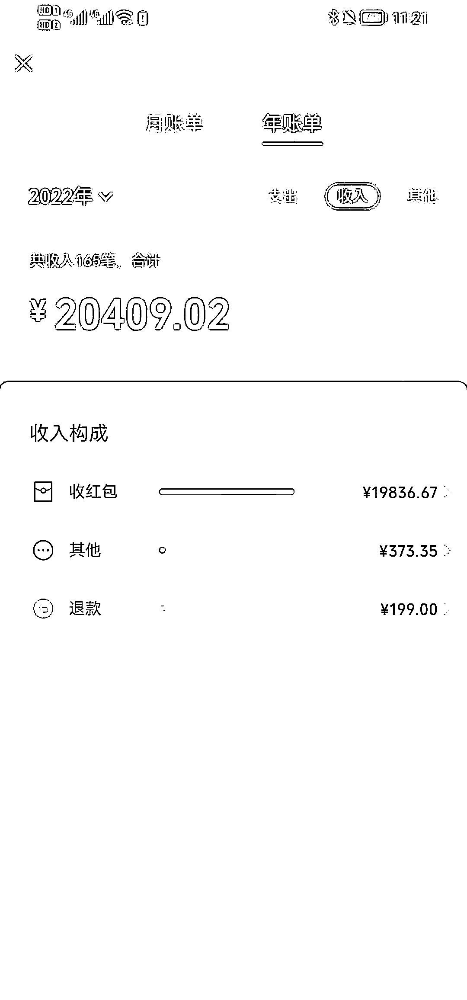

我是LLL，在生财潜水三年，存在感很低。本职工作在十八线小县城，体制内，不算忙。加入生财圈以后，我陆续试过淘宝蓝海、视频号大海航、快手小游戏等项目，都没跑出结果。去年3月参加过生财组织的抖音2.0直播大航海，随后转战视频号，最终扎进简谱教学这一细分领域，用户以中老年女性为主。下面聊的全是实操层面的东西，文笔不精，欢迎拍砖。

## 一、音乐技能直播是怎么一回事

把音乐能力做成直播内容，用内容吸引流量，再让流量变成收入，这就是音乐技能直播的底层逻辑。按变现方式拆分，常见有三条路：礼物打赏、直播带货、知识付费。这次只聊知识付费这条路。

这类直播间形态不少：钢琴、吉他、电子琴、电吹管、葫芦丝、二胡等乐器教学，还有声乐、乐理和视唱练耳等基础内容。

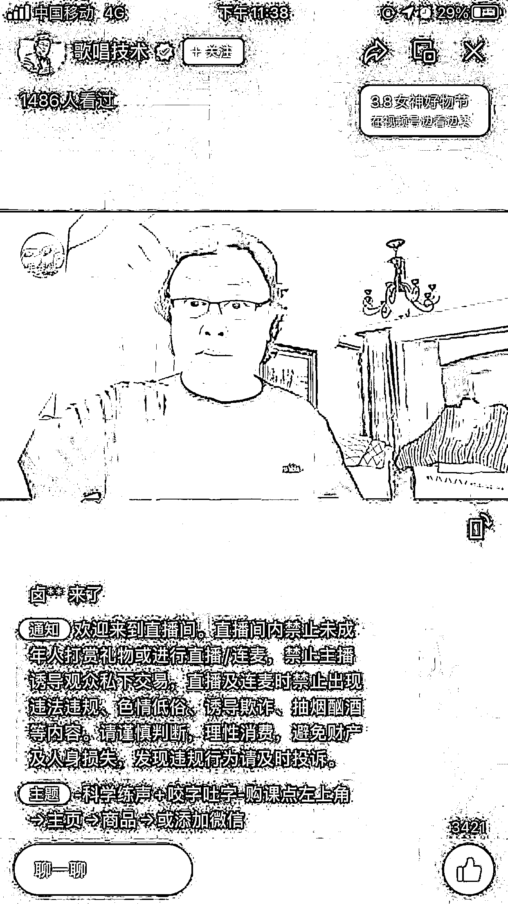

声乐方向

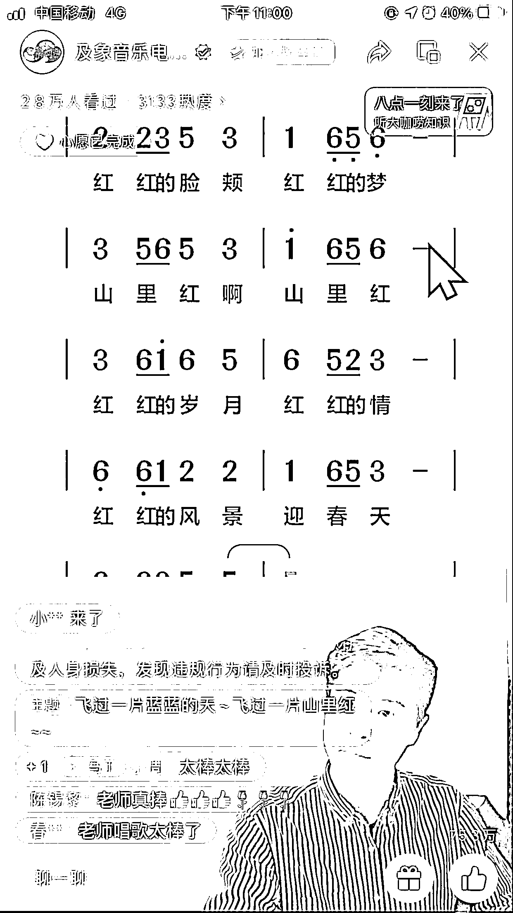

歌曲方向

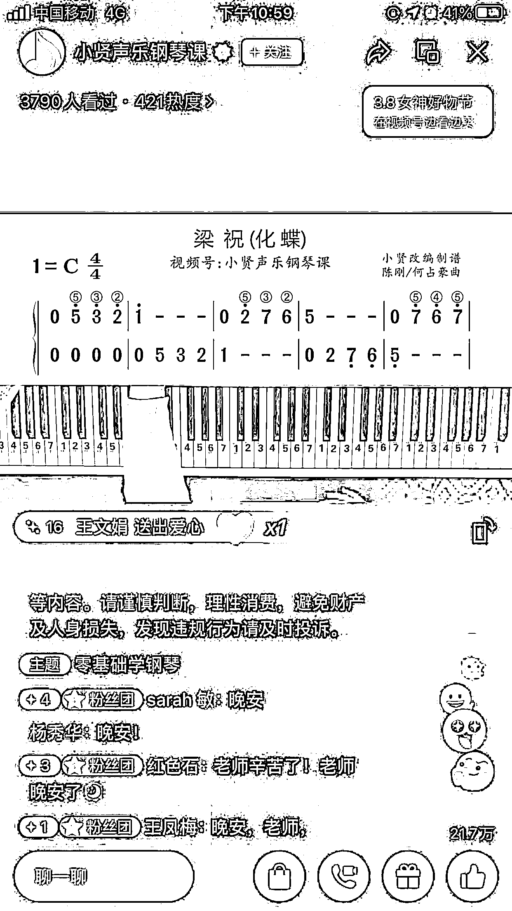

简谱钢琴方向

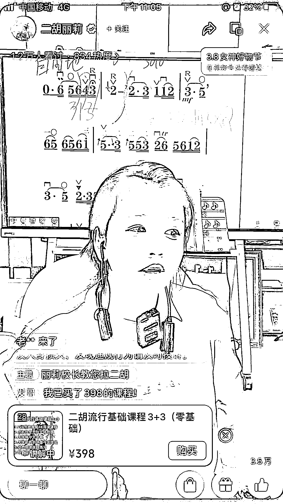

二胡方向

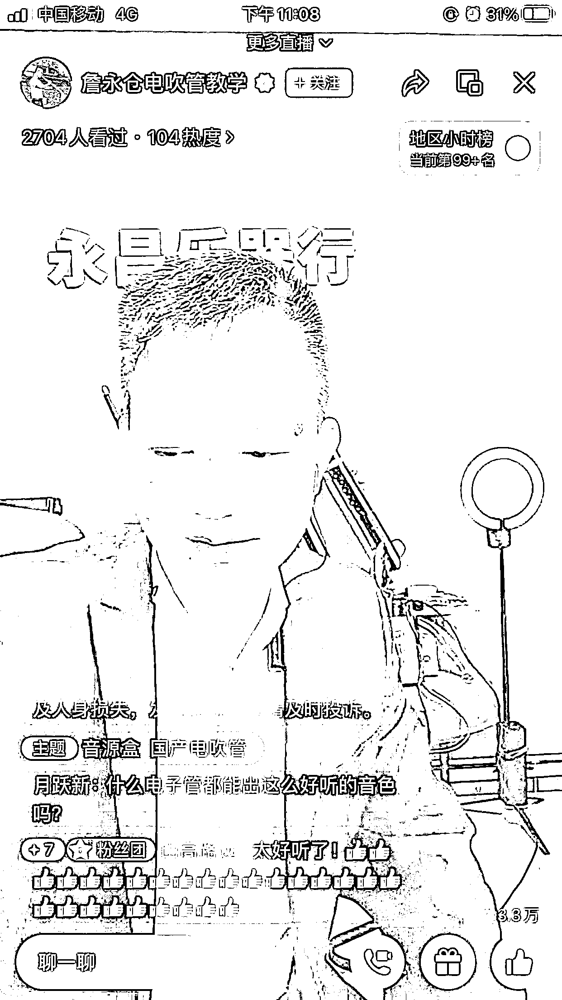

电吹管方向

小提琴方向

## 二、如何在音乐圈里找到适合自己的细分切口？

**（1）从自身积累出发**

先盘家底：手里有什么音乐技能，对哪个方向有兴趣，哪怕边学边卖也不丢人。我本身音乐学院毕业，带过线下课，乐理、视唱练耳这类基础内容很熟，把线下的教法直接搬进直播间就行。

**（2）让试错成本尽可能低**

前期最好一个人就能跑完整条链路：直播形式怎么定、流量怎么引、产品怎么做、钱怎么收。投入以时间为主，资金成本能压多低压多低。

**（3）选受众最广的蓝海细分**

音乐技能那么多，为什么偏偏是识谱？因为乐谱是音乐的“文字”，也是所有音乐学习的地基。不管学什么乐器，还是想提升音乐素养，认谱都是一道绕不过去的门。放在整个赛道里看，这就是刚需。

国内主流记谱法就两种：五线谱、简谱。五线谱上手门槛高，普通人容易被劝退；简谱则亲民得多，毕竟名字里就写着“简单”。所以简谱识谱成了很多人的入门第一课，也是最容易接受的基础课。

**（4）怎么找对标账号**

方向定了，先别急着按自己的设想开干。去目标平台看看有没有同行。有人在做，就仔细拆解：直播间怎么布置、用什么钩子引流、产品是什么形态、成交怎么完成、价格定在多少。把每个环节看明白，再谈执行。

先在抖音搜索【简谱教学】，把顶部每个分组都点一遍，留意有没有数据异常的新账号。

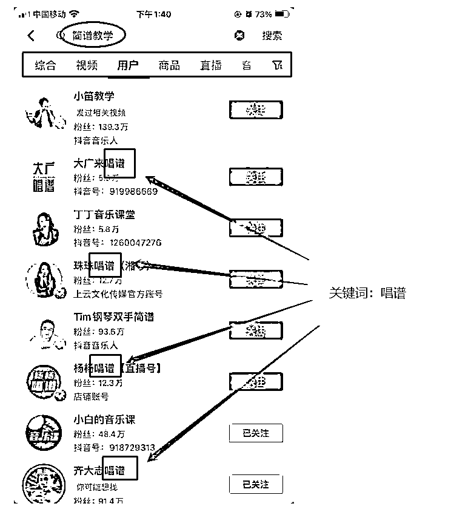

你看出什么没有？

再搜【唱谱】，切到“用户”标签，会跳出一大排唱谱账号。

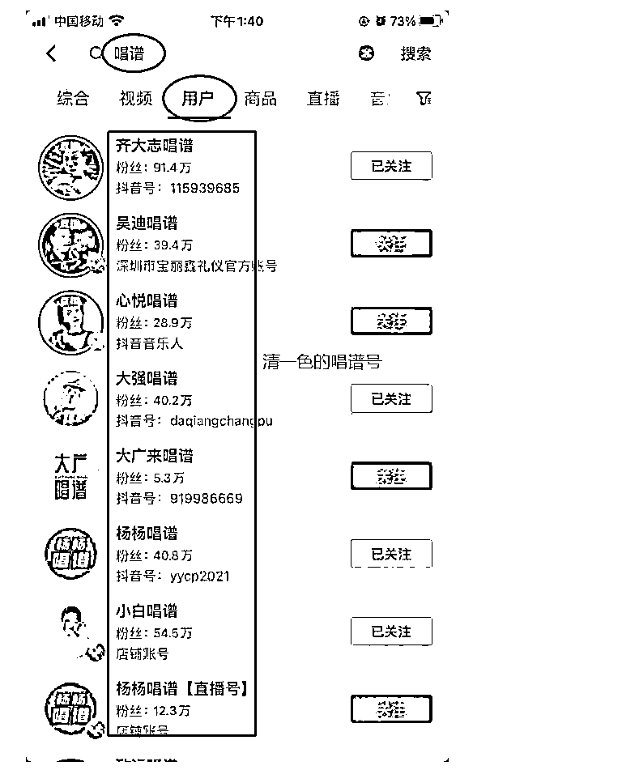

这些都是简谱教学的对标对象。逐个点进主页：看发什么内容、点赞数据如何、评论区里反复出现什么需求；再去直播间蹲几天，把行业底数摸清。

第二步，用蝉妈妈这类数据工具量化同行的表现。蝉妈妈官网：https://www.chanmama.com/

注册并登录后，从左上角进入【抖音分析平台】。

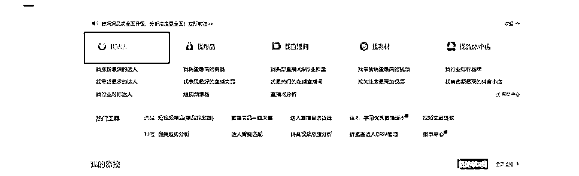

点开【找达人】。

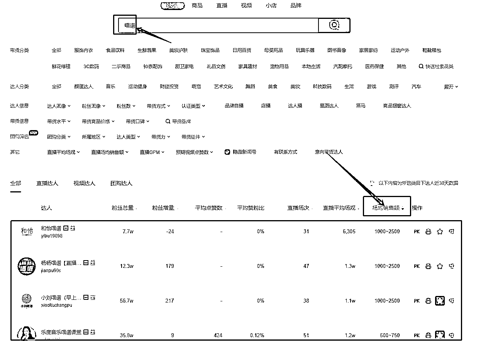

在页面顶部的搜索框输入【唱谱】，再看右下角的场均销售额（详细数据要开会员），头部玩家的变现水平一目了然。挑一个账号当对标，照着做，像素级复刻——先抄后超。

## 三、项目实操

**（1）定直播形式**

看完对标账号后，我把“真人出镜”这个选项删掉了：画面只保留简谱软件和PPT。一台电脑就能撑起整场直播，设备极其简单。效果参考下图：

**（2）准备直播设备**

1. 电脑一台。
2. 麦克风、耳机各一（耳机负责把伴奏送到耳朵里）。
3. OBS直播软件，官网：http://www.obsproject.com.cn/
4. 基础理论课件PPT。
5. 简谱编辑软件。

怎么快速找到同行同款软件？最省事的办法是装成学员，直接在直播间开口问，有些主播会大方说出软件名。如果问了几次都没人理，就去百度、淘宝、微信、知乎这些平台交叉搜索，把候选软件下载试用，逐一比较。

我搜了一圈，最后落在JP-WORD上（官网：http://www.happyeo.com/）。这款专业打谱软件可以播放乐谱，唱谱时还会显示进度条；完整功能需要付费解锁，价格见下图。

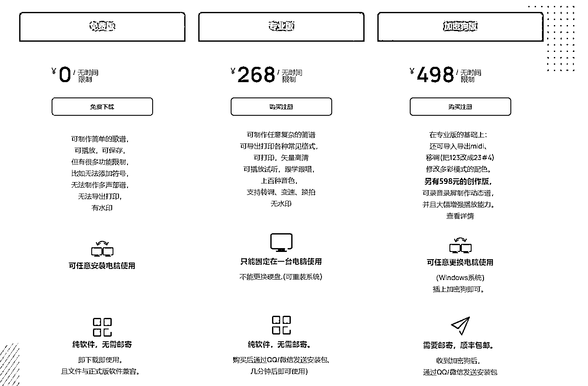

要买的话，我建议直接上498元的加密狗版本，多台电脑都能用。

**（3）定直播流程**

单场流程是：自我介绍→基础乐理→节奏型讲解→节奏型练习→卖课。完整结构如下：

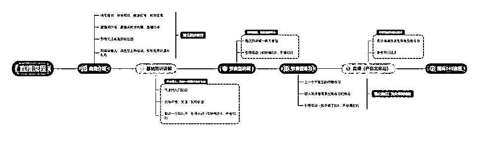

【基础乐理】部分需要专门做一套PPT。

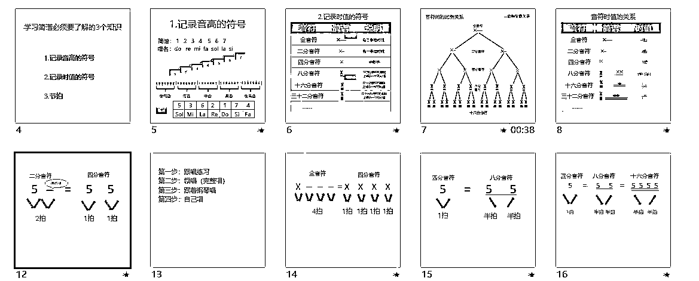

【节奏型练习曲】可以从市面上的视唱练耳教材里挑谱例，也可以自己编写，提前录进JP-WORD，直播时随时调出来用。

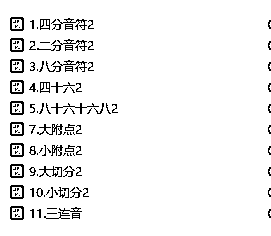

全程从零基础用户出发：先把简谱常识讲透，再安排大量跟唱练习。教学以领唱为主，类似于健身博主带操，主播必须亲自示范，让观众听得懂、学得会。

**（4）开播和引流**

准备工作就绪，就可以正式开播。步骤拆开如下。

第一步，下载并安装OBS。打开后，从右下角进入【设置】→【视频】，把分辨率设为竖屏1080×1920或横屏1920×1080。

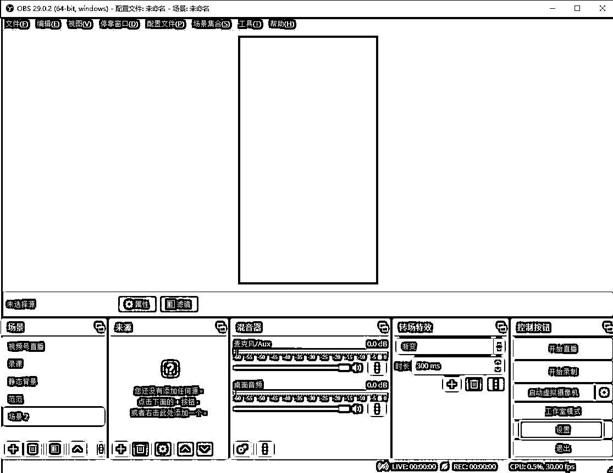

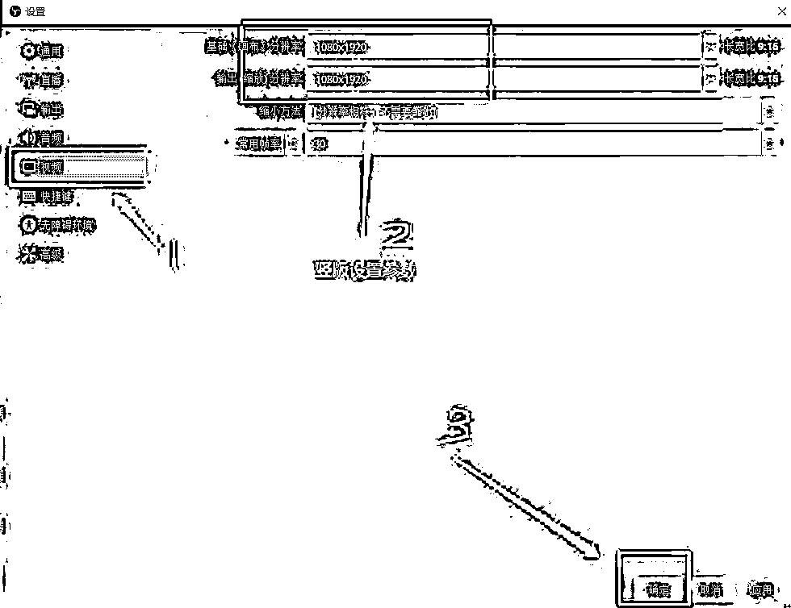

第二步，在【来源】面板里把要用到的窗口全部加进去，直播中切换画面才方便。

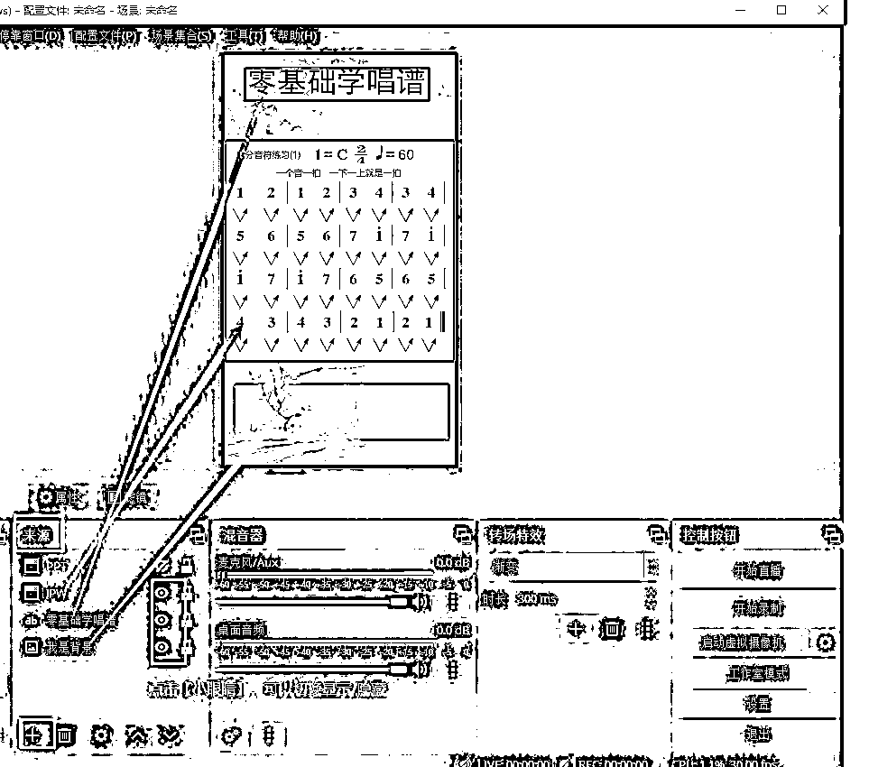

第三步，点击【启动虚拟摄像机】。

第四步，电脑端微信登录后，点左下角的三条横线，选择【视频号直播工具】。

第五步，在【添加画面源】里选【摄像头】，并把设备指定为【obsVitual Camera】。此时OBS输出的画面就会以虚拟摄像头的方式，进入视频号直播工具。

到这里，按下开始直播即可。播的时候只需操作OBS；但要留意，视频号直播工具里的麦克风必须保持开启，否则观众听到的只有静音。

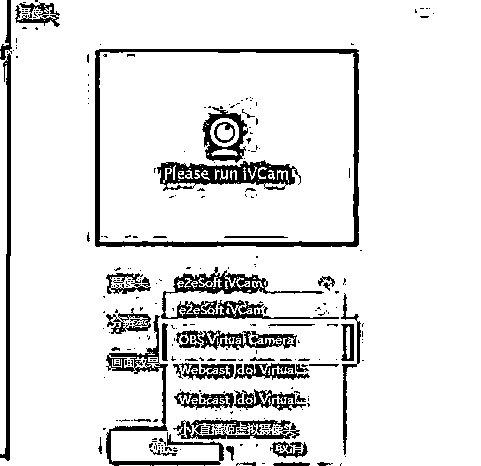

直播稳定后，我把原来注册的企业微信和视频号做了绑定，并在直播中引导用户添加企业微信，为后续私域转化做铺垫。

**（5）课程同步开发**

课程这边也没有等，同步开工。录制同样用OBS，剪好后传到【小鹅通】；用户购买后，把邀请码发给对方即可。

课程主体是录好的唱谱教学视频。唱谱要想真正掌握，必须靠大量练习，熟能生巧。初学者哪怕在直播间学会了认谱，课后不练依然拿不下这项技能。这也是这个赛道的特点，同时也解释了我为什么敢在直播间把课程内容全部教出去——听懂不等于练会。

## 四、做音乐技能直播必经的几个阶段

### 阶段一：直播与产品同步推进，用复盘换数据

**（1）直播：拼执行力，勤复盘**

刚开播那阵子，直播间大概率空无一人，千万别灰心。扛住更新频率，流量会慢慢聚起来。

每场下播后都要复盘：把直播回放调出来，对照后台数据，看是哪个动作拉高了在线人数，哪句话点燃了互动氛围。这张复盘表在当时帮了我很多：

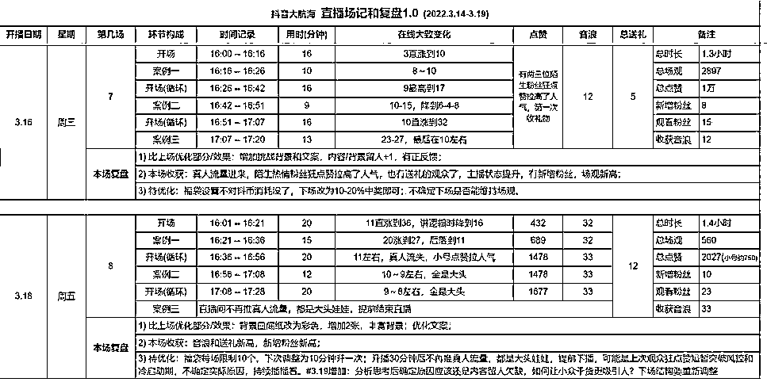

前期盯住观看时长、互动率、加粉团这三个指标就够。具体玩法可以参考去年3月生财的抖音直播2.0大航海课程，干货很密。

差不多播了一周，在线人数就能稳定在30～100人；按每场两小时算，场观轻松到2000～3000人。

另外可以避开同行集中开播的时段。这个赛道的大主播一般上午8点、晚上7点左右开播，我则选早上6点到8点：一是8点后要去上班，二是目标用户是50岁以上的长辈，他们普遍觉少起得早，6点的场根本不用愁没流量。还有一点，开播时间尽量固定，老观众才有粘性。

最初为了尽快拿到正反馈，我每天5点半硬爬起来，眼睛还没睁开就把电脑先摁亮。笑话闹了不少：播到一半冲进洗手间，用冷水拍脸提神；PPT忘了切，讲到一半才发现；弹幕里也经常有学员提醒“看不到谱子”。

坚持一段时间后，早起直播慢慢变成了习惯，下播后精神状态依然很好，主业也没耽误。现在回头看，正是那段咬牙硬扛的日子，让我用最短的时间拿到了正反馈。没有那些凌晨的开播，就不会有今天这点成绩。

**（2）产品：快速做出第一版，留好优化接口**

开工做产品前，先把全局想清楚：交付形态是什么？内容体系怎么排？差异化怎么做？用什么方式录制？课程产能如何保证？录制SOP能不能复制？这些问题想不明白，后面很容易做大量重复劳动。下面是我的产品规划思路：

1）内容体系分四层：
① 基础乐理知识
② 常见节奏型讲解
③ 节奏型跟练（逐句跟唱+整曲带唱+钢琴动态谱）
④ 综合练习曲（逐句跟唱+整曲带唱+钢琴动态谱）

2）怎么做出差异化？
① 我在练唱环节加入了逐句跟唱，一句一句领。这种教法我翻了很多同行都没见过，但对零基础用户非常友好。
② 综合练习曲一共110首。同行基本都选当下热歌，比如《梅花泪》《早安隆回》《红枣树》，长辈们确实爱听；但拿经典老歌编教材的很少。我于是主打《歌声飘过30年》系列。

这套合集是《中国音乐电视》推出的，把改革开放30年来在内地和港台流传的百余首经典曲目收罗其中。我们的用户大多在50岁以上，这些老歌恰好流行于他们的青年时代，直播间一开唱，情感共鸣自然就来了。

3）交付形式分平台处理：
① 抖音用学浪。我有教师资格证，资质审核一次通过，录完一集传一集就行。但即便操作这么简单，仍有大量用户找不到课程入口。后来我专门录了一支“课程观看指南”，遇到来问的，直接引导去主页看视频。
② 视频号用“小鹅通”。视频号官方不支持虚拟类课程上架，只能借第三方工具完成交付：先加微信，再把课程链接发过去。小鹅通可以直接挂虚拟课程、关联视频号卖货，实操起来比较顺手。
③ 补充方案：注册一个视频号小号，设为私密账号，把课程传上去；用户关注后，后台手动通过申请就算交付完成。

交过的学费：为了省成本，一开始选了免费的【荔枝微课】，结果售后直接爆炸。平台里广告多，用户天天来问“课程在哪”“为什么看不到”。被折腾到没脾气之后，我换了小鹅通，操作层面的问题基本归零。课程平台这钱不能省，毕竟目标用户不是手机深度玩家。

### 阶段二：根据市场反馈打磨产品

第一版课程只做虚拟内容，本意是轻交付。但中老年用户有个很实际的困难：眼睛不好，盯屏幕吃力，字又看不清楚。直播间里不断有人问“能不能出书”——这就是市场给的信号。

后来的产品形态改成：简谱书+二维码。每首曲子上方印一个码，手机一扫就能打开对应的练习视频，书和视频配合使用。这个改动，让产品在中老年用户中的接受度明显提高。

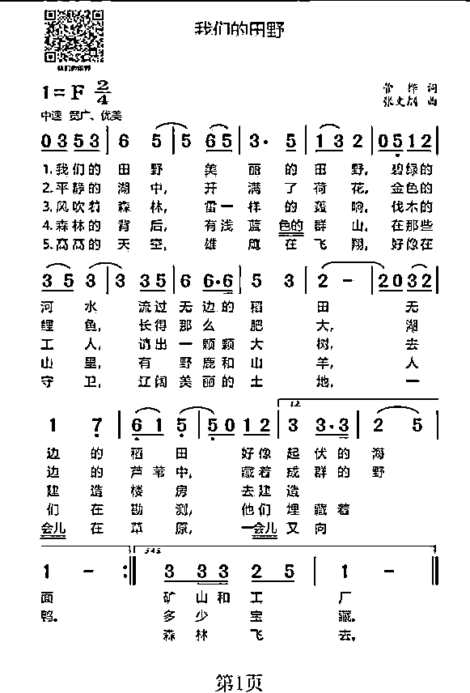

一句话总结：产品上架不是终点。把市场反馈持续收集回来，再反馈到产品迭代中，才是一条完整的闭环。

### 阶段三：多路放大，收益再上台阶

**（1）拉时长，加场次**

产品跑通、变现稳定之后，下一步就是放大收益。先把单场时长拉起来。做过直播的都知道，这活儿拼的是体力，连续讲几个小时，脑力和嗓子都在透支。体力扛得住就多讲一会儿；内容讲完，从头再讲一遍也无妨，反正很少有人全程听到底。实在没得讲了，闲聊几句也行——我不少订单恰恰是在下课后的聊天阶段成交的。

场次也可以往上加。前期只在早上6点播，为了避开同行；等直播间有竞争力了，我把排期加到一天三场：6:00—8:30、13:00—14:30、19:30—21:30。

**（2）无人直播：爽过，但别依赖**

去年视频号的无人直播非常普遍：平台不提醒、不扣分，还能循环播放。我当时怕封号，一直没敢上。（现在视频号里依然有不少录播，尤其是知识类目，只是被系统提醒的概率变高了，扣分也开始出现。）

10月之后，我开始小规模试水：放提前录好的视频，或者干脆把直播回放挂上去。那阵子的收益几乎是躺赚，每天2000～3000到手。现在最后悔的是没敢继续放大——如果当时多开几个小号同步放录播，七位数可能早就破掉了。

后来平台逐渐收紧，无人直播被打击得越来越狠，到今天已经基本走不通。即便要用录播，也必须保留真人直播的状态，否则某天录播不能用了，你会发现自己的临场能力掉得厉害。更麻烦的是心态会变：不想开播，畏惧开播。所以别跟平台逆着来。如果一定要播录播，至少留一两个号每天正常开播，这点非常关键。

我实测过，播20天以前的直播回放，被系统提醒的概率相对较低；只要不是频繁被盯上，一般不会扣分。即便被提醒了，也可以顺势把用户引导到主页橱窗去下单，照样能转化。

**（3）复制矩阵，让普通人也能播，并多平台分发**

收益最大化的解法是矩阵化：把一个成功账号的模板复制到多个账号上。可以招主播、谈合作，把直播间批量搭起来。

但问题马上来了：会唱谱、有音乐技能的主播本来就不多。就算有幸找到专业人才，培养他熟悉直播套路和商业逻辑需要时间；等他全摸透了，大概率选择单干。唱谱赛道门槛不高，自立门户太容易，把宝押在专业主播身上，天花板摆在那里。

所以必须设计一套让普通人都能上手的直播方案。核心是把直播内容拆成两块：

① 讲解部分：提前写好逐字稿，主播背熟、练顺，就能自然地讲。一个知识点、一个节奏型，照着稿子说清楚，用户能听懂就达标了。
② 唱谱部分：不需要每次真人现场唱。把音频或视频提前录好，到了展示环节直接播放。

这套打法已有成功案例，抖音搜“大广来唱谱”就能看到。

最后，多平台同步分发，一鱼多吃。方法还是开OBS的【启动虚拟摄像机】，然后在视频号、抖音、快手（快手我没亲测）等平台把虚拟摄像头添加为视频源。操作细节见上文“开播引流”第五步。

直播引流，先避开这个坑

多个平台一起开播时，最好别在口播或画面里点名平台；例如在抖音直接喊“加微信”，就容易触线。

（4）产品要成梯队，才能接住不同人

一套完整的产品盘子，通常要有获客款、主力爆款和高利润款。不同人有不同需求，产品越丰富，覆盖的人群越广。但开发新品很耗时间精力，想清楚再动手。

价格上，我的大致分法是：获客款9.9元、爆款99元、利润款199元，交付难度由浅到深。不同细分赛道各有各的情况，同行定价也千差万别。定价这件事很考验功夫，我这里没有万能公式；经验就是跟着需求变化走，多看看同行怎么定价，再按自己的条件来。

（5）先把底盘筑牢，再谈增长

各平台竞争激烈，规则也变快，不合规很快会被清出赛道。所以得持续学习、持续试错、持续适应平台规则。产品定位也不是一次定终身。就像前面说的，我最早做虚拟课程，后来做书本；现在同行普遍卖书，同质化很严重。这时就该往训练营、收费直播等方向想，开发新产品。我发现不少客户买了产品，仍然愿意来直播间听课，用户就是喜欢直播和互动。所以想提高生存力，条件允许就尽量把客群往私域引；团队的话，可以分一部分人专门做私域运营。私域运营我自己经验不多，基本没怎么运营过，但可以分享几个思路，放在后面章节。

五、把用户接进私域，怎么做更顺

视频号有个优势：把流量接到私域很顺滑。先注册企业微信，视频号完成认证后能直接挂在直播间；用户通过企业微信名片就能加微信。提前把企业微信的欢迎语设好，在欢迎语里引导用户进群；每次开播把链接丢到微信群，既增强粘性，也能拉长直播间停留。不少用户是先学一阵子，后面才下单。

六、用户进了私域，如何转化成交

私域成交之后，后续运营非常关键。这里给一些方案和思路供参考。艺术教育赛道里体量较大的团队，几乎都走录播，手里账号矩阵很多；直播间并不卖课，全部先把人引到企业微信，再到私域完成转化，客单价不低。

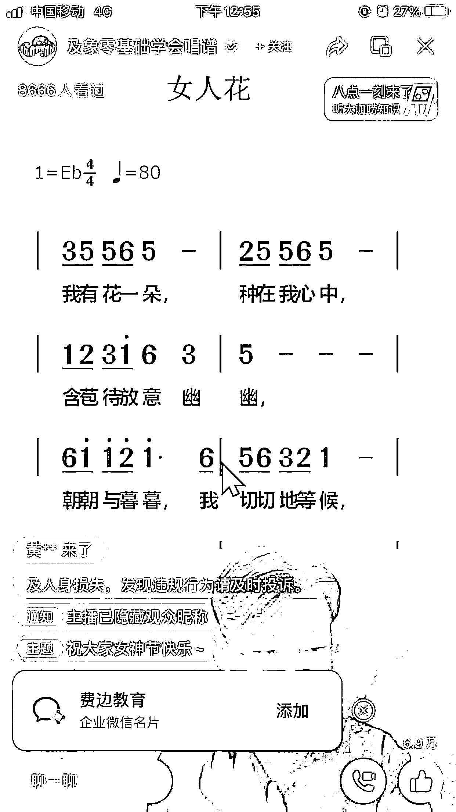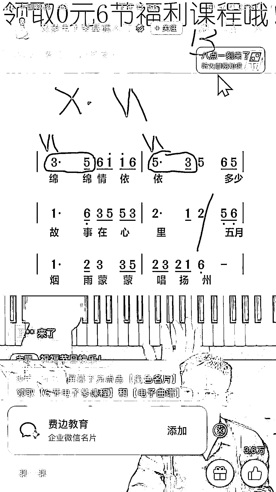

引到私域的话术是“免费领取XX节XX课程”。用户进私域后，他们会持续发消息，通知免费课，再引导买课，具体看下图：

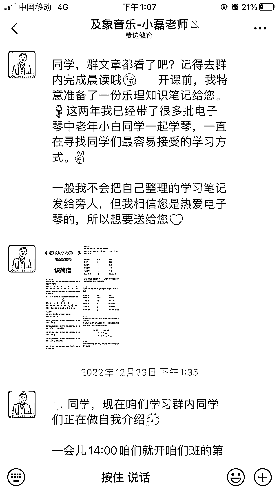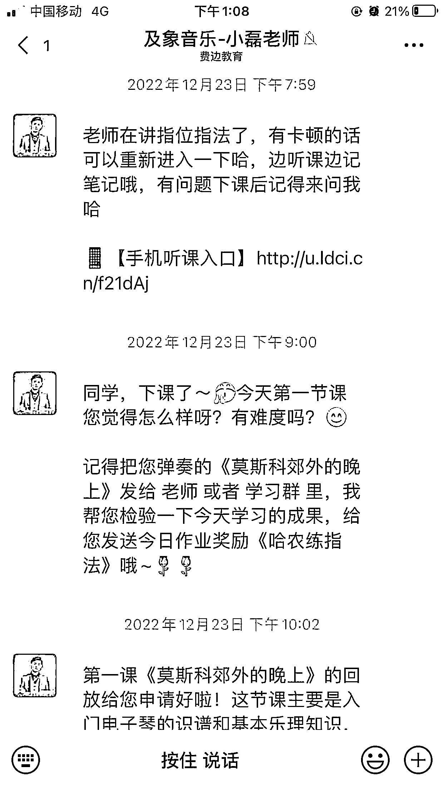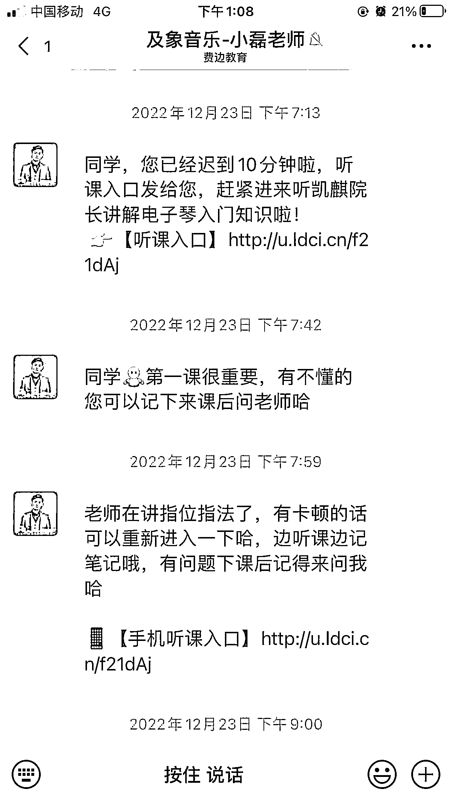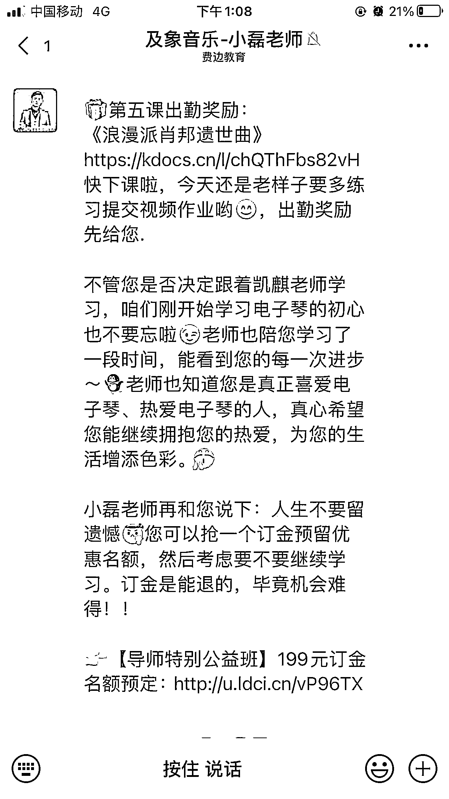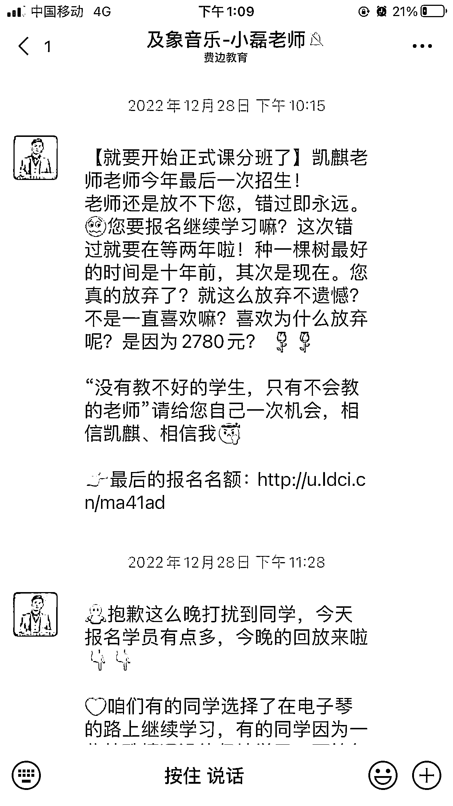

七、新手入场的门槛与建议

① 自己至少得懂基础乐理、会唱谱；本人不会的话，团队里至少有人会。

② 这个赛道转化率偏低，因为用户只要有时间，就可能一直蹭免费内容。

③ 先照着同行做，再争取超过；执行到位，边做边找思路。

④ 视频号录播眼下还能跑，但一定会越来越难，录播终究不是长久方案。

⑤ 没有音乐基础的人，可以提前录好唱谱环节，再配合预先设计好的讲解话术，同样能开播。案例可参考抖音号：大广来唱谱。

（1）延展方向：乐器类教学

乐器类教学实操性更强，学习过程需要拿具体乐器练，所以整体转化率通常更高；不像唱谱赛道有大量只蹭免费内容的用户。客单价也能做得更高，当然竞争同样激烈，有条件的社群朋友可以试试。落地方法还是先学同行再做出差异：先看别人怎么干，做近乎一比一的复刻，然后在实操中不断优化调整。下面给几个思路和案例：

1）电子琴教学

用简谱唱谱把用户引到私域，再在群里做电子琴录播教学，配合转化文案。

传统电子琴教学会展示电子琴+教材实操，转化率较高。

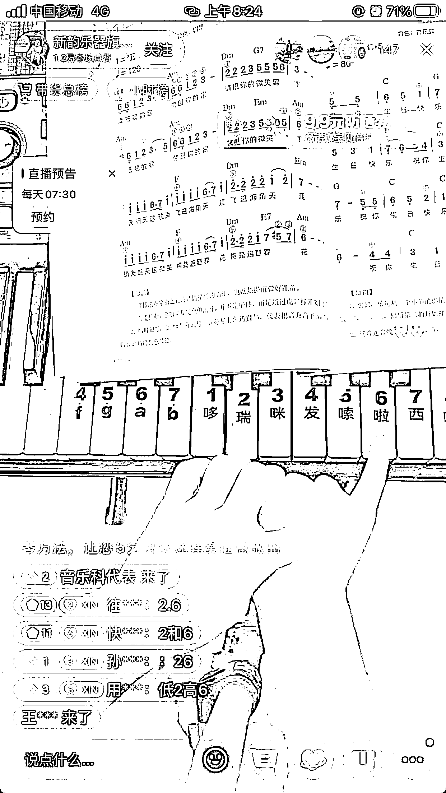

2）钢琴教学

赛道玩家很多，大致分两类。传统钢琴教学和线下教学差不多，直播时主要讲乐曲、练习曲的处理。

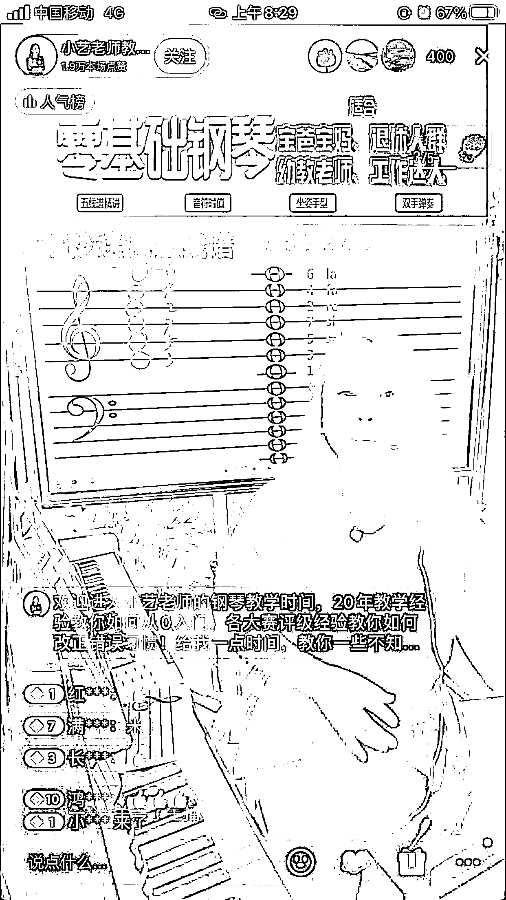

简谱钢琴教学对应大学里的即兴伴奏课，很受想学钢琴的成年人欢迎，入门也不难。

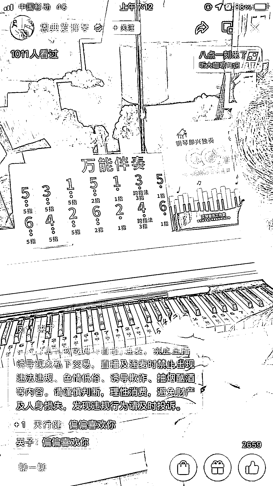

3）电吹管教学

相对蓝海。客单价高，但乐器结构较复杂，不太适合在直播间做教学；常见做法是直播示范演奏，再靠卖乐器变现。

4）吉他教学

可以和带货结合，卖吉他和周边。

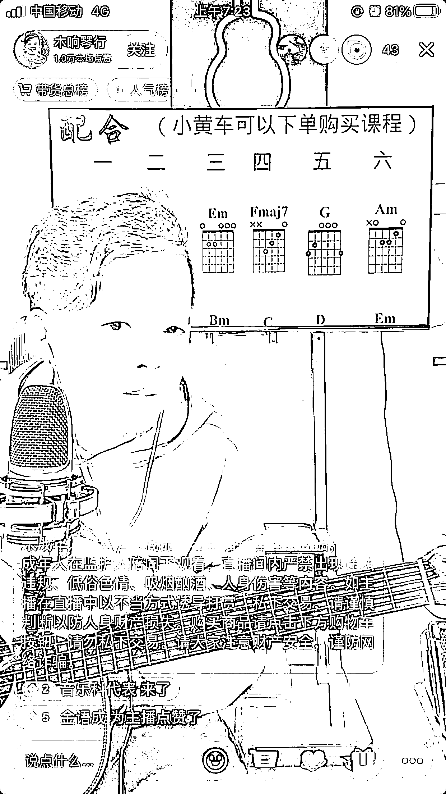

5）二胡教学

同样可以和带货结合。

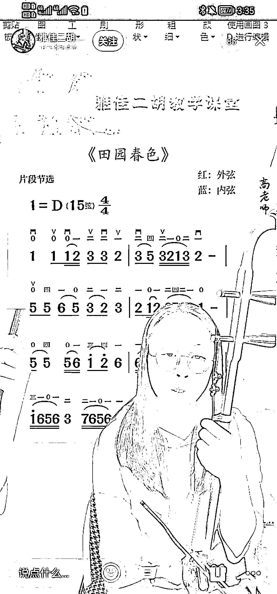

乐器类教学直播还有很多可挖的方向，有兴趣的社群朋友可以继续研究。这里只是先抛几个方向供参考。以上是我的实操心得，有讲得不准或不到的地方，欢迎补正，感谢。

互动区里，不少朋友给了鼓励：有人说内容里能看到不少自己的思考，有人点赞支持，也有人感慨音乐相关项目在社群里确实少见，连声道谢。谢谢大家的支持。