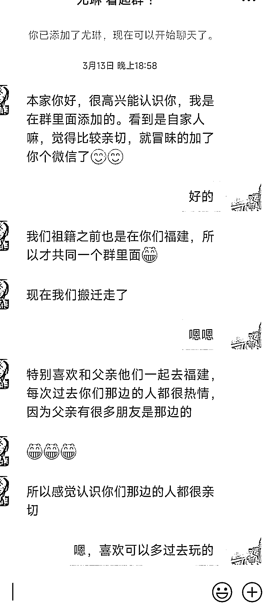
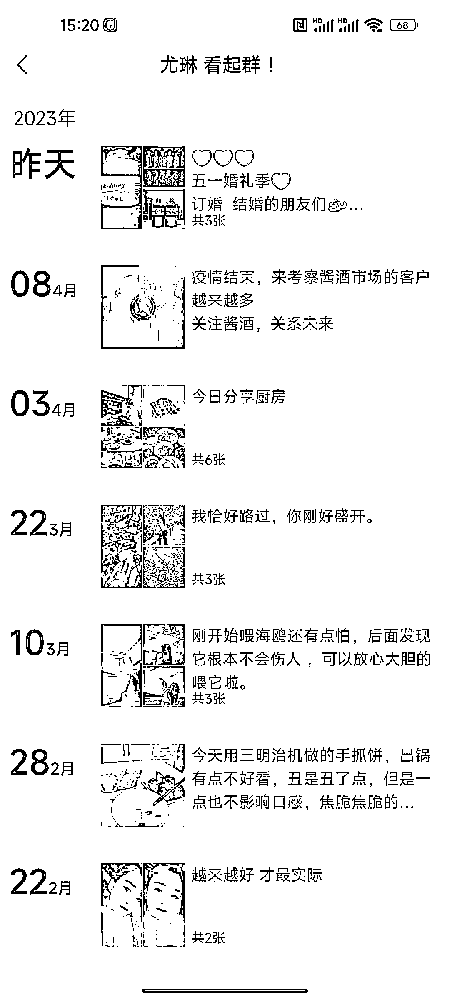
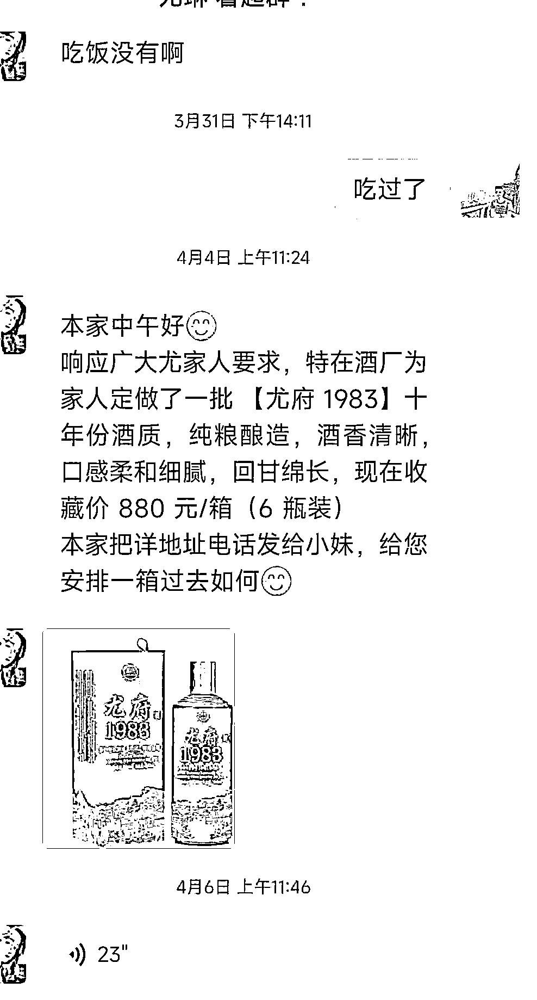
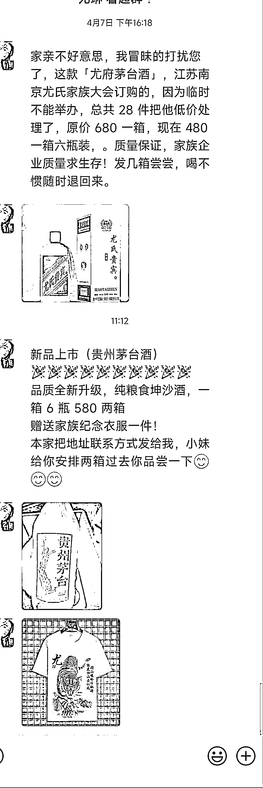

# 本家姓氏群里的白酒生意，居然还能这么做

前几天，一位自称“尤氏本家”的女士从家族群里加了我的微信。刚开始我以为她有什么正事，简单聊了几句，翻了翻她的朋友圈，发现全是日常晒生活加卖酒的内容，一眼就能看出是个专业卖酒的账号。

隔了两天，她突然问我还有没有其他本家微信群。到这儿我基本明白了，她根本不是来认亲的。果然，很快她就给我推荐了尤氏定制的贵州白酒。看我没啥购买意愿，她立马换了个思路，变相降价不说，还额外承诺，买酒就送一件姓氏定制的家族纪念T恤。

说实话，这种在家族群里兜圈子做销售的方式，我个人不太喜欢。但如果对面换成中老年群体，效果可能就完全不一样了，不少人会冲着那份“自己人”的亲切感下单。

把这个案例拆开来看，核心其实就是三步：

第一步，引流。她打着“同宗同源”的旗号，混进各种姓氏群，把群里的男性本家都加一遍微信，平时聊聊天慢慢建立信任，混熟之后，再请对方把自己拉进更多同姓的群。

第二步，卖货。她根据不同姓氏的特点调整包装，推出定制姓氏白酒，让你觉得“这酒就是专门为我做的”，一种被重视的感觉油然而生。我虽然平时不喝白酒，可看到自己姓氏印在酒瓶上，心里还是多了一丝好感。

第三步，转化。美女形象加上本家人设，再加上姓氏定制酒，三管齐下，那些爱喝酒的中老年客户很容易就被打动。遇到拿不定主意的，就继续降价或者增加赠品，进一步提升成交的可能。

再往远了想，这个模式完全可以复制到李、王、刘、张等各大姓氏，重新再跑一遍。

白酒行业的同行不妨试试，毕竟现在白酒客户的引流成本越来越高，一个顾客往往要花掉好几百元。另外，凡是目标客群相似的产品，比如中高客单价的古董、文玩、玉石，也能套用这套打法。

评论区：
- 华龙：其实就是散装酒装进定制瓶，别问我怎么知道的。
- Luke 王子：确实可行，我爸已经买了。
- Kilo：一单净赚四百不是梦。
- 登登：我爸也买了，还特别自豪。
- 怡宝：我爸也买了，也很得意。
- 发达：看来买的人真不少。
- 思蒙：😄
- 巫哥：看这评论区，这方法可能真挺有效。