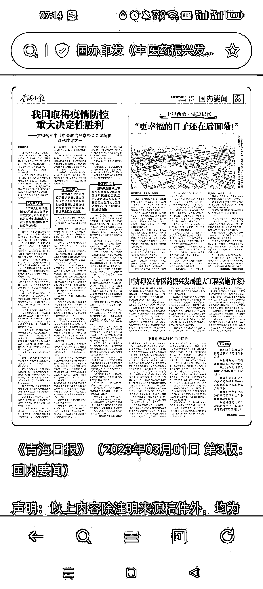
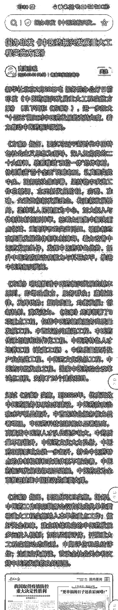

# 中医药，机会来了

清晨打开手机，一条消息跳进视线：国务院办公厅正式发布《中医药振兴发展重大工程实施方案》。政策层面的信号很清晰，中医药振兴被放进重大工程里推进。

这对内容创作者意味着什么？经营养生账号的、做短视频的、盯中老年增量市场的，尤其是长期做中医药文化传承与推广的朋友，都该把这件事放进自己的节奏表里。顺着政策节拍，卡准时间窗口，轻装前行，加快推进。愿大家内容做得扎实，收益也跟上来。

留言区也有值得记下的声音：行业有周期，去年四五月就出现过一波集中爆发；旺小哥很谦虚，说“中老年市场开创者”不敢当，自己也是向慧哥取经，做得更久更好的人不少，他只是恰好坚持得长一些；亦仁给这条风向标标了“中标，术值+1”，并提示到星球上方 #星球栏目 的 #中标 专栏可查看全部中标风向标；施霖回应，叫顺口的慧姐一直优秀，继续冲，3月25日慧哥的分享值得期待，同时感谢亦仁老板。