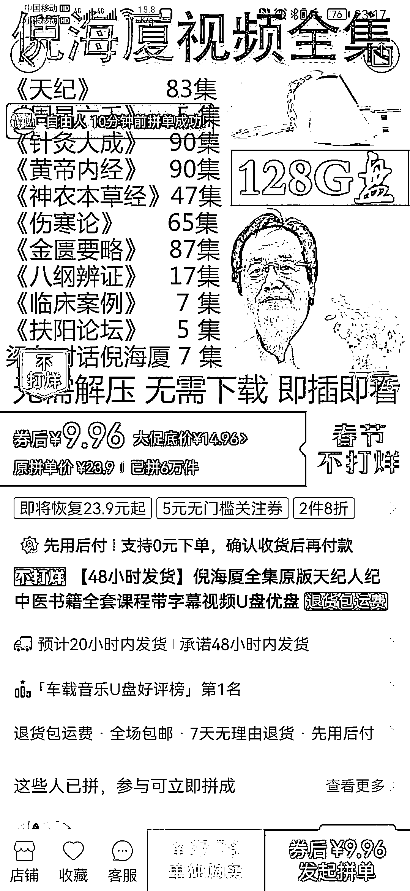

# 拼多多悄悄挤满了中老年买家

作者：小猫招财

日期：2023-01-27

你有没有发现，最近家里长辈的快递越来越多了？

不是子女买的，是他们自己下单的——在拼多多上。

很多人以为拼多多还是年轻人的天下，但真实情况恰恰相反。中老年用户，正在成为这个平台上一股不容忽视的消费力量。

他们为什么聚集在拼多多？答案并不复杂：便宜、简单、熟人都在用。没有复杂的满减规则，没有花里胡哨的营销套路，九块九包邮就能买到实用小物，砍一刀还能拉上老姐妹一起玩。对习惯精打细算的一代人来说，这种直接了当的购物体验，比任何广告都更有说服力。

更值得关注的是，这个群体的消费决策往往带有强烈的社交属性。一个拼单链接发到家庭群、广场舞群，成交就是成片的。他们不只为自己买，还会顺手给儿女、孙辈捎上一份。这种基于信任关系的分享式购买，转化率远超普通流量投放。

对于商家来说，这意味着什么？意味着一个被低估的增量市场就摆在眼前。谁先摸清中老年用户的真实需求，谁就能在拼多多这片红海里挖到属于自己的金矿。

评论区：

亦仁：中标，术值+1。

在上方 #星球栏目 专栏中，点击 #中标，可查看所有中标风向标。